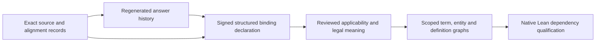

# Structured candidate source-binding declarations

`corpus_source_bindings` connects the candidate answer history to explicit source
version, occurrence and applicability declarations. It uses the existing source
and alignment corpus records, the complete history replay and the shared
`legal_graph_review` authority engine.

The positive result is a structured declaration authenticated under the caller's
selected profile. It does not establish which law governs, when a statute took
effect, whether an interpretation is correct, or whether a graph or Lean theorem
may be admitted. Real reviewer trust and decisions must be supplied separately.



## The declared choice

Each declaration binds one original request and subject, their independently
pinned full record hashes, the preparation root, the complete history root, the
selected current epoch and its exact current group. It retains all nine selected
answer-variant references. Those answers are declarations of findings and prose;
they do not themselves supply the structured source choice.

The choice has these closed fields:

```text
parent_ref
comparison_ref
document_observation_ref
source_version_ref
source_occurrence_ref
context_ref
declared_region_role
applicability
```

Every reference is the full triple `{record_cid, sha256, schema}`. `sha256` is the
full canonical record hash, including its seal. A literal text match or a CID
without the independently checked record hash is insufficient.

The parent must be the original request's exact parent observation. The
comparison must be one of that request's exact original comparisons and must
link that parent to the chosen document. The version must be the normalized or
rendered comparison version named by that document. The occurrence and context
must belong to that exact version and to one another. Required evidence
occurrences must resolve in the same selected document/version. The assessor
derives this catalog from the original base and alignment corpus inputs of the
selected epoch after the complete history is replayed.

These checks reuse the existing source version and occurrence owners. They
preserve the exact extraction and normalization profiles, Unicode codepoint
offsets and UTF-8 half-open byte offsets. Selecting a rendered view does not
establish equivalence to a normalized view or a raw HTML coordinate system.
Repeated text and shared physical source records retain their original parent,
comparison, document and request identities; they are not merged by text or CID.

`declared_region_role` is one of `operative_body`, `editorial_note`,
`source_credit` or `unknown`. These are explicit declarations. The parser's
region names and markup do not establish the legal role. `unknown` remains
visible and prevents a complete positive binding result.

## Applicability and the two clocks

The applicability declaration is closed:

```text
scope_id
jurisdiction_id
instrument_id
legal_as_of_civil_date
evidence_occurrence_refs
```

All IDs are explicit canonical identifiers; there is no default jurisdiction,
instrument or universal scope. The applicability `scope_id` is a separate signed
declaration. It is not inferred from the document or treated as the authority
scope. `source_review_scope_id` retains the original subject's exact scope, and
the shared authority engine checks the signers against that original subject.
Evidence is a nonempty bounded list of exact
occurrence references from the selected version. The legal date is a valid,
canonical `YYYY-MM-DD` civil date, or `None` for explicitly unknown. An unknown
date is retained and blocks the positive complete-binding result.

The civil legal date is distinct from `declared_at_utc`, signature issuance,
key/policy validity and the history's caller-selected evaluation time. A year in
an edition label does not fill in the legal date. Review chronology cannot
establish statute-effective time. No implicit system clock or date inference is
used.

This owner does not evaluate effective, sunset, repeal or supersession windows.
The existing `legal_ir_temporal_authority` law-version and temporal-window engine
and `constraint_query` applicability contracts are later consumers of explicitly
reviewed bindings. Their permissive input aliases, defaults or `proof_safe`
outputs cannot authenticate this source declaration or clear its admission gates.

## Public API

```python
record_source_binding_declaration(
    request, subject, current_history_group, choice,
    *, expected_request_sha256, expected_subject_sha256,
    expected_current_history_group_sha256,
    expected_preparation_manifest_sha256, expected_history_manifest_sha256,
    current_epoch_id, declared_at_utc, rationale, evidence_refs, limits=None,
)

validate_source_binding_declaration(record, *authoring_args, **authoring_kwargs)

assess_source_bindings(
    history_report, history_replay_inputs,
    binding_registry, binding_policy, binding_groups,
    *, expected_history_manifest_sha256,
    expected_binding_registry_sha256, expected_binding_policy_sha256,
    expected_binding_group_pins, limits=None,
)

validate_source_bindings(report, *assessment_args, **assessment_kwargs)
```

Authoring checks structure, explicit pins and declared content. It does not
authenticate an offered history, source record, key, reviewer or signature. A
previously sealed positive flag cannot authorize a new declaration. The content
validator regenerates the body from the exact authoring inputs rather than
repairing missing fields or silently selecting defaults.

`history_replay_inputs` is the closed set of named arguments for
`assess_source_history`: `genesis_report`, `genesis_inputs`, `revision_steps`,
`genesis_epoch_id`, `current_epoch_id`, `at_time_utc`,
`expected_genesis_manifest_sha256` and `expected_revision_step_pins`. Only the
optional history `limits` profile may be added. No callback, alternate catalog,
filesystem lookup, remote retrieval or cached eligibility override is accepted.

Binding groups and their independent pins use the existing complete signed
group layout with `binding_artifact_id` in place of `app_artifact_id`. Every
original request has one ordered group, including requests without a body or
without eligible upstream evidence. The caller retains the complete raw evidence
bytes, review claims and dependency observations.

## Authentication and prerequisites

The full supplied history is validated once per assessment or validation
operation. Each supplied epoch is regenerated by the unchanged history owner.
The selected leaf, preparation root, ordered request population and explicit
evaluation time must match. All nine current answer references must be eligible;
an older activation, a cached manifest flag or an unresolved visible fork cannot
substitute for that prerequisite.

A separate fixed binding action, audience and claim schema authorize the common
declaration body. Source-review, adjudication, genesis-application and revision
claims cannot authorize this domain. Both legal and formal roles must attest the
same exact body under independently pinned selected trust, role, scope,
dependency and time checks. All required evidence bytes must exist and match
their pinned hashes.

Original source-review principals, DIDs and known registered public keys are
excluded across the whole supplied history, including rejected claims and other
branches. Explicitly authorized adjudication or revision signers may be reused
under the new separately selected policy. Mechanical identity/key separation
does not prove human identity, competence or independence.

Binding declarations and signatures must follow the selected upstream intent,
and signatures must be current at the explicit selected evaluation. Unknown
classification or legal date cannot silently complete the binding. A complete
signed declaration authenticates what the selected signers declared; it cannot
prove source authenticity or legal truth.

## Reports and bounds

Reports contain eight components:

- `manifest`, `pages` and `records` for the complete binding population;
- `history_manifest`, `history_pages`, `history_records`,
  `history_epoch_manifests` and `history_epoch_pages` for the complete unchanged
  supplied history.

Each binding group retains its exact current upstream group. All five history
components retain their complete original values. Raw epochs, source findings,
variants, disagreements, forks, original contexts and seven deferred questions
remain present. A blocked request is an output row; there is no eligible-prefix
result or automatic choice of another source.

Limits are explicit positive lower-only integers. The record envelope remains
1 MiB and the complete collection cap remains 64 MiB. Whole-input native
detachment and byte/node/depth checks cover the history and new binding inputs
before indexed evidence-body hashing or replay. The logical input cap is
512 MiB, the node cap is eight million, and depth is capped at 64. Repeated
logical occurrences count even when callers share native references. One 64 MiB
mixed signed-evidence budget covers every supplied history epoch/stage and the
new binding population. These protocol bounds do not promise a peak resident
memory limit.

Producer identities are derived from the unchanged source/history producer map
and the new owner, rather than a guessed count. Report validation regenerates
the complete assessment and compares every component. Repairs to record seals,
page inventories, counts or cached eligibility cannot replace replay.

## Effect and remaining gates

`structured_source_binding_declared_under_selected_profile` is the narrow
positive flag. The output records an authenticated candidate declaration with
exact replayed source geometry and linkage. Original `selected_occurrence` and
`governing_source_binding` fields remain unchanged. Governing-source truth,
effective-time applicability, physical source adoption, source/preparation
migration and downstream cross-generation invalidation remain unqualified.

No graph is accepted and no training gold or Lean proposition is admitted by
this owner. Real trust, actual signed choices, reviewed statutory meanings,
scoped definition/entity/reference closure, conflict handling and native Lean
dependency qualification remain required for the unified corpus.
