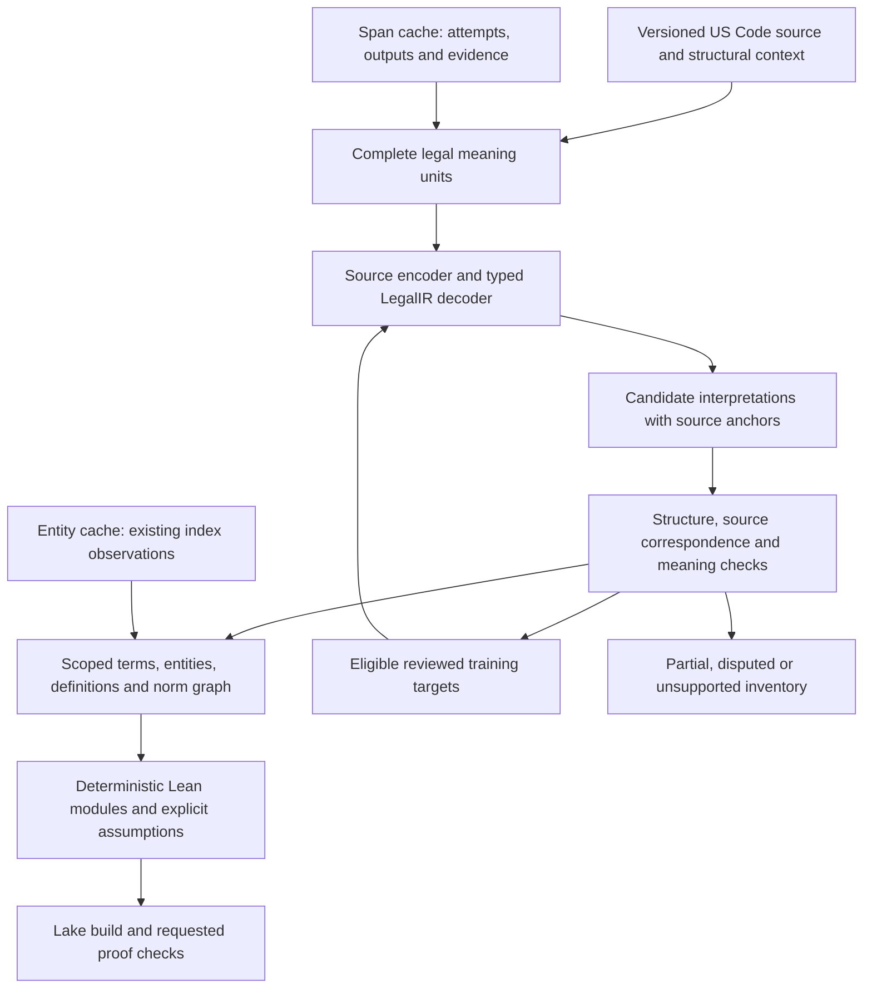
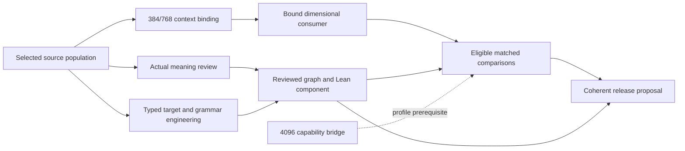

# LegalIR improvement plan: US Code sources, span interpretations, graphs and Lean4

Date: October 17, 2026. Status: implementation plan; no new training or proof results.

<!-- legal-ir-comprehensive-plan-20261018-01:start -->
The [October 18 consolidated LegalIR delivery plan](legal-ir-autoformalization-delivery-plan-2026-10-18.md) provides the current source-to-span-to-scoped-graph-to-Lean4 architecture and 12 ordered work packages. It incorporates the complete historical-parent scan, current cache and decoder results, the proposed reviewed-component acceptance boundary, controlled model experiments, and measured index/capsule costs. Earlier evidence and the original 24 task states/dependencies remain preserved.
<!-- legal-ir-comprehensive-plan-20261018-01:end -->

Capacity update: include the existing **384D, 768D and 4096D representation/conditioning paths**, with source-only and historical 8D controls. The width-specific implementation and experiment plan is recorded in [representation-plan.json](../../artifacts/legal-ir-width-aware-plan-20261017-01/representation-plan.json). Larger paths already have implementations and historical experiments; their individual consumer and semantic qualifications remain explicit below.

The [implementation work packets](../../artifacts/legal-ir-work-packets-20261017-01/work-packets.json) now map the next changes to actual owner APIs, existing task aliases, input/output contracts and regression tests. Section 11 supplies the execution order. They are planning records, with no native dispatch or task-state changes.

Current numerical status: the **345-case head/generation qualification** and **103-case source-generation integration** are completed engineering results. The installed compact trainer has **36 passing tests and four observed authored compact-target updates**, including exact weights/Adam/progress resume; its campaign total remains unknown because an interrupted earlier attempt was uncounted. Original native finalization failed and later storage recovery completed; independent historical CPU/memory lease release remains unestablished. Compatible trained inference is now installed and qualified by a separate **23-case run**; its source-selected trained caller also passed a **55-case cohort including those 23 regressions**. Native receipt/source binding now has a completed **175-case qualification**, and a separate **60-case receipt-bound trained-source consumer** preserves all four selected occurrences (three embedded and one over-limit), dispatches the three embedded rows, and generates only the one nominated embedded occurrence. Its successful native02 run uses 48 actual overlapping model/GRU calls across one preparation and its full public validation, including mandatory replay, with zero fresh encoders or optimizer operations; its original source/native/storage closeout succeeded. The failed native01 retained 48 more observed calls but qualified 0 cases; later claim recovery preserves that failure. These are mechanical custody results, not native-conditioning training compatibility or permitted-context authentication. The existing adapter and trained caller currently accept 1..12 new BOS IDs per nominated embedded row; this run requests 12. Actual completion remains the saved trace disposition. The retained legacy profile keeps its 1..12 limit; a separate opt-in prepared successor has now qualified 64 new BOS tokens in **61 cases**, with **four fresh model restores**, **256 actual GRU calls**, zero fresh encoders or optimizer operations, and **0/1 complete nominated output** (saved status `step_budget_exhausted`). This is an output-geometry and custody result. The new **two-control reconstruction diagnostic passed its engineering checks but completed 0/2 outputs and matched 0/2 authored targets**: both original training-exposed examples exhausted 64 new tokens without EOS. It performed 129 actual model/GRU calls and zero optimizer updates, and its own original source/native/storage closeout succeeded. Reuse these retained owners and results. Overlapping cohorts and exposed fictional examples do not establish statutory accuracy or latent benefit.

## 1. Outcome and immediate milestone

Improve the LegalIR autoencoder in `ipfs_datasets_py` so that complete, source-grounded legal interpretations can be learned, reconstructed, assembled into scoped graphs, and emitted as a reproducible Lean4 library. The target is semantic reconstruction: preserve who may, must or must not do what, under which conditions, exceptions, definitions and temporal scope. Normalized wording is sufficient; matching the original prose is a separate metric.

The next delivery is **one reviewed definition, one complete norm using it, and a second genuine statutory use**, represented by the same typed interpretation in the span cache, entity/definition graph and an actually built Lean project. This small component establishes integration, not general legal accuracy. Expand only after its source, interpretation, model-consumer and proof boundaries are explicit.



Source custody, learned prediction, reviewed interpretation, graph validity and checked theorems are different outputs. A successful round trip or `lake build` does not by itself establish fidelity to the law. One corpus can contain multiple versioned interpretation views; it must not merge conflicting interpretations or editions into an undifferentiated axiom set.

This is the concise delivery view of the existing [comprehensive roadmap](legal-ir-autoformalization-roadmap-2026-10-16.md), [execution companion](legal-ir-next-implementation-plan-2026-10-16.md), [training review](legal-ir-training-review-and-corpus-plan-2026-10-13.md), [connected statutory pilot](legal-ir-connected-statutory-pilot-spec-2026-10-15.md), and [24-task backlog](../../artifacts/autoencoder-comprehensive-review-20261013/implementation-backlog.json). It preserves their task identities, historical results and owners. The [supervisor operations guide](legal-ir-supervisor-operations-2026-10-16.md) remains the execution handoff; this document introduces no runtime authority.

## 2. Starting evidence and the three dataset roles

The October 17 14:49 UTC [primary metadata and pinned-card refresh](../../artifacts/legal-ir-comprehensive-plan-consolidation-20261017-01/freshness/hub-metadata-refresh.json) confirmed the same three heads and card bytes as the earlier intake. Preserve the [13:51 observations](../../artifacts/legal-ir-source-to-lean4-plan-20261017-01/metadata-observations.json) as their own generation. Repository/card metadata establishes release identities and declarations; selected tables still require their complete file and row checks.

| Dataset | Observed revision | Role in the pipeline |
| --- | --- | --- |
| [justicedao/ipfs_uscode](https://huggingface.co/datasets/justicedao/ipfs_uscode/tree/91ca1838853ac82d7a12dd4ab47d9686f47667f9) | `91ca1838853ac82d7a12dd4ab47d9686f47667f9` | Source records, structural graph, lexical and vector retrieval. Preserve official-source provenance and edition separately from Hub revision. |
| [justicedao/uscode-autoformal-span-cache](https://huggingface.co/datasets/justicedao/uscode-autoformal-span-cache/tree/60501f3e920f6c9050cfc452e0d9fcc2b7c184f3) | `60501f3e920f6c9050cfc452e0d9fcc2b7c184f3` | Physical span observations, producer outputs, disagreements, deferred work and original evidence. Derive eligible targets from these records after checks. |
| [justicedao/uscode-autoformal-entity-cache](https://huggingface.co/datasets/justicedao/uscode-autoformal-entity-cache/tree/79d54378c5d6a89ab56e7a27e0f0ba867e800e19) | `79d54378c5d6a89ab56e7a27e0f0ba867e800e19` | Existing materialized index. Add versioned semantic companions and exact links to interpreted source occurrences. |

The span card explicitly describes legacy guided-compiler output with no learned formula decoder and no semantic-gold qualification. Its storage split named `train` is not a quality gate. Preserve producer origin, including legacy mock/8D paths, deterministic compilers, genuine learned outputs and later profiles. Discover v1/v2 banks through their manifests rather than assuming the default dataset configuration includes everything. [Pinned span card](https://huggingface.co/datasets/justicedao/uscode-autoformal-span-cache/blob/60501f3e920f6c9050cfc452e0d9fcc2b7c184f3/README.md).

The [earlier bounded intake](../../artifacts/legal-ir-source-span-graph-plan-20261016-01/hub-intake/inspection_summary.json) found unmatched revision namespaces: producer source revision `006dd603185b283c54648dd4aef3c2cbe650981a`, historical span label `ipfs-uscode-5016b86a`, and Hub commit identities. A matching citation cannot bridge them. That inspection also retained metadata/count discrepancies and incomplete occurrence/context fields. Resolve selected records explicitly; preserve unresolved joins without rewriting their provenance.

| Current result | What it establishes | Remaining gap |
| --- | --- | --- |
| [Selected source/span/entity join](../../artifacts/legal-ir-source-span-entity-join-20261016-01/README.md) | Bounded source metadata and complete retained paired-bundle replay. | Entity input is metadata-only; exact current-release correspondence and semantic eligibility remain open. |
| [Conditional adapter](../../artifacts/legal-bound-variable-definition-20261017-02/README.md) and [applicability bridge](../../artifacts/legal-norm-definition-application-binding-20261017-02/README.md) | 103 and 65 focused engineering cases respectively; exact occurrence/link custody and conditional instance preparation. | No actual governing interpretation or statutory training labels follow from these fixture qualifications. |
| [Second-use fixture](../../artifacts/legal-norm-definition-second-use-20261017-01/README.md) | One additional test of a distinct fictional occurrence and wrong-link refusal. | Obtain a second genuine statutory occurrence; do not count the fixture as one. |
| [Current candidate graph](../../artifacts/legal-ir-current-definition-graph-20261017-02/README.md) | A qualified with 16 nodes/33 custody edges; B admission-blocked at the inspected snapshot. | Accepted meaning, governing definition use and semantic merging remain absent. |
| [Native conditional preparation and compilation](../../artifacts/legal-ir-bound-variable-native-20261017-01/qualification-summary.json) | Full actual A preparation/validation and an offline native Lean 4.34.1 Lake build passed final independent readback. The unchanged 2,782-byte source produced a 117,000-byte compiled artifact; two conditional theorems have empty global-axiom observations and three intended failing controls. Successful prepare/compile operations retained 166/115 durable files and released their own resources. | Definition and membership premises remain unverified; the original norm supplies occurrence custody and is not a theorem premise. The full reviewed norm/second-use component remains open. Preserve the failed bootstrap and its 128 MiB claim separately. |

Retain the [historical 13:53 progress observation](../../artifacts/legal-ir-source-to-lean4-plan-20261017-01/native-progress-observation.json) as its own dated record. The [conditional-instance qualification summary](../../artifacts/legal-ir-bound-variable-native-20261017-01/qualification-summary.json) and current README record the actual offline build with Lean 4.34.1, two explicit-premise theorems with empty global-axiom observations, and three intended compiler refusals. Reuse that completed result. The original norm was not a compiled theorem premise or rewritten; definition truth, membership, governing interpretation and legal-as-of remain unverified. This is one conditional instance, not completion of the full norm/definition/second-use component. The earlier failed attempts remain retained.

The [current pilot readiness packet](../../artifacts/legal-ir-current-pilot-readiness-20261017-01/README.md) connects these results to the next decoder and join work. Canonical typed AST transport is implemented; the remaining handoff is a compatible learned-content, runtime/checkpoint and eligibility profile. The pilot's physical span-cache/entity-row membership remains unverified.

Training evidence also constrains the plan. On eight initially withheld sources, augmentation changed exact generation from `1/8→0/8`, `1/8→2/8`, and `3/8→0/8` across three seeds, despite lower teacher-forced loss. Existing source/latent comparisons have tied on authored challenges. The currently bound source-span trainer constructs `latent_dimension=0`; its successful binding/resume checks are not evidence of latent benefit. Retain those controls and failures. [Reconstruction evidence](../../external/ipfs_datasets/docs/autoencoders/reconstruction_training.md), [bound trainer](../../external/ipfs_datasets/ipfs_datasets_py/optimizers/logic_theorem_optimizer/legal_span_bound_training.py), [full historical review](legal-ir-training-review-and-corpus-plan-2026-10-13.md).

### 2.1 Completed training and implementation that determine the next step

The [consolidated training audit](../../artifacts/legal-ir-comprehensive-plan-consolidation-20261017-01/training/README.md) preserves exact lineages and outcomes alongside the earlier full review.

| Completed evidence | Consequence for the plan |
| --- | --- |
| F18 generated 154/168 complete TRAIN outputs on raw and joint routes, repaired neither targeted conditions error, and scored 0/36 on each fresh development/test population. Latent conditioning was disabled. | Preserve its scientific failure and no-promotion decision. Another run needs a changed hypothesis and retention controls. |
| F19 inspected six saved conditions-score observations; complete spans were already top-eight at ranks two or three. No checkpoint was trained. | Test responsible selection/scoring with frozen-head margin versus the same freezing without margin and the retained parent. Candidate inclusion was not the observed failure in these cases. |
| Retained-weight storage work produced 60 first-pass and 60 reload generations, 3,240 forward calls and zero optimizer steps. Bound-training smoke performed two fictional updates. | Reuse storage/runtime/resume qualification; keep those two updates separate from scientific statutory training. |
| Trained contextual 384D/768D paths, dimensional span training and genuine historical 4096D head fits exist. The newer 4096D span consumer has a separate trusted-integration gate. | Continue compatible parents; preserve positive fits and negative generalization results. Section 5.1.1 records distinct dimensions, residual bypasses, hidden sizes and consumer gaps. |
| Typed AST serialization/lowering, selected source joins, target census, exact-use/conditional owners and graph exchange are implemented. | Extend missing compatible handoffs and the reviewed component. Repeat infrastructure qualification is not model improvement. |

A dated [14:50 bounded training refresh](../../artifacts/legal-ir-comprehensive-plan-consolidation-20261017-01/freshness/background-freshness.json) found no newer summary among 68 filenames in six known roots since the preceding 13:46 observation; no new summary bodies were read. It supplements the substantive historical review and does not claim a universal/private-run census.

## 3. Source intake and legally coherent spans

Start with a manifest-selected connected population. Reuse `legal_source_package_intake_v1`, `legal_source_span_entity_join_v1`, `legal_entity_index_intake`, `legal_statutory_context` and the existing paired-census loaders in `logic/autoformal`.

1. Pin repository commits, selected files, file hashes, row positions, producer identities, official source references, editions and available effective dates. Record unavailable legal-as-of dates as unavailable.
2. Verify each physical observation and its exact source occurrence. Preserve original text, normalized text, offset maps and enclosing structural path. Classify joins as exact, ambiguous, missing, incompatible or integrity-failed; account for every selected row.
3. Recover the full legal meaning unit: introductory language, enumerated children, shared subject/modality, provisos, exceptions and definition/cross-reference context. Distinguish operative text from editorial notes, amendment history, headings and repealed provisions.
4. Use statute structure as the primary boundary. Reuse semantic chunking to propose subdivisions within that structure; embedding similarity must not sever an exception, quantifier scope or shared introduction. Keep parent and ordered-child IDs so the full unit can be reconstructed.
5. Treat model windows as transport pieces of that unit. Token limits belong to the actual tokenizer/profile; 384 embedding dimensions do not imply a 384- or 512-token window. Preserve context links and composition rather than truncating a long provision. Deduplicate overlap by source identity, not by discarding repeated legal language.

Compare structural, existing semantic and hybrid chunking on the same selected complete units. Score recoverable context, omitted/duplicated rules, qualifier attachment and complete-IR fidelity, with Lean success reported separately. Choose a method for legal meaning preservation; syntax success alone can reward an incomplete formula.

The retained pilot is Govinfo 2024 source evidence. Its exact span-cache and entity-file row identities still need an evidenced join. No pilot paragraph exactly matched the earlier selected 16-row/18-output historical census; that bounded result establishes neither whole-cache absence nor membership. Keep Hub source revision, producer revision/release point, legacy source label and Govinfo edition/view coordinates distinct until a crosswalk passes. Preserve every matching occurrence candidate and missing or ambiguous outcome. The current entity join is metadata-only; extend it through complete selected entity-file custody and scoped companions.

Deliver `source-span-entity-join-manifest.json`, a complete unit inventory and exact context dependencies. Existing selected-bank qualifications remain valid within their recorded populations; new files require their own intake.

## 4. Typed LegalIR and graph representation

Extend the existing typed representation and lossless companions, guided by a representability census. Every selected unit must have a disposition before training: supported, context-missing, ambiguous/disputed, vocabulary/length-limited, unsupported construction, binding-invalid or projection-unsupported.

| Record | Required meaning and provenance |
| --- | --- |
| Source occurrence | Immutable source/edition, document path, original and normalized offsets, text digest, parent context and producer. |
| Term mention and sense | Surface form, exact occurrence, scoped sense candidates and selected interpretation if justified. Same spelling is not entity identity. |
| Entity/type | Stable scoped symbol, declared carrier/type and evidence; separate a type or variable declaration from an existence fact. |
| Definition | Defined expression and parameters, ordered roles, body AST, scope, temporal applicability, and distinct equivalence/inclusion/exclusion/deeming operators. |
| Norm | Actor and action, ordered objects/recipients, O/P/F modality, polarity, quantifiers, conjunction/disjunction, conditions, exceptions, quantities and temporal context. |
| Definition use | Exact AST occurrence/argument, candidate definitions, scope/time match, selected governing definition, assessment and justified application. |
| Interpretation and evidence | Original alternatives, uncertainty, source/meaning decisions, field-level eligibility, model/decoder origin and check results. |

Use graph nodes for these typed objects and typed relations for their connections. Keep custody relations such as `DERIVED_FROM` distinct from semantic relations such as a justified `DEFINES`, `APPLIES_WITHIN` or `USES_DEFINITION`. Relations must carry exact endpoint/argument IDs and source evidence. Graph serialization must reconstruct the complete AST, including order, binders, modality and qualifiers; a bag of triples alone is insufficient.

Reuse `legal_semantic_graph`, `corpus_graph`, `corpus_graph_exchange` and `scoped_definition_resolution`. Similarity nominates candidate links. Admit a governing link only after an explicitly justified governing-selection/application operation validates the exact occurrence, scope, edition, applicability and semantic evidence. The current authenticated applicability-to-instance bridge supplies custody, not that admission. Preserve ambiguity and competing interpretations. Current resolver support for local scope chains and explicit external document references must be extended compatibly for any required instrument/title/effective-time precedence.

Track dependency closure, including empty or unavailable definition lookup partitions: a newly available competing definition can invalidate an old selection. Detect cycles and keep unresolved imports explicit. Current graph v1 rejects dangling external imports and bounds complete snapshots at 4,096 nodes/8,192 edges. Scale through complete component manifests and a qualified cross-component reference contract; do not bypass those limits or invent implicit endpoints.

## 5. Improve training without conflating the model components

All training, inference, representations and projections stay in `ipfs_datasets_py`; `ipfs_accelerate_py` consumes versioned interfaces and receipts. Reuse the shared autoencoder framework and preserve existing LegalIR weights at every width. Include 384D, 768D and 4096D as explicit candidate paths, retaining source-only and historical 8D controls. New candidates have distinct parent/child identities and do not replace current accepted artifacts on save.

### 5.1 Establish the exact baseline and decoder capability

Record core, source encoder, latent producer, formula head, tokenizer, schema, projection and trainable tensor identities. Distinguish raw-text input, parser-assisted input, source-plus-latent and latent-only inference. A parser-generated training label or runtime scaffold is not a learned prediction.

Existing profiles have different contracts:

| Profile | Current relevant limits | Planned extension |
| --- | --- | --- |
| `source_span_formula_v1` | Pointer/copy spans, one rule, up to 256 structural source tokens, optional 384D latent. | Typed constructors for complete supported norm/definition structures; qualify latent-enabled bound consumption separately from today's zero-latent wrapper. |
| `source_conditioned_formula_v1` | Separate fixed-vocabulary lineage with 64-token source/target limits. | Retain as an explicit baseline; do not silently widen its vocabulary or change checkpoint meaning. |
| `source_conditioned_grouped_v2` | Ordered 2–8 members, caller-supplied modal scope, no numeric latent. | Learn and validate supported grouping/scope decisions where reviewed targets exist; disclose any retained caller assistance. |
| Current384 core plus formula sidecar | The current latent-formula training route freezes the sparse core while training the residual projection and token decoder. | Separate sidecar adaptation from core fine-tuning and independently test whether latent conditioning helps. |
| Retained contextual Legal384/768 | Trained contextual formula heads and actual cached inference exist for both widths, consuming paragraph and ordered-clause vectors. These are input embedding dimensions; the retained residual branch is `D→8→D`, condition/GRU hidden width 32, token embedding width 16 and vocabulary 32. | Continue from exact compatible selected states and bind arbitrary new source caches separately. Broaden grammar and qualify targets without relabeling old checkpoints. |
| `native_dimensional_source_span_v1` | Separate source-copy span owner supports context dimensions `0/8/384/768`, width-specific adapters, training and inference. | Bind nonzero-width training/evaluation to complete reviewed populations and verified producers; the current zero-latent bound wrapper does not automatically cover these paths. |
| Historical native4096 formula sidecar | Genuine Leanstral4096 source production and learned decoder-head fits executed. The sidecar has identity source projection and separate maps into decoder hidden/token states. | Preserve the trained head lineage and negative results; obtain a compatible reviewed-target/inference binding before statutory use. Original pilot weight snapshots omit optimizer state. |
| `native_4096_source_span_v1` | Separate actual 4096-wide conditioning adapter and checkpoint/Adam schema exist. Current positive-step training refuses with `trusted_native_owner_integration_required`; CPU/device inference permits untrained synthetic architecture controls only. | Connect the trusted native producer to this specific consumer and qualify its complete split, training, reload and inference contracts. Historical formula-sidecar fitting does not complete this newer integration. |

Prioritize a constrained typed decoder with explicit constructor choices, binder/scope references, ordered arguments, source copy pointers, quantities, definition references, group/rule counts and refusal. Add constructors demanded by the census, with parser/decompiler and lossless serialization checks. Reuse the existing architecture until a measured capacity limit justifies replacing it.

### 5.1.1 Preserve width, lineage and actual information flow

The [contextual runtime](../../external/ipfs_datasets/ipfs_datasets_py/logic/formalization/autoencoder/contextual_legal_ir_runtime.py), [retained-cache adapter](../../external/ipfs_datasets/docs/autoencoders/normative_cached_legal_ir_runtime.md), [dimensional span owner](../../external/ipfs_datasets/ipfs_datasets_py/optimizers/logic_theorem_optimizer/legal_span_dimensions.py), [native 4096 span owner](../../external/ipfs_datasets/ipfs_datasets_py/optimizers/logic_theorem_optimizer/legal_span_4096.py) and [four-width experiment record](../../external/ipfs_datasets/docs/autoencoders/four_width_training.md) establish distinct paths. Width alone is not a runtime or checkpoint selector.

For every parent, candidate, cache and prediction, record producer output dimension; the actual consumed conditioning/latent dimension and its role; residual/adapter bottleneck and bypass; decoder hidden width; token embedding width; vocabulary and output limit; tokenizer/source-token limit; and access to raw text, paragraph vectors, clause vectors or retrieved context. A 768D input with a residual identity path does not demonstrate a learned 768D compression bottleneck. The native 4096 span adapter takes 4096 coordinates but has a separate configurable intermediate projection, default 16.

The selected contextual 768D state has retained SHA256 `8892a3261c0750a6247ba5400069ed18cad3354426e2095ed1d295287e3559b4`. The [checkpoint recovery report](../../external/ipfs_accelerate/docs/agent_supervisor/contextual_ir_checkpoint_recovery.md) records its publication at `Publicus/legal-ir-autoencoder-768d@2fc77ccd037e7276c8bdd56a2c79cada0334fd79`, registration, original byte checks and supervisor nomination. This planning refresh read that report; it did not download or rehash the weights. Registered metadata, exercised cached inference and qualification for new statutory inputs remain separate.

Preserve the historical outcomes: contextual 384/768 replayed 48/48 ordered authored IR with empty qualifiers, while original prose reconstruction was 0/48. Genuine 4096 head experiments fitted 2/2 narrow TRAIN clauses after 200 updates; both later broader arms remained 0/12 exact on exposed development. These results establish exercised paths and their limitations, not width superiority. The source-span comparison that tied source-only/trained384/native768 at 571/576 remains adverse evidence for a claim of demonstrated latent benefit.

For continuation, select the exact compatible parent in each lineage. Transfer only shape-, codec- and meaning-compatible tensors with a transfer manifest; bind any newly fitted source adapter and normalization separately. Keep optimizer-resume versus fresh-optimizer warm-start explicit. Padding, truncating or renaming vectors cannot substitute for a native producer or a qualified learned projection. Keep the retained 768 experiments' 512-token ceiling distinct from the producer's declared 8192-token capability; context expansion is a separate intervention.

At the earlier readiness snapshot, the source-span bound trainer bound the original zero-latent schema, the arbitrary native span adapter was raw384-specific, the contextual adapter supported separate 384/768 contracts, and the native 4096 span owner refused production inputs. Subsequent bound-dimension and native 4096 engineering qualifications below supersede those availability observations within their recorded source/grammar scopes. Preserve these versioned owners and their checks. Recheck each generic dispatch/inventory profile before scheduling 4096: a qualified bound consumer does not establish compatibility for every older dispatcher or the compact 537-token head. Historical 4096 native-owner execution remains valid in its own scope.

### 5.1.2 Compact typed content and compatible learned outputs

Reuse `syntax_core.ast.TypedExpression.to_dict/from_dict`, `legal_relational_norm_v1`, existing native serialization/lowering and definition-body owners. Both retained §7213 hypotheses already have exact transport as one closed 15-node expression with three binders, three binary predicates and one permission node. Their permission/implication placement must remain distinct. The 19 review obligations are not 19 decoder rules.

The [compact relational content profile](../../external/ipfs_datasets/docs/autoencoders/legal_compact_content_v1.md) is now installed and qualified: 109 focused cases and 71 existing relational regressions passed through the owned source/resource runner. Both exact saved 15-node §7213 requests reconstruct with their original identities through a separate archival sidecar. Decoding new predictions takes only content and an independently supplied signature/ordered-role context, and preserves changed valid predictions. Each compact content object is 275 bytes / 99 JSON lexical tokens, compared with 6,938 bytes / 1,435 tokens for its verbose typed expression. The separate context is 2,003 bytes / 413 lexical tokens and the identity sidecar is 765 bytes / 79 tokens. These measurements do not establish model tokenizer or checkpoint compatibility, whole-transport compression, or accuracy.

Exact current definition intake remains unsupported: the definition owner emits native FOL with 65-character predicates, beyond the relational owner’s unchanged 64-character bound. Opaque-body and disjunction tests therefore use explicitly authored short names. Four unsuccessful qualification attempts remain recorded; passing counts refer to the final complete run, whose source/native/storage leases released. All source, meaning, governing-use, training and gold gates remain unchanged. Next, qualify a compatible learned target/decoder profile and its independently permitted context through the existing eligibility and consumer owners. [Qualification, failed attempts and limits](../../artifacts/legal-ir-compact-content-profile-20261017-01/README.md).

The [fixed compact-content token and prefix profile](../../external/ipfs_datasets/docs/autoencoders/legal_compact_content_tokens_v1.md) is now installed and qualified: 92 focused token cases, 109 compact-content regressions and 71 relational regressions passed together (272 cases) through the owned source/resource runner. The fixed vocabulary has 537 entries; its separate output profile admits at most 512 IDs including BOS/EOS. Each retained 275-byte §7213 content alternative encodes to 99 lexical IDs / 101 framed IDs, with distinct modal scope preserved. The target-free prefix interface restricts constructors, arity, predicate indices and lexical binders against separately committed context. Tests exercise every prefix of both retained sequences, changed valid predictions, malformed framing, bounds and local dead ends; local admissibility does not prove future completability. Incomplete and rejected bounded generated sequences remain observations without EOS or PAD repair. The engineering context is derived from the retained target signature/roles and is not evidence of independently permitted held-out inference. These are encoded-target replays, not numerical predictions, new legal samples or accuracy. The older full-request compact byte codec, flat-rule trainer, numerical output head and checkpoints remain distinct contracts. No numerical model, provider tokenizer, encoder, optimizer, training, solver or Lean execution is qualified by this operation, and all eligibility masks remain zero. The complete run closed its source/native/storage leases. Next, bind a separately versioned learned target/head profile and raw generated observations through the existing source-separated example, complete-population batch and consumer owners; preserve source/review/exposure gates and actual definition/counting limits. [Token qualification and limits](../../artifacts/legal-ir-compact-decoder-intake-20261017-01/README.md).

The [compact-content score selector](../../external/ipfs_datasets/docs/autoencoders/legal_compact_content_selection_v1.md) is now installed and qualified: 64 focused selector cases plus all 272 token/content/relational regressions passed together (336 cases) through the owned source/resource runner. It accepts the complete 537-entry finite score vector, calls the existing public prefix owner, and chooses the highest allowed score with lowest-ID ties. Reports retain all scores and their commitment, the raw argmax, complete prefix report, selected ID, override and offered/resulting prefixes. Completed, rejected, budget-exhausted or locally blocked prefixes produce no selection and preserve the offer. The two exposed 101-ID §7213 alternatives exercised 202 deliberately programmed PAD-to-allowed overrides; those are mask controls, not numerical model predictions or new legal samples. The actual numerical head must still bind the ordered codec, context policy, output budget and compatible checkpoint; accepting 537 numbers establishes none of that provenance. Reuse the already qualified source-separated semantic companion and existing complete-population batch/reconstruction owners. Current source_training_v2 still invokes the older flat-rule Legal validator; its generic GRU and token-row transfer are reusable mechanisms, not a qualified 537-token runtime. No numerical model, encoder, optimizer, solver or Lean compiler ran; all eligibility masks remain zero. The successful operation closed its source/native/storage leases. [Score selection, trace controls and limits](../../artifacts/legal-ir-compact-logits-selection-20261017-01/README.md).

At the saved observation of 2026-10-17 19:29:06 UTC, the [weights-only compact numerical head](../../external/ipfs_datasets/docs/autoencoders/legal_compact_content_head_v1.md) has three installed, statically reviewed files; runtime qualification remains blocked. The successor watch manifest binds 175 saved inputs with 177 native watchers under the unchanged one CPU slot/4096 MiB/two child slots/600-second profile and a smaller 32 MiB storage request. The 423 planned cases comprise 87 head cases plus 336 overlapping selector/token/content/relational regressions; zero test calls and zero passed cases are credited to this numerical-head phase. Run 01 reached admitted CPU Torch bootstrap, then collection refused a missing compiler source pin before any test, head numerical forward, old-grammar donor-fixture update or diagnostic. Its complete failed generation is archived and its 512 MiB storage claim remains retained. The separately reviewed successor expands the conservative source closure and refuses the optional provider/configuration branch before loading; run 02 then refused shared storage admission before creating a claim or child. The separate read-only capacity census reports insufficient room for that 512 MiB request; the dated 32 MiB sizing forecast justified a smaller ordinary reservation, not standing admission authority. Run 03 created that 32 MiB storage reservation, then native resource-lease admission timed out before a child, Torch bootstrap or test could start; its 32 MiB claim remains retained. The current blocker is native resource-lease admission after successful storage accounting; the earlier 512 MiB storage refusal remains separately recorded. All three source leases closed; this is no assertion that all phase or global storage claims were released. No numerical-head checkpoint, forward/reload, parent transfer, old donor update, optimizer resume or trained 537 target is qualified by these attempts. The 384-input/537-vocabulary/512-total-ID implementation remains an engineering candidate pending a future ordinary admitted qualification when resources permit, with no policy change or manual release of claims. The separately completed native 4096 source-span tiny CPU updates and Adam resume use their own old grammar and simulated native issuance; they do not qualify native embedding inference or this 537-token head. The reconciled 301-case semantic-token batch generation and earlier 594-case predecessor retain their own source-bound credit. No new compact optimizer step, model-quality result, statutory target eligibility, source interpretation, semantic graph or Lean admission is promoted. [Saved readiness, all three failures and next gate](../../artifacts/legal-ir-compact-numerical-head-20261017-01/README.md).

Later availability update: the successful joint head/generation run observed at 19:51 UTC supersedes the numerical-head blocker above for its exact engineering scope. It does not rewrite that sealed failed phase or turn its planned 423 cases into passes. See Section 17 and the [separate reconciliation](../../artifacts/legal-ir-compact-head-reconciliation-20261017-01/README.md).

Specify a versioned model-facing content projection and exact reconstruction contract. Predict operators, predicate/role identity and binder references; copy source CIDs, hashes and review evidence outside the learner from independently pinned companions. Preserve original ASTs, signatures, argument order, modal ancestry and both definition bodies. Identifier or variable normalization requires declared correspondence. Keep held-out answer bodies and answer-bearing metadata outside inference inputs.

Generic typed-JSON utilities already exist, but the legal target validator still enters the narrower rule codec. The readiness audit counted 1,435 JSON lexical tokens per verbose expression against the inherited generic target maximum of 1,024, excluding BOS/EOS. This is a static diagnostic, not product-tokenizer execution or a model-admissibility result. Audit a compact lossless projection before setting output budgets. Encoder context, producer/conditioning width, decoder vocabulary, output limit and checkpoint/head compatibility remain separate contracts.

Qualify both norms and both definition alternatives through existing AST owners, with bounds, unsupported-input accounting, binder capture, wrong argument role, invalid predicate signature and changed modal-scope controls. Preserve statutory origin and same-source alternative groups. The source-span consumer's distinct-text and engineering/weak-origin rules do not automatically admit these proposals as reviewed targets. Compatible consumers require actual population, eligibility, exposure and split decisions. Engineering fixtures can qualify transport while source/meaning review proceeds.

The source-only §7214 passage has a count restriction. This §7213 subset does not supply its cardinality semantics; retain that gap or choose a different genuine reviewed second use within the supported profile. Never discard a restriction to fit an older decoder. [Detailed decoder and join acceptance criteria](../../artifacts/legal-ir-current-pilot-readiness-20261017-01/README.md).

### 5.2 Build eligible targets and splits

Maintain separate lanes for authored engineering fixtures, disclosed compiler/weak labels, and reviewed statutory interpretations. Weak supervision can support pretraining and diagnostics, but it cannot supply independent gold evaluation. Retain all failed and unsupported cases in the enrolled population.

Split **before** vocabulary fitting, normalization fitting, retrieval construction, negative mining and checkpoint selection. Group near duplicates, edition/amendment variants, authored template derivatives and directly shared definition/use targets. Use the existing source partition, corpus index and `legal_ir_eval_splits` owners; bind the actual complete consumed batch at every training, restore, tuning and evaluation interface. Avoid making all citations one giant split group: record a permitted external-context policy and distinguish shared background from held-out answer content.

Previously inspected holdouts are now exposed development/regression panels. Seal fresh provision groups for final evaluation. Report separately source-held-out reconstruction, definition/context-assisted generalization and genuinely unseen construction coverage. Do not let target ASTs, expected repairs or holdout results enter inference retrieval.

### 5.3 Train for complete semantics

Use a staged curriculum: entities/roles and simple definitions; complete single norms; scoped conditions/exceptions; grouped provisions and definition applications; supported temporal constructions. Mix retention examples from prior stages and preserve the full population ledger.

Reuse existing losses and guards, extending them only for new typed outputs. Candidate objective:

`L = λAST L_AST + λcopy L_copy + λbinding L_binding + λreference L_reference + λsupport L_support + λcontrast L_contrast + λreconstruction L_reconstruction`.

Select weights on the declared tuning split. Mask each component by its actual review/label eligibility. Missing or disputed relationships are unknown, not automatic negatives. Unsupported examples train calibrated refusal without a fabricated complete target. Do not optimize only teacher-forced cross-entropy, embedding MSE or compiler pass rate.

Use verified contrastive controls for swapped actor/recipient, O/P/F changes, omitted exception, reversed approval condition, wrong definition scope and wrong edition. Generate targets and corruption labels through deterministic typed transformations plus review where their interpretation is uncertain. Score free-running complete IR and normalized decompilation; keep prose similarity secondary.

### 5.4 Experiments that identify what helps

Freeze source population, permitted context, acceptance rules, exposure and accounting before each comparison. Stage the experiments rather than immediately running a large factorial campaign.

| Comparison | Question | Necessary control |
| --- | --- | --- |
| F19-informed conditions selection | Does the responsible head select complete conditions better? | Frozen-head margin versus the same freezing without margin and the retained parent; identical candidate/grammar/data budgets, raw and joint outputs, permission/refusal/retention floors. |
| Current versus richer typed grammar | Can the target be represented and decoded? | Report full enrolled coverage and the common representable subset separately. More grammar and more training are different interventions. |
| Existing parent versus adapted decoder | Do new targets/losses improve complete held-out IR? | Matched grammar, source/context, update budget and selection protocol; retain previous-case failures. |
| Source-only versus verified 384, 768 and 4096 conditioning | Which eligible representation/profile improves the same complete-IR task? | Same reviewed units, grammar, allowed context, selection rules and compatible decoder controls. Native producers differ, so this is a representation/profile comparison, not an isolated width effect. |
| Genuine versus zero/shuffled/donor conditioning within each compatible profile | Does that path use the representation beneficially? | Preserve source/context access and decoder capacity. A source-withheld latent-only arm is a separate compression test; record paragraph/clause-vector side information. |
| Width or adapter-capacity ablation within one qualified producer | Does dimensional capacity itself help? | Require a validated width-changing projection or explicitly supported native output contract. Fit transforms on TRAIN only; do not assume arbitrary coordinate truncation preserves another model's geometry. |
| Frozen core + trained sidecar versus limited core adaptation | Is changing the autoencoder core beneficial? | Same downstream decoder, explicit trainable tensors, actual update evidence, parent-retention panel and rollback. |
| Source-only versus deterministic scoped context versus learned graph retrieval | Does the graph improve definition/scope fidelity? | Same allowed evidence; no gold targets in the retrieved context. Charge lookup and preparation costs. |

Preserve F18's failed scientific outcome and F19's saved-score-only scope. Another run needs a changed, testable hypothesis rather than an unchanged recipe. Use multiple seeds for promising matched arms; the same eight sources under three seeds are eight source cases, not 24 independent legal examples. Report readiness for every enrolled width/profile. An unsupported 4096 consumer is an infrastructure/eligibility outcome, not a fabricated wrong semantic prediction or a silent 384 fallback. Keep availability coverage alongside fidelity on actually invoked eligible inputs.

If an existing head cannot express the reviewed target, retain that grammar gap and qualify a distinct richer candidate for its lineage. Do not simplify the legal target to fit a wider model's older codec. Eligible profiles can progress while another profile's integration is pending, with the full enrolled comparison and each unavailable arm still reported.

## 6. Logic projections and Lean semantics

Select logic families by the meaning that must be preserved. Maintain a per-constructor, per-profile capability matrix with actual caller and validation evidence. Unsupported projections remain explicit.

| Family | Legal use | Current boundary and planned work |
| --- | --- | --- |
| Typed FOL | Entities, relations, quantification and suitable definitions. | Independent native fragment support exists; a canonical legal O/P/F rule cannot be stripped to FOL. Add explicit typed translation and binder-preservation checks where needed. |
| Deontic FOL | Obligations, permissions and prohibitions under conditions. | Canonical legal routing currently preserves its deontic profile. Keep parameterized semantics and the distinction between permission and obligation. |
| Temporal FOL / TDFOL | Time-dependent norms, persistence and sequence where source-supported. | Native fragments exist; calendar/effective-date lowering needs an explicit clock interpretation. Source validity time and modeled event time are different. |
| DCEC / event and cognitive logic | Knowledge, belief, notice or event-dependent rules when actually stated. | Current legal route covers only a narrow ground Object/O/P/F fragment. Quantified, cognitive and event semantics require new justified translations. |
| Frame-style representation | Scoped entity attributes and inherited classifications. | Graph storage alone is not a qualified frame-logic translation. Specify inheritance and exception semantics before adding the route. |
| Transition systems / TLA+ | Procedures with states and permitted transitions. | Optional for procedural components; define a transition/effect model first. No current general legal translation is established. |
| Exception/priority reasoning | Defeasible rules, exclusions and competing norms. | Keep exceptions and priority claims explicit in IR. Add a dedicated justified semantics; do not infer legal priority from graph order or a generic closed-world rule. |

The source of this boundary is [legal_family_routes.py](../../external/ipfs_datasets/ipfs_datasets_py/logic/autoformal/legal_family_routes.py). Availability of another family elsewhere in the logic module does not establish a semantics-preserving LegalIR projection.

Generate Lean deterministically from the same selected typed AST used by the graph. Suggested organization, consistent with the existing roadmap:

```text
Legal/Core/{Entities,Syntax,Scope,Definitions,Deontic,Time}.lean
Legal/Definitions/D<interpretation_digest>.lean
Legal/Assertions/A<assertion_digest>.lean
Legal/Components/C<component_digest>.lean
Legal/Verification/T<obligation_digest>.lean
Legal/USCode/Views/V<release_view_digest>.lean
manifest.json
lean-toolchain
lake-manifest.json
```

Shared symbols and explicit typed variables solve missing-reference syntax without inventing facts. `∀ x, D x ↔ Body x` can yield an instance equivalence; deriving `Body r` also requires `D r`. The current conditional adapter does not rewrite the norm or prove governing applicability. Definition application under modality, n-ary substitution, exclusions and guard insertion need their own supported semantics.

Reuse the shared Lake, native definition-use, backend receipt and incremental owners, including the completed actual A conditional instance. Its original norm supplies occurrence custody, while definition and membership remain explicit unverified parameters. Current V2 unary-definition/alias examples and fictional builds are also reusable engineering; extend this base to the complete reviewed relational norm and genuine second use. Keep exact source→AST→graph→declaration maps, expected module inventory and explicit assumptions. The root build must import all expected component modules so missing material cannot disappear from the denominator.

For each supported component, retain actual toolchain/version probes, emitted bytes, build command/logs, declaration types and theorem axiom dependencies. Reject `sorryAx` and undeclared placeholders in accepted proof artifacts. State the trusted Python translation/serialization boundary; an abstract translator theorem alone does not verify this emitter. Record native-evaluation dependencies rather than automatically calling them kernel-only.

Separate five checks: well-formed IR, lossless reconstruction, source/meaning correspondence, translation preservation, and the requested conditional proof. Include missing-membership, wrong-variable, wrong-modality, wrong-condition and wrong-definition controls. A declaration that assumes its desired conclusion is not a composition proof. Lake builds packages/modules; their success is a different claim from whether a statute was modeled correctly. [Official Lake reference](https://lean-lang.org/doc/reference/latest/Build-Tools-and-Distribution/Lake/).

## 7. Throughput, incremental updates and deployment

Profile preparation, embeddings, numerical updates, free-running decoding, semantic validation, graph assembly, admission and Lean separately, alongside encompassing wall time. Report distinct source units and accepted complete components per compute/review hour. Do not sum overlapping clocks or treat lease reservations as measured CPU/GPU consumption.

Existing prepared-tensor training has exact-parity speed results, including a separately thread-capped CPU comparison of 1,146.76 versus 1,834.07 row presentations/second. These are warm trainer measurements, not corpus formalization throughput. Reuse the prepared trainer where its input/model contracts are compatible; separately qualify tensor caching and batching in the source-span owner. Measure immutable token/label caches, epoch permutations, compatible length buckets, batched decoding and checkpoint/moment serialization. Preserve ordering/resume equality or explicitly version the algorithm change. Test mixed precision or larger models only against matched quality and retention checks. [Measured scope](../../external/ipfs_datasets/docs/autoencoders/reconstruction_training.md).

Local first: reuse bounded workers, resource/source leases and the existing DuckDB owner. Keep one owning writer or qualified isolated shards and merge; do not assume arbitrary multi-process writes are supported. Reuse DuckLake/Quack protocols only where actually qualified. Cache keys bind source/context, tokenizer/model, schema, decoder, semantic profile and review dependencies.

Budget each 384/768/4096 path separately, including native source production, model loading/hashing, cached-head fitting, decoding and validation. Historical 4096 measurements used a CPU native owner and different head architecture; they cannot supply a matched GPU or dimension-only speed ranking. Record parameter counts, optimizer/storage bytes and measured CPU/GPU memory alongside useful throughput. Compare both a common data/update protocol and a separately declared fixed-time/compute protocol when studying efficiency. Use measured resource admission to schedule large-model extraction and smaller decoder training; concurrent availability does not imply all widths fit in memory together.

The current A graph build and validated export took about 369.2 and 369.8 seconds respectively, each fully replaying original evidence. Profile admission, source-watchdog/filesystem census, snapshot/hash, source/definition regeneration and exchange separately from numerical work; encompassing clocks may overlap. Any operation-owned immutable validation context needs complete dependency identity, bounded lifetime/aggregate charging, mutation/invalidation fences and clean-replay output/refusal parity before replacing current replay. Reuse existing resource/source owners. Bounded queued admission and ledger fairness/census qualification are separate follow-ups; preserve failed attempts and claims. [Current operation/admission evidence](../../artifacts/legal-ir-current-definition-graph-20261017-02/README.md).

Before distributed training, qualify the sequence-decoder sparse update format and optimizer-aware merge/resume protocol. Bind exact base tensor hashes, shapes, dtypes, vocabulary, parameter names, optimizer step and permitted staleness. Distinguish synchronized data parallel training from independent fine-tuning experiments; independent optimizer states are not safely averaged by default. Preserve immutable full checkpoints plus compatible deltas, not unrelated heads merged by filename. Keep 384/768/4096 namespaces, normalization, optimizer histories and sparse updates independent. Cross-width reuse goes through an explicit compatible transfer/distillation contract, not direct averaging.

Incremental graphs and Lean builds need semantic dependency invalidation. Changing a definition, alternative selection, previously empty lookup, source edition, review eligibility or toolchain invalidates the affected outputs. Compare clean and incremental canonical ASTs, graph/source maps, emitted source, declaration types, assumptions and dispositions. Current `legal_corpus_incremental` qualifies a legacy per-module profile; extend it explicitly for relational V2 composition. Reusable compiler bytes cannot restore revoked semantic review.

For deployment, qualify the **actual** loader/registry/consumer path: admitted checkpoint bytes, parent, producer, input profile, decoder and predictions must be observable. Evaluate the saved-and-reloaded checkpoint without target access. Missing/incompatible heads and unsupported inputs must return explicit unavailable/abstention states; a deterministic fallback retains its own origin.

Publish only a separately selected immutable generation tying together source release, span and graph snapshots, model lineage, split/exposure manifest, projections, Lean project and receipts. Cross-repository uploads are not atomic: write and verify components, then select a coherent release manifest. Retain the prior generation and a rollback path. This planning refresh performs no upload or checkpoint promotion.

## 8. Delivery sequence and existing backlog mapping

| Phase / existing tasks | Concrete deliverable | Exit gate and dependency |
| --- | --- | --- |
| A. Source and baseline — LIR-01–04 | Capability/lineage table including 384/768 and both 4096 paths, exact selected three-cache join and complete unit inventory. | Every selected row accounted for; source versions, geometric roles, consumer readiness and unresolved correspondence explicit. Engineering can start immediately. |
| B. Meaning and grammar — LIR-05–07 | Reviewed definition/norm/second-use component; representability census; versioned eligible target schema. | Actual source/meaning and applicability decisions; no silent unsupported construct or truncation. Review and authored decoder engineering can proceed in parallel. |
| C. Scoped graph — LIR-08–11 | Complete AST companions, governing definition-use records and reconstructable component snapshot. | Endpoint closure, argument/binder preservation, exact source identities, retained alternatives and justified semantic relations. Depends on B for accepted meaning. |
| D. Lean integration — LIR-12–15 | Shared semantic modules, actual source-linked build/proof receipts and invalidation comparison. | Same selected interpretation throughout; explicit assumptions and negative controls; clean/incremental agreement for supported profile. Authored adapter engineering can run before semantic acceptance. |
| E. Model improvement — LIR-17–20 | Matched decoder/latent/context experiments for eligible 384/768/4096 profiles, saved-model inference and fresh held-out report. | Complete-IR and retention improvement under fixed protocol; refusal, width-specific availability and critical errors reported; no leakage. Depends on eligible B targets, compatible consumers and measured baseline. LIR-16 remains completed. |
| F. Release and expansion — LIR-21–24 | Coherent release manifest, classified repair feedback and full cost/coverage report. | Independent reconstruction of the selected generation; expansion by qualified dependency components. |

Preserve the existing task statuses; these are delivery gates, not completion declarations. Full corpus scale should follow a proposed 20–40 connected provisions, then 200–500 reviewed passages when review capacity and construct coverage support it. These sizes are planning ranges, not statistical power claims or already available gold labels. Broader evaluation should stratify by title, era, provision type, definition distance, nesting, modality and length.

## 9. Acceptance metrics and experiment stopping rules

Freeze the cohort, budgets, acceptance rules and final holdout before execution. Numerical improvement thresholds should follow the baseline and intended use; choose them before candidate fitting rather than inventing a universal accuracy target here.

| Layer | Required accounting |
| --- | --- |
| Source/context | Exact and unresolved joins; complete context coverage; lost/duplicated source content. |
| Decoder | Complete generated AST exactness with refusals/invalid/missing outputs retained; missing/extra rules; constructor coverage. |
| Legal structure | O/P/F, negation, ordered roles, quantifier/scope, condition/exception, quantity and temporal errors separately. |
| Definition graph | Exact-use binding, scoped identity, unresolved alternatives, dependency closure and full AST reconstruction. |
| Model generalization | Fresh grouped holdouts, casewise parent retention, calibrated coverage/error, seed variability and exposure. |
| Lean/proof | Syntax/build, exact statement/source binding, actual discharged obligations, assumptions/axioms and negative-control outcomes separately. |
| Cost | Cold/warm preparation, updates, inference, failed attempts, graph/Lean validation, review time, storage and end-to-end useful throughput. |

Qualification failures block release, not evidence retention. Stop or revise an experiment for source/split leakage, unsupported target grammar, unbound checkpoint use, integrity failure, exhausted declared resources, or prespecified critical regression. Preserve the failed attempt and its true cause. A proposed quality improvement must survive complete free-running outputs and parent retention; lower training loss alone is insufficient.

Use independent provision/component groups for uncertainty. Report both the full enrolled population and supported-subset diagnostics. Keep attempts, alternative interpretations, physical occurrences, graph nodes and proof obligations as different denominators. A checked toy example or one reviewed component cannot establish national-code coverage.

## 10. First implementation packet

Run three preparations in parallel through the existing source and supervisor owners:

| Preparation | Concrete handoff | First acceptance gate |
| --- | --- | --- |
| Source/span/entity joins | `source-span-entity-join-manifest.json` plus complete source-unit, physical-row/output and scoped entity-companion inventory. | Exact selected file/row identities and evidenced edition/view crosswalk; unresolved/missing joins retained. |
| Compact learned content | `legal-ir-model-content-profile.json`, reversible reconstruction and constructor/runtime/checkpoint/consumer capability matrix. | Existing AST owners recover both norms and both definitions without lost binding/scope/alternatives; output bounds measured and unsupported cases explicit. |
| Actual source/meaning review | Existing typed-response/applicability handoffs and `legal-ir-component-spec.json` for one definition, complete norm and second genuine use. | Actual trusted decisions, complete context/roles/restrictions, dissent and justified governing use; no invented membership or legal-as-of date. |

Combine the relevant handoffs into `legal-ir-target-eligibility.jsonl`, with per-field labels, original origin, allowed context, exposure, dependency groups and splits. Reuse the census and consumer owners through explicitly compatible profiles. Same-source A/B alternatives remain dependent hypotheses, not independent train/test examples. Inventory exact 384/768/4096 parent, producer and consumer readiness with the [width-aware plan](../../artifacts/legal-ir-width-aware-plan-20261017-01/representation-plan.json); keep every unavailable arm in the enrolled comparison.

Qualify reviewed scoped graph composition and the shared Lean component using the same source/AST identities. Reuse the completed conditional native instance rather than repeating its compiler run. Add the complete norm, genuine second use, supported semantics, root module inventory and clean-versus-incremental invalidation checks. These engineering preparations can use declared fixtures while accepted meaning remains gated by actual review. Section 11's pure nonzero context-binding and native-consumer preparations can proceed alongside this work; they do not authorize statutory fitting before target eligibility.

Freeze the smallest informative model experiment after its target/profile/consumer and split gates pass. Test F19-informed selection and richer typed output separately, then genuine conditioning, controlled 384/768/4096 comparisons, limited core adaptation and scoped retrieval. Preserve fixed budgets, parent retention, complete free-running outputs, critical-error/refusal floors and independent provision groups. Eligible profiles can progress while another profile's trusted integration is pending.

Finally select a coherent immutable source/span/entity/model/Lean release after independent reconstruction. Expand by qualified dependency components, initially the proposed 20–40 connected provisions and then 200–500 reviewed passages when coverage/review capacity supports it. The [structured six-delivery sequence](../../artifacts/legal-ir-comprehensive-plan-consolidation-20261017-01/pipeline/pipeline-delivery-sequence.json) maps artifacts, reuse, dependencies and acceptance to the original 24 tasks. No new database or supervisor rebuild is a prerequisite.

This plan was prepared through read-only source/evidence inspection and public metadata retrieval. No new models, training, solvers, Lean builds, benchmarks, dependency installs, service changes, uploads or pushes were performed by this planning task. Other ongoing work retains its own receipts and status.

## 11. Concrete implementation work packets

The [packet inventory](../../artifacts/legal-ir-work-packets-20261017-01/work-packets.json) refines the existing 24 parent tasks and 64-task authoring catalog. Each packet names current public entrypoints, exact prerequisites, proposed extensions, returned artifacts and meaningful refusal tests. Packet labels are local planning labels; existing native IDs, parent dependencies and state ownership remain unchanged.

| Packet | Existing task alignment | Smallest concrete change | Completion evidence |
| --- | --- | --- | --- |
| `source_population` | LIR-01–04; LIR-0201/0202 | Attach the detailed entity-file census as a versioned companion to the existing source/span join. | All selected rows accounted for; stream/file identity, multiplicity and endpoint diagnostics retained; no semantic merges inferred. |
| `meaning_review` | LIR-05/06; LIR-0601/0602 | Complete existing content/review handoffs for definitions, the full norm and a second genuine use. | Actual responses, alternatives and unresolved questions. Current authenticated assessments do not automatically grant governing or training authority. |
| `typed_target_profile` | LIR-07/17/18; LIR-0701/0702 | Derive required constructors and versioned eligibility/split contracts from the complete-unit census. | Lossless roles, binders, modality, quantities and qualifiers; every unsupported unit remains counted. |
| `context_binding_384_768` | LIR-01/03/17/19; LIR-0102/0302 | Add nonzero batch bindings with exact native producer/source/vector evidence. | Entire ordered detached batch reaches its consumer; raw/core/trained384 and native768 remain distinct; swapped or forged contexts refuse. |
| `bound_dimensional_consumer` | LIR-17/19; LIR-1702/1901 | Wrap dimensional construction/resume/inference and add a separate reviewed-statutory target consumer. | Engineering parity and actual source/review/governing dependency replay have separate gates; masks and splits enforced; zero-only API preserved. |
| `native4096_consumer` | LIR-01/03/17/19; LIR-0102/0302/1901 | Connect the existing actual native-owner capability to the separate 4096-wide source-span consumer. | Contract refusals and real native integration recorded separately; serialized provenance or synthetic vectors cannot replace the native capability. |
| `graph_lean_component` | LIR-08–15 | Add justified governing application and reviewed relational composition to existing graph/Lean owners. | Same AST across graph/modules, meaningful conditional consequence, visible premises, complete root imports and dependency invalidation. |
| `matched_comparison` | LIR-17–20/23 | Freeze eligible profiles and the smallest informative representation/conditioning experiment. | All-enrolled availability, source-group holdout fidelity, critical errors, retention and full pipeline cost. |
| `coherent_release` | LIR-21–24 | Assemble a reconstructable local cross-cache/model/Lean generation before selecting publication. | Exact independent readback, explicit unavailable profiles, rollback and compatible per-width update namespaces. |

### Parallel work and dependencies



Source intake, authored grammar work, pure consumer-contract work and the pure 4096 bridge can proceed concurrently. Numerical engineering uses explicitly labeled fixtures/weak targets under existing resource ownership. Reviewed statutory fitting waits for eligible meaning and governing-use inputs. The 4096 prerequisite applies to its own selected source-span arm; other qualified profiles need not wait, but unavailable enrolled arms remain in the report.

The current catalog has LIR-1902 for 8D, LIR-1903 for 384D and LIR-1904 for 768D. It has **no dedicated 4096D comparison cell**. The packet inventory includes a catalog-extension proposal under LIR-19, with native task ID unset. Submit that refinement through the existing authoring/intake owner when preparing execution; do not reuse the 768D alias or infer a new task from this planning label.

### The first consumer change

The [native-context implementation slice](../../artifacts/legal-ir-context-binding-20261017-01/README.md) now contains additive 384D/768D evidence verifiers and the nonzero source-span binding. All 188 focused contract cases passed, with successful source/native/storage closeout; the earlier fixture failure and resource-admission failure remain retained. Original producer split roles remain effective even when a new consumer manifest is supplied. Derived core/trained384 outputs retain a saved-projection custody scope until an actual numerical replay is independently qualified. This engineering slice does not complete the source population or statutory eligibility dependencies, and executes no encoder or training operation.

Start with the explicit nonzero binding beside `legal_span_consumer_binding`. Inputs must bind the complete ordered source/target population, split/exposure manifest, representation stage, original producer evidence and target-free contexts. Retain independent hashes and resolve partial source references. Output a detached numerical batch plus producer/context receipt. Current authored/weak-label eligibility restrictions remain intact; authentic native embeddings do not convert a target into statutory gold.

The [bound-dimensional engineering slice](../../artifacts/legal-ir-bound-dimensions-20261017-01/README.md) now connects verified 384D/768D batches to construction, training, save/load and target-free CPU inference. All **414 selected tests passed** in the corrected run, with source/native/storage closeout; the earlier assertion-helper failure is retained separately. Tests establish direct-owner checkpoint equality, exact weights/Adam/cursor equality across two-step uninterrupted versus saved/resumed updates, and decoder parity with optimizer construction forbidden. Only the training population supplies `training_index_sha256`; tuning cannot replace it. The existing checkpoint format and zero-latent wrapper remain unchanged. These are tiny fictional CPU fixtures using an explicitly replaced original-context verifier, alongside separate native-artifact contract suites. They do not establish a live producer-to-training run, statutory accuracy, holdout gains or throughput improvement.

That packet also owns the **reviewed-statutory consumer extension**. Eligibility metadata alone cannot make the current authored/weak-only bindings consume reviewed statutory targets. The extension must replay exact source, meaning-review and governing-application dependencies, enforce per-field masks and split permissions before numerical dispatch, and reject self-declared/rehashed review status, revoked decisions and altered governing links. Keep its completion receipt separate from engineering parity. Scientific fitting requires this gate; the 4096 path must use the same eligibility mechanism through its own compatible binding. A cached contextual decoder selected for new fitting needs equivalent enforcement through its actual consumer.

The [statutory prerequisite audit](../../artifacts/legal-ir-native4096-binding-20261017-01/statutory-prerequisites.md) confirms that current authenticated content/adjudication/applicability outcomes retain zero training masks and null governing use. No existing positive reviewed-target admission can be connected merely by trusting a receipt. The inspected §7213 A/B requests also use relational arguments and nested modal scope outside the current one-rule source-copy grammar. Preserve those alternatives and their original provenance. Complete a compatible relational decoder/target profile and an explicit substantive admission outcome before connecting these records to reviewed-target training; native context width and custody checks do not resolve either prerequisite.

The [native4096 binding slice](../../artifacts/legal-ir-native4096-binding-20261017-01/README.md) now reuses `source_embeddings_4096_verified.receive_verified_source_embeddings` and its retained live `VerifiedForwardResult` chain. All **288 selected tests passed** with source/native/storage closeout. The complete ordered native source population, original producer/library/receipt pins and engineering split/exposure/eligibility inputs are rechecked before a detached callback. Tests simulate private native issuance while exercising the actual receiving and live readers; no real encoder ran. The existing unbound 4096 numerical owner still refuses positive-step training and nonsynthetic inference; those refusals remain intact. Input width 4096 does not by itself establish a 4096-wide autoencoder bottleneck or statutory accuracy.

The [native4096 numerical engineering slice](../../artifacts/legal-ir-native4096-training-20261017-01/README.md) now consumes those live bindings through a separate checkpoint lineage. It connects a trained source-only parent to bounded CPU decoder/adapter updates, exclusive save/load, exact weights/Adam/cursor resumption, and target-free inference with no optimizer construction. Fresh native operations may resume only the same exact stable source/target/split/producer/vector population; serialized receipt metadata cannot restore a live capability. Training and tuning identities remain separate, and inference records its actual native-input commitments. Failed writes preserve other writers’ replacements; generated checkpoints and public loading share byte, depth and node bounds.

The broad qualification passed **602 cases**; the subsequent output-bound revision passed **90 focused consumer cases**. The earlier 589-case run is retained separately. These overlapping cohorts are implementation checks, not repeated statistical samples. All three runs closed source/native/storage leases and matched installed-source hashes. They use real tiny CPU gradient updates with explicitly simulated private native issuance; the actual receiving/replay validators remain active. They do not train the native embedding producer, execute an actual encoder, qualify statutory meaning, measure held-out gains or run Lean. The current zero training masks, null governing use and original native task state are unchanged.

The subsequent [real native4096 integration](../../artifacts/legal-ir-native4096-live-integration-20261017-01/README.md) completed a separately admitted two-source fictional operation. Two real 4096-dimensional vectors fed the bound decoder; four updates across uninterrupted and saved/resumed trajectories produced identical weights, Adam state and progress. The exact CPU runtime passed **30 focused pipeline/lifecycle cases**. Target-free inference from source text and native vectors abstained on **both examples** with `copied_spans_overlap`; this is retained training-resubstitution evidence, not a reconstruction or statutory accuracy gain. The native operation took 108.753 seconds, including 91.565 seconds hashing model content. Outer admission/accounting took the complete trajectory to 217.012 seconds; these nested scopes are not additive. Sampled owner/worker RSS is not total cgroup memory: the recorded memory-limit event counter increased while OOM counters stayed zero. Original admission failures, the initial missing-Torch launch, alternate-runtime qualifications and their recovery records remain distinct. The successful run closed source/native/storage custody and performed no Lean execution or checkpoint promotion. Reconcile the separately developed relational head/coordinator and close the distinct permitted-context, reviewed-target and governing-use gates before scientific fitting; this integration does not satisfy those gates.

### Data and review handoff

The retained pilot supplies definition alternatives and two hypotheses over one physical section 7213 passage. Its existing review handoff identifies section 7214 as the second-source lead; the latter's count restriction and complete context still need interpretation. Treat this as a source selection proposal until exact occurrences and actual decisions are bound.

Retain three deliverables with separate purposes:

1. `source-span-entity-join-manifest.json`: physical inventory, provenance and unresolved correspondences.
2. `legal-ir-component-spec.json`: complete source units, proposed/selected interpretations, exact uses, conditions, alternatives and governing-application evidence.
3. `legal-ir-target-eligibility.jsonl`: per-field semantic labels, grammar support, review eligibility, producer origin, exposure, split and allowed context.

No compiler agreement, native producer receipt, authenticated review signature or conditional theorem upgrades all three artifacts automatically. The full semantic selection/application integration must justify the specific accepted interpretation and its eligible target fields.

### Freeze before scientific execution

Each experiment packet must record exact source groups, grammar, producer/checkpoint/consumer pins, allowed side information, finite update/time/memory/storage/process budgets, selection and retention rules, seed/order plan and failure dispositions. The numerical budget is not yet frozen because the reviewed population and compatible candidate bindings remain incomplete. That is a named preparation dependency, not permission for an unbounded run.

Persist final target-free predictions from the permitted held-out source/context inputs before opening their reference labels or scoring artifacts. Reading those source inputs is required for inference; the protected boundary is access to answers and model-selection feedback.

Use a tiny engineering integration stage first, then a matched semantic pilot on the agreed reviewed population, and multiple seeds on promising arms with fresh final source groups. Grammar improvement, richer context, different native encoders and latent compression remain separate claims. All widths emit the same versioned LegalIR and face the same applicable graph/logic/Lean checks.

The packet [validator](../../artifacts/legal-ir-work-packets-20261017-01/validate_work_packets.py) performs standard-library-only checks of owner symbols, source/test paths, task aliases, packet dependency cycles and nonlaunch status. It imports no product packages and executes no tests or numerical owners. These checks make the handoff concrete; they do not qualify its proposed implementation.

## 12. Relational owner recovery and compact transport qualification

The October 17 current-source [recovery and transport package](../../artifacts/legal-ir-relational-owner-recovery-20261017T151703Z/README.md) closes the missing relational-owner recovery gate and qualifies a fixed compact transport. Fourteen absent owner/test/guide files were recovered from exact retained/Git bytes without replacing current source fences or resource owners. The new compact codec and 50 tests join 437 current regression cases: **487 passed**, with complete native closeout and independent artifact readback. Earlier bootstrap, probe-policy and reporting failures remain separate in the package.

Both retained §7213 hypotheses reconstruct their entire canonical requests, including their distinct permission scope. Each shrinks from **7,256 to 2,452 framed byte IDs (66.2073%)** against the existing canonical byte codec. This is exact transport replay of encoded targets, not model predictions or a model-tokenizer measurement. Both targets still exceed 512/1,024-ID budgets. A/B remain two exposed hypotheses for one physical occurrence, with zero training/evaluation-gold masks and no new review, governing interpretation, graph admission or Lean result. Unary definition bodies retain their separate profile.

The next bounded implementation should bind an explicit compact-label companion to the existing source-separated example owner and extend the existing batch observation boundary for raw IDs/bytes, malformed UTF-8 and incomplete framing without changing its denominator ownership. A complete structural-token or composition contract still needs actual decoder/checkpoint/budget qualification; no output cap was increased. Keep genuine review, source geometry, definition applicability, a second use, exposure and split eligibility as separate semantic gates. The [next-step review](../../artifacts/legal-ir-relational-owner-recovery-20261017T151703Z/compact-next-step-review.md) maps these changes to existing APIs; its pending-execution sentences are superseded by the package's final receipts. No scientific training or provider campaign is launched by this update.

## 13. Compact labels and complete output accounting

The [compact integration package](../../artifacts/legal-ir-compact-integration-20261017T171221Z/README.md) completes the first two implementation steps from Section 12. The new source-separated compact-example companion replays the original example and preserves its complete byte target, physical source group and model input before adding a compact label. The existing batch evaluator now also accepts raw compact IDs, retaining malformed, incomplete, missing, duplicate, unexpected and unidentifiable observations while using its original selected population and comparison loop. Caller-declared operational statuses remain explicitly unverified; actual owner failures and whole-batch bound failures propagate. No second evaluator or supervisor was introduced.

Current native qualification passed **524 cases**: 451 existing regression cases, 39 companion cases, 33 batch cases and one independent source-to-batch integration fixture. Independent saved-artifact readback verified all 256 source pins, the retained JUnit/cache identities and native closeout hashes. The run used the existing 1-CPU, 2,048-MiB, two-process, 128-MiB-storage, 600-second admission. The unchanged standalone byte-codec suite's 36 earlier passes remain historical; it was not rerun in this cohort. Full per-call diagnostic arrays exceeded their retained byte bound; complete JUnit and cache identities remain available alongside the execution summary.

The fictional end-to-end fixture retains **eight selected conditions and ten raw observations**, with two structural comparisons and one exact match. It independently reconstructs both full canonical requests and preserves their different modal scopes, unchanged source/context inputs, invalid UTF-8 bytes, incomplete framing and extra observations. This is deliberately authored engineering evidence, not a statutory accuracy or model-performance result. Training and evaluation-gold masks remain zero. No model, training, provider, GPU or Lean execution occurred.

Next implement a complete structural-token or composition contract with exact reconstruction, then qualify actual tokenizer/vocabulary, decoder head, checkpoint and 512/1,024-ID budget compatibility. The prior retained statutory targets still require 2,452 framed byte IDs; this increment does not make them fit or establish actual model-token savings. Preserve roles, binder identities, modal scope, unresolved alternatives and separate unary definitions, without silent truncation, target-derived answer dictionaries or an implicit cap increase. Actual meaning review, governing applicability, source geometry, a second genuine use and exposure/split eligibility remain distinct prerequisites. The [current handoff](../../artifacts/legal-ir-compact-integration-20261017T171221Z/next-model-handoff.json) records completed gates and the remaining acceptance conditions without changing native task state.

## 14. Reuse of structural content tokens and context-bound batch intake

The [structural-target integration](../../artifacts/legal-ir-structural-target-20261017T175615Z/README.md) identifies and reuses the existing compact-content/token owners rather than creating another representation. Their retained A/B transport already uses **101 framed content IDs**, within the fixed 512-ID ceiling and separate 537-entry vocabulary. That contract also needs 2,003 bytes of signature/role context; the historical diagnostic reports a 765-byte archival sidecar. These costs remain separate from the 2,452-ID complete-request byte transport and from actual model/provider-token accounting. Target-derived context does not establish permitted source-only inference.

The existing batch evaluator now has an explicit content-token API. Every observation supplies separately pinned signature/role context, distinct from its source-context hash. Raw observations, full decoder records and all selected occurrences remain visible; malformed/incomplete/exhausted outputs and operational failures keep their own dispositions. Claimed decoder outputs with target-derived context receive no comparison credit. Prediction decoding receives neither reference targets nor archival identities. Its fresh generated identities remain separate from the existing lexical alpha structural comparison. Both earlier batch APIs retain their contracts.

The pinned batch source `27e957670dd54c3f3b1ba30f41e85688f741dc760d055ec1fe3dd7dfa084a235` passed native qualification with **594 cases**: 350 existing relational/byte cases, 109 content cases, 92 token cases and 43 new batch cases. Independent readback rechecked all 256 frozen source pins, 96 loaded origins, complete JUnit/cache identities, all durable artifacts and reported source/native/storage closeout. The unchanged resource request was one CPU, 2,048 MiB, two process slots, 128 MiB storage and 600 seconds. The first source installation wait timed out without edits; its subsequent successful installation and the single successful native test run have separate receipts. Omitted earlier source-example cases remain historical. Full per-call arrays were omitted by their byte bound, with the successful summary and complete JUnit/cache populations retained.

After this run closed, a separate session added exact producer/content/context/request bindings while preserving the CONTENT API. Its later batch source `663af1184aeb73d10213e9953fee501303119de076886fa526dabff2b16d2138` passed a separately admitted **301-case** cohort, comprising 280 overlapping regressions and 21 focused binding cases. The [saved provenance observation](../../artifacts/legal-ir-structural-target-20261017T175615Z/concurrent-extension-observation.json) and [independent saved-artifact review](../../artifacts/legal-ir-structural-target-20261017T175615Z/audit/concurrent-extension-independent-review.json) distinguish these generations, retain the exact patch and verify the later receipts without another execution or active-state inspection. Do not add these overlapping counts or attribute the earlier 594 cases to the later source. The newer source remains installed; no concurrent edits were replaced.

The new fictional singleton emits **107 IDs**, 290 content bytes and 2,100 context bytes. It matches lexical alpha structure while retaining different generated identities and binder spellings. The mixed fixture preserves **16 selected conditions and 19 observations**, with one comparable alpha match, zero exact identity matches and a separate valid candidate without a reference. These authored controls qualify intake and accounting; they establish neither numerical generation nor source meaning. All training/evaluation-gold masks and context-permission authority remain zero/false.

The next implementation should first reconcile any concurrently completed numerical work, then bind the existing content profile to an explicit numerical head/checkpoint contract, reusing compatible body/adapter components through a declared tensor-transfer ledger. The already-existing `legal_compact_content_selection_v1.select_compact_content_token_v1` provides the finite-score/prefix selector; its scripted-score qualification is separate from actual model predictions. Pin the ordered 537-token vocabulary, special IDs, output rows and sequence cap; do not reinterpret donor logits or extend the old flat-rule validator implicitly. In parallel, establish permitted source-derived signature/role context and an explicit selection policy: the current content profile requires every declared predicate to occur, so a broad corpus catalog is not yet a drop-in context. Actual context admission, qualified meaning/governing use, source geometry, second-use evidence and split/exposure eligibility remain required before scientific fitting. The [current handoff](../../artifacts/legal-ir-structural-target-20261017T175615Z/next-model-handoff.json) records these bounded prerequisites without launching a model, provider, GPU, Lean or training campaign.

## 15. Complete selected-population decoding-context availability

The [context-availability companion](../../artifacts/legal-ir-numerical-contract-20261017T183209Z/README.md) adds a separate versioned inventory around the existing CONTENT batch evaluator. It replays and embeds that evaluator's complete original report unchanged. Every selected occurrence remains in the original denominator; missing, duplicate, malformed, unavailable and binding-conflicting context declarations cannot select a favorable subset or alter a prediction score. Each generated observation receives a separate comparison of raw context bytes, canonical context and origin label. A supplied context passes the existing public empty-prefix validator without receiving an inference-permission or source-independence claim.

Native qualification passed **345 tests**, including **77 new companion cases** and 268 existing regression cases. The retained fictional fixture has **12 selected items, 15 raw context records and 12 generated observations**. Each of the twelve availability dispositions occurs once. Its original batch retains all twelve comparisons, while the separate context-binding table records one match, seven declared unavailable contexts, and one each missing, duplicate, malformed and unverifiable binding. Full input and report hashes, source pins, JUnit identities and reported source/native/storage releases are retained and independently recounted. The existing one-CPU, 2,048-MiB, two-process, 128-MiB-storage, 600-second request remains unchanged. These engineering checks do not establish model accuracy, statutory meaning or actual token savings.

Concurrent sessions already owned the numerical head and its multistep generation/batch integration when this work began. Their sources and operations remain untouched. The [next handoff](../../artifacts/legal-ir-numerical-contract-20261017T183209Z/next-model-handoff.json) requires reconciling their actual qualification receipts before starting another adapter. Context availability is now independently visible across the full selected population; producing independently permitted source-derived vocabulary/roles, qualifying governing meaning and source geometry, obtaining a second genuine use, and satisfying exposure/split eligibility remain distinct gates before scientific fitting. This update changes no native task state and launches no training, model, provider, GPU or Lean campaign.

## 16. Retained source context and explicit catalog selection

The [source-context readiness packet](../../artifacts/legal-ir-source-context-readiness-20261017T191055Z/README.md) consolidates 21 exact retained input files for 2024 Title 10 §§101, 7213 and 7214. A bounded standard-library analysis checks all **627 normalized blocks**, the **1,884 original sampling records** and the exact joins of **six selected source occurrences**. Full sources, neighboring definitions and blank review bundles remain available; the six selections are source occurrences, not six accepted targets. All 627 sampled units retain null targets, empty formal outputs and zero masks. The analysis rechecks saved normalized geometry and payload commitments, not the HTML parser or raw HTML coordinate mapping. Original cache occurrence correspondence and semantic context closure remain unverified. No product tests, models, training or Lean ran in this increment.

The [bounded numerical reconciliation](../../artifacts/legal-ir-source-context-readiness-20261017T191055Z/audit/numerical-reconciliation.json) records the observed head's first collection failure (336 collection records, zero test calls) and second storage-admission refusal before child launch. At that observation the staged generation coordinator had no completed qualification; its joint 345-case population was planned. These observations do not supersede later owning-session receipts. No foreign source, reservation or task state was changed, and overlapping historical test populations receive no new execution credit.

`legal_compact_content_v1.prepare_context_v1` already assembles independent signature and ordered-role bytes without receiving a target expression. The missing source declarations, provenance, permitted use and pre-generation exposure history cannot be supplied by another validator. The current prefix and relational-lowering contracts both require every declared predicate to occur. Consequently a broad independently supplied catalog is not a drop-in replacement for an answer-derived vocabulary. An independent pre-generation subset can use v1 only while preserving its all-selected-predicates requirement and counting selector errors in the complete task result.

The [next implementation specification](../../artifacts/legal-ir-source-context-readiness-20261017T191055Z/next-context-implementation.md) defines a separate optional-catalog successor: preserve the whole source catalog, explicitly select and remap referenced predicates into the strict effective AST signature, retain unused entries, and bind the catalog/order/policy into report identity. Prefix completion, decoding, codec/profile and checkpoint compatibility must change together under the new version; do not silently prune a v1 rejection or infer compatibility from equal 537-token output shape. Meaning, governing use, inference permission and training/gold authority remain with existing owners. The specification includes bounded synthetic controls but is not an installed or tested extension.

The smallest next real-data input is an independently supplied signature/ordered-role inventory for one grouped §7213 source occurrence, with exact source selectors, selection policy, actual exposure declarations and permitted-use chronology. The packet retains null fields in a non-executable planning template. Qualified review of §101 scope/body and §7213 alternatives, justified exact-use applicability, a supported count-sensitive interpretation of §7214, source/cache crosswalks and exposure-aware split eligibility remain separate substantive gates. The exposed pilot must not become a fresh blind final set. Source preparation, numerical engineering and substantive review can proceed concurrently with their claims kept distinct.


## Source-nominated compact decoder context: October 17 qualification

The [source-context implementation](../../artifacts/legal-ir-relational-source-context-20261017-01/README.md) adds an executable source-to-vocabulary bridge beside the existing compact grammar. It takes exact source bytes and an independently pinned caller catalog of signatures, ordered roles and aliases; no expected formula is an input. Exact case-sensitive matches retain original UTF8 byte geometry, overlapping occurrences, catalog order and explicit original-to-selected predicate indices. Unicode letters, numbers, combining marks, connector punctuation and join controls prevent interior-word matches. A shared observed alias retains every alternative and withholds the context; an unmatched source remains unavailable. The existing public context validator checks the complete catalog and selected subset. Existing decoder acceptance and the requirement that every selected predicate occur remain unchanged.

Owned qualification passed **239 cases: 38 new source-context cases and 201 existing content/token regressions**. Saved-record readback verified 255 source pins, 91 loaded product origins and 20 durable artifacts. The fictional integration selects one predicate from three and decodes a separately authored 47-ID control using its selected roles. This is a tested context-to-decoder connection, not learned generation or statutory accuracy. The first 128-MiB storage reservation was refused before tests; its source lease closed and failure remains retained. A fresh 32-MiB request passed with identical selected tests and source pins; all existing source/native/storage owners reported closeout. Qualification took 9.049 seconds within a 59.312-second native execution interval, with 636,671 final retained bytes. These nested durations are not additive and no resource policy or shared cap changed.

The catalog origin remains `caller_supplied_unverified`. Lexical grounding does not establish source permission, target independence, role meaning, governing applicability, or pre-generation availability. Catalogs prepared from answers remain exposed even though this API accepts no target formula. Training/evaluation-gold masks remain zero, semantic authority remains false, and no model, training or Lean execution occurred. This text/context operation is independent of 384D/768D/4096D geometry; it neither reinterprets checkpoints nor changes the earlier native4096 abstentions. Next bind independently permitted catalogs and source/cache occurrences, resolve eligible meaning/governing use and source-group splits, and connect the separately qualified numerical generator and compatible training consumer. The concurrent head/generation campaign retains its own receipts and credit.

## 17. Joint numerical qualification and the next compact training contract

The [joint numerical qualification](../../artifacts/legal-ir-compact-head-binding-20261017-01/qualification-summary.json) passed **345 unique cases: 87 head, 38 bounded-generation, 64 selector, 92 token, 21 producer-binding and 43 content-batch cases**. The head and its tests are byte-identical to the earlier standalone candidate. A separate [saved-evidence reconciliation](../../artifacts/legal-ir-compact-head-reconciliation-20261017-01/saved-run-custody-audit.json) checked all 238 frozen inputs, 240 native watchers, 149 raw-compiled/executed sources and 176 retained runtime files (8,404,599 bytes), including all 175 durable payloads. It also rechecked the unchanged 292-file standalone seal. The successful joint operation's own source/native/storage release records are present; the reconciliation performs no fresh scheduler census or additional tests. Its request used one CPU, 4,096 MiB, two child slots, 32 MiB storage and a declared 900-second timeout, separate from the earlier 600-second profile. Do not sum overlapping test cohorts, retries or nested execution clocks.

The retained numerical example has **three actual BOS continuation steps ending incomplete**, and a separate **one-token EOS completion after 106 supplied target IDs**. Full 537-score vectors, constrained selections, raw maxima along the selected prefixes, original inputs and final decoding are retained. These are two engineering controls, not four statutory predictions. The full two-occurrence batch keeps one unobserved occurrence missing and the observed generation unverifiable because its encoder identity is null: **zero compared outputs**. Conditioning and context remain authored/exposed. One cached fictional old-grammar parent performed one optimizer step in the head regressions; the compact head/generator performed **zero compact-target optimizer updates**. The [case and trace review](../../artifacts/legal-ir-compact-head-reconciliation-20261017-01/source-runtime-test-review.json) records those boundaries.

The separately completed [real native4096 integration](../../artifacts/legal-ir-native4096-live-integration-20261017-01/summary.json) extends the earlier simulated-issuance engineering evidence: two actual source vectors, four decoder updates across two trajectories each ending at two updates, exact weights/Adam/progress resume, and one source-parent update. Its final 30-case runtime qualification used Torch 2.9.1+cpu; the compact head run used 2.13.0+cu130 in CPU mode, so their runtime/checkpoint identities remain separate. Both fictional training inputs abstained at inference with `copied_spans_overlap`; there were zero decoded outputs and no accuracy computation. The [saved-record review](../../artifacts/legal-ir-compact-head-reconciliation-20261017-01/native4096-live-evidence-review.json) records its source/producer/consumer scope. This result qualifies a real producer-to-old-grammar-consumer connection, not 537-token compatibility, native encoder training, compression, or statutory generalization. Repeated 30-case attempts are not additional independent examples and do not replace the historical broader 4096 development failures.

Reuse the existing generator and [qualified source-nominated context owner](../../external/ipfs_datasets/docs/autoencoders/legal_compact_source_context_v1.md). The latter's 239-case result establishes exact alias nomination and context assembly from a separately committed caller-supplied catalog; its catalog provenance, role meaning and inference permission remain unverified. A fresh implementation must not recreate the generator, silently relabel conditioning as encoder output, or turn lexical matches into approved interpretations.

The next implementation is the [compact training contract](../../artifacts/legal-ir-compact-head-reconciliation-20261017-01/next-training-contract.md), in this dependency order:

1. Bind the complete selected source population to an actual compatible producer or an explicitly qualified receipt-reuse path. Preserve source/edition/cache occurrence identities, exact input/token/vector commitments, unavailable rows and the original denominator. The retained 128-row GTE receipt's older producer-code identity cannot be replaced with the current hash.
2. Freeze independently permitted pre-generation signature/role catalogs, selection policy and exposure history. Use the qualified selector and full context-availability ledger; retain ambiguous aliases, omitted symbols, all-selected-predicates constraints and source/cache crosswalk failures as explicit outcomes.
3. Specify a distinct trained compact checkpoint, scoring and generation consumer. Current head v1 requires zero compact steps and unchanged initialization weights; generator v1 pins that exact head. A trained state therefore needs an explicit compatible successor, with the fixed 537-token ordering, 512-total-ID limit, complete trainable tensor inventory and declared conditioning space.
4. Qualify tiny authored optimizer mechanics: genuine changed weights, explicit engineering-fixture supervision and token-loss masks, exact Adam moments, cursor/order/RNG restoration, and two uninterrupted updates versus one-plus-resume. Those numerical masks remain distinct from zero statutory training/gold eligibility masks. Keep fresh-optimizer warm starts separate from resumes and preserve the old weights-only API. These are proposed controls, not completed compact training.
5. Before statutory fitting, bind eligible source/meaning/governing-use decisions and grouped split/exposure manifests at the actual numerical consumer. Use the same accepted complete targets, permitted context and budgets across source-only, zero/shuffled-conditioning and warm-start controls. Preserve F18's 0/36 fresh development and test outcomes, F19's zero-update selection scope, and the adverse eight-source multi-seed results; lower teacher-forced loss alone is insufficient.
6. Evaluate complete BOS predictions with the existing full-population batch owner, including every missing, invalid, unsupported and budget-exhausted outcome. Report semantic structure, binder/role/modal/condition/definition fidelity, retention and held-out coverage separately. Test a genuine isolated bottleneck against the existing residual bypass only through a separately qualified profile; 384 conditioning coordinates do not establish compression or latent benefit. Keep 768D/4096D lineages distinct until explicitly compatible consumers exist.
7. Admit only reviewed complete interpretations and justified definition uses into the semantic graph, then export the same typed dependency component to Lean4. The immediate statutory milestone remains one reviewed definition, a complete norm and a second genuine use. Exact span/entity-cache membership, the 65-versus-64-character definition boundary, count-sensitive constructions, governing interpretation and conditional proof premises remain independent unresolved gates.

This update records completed numerical engineering and a concrete remaining contract. It promotes no statutory training/gold masks, legal interpretation, model-quality claim, graph fact or Lean theorem, and changes none of the 24 backlog task records.


## Source-selected numerical generation: installed integration and pending qualification

The [source-generation package](../../artifacts/legal-ir-source-generation-20261017-01/README.md) installs an additive caller that freezes the complete ordered source/catalog population, prepares and publicly replays every source-context nomination, and only then invokes the existing numerical compact generator from BOS. Its existing batch adapter performs the required numerical replay; original and replay forwards have separate accounting. Ambiguous and unmatched source rows retain their original slots with zero numerical dispatch. The API accepts no reference formula, target AST, context override or assisted prefix. Existing decoder, evaluation and resource owners are unchanged.

The bridge, guide and 27 new integration cases have independent static review; runtime qualification is pending. The fixed native cohort contains 103 cases: 27 bridge, 38 generation and 38 source-context cases. Attempt 01 stopped before admission because its empty attempt directory was missing. Attempt 02 reached native resource admission but timed out before any child or test launch. The existing recovery API released only its retained 32-MiB reservation, with actual postwrite census, independent readback and source lease closeout. Subsequent bounded observations show another job reserving all 16 child-process slots. These later observations do not establish the unrecorded historical timeout decision. Attempt 03 is prepared, unchanged at one CPU/4,096 MiB/two process slots/32 MiB/600 seconds, and remains uninvoked pending capacity. No passing tests or new numerical result are credited in this status.

The planned fictional fixture contains three selected inputs and expects one nominated, one ambiguous and one unavailable context. Its three-token BOS run is a bounded engineering integration, not a complete formalization. The caller-supplied 384-vector and catalog remain unverified; encoder identity remains null and the existing evaluator must withhold source-generation comparison credit. No optimizer, holdout, source meaning, graph admission or Lean result is claimed. The source selector is width-independent; the numerical head still explicitly accepts 384 dimensions. Native 768D/4096D paths and bottleneck projections retain their distinct encoder/adapter/checkpoint identities and earlier outcomes. The next training contract must preserve the current zero-step head version, reuse shared optimizer/resume machinery through an explicit trained successor, and bind permitted source context, eligible source groups and independently reviewed targets before a scientific fit.

The [trained-checkpoint successor specification](../../artifacts/legal-ir-source-generation-20261017-01/next-trained-checkpoint.md) now names the existing shared model/Adam/tensor-serialization, source-encoder and split APIs to reuse, the compact-loss adapter those old one-rule trainers cannot supply unchanged, and the necessary versioned scorer/generator. Acceptance covers genuine parameter/gradient updates, exact save/resume, source/target separation, complete failure accounting and distinct optimizer/end-to-end throughput clocks. It proposes engineering execution only after the current integration qualifies; no fitting or default checkpoint replacement occurred.


## Source-selected numerical generation: completed CPU qualification

The later [completed source-generation qualification](../../artifacts/legal-ir-source-generation-20261017-01/README.md) supersedes the pending execution status above while retaining every earlier observation. Attempt 03 was admitted but failed before collection because Torch optional ONNX discovery encountered the harness import guard. Its four failure logs remain unchanged and its exact retained reservation was recovered. A reviewed driver successor permits bootstrap discovery, rejects any actually loaded forbidden/product modules, then enables the pinned importer and execution guards. No product source, tests, budgets or acceptance checks changed.

Attempt 04 passed **103 tests: 27 new bridge, 38 generation and 38 source-context cases**. Saved-record reconciliation verifies 215 current source pins, 137 loaded product origins, complete collected/call/JUnit populations and 39 durable files. The retained three-source fixture observes three original head forwards and three mandatory adapter-replay forwards, with zero head calls for ambiguous/unmatched inputs. All three selected rows remain in the existing evaluator; it records three unverifiable generations because the encoder identity remains null. There is no complete formula, authenticated source encoder, legal-accuracy or training claim. Source/native/storage owners reported release. Qualification took 95.507 seconds inside a 145.119-second native interval; these clocks are nested, not additive.

The [bounded training-owner discovery](../../artifacts/legal-ir-compact-training-readiness-20261017-01/README.md) found no implemented compact v2 trainer in its inspected sources and staged candidates. The next additive owner can now be prepared against this qualified integration: retain the zero-step v1 contract, reuse the shared numerical model and Adam serialization, and compare two uninterrupted authored updates with one update followed by save/load and one update. That comparison performs four actual optimizer updates across two trajectories; it establishes resume mechanics, not held-out improvement or statutory meaning. Native 768D/4096D paths remain distinct.

## Compact-token training: executed optimizer and exact resume

The [compact training v2 increment](../../artifacts/legal-ir-compact-training-v2-20261017-01/README.md) implements the numerical mechanics proposed above. Its additive checkpoint retains the complete original v1 head, current trained weights, complete named Adam state, deterministic row/epoch progress, original source/context/target/vector population commitments and immediate-parent identity. It reuses the existing shared model, optimizer, tensor restoration and compact grammar. Every complete target is checked against its independently supplied context before the first update. The previous v1 zero-step contract is unchanged and deliberately rejects the trained successor.

The corrected CPU cohort passed **36 tests**, including **four actual optimizer updates** on two fictional source groups. Two uninterrupted updates equal one update followed by exclusive save/load and one resumed update in complete weights, optimizer state and progress; their immediate-parent hashes differ correctly. Independent saved-record review checked positive formula-to-projection gradients, projection/decoder parameter changes, 219 source pins, 75 observed product origins, 27 fixture artifacts, exact source/context/target/vector joins and all 36 collected/call/JUnit identities. This qualifies compact training and resume mechanics. Conditioning remains an arbitrary unverified 384-vector; legal training/gold masks remain zero. No source encoder, statutory meaning, free-running reconstruction, holdout improvement, graph fact or Lean result is established.

Preserve both attempts. Attempt01 was cancelled when pytest created a convenience symlink; no completed qualification or saved training fixture establishes its update count. The one-line correction uses a plain directory, preserving all assertions and the same resource limits. The original failure files and test bytes remain retained; the link's exact no-follow metadata was saved before removing that one generated link. Attempt02 completed numerical qualification and its durability seal, then original native closeout failed with `storage reservation capacity exceeded`. A separate existing administrative recovery released its own 32-MiB retained claim, preserved all 40 final files (9,613,938 bytes), and completed an actual postwrite census. It did not rerun models, modify thresholds, release foreign claims, or rewrite the original failed closeout. Storage recovery is not an independent native CPU/memory lease-release observation. Four is the known successful-attempt count; the complete campaign update total remains unknown.

Qualification took 49.181 seconds within a 116.641-second native execution interval. The original closeout failure occurred at 134.584 seconds; recovery had a separate 53.456-second interval. The uninterrupted two-update report records 92 target tokens, 0.0463 seconds of instrumented batch work, and 1.342 seconds from public training entry to its pre-serialization reporting point. Retain these distinct scopes; this tiny engineering fixture does not establish production throughput or a speedup. The earlier 103-case source-generation integration remains a separate qualification, not another run of this cohort.

The remaining dependency order is now:

1. Add an explicit trained-v2 scoring/generation consumer that validates current weights and checkpoint lineage, while reusing the existing compact prefix grammar, source-context selector and full-population evaluator. Qualify actual trained-state consumption from BOS, mandatory replay, unavailable rows and rejection of incompatible v1/v2 checkpoints. Preserve incomplete or incorrect generation as observed outcomes.
2. Bind an authenticated, compatible source-embedding producer and permitted pre-generation catalogs to the actual numerical consumer. Keep 384D, 768D and native4096 identities distinct; neither an arbitrary conditioning vector nor a projector width is a source encoder. A real-data fit needs its qualified LegalIR parent and an explicit compatible transfer lineage, not this seeded fictional fixture's checkpoint.
3. Complete reviewed statutory targets, governing definition use, source/cache occurrence joins and exposure-aware source-group splits before statutory fitting. Keep the exposed Title 10 pilot separate from genuinely held-out material. Compare full BOS reconstruction, modal/role/binder/condition fidelity, unsupported coverage and parent retention on fixed complete populations; lower teacher-forced loss alone is insufficient. Profile preparation, validation, optimizer and inference costs separately before optimizing throughput.
4. Admit reviewed interpretations and justified definition uses to the shared semantic graph, then export the same typed dependency component to Lean4. The immediate substantive milestone remains a reviewed definition, complete norm and second genuine use. Lean syntax/type checking and stated assumptions remain separate from whether the encoding faithfully represents the statute.

No default production checkpoint, semantic acceptance rule, external service, Hub release, native 768D/4096D path or backlog task state changed in this increment.


## Optional source catalog: completed grammar qualification

The [optional-catalog package](../../artifacts/legal-ir-optional-catalog-20261017T201301Z/README.md) implements the next grammar slice specified by the source-context readiness packet. A complete candidate may reference a nonempty subset of its fixed supplied predicate catalog. The whole catalog is validated and retained, including unused declarations. Original catalog indices are projected into the selected catalog order, ordered role rows and binder/modal structure are preserved, and the unchanged public strict-content owner validates the effective formula. The outer prediction identity commits the full original catalog, so changing an unused declaration changes that identity even if the effective AST stays the same.

One admitted CPU run passed **282 cases: 81 new optional-catalog, 109 existing content and 92 existing token cases**. Independent saved-evidence readback reconciles the complete collection/call/JUnit populations, 255 current source pins, 91 executed product origins and 17 durable payloads. The retained authored fixture selects catalog indices `[0, 2]`, keeps unused `[1]`, maps `[0, null, 1]` and preserves original role rows `[1, 0]`. Its original lexical content and predicate-only projection were independently reconstructed from saved artifacts. These cases establish grammar and reconstruction behavior; overlapping regressions are not additional independent statutory examples.

The existing admission owner enforced one CPU, 2,048 MiB, two process slots, 32 MiB storage and a 600-second timeout. Qualification took 10.187 seconds within a 78.185-second native interval, with 379,401 final retained bytes. Source/native/storage owners reported release. The saved zero RSS at shutdown is not a peak-memory measurement. No model, training or Lean execution occurred, and existing product files and production defaults were unchanged.

The new profile has its own codec/context identity despite reusing the 537 ordered lexical tokens. The existing all-predicates profile, numerical head, selector, generator, trained-checkpoint workstream and full-population batch APIs are not silently migrated. The [next integration contract](../../artifacts/legal-ir-optional-catalog-20261017T201301Z/next-integration-contract.md) requires explicit compatible consumers that retain the full catalog and outer identity, all original selected occurrences, and every missing/refused/unavailable outcome. Coordinate that integration with the separately owned training successor rather than duplicating it. Source-context permission, independently supplied ordered roles, exact source/cache occurrence binding, grouped exposure/splits, reviewed meaning and governing definition use remain separate gates before statutory fitting or graph/Lean admission. All current statutory training/gold masks and semantic/proof authority remain unchanged.

## Compact training: installed owner, qualification boundary and trained inference

The [training-owner reconciliation](../../artifacts/legal-ir-compact-training-20261017-01/README.md) reviews the newly installed [compact v2 trainer](../../external/ipfs_datasets/ipfs_datasets_py/logic/formalization/autoencoder/legal_compact_content_training_v2.py), its tests and the separately owned qualification artifacts. Its fixed profile is `authored-compact-content-training-384/v2`: 384 caller-supplied conditioning coordinates, the existing ordered 537-token vocabulary and 512 total IDs. It reuses the existing residual model, Adam and named tensor serialization. Complete ordered source/context/target/vector commitments are checked before updates; the original v1 head, current weights, named Adam state and row/epoch cursor have separate identities. Source bytes are hashed but do not enter an encoder. The statutory training/gold masks remain zero.

The initial [20:36 peer-run observation](../../artifacts/legal-ir-compact-training-20261017-01/reconciliation/peer-run-evidence-review.json) found a failed attempt 01 and prepared retry. A [later saved-evidence review](../../artifacts/legal-ir-compact-training-20261017-01/reconciliation/latest-observation.json) supersedes that execution status: attempt 02 completed **36 unique successful test calls, matching collection and JUnit, and four actual compact Adam updates**. Two uninterrupted updates and one/save/load/one resume finish at two steps each, with exact weights, named Adam moments and progress. Four observed optimizer calls and positive finite formula-to-projection gradients are retained. This establishes authored update/resume mechanics; no inference, holdout or source encoder was evaluated.

The child result succeeded, but later native finalization raised `storage reservation capacity exceeded`. The source lease closed; whole-run native/storage closeout remains unqualified. Retain the numerical success and finalization failure as separate outcomes, and use existing owners to resolve only that attempt's custody/recovery. Attempt 01's failed convenience-symlink inventory and later scoped recovery remain historical; its actual optimizer count is unknown. A source-lease release or successful child does not imply native/storage release. Do not rerun the completed optimizer fixture merely to replace missing closeout evidence.

Our parallel candidate reached source review, but its installer found the canonical destinations already occupied and refused **before writing any files**. Its source lease released. Its four candidate files, 66 authored cases, planned 347-case cohort and draft readback remain preserved and unexecuted. Its checkpoint uses a different profile and closed field set, despite sharing the generic v2 schema label; none of its source reviews or unexecuted tests qualify the installed trainer. Do not install a second trainer or combine the two checkpoint contracts.

Continue in this order:

1. Complete the existing attempt's independent custody/closeout reconciliation through its actual resource owners. Reuse the retained 36-case numerical result, four observed optimizer calls, genuine changed weights, positive finite formula-to-projection gradients, exact named Adam/progress restoration and exclusive save/load. Keep both trajectories, the unchanged full population/order, failed attempts and actual release/recovery evidence. Extend tests only for a concrete missing acceptance condition; do not repeat completed fitting or regressions for additional credit.
2. Add an explicitly compatible trained scorer and bounded generator around that installed checkpoint profile. Preserve the full trained checkpoint identity, initial-head lineage, current weights and exact conditioning space. Head/generator v1 deliberately require zero compact updates and cannot consume the trained state by relabeling. Reuse the existing model forward, grammar selection and generation behavior through a declared successor. The installed public validator currently restores model **and Adam**; a no-optimizer inference path needs a separately reviewed metadata/state preflight or explicit weights-only export contract. Terminal prefixes must not trigger forwards. Retain full logits, raw and constrained decisions, original-input replay and bounded failure dispositions.
3. Join that trained consumer to the already qualified source-selected context caller and existing whole-population evaluator. Preserve every selected occurrence, ambiguous/unmatched contexts, original denominators and original/replay forward counts. Null encoder identity continues to withhold comparison credit. Bind an actual permitted compatible producer receipt to the exact source/token/vector consumed before reporting source-grounded generation.
4. Keep the separately qualified optional-catalog profile explicit. Its 282-case grammar result permits unused catalog declarations and reconstructs selected indices, but its codec/context identity differs from the all-predicates profile despite the same 537 lexical tokens. Training, scoring, source selection and batch adapters require declared compatible consumers; do not silently migrate checkpoints or prune the catalog from reference targets.
5. Before statutory fitting, bind reviewed complete meanings, independently permitted source context, exact source/span/entity-cache occurrence joins and grouped exposure/split eligibility at the numerical consumer. Reuse F18/F19, all dimensional parents and the adverse eight-source multi-seed results. Evaluate complete BOS output against source-only, zero/shuffled-conditioning and retention controls. The immediate semantic delivery remains one reviewed definition, one full norm and a second genuine statutory use in the same typed graph/Lean component.

This reconciliation runs no tests, model forwards, optimizer, provider or Lean process and makes no statutory accuracy or graph/proof admission claim. It preserves all prior backlog values and the existing 24 task records. The [installed-contract review](../../artifacts/legal-ir-compact-training-20261017-01/reconciliation/installed-contract-review.md) specifies the concrete compatible-runtime handoff.

### Subsequent owner update: compact-training storage recovery completed

The preceding closeout paragraph and step 1 record the peer observation before the owning recovery finished. The later [saved-record reconciliation](../../artifacts/legal-ir-compact-training-v2-20261017-01/audit/saved-readback-recovered-02.json) and [independent closeout audit](../../artifacts/legal-ir-compact-training-v2-20261017-01/audit/independent-recovered-closeout-02.json) now establish that the existing administrative owner released attempt02's exact retained storage claim, preserved all 40 files, completed the actual postwrite census and released its source read lease. Original native finalization remains a recorded failure; independent native CPU/memory lease release is still unestablished. Storage recovery is no longer pending. No models or tests were rerun, and the four-update numerical result and unknown attempt01 update count remain unchanged. The installed profile's trained inference consumer is the next implementation dependency; coordinate it with the separately qualified optional-catalog contract as described above.


## Trained compact inference: reviewed source candidate

The [trained-inference preparation](../../artifacts/legal-ir-trained-inference-20261017-01/README.md) stages an additive consumer for the installed `authored-compact-content-training-384/v2` checkpoint. Its pure structural inspector and model-only scorer preserve the original trainer and checkpoint identities; a compatible bounded generator reuses the public grammar, full-logit selection, original-input replay and no-credit CONTENT adapter. Static review added the missing agreement between the initial head's Torch version and the checkpoint's declared runtime. The optional-catalog profile and other representation widths remain separate.

The [seven-task source handoff](../../artifacts/legal-ir-trained-inference-20261017-01/TASKS.json) uses the independent STORAGE-14 lane. Three staged source/test files and an exclusive-adoption roster are reviewable; **24 authored test functions / 81 static cases have not been collected or executed**. No model, optimizer, source installation, native job, Git publication or Lean build ran in this increment. The prior trainer's 36-case/four-update result remains separately owned, with its original native-finalization limitation. This candidate adds no statutory accuracy, source-encoder authentication or corpus acceptance. Actual qualification requires fresh original admission; the recorded publication-capacity refusal is a historical observation, not a fresh capacity check. The 65-character definition-ID versus 64-character relational-name contract remains a separate next profile gap.

## Retained trained checkpoint: reviewed inference handoff

The [retained-inference handoff](../../artifacts/legal-ir-trained-inference-retained-handoff-20261017-01/README.md) reuses the active [trained-inference source packet](../../artifacts/legal-ir-trained-inference-20261017-01/README.md). Its reviewed head/generator snapshot supplies pure full-checkpoint inspection, model-only scoring, terminal no-model paths, bounded continuation, original-input replay and the existing CONTENT adapter without changing the trained owner. The exact snapshot has 81 authored cases, including independent GRU reconstruction, but no execution credit. The active test file was changing during inspection; the [source review](../../artifacts/legal-ir-trained-inference-retained-handoff-20261017-01/source-review.json) and [test review](../../artifacts/legal-ir-trained-inference-retained-handoff-20261017-01/test-review.json) apply to retained snapshot hashes. Reuse the compatible owner instead of adding another trainer or checkpoint format. Its full-checkpoint preflight carries Adam/population payloads and mirrors the pinned envelope; these are maintenance/performance costs, not a demonstrated correctness failure.

The independently checked [input packet](../../artifacts/legal-ir-trained-inference-retained-handoff-20261017-01/inference-inputs.json) preserves the original two-step `uninterrupted-checkpoint.json`, both fictional training occurrences, their original vectors and model-context bytes, and a complete two-row selected population. Exact source, context, target and conditioning commitments join back to the original training manifest. Prediction inputs contain no reference bodies; a separate reference ledger preserves their identities. The new source/catalog/nomination wrappers are explicitly authored custody records, with source-context hashes distinct from model-context hashes. They establish no legal meaning, permission or encoder identity. Both rows are already training-exposed and cannot become a fresh holdout.

The [recovery readback](../../artifacts/legal-ir-trained-inference-retained-handoff-20261017-01/recovery-evidence-review.json) verifies all 40 original runtime files and later exact storage recovery, retaining the original failure. It independently compares saved weights, Adam state and progress as ordinary JSON; it performs no numerical replay. The known four-update fixture, unknown interrupted attempt01 count and unknown whole-campaign total remain unchanged. Storage recovery is completed; independent native CPU/memory lease release remains unestablished.

Preserve the actual retained runtime: CPU float32, Torch `2.13.0+cu130`, Python `3.12.3` on `aarch64`, one intraop thread and **20 interop threads**, plus the saved build, MKLDNN and determinism values. A future worker must check that entire contract. Reusing an earlier one-interop-thread bootstrap would change it. Structural inspection alone verifies declared metadata, not the running numerical environment.

The [four proposed retained controls](../../artifacts/legal-ir-trained-inference-retained-handoff-20261017-01/candidate/test_legal_compact_retained_inference_v2.py) are authored and unexecuted. They load the original trained checkpoint and prohibit Adam/training, exercise a nontrivial syntax-prefix score against independently expressed GRU gates and cross-entropy arithmetic, enforce terminal no-numerical allocation, and retain BOS continuation/replay with the complete two-occurrence CONTENT denominator. The fixed document grammar makes the two BOS selections structural literals; this control does not exercise a learned choice of logical constructor. Complete free-running reconstruction remains a later gate. The [qualification contract](../../artifacts/legal-ir-trained-inference-retained-handoff-20261017-01/retained-qualification-contract.md) sets finite forward accounting and original input/source commitments. No optimizer update is needed for these controls. Freeze the final compatible source and enroll the actual finite inputs through the existing resource owner before running them. Do not count the proposed four controls or the 81-case source snapshot as passing tests.

After compatible inference qualifies, connect an authenticated permitted producer to the exact consumed source/token/vector and independently permitted pre-generation catalog, then evaluate complete BOS outputs with all missing/ambiguous/unavailable outcomes retained. Keep optional-catalog compatibility, cache occurrence/edition joins, reviewed meaning/governing definition use and grouped exposure/splits explicit before statutory fitting. The semantic delivery remains one reviewed definition, a complete norm and a second genuine statutory use represented consistently in the span cache, typed graph and Lean component. No masks, graph/proof authority, production acceptance or prior backlog task state change in this handoff.


## Trained compact inference: installed consumer and completed qualification

The canonical [trained runtime v2](../../external/ipfs_datasets/ipfs_datasets_py/logic/formalization/autoencoder/legal_compact_content_trained_runtime_v2.py) is now installed and qualified in the [compact trained-inference increment](../../artifacts/legal-ir-compact-trained-inference-20261017-01/README.md). It consumes the installed `authored-compact-content-training-384/v2` checkpoint through pure state inspection and current-weight model restoration, without constructing Adam or modifying the original trainer, head or generator. Its score, bounded generation, original-input replay and CONTENT adapter retain explicit v2 identities. Complete/rejected prefixes allocate no model; an incompatible declared runtime is rejected before model allocation. Reuse this installed consumer when continuing the source integration; the separately staged 81-case and four-control snapshots above remain unexecuted and are not part of this result.

One native CPU run passed **23 cases**, with **11 actual GRU forwards: two independent references and nine trained-runtime forwards**. Nine wrapper observations overlap those calls and are not additional forwards. The exact retained resumed checkpoint `0ba5bb1d941c83e4695b6ec7e971c042d6e0419f1dc8c24bfb5cc509b0c6bac0` supplies its historical two-step trained weights. All 537 scores match an independent tensor/GRU calculation and differ from initialization; the maximum absolute difference is 0.15848436951637268. Original-input replay matches, and a rehashed altered trace is replayed and rejected. No new optimizer allocation or update occurred. Pure inspection checks structural declarations; the active model path separately checks the actual runtime contract.

The [independent saved-record audit](../../artifacts/legal-ir-compact-trained-inference-20261017-01/audit/saved-readback-01.json) reconciles 253 frozen inputs, 134 observed product origins, the complete 23-case collection/call/JUnit population, 41 fixture artifacts including 27 unchanged historical copies, and 52 durable files. Original native, storage and source closeout succeeded; no recovery or numerical rerun was required. The new request explicitly binds the two source successors and applied scheduler policy from the separately authorized resource-headroom campaign. Historical training pins and its failed original closeout remain unchanged. This inference increment invoked no policy-change operation. Qualification took 88.901 seconds inside a 138.295-second native interval; these clocks overlap and do not establish production throughput.

Keep the semantic limit explicit: BOS continuation emitted only two tokens and remained incomplete. Each of those steps had a single grammar-allowed next token, so they do not test a learned choice among logical constructors. Full-logit equality establishes trained-weight consumption, not successful autoformalization. The conditioning vector and catalog remain unverified, and the full two-occurrence evaluator retains one missing and one unverifiable row with no legal-accuracy credit. No source encoder, holdout improvement, statutory interpretation, graph fact or Lean theorem was qualified. Native 768D/4096D and optional-catalog identities remain distinct.

The next gates are now: (1) nontrivial-prefix and complete free-running reconstruction controls against this compatible consumer; (2) explicit source-context caller compatibility and an authenticated permitted source/token/vector producer, preserving complete populations and unavailable rows; (3) reviewed statutory meanings, governing definition uses, exact source/span/entity-cache occurrence joins and grouped exposure-aware splits before fitting or holdout selection; and (4) admission of those qualified interpretations into the typed graph and a consistent Lean4 export. Preserve the definition-ID width gap and the separate optional-catalog contract. The immediate substantive target remains one reviewed definition, a complete norm and a second genuine statutory use. This update changes no production default, semantic acceptance rule, external release or backlog task state.


## Optional source catalog: completed score-selection qualification

The [catalog-consumer package](../../artifacts/legal-ir-catalog-consumers-20261017T213119Z/README.md) installs an additive one-token score selector for the qualified optional-catalog grammar. It retains all 537 supplied scores, the raw and allowed-token argmax, exact offered/resulting prefixes, the complete prefix receipt and full catalog commitments. Ties use the lowest token ID; completed, rejected and exhausted prefixes preserve the offered IDs with no selection. The original all-predicates selector, numerical head, generator, training owner and batch consumers remain unchanged and require explicit compatible successors.

An admitted CPU run passed **226 cases: 81 new catalog-selector, 64 existing selector and 81 catalog-token cases**. Saved-evidence readback reconciles collection/call/JUnit identities, 255 source pins, 23 executed product origins and 26 durable payload files. The qualification took 32.286 seconds within an 81.423-second native interval; final retained bytes were 351,522 including the durability receipt. These clocks are nested, not additive, and shutdown RSS is not peak memory. Existing source/native/storage owners reported release under one CPU, 2,048 MiB, two process slots, 32 MiB storage and a 600-second timeout.

The retained fictional fixture supplies 64 authored prefix IDs and all 537 scores, then selects one EOS token despite a higher global PAD score. Public decoding preserves selected catalog indices `[0, 2]`, unused `[1]`, the original role mapping and the full outer prediction identity. The unchanged old profile refuses that same subset prefix. This is one scored step after an authored prefix, not a complete BOS model prediction, trained checkpoint evaluation, source-meaning review, token-savings benchmark or Lean proof.

The first attempt failed during collection because its request omitted the reused old selector's source pin; no test bodies ran. The corrected request added only that dependency. The original ten failure artifacts remain intact. Existing single-claim recovery released the failed attempt's exact 32-MiB storage reservation with normal capacity checks and actual postwrite accounting; its historical native CPU/memory lease release remains unknown. Do not substitute storage recovery or the successful retry's release for that missing receipt.

The next batch slice is specified in the [batch-core extraction contract](../../artifacts/legal-ir-catalog-consumers-20261017T213119Z/batch-core-extraction-contract.md): an additive core and thin catalog facade, with closed content/catalog dispatch, acyclic source dependencies and original-input public-owner replay. The proposed differential fixture retains 19 selected occurrences and 22 observations, including every missing, duplicate, provenance-invalid and declared terminal outcome. Implementation and qualification remain pending; the current package supplies a design, not a new batch API. Coordinate optional-catalog numerical compatibility with the separately qualified trained-inference owner described above. Source-context permission, exact source/span/entity-cache binding, reviewed roles and governing meanings, grouped exposure/splits, statutory training/gold eligibility and graph/Lean admission remain separate unresolved gates.

## Source-selected trained inference: installed and qualified

The [source-selected trained generation increment](../../artifacts/legal-ir-trained-source-generation-20261017-01/README.md) reuses the already installed trained-runtime v2 owner instead of installing the earlier alternative head/generator snapshots. Its additive [source caller](../../external/ipfs_datasets/ipfs_datasets_py/logic/formalization/autoencoder/legal_compact_trained_source_generation_v2.py) checks the complete trained checkpoint before source nomination, prepares and publicly replays every selected source context before numerical dispatch, and invokes trained BOS generation with mandatory original-input adapter replay. Its explicit twelve-token engineering profile reaches constructor decisions beyond the former eight-token forced header. The old source caller and original trainer/runtime remain unchanged.

One admitted CPU run passed **55 cases: 32 new source-integration cases and 23 retained runtime regressions**, with **35 actual GRU forwards**. Eleven belong to the retained regression fixture; the new integration performs twelve original and twelve replay forwards. The 33 overlapping trained-wrapper observations are not additional calls. All six source preparation/replay events precede dispatch. The three fictional selected sources retain one nominated, one ambiguous and one unavailable slot; the latter two abstain. The nominated continuation makes two genuine nine-way choices at emitted steps nine and twelve, selecting `or` and `and`, and remains incomplete at the twelve-token budget. All 537 scores and both raw/allowed argmaxes are retained, original/replay outputs match, and no optimizer allocation or update occurs. Null encoder identity keeps all three rows in the zero-credit evaluator. This establishes integration and custody, not legal accuracy or native 8D/384D/768D autoencoder fidelity.

The [independent saved-record audit](../../artifacts/legal-ir-trained-source-generation-20261017-01/audit/saved-readback-01.json) checks 256 frozen inputs, 138 observed product origins, exact collection/call/JUnit identities, the old 41-artifact fixture and new 18-artifact fixture, and 71 sealed payload files plus the durability receipt. The complete stopped attempt retains 72 files and 11,865,986 bytes. Original source/native/storage closeout succeeded; selected native absence, exact released disk row and original PID/group absence were independently checked under existing readonly metadata locks. Qualification took 275.647 seconds within a 326.025-second native interval; these clocks overlap. Source installation separately passed its [R03 audit](../../artifacts/legal-ir-trained-source-generation-20261017-01/audit/installation-independent-r03.json), with two exact files totaling 57,033 bytes. Earlier write-lease timeouts performed zero writes and remain preserved. The concurrent reader was allowed to finish; no foreign job or lock was modified. The current applied 200-GB resource policy is reused without change; historical 160-GB refusal does not supply a fresh admission decision.

## Reconstruction failure: bound the next training experiment

The concurrent trained reconstruction diagnostic is a separate two-case/129-forward cohort. Its [saved-record reconciliation](../../artifacts/legal-ir-trained-source-generation-20261017-01/audit/concurrent-reconstruction-readback.json) preserves the adverse numerical result: both exposed fictional examples exhaust 64 new tokens, remain incomplete and produce **zero complete, exact-target or structural matches out of two**. Their 47-ID targets are shorter than the 65-ID attempted outputs. At the first constructor choice, the ninth emitted token, each chooses `or` instead of reference `forall`; `forall` ranks last among nine allowed constructors, with selected-minus-reference margins 0.795944 and 0.795366. Each output subsequently opens eighteen `and` subtrees. Increasing the cap alone does not address this observed constructor-ranking failure.

The [cross-row score comparison](../../artifacts/legal-ir-trained-source-generation-20261017-01/audit/concurrent-reconstruction-cross-row-score-comparison.json) confirms identical token-ID sequences but distinct contexts, sparse vectors and some scores. Catalog-relative predicate indices do not establish identical formal meanings; this is not a controlled demonstration that conditioning is ignored. The diagnostic consumes the retained uninterrupted checkpoint, while our source-integration fixture consumes the resumed checkpoint. Their complete lineage hashes differ even where current model tensors agree. Keep both original owners, cohorts, historical two-step declarations and source/native/storage limitations separate. No new fitting or statutory evaluation occurred in this increment.

The [14-task accuracy DAG](../../artifacts/legal-ir-trained-source-generation-20261017-01/ACCURACY_TASKS.json) makes the next work reviewable: bind the adverse baseline and first-divergence margins; freeze complete BOS/constructor/quantifier/role metrics; then score a fixed twelve-arm original/zero/swapped-vector and trained/initial-weight control population before enrolling bounded trajectories or fitting. A later explicitly compatible training successor can compare unchanged all-token CE, a predeclared prefix-grammar decision-weighted objective and a staged constructor curriculum. The decision mask must derive only from the offered prefix and permitted grammar, with all 537 logits retained. Token loss, forced-token accuracy and whole-output fidelity remain distinct measures. These tasks are local planning records, with no canonical acceptance, cap reset, automatic retry or optimizer execution authority.

The independent [performance review](../../artifacts/legal-ir-trained-source-generation-20261017-01/audit/monitoring-performance-review.json) identifies repeated source-map hashing, per-scalar checkpoint fingerprinting, nested complete checkpoint inspection and per-token model restoration. Their relative costs and any speedup remain unmeasured. The [eight-task prepared-session contract](../../artifacts/legal-ir-trained-source-generation-20261017-01/prepared-inference-session-contract.md) proposes one complete checkpoint preflight and one private eval-model restore per bounded operation, initially preserving full-prefix GRU calls, every score, effective mutation refusals, runtime/RNG checks and mandatory independent replay. Qualify behavior and measured cost before binding a source-caller successor. Current v2 remains available unchanged.

Real US Code fidelity still requires independently reviewed complete meanings and governing definitions, an authenticated compatible producer for the exact consumed source/token/vector, permitted pre-generation context, exact source/span/entity/edition joins and grouped exposure-aware splits before statutory fitting or holdout selection. Engineering reconstruction gains must not become statutory gold. Pass only the same reviewed interpretation identities into the typed graph and Lean component, then run the actual separately admitted `lake build legal` and trust checks. The original semantic target remains one reviewed definition, a complete norm and a second genuine statutory use. This update leaves canonical acceptance 0/64, cap2, historical consumed attempts2, production runtime off and external publication unchanged.


## Meaningful modal choice and reconstruction: completed diagnostic, adverse reconstruction

The [reconstruction diagnostic package](../../artifacts/legal-ir-compact-reconstruction-20261017-01/README.md) completed **six engineering cases** against the installed trained runtime and unchanged resumed checkpoint `0ba5bb1d…`, containing its historical two optimizer steps. Both exposed fictional occurrences remain in the population. The conditional probe supplies the target-derived prefix at position 21, before the three permitted F/O/P alternatives. All 537 trained scores match independent recurrent gate equations within the declared tolerance; maximum absolute error is `1.1920928955078125e-7`. These tests qualify numerical consumption and accounting, not successful interpretation.

| Exposed occurrence | Target / selected modality | Full-vocabulary target NLL: initial → trained | BOS result |
| --- | --- | --- | --- |
| fictional-retention | P / P | 5.892923 → 5.875267 | 64 new tokens, incomplete |
| fictional-inspection | O / P | 6.302077 → 6.306347 | 64 new tokens, incomplete |

The [saved initial-versus-trained comparison](../../artifacts/legal-ir-compact-reconstruction-20261017-01/audit/modal-parent-comparison-02.json) finds **1/2 conditional modal matches both before and after training**; both states choose P. The small mean full-vocabulary loss decrease, 6.097500→6.090807, hides the worsened obligation row. The separate three-alternative normalized loss changes from 1.046197→1.044263; its denominator differs from the 537-token loss. Initial scores come from retained manual equations, while trained scores come from the public runtime. Both BOS attempts exhaust the fixed allowance: **0/2 complete formulas and 0/2 exact target-ID matches**. Structural-content comparison remains unavailable for the incomplete outputs. The 47-ID authored targets fit the declared allowance; the generation budget was not extended to obtain success.

The [independent readback](../../artifacts/legal-ir-compact-reconstruction-20261017-01/audit/saved-readback-02.json) reconciles six collection/call/JUnit identities, 256 frozen inputs, 76 executed product origins, 44 fixture artifacts and 55 durable payload files totaling 14,748,475 bytes. Original source/native/storage closeout succeeded without recovery. Actual work comprises 130 GRU forwards—two conditional scores and 128 BOS steps—and four separate manual references; the 130 wrapper observations overlap the GRU calls. Zero optimizer allocations or updates occurred. No new public replay, CONTENT admission, source encoder, holdout, statutory meaning, graph fact or Lean theorem was qualified. The earlier constructor probe and uninterrupted-checkpoint BOS diagnostic remain separate observations from the same training lineage, not independent seeds or additional independent accuracy examples.

Qualification took 695.930 seconds inside a 746.808-second native interval. The two public generation calls took 341.020 and 342.483 seconds; nested trained-forward totals were 96.403 and 97.074 seconds, with nested GRU totals of only 0.0585 and 0.0557 seconds. These scopes overlap and are not added. The [source-based cost diagnosis and optimization contract](../../artifacts/legal-ir-compact-reconstruction-20261017-01/audit/generation-source-cost-diagnosis.md) identifies 24 whole-checkpoint fingerprint traversals on an ordinary emitted-token path, repeated complete checkpoint inspection, and per-token model restoration. The timings establish substantial work outside the GRU; they do not attribute all of it to one operation or measure a speedup. Next, qualify generation-local checkpoint preparation and restoration while preserving standalone validation, exact weights/runtime/source commitments, complete traces, refusal behavior and numerical parity. Keep this throughput intervention separate from training or architecture changes.

The installed trainer applies full-vocabulary cross-entropy to all nonpadding target positions without a decision-specific weight or grammar mask. A controlled decision-weighted/conditional-loss comparison is therefore a hypothesis to test against the unchanged objective, with complete BOS outcomes retained. Coordinate with the separately completed twelve-score constructor factorial and its proposed per-step conditioning comparison; do not combine conditioning, loss and curriculum changes into one causal claim. Neither conditional loss nor small score changes substitute for complete reviewed meanings.

Installation attempts 01–03 remain preserved source-lease refusals; attempt 04 installed the test. Native request 01 refused an obsolete policy before model/resource work. A separate rollout had already applied 20 process slots and 220 GB of logical campaign allowance. This continuation aligned the stale canonical 200-GB constant and private fixtures, then passed **41 resource checks** with original closeout. It performed no scheduler/ledger migration or physical disk expansion. The incomplete 237-pin resource request was never launched; its 238-pin successor supplied the resource qualification. These observations remain separate from reconstruction outcomes in [status-v02.json](../../artifacts/legal-ir-compact-reconstruction-20261017-01/status-v02.json).

This is a 384-coordinate authored engineering workload. Native 768D/4096D and optional-catalog compatibility retain separate contracts and qualification. Authenticated compatible source/token/vector receipts, independently permitted context, physical US Code/span/entity/edition joins, grouped exposure-aware splits, and a reviewed definition–complete norm–second genuine statutory use remain prerequisites for substantive fitting and evaluation. Preserve the same complete typed meanings through graph reconstruction and separately qualified Lean4 export. This update changes no backlog status, semantic eligibility rule, checkpoint, production default or external release.

## Optional source catalog: batch implementation staged, qualification pending

The [catalog-batch package](../../artifacts/legal-ir-catalog-batch-20261017T220148Z/README.md) now contains the reviewed additive core, thin catalog facade, independent tests and guide required by the preceding extraction contract. The four source candidates and [reviewable patch](../../artifacts/legal-ir-catalog-batch-20261017T220148Z/proposed-additions.patch) are frozen; they are **not installed or execution-qualified**. The original batch owner remains unchanged at `663af1184aeb73d10213e9953fee501303119de076886fa526dabff2b16d2138`.

The core uses closed content/catalog profiles and existing public owners, preserves the full original catalog and subset/role mappings, replays every available reference before eligible observations, and retains all selected occurrences and raw observations. Its content-profile differential permits only the schema, added accounting-core record and added source pin to differ from the original; profile, limitations, comparisons and denominators must match exactly. Actual owner, source, complete-bound and interruption failures abort without a partial result, while explicit caller-declared error/timeout/cancellation/not_started rows remain distinct observations.

Static review enumerates **71 new cases plus 43 unchanged regression cases**, for114 expected cases. This is not a pass count. The authored mixed fixture source defines19 selected occurrences and22 observations, covering missing/duplicate/malformed/provenance failures and declared/decoded outcomes without choosing favorable duplicates. No fixture outputs, collection results or actual test passes exist yet. The reduced output-bound test checks refusal mechanics under a smaller local limit; it is not an8MiB boundary benchmark. All source/model/legal/proof authority and training/gold masks remain unqualified.

Three original installation receipts record source-lease timeouts before acquisition or canonical writes: two55-second admission waits and one300-second write wait using the existing owner's default. The longer installer changes only that wait value. No native validation request, storage claim or compute grant was created, and no tests/models/training/Lean were run. Preserve the receipts as installation contention outcomes, separate from scientific or test failures. Do not remove locks, modify another owner's resources or infer that a lock holder has failed.

The immediate remaining step is ordinary source-lease acquisition and exact four-file installation, followed by fresh request preparation and native qualification at oneCPU,2048MiB,two child-process slots,32MiB storage and600seconds. The reviewed preparation logic retains the256-source limit and all reused fixture dependencies; this planned closure is not an already prepared request. After execution, use the saved-artifact readback to reconcile complete collection/call/JUnit identities, original transport hashes,19/22 accounting, full-selected/comparable denominators, catalog identities and actual source/native/storage closeout. Null test results remain null until that evidence exists.

The [next numerical compatibility contract](../../artifacts/legal-ir-catalog-batch-20261017T220148Z/next-integration-contract.md) proposes a bounded one-step catalog scorer reusing the installed trained-runtime v2 current-weight primitive and catalog selector, with separately retained training/inference codec identities and explicit vocabulary/geometry checks. It does not relabel the old checkpoint or duplicate the separately owned trained-source CONTENT bridge. Authenticated permitted source embeddings/catalogs, exact statute/span/entity-cache occurrence joins, grouped exposure/splits, reviewed complete meanings and governing definitions remain separate gates before fitting, graph admission or a unified Lean4 corpus. This increment changes no production default, acceptance policy, publication or backlog state.


## Retained trained reconstruction: completed diagnostic and adverse result

The [retained reconstruction diagnostic](../../artifacts/legal-ir-trained-reconstruction-diagnostic-20261017-01/README.md) exercises the installed trained runtime with the original uninterrupted two-step checkpoint `a98a6244222b6379cd4669905b0d14b87e30761fe9cbc795206b16151ba69c7b`. The earlier 23-case qualification used the resumed checkpoint `0ba5bb1d…`; their independently reconciled numerical states agree, while their whole-checkpoint identities and immediate parents remain distinct. This increment adds one test module and changes no model, trainer or runtime implementation. The earlier 81-case staged snapshot and four proposed retained controls remain unexecuted historical records.

| Original occurrence | New tokens / model calls | Final disposition | Complete / exact target / structural match |
| --- | --- | --- | --- |
| `fictional-retention` | 64 / 64 | `step_budget_exhausted`, incomplete, no EOS | false / false / false |
| `fictional-inspection` | 64 / 64 | `step_budget_exhausted`, incomplete, no EOS | false / false / false |

Both rows remain in the denominator: **0/2 complete, 0/2 exact target-token matches and 0/2 structural-content matches**. Each authored target requires 46 new IDs from BOS, so this allowance permits its length. That does not guarantee that the selected continuation will complete. The [saved-trace analysis](../../artifacts/legal-ir-trained-reconstruction-diagnostic-20261017-01/audit/reconstruction-outcome-analysis.json) finds identical 65-ID trajectories: an `or` root followed by 18 nested `and` constructors, with no completed predicate, modality or closing expression. The first target divergence is the ninth newly emitted ID: `or` is selected where the target uses the grammar-allowed `forall`. These are two training-exposed fictional occurrences under unverified vectors and contexts. The result establishes failed reconstruction at this checkpoint and allowance; it does not identify conditioning, optimization, grammar or capacity as the cause. Preserve the failure without promoting the model or automatically extending generation.

The two engineering controls passed. A separate nine-ID transport-syntax prefix reaches a genuine choice among nine constructors; all 537 trained scores agree with explicitly expressed GRU gate equations, with maximum absolute error `8.940696716308594e-08` under `rtol=2e-5`, `atol=2e-6`. The syntax-only cross-entropy probe checks arithmetic and is not a legal score or training update. Each original generation contains 19 multiple-allowed-token steps. The saved trace identifies all 19 as constructor choices in this observation; the generic `branch_decision_count` field can include other syntax in future outputs. Actual work is **129 public model calls = 129 overlapping GRU calls**, including the separate prefix score and both 64-step continuations, plus one manual equation evaluation that constructs no GRU object. These counts are not additive.

The [independent saved-result readback](../../artifacts/legal-ir-trained-reconstruction-diagnostic-20261017-01/audit/saved-readback-01.json) reconciles 230 frozen source/input pins, 76 executed product origins, exactly two unique collection/call/JUnit cases, eight numerical payloads and the full original 20-file attempt inventory. Nineteen durable payload files total 6,253,326 bytes; the final durability receipt adds 3,908 bytes. Original source/native/storage closeout succeeded without recovery. Qualification took 688.017 seconds inside a 738.212-second native interval; these clocks overlap and do not establish production throughput. The source-reviewed saved reader executes no model or numerical reference. No new optimizer was constructed or updated, and the retained checkpoint remains at its historical two steps. Both references were read only after both original predictions finished, with zero subsequent model calls. Training/evaluation masks and comparison credit remain zero.

Continue with these concrete priorities:

1. Bind the actual compatible source/token/vector producer and independently supplied pre-generation context to the source-selected caller and trained runtime v2. Preserve full populations, ambiguous/unavailable outcomes and separate source/model-context identities. Reuse the installed consumer instead of creating another trainer or silently retagging the old source-generation profile.
2. If another numerical experiment is justified, state a changed hypothesis and use the [reviewed four-arm comparison plan](../../artifacts/legal-ir-trained-reconstruction-diagnostic-20261017-01/next-experiment-contract.json): the same retained weights with original, zero and swapped conditioning, plus the explicitly compatible initial parent. Keep 64 new tokens, original input/order/grammar and all failures; reuse exact qualified observations when their contracts match. This plan is unexecuted, and initial-parent public-consumer compatibility must be resolved before enrollment. Conditioning sensitivity alone does not establish benefit. Any later optimizer experiment needs its own fixed schedule and exposure accounting.
3. Complete the selected US Code source/span/entity-cache physical occurrence and edition crosswalk, then review one definition, a complete norm and a second genuine statutory use. Resolve the definition-ID representability gap without truncating identities, and retain unsupported counting constructs, conflicting interpretations and missing context explicitly. Establish grouped exposure-aware splits and consumer eligibility before statutory fitting or held-out selection. Existing adverse F18, eight-source multi-seed and dimensional-control results continue to constrain model claims.
4. Admit the same qualified complete interpretations and justified governing-definition applications into the scoped graph; reconstruct their full typed ASTs from that graph and build the corresponding Lean4 component with explicit assumptions. The existing conditional Lean result remains limited to its recorded premises. This diagnostic supplies no semantic graph fact, statutory interpretation or new theorem. Coordinate the separately evolving optional-catalog consumers without treating identical lexical tokens as compatible codec/profile identities.

This update preserves every previous backlog value and all 24 task records. It changes no semantic eligibility rule, production default, resource policy or external release, and supplies no held-out generalization or source-encoder authentication.


## Native source receipts to trained generation: concrete integration contract

The [source-producer integration review](../../artifacts/legal-ir-source-producer-integration-20261017-01/integration-contract.json) reconciles the actual existing owners before specifying a successor. The [trained source caller](../../external/ipfs_datasets/ipfs_datasets_py/logic/formalization/autoencoder/legal_compact_trained_source_generation_v2.py) is already installed and qualified. Its separate 55-case run comprises 32 source cases and 23 runtime regressions. It performed 35 actual GRU calls: 12 original source-generation calls, 12 required adapter-replay calls and 11 runtime-regression calls. The 33 overlapping wrapper observations add no calls. The original source/native/storage closeout succeeded. Its three selected fictional rows retain one nominated, one ambiguous and one unavailable source context; the generated output remains incomplete and all encoder/comparison authority stays unqualified. Reuse this owner instead of implementing another trained caller.

The installed [source receipt binding owner](../../external/ipfs_datasets/ipfs_datasets_py/logic/formalization/autoencoder/legal_compact_content_source_binding_v1.py) already provides `prepare_compact_source_conditioning_v1`: exact occurrence and physical source/request/input identity, fixed current native GTE-small producer and nine assets, complete untruncated token record and unchanged 384D float32 vector. Its outer generation binding targets the older zero-step v1 generator. Its 33 focused authored cases belong to an unexecuted 175-case qualification; six attempts ended before test/model credit, most recently at the Torch `/dev/null` bootstrap boundary. Repair and review that harness boundary without replacing the existing producer, receipt verifier or source guards. The old positive fixture's target-derived contexts and assisted EOS prefix do not qualify independently supplied contexts for the trained successor.

The [bounded producer review](../../artifacts/legal-ir-source-producer-integration-20261017-01/audit/producer-provenance-review.json) also preserves the inspected historical 128-row native receipt. Its producer generation differs from the current required producer and its source texts match neither retained compact training occurrence. Do not rewrite its producer hash, reuse it as a current positive or relabel the two authored vectors as native embeddings. This is a bounded observation, not a census of every private or historical receipt.

### Preserve the original population when vectors are unavailable

Direct composition has a concrete contract mismatch. The trained caller requires a finite 384-value conditioning vector for every selected row before source nomination, including rows whose context later abstains. The existing receipt preparation returns null conditioning for `missing_input` and `token_limit_exceeded`. A wrapper must not invent zeros or silently remove those rows.

The reviewed proposal adds an outer full-selected population with an exact pre-generation map to an embedded-only inner population. It reuses both existing owners unchanged. For the planned native fixture:

| Original outer slot | Native result | Inner slot | Independently checked context | Decoder work |
| --- | --- | --- | --- | --- |
| A | embedded | 0 | nominated | At most 12 original + 12 adapter-replay calls |
| B | embedded | 1 | ambiguous | Abstain |
| C, equal text at a distinct physical origin | embedded | 2 | unavailable | Abstain |
| D | token limit exceeded | null | Checked and frozen separately | Abstain; retain null conditioning |

All four original occurrences remain the primary denominator; three embedded inner rows and the complete producer receipt population are separate inventories. Resolve and freeze **every outer context disposition before the first decoder call**, including rows with unavailable vectors. Require exact joins between outer occurrence/source/catalog identities and the selected receipt source request/input/physical span. Keep source/catalog hashes distinct from compact model-context hashes. Equal text or equal vector bits do not merge physical occurrences. A zero-byte source is refused before model dispatch because the existing context owner requires nonempty UTF8; do not fabricate an `unavailable` context report for an input the owner refuses.

The producer runs outside the proposed outer preparation/validator, once for the planned fixture: one actual encoder forward for three embedded inputs, four untruncated tokenizations and one explicit over-limit result. Both outer operations reuse the same pinned receipt. One preparation with one nominated inner row permits at most 24 decoder calls. Validation by another public preparation adds at most 24 more; **48 is the cap only when both operations actually execute**. This is a plan, not an observed count or prepared native request. Missing-input serialized counterfactuals remain labeled controls and are not credited as actual native producer outcomes. The fixture checks custody and complete accounting, without requiring successful formula reconstruction.

### Native conditioning is a new training population

The retained compact checkpoint declares `caller_supplied_unverified_conditioning_vector` and was fitted on authored vectors. Matching 384 coordinates does not establish that its trained input space is raw GTE-small, `core384` or `trained384`. A successfully bound real vector would qualify an artifact connection, not useful conditioning, generalization or statutory meaning.

The current trainer freezes each conditioning digest and the exact complete population bytes. Replacing authored vectors with native vectors changes that population. Use a new declared fitting population or a separately reviewed weights-only warm start with explicit transfer lineage and fresh optimizer; **do not report it as exact Adam resume**. Bind the chosen representation stage, exact producer/assets/token/vector receipts, original contexts and targets, exposure groups and training invocation before comparing complete BOS reconstruction. Keep the four-arm conditioning/initial-parent control plan and prior F18, multi-seed and dimensional adverse results. No review or receipt automatically promotes statutory training/gold eligibility.

The contract maps its execution dependencies to existing tasks: qualify the existing receipt owner (`LIR-01/03`), add the outer population composition (`LIR-02/03`), run the bounded genuine-producer integration (`LIR-02/19/23`), then declare source-space training and evaluation (`LIR-17/18/19`). In parallel, continue the physical source/span/entity-cache and edition joins and the reviewed definition, full norm and second genuine statutory use. Their same complete typed component must survive graph reconstruction and an actual Lean4 build with explicit assumptions; this source-custody integration adds no governing definition, semantic graph fact or theorem.

This increment performs source/JSON/AST review and planning only: no product imports, tests, model, optimizer, encoder, native job or Lean execution. The proposed outer module is not implemented or installed. The [contract source review](../../artifacts/legal-ir-source-producer-integration-20261017-01/audit/integration-contract-review.json) and [acceptance review](../../artifacts/legal-ir-source-producer-integration-20261017-01/audit/source-producer-acceptance-review.json) distinguish planned observations from actual evidence. All earlier backlog values and all 24 task records remain unchanged; one additive availability record identifies this next contract. No resource policy, production default, semantic acceptance rule or external release changes.


## Optional source catalog: installed batch core and completed qualification

The [catalog-batch continuation](../../artifacts/legal-ir-catalog-batch-resume-20261017T225032Z/README.md) installs the four exact additions previously frozen in the catalog batch package: an additive shared accounting core, thin catalog facade, guide and tests. The original batch owner remains unchanged. Both closed profiles use existing public decoders and original-input replay; full catalog identity, unused declarations, selection/role mappings, all selected occurrences and every raw observation survive accounting. The content-profile differential changes only its explicit schema/core/source identity fields.

One admitted CPU run passed **114 cases: 71 new catalog-batch cases and 43 existing content-batch regressions**. [Saved-evidence readback](../../artifacts/legal-ir-catalog-batch-resume-20261017T225032Z/qualification-03-readback.json) reconciles the full collection/call/JUnit population, 256 source pins, 99 loaded product origins and 36 durable payload files plus the durability receipt. The retained attempt totals 5,138,545 bytes. Existing owners report source/native/storage release. Qualification took 30.683 seconds within an 88.453-second native interval; these clocks overlap. The unchanged request used one CPU, 2,048 MiB, two child process slots, 32 MiB storage and 600 seconds under the existing cooperative validation profile.

The retained mixed fixture contains **19 fictional selected occurrences and 22 raw observations**, with 18 available references and one unavailable. Missing, duplicate, malformed, provenance-invalid and declared error/timeout/cancellation/not_started rows remain distinct. There are three valid typed outputs and two comparable pairs; the authored lexical-alpha match is 1/19 across the complete selected population and 1/2 among comparable pairs. Catalog and content reports conserve the same population and diagnostics. These controls establish engineering accounting, not statutory accuracy, source permission or learned reconstruction. The earlier reduced-output-limit test remains a refusal-mechanics check, not an 8-MiB boundary benchmark.

Two native launches were refused before any test process, durable storage claim or native grant: first by a historical scheduler-policy pin, then by the canonical resource source's historical 200-GB scope. Their pass counts remain null with explicit reasons. Saved external receipts establish the separately applied 20-process-slot/220-GB rollout; its owning workstream subsequently installed the minimal canonical resource alignment. The successful fresh request changes only that source pin among 256 inputs after the policy had been independently verified. This continuation performs no migration or competing resource edit and does not pool the external resource tests into its 114 cases. Original installation timeouts, failed admission receipts, historical pins and the sealed earlier stage remain intact.

The next distinct catalog gap is the [explicit numerical compatibility contract](../../artifacts/legal-ir-catalog-batch-resume-20261017T225032Z/next-integration-contract.md): reuse the existing trained weights under separately declared training/inference codecs, retain original checkpoint identity and all logits, and count original/reference/replay forwards separately. [Current next-work reconciliation](../../artifacts/legal-ir-catalog-batch-resume-20261017T225032Z/audit/next-work-status.json) supersedes that contract's historical pending-source-caller observation with the separately completed 55-case source-generation evidence; reuse that caller rather than duplicate it. No numerical model, optimizer, source encoder, provider, training or Lean job ran in this batch increment. Permitted native source conditioning, physical source/span/entity and edition joins, reviewed governing meanings, grouped exposure/splits and graph/Lean admission remain separate gates. No production default, semantic acceptance rule, backlog task state or external publication changes here.

## Constructor controls: completed twelve-score factorial

The [constructor-control increment](../../artifacts/legal-ir-constructor-controls-20261017-01/README.md) completes the `ACC-CONTROL-PREP` and `ACC-CONTROL-RUN` slice using the existing public initial-v1 and trained-v2 scorers. Each of the two exposed fictional rows keeps its original context and the same nine-ID structural prefix. The fixed factorial compares original, all-zero and swapped conditioning vectors under the retained uninterrupted trained checkpoint `a98a6244…` and its exact nested initial checkpoint `c7d56d50…`. No new decoder/checkpoint profile, production API, canonical test, fitting or autoregressive generation is introduced.

One admitted CPU experiment completed **12 score observations and 12 actual GRU forwards**, six current and six initial, with zero optimizer allocations/updates and zero pytest cases. Twelve public-forward instrumentation events overlap those forwards. All 537 scores are retained. Every arm selects `or`; reference `forall` ranks last among nine allowed constructors. On original vectors, the two historical optimizer steps reduce the `or` minus `forall` margin from **0.821876 to 0.795944** for retention and **0.821288 to 0.795366** for inspection. These are reductions of 0.025932 and 0.025923 without a ranking or selection improvement. Do not report a reconstruction or statutory accuracy gain.

Within a fixed row and checkpoint, conditioning substitutions change the scores but not the selected constructor. Under current weights, the maximum absolute difference across 537 scores is 0.000236 for retention original-versus-zero, 0.000490 for inspection original-versus-zero, and 0.000726 for original-versus-swapped in either context. The sparse vectors remain unauthenticated caller observations. Both current/original full score vectors and selections exactly match the saved diagnostic baselines; reference comparison adds no neural forwards or independent accuracy examples.

The [independent saved-record audit](../../artifacts/legal-ir-constructor-controls-20261017-01/audit/saved-readback-r02.json) reconciles 230 frozen inputs, 75 observed product origins, all 29 core artifacts, the twelve-prediction persistence barrier, twelve full ranking/margin/tie reports, eighteen paired full-score comparisons and original source/native/storage/process closeout. The stopped attempt retains 35 files totaling 2,202,644 bytes: 34 sealed payloads plus durability receipt. Qualification took 29.128 seconds within a 79.542-second native interval; these clocks overlap. Existing readonly locks independently verify the selected native row is absent, the original disk row is exactly released and the original PID/group has exited. The [local completion record](../../artifacts/legal-ir-constructor-controls-20261017-01/TASKS-completion-r02.json) closes eight engineering tasks; [accuracy progress](../../artifacts/legal-ir-constructor-controls-20261017-01/ACCURACY-PROGRESS.json) leaves the frozen parent DAG and canonical board unchanged.

The first launch was refused before native/storage admission by a historical policy pin, with zero model calls and an empty attempt. Its [refusal audit](../../artifacts/legal-ir-constructor-controls-20261017-01/audit/pre-admission-policy-refusal-r01.json) preserves the real outcome and later one-source postimage drift. A distinct reviewed successor adopts another agent's already applied 20-process-slot/220-GB rollout and minimal canonical resource alignment. The [adoption review](../../artifacts/legal-ir-constructor-controls-20261017-01/audit/resource-adoption-r02.json) verifies only the cap constant/comment changed in the canonical reader, with all function/class ASTs unchanged. That owner's focused 41-case qualification and the separate 146-case frozen-backend resource campaign remain separate results. This increment changes no shared policy, quota or canonical resource source, and obtains its own original one-CPU/4,096-MiB/two-slot/16-MiB/600-second admission under policy `4662bd8f…`.

The [conditioning-path review](../../artifacts/legal-ir-constructor-controls-20261017-01/audit/conditioning-path-review.json) identifies the next architecture hypothesis: the 384-vector affects the GRU's initial hidden state, while subsequent recurrent inputs contain token embeddings alone. The previously saved matched-prefix traces show the two sparse vectors' maximum full-score difference decreasing from 0.017697 at step one to 0.000726 at step nine, about 0.000000775 at step24 and exact float32 equality throughout steps33–64. This is consistent with conditioning attenuation on this retained workload, not proof of a general failure or authenticated source semantics. Compare an explicitly versioned per-step conditioning candidate against the unchanged initial-state baseline, keeping data, loss and training budget fixed for that architecture experiment. Preserve full state/optimizer/checkpoint compatibility and zero-initialized baseline-equivalence controls where applicable; do not silently load new tensors or mix an objective/curriculum change into the same comparison.

The [seven-task architecture DAG](../../artifacts/legal-ir-constructor-controls-20261017-01/NEXT_TASKS.json) retains one gated additive per-step factor, unchanged baseline/CE/data, explicit new parameter inventory and versioned checkpoint conversion. It also requires a non-degenerate initialization and actual gradient-flow control: zeroing both a multiplicative gate and its projection can prevent the new path from learning. A zero-output compatibility branch must be checked for both baseline equivalence and learnability under its separately admitted experiment.

Coordinate that work with the separately planned prepared inference session and the optional-catalog numerical compatibility contract above. Complete BOS trajectories, EOS/AST/quantifier/role metrics, unchanged-parent retention and grouped exposure-aware holdout remain the success criteria beyond local logit margins. Reviewed statutory supervision, exact consumed source/token/vector receipts, permitted definition context, physical span/entity/edition joins and typed graph/Lean acceptance remain open. No new weights were trained or published, and no canonical task, cap/counter or production runtime state changed.


## Optional source catalog: trained-weight scoring installed and qualified

The [catalog-scoring increment](../../artifacts/legal-ir-catalog-trained-scoring-20261018T035048Z/README.md) installs one additive scorer, its guide and tests. It reuses the original trained CONTENT checkpoint and numerical runtime, verifies exact ordered vocabulary/special-ID/geometry compatibility, and retains distinct complete training and catalog-inference codecs. The original weights, lineage and historical optimizer metadata remain unchanged. A valid lexical bridge does not authenticate training for the new catalog policy.

One native CPU qualification passed **80 cases: 57 new scoring cases and 23 unchanged runtime regressions**. The [saved-record readback](../../artifacts/legal-ir-catalog-trained-scoring-20261018T035048Z/audit/saved-readback-01.json) reconciles the complete collection/call/JUnit population, 256 source/input pins, 137 loaded product origins, 71 durable payloads and the final durability receipt. The attempt retains 72 files totaling 11,542,219 bytes. Original source/native/storage owners report successful release; no recovery was needed. Qualification took 360.458 seconds within a 411.447-second native interval, with overlapping clocks. The request used one CPU, 4,096 MiB, two child-process slots, 32 MiB storage and 600 seconds under the existing cooperative validation profile.

The fictional three-symbol catalog contains Alpha, Beta and Gamma. At a frozen 19-ID prefix beneath two binders, the original trained weights select `and` from nine permitted constructors. All 537 scores agree with independent explicit GRU gate arithmetic within the predeclared `rtol=1e-5`, `atol=2e-6`; the maximum absolute difference is 1.1920928955078125e-7. The separate proper-subset complete-body control permits EOS only, records one real forward and has maximum difference 1.7881393432617188e-7. Both comparisons are tolerance matches, not exact equality. The candidate references indices [0,2] and preserves unused index [1]; unchanged CONTENT policy rejects that completion. Supplied complete and rejected prefixes perform zero forwards and retain null numerical outputs. A forced EOS and authored-prefix choice do not establish complete reconstruction or statutory accuracy.

The whole cohort performs **13 actual GRU calls**: two new catalog calls, nine existing-runtime calls and two old independent GRU references. Eleven trained-runtime observations overlap those calls; two new manual arithmetic references are counted separately and create no GRU object. Optimizer allocation and update counts remain zero. All model/source/permission/legal/proof authority and training/gold masks remain unqualified.

The [resource-source adoption review](../../artifacts/legal-ir-catalog-trained-scoring-20261018T035048Z/audit/resource-successor-adoption.json) reconciles a concurrent owner's completed deadline-SDK installation and the prior cap alignment before this fresh request. Only three reviewed resource pins change; the external 11 private tests remain separate. This increment changes no shared policy, cap, resource source, production default or canonical task state.

The [successor contract](../../artifacts/legal-ir-catalog-trained-scoring-20261018T035048Z/next-integration-contract.md) proposes bounded catalog continuation and mandatory original-input replay into the existing full-population batch evaluator. Its historical pending-scoring gate is satisfied by this completed run; continuation remains proposed. Coordinate the separately owned prepared-session and conditioning-architecture work rather than duplicate it. The [October 18 roadmap](../../external/ipfs_datasets/docs/autoencoders/legal_ir_uscode_roadmap_20261018.md) remains the consolidated plan; this evidence supersedes only its historical pending-scoring observation. Exact source/span/entity/edition joins, authenticated permitted source conditioning, grouped exposure-aware targets, reviewed governing meanings and typed graph/Lean admission remain open. No new training, source-encoder, provider, GPU or Lean campaign ran here.


## Gated per-step conditioning: implemented and numerically qualified

The [gated-conditioning increment](../../artifacts/legal-ir-step-conditioning-20261018-01/README.md) implements the next architecture factor from the constructor-control review. The staged384D development candidate preserves all13 inherited decoder tensors, initial hidden-state conditioning, codec, grammar and output head. It adds a bias-free384→8 projection plus scalar gate,3,073 parameters in total. The privately seeded projection starts nonzero and the gate starts at zero. Explicit migration profiles accept the exact uninterrupted trained parent `a98a6244…` and nested initial parent `c7d56d50…`; they do not relabel either legacy checkpoint or restore historical Adam as a new-architecture optimizer. The candidate remains a development artifact, not an installed production decoder.

One freshly admitted experiment completed **132 genuine GRU forwards and two actual backwards**, with **zero optimizer allocations/updates and zero pytest cases**. Two actual64-step BOS trajectories account for128 forwards; two exact-initial constructor checks and two gradient probes account for the remaining four. Every537-score vector, selected prefix, raw/allowed maximum and final disposition in both BOS trajectories exactly matches the retained baseline. Both initial constructor vectors also match. Thirteen malformed checkpoint proposals were rejected before a GRU. Models are restored once per bounded phase and still evaluate full prefixes; this does not substitute teacher-forced replay for actual autoregression. All130 inference predictions are durable before separate baseline comparisons or gradient-reference reads.

The gradient controls establish a usable initialization. At gate0, the gate derivative is0.03499960899353027 and all3,072 projection derivatives are present and exactly zero. At the declared untrained gate1/16, the gate derivative is0.035080328583717346; all3,072 projection coordinates have nonzero derivatives, with L2 norm0.06581010286659406. Both backwards preserve every parameter value. Opening the gate increases local constructor CE from6.8620429039001465 to6.864233016967773, so this probe is not a beneficial learned update. Both candidate BOS outputs remain incomplete: **0/2 complete formulas**, identical to the baseline. No accuracy improvement, newly trained weights or real-law supervision is established.

The [saved-evidence audit](../../artifacts/legal-ir-step-conditioning-20261018-01/audit/saved-readback-02.json) reconciles244 source/input pins,75 executed product origins,28 core artifacts and the original source/native/storage/process closeout. The stopped attempt contains34 files totaling11,033,488 bytes:33 sealed payloads plus the durability receipt. Worker time was35.489 seconds inside an85.616-second native interval; these clocks overlap. Saved-array reductions and full parameter-state checks use stdlib code without another model/backward execution. The supplemental arithmetic author's experiment-core authorship is disclosed; the broad auditor was separately authored and both sources independently reviewed. Original readonly locks confirm the selected native row is absent, the exact original disk row is released, and the original PIDs/group are absent.

This work also incorporates another agent's newly installed resource-deadline fixes. Initial source preparation stopped before request/attempt creation or admission when the shared owner hashes changed. The [preserved refusal](../../artifacts/legal-ir-step-conditioning-20261018-01/audit/preparation-refusal-01.json) retains that zero-work outcome. The [successor adoption review](../../artifacts/legal-ir-step-conditioning-20261018-01/audit/resource-adoption-r02.json) verifies genuine installation evidence, the external11-case private-fixture scope and default-unscoped compatibility. A fresh successor binds exactly the three changed resource dependencies used here, under unchanged policy4662bd8f… and220GB cap. This increment does not install an SDK, change policy/quota, inherit an external native grant or alter foreign resources. The separately installed fourth parented-phase owner is outside this experiment's dependency closure.

The supervisor-readable [next training task DAG](../../artifacts/legal-ir-step-conditioning-20261018-01/NEXT_TRAINING_TASKS.json) and [progress overlay](../../artifacts/legal-ir-step-conditioning-20261018-01/TRAINING_PROGRESS.json) make the remaining work concrete:

1. Add an explicit trained-candidate state/profile and fresh named Adam state for **both** arms. Preserve the qualified zero-gate migration schema; historical parent optimizer steps remain provenance. Qualify actual first-update legacy parity, gate learning, second-update projection learning and uninterrupted-versus-resumed equality.
2. Run the paired architecture-only training schedule with identical whole populations, full537 token CE, tokenization, row order, seeds, optimizer settings/update counts and64-new-token evaluation allowance. Keep loss weighting, curriculum, optional-catalog changes and other architectures as separate factors. Report the extra3,073 parameters and preserve every failed/incomplete occurrence.
3. Evaluate complete BOS outputs, typed AST structure, quantifier/scope/binding and legal roles; use original/zero/swapped conditioning within fixed contexts as sensitivity diagnostics rather than accuracy substitutes. The new candidate's complete zero/swapped constructor matrix remains unexecuted; this increment qualifies original-vector parity only.
4. Reuse the existing trained source-generation bridge and qualified catalog-batch accounting. Continue authenticated US Code source/span/entity/edition joins, independently reviewed meanings and grouped exposure-aware splits, then explicit8D/768D and logic-family qualification. The same complete typed interpretations must survive scoped entity/definition graph reconstruction and the pinned `lake build legal` target before graph/Lean promotion.

[Local completion](../../artifacts/legal-ir-step-conditioning-20261018-01/TASKS-completion-02.json) closes only the compatibility/differentiability cohort. The source-only training DAG's first prerequisite is complete; trained-checkpoint and optimizer work is next. Frozen parent plans, all prior task records, canonical backlog/caps/counters, source-semantic acceptance rules and production runtime remain unchanged. No new trained weights were published and no Lean build ran in this increment.


## Gated trained state: matched Adam updates and exact resume qualified

The [training-state increment](../../artifacts/legal-ir-gated-training-state-20261018-01/README.md) closes the local `GATED-TRAIN-T2/T3` implementation and numerical controls. Its strict separate development checkpoint binds learned body/gate/projection tensors and complete named fresh-Adam moments, per-parameter steps/order, population/cursor, codec, runtime and original sources. Both arms begin at the same a98 legacy weights with empty new Adam; the parent's historical two optimizer steps remain provenance. The qualified zero-gate migration schema is unchanged. No canonical decoder installation or production activation occurs here.

One original-owner native CPU experiment performs **six actual GRU forwards, six backwards and six Adam updates**, with four actual Adam allocations and zero pytest cases. Four updates are the uninterrupted two-step sequences across both arms; two updates independently replay step2 after reading each actual saved step1 JSON. Each final arm therefore contains **two consecutive new updates**, not three or six. The objective remains full537 shifted-token mean CE, ignore0, batch1, lr.001 and the unchanged global clip5; every observed clip factor is1.0. The baseline has16101 parameters and the gated arm19174, a3073-parameter capacity difference.

At the first update, the whole sequence of537-way logits, CE, all13 legacy gradients, and resulting legacy tensors/Adam moments are exact across arms. The gate derivative is0.01676207222044468 and the gate learns0→−0.0009999993490055203. Projection gradients and moments remain zero, with unchanged weights and an actual recorded Adam step1. On step2, all3072 projection coordinates have nonzero gradients and all3072 weights change; the gate reaches−0.001993561163544655. Both arms restore actual saved step1 JSON to **byte-identical complete step2 checkpoints** versus uninterrupted execution, with exact model/Adam/progress/logit/loss/gradient equality. Twenty initial and twenty post-step1 malformed proposals are refused without added numerical work; the latter explicitly retain earlier actual training counters.

The second-row pre-update teacher-forced CE is6.194187164306641 for h0-only versus6.1941728591918945 for gated, a difference of−0.00001430511474609375. This tiny exposed-row observation establishes no generated-formula or statutory accuracy benefit. Step1 and step2 use different rows and do not form a same-example learning trend. No BOS generation or evaluation is performed in this cohort; both rows and vectors remain authored, fictional, training-exposed and unauthenticated. The previous0/2 complete BOS result is historical context, not an evaluation of these newly trained checkpoints.

The [independent saved readback](../../artifacts/legal-ir-gated-training-state-20261018-01/audit/saved-readback-02.json) passes with247 pinned inputs,75 loaded product origins,30 core artifacts, eight complete checkpoints,26 actual instrumentation events and54 semantic input reads. Saved-array CE/clip/scalarAdam checks use explicit float32 bounds, without a model/optimizer rerun or independent autograd derivation. The broad auditor is separately authored; supplemental core-author overlap is disclosed. [Independent interpretation](../../artifacts/legal-ir-gated-training-state-20261018-01/audit/interpretation-review-02.json) also compares both complete final/resume file pairs byte-for-byte and reviews the result/task documentation.

The stopped attempt contains36 files totaling48,315,802 bytes:35 sealed payloads plus the original durability receipt. Worker time is135.601 seconds inside the186.254-second native interval, with overlapping clocks. Existing readonly original locks independently verify the selected native row is absent, the exact disk row is released, and original selected PIDs/group have exited. Both genuine original source read leases are released. The finite request uses oneCPU,4096MiB, two process slots,96MiB storage and900s under unchanged4662bd8f policy and220GB campaign cap.

A concurrent V6 resource-owner update caused the original stdlib preparation to refuse before request/attempt creation, admission or numerical work. Its [zero-work refusal](../../artifacts/legal-ir-gated-training-state-20261018-01/audit/preparation-refusal-01.json) and executed original sources remain immutable. The [successor adoption review](../../artifacts/legal-ir-gated-training-state-20261018-01/audit/resource-adoption-r02.json) incorporates that agent's genuine aggregate-only capacity-refusal diagnostics, with the same admission inequalities, successful path and cap. Its292 normal private regression cases remain a separate external cohort and confer no native grant. Our distinct successor replaces exactly one canonical owner pin, adds provenance, and holds the original public source read lease from preparation through unchanged inner/native closeout. Writer-priority contention can still cause a bounded pre-native refusal; no original lease semantics are weakened.

[Local completion](../../artifacts/legal-ir-gated-training-state-20261018-01/TASKS-completion-02.json) and the [progress overlay](../../artifacts/legal-ir-gated-training-state-20261018-01/TRAINING_PROGRESS.json) qualify only T2/T3. The next [supervisor-readable paired task DAG](../../artifacts/legal-ir-gated-training-state-20261018-01/NEXT_PAIRED_TASKS.json) and [pilot proposal](../../artifacts/legal-ir-gated-training-state-20261018-01/PAIRED_PILOT_DRAFT.md) specify goals/subgoals/tasks for fixed continuation and mandatory original BOS generation from both starting/final arm states. The proposal is not another prepared or executed native run. Its bounded budget, full-row accounting, fixed64-token allowance and explicit failure/tie/regression branches must be frozen before admission. Substantially longer training needs a measured validation/checkpoint-save-cadence design rather than naive scaling of full per-step checkpoint validation.

Full T4/T5 comparison and T6 remain pending. Continue genuine source/encoder receipts, physical US Code source/span/entity/edition joins, independently reviewed complete meanings and grouped splits, then explicit8D/768D and logic-family qualification. The same typed meanings must survive scoped entity/definition graph roundtrip and the pinned `lake build legal` target with declared assumptions. No new checkpoint is published to the Hub, and no frozen parent plan, canonical board/cap/counter, semantic acceptance rule or production default changes in this increment.


The next pilot also has an explicit checkpoint-transport prerequisite. The qualified full pretty checkpoints are4,550,873 and4,863,232 bytes, exceeding the original runner's4MiB bound for pinned inputs. [Bounded compact-transport feasibility](../../artifacts/legal-ir-gated-training-state-20261018-01/audit/compact-transport-feasibility.json) calculates exact complete canonical JSON sizes2,475,191 and2,679,431 bytes, with hashes equal to the qualified checkpoint identities. Both fit the unchanged bound. These calculations materialize no data copies and grant no admission. The [next-task DAG](../../artifacts/legal-ir-gated-training-state-20261018-01/NEXT_PAIRED_TASKS.json) requires a separately reviewed/admitted conversion and readback, preservation of original pretty export descriptors and full model/Adam/progress/lineage, then fresh pilot pins for the qualified compact bytes. Do not re-enroll the oversized original payloads, truncate state, widen only a worker reader or fork the original resource owner. No transport conversion or paired pilot has executed in this increment.


## Optional source catalog: bounded continuation and batch replay qualified

The [catalog-continuation increment](../../artifacts/legal-ir-catalog-continuation-20261018T043227Z/README.md) installs one additive generation module, its guide and tests. It calls the existing public trained scorer for every bounded step, retaining complete537-score receipts, distinct training/inference codecs and the unchanged checkpoint. Its validator returns an explicit original-input replay receipt; its batch adapter performs mandatory numerical replay and preserves the complete original population. Exact-integer bounds remain1–12 new IDs,512 total IDs and8MiB for complete traces and wrapped output. First operational failures survive closing custody failures; there are no hidden retries or truncated successful reports.

One fresh native CPU qualification passed **146 cases:71 new continuation cases,4 focused scorer controls and71 existing catalog-batch regressions**. The [saved readback](../../artifacts/legal-ir-catalog-continuation-20261018T043227Z/audit/saved-readback-01.json) and separately authored [independent closeout](../../artifacts/legal-ir-catalog-continuation-20261018T043227Z/audit/independent-closeout-01.json) reconcile full collection/call/JUnit identities,256 source/input hashes,140 loaded product origins and59 fixture payloads. The stopped attempt contains73 files totaling7,418,438bytes, including its durability receipt. Qualification took662.981s inside a713.279s native interval; these clocks overlap. The original request uses oneCPU,4096MiB, two process slots,32MiB storage and a900s timeout, frozen before execution from saved-cost estimates. Original source/native/storage owners report release; no live control-state census was performed.

The authored19-ID prefix emits IDs[6,19] over two actual forwards and stops incomplete at its two-step allowance. The separate64-ID proper-subset prefix emits its sole allowed EOS in one genuine forward and completes; this is not learned reconstruction. Supplied-complete, rejected and512-ID-exhausted controls retain one no-forward score receipt and zero numerical work. Both first-step score receipts exactly match their previously retained original scoring artifacts; separate manual arithmetic comparisons retain their predeclared float32 tolerance. No complete BOS formula or statutory accuracy is established.

The whole cohort performs **10 actual GRU forwards**:3 original new-generation forwards,4 successful replay forwards,1 failed validation replay against an intentionally resealed altered score, and2 focused existing-scorer forwards. Two explicit arithmetic references are counted separately; nested wrapper counters overlap. There are zero optimizer allocations/updates in this increment. The new adapter retains all9 selected occurrences; its mixed11-observation control records6 unverifiable-generation,1 missing,1 duplicate and1 malformed selected occurrence. Declared error/timeout/cancellation/not-started/unsupported values remain in original observations even when provenance checks determine the terminal category. Encoder identity stays null and comparison credit stays withheld. The unchanged19-selected/22-observation batch differential remains a separate fixture.

The [next source-to-catalog contract](../../artifacts/legal-ir-catalog-continuation-20261018T043227Z/next-phase-contract.md) was written before qualification; its continuation prerequisite is now satisfied by [completion.json](../../artifacts/legal-ir-catalog-continuation-20261018T043227Z/completion.json). Reuse the existing receipt-bound source owner, prepare every nomination and source/receipt disposition before forwards, and freeze the complete nominated subset as the inference catalog. Preserve ambiguous/unavailable slots and generated-subset mappings. Coordinate prepared inference and the separately advancing gated-training owner, including its newer paired-task DAG above; do not repeat their completed work or pool their numerical counts with this cohort. Reviewed US Code meanings, exact source/span/entity/edition joins, permitted source conditioning, exposure-aware splits and graph/Lean admission remain open. This increment ran no new training, source encoder, provider, GPU or Lean campaign and changed no shared resource policy, production defaults or external publication state.

## Receipt-bound trained-source integration (2026-10-18)

The [completed saved audit](../../artifacts/legal-ir-receipt-bound-trained-source-20261018-01/audit/saved-readback-01.json) is dated 2026-10-18T05:02:02.592190+00:00. Its **60 cases** form a separate receipt-consuming cohort from the [existing 175-case native source-binding qualification](../../artifacts/legal-ir-compact-source-binding-20261017-01/saved-evidence-readback-v09.json). One preparation and one public validation, each including mandatory adapter replay, used 48 actual public-model/GRU calls; those observers overlap. Fresh encoder calls, optimizer allocations and updates are all zero. The successful native02 source/native/storage closeout succeeded. The adapter and trained caller currently accept **1..12 new IDs per nominated embedded row, starting from BOS**; this run requests 12. Actual emitted prefixes and completion dispositions come from the saved audit. Full-norm generation requires a separately qualified complete-output budget. The first publication attempt remains a zero-write source-lease timeout, followed by the reviewed successful publication retry.

The [failed native01 audit](../../artifacts/legal-ir-receipt-bound-trained-source-20261018-01/audit/failed-native-attempt-01-readback.json) retains **48 actual public-model/GRU calls**, 15 positive payloads and 12 unfinalized pass markers, with **zero qualified cases**. An optional pytest `current` alias violated the unchanged strict inventory. The [separate own-claim recovery](../../artifacts/legal-ir-receipt-bound-trained-source-20261018-01/recovery-native-01/failed-attempt-closeout-result.json) and [saved coordinator postcheck](../../artifacts/legal-ir-receipt-bound-trained-source-20261018-01/audit/native-01-recovery-postcheck.json) preserve 19 regular files and remove only that optional alias; recovery does not turn the failed run into qualification. Failed 48 plus successful 48 gives **96 observed forward calls across two distinct attempts**. The observer pairs overlap within each attempt; complete failed-attempt work outside the saved fixture remains unknown. The successful retry suppresses optional aliases at the already qualified pytest helper, keeps numbered fixture directories and restores that helper. The [source-only SDK adoption](../../artifacts/legal-ir-receipt-bound-trained-source-20261018-01/audit/resource-adoption-02.json) explicitly binds the current daemon's detached capacity-observation delta; its 292 unique private SDK cases confer no native grant or policy change here.

The complete population retains **four physical occurrences: three embedded, one over-limit and zero missing**. An explicit ordered inner map keeps all three embedded rows: one nominated, one ambiguous and one unavailable context. The over-limit occurrence keeps null conditioning and its separate outer context disposition. Source spans, identities, tokens and float32 vector bits join the original receipt; equal text at different physical origins stays distinct. Authored catalog permission, exposure and compact-head compatibility with native conditioning remain unverified. Training/evaluation-gold masks, comparison credit and legal/graph/Lean authority stay zero.

The [retained reconstruction diagnostic](../../artifacts/legal-ir-trained-reconstruction-diagnostic-20261017-01/audit/saved-readback-01.json) still reports **0/2 complete, 0/2 exact and 0/2 structural matches** after both training-exposed BOS outputs exhausted 64 new tokens, with 129 overlapping model/GRU calls and no updates. The new custody result does not reverse that adverse result or isolate latent benefit. Replacing authored conditioning with native GTE bits changes the frozen population; future fitting needs a new population or explicit weights-only warm start, never exact optimizer resume on changed rows.

The [historical bounded parallel-frontier audit](../../artifacts/legal-ir-receipt-bound-trained-source-20261018-01/audit/current-training-frontier-02.json) closed at 2026-10-18T04:29:20.416162+00:00: gated conditioning had completed 132 GRU forwards, two backward passes and zero updates, while prepared-runtime v3 was then pending. That dated observation is superseded for current status by the [later saved-evidence frontier](../../artifacts/legal-ir-receipt-bound-trained-source-20261018-01/audit/current-training-frontier-03.json), closed at 2026-10-18T05:06:39.502966+00:00. **GATED-TRAINSTATE completed six actual GRU forwards, six backwards and six Adam updates with four Adam allocations**: four uninterrupted transitions across the two arms plus two actual serialized-resume replays. **Each final arm contains two new consecutive updates**, and both saved-step1 resumes reproduce the full step2 state exactly. This cohort performed no BOS evaluation and proves no improved reconstruction; the separately owned paired pilot remains unexecuted. The separate catalog continuation completed **146 cases, ten GRU calls and zero updates**; its incomplete authored-prefix trajectory and sole-allowed-EOS control do not establish complete BOS reconstruction. Prepared-runtime v3 has now completed **34 cases, 57 GRU calls and 38 model restores with zero optimizer operations**, with full behavior parity in the short comparisons. Those comparisons all exhausted their budgets and do not qualify a larger complete-output budget. Preserve those completed owners, separate sections and their next tasks. The next engineering step is to qualify a larger complete-output budget through a separately owned prepared-runtime successor while retaining BOS generation, mandatory replay and every original denominator. That output-geometry qualification establishes neither fitting nor improved reconstruction accuracy. The next substantive integration is reviewed statutory span/meaning-unit, entity/definition and governing-use joins carried consistently into graph and Lean4 obligations. A bounded native/zero/shuffled-conditioning comparison against a retained parent can test latent benefit; increasing the output allowance alone does not explain the retained failure. All prior backlog properties and 24 ordered whole task records remain unchanged.

## Prepared receipt-bound source generation: 64-token qualification (2026-10-18)

The [actual independent saved readback](../../artifacts/legal-ir-prepared-receipt-source-20261018-01/audit/saved-readback-01.json) is dated 2026-10-18T19:45:56.736292+00:00. The separate opt-in source and receipt-source successors passed **61 cases** with the unchanged `a98a6244222b6379cd4669905b0d14b87e30761fe9cbc795206b16151ba69c7b` checkpoint. They preserve all **four original source occurrences**, including three embedded rows and one over-limit row; the inner source population retains one nominated, one ambiguous and one unavailable context. Only the nominated embedded row generates. One preparation and one full public outer validation include mandatory original-input replay: **four prepared generation operations, four fresh private model constructions/restores and 256 actual GRU forwards**. Public-forward observers overlap those GRU calls; replay predictions are not independent examples. Fresh encoders, optimizer allocations, updates and training calls are zero. Original source/native/storage closeout succeeded according to the checked saved owner records; this is not a global live-ledger claim.

The frozen allowance is **64 new tokens from BOS** under the [predeclared finite protocol](../../artifacts/legal-ir-prepared-receipt-source-20261018-01/protocol.json). Its actual nominated output disposition is **0/1 complete**, generation status `step_budget_exhausted`, final decoding `incomplete`. Every ambiguous, unavailable and over-limit slot remains in the outer denominator. Completion alone would not establish a correct statutory interpretation. The retained legacy APIs keep their **1..12-token** profile. The frozen checkpoint, vector bits, source/catalog bytes, vocabulary and grammar stayed fixed during the run. The new cohort has its own population commitment and retains the same ordered physical source rows. Legacy APIs remain unchanged. No adaptive cap or checkpoint selection was used.

Saved-only comparison confirms exact full537 logits and token decisions at the first **12** positions against the old qualified receipt-source trace, with no old model replay and no quality credit. This establishes continuity of the unchanged weights and source/context/conditioning inputs across the prepared implementation. It does not reverse the separate authored reconstruction result of **0/2 complete BOS outputs at 64 tokens**, establish native-conditioning training compatibility, authenticate context permission, evaluate the newly trained gated states, or measure held-out legal accuracy. The larger allowance is a finite engineering qualification; constructor, termination and role errors still require controlled analysis and separately frozen training hypotheses.

The [broader saved-background correction](../../artifacts/legal-ir-prepared-receipt-source-20261018-01/audit/saved-background-review_v03.json) supersedes the earlier narrow directory inventory; it does not imply that all newly discovered work completed after that inventory. The original execution protocol retains its frozen historical background input unchanged. The earlier [29-case decision/loss diagnostic](../../artifacts/legal-ir-decision-loss-diagnostics-20261018-01/COMPLETION_MANIFEST.json) selected two saved modal positions. The separately completed [full loss recovery](../../artifacts/legal-ir-prepared-receipt-source-20261018-01/audit/background-v02-observations/loss-completion.json) now covers **184 positions across four original transitions plus 92 positions in two resume replays, with zero missing positions and zero new neural or optimizer calls**. There are three distinct saved matrices and two exposed authored target rows. Forced positions account for about **84.1–84.2% of measured CE**, transport about **70.8%**, and forced positions about **84.77% of mean-CE output-logit gradient squared mass**; the last measurement is not a model-parameter gradient or training-time attribution. Choice-only conditional agreement is **2/7 on retention and 1/7 on inspection**. Scalar CE matches the original FP32 loss within `1.73e-7`, under the prespecified `2e-6` tolerance. This closes historical saved-score coverage; it supplies no BOS reconstruction gain and does not score both targets at every fixed checkpoint.

The [complete compact checkpoint transport](../../artifacts/legal-ir-prepared-receipt-source-20261018-01/audit/background-v02-observations/transport-readback.json) has also qualified both lossless step2 payloads under the unchanged 4 MiB input guard, including complete model/Adam/progress lineage and 21 malformed-input refusal observations, with no model or optimizer calls. Reuse it. As of the broader saved observation, the separately owned paired pilot already has its prepared evaluator, strict core and retry controls; **two source-admission attempts timed out before acquisition, preparation or native launch**. Its planned eight BOS slots and twelve updates remain unperformed in those records. A separate positive weighted-full537 owner is already staged with all-one equivalence and exact-resume checks; its **five proposed GRUs/backwards/Adam updates and four allocations are planned limits, not completed training**. Preserve the architecture-only pilot's uniform objective and reuse these owners rather than duplicating transport, evaluator or loss-measurement work.

The [85-case selected cache-intake qualification](../../artifacts/legal-ir-source-context-cache-intake-20261018-02/qualification-summary.json) combines 36 new intake cases and 49 current inventory regressions. **All16 selected records remained unresolved in that intake's original-source-occurrence association**; this does not describe every record in the entire cache. The source-candidate crosswalk subsequently retained the real16-record component but its whole95-case suite failed **51 pass/44 fixture failures**; corrected95-case successor02 remained pending at the saved cutoff. No original occurrence was selected by a unique match alone. Separately, the receipt-bound catalog integration's first installation timed out with zero files written and no source acquisition. Component passes and planned eight-GRU catalog limits receive no whole-qualification credit. Entity/definition semantic joins, permission and effective inference views remain open. These cohorts and their counters are not pooled with this61-case prepared model cohort.

The next semantic integration is exact source/span/entity/edition correspondence and reviewed definition–complete-norm–second-use joins carried consistently into scoped graphs and Lean4 obligations. Reuse the completed cache transport and its source-correspondence handoff. Separately, reuse the already qualified complete-checkpoint transport and the separately authored strict paired evaluator/pilot, then reconcile its actual admitted results when available; this prepared successor does not implement or score that trained-state profile. Any native/zero/shuffled-conditioning comparison or weights-only native warm start requires a new frozen population/schedule. Training and evaluation-gold masks remain integer zero, comparison credit remains zero, and graph/Lean or legal-meaning authority remains false. Every current backlog property and all24 ordered whole task records are preserved; only a dated implementation-availability record is added.


## Compact transport and paired decoder training: completed adverse result (2026-10-18)

The [compact checkpoint transport](../../artifacts/legal-ir-compact-training-transport-20261018-01/README.md) and [paired training pilot](../../artifacts/legal-ir-paired-training-pilot-20261018-01/README.md) now complete the finite engineering proposal above. This dated result supersedes only earlier observations that the transport/pilot had not executed; it preserves those frozen plans and all other agents' completed cohorts. The separate prepared-runtime, catalog-continuation and receipt-bound source qualifications remain reusable and their numerical counts stay separate.

The transport materializes lossless canonical JSON for both qualified step-2 full checkpoints: 2,475,191 and 2,679,431 bytes, within the unchanged original 4 MiB pinned-input guard. Complete model tensors, named Adam, progress, codec, population, runtime and source lineage remain intact, with original pretty exports retained. Twenty-one pure controls reject malformed transport proposals; no model/optimizer runs in that cohort. Its [saved audit](../../artifacts/legal-ir-compact-training-transport-20261018-01/audit/saved-readback-01.json) passes and reconciles original source/native/storage/process release. No resource SDK, quota or guard is forked or widened.

The paired pilot performs **12 actual training GRU forwards, 12 backwards and 12 Adam updates**, six per arm, with two actual new-lineage Adam restores. Both final arms reach eight consecutive new steps; historical parent optimizer progress remains provenance. Mandatory BOS generation from both starting step-2 and final step-8 states on both authored rows uses **512 actual evaluation GRU forwards across eight cases**. Total actual GRU work is **524**, with 23 pure refusal controls, zero resume replays and zero pytest cases. The unchanged full 537-way shifted-token mean CE, clip 5, row order, codec, source/context access and 64-new-token BOS cap preserve the architecture comparison. The gated arm still has 3,073 extra parameters and only one inherited seed pair is evaluated.

Both arms reduce same-row pre-update training CE by roughly 0.040. The gate moves from -0.0019935612 to -0.0077986568, with all 3,072 projection coordinates changing. These are exposed training observations; step-7/8 losses precede those updates and are not final-checkpoint validation CE. **All eight generated token sequences remain identical and incomplete: 0/2 complete formulas per arm at both phases. No generation accuracy improvement is observed.** These eight cases repeatedly evaluate the same two fictional, exposed, unauthenticated rows. They establish no statutory or heldout fidelity.

Each case contains 45 grammar-forced and 19 genuinely branching decisions; all 64 raw argmax choices require public grammar override on the selected trajectory. The [saved branching diagnostic](../../artifacts/legal-ir-paired-training-pilot-20261018-01/audit/training-outcome-interpretation.json) finds that every first genuine branch chooses `or` while the authored `forall` ranks 9/9. Both reference formulas fit within 64 tokens. A larger append-only cap cannot repair that wrong root constructor. Critical quantifier, ordered-role, binding and O/P/F fidelity stay unavailable for incomplete outputs. The frozen outcome branch is a tied zero-completion result, not a reason for an automatic tiny-update or token-cap search.

The additive [single-source-lease launcher](../../artifacts/legal-ir-paired-training-pilot-20261018-01/launch_single_lease_r03.py) removes a reviewed nested-lease hazard by holding one genuine public read lease across preparation and the unchanged original native runner. The original native owner alone admits, attaches, supervises, drains, seals and releases resources. Two prior outer source admission timeouts and one wrong CLI hash refusal remain preserved; all occurred before preparation/native/model work. No nested deadlock was observed in those failures. The successful public lease waits 111.856 seconds under the original 300-second default; this wait is separate from the native/worker intervals.

The [independent saved readback](../../artifacts/legal-ir-paired-training-pilot-20261018-01/audit/saved-readback-01.json) passes with 255 pins, 189 unchanged canonical sources, 75 loaded product origins, all complete checkpoint and BOS-score traces, and original selected source/native/storage/process closeout. Saved scalar Adam/CE/clip checks use explicit float32 bounds without backend/autograd/model reexecution; the exact public pure-parser derivation and helper authorship overlap are disclosed. The stopped private attempt retains 52 files totaling 99,574,520 bytes: 51 sealed payloads plus a 9,027-byte durability receipt. Worker time 157.180 seconds lies inside native 296.686 seconds. These clocks are not an architecture performance comparison.

The [local completion overlay](../../artifacts/legal-ir-paired-training-pilot-20261018-01/TASKS-completion-01.json) closes only GATED-PAIR-T0 through T7 and the finite paired goal. Broader GATED-TRAIN-T4/T5/T6 and the higher-accuracy goal remain open. Prior exact runtime resume is qualified at step 2; actual step-8 strict runtime resume has not yet been exercised. The new final pretty checkpoints again exceed the original 4 MiB input guard. Saved canonical feasibility is 2,474,789 and 2,679,405 bytes, but those step-8 compact inputs are not materialized or admitted.

The next [supervisor-readable goals/subgoals/tasks](../../artifacts/legal-ir-paired-training-pilot-20261018-01/NEXT_TRAINING_TASKS.json) contain 15 tasks and explicit dependency/acceptance conditions:

1. Reuse concurrent prepared-runtime work; measure validation, restore, forward/backward/Adam, encoding and fsync costs under a separately frozen engineering roster. Qualify prepared training, a fixed save cadence, step-8 lossless transport and actual strict serialized resume before a longer trial.
2. Freeze one substantive matched unweighted continuation with a cost-supported fixed budget and final-checkpoint rule. Keep mandatory original BOS comparison, unchanged 64-token cap, complete evidence and every adverse outcome. First-constructor rank/margin is a secondary diagnostic, not a substitute for whole generation.
3. Design a separate single-factor logical-branch weighting or curriculum ablation. Its objective/profile/lineage and model/Adam transfer policy must be explicit; it is not exact continuation under the old objective. No target-aware inference mask, constructor patch or forced EOS is allowed. Broader seed/capacity and original/zero/swapped-conditioning controls remain required.
4. Carry authenticated source/edition/span/entity joins and reviewed governing meanings into grouped exposure-aware statutory splits, explicit 8D/384D/768D profiles, logic-family lowering, scoped entity/definition graph roundtrip and the pinned `lake build legal` target. Reuse the existing source/corpus owners and retain every physical occurrence. Parser/build success remains separate from source fidelity.
5. Contribute the development implementation through an explicit canonical integration task. Byte-identical source moves need compatibility qualification; changed implementation hashes require a versioned migration rather than relabeling checkpoint identity. This artifact cohort is not canonical installation or production activation.

The [progress overlay](../../artifacts/legal-ir-paired-training-pilot-20261018-01/TRAINING_PROGRESS.json) reports local saved weights, no Hub publication, no running training job and no supervisor dispatch for the next DAG. No canonical board, shared policy 4662bd8f…, 220 GB cap, counter or production default changes. GitHub qualification remains skipped per the user's instruction.


## Receipt-bound source-to-catalog integration: qualified (2026-10-18)

The [receipt-bound catalog package](../../artifacts/legal-ir-receipt-bound-catalog-20261018T191840Z/README.md) installs two additive product modules, one test module and an API guide. It reuses the unchanged source custody, native receipt, source nomination, catalog continuation and batch owners. The pure inventory is byte-equal across all 13 retained fields to the original CONTENT result without rerunning that model. All source conditioning and catalog nominations are frozen before model restoration; the complete nominated catalog remains in original order, with separate original-catalog, nominated-context and inference-wrapper commitments. Existing CONTENT and prepared-runtime owners remain unchanged.

The [independent saved readback](../../artifacts/legal-ir-receipt-bound-catalog-20261018T191840Z/audit/independent-closeout-02.json) verifies **44 passing cases**, 237 source/input pins, 154 loaded product origins and 20 fixture payloads. Successful native02 used **eight actual GRU forwards**: two original, two mandatory adapter replay and four outer validation replay. These overlap public runtime and model-restore observations. The [first failed attempt](../../artifacts/legal-ir-receipt-bound-catalog-20261018T191840Z/audit/failed-attempt-01-final.json) retains eight separate forwards, 43 passing calls, one incorrect test assertion about an empty mapping and zero qualified cases. Only that assertion was corrected: products, checkpoint and the 44-case population stayed fixed. **Total observed work is 16 GRU forwards across two distinct attempts**, with zero new encoder, optimizer or training operations. The saved reader's separate metadata-key failure and corrected v3 are also retained; correcting the reader ran no model and required no repeated native qualification.

The original four physical occurrences remain selected: one nominated embedded statutory source, two embedded ambiguous/unmatched sources with equal text at different positions, and one genuine over-limit null vector. Only the nominated embedded source generates. Its BOS trajectory emits [535,16], remains incomplete, and both steps have singleton grammar choices. This establishes bounded integration and replay, not learned semantic selection or legal reconstruction accuracy. The all-ineligible control selects three occurrences while retaining all four producer inputs and performs zero model work. The main ledger preserves one declared generated observation and three declared abstentions; all four evaluator outcomes remain unverifiable_generation because encoder authentication is absent. Comparison credit and training/evaluation-gold masks remain zero.

Each native attempt used the existing one-CPU, 4096 MiB, two-child-slot, 32 MiB storage and 900-second admission envelope. The successful qualification took 358.307 seconds inside a 409.610-second native interval; these clocks overlap and are not a throughput comparison. The saved owner receipts report source/native/storage release. The stopped successful attempt retains 32 files totaling 2,086,268 bytes including durability; the failed attempt retains all 31 files totaling 2,026,777 bytes after explicit typed-owner reconciliation of only its own claim. Two earlier source-lease timeouts remain zero-write attempts. No policy, cap, foreign lease, production default or external publication changed. The API's maximum 16-row/12-token bounds are not a measured stress qualification.

A [separate current crosswalk availability audit](../../artifacts/legal-ir-receipt-bound-catalog-20261018T191840Z/audit/source-crosswalk-completion-availability.json) verifies the sibling's completed **95-case** cohort and recounts 16 physical cache records, 150 candidates and 13 sections. This supersedes the earlier pending observation only for that sibling; its tests and costs are not pooled here. Eleven records have a unique candidate and five are ambiguous, but every selected_occurrence and inference_view remains null. Unique matching does not authorize a legal interpretation. The [next-boundary record](../../artifacts/legal-ir-receipt-bound-catalog-20261018T191840Z/next-boundary.json) requests the smallest semantic companion inputs: independently justified exact occurrence decisions; physical entity rows bound to source bytes and editions; source-supported symbols, roles and aliases; separate definition and governing-use spans with scope, exceptions and rivals; and existing review, permission, chronology and dependency evidence. Reuse the completed crosswalk and inference owners when those inputs are available. Reviewed graph acceptance, source fidelity, native-conditioning compatibility and Lean4 admission remain open, and larger generation/training studies keep their separate owners and populations.

## October 18 comprehensive reconciliation and current delivery order

The latest completion evidence supersedes the *status* of earlier bounded snapshots while preserving those snapshots and failures. The [repository roadmap, Section 12](../../external/ipfs_datasets/docs/autoencoders/legal_ir_uscode_roadmap_20261018.md#12-october-18-training-reconciliation-and-next-delivery-order) records the integrated training history, exact next experiment, source/cache work, graph/Lean contract and acceptance gates. The [refresh evidence](../../artifacts/legal-ir-comprehensive-plan-refresh-20261018-01/README-v02.md) links independent training, freshness and source/graph reviews plus saved public metadata.

The paired pilot is complete: 12 additional physical updates (six per arm), final eight new-lineage steps per arm, 524 GRU calls including 512 mandatory BOS calls. Every pre/post output remained identical and incomplete: 0/2 complete per arm at both points. Same-row CE improved about 0.04, while the first genuine branch still chose `or` and the authored `forall` ranked 9/9. Keep this adverse reconstruction result and the two exposed fictional-row denominator.

The weighted-loss owner is now installed and mechanically qualified: five physical GRU/backward/Adam updates, four allocations, 26 refusals, exact all-one parity and actual saved step-two resume parity. One update is a replay; the weighted lineage has two sequential steps. No BOS generation or new statutory accuracy was measured. Its earlier proposed/staged status is historical. The separate objective-bearing checkpoint requires an explicit compatible inference consumer.

The successor source crosswalk has also completed its 95-case qualification (59 new, 36 regressions), with nine saved-readback checks. Its 16 physical observations, 13 sections and 150 candidates still yield **zero selected original occurrences**. Eleven uniquely matching records are candidates, not authenticated original-source choices. Entity-file custody and reviewed governing meanings remain open.

At the bounded 20:02 UTC observation, an existing owner had prepared/reviewed compact transport of the actual final step-eight checkpoints; no materialization/native completion was credited. A compact prepared-training feasibility owner was already reserved without a formal protocol. Reuse those owners. Older 8D and 384D prepared trainers are useful implementation precedents, but their prior throughput does not qualify this new compact profile. A later stopped-attempt readback at 20:08 UTC verifies completed receipt-bound catalog native02: 44 passing cases and eight actual GRU calls, no encoder or optimizer work. Its one generated two-token output remains incomplete with singleton grammar choices. The first failed attempt retains a separate eight calls and zero whole-cohort qualification. Reuse the completed integration and keep the earlier pending observation as historical.

Prioritize these two parallel tracks:

1. **Fixed decoder objective experiment.** Finish the weighted-checkpoint inference consumer and measured prepared-training/save-cadence gates, then compare existing h0-only 1:1 versus 1:4 forced:choice loss from the exact common a98 donor with fresh Adam. Freeze one feasible update count, row/seed/codec/source context, original 64-token BOS evaluation and final-checkpoint rule before fitting. The earlier 128-step suggestion is provisional. This is a local fitting experiment, with complete AST/role/scope/modal outcomes primary. The gated step-eight unchanged-objective continuation retains its separate lineage and `GATED-NEXT` dependencies; it is not silently merged with this comparison.
2. **Reviewed source-to-corpus component.** Obtain the existing parent-Parquet selected-row evidence, prepare candidate review requests through the existing source-review owners, join the actual selected source/span/entity observations, and carry one reviewed definition, one complete norm and a second genuine statutory use through typed companions, graph roundtrip and the pinned Lean project. Preserve scoped senses and exact AST-use bindings; labels alone cannot merge entities. This semantic delivery does not wait for successful toy memorization.

The public metadata refresh at 20:02 UTC confirmed all three previously pinned Hub heads. Viewer configuration totals are observations, not physical membership qualification; the source Viewer returned HTTP 500 without implying absent source data. The detailed roadmap retains those distinctions, the older F18/F19/augmentation failures, original interrupted-work uncertainty, the completed conditional Lean build, width-specific consumer gates and dependency-aware splits.

Backlog integration adds an availability record only. Every pre-existing recursively typed property and all 24 whole ordered task records remain unchanged. No model, training, pytest, graph native run, solver or Lean build is invoked by this reconciliation.


## Original-bound entity census companion: qualified (2026-10-18)

The [entity-census companion package](../../artifacts/legal-ir-entity-census-companion-20261018T201552Z/README.md) installs one additive product module, test module and API guide. It joins the unchanged original source/span report to an independently pinned detailed v2 entity census through the existing public validators. All 16 physical paired rows and 150 candidate occurrences remain; 11 unique candidate rows and 5 ambiguous rows retain null selected occurrences and null semantic entity bindings. The nested predecessor's metadata-only entity counters are unchanged.

The matching entity revision `79d54378c5d6a89ab56e7a27e0f0ba867e800e19` has a pinned 11,139,328-byte Parquet file and a retained 1,960,876-record census. Fresh checks cover original file bytes, schema and footer; the full entity population was not rescanned. All 1,722,395 recorded edges have empty source and target endpoints. This advances physical evidence custody, not usable graph reconstruction or source/entity semantic correspondence. Ordered checks do not establish an atomic multi-file snapshot or authenticated remote history.

The [independent saved readback](../../artifacts/legal-ir-entity-census-companion-20261018T201552Z/audit/independent-readback-02.json) passed 49 checks and verifies 141 selected cases: 44 new, 48 original join and 49 entity-index regressions. One deliberate symlink fixture remains explicitly excluded from this strict regular-file profile. Successful native attempt 02 binds 201 source/input pins and 31 executed product origins. Its main positive fixture performs two genuine join replays and two census-binding calls, with no new full entity scan or numerical model work. Negative replay controls and tiny authored entity scans remain separate; whole-cohort delegate-call counts are unavailable. The sibling 95-case crosswalk and 44-case catalog cohorts are not pooled here.

Native attempt 01 also passed 141 test calls but failed closing custody because the frozen import closure omitted the lightweight `router_deps` initialization dependency. It retains zero complete qualification credit. Native attempt 02 adds that exact unchanged source and a versioned preparer; all original 199 pins, product/test bytes, selected cases and budgets stay fixed. All 58 failed files totaling 8,519,231 bytes remain after exact typed-owner reconciliation. Successful native attempt 02 retains 60 files totaling 8,527,702 bytes including durability. Each run uses the existing one-CPU, 4096 MiB, two-child-slot, 32 MiB, 900-second envelope. The successful 38.313-second qualification lies within 87.786 native seconds; these clocks overlap. Saved receipts report both own attempts' source/native/storage release, not global free capacity.

The [completion](../../artifacts/legal-ir-entity-census-companion-20261018T201552Z/completion.json) supersedes this package's earlier pending snapshots only. The whole `source_population` packet remains open. The [next-boundary record](../../artifacts/legal-ir-entity-census-companion-20261018T201552Z/next-boundary.json) requests exact source/entity/edition correspondences, physical entity identities, source-supported roles and declaration bodies, separate definition and governing-use spans with scope and exceptions, and genuine qualified reviews. The existing officer review pilot is pending and does not overlap this join's 13 sections. Reuse the separately owned parent-source replay and inference/training owners. No annotation, source interpretation, graph admission, training/gold promotion, Lean execution, production-default change or external publication occurred.


## Step-eight transport and prepared-training cost qualification (2026-10-18, 20:39 UTC)

The [step-eight transport](../../artifacts/legal-ir-step8-training-transport-20261018-01/README.md) and [prepared-training profile](../../artifacts/legal-ir-prepared-training-feasibility-20261018-01/README.md) now supersede only earlier pending snapshots of those owners. The actual final step-eight checkpoints are materialized as complete canonical JSON inputs of 2,474,789 and 2,679,405 bytes under the unchanged original 4 MiB guard. Full model tensors, named Adam, all33 checkpoint fields and lineage remain intact. Its independent saved audit passes21 transport refusals and original source/native/storage/process closeout, with no numerical model work. Reuse those exact inputs rather than repeat transport or widen the guard.

The corrected profiling cohort's [independent saved readback](../../artifacts/legal-ir-prepared-training-feasibility-20261018-01/audit/saved-readback-02.json) passes. Actual work is **12 physical GRU/backward/Adam updates and six model/Adam restores**: six distinct arm/step transitions plus six replays. Both arms restore their exact step-eight state and reach reference/resume eleven; uninterrupted prepared execution ends at ten. Real restore from saved prepared-ten reproduces reference-eleven. Six comparisons match complete checkpoint/model/named-Adam/progress, full537 logits, loss and pre/post clipping gradients exactly. Six cache refusals and four pure timer refusals remain separate. No BOS generation, evaluation or Lean work occurs in this profile. Step-eleven teacher-forced report loss precedes that update on exposed row0, not post-step-eleven validation.

The [timing interpretation](../../artifacts/legal-ir-prepared-training-feasibility-20261018-01/audit/timing-result-interpretation-02.json) identifies state-contract validation at73.473 seconds (60.75%) and container JSON encoding at25.526 seconds (21.11%) of the120.941-second core snapshot: **81.86% combined**. Primitive fingerprint JSON is still performed inside enclosing phases. Measured numerical phases total0.064862 seconds; fsync totals0.340259 seconds. Matched two-update windows are14.202170 versus14.127290 seconds for h0 and14.574480 versus14.159761 for gated. These0.53%/2.85% descriptive differences are fixed-order shared-host observations; cache and cadence changed together. No isolated effect, whole-training speedup or storage reduction follows. Later deferred prepared-nine copies still cost9,413,423 bytes and0.654260 seconds, and all12 complete updated checkpoints remain retained.

Core outputs are40 files/76,907,835 bytes; the stopped successful native attempt retains46 regular files/76,982,373 bytes including durability. The124.850-second worker interval lies inside the176.014-second original native execution interval. The core snapshot excludes later metadata/fences/bootstrap; the native execution clock precedes success sealing/final release. These clock scopes cannot be added or treated as a complete end-to-end rate. The saved reader checks255 pins,189 unchanged canonical sources, actual origins and original selected source/native/disk/process closeout. Policy4662bd8f… and the220GB campaign cap remain unchanged.

The frozen first profiling attempt remains a failed, unqualified observation. [Source analysis](../../artifacts/legal-ir-prepared-training-feasibility-20261018-01/audit/failure-source-diagnosis-01.json) proves that instrumenting every primitive JSON fingerprint operation necessarily exceeds the unchanged100000-span bound; the exhausted instrumentation can also suppress primary failure persistence. Original post-control numerical counters are missing and remain **unknown**, rather than presumed zero. The r02 repair times dict/list encoding and saves failures through an independent untimed path without changing the scientific roster or bound. [Separate genuine public own-claim recovery](../../artifacts/legal-ir-prepared-training-feasibility-20261018-01/recovery-01/result-01.json) releases only the original retained claim, preserving all ten files/102,972 bytes and eight directory identities. Recovery reconstructs no successful seal, supplies no scientific credit and grants no subsequent admission. R02 uses a fresh original request and completes its own closeout.

The [local completion overlay](../../artifacts/legal-ir-prepared-training-feasibility-20261018-01/TASKS-completion-01.json) closes GATED-NEXT-T1/T2/T3 only for finite design, actual step-eight transport and engineering parity; T0 retains its earlier saved diagnosis. The [supervisor-readable successor](../../artifacts/legal-ir-prepared-training-feasibility-20261018-01/NEXT_TRAINING_TASKS.json) has26 nodes, four subgoals and21 tasks with22 edges. All original15 task IDs, acceptance criteria and16 edges remain. A [reviewed prepared-session contract](../../artifacts/legal-ir-prepared-training-feasibility-20261018-01/PREPARED_SESSION_CONTRACT.md) adds six explicit tasks to reduce repeated validation through a new versioned execution/journal profile. That successor is **unimplemented and unqualified**. It must preserve original a1ad identity, complete model/buffer/Adam inventories, actual serialized resume and exact numerical equivalence; journal-only transitions cannot invent old immediate whole-checkpoint SHA links. Fixed durable recovery anchors, publication/fsync order, session lifetime, source-boundary checks and cumulative crash/replay budgets precede any longer fitting.

A newer bounded availability reconciliation also verifies the separately completed [weighted checkpoint consumer](../../artifacts/legal-ir-weighted-inference-20261018-01/README.md): eight actual GRU forwards, five model allocations, ten refusals and direct/full537 plus whole/split continuation parity, with no training or optimizer operations. Reuse it and the installed weighted trainer. This consumer qualifies the1:4 step-two policy only, using target-derived nine-ID prefixes and one/two-token bounds; all calls exhaust their caps. It establishes neither complete BOS reconstruction nor separate1:1 numerical consumer qualification. Its objective-bearing fresh-Adam/a98 lineage stays separate from unweighted gated step-eight continuation. The substantive comparison still needs its owner's frozen protocol and complete BOS evaluation; GATED-NEXT-T8 retains its originalT6/T7 prerequisites.

The last complete BOS evaluation remains **0/2 complete per arm at step eight** on two exposed fictional rows, with chosen `or` and reference `forall` rank9/9. Step-eleven generation is unmeasured and its full pretty checkpoints have not undergone new compact transport. GATED-NEXT-T4 still enrolls exact qualified step-eight model+Adam unless a new protocol explicitly changes that start. Higher-accuracy GATED-TRAIN-T4/T5/T6, authenticated actual source/span/entity/edition joins, reviewed whole meanings and grouped splits, explicit8D/384D/768D profiles, logic-family/graph fidelity and the pinned `lake build legal` remain open. Continue existing semantic owners independently of toy fitting; do not pool their populations/counters here.

These are local retained weights, evidence and documentation. No new supervisor dispatch or background training remains active for this cohort; no canonical installation, production activation, Hub upload or Lean build is claimed. Prior canonical task boards and frozen execution sources remain unchanged. GitHub qualification stays skipped per the user's instruction.


## Prepared weighted training: exact parity and measured costs (2026-10-18)

The [prepared weighted-training adapter](../../artifacts/legal-ir-weighted-prepared-training-20261018-01/README.md) passed its bounded source-only qualification and [independent saved audit](../../artifacts/legal-ir-weighted-prepared-training-20261018-01/audit/saved-readback-01.json). It validates the existing h0-only/a98 compact384 objective-bearing checkpoint once per session and caches the two authored rows and grammar-derived weights. The 1:1 and 1:4 objective kernels, full per-update model/named-Adam/progress export and immediate-parent checkpoint identity remain unchanged. The staged execution owner is separately bound in its reports; it has not been canonically installed.

Actual work was **seven physical GRU/backward/Adam updates and five model/Adam allocations**: weighted reference two, prepared two, one actual saved-step-one replay to step two, and all-one reference/prepared one each. Four comparisons match every full537 logit, loss, all13 pre/postclip named gradients, complete weights/named moments/progress and whole checkpoint exactly. Twenty-two refusals across12 subjects add no numerical dispatch; three existing sessions poison on input/cache/model tamper, remain poisoned after value repair and refuse after close. Seven physical updates reproduce known transitions: final weighted progress is2 and all-one1. No generation or efficacy was measured.

The scalar reader checks322 saved CE positions and all16,101 parameter coordinates per transition, with maximum CE error2.184e-7 within2e-6. It checks saved algebra without rerunning derivatives or models. The request pins227 inputs, including the unchanged191-file canonical dependency superset. Exact checked buffers for two local modules and77 naturally loaded product modules are archived. Own original source/native/process/storage release is verified from saved receipts. The stopped attempt retains38 files/47,027,690 bytes, including its6,566-byte durability receipt. The137.350-second worker interval is nested in205.310 native seconds; clocks are not additive.

The [cost interpretation](../../artifacts/legal-ir-weighted-prepared-training-20261018-01/audit/cost-interpretation.json) finds source/input fences consume92.1–93.9% of the **listed productive prepared-step intervals**; forward/backward/Adam are millisecond-scale in this tiny profile. Complete state export and lineage packing still occur every update. Core I/O totals3.179 seconds include the worker callback; the worker's1.045-second I/O table overlaps them. Dispatch/result-copy and enclosing native scopes differ. No isolated whole-call speedup, quality gain or128-update budget follows.

Reuse the separately completed unweighted step-eight transport/profile and the weighted inference consumer. Their populations, identities and counts stay separate. The weighted consumer's API accepts both policies, but its numerical qualification used only retained1:4 step-two state with nine target-derived prefix IDs and one/two-token caps. All-one numerical inference and complete original-BOS evaluation remain open. The unweighted owner's proposed journal/session successor changes execution identity and cannot silently replace old immediate whole-checkpoint SHA links.

Next integrate this staged API through explicit public-consumer compatibility, freeze whole-call cost/save/recovery and complete pre/post64-token BOS rosters, and choose one feasible fixed matched all-one/1:4 experiment. Any reduction in source/input fencing requires parity and mutation/invalidation controls. In parallel, advance actual source-occurrence decisions, scoped symbols, definition bodies and governing-use reviews into the shared graph/Lean component. The completed entity census establishes physical evidence, while semantic entity bindings and accepted meanings remain unresolved. Existing24-task states, gold/training masks, source policy, production defaults and publication state are unchanged.


## Canonical public prepared training: import boundary (2026-10-18)

The [public prepared-training integration](../../artifacts/legal-ir-weighted-prepared-public-20261018-01/README.md) installs two additive files: the canonical weighted prepared-training leaf and its API guide. No existing trainer, checkpoint schema, package-root export or production default changed. The [source comparison](../../artifacts/legal-ir-weighted-prepared-public-20261018-01/ast-delta-v02.json) proves that the previously qualified staged adapter differs only in its module description and staged-source report flag. All numerical, full-state packing, source/runtime/input/tensor fences and lifecycle code remain the same. The earlier seven-update/five-restore/four-pair/22-refusal qualification remains separate evidence for its original staged owner.

The new bounded public-import/first-budget-guard profile passed eight checks, including five physical invalid-budget refusals (boolean, zero, negative, above 2048 and float). No valid prepared session or Torch/NumPy/Arrow import occurred in the child, and no model/GRU/backward/Adam work was enrolled. The request pins 208 inputs, preserving all 191 existing canonical dependencies, and archives six exact compiled product buffers with their real origins. The stopped original attempt contains eight files/183,670 bytes. Its 0.228-second worker interval sits inside 50.750 native seconds; neither is a training speed or longer-run budget. Own original write/read source custody and native/process/storage closeout are recorded.

Root authored the new control orchestration and saved-only reader; reused source/read/closeout helpers match prior independently reviewed code. The [saved readback](../../artifacts/legal-ir-weighted-prepared-public-20261018-01/audit/saved-readback-01.json) validates source/archive/control/durability/release records without executing products or models. No new independent runtime review or numerical public-consumer qualification is claimed. Additional review workers reached the account usage limit before finishing the numerical harness. This limitation changes the completed scope; it supplies no missing test or scientific credit.

The [next numerical qualification](../../artifacts/legal-ir-weighted-prepared-public-20261018-01/NEXT_PUBLIC_QUALIFICATION.json) is proposed, unimplemented and unexecuted: four physical GRU/backward/Adam updates across three model/Adam restores, comprising grouped weighted advance to steps 1/2, an actual newly saved step 1 resume to step 2, and an all-one context-managed step 1. Compare complete checkpoints, full 537 logits/loss, all 13 pre/postclip gradients, clipping norm, named moments/progress and original immediate-parent identities against retained qualified results; do not repeat reference training. Fifteen refusals across nine subjects and six additional lifecycle/detached-return observations are planned counts. Independent source review, full output/recovery/source closure and fresh original admission must precede that execution.

The [public guide](../../external/ipfs_datasets/docs/autoencoders/legal_compact_content_weighted_prepared_training_v1.md) records unchanged interface limits: create sessions through prepare; direct dispatch construction/reflection is unsupported; context entry is historical inspect rather than a ready/live-integrity attestation; retain the first explicit close report for full closing-guard facts. No new interface behavior is invented by documentation or AST equivalence.

Then freeze a feasible matched all-one/1:4 training/save/recovery roster and complete original-BOS pre/post evaluation. The separately completed weighted inference, unweighted cost profile and entity census remain reusable owners with separate populations and counters. Continue the reviewed definition, complete norm and second genuine statutory use through authenticated source/span/entity bindings into the shared typed graph and Lean component in parallel. This import boundary establishes no generation improvement, statutory/held-out accuracy, governing meaning, gold eligibility, graph acceptance or Lean admission. All existing 24 task records and prior root values remain intact; only a new availability observation is added.


## Source-to-primary-graph correspondence candidates recovered (2026-10-18)

The [bounded correspondence packet](../../artifacts/legal-ir-source-graph-correspondence-20261018T211010Z/README.md) reuses the completed 65-case parent replay and the separately retained primary-graph reconstruction. It preserves all 13 physical source sections, 150 candidate spans and 16 cache-record identities. Three streaming passes over the exact 716,898,677-byte, 297,825-record primary transport recover all 13 legal-ID-matching section nodes, all 39 incident edges and all 28 nodes including their endpoints. Each pass checks full file and ordered-population hashes; no original graph shard reconstruction or parent Parquet decoding was repeated.

The selected neighborhood consists of 13 sections, 13 source packages, one title and one release point, joined by 26 HAS_SOURCE and 13 CONTAINS declarations. It provides structural/provenance candidates, not terms, definition bodies or governing interpretations. Every source-to-graph semantic binding remains null; original-occurrence selection, independent edition correspondence and qualified review remain unavailable. The separate broken materialized entity cache is neither replaced nor merged with this population.

Seven frozen evidence operations and eight adversarial/multiplicity controls completed under the existing one-CPU, 4096 MiB, two-process-slot, 32 MiB, 900-second native owner. The [saved readback](../../artifacts/legal-ir-source-graph-correspondence-20261018T211010Z/audit/saved-readback.json) passed 20 checks, verified 224 frozen pins and independently reread all 67 selected graph records at original transport offsets. The stopped attempt retains seven files totaling 501,979 bytes; owner receipts report source/native/storage release. Worker 38.559 seconds lies inside native 105.593 seconds. These checks are not a full repository suite, a new graph proof or a throughput comparison. No model, training, Lean, canonical product/test change or publication occurred.

The [next-input manifest](../../artifacts/legal-ir-source-graph-correspondence-20261018T211010Z/next-inputs.json) names each actual corpus counterpart's shard, row, entry/text identity and the graph source-package declarations. The previous inventory observes a different text and entry identity for each same-legal-ID corpus counterpart, so its split assignments cannot transfer. Next, recover those 13 original corpus rows through the existing intake owner, compare their complete source/edition and producer lineage, and replay the named graph shard records before a canonical correspondence consumer. Source-supported senses, definitions, scope/exception structure and genuine qualified governing-use review remain independent gates. Preserve the separate source-only inventory and training owners; the whole source_population and LegalIR-to-Lean tasks remain open.


## Versioned journal training session: six-transition qualification (2026-10-18, 21:15 UTC)

The [journal training session](../../artifacts/legal-ir-journal-training-session-20261018-01/README.md) now implements the previously proposed prepared-session boundary as a staged development candidate. Its [independent saved readback](../../artifacts/legal-ir-journal-training-session-20261018-01/audit/saved-readback-02.json) passes **six actual GRU/backward/Adam updates, four real model/Adam restores, six complete numerical reference pairs,70 refusals and two positive caller-copy-isolation controls**. Thirty physical call events retain factory/Adam/GRU/backward/update and overlapping observer distinctions. The six updates reproduce already qualified reference9/10/11 states; they add no unique learning beyond the previously reached eleven. Old reference models are not rerun and their work is not pooled into this cohort.

The opt-in source moves full legacy validation to preparation, privately caches fixed model-independent row tensors and retains the unchanged a1ad complete dynamic model/named-Adam exporter on each update. Full537 logits, loss, pre/post clipping gradients, complete weights, moments/steps, parameter order, defaults/groups, empty buffers and progress exactly match the old independently scalar-audited arrays. Its explicit new `legal-gated-journal-training-checkpoint/v1` embeds the original exact step-eight anchor, complete current numerical state, bounded ordered journal, source implementation and cumulative budget. Journal-only transitions do not invent old whole-checkpoint hashes; original a1ad and189 canonical sources remain unchanged. The finite profile permits exactly three cumulative updates, cadence two and two positive restores per arm. Actual saved ten is restored after closing the first live session and produces eleven exactly. **Ten is the tested training recovery anchor; eleven is a durable terminal state whose spent budget refuses another training allocation.** Step-nine journal entries are not recovery points, and interrupted-process recovery is unqualified.

The [saved cost interpretation](../../artifacts/legal-ir-journal-training-session-20261018-01/audit/result-interpretation-01.json) reports six local advance calls of113.574–138.707ms, totaling0.762737seconds. Four outer preparation observations total24.173seconds; nested candidate restore phases total15.245seconds and must not be added to those outer intervals. The95.226-second core snapshot includes controls, retained proof I/O, reference-body checks, copying and fences. The remaining70.290seconds after the disjoint outer preparations and advances is unpartitioned qualification overhead, not a measured attribution to one bottleneck. Native execution is152.351seconds before final sealing/release. These clocks and the older profiler have different work/retention scopes; no whole-training speedup or long-run viability is claimed.

All35 core files/33manifest payloads total55,175,637bytes. Four pretty full new checkpoints account for26,808,626bytes. The complete stopped successful attempt retains41 regular files/55,246,270bytes including durability. The audit checks255 pins, loaded source origins and selected original source/native/disk/process closeout under unchanged policy4662bd8f… and220GB campaign cap. Direct4MiB input/256pin guards remain; large old reference bodies are enrolled through the original qualified manifest and explicit bounded readers. The first saved-only audit hit its unchanged30-second readonly metadata-lock deadline, preserved in its [failure receipt](../../artifacts/legal-ir-journal-training-session-20261018-01/audit/readback-invocation-01-failure.json). The unchanged reader's fresh-output retry passes without repeating any model, native qualification or recovery. No foreign cleanup, owner fork, deadline or quota change occurred.

The bounded [owner reconciliation](../../artifacts/legal-ir-prepared-owner-reconciliation-20261018-01/source-reuse-note-01.json) also verifies the separately completed staged [weighted prepared adapter](../../artifacts/legal-ir-weighted-prepared-training-20261018-01/README.md): seven physical updates, five allocations, four full pairs and22 refusals, with actual saved-step1-to2 parity. It caches validated static/grammar/row inputs while preserving its original weighted per-step checkpoint schema. Reuse its ownership/cache/poison patterns and qualification; it is neither installed by this cohort nor interchangeable with the unweighted a1ad/gated journal profile. The installed weighted trainer/consumer remain separately reusable. Their populations, optimizer lineages and counters stay distinct. This targeted reconciliation is not a full fresh branch/worktree census or canonical merge.

The [completion overlay](../../artifacts/legal-ir-journal-training-session-20261018-01/TASKS-completion-01.json) closes GATED-SESSION-T1/T2/T3 only for staged implementation, frozen finite review and actual saved-reference parity. The [successor supervisor plan](../../artifacts/legal-ir-journal-training-session-20261018-01/NEXT_TRAINING_TASKS.json) has27 nodes, four subgoals and22 tasks with23 dependency edges; it preserves the previous26 nodes,21 complete task criteria and22 edges. Longer workload/cadence gates T4/T5 remain open: hard-three scope cannot silently become an arbitrary64/128-step run. Full state/report retention and restore costs require an explicit versioned workload/evidence/recovery protocol and justified original-owner reservation before admission. No tiny-profile result alone selects a substantive count.

New GATED-SESSION-T6 explicitly requires a compatible **journal-checkpoint inference consumer**, in parallel with workload design. Existing legacy consumers cannot automatically ingest the new envelope, and exhausted final eleven cannot be fed back through the training prepare API. Preserve target-independent source/context/conditioning views, complete full-prefix/full537 behavior, no model/Adam/gradient/RNG mutation, actual split-resume and BOS64 controls, plus every incomplete/adverse denominator. No target prefix or fabricated legacy lineage may be used to obtain apparent reconstruction. Selecting this session for a later accuracy trial requires the new workload and consumer gates. The original unchanged GATED-NEXT-T4 still enrolls its exact legacy step-eight model+Adam unless a separately frozen protocol changes that start.

The latest complete BOS result remains **0/2 complete per arm at step eight** on two exposed fictional unauthenticated384D rows, with chosen `or` and reference `forall` rank9/9. No new BOS, heldout/statutory fidelity,8D/768D, logic-family lowering, scoped graph or Lean result follows here. Continue existing source/span/entity/edition and independently reviewed-meaning owners in parallel with fitting, then exposure-aware splits, dimension/family profiles, graph roundtrip and pinned `lake build legal`. GATED-NEXT-T14 still owns canonical installation and explicit source-identity compatibility/migration; staged source is not a canonical contribution or production activation. No supervisor dispatch/background training, Hub upload, cap/policy change or Lean build is claimed. GitHub qualification remains skipped per the user's instruction.


## Selected corpus counterpart recovery and source-token boundary (2026-10-18)

The [corpus counterpart recovery](../../artifacts/legal-ir-corpus-counterpart-recovery-20261018T214932Z/README.md) freshly verifies all eight selected original shards (27,406,240 bytes), reads each through the existing wrapper and corpus owners, and recovers the exact 13 nominated counterparts. Both complete 32,768-row disposition rosters remain retained; the two passes check the same physical population. All 45 fields of each saved parent row and all 150 candidate spans survive comparison. No complete corpus inventory rebuild or parent-Parquet/graph-shard replay is claimed.

None of the 13 corpus texts equals its parent text, including after whitespace collapse. Only one of 150 candidate spans has an exact corpus occurrence, in §7346. This measures literal alignment across these two representations, not autoencoder accuracy or original source selection. The parent rows declare 2024 GovInfo sources; corpus rows declare preliminary OLRC URLs and release point us/pl/119/102. Preserve both complete texts and the unresolved edition/producer relationship.

All 13 corpus source_cid/source_checksum fields and graph source-package labels equal SHA256 of the synthetic string source|legal_id|us/pl/119/102. Current producer code contains this fallback, but historical executed call/configuration identity remains absent. Published verified/retrieval-admitted labels cannot substitute for original source-byte custody. Exact incomplete-reference phrases are retained as observations without repaired citations or an inferred historical cause.

Successful attempt 04 completed seven frozen operations and eight controls. Independent saved readback passed 15 checks, verified 206 frozen pins and 26 archived executed source files, and confirmed native durability/release. Worker/native times are 6.952/57.984 seconds with overlapping clocks; the stopped attempt retains 34 files/11,959,264 bytes. Unexecuted request 01, startup refusal 02 and failed sealing of worker-complete attempt 03 remain separate. Attempt 03 receives no qualification credit; its original artifacts and exact typed administrative recovery remain recorded.

The [next-input manifest](../../artifacts/legal-ir-corpus-counterpart-recovery-20261018T214932Z/next-inputs.json) names all 13 physical counterparts and source declarations. Next recover original XML/HTML, acquisition manifests and historical extraction traces; distinguish identity tokens, real byte digests and verification evidence in a versioned future intake contract. Compare original link text and explicit rendering losses before binding sources or meanings. Original cache occurrence custody, qualified definition/use reviews and original graph replay remain independent gates. No training, model, Lean, split transfer, canonical product edit or external publication occurred.


## Correction: continue from retained text/JSON, without a markup prerequisite (2026-10-18)

The user's sample-format clarification is confirmed by all 26 retained text fields in the 13 parent/corpus pairs: no angle brackets or XML/HTML tags occur. The records are Parquet-derived text/JSON, with serialized JSON/JSON-LD metadata; .htm/.xhtml URLs are provenance locators. The [scope correction](../../artifacts/legal-ir-text-sample-scope-correction-20261018T220325Z/README.md) supersedes the preceding section's blanket requirement to recover original XML/HTML before continuing this text autoformalization work. Earlier sealed artifacts and counts remain unchanged.

Proceed by binding the span cache to the exact consumed dataset revision, physical row and text digest; then compare corresponding text units using retained structure and explicit character/UTF8 offset maps. Preserve headers, notes, body text and unresolved associations without dropping context or forcing equivalence. The previous 0/13 full-text and 1/150 literal-span counts compare different representations; they are neither model accuracy nor proof of markup-extraction loss. Diagnose incomplete reference phrases against retained text/JSON and producer transformations first. Upstream documents are optional targeted evidence only when a particular remaining discrepancy requires them. Genuine interpretation review and existing eligibility gates remain separate from the sample-format question.


## Journal checkpoint inference and step-eleven BOS observations: qualified (2026-10-18)

The [readonly journal consumer](../../artifacts/legal-ir-journal-inference-20261018-01/README.md) now consumes the actual exhausted step-eleven journal checkpoints through an explicit inference profile. The [independent saved audit](../../artifacts/legal-ir-journal-inference-20261018-01/audit/saved-readback-01.json) passes four full537/raw-score and projected384 comparisons against older independently qualified reference-eleven envelopes, plus two actual saved32/close/restore/remaining32 full-state and full-trace comparisons. Both envelope paths share the original model builder. No old training or BOS case is reexecuted for this comparison.

Actual work is392 physical GRU forwards:256 across four whole original-BOS64 cases,128 across two split trajectories, and8 direct/consumer score observations. Eight model factories include six readonly consumer restorations and two independent legacy-envelope model restorations. Seventy refusals and four caller-copy isolation observations preserve their exact physical boundaries; no optimizer, update, backward or autograd-grad call occurs. Eight positive model lifetimes preserve complete parameters, gradients, buffers, modes and versions. Six consumers are deliberately poisoned and closed after productive evidence is saved. Repaired values do not restore their lifetime.

The actual generation result is **0/2 complete authored ASTs per arm,0/4 overall**. Every whole case reaches the original64-token cap. Each has45 syntax-forced decisions,19 genuine branches and64 mask overrides. The [posthoc saved interpretation](../../artifacts/legal-ir-journal-inference-20261018-01/audit/result-interpretation-01.json) verifies identical selected-ID sequences across all four current cases and the earlier final step-eight cases. At the first genuine constructor branch, chosen `or` still outranks reference `forall`, which ranks ninth of nine. This is saved-array development evidence; old/new logits are not asserted equal and no causal training effect or heldout/statutory accuracy follows. Critical constructor/scope/binding/ordered-role/O-P-F outcomes remain null without complete ASTs. These two authored exposed rows still have no authenticated encoder or verified source-context permission.

Allowed serving views, numerical forward inputs, token selection and supported public states exclude target fields. Complete checkpoint integrity validates historical training metadata, and the unchanged builder can retain parent metadata privately. This is a supported API boundary, without process-memory secrecy or hostile Python isolation. Reference-metric target files are read after all four whole predictions are durable. Model-free resume checks establish trace/grammar consistency; the actual saved-call custody supplies provenance for this cohort.

Original189 canonical sources and all255 request pins remain byte-identical. One original source read lease encloses preparation through original native closeout; the direct4MiB guard, policy4662bd8f and220GB campaign cap remain unchanged. Large checkpoint bodies join their original qualified manifests after admission. The47 core files retain52,180,366 bytes; original sealing covers52 files/52,266,533 bytes; the complete stopped attempt with durability is53 files/52,275,973 bytes. Core181.855s, worker185.829s and native execution237.820s are nested clocks; the last excludes later sealing/release. No whole-training speedup or storage reduction is established. Selected own source/native/disk/process release is independently checked, supplying no future capacity guarantee.

The [local completion](../../artifacts/legal-ir-journal-inference-20261018-01/TASKS-completion-01.json) closes only GATED-SESSION-T6 for this finite staged consumer. The [supervisor-readable successor](../../artifacts/legal-ir-journal-inference-20261018-01/NEXT_TRAINING_TASKS.json) preserves all27 prior nodes,22 task criteria and23 ordered edges, including all previous engineering closures. The new consumer is specific to the current journal-eleven profile and original64 allowance. A longer training profile requires explicit compatible inference qualification; current hard3/cadence2 training and exhausted-eleven rules remain.

Continue GATED-SESSION-T4/T5 through a versioned longer-workload and durable-recovery cost design and qualification before fixing a fitting budget. Preserve the original exact-step8 continuation and weighted fresh-Adam/a98 objective experiment, compatible complete-BOS consumers and existing dependencies. GATED-NEXT-T14 public journal/consumer integration requires explicit source/profile/checkpoint migration. Reviewed actual US Code source/span/entity/edition joins, scoped definitions/norms, explicit8D/384D/768D and logic-family profiles, graph correspondence and pinned `lake build legal` acceptance remain open through their existing owners. No canonical installation, Hub publication, new supervisor dispatch or Lean build occurs here. GitHub qualification remains skipped under the user's instruction.


## Public prepared training qualified numerically; later training/source evidence reconciled (2026-10-18)

The [canonical public prepared-training qualification](../../artifacts/legal-ir-weighted-prepared-public-numerical-20261018-01/README-v04.md) now closes the previously pending four-update/three-restore training boundary. Independent source reviews preceded the original native run and the separately authored [saved-record audit](../../artifacts/legal-ir-weighted-prepared-public-numerical-20261018-01/audit/saved-readback-01.json) passes on its first invocation. The installed public module, unchanged weighted checkpoint schema, full per-step state identity and immediate-parent commitments are preserved; no canonical product change or reference training rerun occurs in this cohort. Earlier staged and import-only observations retain their dated scope.

Actual work is four GRU/backward/Adam updates and three model/Adam lifetimes: grouped weighted advance to steps 1/2, restoration of the actual newly saved public step 1 to reproduce step 2, and all-one context-managed step 1. Four comparisons match complete checkpoints, all 537 logits per position, loss, all 13 named pre/postclip gradients, clipping norm, weights, named moments and progress. Fifteen refusals across nine subjects preserve numerical counters; six interface observations preserve detached copies, three first-closing guard reports, three repeated-close historical observations and automatic context exit. The scalar audit checks 184 CE positions and 16,101 coordinates per transition with maximum CE error 2.184e-7 within 2e-6, without rerunning the GRU or independently differentiating parameter gradients. Weighted final progress remains 2 and all-one 1: three distinct already known transitions plus one replay supply no new unique learning.

The request pins 215 inputs, including all 191 prior canonical dependencies plus the public leaf, and archives 78 exact compiled product buffers and one local core with real-origin joins. The complete stopped attempt retains 33 files/30,877,980 bytes including its 5,664-byte durability receipt. Saved original receipts report own source/native/process/storage release. Worker 41.531 seconds is nested inside native 156.566 seconds; the 115.035-second gap is unpartitioned and native execution precedes final sealing/release. No isolated speed or future resource grant follows.

The [whole-call timing interpretation](../../artifacts/legal-ir-weighted-prepared-public-numerical-20261018-01/audit/cost-interpretation.json) fills the previous dispatch/result-copy boundary: successful preparations take 3.822/4.441/3.825 seconds; grouped weighted advance takes 5.315 seconds for two updates, saved resume 3.483 seconds and all-one 2.615 seconds. Source/input fences account for 86.7–90.5% of those complete advance calls. This denominator differs from the previous 92.1–93.9% share of listed phases. First closes take 1.724/2.329/1.690 seconds, with only explicitly timed guard children attributed. The 32-call table includes nested context/advance/close durations and eleven refused calls. Core and worker I/O inclusive totals are 1.971 and 0.652 seconds; their callback intervals overlap and must not be added. Their artifact memberships differ (24 core callbacks and 27 worker saves). Retention remains complete; no reduced-save, interrupted-process recovery, cross-profile speedup or larger training budget is qualified.

The [later training/source completion review](../../artifacts/legal-ir-weighted-prepared-public-numerical-20261018-01/audit/adjacent-completion-interpretation.json) incorporates the separately staged journal trainer: six updates, four restores, six exact retained pairs, 70 refusals and two copy controls. Its versioned journal checkpoint, hard-three cumulative budget and cadence two remain distinct from this weighted owner. Saved ten is the tested recovery anchor, and a separately qualified readonly journal consumer now serves exhausted terminal eleven under its exact profile. Its 113–139 ms local advances have a different contract and timing scope, so they cannot rank this API or justify a 64/128-update workload. [Completed journal inference/BOS interpretation](../../artifacts/legal-ir-weighted-prepared-public-numerical-20261018-01/audit/journal-inference-completion-interpretation.json) records 392 physical forwards across eight models, zero optimizer/backward/update calls, four exact direct score comparisons and two actual saved32/close/restore/remaining32 comparisons, plus 70 refusals and four copy controls. The latest four whole original-BOS64 cases remain 0/2 complete per arm, 0/4 overall; all reach the cap. Posthoc selected-ID equality with older step-eight cases supplies no raw-logit equality or causal effect, and critical AST metrics remain null. Only finite GATED-SESSION-T6 closes. Reuse this completed journal consumer and keep longer-workload/cost and canonical/source-identity gates open; weighted all-one inference and BOS remain separate.

The same review reconciles the source-to-primary-graph packet: the existing 13 source sections, 150 spans and 16 cache records correspond to 13 matching section nodes, 39 incident edges and 28 recovered nodes. These are structural/provenance candidates and every semantic binding remains null. All 13 original-corpus counterparts have different text and entry identities; split assignments cannot transfer. The later corpus-counterpart recovery now recovers all 13 nominated rows with their 45 fields and 150 spans preserved. None of its 13 corpus texts equals the parent text, including after whitespace collapse, and one of 150 spans matches literally. Parent 2024 GovInfo and preliminary OLRC us/pl/119/102 source declarations retain unresolved edition/producer correspondence. The observed source CID/checksum and graph labels are synthetic source-identity tokens, not evidence of original source-byte custody. The subsequent text-sample scope correction confirms retained Parquet-derived text/JSON as the working input: all 26 inspected parent/corpus text fields have no angle brackets or detected markup tags. Bind the cache to the exact consumed dataset revision, physical row and text digest, then compare corresponding units with explicit character/UTF8 offset maps, preserving headers, notes, bodies and unresolved associations. Diagnose incomplete references against retained text/JSON and producer transformations first. Original XML/HTML is optional targeted evidence for a particular unresolved discrepancy, not a blanket prerequisite for text autoformalization. Meaning review and existing eligibility gates remain separate. [Later counterpart recovery interpretation](../../artifacts/legal-ir-weighted-prepared-public-numerical-20261018-01/audit/corpus-counterpart-completion-interpretation.json) retains the dated evidence and original failed-attempt history. This neither repairs the separate broken entity population nor qualifies definitions or governing uses.

The immediate delivery sequence is now:

1. Reuse the completed public training API and retained reference/closeout evidence. Complete all-one numerical inference and freeze a target-independent original-BOS evaluation roster with all incomplete/adverse outcomes; both-policy training qualification does not close inference or generation gates.
2. Choose one fixed matched all-one/1:4 scientific workload, explicit starting/ending states, save/recovery/report cadence, source/input contract and feasible measured original-owner budget. Keep matched update counts, initial weights/optimizer provenance and evaluation populations fixed. Any fence reduction or journal adoption requires explicit source/checkpoint compatibility and mutation/invalidation qualification.
3. In parallel, reuse the recovered named original corpus counterparts, bind spans to exact consumed revision/row/text digests and align corresponding retained text/JSON units with explicit character/UTF8 offset maps. Preserve headers, notes and unresolved associations. Continue source/span/entity/edition correspondence, occurrence decisions, scoped symbols and reviewed definition/norm/second genuine use; consult upstream documents only for a particular discrepancy that needs them. Preserve zero gold/training masks until their actual acceptance gates pass.
4. Fold accepted components through the same typed graph and pinned Lean corpus, measuring source/formula/graph fidelity and preservation obligations. Compilation of conditional proofs and custody-only graph edges do not establish statutory meaning.

[Sample-format scope correction](../../artifacts/legal-ir-weighted-prepared-public-numerical-20261018-01/audit/text-sample-scope-interpretation.json) retains the format evidence and supersedes only the blanket markup-recovery prerequisite. The 0/13 text and 1/150 literal-span comparisons remain representation observations, not autoencoder accuracy or proof of markup-removal loss. No new BOS reconstruction, held-out/statutory accuracy, source-encoder authentication, accepted meaning, semantic graph or Lean admission is claimed. All existing 24 ordered task records and prior root values remain unchanged; one new availability observation records the completed public numerical boundary.
