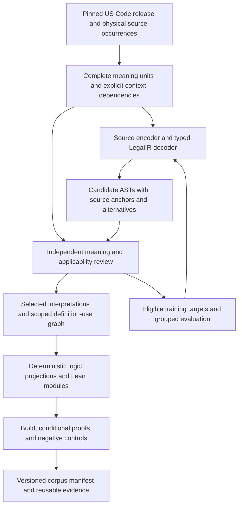

# LegalIR roadmap: US Code to scoped graphs and a unified Lean4 corpus

Planning snapshot: 2026-10-18. Scope: `ipfs_datasets_py` training, inference, source/span/entity integration and Lean corpus generation. This is the consolidated delivery view of the [existing plan](legal_ir_uscode_corpus_improvement_plan_20261015.md), incorporating subsequent local evidence. It does not replace the historical reports or change task status. The existing LIR-01–24 backlog remains the work authority; LIR-16 is already recorded as completed.

**Deliver the first reviewed, connected statutory component before scaling training:** one definition, one complete norm using it, and a second genuine statutory use, preserving the same selected interpretation in the span cache, scoped entity graph and built Lean project. Keep 384D, 768D and genuine 4096D producer/decoder profiles explicit throughout. Broader inventory and model engineering can proceed in parallel.

## 1. Intended system and meaning of success



The model proposes typed interpretations; review and independent checks establish which interpretations may become corpus assertions or supervised targets. Source custody, grammar validity, semantic fidelity, logical consequence and release eligibility are different decisions. Round-trip agreement between two components trained from the same compiler is not independent evidence of fidelity.

Separate four reconstruction objectives: source embedding/latent reconstruction; complete typed meaning reconstruction; IR-to-normalized-language reconstruction; and exact source-byte restoration through the retained span/source map. A fixed-width vector cannot be assumed to preserve arbitrary statutory text losslessly. Preserve original source bytes outside the learned representation.

A unified corpus means compatible semantic modules and versioned, source-linked declarations. It does not mean collapsing different editions, jurisdictions, scopes or disputed interpretations into one set of unconditional facts.

## 2. Current evidence and data roles

The [metadata observation](evidence/legal-ir-roadmap-20261018/public-metadata.json) records bounded public Hub and Dataset Viewer inspection. Hub revisions and README bytes are pinned; Viewer responses are mutable observations, not verified physical-file joins. No corpus payloads or weights were downloaded.

| Input | Observed Hub revision | Intended role and current boundary |
| --- | --- | --- |
| [US Code source](https://huggingface.co/datasets/justicedao/ipfs_uscode) | `91ca1838853ac82d7a12dd4ab47d9686f47667f9` | Source text, structure and retrieval artifacts. Its card separately names source revision `006dd603185b283c54648dd4aef3c2cbe650981a` and release point `us/pl/119/102`; these are not the Hub commit. The Viewer splits request returned HTTP 500; the page reports an invalid slash-containing config name. Use pinned manifest artifacts for intake; propose a backward-compatible viewer alias separately. |
| [Span cache](https://huggingface.co/datasets/justicedao/uscode-autoformal-span-cache) | `60501f3e920f6c9050cfc452e0d9fcc2b7c184f3` | Reuse source-linked observations, candidates, failures and retained outputs. Eight Viewer configurations include `paired_spans`, `formal_logic_text` and `retained_outputs_v1`. Storage named `train` does not grant training eligibility. The card explicitly preserves diagnostic, unadmitted and unformalized results. |
| [Entity cache](https://huggingface.co/datasets/justicedao/uscode-autoformal-entity-cache) | `79d54378c5d6a89ab56e7a27e0f0ba867e800e19` | Existing graph observations and navigation leads. The observed twelve-column projection includes node/edge identifiers and status fields, but not complete typed AST, source-offset, edition and proof companions. Reuse existing physical census and graph owners to obtain a lossless, source-bound generation. |

The source card declares GTE-small 384D retrieval vectors. Their presence does not show that a particular LegalIR checkpoint was trained on that vector space. Likewise, a graph row marked `formalized` is a claim requiring its supporting record.

Current retained implementation evidence establishes useful infrastructure, but leaves the substantive milestone open:

- Typed relational ASTs, compact codecs, context nomination, compact training, trained inference, the source-selected trained caller and catalog batch accounting exist. Reuse them; overlapping engineering test counts are not independent legal examples.
- The retained 384-conditioned compact checkpoint still produced **0/2 complete BOS formulas** at the declared 64-token allowance. Conditional modal selection stayed **1/2**. These are exposed fictional cases with unverified conditioning vectors, not holdout statistics. See [saved status](../../../../artifacts/legal-ir-compact-reconstruction-20261017-01/status-v02.json).
- The original/zero/swapped conditioning control already completed twelve scores across two rows and initial/trained weights. All selected the wrong constructor; vector substitutions changed logits slightly. Reuse this [completed control](../../../../artifacts/legal-ir-constructor-controls-20261017-01/README.md) and its proposed architecture successor instead of scheduling the same diagnostic again. A separate 129-forward reconstruction cohort and this plan's six-case/130-forward cohort have distinct whole-checkpoint identities; do not pool them into independent legal accuracy samples.
- Bound 384D/768D training paths exist. The additive native4096 integration now has genuine source vectors, decoder updates, save/load and exact optimizer/progress resume. Both retained target-free predictions abstained with `copied_spans_overlap`; no statutory accuracy follows. See [native4096 summary](../../../../artifacts/legal-ir-native4096-live-integration-20261017-01/summary.json). Older claims that all positive-step native4096 integration is missing are superseded for this separate profile.
- A retained candidate graph has 16 nodes and 33 custody edges. The actual Lean 4.34.1 conditional-instance build completed with two theorem axiom checks and three intended failing controls. Its definition/membership premises remain unverified; the original norm was not a theorem premise. See [graph review handoff](../../../../artifacts/legal-ir-current-definition-graph-20261017-02/pilot-review-handoff.md) and [Lean receipt](../../../../artifacts/legal-ir-bound-variable-native-20261017-01/qualification-summary.json).
- The October 18 source-binding bootstrap and optional-catalog trained-scoring stages were work in progress at inspection. Their opening records are not completion receipts. Recheck those owners before assigning duplicate work.

The [October 17 delivery record](../../../../implementation_plan/docs/legal-ir-source-to-lean4-delivery-plan-2026-10-17.md) retains detailed qualifications, failures and concurrent increments. Interpret its historical pending statements against later receipts, not as the current implementation inventory.

## 3. Source and span contracts

Freeze a compatibility manifest across source, span, entity, encoder/tokenizer, checkpoint, decoder/IR, review, projection and toolchain generations. Record actual loaded implementation hashes; the dirty checkout HEAD alone is not an executed source identity.

Each selected source occurrence needs release/edition, citation, physical file and row/paragraph identity, original bytes/hash, offset units, parent hierarchy, source URL and normalization map. A repeated quotation or equal hash does not erase occurrence identity. Track acquisition/publication time separately from the text's effective time, amendments and applicable scope.

Use statutory structure first: section/subsection/paragraph hierarchy, lead-in plus dependent list items, complete conditions, exceptions, definitions and referenced qualifications. Reuse existing structural/semantic chunkers; embeddings can nominate a boundary, but may not cut away a negation or qualifier to fit a model. Separate the complete meaning unit from the encoder's token windows:

1. Construct the complete source unit and explicit dependency context.
2. Tokenize with the actual producer tokenizer and reserve special-token capacity.
3. If necessary, use source-mapped subwindows with semantic boundaries and overlap, retaining their ordered parent and coverage map. Count overlap once in source accounting.
4. Refuse or defer unsupported units rather than silently truncating. A 512-token profile remains a 512-token profile; a longer native producer needs its own qualified consumer/output budget.
5. Compare chunking methods on the same independently reviewed source units: qualifier retention, complete-IR fidelity and cost. Lake success alone cannot choose the most faithful segmentation.

For the selected pilot, resolve physical membership in both caches or record it as unavailable. The previously inspected sixteen historical rows did not establish membership for the current pilot; they do not prove whole-cache absence. Recover existing source/ordinal records before creating new, explicitly versioned cache observations for the identified physical source occurrences.

## 4. Canonical LegalIR and reviewed targets

Reuse the existing typed expression and relational norm owners, with a versioned capability census over complete provisions. Preserve:

- Typed entities, scoped term senses, ordered relation arguments, variable binders and quantifier scope.
- Obligation, permission and prohibition; negation; necessary versus sufficient conditions; exceptions and exclusions; authority and applicability.
- Numeric comparisons/cardinality, units, temporal intervals/deadlines and effective-date context where supported.
- Purpose, anaphora, cross-references and definition scope as supported structures or explicit unresolved obligations. No opaque atom may be reported as fully interpreted internal meaning.

Keep content tokens separate from source, symbol-table, confidence and review companions, binding them by digest. Compact serialization must round-trip the entire typed AST; shorter JSON is not proof of semantic compression or measured provider-token savings. Version vocabularies, symbol catalogs, constructor grammar and input/output limits together.

The first real component can use the already prepared §101 definition and §7213 norm candidates, after confirming the exact title and edition from their source records. Their competing interpretations remain candidates. The §7214 second-use proposal includes cardinality; represent it faithfully or select a different genuine, reviewed use. Do not replace it with the existing fictional second-use fixture. Resolve the existing 65-character definition-predicate versus 64-character relational-owner limit with an explicit compatible symbol contract, not truncation or an unrecorded renaming.

Build three separately labeled target populations: authored engineering fixtures, compiler/teacher weak targets, and independently reviewed statutory interpretations. Record reviewer identity/competence, applicable trust, disagreements, adjudication, context access and exposure. Authenticating a response does not make the response correct. Rejected candidates and ambiguous provisions remain available for diagnosis with explicit training masks.

## 5. Improve the autoencoder and decoder with attributable experiments

Start from the actual saved parent for each compatible family. Record tensor names/shapes, tokenizer, producer geometry, pooling/normalization, codec, input provenance, optimizer, actual updates and source exposure. Distinguish encoder adaptation, latent reconstruction, source-conditioned typed decoding and text decompilation. They are separate heads/objectives even when sharing infrastructure.

| Profile | Preserve and qualify | Fair comparison |
| --- | --- | --- |
| Source-only | Existing no-latent baseline and its source/context access | Required baseline for useful latent contribution. A zero placeholder is not learned conditioning. |
| 384D | Actual native producer and exact consumed representation; distinguish raw GTE, adapted latent and authored diagnostic vectors | Same reviewed population, grammar, allowed context and decoder protocol; genuine/zero/shuffled controls. |
| 768D | Native producer, compatible input adapter, existing bound trainer and consumer | Preserve its own tokenizer/normalization/lineage; do not pad 384D. |
| 4096D | Genuine native4096 producer, bound decoder and separate codec/checkpoints | Continue from verified compatible assets; do not claim compatibility with the 384-conditioned compact head. |
| Historical 8D | Diagnostic baseline only | Preserve old observations without promoting them into source encoder evidence. |

Different native producers make a profile comparison, not an isolated experiment on dimension. To isolate width, qualify a common producer plus TRAIN-fitted width adapters and matched downstream capacity. No arbitrary truncation/padding or cross-width tensor averaging. Changing from authored vectors to genuine source embeddings creates a new training population; it is not exact continuation of the old population's Adam trajectory.

Record native embedding width, conditioning width, actual bottleneck, residual bypass, decoder capacity and permitted source/context access separately. Existing contextual384/768 models include an identity bypass around their residual projection, and source-span consumers retain source text. Neither establishes a standalone fixed-width compression bottleneck or an independent latent benefit. Preserve the shared numerical/prepared-training owners where compatible; their earlier warm training throughput does not qualify the newer compact runtime.

Run these experiments in order, retaining unchanged baselines:

1. **Representability and target completeness.** For every enrolled complete unit, determine whether the typed grammar and symbol/catalog profile can express it. Separate richer grammar from additional training. Include unsupported units in coverage denominators.
2. **Source-conditioned integration.** Finish the already-owned bootstrap and optional-catalog work. Connect authenticated native receipts to the existing trained source caller, retaining missing/ambiguous/unavailable rows. Verify actual vector/checkpoint consumption; correct dimensions alone are insufficient.
3. **Inference preparation optimization.** Prepare one immutable validated checkpoint/model per bounded generation operation. Preserve standalone score validation, input and dependency checks, RNG behavior, terminal/refusal behavior and output parity. The saved diagnostic's roughly 341–342-second generations spent under 0.06 seconds inside their nested GRU calls. Repeated checkpoint traversal/restoration is a source-derived hypothesis; profile it before claiming a speedup. The older Legal384 session optimization does not automatically cover compact v2.
4. **Conditioning architecture.** Compare initial-state-only conditioning with an explicitly versioned per-step conditioning path. Saved prefix controls show attenuation on this workload, not proof of a universal cause. Keep data/loss/budget fixed; check actual gradients and avoid a doubly zero-initialized gate/projection that cannot learn. New tensors require explicit conversion and fresh/compatible optimizer handling.
5. **Training objective.** Compare existing full-vocabulary cross-entropy with a separately specified legal-decision weighting and/or grammar-conditional objective. Score constructors, ordered roles, O/P/F, negation, conditions and termination. Keep unconstrained logits and grammar interventions observable. Adding loss weights must not conceal critical errors in aggregate loss.
6. **Curriculum and hard negatives.** Progress from definitions and simple norms to conditions, exceptions, quantifiers, count/time constructs and connected provisions. Use minimally changed modal/role/condition/definition counterexamples, but label authored negatives separately. Mix parent-retention cases and prevent unsupported synthetic targets becoming gold.
7. **Representation and graph utility.** Only after compatible consumers and meaningful targets exist, compare source-only, each eligible width, deterministic scoped context and learned retrieval. Genuine versus zero/shuffled/donor vectors tests whether representations help. A latent-only compression arm must withhold source and disclose every context/symbol side channel.
8. **Encoder adaptation and transfer.** Freeze the source encoder initially to measure decoder changes. Then compare limited adaptation or distillation as distinct interventions, retaining parent behavior. Transfer only compatible tensors/semantics and keep failed teachers visible. Promote no checkpoint on reconstruction loss alone.

Use complete BOS-to-EOS generation as the primary decoder outcome. Teacher-forced token scores and prefix-conditioned choices are diagnostics, not complete reconstruction. A grammar-valid but wrong or endlessly recursive output stays a failure; do not increase generation limits after seeing outcomes to manufacture a pass.

## 6. Holdouts, measurements and qualification

Assign splits before learning vocabularies/adapters, normalizing based on data, selecting negatives or choosing checkpoints. Group identical/near-identical provisions, edition/amendment variants, target templates and direct definition-use leakage. Separate shared, explicitly permitted background law from held-out answer content; connecting every citation must not accidentally create one giant split group.

Use distinct TRAIN, development/selection and sealed final holdout groups. Report exposed engineering and reviewed statutory cohorts separately. Compare complete accepted IR up to justified canonical variable renaming, preserving binder scope and argument order. Also compare normalized text, source anchors and relevant semantic countermodels; exact wording is not required for normalized decompilation.

| Measure | Required interpretation |
| --- | --- |
| Coverage and reconstruction | Complete supported units/all enrolled units; exact complete AST; missing/extra rules; invalid, refused and unavailable outputs retained. |
| Critical fidelity | Separate O/P/F, negation, actor/role, quantifier, condition/exception, time and quantity errors. |
| Definition/graph quality | Per-occurrence governing binding, source coverage, unresolved alternatives, endpoint/dependency closure, exact graph-to-AST reconstruction. |
| Generalization | Grouped holdout outcomes, parent-retention regressions, calibration and error versus abstention coverage; multiple seeds do not multiply source cases. |
| Formal validation | Parser/type/build outcomes, exact encoded statements, conditional obligations discharged, assumptions/axioms and negative controls. |
| Efficiency | Cold preparation, actual updates, decoding, validation/review, graph/Lean, failures, peak memory and storage; accepted complete units per wall/compute/review hour. |

Freeze promotion thresholds after baseline characterization and before candidate fitting; no arbitrary universal legal-accuracy percentage is justified here. Require no unresolved critical regression on the agreed retention panel and independently inspect the intended accepted cohort. Report numerator, denominator and uncertainty by independent provision/component group. Parsing/build success is not a proxy for legal meaning.

Stop or revise for leakage, unrepresentable target semantics, unbound/incompatible checkpoints, nonfinite/integrity errors, prespecified critical regressions or exhausted resource budgets. Preserve every enrolled arm and failed attempt. Expand a successful experiment only when its changed hypothesis and held-out evidence justify it.

## 7. Aggregate into scoped semantic graphs

Reuse the current graph and exchange owners. Maintain separate records for source occurrences, term mentions, scoped senses, entities, definition interpretations, norm ASTs, conditions/exceptions, reviews, statements and proof/build receipts. A compact public navigation table should link to lossless typed companions, not replace them.

Proposed relationships include `derived_from`, `mentions`, `defines`, `uses_definition`, `has_condition`, `has_exception`, `effective_during`, `refers_to` and `checked_by`. These are conceptual mappings to the existing schemas, not a new database authority. Separate custody/navigation edges from accepted semantic relationships.

Definition resolution needs the exact use occurrence, scope, version, time and applicable definition. Equal surface strings, vector similarity and shared citations nominate candidates only. Preserve alternative definitions and failed/empty lookups; changes to a previously empty partition can invalidate earlier results. Treat each edge's evidence and applicability independently.

For each connected component require endpoint closure, preserved argument/binder/modal structure, exact source maps, deterministic export/import and graph-to-AST reconstruction. Detect conflicting interpretations, unsupported cycles and missing dependencies. Definition cycles may require a joint semantic treatment; do not resolve them by silently breaking an edge. Keep temporal amendments/versioning explicit rather than destructive merges.

## 8. Logic projections and the Lean corpus

Select projections because a source construct needs their semantics. Existing modules elsewhere in the repository do not establish a faithful LegalIR route. The actual [family router](../../ipfs_datasets_py/logic/autoformal/legal_family_routes.py) currently preserves canonical legal O/P/F through its deontic route; independently supplied native fragments have narrower contracts.

The current independently supplied FOL/TDFOL fragment path uses one carrier. Multisorted and free-variable lowering require separate qualification; the typed vocabulary in the intended IR does not establish those backend capabilities.

| Family | Applicable role | Delivery condition |
| --- | --- | --- |
| Typed FOL | Entities, relations, definitions and quantification | Preserve sorts/binders/argument order. Do not erase legal modality to fit FOL. |
| Deontic FOL | O/P/F, guards and permissions | Explicit parameterized modal semantics; prohibition and permission are not replaced with ordinary truth. |
| Temporal FOL / TDFOL | Effective intervals, deadlines and event ordering | Keep legal version time separate from modeled time; justify calendar-to-clock lowering. |
| DCEC / event-cognitive logic | Source-supported notice, knowledge, belief or event conditions | Existing route is narrow ground Object/O/P/F. Broader cognition, quantifiers and events need an explicit translation and checks. |
| Frame logic | Scoped attributes, types and inheritance | Qualify inheritance/exceptions; graph storage alone is not a frame-logic projection. |
| TLA+ / transitions | Stateful statutory procedures and permitted transitions | Supply a transition/effect model first; treat as a separate qualified projection, not a default for all law. |
| Defeasible/priority semantics | Exceptions and competing norms | Preserve source/authority for priority; no generic graph order or closed-world assumption substitutes for legal applicability. |

Use the same selected typed AST for graph and deterministic Lean emission. Suggested logical layout, mapped onto the existing builders rather than replacing them:

```text
Legal/Core/                 -- entities, syntax, scope, deontic/time interpretation
Legal/Definitions/          -- stable scoped definition declarations
Legal/Norms/                -- source-bound interpreted norm statements
Legal/Components/           -- explicitly selected definition/use compositions
Legal/Verification/         -- conditional consequences and preservation checks
Legal/USCode/Views/         -- release-specific imports; all expected modules included
manifest.json
lean-toolchain
lake-manifest.json
```

Declare unknown entities as typed variables/parameters with explicit source-bound symbol maps. Never invent membership, authority or a desired conclusion just to make Lean compile. Distinguish assumptions representing a selected interpretation from independently proved consequences. A theorem that assumes both the definition and norm can demonstrate a conditional inference; it does not prove either is the meaning of the statute.

For each component retain emitted bytes, source-to-declaration mapping, exact toolchain/library closure, build commands/logs, expected modules, declaration types and `#print axioms` output. Exclude `sorryAx`/undeclared placeholders from accepted proof artifacts and report any native-evaluation trust dependencies. Include wrong-modality, swapped-role, wrong-definition, missing-premise and changed-exception controls. Prove nontrivial consequences rather than restating assumptions.

Reuse the completed conditional build, then extend it to the full reviewed norm and second genuine use. Qualify the existing incremental owner for the newer relational profiles: cold and incremental outputs must agree on statements, assumptions, dependencies and dispositions. Definition, review, source-edition, symbol mapping or toolchain changes invalidate affected results. A cached compiler artifact cannot restore a withdrawn semantic judgment. Lake checks the encoded project; statutory fidelity requires the separate source/meaning evidence.

## 9. Storage, throughput, checkpoint delivery and scaling

Keep shared model/training/logic implementation in `ipfs_datasets_py`; `ipfs_accelerate_py` consumes qualified loaders and results. Reuse existing DuckDB owners, immutable Parquet/CAS artifacts, checkpoint registries and supervisor resource/source leases. DuckLake/Quack integration requires its existing qualified transaction/snapshot contract; do not create a parallel planner or database because a join is unfinished.

Use one owning writer or qualified isolated shards with deterministic merge. Schedule CPU intake/review/graph work independently of measured GPU encoder/decoder capacity. Cache exact source windows and prepared tensors by source/context, tokenizer/producer, geometry, codec and split identity. Optimize model restoration/hashing first where observed overhead warrants it; then evaluate bucketing, batching, incremental recurrent state, mixed precision and GPU execution as separately checked changes.

Measure full pipeline wall time alongside phase clocks; nested times are not additive and reserved resources are not measured consumption. Report formalized, reviewed complete units per second as well as raw examples/token updates per second. Charge setup, failed runs, review and proof costs; disclose amortization horizon.

For multi-machine work, distinguish synchronized data-parallel training from independent trials. Immutable full checkpoints and compatible sparse deltas need exact base tensor hashes, parameter names/shapes/dtypes, codec, step and optimizer handling. Independent Adam histories cannot be averaged by default. Keep widths and semantic profiles in separate namespaces. Qualify resume/replay and base mismatch refusal before enabling distributed merges.

A release manifest must select one compatible source/span/graph/model/semantics/Lean generation with splits, lineage, costs and qualification receipts. Upload/readback component artifacts before selecting that release; cross-repository publication is not atomic. Preserve previous generations and rollback. Publication, large training and production changes are implementation phases, not actions performed by this planning refresh.

## 10. Reuse map and ordered delivery packets

Source paths below are relative to `ipfs_datasets_py/`; they name existing owners, not claims of complete statutory deployment.

| Area | Existing owners to extend |
| --- | --- |
| Intake and physical joins | `logic/autoformal/legal_source_package_intake_v1.py`, `legal_source_span_entity_join_v1.py`, `legal_entity_index_intake.py`, `legal_cache_parent_occurrences.py` |
| Context and targets | `logic/autoformal/legal_statutory_context.py`, `legal_statutory_context_v2.py`, `legal_source_span_target_eligibility_v1.py` |
| Typed content and reviews | `logic/autoformal/legal_relational_norm_v1.py`, `legal_compact_content_v1.py`, `legal_norm_content_responses_v1.py`, `legal_norm_content_adjudication_v1.py`, `legal_norm_definition_applicability_v1.py` |
| Compact training and inference | `logic/formalization/autoencoder/legal_compact_content_training_v2.py`, `legal_compact_content_trained_runtime_v2.py`; reuse the installed source caller and codec owners |
| Width-specific training | `optimizers/logic_theorem_optimizer/legal_span_bound_dimensions.py`, `legal_span_bound_native4096.py`, native producer/binding/numeric owners |
| Graph and definitions | `logic/autoformal/legal_semantic_graph.py`, `corpus_graph.py`, `corpus_graph_exchange.py`, `scoped_definition_resolution.py` |
| Logic and Lean | `logic/autoformal/legal_family_routes.py`, `legal_corpus_shared_lake.py`, `legal_corpus_definition_use_lake_v2.py`, `legal_corpus_incremental.py` |

| Priority / existing tasks | Concrete output | Exit gate / dependency |
| --- | --- | --- |
| P0 — LIR-01–04 | Selected three-cache physical join and current width/checkpoint/grammar inventory | Every selected occurrence and unavailable arm accounted for; exact edition/source and producer identities. Reuse completed censuses. |
| P1 — LIR-05–07 | Reviewed definition, complete norm and second genuine use; representability table | Meaning/applicability decisions and full target ASTs, or explicit unresolved outcomes. Source/context review can run alongside engineering. |
| P2 — LIR-07,17–20 | Finish existing source/bootstrap/catalog handoffs; real source-to-trained inference | Exact consumed vectors/checkpoint/codec and original population, including abstentions. No new duplicate trainer. |
| P3 — LIR-17–20 | Prepared inference optimization; then controlled conditioning/loss/curriculum comparisons | Parity for optimization; complete holdout and retention outcomes for model changes. No conflated interventions. |
| P4 — LIR-08–11 | Lossless scoped graph of the selected component | Reviewed per-occurrence governing bindings and graph/source/AST reconstruction. Depends on P1 for accepted meaning. |
| P5 — LIR-12–15 | One Lean project with complete component and explicit conditional consequences | Actual build and negative controls; full module coverage; clean/incremental equivalence. Depends on P4 for accepted source composition. |
| P6 — LIR-19–24 | Matched 384/768/4096 evaluation, coherent release and incremental update rehearsal | Whole-cohort quality/cost/availability report, qualified consumers and reproducible selected generation. |

First expand to a small connected development collection, approximately 20–40 provisions, then 200–500 independently reviewed passages if review capacity and construct coverage permit. These are planning ranges, not existing gold counts or a statistical power claim. Stratify later evaluations by title, provision kind, era, definition distance, nesting and length; seal fresh groups before fitting.

The immediate handoff is P0 plus P1, in parallel with the already-owned engineering in P2 and a bounded P3 optimization proposal. Do not wait for a larger model to resolve missing source membership or governing meaning. Do not delay meaningful decoder evaluation behind unrelated supervisor architecture work. Keep the existing backlog/status owner and attach evidence to it instead of creating another campaign.

## 11. Reproduction and remaining decisions

The [inspection script](evidence/legal-ir-roadmap-20261018/inspect_public_metadata.py) uses only the standard library and public metadata. From this repository root, reproduce the observation into a new file:

```sh
python docs/autoencoders/evidence/legal-ir-roadmap-20261018/inspect_public_metadata.py --output /tmp/legal-ir-public-metadata-new.json
```

It refuses an existing output, bounds responses and reports inaccessible services without treating them as absent data. Historical local evidence is linked above; it was inspected, not rerun. [Local source pins and document checks](evidence/legal-ir-roadmap-20261018/local-source-review.json) identify the working-tree sources consulted and validation scope. This plan does not claim those source hashes were the historical experiment runtimes.

Before the first substantive training comparison, settle the specific source edition/connected provisions, independent review assignment, supported semantic profile, grouped holdouts and measured compute/review budget. These are recorded experiment inputs, not reasons to postpone P0 inspection and interface work. No new training, model inference, solver/Lake build, publication or checkpoint promotion was performed for this plan.

## 12. October 18 training reconciliation and next delivery order

The latest completed work changes the next experiment. The gated training pilot improved same-row teacher-forced loss while leaving every recorded BOS prediction identical and incomplete. Weighted-loss training mechanics are now installed and qualified, but have not been evaluated for generation. Prioritize a fixed, matched **all-one versus 1:4 weighted-loss comparison on the existing h0-only profile**, after qualifying its explicit inference consumer and measuring feasible execution costs. Continue the reviewed statutory graph component in parallel; it does not depend on success on the fictional training fixtures.

This dated reconciliation supplements the earlier roadmap and historical snapshots. Its saved evidence, public metadata responses and independent reviews live in workspace-relative `artifacts/legal-ir-comprehensive-plan-refresh-20261018-01/`. The existing comprehensive training review, the October 17 consolidation and the dated October 18 completions remain the evidence chain. Counts below belong to their own cohorts; replay work, overlapping regression tests and repeated observations are not additional independent legal examples.

### 12.1 Training already completed and its implications

| Retained experiment or implementation | Observed outcome | Planning consequence |
| --- | --- | --- |
| Earlier reconstruction augmentation on eight initially withheld sources | Three seeds changed exact generation by 1/8→0/8, 1/8→2/8 and 3/8→0/8 despite improved teacher-forced loss. | Preserve the negative generalization evidence and exposure history. Select on complete meanings with a separate sealed holdout. |
| F18 conditions campaign | 154/168 complete TRAIN outputs, neither targeted repair, and 0/36 on each fresh development/test population; latent conditioning disabled. | Keep the no-promotion result. A new run needs a changed hypothesis and the existing retention floors. |
| F19 saved-score inspection | Six saved conditions observations; complete spans already ranked second or third within the top eight; no training. | Candidate inclusion was not the observed failure. Keep its responsible-selection hypothesis separate from the compact decoder experiments. |
| Existing prepared trainers and width-specific work | 8D prepared training, 384D prepared modal training and 384D/768D/4096D implementations or historical experiments already exist. The currently bound source-span trainer uses `latent_dimension=0`. | Reuse compatible owners. An older prepared-training benchmark or a wider tensor does not qualify the new compact checkpoint, native producer or decoder bridge. |
| Compact training and trained inference | The original compact qualification observed four physical Adam calls across uninterrupted/resume paths; a prior interrupted campaign total remains unknown. Compatible retained inference and source-selected consumers subsequently qualified. | Keep exact lineage, actual resume evidence and failed finalization history. Inference replay is not additional training. |
| Gated architecture and trained-state qualification | Initial architecture checks included 132 GRU calls, two backwards and no updates. The later state cohort performed six physical updates, including two resume replays; each final arm had two new sequential steps. | Gate/gradient availability and exact resume are established within that profile. They do not establish improved reconstruction. |
| Complete loss recovery | Saved full-537-logit analysis covered 184 original and 92 replay positions without new training. Forced tokens contributed about 84.1–84.2% of CE on these targets. | A fixed branch-weighting hypothesis is justified for testing. This loss allocation is not a model-parameter gradient or runtime attribution. |
| Completed paired gated pilot | Twelve additional updates, six per arm; final new-lineage progress is eight steps per arm. Actual work was 524 GRU calls: 12 training plus 512 BOS calls, with 12 backwards and two Adam restores. All eight pre/post × row × arm BOS sequences were identical and incomplete at 64 tokens: 0/2 complete per arm before and after. Same-row CE fell about 0.04; the first real branch chose `or`, while the authored `forall` ranked 9/9. | Preserve the adverse result. The two exposed fictional rows and one seed pair cannot measure statutory generalization. Another small update increment or a larger token cap does not address the observed wrong root choice. The gated arm also has 3,073 extra parameters. |
| Completed weighted-loss qualification | Five physical GRU/backward/Adam updates: baseline step 1, all-one step 1, weighted steps 1–2 and one exact saved step-2 replay. Four model/Adam allocations; 26 preflight refusals. All-one parity and full saved-resume parity passed. No BOS generation was performed. | Mechanical steps L1–L2 are complete. The next missing consumer must accept the objective-bearing checkpoint explicitly; efficacy remains unmeasured. Five physical updates are not five sequential steps in one model. |
| Prepared receipt-bound source generation | A separate 61-case qualification performed four restores and 256 GRU calls, with no new encoder or optimizer work. The one nominated output was incomplete at 64 tokens; its first 12 steps matched the retained shorter trace. | Reuse source/receipt custody and bounded generation. It does not establish training-space compatibility of native vectors or a reconstruction improvement. |

Primary recent records are the paired pilot's `RESULTS.json`, `INTERPRETATION.json`, independent `audit/saved-readback-01.json` and `NEXT_TRAINING_TASKS.json`; the weighted owner's `results.json`, `completion.json`, independent readback and `NEXT_STEPS.md`; and the complete-loss recovery results and independent metrics. Their full workspace paths and content hashes are retained in the refresh reviews. Earlier historical results remain linked in Sections 2 and 5 and in the comprehensive training review.

### 12.2 Freeze two different training lineages

**First objective experiment.** Use `legal_compact_content_weighted_training_v1.py` with its exact retained a98 donor, h0-only architecture, 384D authored conditioning, hidden size 8, projection size 4, token embedding size 8 and existing 537-token codec. Start both arms from the same donor weights with fresh Adam. Compare only the existing forced:choice policies 1:1 and 1:4. The objective is full-vocabulary cross entropy weighted over every supervised position, including EOS, divided by the sum of position weights. On each authored target, 39 forced positions and seven choices yield choice-weight shares 7/46 versus 28/67. Preserve these target-trajectory denominators separately from the different branch counts in free generation.

The changed objective has its own checkpoint/profile and lineage. Do not discard policy fields to pass it to the legacy v2 runtime. First qualify an explicit consumer using the existing decoder/selection owners: complete checkpoint validation, policy/input/codec bindings, actual loaded weights, direct-versus-restored logits/generation, immutability during inference and rejection of changed policy/source identities. Reuse compatible prepared-runtime concepts without assuming their present schema accepts this checkpoint.

Measure preparation, population/token validation, model/Adam restoration, forward, backward, clipping/Adam, checkpoint encoding and durable-write costs separately. The paired pilot's 157.180-second worker / 296.686-second containing native interval and weighted qualification's 370.714-second clock contain other work; neither supports a steps-per-second extrapolation. The existing compact prepared-training feasibility owner is already reserved. Extend compatible old prepared trainers through that owner instead of starting another implementation.

Choose one fixed update budget from measured feasibility, with fixed save/recovery points and full final states. The earlier 128-updates-per-arm suggestion remains provisional. Freeze row order, seed roster, learning rate, clipping, source/context access, codec, original 64-token BOS cap, pre/post prediction slots, final-checkpoint selection and all cost bounds before fitting. Keep all-one and weighted arms matched. No weight grid, target-aware inference mask, forced constructor, target prefix, EOS patch or outcome-driven cap change belongs to this comparison.

Primary local outcomes are complete EOS-terminated typed output and whole authored AST reconstruction for both exposed rows. Report quantifiers, scope/binding, ordered roles, O/P/F, conditions and exceptions where outputs make those comparisons available. Preserve incomplete/wrong predictions and null unavailable metrics. Constructor rank/margin, forced/choice CE and same-row loss are diagnostic outcomes. Even 2/2 exact local fits would establish only memorization of these fixtures. A fixed-budget failure should trigger an explicit architecture/data/representation diagnosis, not an automatic training loop.

**Separate gated continuation.** The paired pilot's final step-8 h0/gated states retain their own Adam histories and unchanged-objective protocol. Their compact transport has a separately owned preparation/review packet; it was not yet materialized or natively qualified at the bounded 20:02 UTC observation. Actual strict resume of those final step-8 checkpoints remains a separate gate. Do not substitute them into the weighted owner's a98/fresh-Adam profile. Its existing `GATED-NEXT` dependency graph, capacity/seed controls and source-identity migration requirements remain intact; this roadmap does not mark its later objective task ready or close it through the independent h0 weighted experiment.

### 12.3 Source and cache work that is ready to advance

Public Hub metadata observed at 20:02 UTC on October 18 retained the same revisions: source `91ca1838853ac82d7a12dd4ab47d9686f47667f9`, span cache `60501f3e920f6c9050cfc452e0d9fcc2b7c184f3`, entity cache `79d54378c5d6a89ab56e7a27e0f0ba867e800e19`. Pinned cards were saved. The source Viewer returned HTTP 500; use manifest-selected files through existing intake rather than interpreting this as missing data. The span Viewer listed eight configurations. A one-row `paired_spans` preview reported 4,888 rows and an entity preview reported 1,960,876 rows. These are Viewer-reported configuration totals, not whole-repository censuses or authenticated physical membership for the pilot.

The completed successor source crosswalk passed **95 cases: 59 new and 36 cache regressions**, with nine saved-readback checks. It preserves 16 physical observations, 13 historical sections and 150 candidate occurrences: 11 records with a unique exact candidate and five ambiguous records. It selected **zero original occurrences**. Exact string uniqueness does not identify the historical extractor's source edition or intended occurrence. Keep the earlier 51-pass/44-failure attempt as a separate failed fixture qualification.

Advance the existing source owners in this order:

1. Use `legal_parent_parquet_pages` to obtain the independently bound parent descriptor, preflight evidence and exact selected section rows under its existing bounds. This closes the complete-selected-source custody gap without rewriting the original candidate report or claiming correspondence to a different official edition.
2. Prepare the existing legacy-source review requests for the retained candidate population. Reuse `corpus_legacy_source_review` and the typed response/adjudication/application owners. Retain every candidate and unresolved disposition. Eleven unique candidate records are not eleven automatic selections.
3. Bind the selected pilot to physical source/span observations and complete surrounding legal units. Preserve the Hub revision, producer revision/release point, legacy label and Govinfo 2024 edition as distinct coordinates until evidenced correspondence exists. If the existing selected bank does not contain the pilot, record that bounded result and deliberately select another manifest-bound bank or add a separately sourced observation; do not invent a cache row.
4. Use `legal_entity_index_intake.iter_observed_rows`, `census_parquet` and `validate_census_bindings` for selected physical entity-index custody. The current 12-field Viewer schema is an observed node/edge index; its fields do not carry the proposed complete scope/definition/AST contract. Preserve row/group ordinals and raw-row identities, then attach typed semantic companions through existing IDs.

The receipt-bound catalog successor subsequently completed **44 cases**. Its successful native02 used eight actual GRU calls (two original, two adapter replay and four outer-validation replay), with no encoder or optimizer work. It preserves four physical occurrences and generates only the one eligible nominated embedded occurrence. Its two emitted IDs, `[535,16]`, remain incomplete and both choices are grammar-forced; all four evaluator outcomes remain unverifiable. The first failed attempt retains a separate eight calls, 43 passes and one incorrect fixture assertion, with zero whole-cohort qualification. The stopped-attempt independent closeout is retained in the later catalog-completion addendum; the earlier 20:02 pending observation remains historical. Reuse the completed integration. Optional target-prefix continuation remains assisted continuation and is never pooled with original-BOS reconstruction.

### 12.4 One reviewed component through spans, graph and Lean

The first semantic delivery remains one reviewed definition, one complete norm using it and a second genuinely distinct statutory use. Keep the existing Govinfo 2024 hypotheses as alternatives until review. Two rival readings of §7213 are one physical use; the fictional second-use fixture supplies no additional statute. If §7214 is selected, its count restriction needs a complete supported cardinality interpretation. Choosing another genuine supported use is preferable to silently dropping that restriction.

Extend existing typed companions and graph exchange rather than introducing a second IR. The same interpretation identity must bind:

| Companion | Required relationship |
| --- | --- |
| Source occurrence and span observation | Exact edition/source view, physical file/row, original and normalized offsets, surrounding unit, producer/output and original artifact pointer. |
| Term mention, scoped sense and entity/type | Mention occurrence → candidate or reviewed sense → declared type/entity. Matching labels alone never select a sense or establish existence. |
| Definition | Full body AST, ordered parameters/roles, definition operator, source/scope/time and alternatives. Equivalence, inclusion, exclusion and deeming remain distinct. |
| Norm | Full typed AST with actor/action/objects, modality, polarity, binders, conditions, exceptions, quantities and temporal scope. |
| Exact definition use | Norm AST path, variable/argument binding and modal ancestry → candidate definitions → reviewed governing selection with applicability evidence. |
| Review and training view | Meaning/applicability decisions, assessor provenance, alternatives and exposure; separate masks for training and evaluation. Unknown is not a negative label. |
| Graph and Lean export | Original interpretation/AST IDs, scoped symbols, dependencies, lowering profile, assumptions, open obligations and actual build receipt. |

Qualify IR→graph→IR reconstruction on the full component, preserving duplicate physical occurrences and incompatible editions. Retain unresolved candidate and custody edges alongside reviewed semantic edges. A graph index cannot replace external AST bodies or authenticate a governing definition. Definition cycles require explicit dependency handling; unsupported cycles or semantic constructs remain visible.

Reuse `legal_semantic_graph`, `scoped_definition_resolution`, `corpus_graph_exchange`, `legal_corpus_definition_use_lake_v2` and incremental corpus owners. Emit deterministic modules in a pinned shared Lean project: source/provenance, scoped vocabulary/types, reviewed definitions, complete norms, exact definition applications and conditional consequences. Keep rival interpretation views separate. A law's normative expression is represented explicitly; it does not become a proved theorem about actual conduct.

The retained Lean 4.34.1 build already checked two explicit-premise conditional theorems and three intended failing controls. Reuse it. The next build must include the reviewed complete norm and genuine second use, with declared premises and no `sorry` or unreviewed axiom shortcuts. Check deterministic clean/incremental agreement and invalidation when a source, definition, scope, interpretation, codec or toolchain changes. Report compilation/type correctness separately from source-meaning review.

### 12.5 Ordered packets and acceptance

| Packet and existing backlog IDs | Deliverable | Exit condition |
| --- | --- | --- |
| A — LIR-01–04,07,17 | Weighted-checkpoint inference contract and cost-bounded prepared-training design; reuse the active transport/feasibility owners. | Exact policy/state/input custody, restore/parity/refusal controls, separate phase timers and a frozen feasible experiment roster. No extra toy training needed to repeat completed qualification. |
| B — LIR-02–06,09 | Selected parent-source evidence, candidate review requests, actual pilot/cache/entity bindings and complete-unit inventory. | Every selected occurrence has an evidenced disposition; actual review resolves or explicitly leaves meaning/applicability open. |
| C — LIR-17–19 | One fixed h0 all-one/1:4 comparison after A; retain the separate gated continuation DAG. | Whole pre/post BOS predictions and final states, full physical-work accounting, complete/critical-error metrics and an independent saved-result audit. No statutory or width-benefit claim from toy fit. |
| D — LIR-07–11 | Reviewed definition–norm–second-use component and lossless scoped graph. | Full typed ASTs, exact-use applicability, physical provenance and graph roundtrip; unresolved alternatives retained. Depends on B for accepted source meanings, not on C's success. |
| E — LIR-12–15 | Shared Lean component with complete source interpretations and explicit conditional consequences. | Pinned actual build, intended refusals, premise/axiom audit, full module inventory and clean/incremental equivalence. |
| F — LIR-17–24 | Reviewed statutory collection and controlled representation/context experiments. | Dependency/exposure-aware TRAIN/DEV/TEST groups, fresh sealed holdout, complete fidelity/availability/cost reports and qualified per-width consumers. |

After the small component, use the existing planning ranges of 20–40 connected development provisions and then 200–500 reviewed passages if review capacity permits. They are proposed collection sizes, not available gold or power calculations. Group by source lineage, near-duplicates, edition and shared definition dependencies; preserve prior exposure and prevent target-bearing graph context from entering the holdout inputs. Split on connected dependency groups where feasible and report any shared public definitional context explicitly.

Qualify 384D, 768D and 4096D source/decoder profiles separately. Test original versus zero/swapped/shuffled conditioning within each compatible profile and a matched source-only control. Native producers differ, so comparing their dimensions does not isolate width. Treat source-withheld latent-only reconstruction as a separate compression experiment. Only after complete held-out fidelity and retention improve should the plan add graph retrieval, core adaptation or broader logic families one factor at a time.

Release eventually binds the three dataset revisions and selected files, interpretations/reviews, model/checkpoint/objective/codec, graph snapshot, split/exposure manifest, Lean toolchain and build outputs. Incremental updates must identify affected dependency components and preserve prior versions. This continuation updates planning records only; it neither publishes a corpus nor changes the existing 24 task states.


## 13. Prepared weighted training qualification and remaining experiment gates

The [prepared weighted-training adapter](../../../../artifacts/legal-ir-weighted-prepared-training-20261018-01/README.md) passed its bounded source-only qualification and [independent saved audit](../../../../artifacts/legal-ir-weighted-prepared-training-20261018-01/audit/saved-readback-01.json). It validates the existing h0-only/a98 compact384 objective-bearing checkpoint once per session and caches the two authored rows and grammar-derived weights. The 1:1 and 1:4 objective kernels, full per-update model/named-Adam/progress export and immediate-parent checkpoint identity remain unchanged. The staged execution owner is separately bound in its reports; it has not been canonically installed.

Actual work was **seven physical GRU/backward/Adam updates and five model/Adam allocations**: weighted reference two, prepared two, one actual saved-step-one replay to step two, and all-one reference/prepared one each. Four comparisons match every full537 logit, loss, all13 pre/postclip named gradients, complete weights/named moments/progress and whole checkpoint exactly. Twenty-two refusals across12 subjects add no numerical dispatch; three existing sessions poison on input/cache/model tamper, remain poisoned after value repair and refuse after close. Seven physical updates reproduce known transitions: final weighted progress is2 and all-one1. No generation or efficacy was measured.

The scalar reader checks322 saved CE positions and all16,101 parameter coordinates per transition, with maximum CE error2.184e-7 within2e-6. It checks saved algebra without rerunning derivatives or models. The request pins227 inputs, including the unchanged191-file canonical dependency superset. Exact checked buffers for two local modules and77 naturally loaded product modules are archived. Own original source/native/process/storage release is verified from saved receipts. The stopped attempt retains38 files/47,027,690 bytes, including its6,566-byte durability receipt. The137.350-second worker interval is nested in205.310 native seconds; clocks are not additive.

The [cost interpretation](../../../../artifacts/legal-ir-weighted-prepared-training-20261018-01/audit/cost-interpretation.json) finds source/input fences consume92.1–93.9% of the **listed productive prepared-step intervals**; forward/backward/Adam are millisecond-scale in this tiny profile. Complete state export and lineage packing still occur every update. Core I/O totals3.179 seconds include the worker callback; the worker's1.045-second I/O table overlaps them. Dispatch/result-copy and enclosing native scopes differ. No isolated whole-call speedup, quality gain or128-update budget follows.

Reuse the separately completed unweighted step-eight transport/profile and the weighted inference consumer. Their populations, identities and counts stay separate. The weighted consumer's API accepts both policies, but its numerical qualification used only retained1:4 step-two state with nine target-derived prefix IDs and one/two-token caps. All-one numerical inference and complete original-BOS evaluation remain open. The unweighted owner's proposed journal/session successor changes execution identity and cannot silently replace old immediate whole-checkpoint SHA links.

Next integrate this staged API through explicit public-consumer compatibility, freeze whole-call cost/save/recovery and complete pre/post64-token BOS rosters, and choose one feasible fixed matched all-one/1:4 experiment. Any reduction in source/input fencing requires parity and mutation/invalidation controls. In parallel, advance actual source-occurrence decisions, scoped symbols, definition bodies and governing-use reviews into the shared graph/Lean component. The completed entity census establishes physical evidence, while semantic entity bindings and accepted meanings remain unresolved. Existing24-task states, gold/training masks, source policy, production defaults and publication state are unchanged.


## 14. Public prepared-training integration and remaining numerical qualification

The [public prepared-training integration](../../../../artifacts/legal-ir-weighted-prepared-public-20261018-01/README.md) installs two additive files: the canonical weighted prepared-training leaf and its API guide. No existing trainer, checkpoint schema, package-root export or production default changed. The [source comparison](../../../../artifacts/legal-ir-weighted-prepared-public-20261018-01/ast-delta-v02.json) proves that the previously qualified staged adapter differs only in its module description and staged-source report flag. All numerical, full-state packing, source/runtime/input/tensor fences and lifecycle code remain the same. The earlier seven-update/five-restore/four-pair/22-refusal qualification remains separate evidence for its original staged owner.

The new bounded public-import/first-budget-guard profile passed eight checks, including five physical invalid-budget refusals (boolean, zero, negative, above 2048 and float). No valid prepared session or Torch/NumPy/Arrow import occurred in the child, and no model/GRU/backward/Adam work was enrolled. The request pins 208 inputs, preserving all 191 existing canonical dependencies, and archives six exact compiled product buffers with their real origins. The stopped original attempt contains eight files/183,670 bytes. Its 0.228-second worker interval sits inside 50.750 native seconds; neither is a training speed or longer-run budget. Own original write/read source custody and native/process/storage closeout are recorded.

Root authored the new control orchestration and saved-only reader; reused source/read/closeout helpers match prior independently reviewed code. The [saved readback](../../../../artifacts/legal-ir-weighted-prepared-public-20261018-01/audit/saved-readback-01.json) validates source/archive/control/durability/release records without executing products or models. No new independent runtime review or numerical public-consumer qualification is claimed. Additional review workers reached the account usage limit before finishing the numerical harness. This limitation changes the completed scope; it supplies no missing test or scientific credit.

The [next numerical qualification](../../../../artifacts/legal-ir-weighted-prepared-public-20261018-01/NEXT_PUBLIC_QUALIFICATION.json) is proposed, unimplemented and unexecuted: four physical GRU/backward/Adam updates across three model/Adam restores, comprising grouped weighted advance to steps 1/2, an actual newly saved step 1 resume to step 2, and an all-one context-managed step 1. Compare complete checkpoints, full 537 logits/loss, all 13 pre/postclip gradients, clipping norm, named moments/progress and original immediate-parent identities against retained qualified results; do not repeat reference training. Fifteen refusals across nine subjects and six additional lifecycle/detached-return observations are planned counts. Independent source review, full output/recovery/source closure and fresh original admission must precede that execution.

The [public guide](legal_compact_content_weighted_prepared_training_v1.md) records unchanged interface limits: create sessions through prepare; direct dispatch construction/reflection is unsupported; context entry is historical inspect rather than a ready/live-integrity attestation; retain the first explicit close report for full closing-guard facts. No new interface behavior is invented by documentation or AST equivalence.

Then freeze a feasible matched all-one/1:4 training/save/recovery roster and complete original-BOS pre/post evaluation. The separately completed weighted inference, unweighted cost profile and entity census remain reusable owners with separate populations and counters. Continue the reviewed definition, complete norm and second genuine statutory use through authenticated source/span/entity bindings into the shared typed graph and Lean component in parallel. This import boundary establishes no generation improvement, statutory/held-out accuracy, governing meaning, gold eligibility, graph acceptance or Lean admission. All existing 24 task records and prior root values remain intact; only a new availability observation is added.


## 15. Public numerical qualification and current delivery sequence

The [canonical public prepared-training qualification](../../../../artifacts/legal-ir-weighted-prepared-public-numerical-20261018-01/README-v04.md) now closes the previously pending four-update/three-restore training boundary. Independent source reviews preceded the original native run and the separately authored [saved-record audit](../../../../artifacts/legal-ir-weighted-prepared-public-numerical-20261018-01/audit/saved-readback-01.json) passes on its first invocation. The installed public module, unchanged weighted checkpoint schema, full per-step state identity and immediate-parent commitments are preserved; no canonical product change or reference training rerun occurs in this cohort. Earlier staged and import-only observations retain their dated scope.

Actual work is four GRU/backward/Adam updates and three model/Adam lifetimes: grouped weighted advance to steps 1/2, restoration of the actual newly saved public step 1 to reproduce step 2, and all-one context-managed step 1. Four comparisons match complete checkpoints, all 537 logits per position, loss, all 13 named pre/postclip gradients, clipping norm, weights, named moments and progress. Fifteen refusals across nine subjects preserve numerical counters; six interface observations preserve detached copies, three first-closing guard reports, three repeated-close historical observations and automatic context exit. The scalar audit checks 184 CE positions and 16,101 coordinates per transition with maximum CE error 2.184e-7 within 2e-6, without rerunning the GRU or independently differentiating parameter gradients. Weighted final progress remains 2 and all-one 1: three distinct already known transitions plus one replay supply no new unique learning.

The request pins 215 inputs, including all 191 prior canonical dependencies plus the public leaf, and archives 78 exact compiled product buffers and one local core with real-origin joins. The complete stopped attempt retains 33 files/30,877,980 bytes including its 5,664-byte durability receipt. Saved original receipts report own source/native/process/storage release. Worker 41.531 seconds is nested inside native 156.566 seconds; the 115.035-second gap is unpartitioned and native execution precedes final sealing/release. No isolated speed or future resource grant follows.

The [whole-call timing interpretation](../../../../artifacts/legal-ir-weighted-prepared-public-numerical-20261018-01/audit/cost-interpretation.json) fills the previous dispatch/result-copy boundary: successful preparations take 3.822/4.441/3.825 seconds; grouped weighted advance takes 5.315 seconds for two updates, saved resume 3.483 seconds and all-one 2.615 seconds. Source/input fences account for 86.7–90.5% of those complete advance calls. This denominator differs from the previous 92.1–93.9% share of listed phases. First closes take 1.724/2.329/1.690 seconds, with only explicitly timed guard children attributed. The 32-call table includes nested context/advance/close durations and eleven refused calls. Core and worker I/O inclusive totals are 1.971 and 0.652 seconds; their callback intervals overlap and must not be added. Their artifact memberships differ (24 core callbacks and 27 worker saves). Retention remains complete; no reduced-save, interrupted-process recovery, cross-profile speedup or larger training budget is qualified.

The [later training/source completion review](../../../../artifacts/legal-ir-weighted-prepared-public-numerical-20261018-01/audit/adjacent-completion-interpretation.json) incorporates the separately staged journal trainer: six updates, four restores, six exact retained pairs, 70 refusals and two copy controls. Its versioned journal checkpoint, hard-three cumulative budget and cadence two remain distinct from this weighted owner. Saved ten is the tested recovery anchor, and a separately qualified readonly journal consumer now serves exhausted terminal eleven under its exact profile. Its 113–139 ms local advances have a different contract and timing scope, so they cannot rank this API or justify a 64/128-update workload. [Completed journal inference/BOS interpretation](../../../../artifacts/legal-ir-weighted-prepared-public-numerical-20261018-01/audit/journal-inference-completion-interpretation.json) records 392 physical forwards across eight models, zero optimizer/backward/update calls, four exact direct score comparisons and two actual saved32/close/restore/remaining32 comparisons, plus 70 refusals and four copy controls. The latest four whole original-BOS64 cases remain 0/2 complete per arm, 0/4 overall; all reach the cap. Posthoc selected-ID equality with older step-eight cases supplies no raw-logit equality or causal effect, and critical AST metrics remain null. Only finite GATED-SESSION-T6 closes. Reuse this completed journal consumer and keep longer-workload/cost and canonical/source-identity gates open; weighted all-one inference and BOS remain separate.

The same review reconciles the source-to-primary-graph packet: the existing 13 source sections, 150 spans and 16 cache records correspond to 13 matching section nodes, 39 incident edges and 28 recovered nodes. These are structural/provenance candidates and every semantic binding remains null. All 13 original-corpus counterparts have different text and entry identities; split assignments cannot transfer. The later corpus-counterpart recovery now recovers all 13 nominated rows with their 45 fields and 150 spans preserved. None of its 13 corpus texts equals the parent text, including after whitespace collapse, and one of 150 spans matches literally. Parent 2024 GovInfo and preliminary OLRC us/pl/119/102 source declarations retain unresolved edition/producer correspondence. The observed source CID/checksum and graph labels are synthetic source-identity tokens, not evidence of original source-byte custody. The subsequent text-sample scope correction confirms retained Parquet-derived text/JSON as the working input: all 26 inspected parent/corpus text fields have no angle brackets or detected markup tags. Bind the cache to the exact consumed dataset revision, physical row and text digest, then compare corresponding units with explicit character/UTF8 offset maps, preserving headers, notes, bodies and unresolved associations. Diagnose incomplete references against retained text/JSON and producer transformations first. Original XML/HTML is optional targeted evidence for a particular unresolved discrepancy, not a blanket prerequisite for text autoformalization. Meaning review and existing eligibility gates remain separate. [Later counterpart recovery interpretation](../../../../artifacts/legal-ir-weighted-prepared-public-numerical-20261018-01/audit/corpus-counterpart-completion-interpretation.json) retains the dated evidence and original failed-attempt history. This neither repairs the separate broken entity population nor qualifies definitions or governing uses.

The immediate delivery sequence is now:

1. Reuse the completed public training API and retained reference/closeout evidence. Complete all-one numerical inference and freeze a target-independent original-BOS evaluation roster with all incomplete/adverse outcomes; both-policy training qualification does not close inference or generation gates.
2. Choose one fixed matched all-one/1:4 scientific workload, explicit starting/ending states, save/recovery/report cadence, source/input contract and feasible measured original-owner budget. Keep matched update counts, initial weights/optimizer provenance and evaluation populations fixed. Any fence reduction or journal adoption requires explicit source/checkpoint compatibility and mutation/invalidation qualification.
3. In parallel, reuse the recovered named original corpus counterparts, bind spans to exact consumed revision/row/text digests and align corresponding retained text/JSON units with explicit character/UTF8 offset maps. Preserve headers, notes and unresolved associations. Continue source/span/entity/edition correspondence, occurrence decisions, scoped symbols and reviewed definition/norm/second genuine use; consult upstream documents only for a particular discrepancy that needs them. Preserve zero gold/training masks until their actual acceptance gates pass.
4. Fold accepted components through the same typed graph and pinned Lean corpus, measuring source/formula/graph fidelity and preservation obligations. Compilation of conditional proofs and custody-only graph edges do not establish statutory meaning.

[Sample-format scope correction](../../../../artifacts/legal-ir-weighted-prepared-public-numerical-20261018-01/audit/text-sample-scope-interpretation.json) retains the format evidence and supersedes only the blanket markup-recovery prerequisite. The 0/13 text and 1/150 literal-span comparisons remain representation observations, not autoencoder accuracy or proof of markup-removal loss. No new BOS reconstruction, held-out/statutory accuracy, source-encoder authentication, accepted meaning, semantic graph or Lean admission is claimed. All existing 24 ordered task records and prior root values remain unchanged; one new availability observation records the completed public numerical boundary.
