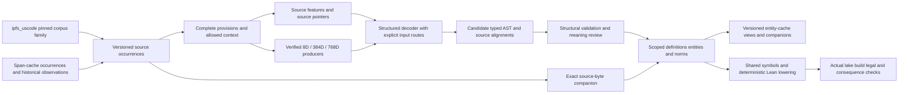

# LegalIR execution design: US Code spans, scoped graphs and Lean 4

Updated October 16, 2026 against `main` at `ff8a01fd0`, including the parallel
span/graph plan and qualified relational target/example interfaces. This is an execution
design for the [existing corpus roadmap](legal_ir_uscode_corpus_improvement_plan_20261015.md)
and its [connected-component pilot](pilots/uscode_definition_component/README.md).
It preserves the existing LIR dependencies and the authored pilot's planning-time
nulls. Proposed experiments, schemas and milestones below are not executed results.
The original design baseline was `643c01860`; subsequent evidence keeps its
original execution scope. The latest [source-corpus research](evidence/legal-uscode-source-corpus-plan-20261016/source-research-summary.json)
adds `justicedao/ipfs_uscode` to the existing span/entity-cache pipeline through
bounded public metadata inspection, without payload processing or training.

The objective is to learn complete, source-grounded legal meaning, aggregate it
without losing scope, and deterministically generate one coherent Lean corpus.
The first accepted component contains **one complete definition, one complete
operative norm using it, and a second physical use with justified governing
scope**. It must retain every material qualifier and pass the actual command
`lake build legal`. The pilot establishes a reusable workflow; it is too small
to estimate statutory accuracy.



## 1. Preserve and use the completed work

| Existing evidence or implementation | Planning consequence |
| --- | --- |
| [Asset reconciliation](legal_ir_asset_reconciliation_20261016.md) identifies historical 8D states, 384D donors/contextual states, 768D initializers/fitted interfaces and detached F15/F17/F18 components. | Recover compatible lineages and existing vectors before creating new assets. Width alone is not a compatibility key. |
| [Merged decoder replay](legal_ir_decoder_output_integration_20261016.md) passed 173 native test cases and reproduced 60 sequences through 60 fresh-load replays. All 60 first-pass outputs satisfy their native grammar; all are outside the richer relational-request profile. | Keep the compatibility adapter and numerical generator. Add an actual richer output head; do not infer missing binders, arguments or predicates in a postprocessor. |
| The five replay variants each score 0/2 on the exposed primary references; original auxiliary donor scores 2/2 and each 768D auxiliary variant 1/2. Primary source swaps change no greedy sequence; student auxiliary zero/swap inputs change no greedy sequence. | Prioritize semantic discrimination and auxiliary retention. This four-row engineering panel establishes neither held-out fidelity nor absence of latent influence on logits. |
| F17/F18 retain 154/168 complete training IR and 0/36 on each exposed development/test panel; their latent input is disabled. F19 locates complete conditions within existing candidates but below shorter prefixes. | Reuse source pointers and diagnose ranking/attachment. These components are source-conditioned baselines, not proof of active 384D benefit. F18 remains an unsuccessful promotion candidate. |
| Typed ASTs, relational reconstruction/batch evaluation, scoped definition lookup, graph exchange, shared/incremental Lean builders, a separate fixed counted-frame profile and selected paired-manifest inventory exist. | Extend exact supported interfaces. Avoid new competing readers, graph codecs, general ASTs or build engines. |
| Latest main adds [owned runtime storage observations](owned_runtime_storage.md). | Reuse its bounded filesystem observations where applicable. It is not resource admission, archive/cleanup implementation, daemon containment or model/Lean execution qualification. |
| The [relational target/example contract](legal_relational_decoder_target_contract_v1.md) passed 142 authored cases with native closeout. It fixes byte serialization and replays source/label separation, with null pending labels, unassigned splits and zero training/gold masks. | Reuse these interfaces. They are not the proposed AST-action head, a trained decoder, an authenticated embedding population or reviewed statutory targets. |
| F15/F17/F18 now have exact retained ModelManager bindings within the 687-record catalog. The full historical 8D state still lacks its exact catalog hash match in the retained survey. | Reuse the completed three-component import; resolve the remaining actual 8D weights separately. A linguistic bundle manifest is not itself a checkpoint, and detached source-token components are not active 384D lanes. |

Training loss, vector reconstruction, native syntax, graph integrity, Lean
compilation and fidelity to a legal provision remain separate measurements.
Keep original-text restoration separate from semantic decoding: equivalent legal
meaning does not preserve exact wording. Retained UTF-8 bytes supply the exact
source companion without forcing semantic latents to encode typography.

## 2. Make the source corpus and both caches reliable inputs

The [three-repository refresh](evidence/legal-uscode-source-corpus-plan-20261016/metadata-refresh.json)
records the latest metadata observations. It supersedes the earlier two-cache
refresh for source selection, while retaining that earlier evidence unchanged.

| Dataset | Revision and observed inventory | Use |
| --- | --- | --- |
| [Source corpus](https://huggingface.co/datasets/justicedao/ipfs_uscode/tree/91ca1838853ac82d7a12dd4ab47d9686f47667f9) | `91ca1838853ac82d7a12dd4ab47d9686f47667f9`; 2,802 Hub descriptors. Its selected manifest declares 62,931 corpus rows in 16 shards and 62,931 GTE-small 384D vectors. | Published legal-text wrappers and reusable source/profile-compatible assets. Declared rows are not newly verified unique provisions or reviewed meanings. Select each artifact family explicitly. |
| [Span cache](https://huggingface.co/datasets/justicedao/uscode-autoformal-span-cache/tree/60501f3e920f6c9050cfc452e0d9fcc2b7c184f3) | `60501f3e920f6c9050cfc452e0d9fcc2b7c184f3`; 7,962 file descriptors, 5,070 Parquet paths | Versioned observations, source evidence, compiler outputs, model outputs and repair goals, preserving their different origins. File counts are not unique spans. |
| [Entity cache](https://huggingface.co/datasets/justicedao/uscode-autoformal-entity-cache/tree/79d54378c5d6a89ab56e7a27e0f0ba867e800e19) | `79d54378c5d6a89ab56e7a27e0f0ba867e800e19`; one advertised 11,139,328-byte Parquet payload, LFS SHA256 `f5f07379d4ca913cb2d8d98505a4ecb01e4d0658039a2f4ff84fb4fb585e8233` | Historical graph observations to reconcile against originals before semantic aggregation. |

Only public metadata, small control-plane JSON and pinned README cards were fetched for this plan; no
Parquet, model, vector or generated-output body was downloaded or executed.

### Select the source release before scanning spans

The source [manifest](https://huggingface.co/datasets/justicedao/ipfs_uscode/raw/91ca1838853ac82d7a12dd4ab47d9686f47667f9/manifest.json)
declares upstream revision `006dd603185b283c54648dd4aef3c2cbe650981a`, release
point `us/pl/119/102`, and GTE-small revision
`17e1f347d17fe144873b1201da91788898c639cd` with mean pooling and L2 normalization.
Published Hub commit, upstream source revision, source-byte hash, legal release
point and effective interval remain separate identities. A packaging report's
`admitted_count=62931` is not statutory review or training eligibility.

The [OLRC download page](https://uscode.house.gov/download.html), checked during
this review, identifies the current release as Public Law 119-121, October 9,
2026. Preserve the selected 119-102 source generation for reproducibility;
matching historical official-source acquisition and a later version-delta
campaign are separate jobs. Never replace an older occurrence with present-day
text under the same source identity. The [prior-release service](https://uscode.house.gov/priorreleasepoints.html)
is an acquisition starting point, not evidence that this review obtained the
required 119-102 title bodies.

Metadata exposes concrete reconciliation work:

| Observation | Required disposition |
| --- | --- |
| The manifest has 1,826 artifact descriptors, the quality report says 1,818, and the build summary says 1,827. | Reconcile each count's scope and generation before a whole-release integrity claim. Do not guess that different counters are interchangeable. |
| 412 current data/index paths are outside this manifest: 377 extra edge shards, 30 extra node shards and five indexes. | Keep them outside the selected ingestion population until attributed to an explicit generation. Retain them and their identities; no automatic deletion or label-based merge. |
| Selected paths exist in Hub metadata and selected LFS sizes/hashes agree, but README is 3,476 bytes against its 3,140-byte descriptor. | Retain the exact old manifest and mismatch evidence. A corrected metadata release needs coherent regeneration and readback; metadata agreement alone does not verify Parquet bodies. |
| The advertised config `publicus-ir-graphrag/v2` currently triggers `InvalidConfigName`; `train` advertises 7,409,174 mixed rows. | Give Viewer configs valid names and explicit artifact-family selections while preserving the internal profile ID where contracts require it. A config rename alone does not repair counts or bind extra files. Never use the mixed count as the legal-source denominator. |

Use manifest-selected `corpus` shards for legal source inventory. Corpus,
vectors, BM25 documents/postings, primary graph nodes/edges, adjacency, receipts,
recovery and legacy compatibility files have different purposes. Do not glob
`data/**/*.parquet` as a single law table. Global publication discrepancies do
not erase an independently qualified unchanged selection; declare the exact
selected scope and unresolved global discrepancies for each operation.

Reuse `optimizers/logic_theorem_optimizer/autoencoder_uscode_import.py`,
`autoencoder_uscode_inventory.py` and
`scripts/ops/legal_ir/inventory_pinned_uscode_sources.py`. The current inventory
ceiling of 65,536 rows covers the 62,931 declared rows, but actual shard hydration,
schema/hash checks and full disposition counting still require their existing
native execution owner and measured budgets. The inventory must preserve invalid
wrappers, record-hash failures, duplicate identities, empty/missing source and
unresolved claims in the selected denominator. A row count is not a unique-section
count. Exact published `text` is one coordinate space; original official
HTML/USLM and normalized visible text are separate spaces requiring explicit
correspondence.

There is a concrete reuse result: the current manifest is 852,161 bytes with
SHA256 `0c6c05582fda19f36c75b166c5c1afecdab156241ce73728f564802b52eacac6`,
exactly matching the [original-primary input descriptor](evidence/legal-primary-corpus-export-20261015/input-descriptor-v01.json).
Reuse the already qualified 74-file selection and 297,825 node/edge occurrences
under their original `5016b86a273ce5e4ffd066c5ae9f5fe494dd417e` provenance. This
metadata join is not a new payload replay or proof of complete release equality.
Do not rebuild that structural export solely because the Hub head changed. The
16 corpus shards, newly added files and official-source correspondence remain
separate populations and jobs.

### Bind physical spans reversibly to source rows

The first new data deliverable is a coordinated source/span/entity selection
manifest and a source-to-span correspondence inventory, using existing owners.
These field groups describe required evidence; they are not a newly implemented
schema or another identity authority:

| Binding group | Preserve |
| --- | --- |
| Published source | Repository/release commit, upstream revision, manifest/shard hashes, physical row ordinal, wrapper/`record_json` hash, `entry_cid`, `legal_id` and exact text hash. |
| Source view and occurrence | Source version, extraction/coordinate profile, character and UTF-8 selectors, exact span bytes, hierarchy and physical occurrence identity. |
| Full interpretation context | Complete provision, list introduction, inherited qualifiers, definitions/references, source applicability and every missing context obligation. |
| Historical observations | Original span aliases, producer/version, historical ordinal/query/release recipe, ordered outputs/goals/failures and actual exposure. |
| New interpretation | Complete/partial/pending/disputed/unsupported status, exact typed profile, alternatives, review dependencies and authorized uses. |

Historical whitespace normalization and invocation-dependent span-ID recipes
must be recovered explicitly. Retain old IDs as aliases; changing batch order
must not silently create new historical identities. Equal text, a citation,
`entry_cid`, source-version CID and graph node-record CID are not interchangeable.
Repeated physical occurrences survive deduplication of identical payload bodies.

Reuse source inventory, `legal_span_cache_intake`, `legal_primary_section_index`,
`legal_span_section_bridge` and sampled-primary association/review owners within
their actual profiles. The selected paired inventory's sixteen-manifest scope
and the old flat bridge's 128-row bound do not authorize a whole-cache scan or
the separate 560-subject sampled-source generation. Expand through declared
bounded selections and resumable acknowledgements, preserving original limits.

Build legal meaning units from source structure, including inherited lists,
exceptions and definitions. Keep headings, citations, amendment/history notes,
repealed text and uncertain roles in explicit strata. If the published text lacks
required markup/context, preserve that gap and acquire the matching official
view; do not invent boundaries or shorten the law to fit a model. Whole-corpus
inventory can proceed while the first reviewed connected component is prepared.

Join cached vectors only when actual input/context bytes, encoder/tokenizer
revision, pooling, normalization, precision and truncation agree. A whole-section
vector is not a clause-plus-context vector. The manifest's legal lexical tokenizer
label is not authentication of the numerical encoder tokenizer. Reuse matching
assets first; generate only genuinely missing native producer/input profiles.

### Preserve the two cache roles

The [span card](https://huggingface.co/datasets/justicedao/uscode-autoformal-span-cache/blob/60501f3e920f6c9050cfc452e0d9fcc2b7c184f3/README.md)
explicitly distinguishes compiler/guided-compiler outputs from learned formula
outputs and calls the readable formula audit diagnostic. Its legacy
`mock:stable-sha256/8` vectors are not genuine semantic encoder evidence. That
campaign is separate from retained learned 8D formula-decoder assets. A `train`
storage split, sealed observation or producer syntax flag does not establish gold.

Maintain three joined inventories rather than one ambiguous span ID:

| Inventory | Required identity and fields |
| --- | --- |
| Physical source occurrences | Source edition/document hash, physical shard/row, hierarchy, exact text bytes, extraction profile, Unicode and UTF-8 selectors, complete provision and inherited context. Keep repeated text at different locations distinct. |
| Observations and attempts | Cache revision/path/row, historical IDs and aliases, producer/checkpoint/input/context/codec/settings, full ordered outputs and failures, goals, execution evidence and exposure history. Multiple attempts can refer to one occurrence. |
| Interpretations and assertions | Typed AST/profile, ordered roles and alignments, source occurrences, legal applicability, alternatives, review decisions, graph/declaration IDs and independent stage eligibility. Multiple interpretations can remain unresolved. |

Reuse `SpanCacheFeed`, `paired_span_census` and the selected
`legal_paired_manifest_inventory_v1` owner. The selected inventory's 16-manifest
bound is intentional; it is not a whole-cache census. Feed observation IDs are
not physical-occurrence IDs. Reuse `corpus_span_adapter` for its existing
six-field source binding and separate ordered output origins.

Complete provisions must preserve introductions, list inheritance, exceptions,
definitions and cross-references. Classify headings, citations and amendment
history separately from operative norms. Record unavailable context and token
overflow instead of silently shortening a law. Publication/edition date,
effective legal interval and event/evaluation time are different fields;
unknown applicability remains unknown.

The retained full census of the current entity payload accounts for 1,960,876
mixed rows with no uniquely resolved edge endpoints. The verified original-primary
transport covers 297,825 selected records in a separate population. Repair the
legacy export from original lineage additively, retaining failed rows and
multiplicity. Never reconstruct endpoints by matching labels. Require full
original-to-export-to-reimport reconciliation of node identity, endpoint identity,
role/ordinal, duplicates and source companions before selecting a repaired release.

## 3. Combine the architectural strengths through an explicit comparison

| Architecture | Assets and useful contribution | Gap to test |
| --- | --- | --- |
| Latent-conditioned autoregressive decoder | Retained 8D/384D GRU and codec heads; 768D donor initialization, aligned boundary and fitted interfaces. Provides a compact semantic condition and reusable learned generation machinery. | Restricted output languages, weak primary discrimination on the exposed panel, auxiliary retention loss, and possible conditioning collapse. |
| Source-conditioned span/pointer and grouped decoder | Detached source-token components, saved candidate rankings and grouped assembly. Preserves exact wording, literals and boundaries with explicit source access. | Presence versus attachment errors, short-prefix preference, incomplete grouping, and poor exposed generalization. Its disabled latent gives no dimensional comparison. |
| Proposed combined decoder | Compatible retained backbone/readout tensors where possible; explicit per-producer latent adapter; source-pointer memory; typed AST actions; rule/argument/qualifier attachment heads. | Whether each added channel improves complete reviewed meaning at matched budget, without regressions or hidden answer access. This architecture is a proposal, not a trained checkpoint. |

The combined design is a testable recommendation, not an assumption that the
largest model wins:

1. **Separate input routes.** Offer latent-only, source-only and combined modes.
   Source-pointer modes receive a declared tokenized source/context memory;
   a pooled sentence vector does not recreate that memory. An explicit adapter
   maps each verified producer to the decoder's declared internal conditioning
   interface. Preserve native input widths and producer identity.
2. **Hierarchical rule generation.** Predict ordered rule assembly and stopping,
   then AST actions, binders, predicate signatures, ordered argument references
   and qualifier owners. Encode inherited paragraph/list context explicitly.
   Rule-count and output limits are versioned capabilities, with visible overflow.
3. **Copy exact evidence, learn its role.** Source pointers carry literals,
   mentions and selectors. Attachment heads decide actor/recipient, predicate
   argument, condition, exception, timing and governing definition. Copying a
   phrase does not establish the correct attachment or interpretation.
4. **Constrain structure.** A versioned action codec maintains a binder stack,
   allowed operators, arity/sort checks, symbol declarations and valid references.
   Serialize to the existing `syntax_core.ast.TypedExpression` for supported
   profiles and validate through the existing owners. Inspect ordinary generated
   actions before any canonicalization; retain malformed and incomplete outputs.
5. **Keep uncertainty explicit.** Emit candidate alternatives, confidence and
   structured unsupported/missing-context diagnostics in companion records.
   Admit only fully supported reviewed assertions to accepted graph/Lean paths.
   Do not replace an unsupported clause with an opaque atom and claim completion.
6. **Lower deterministically.** Family-specific syntax and Lean source are
   generated from the validated AST/profile. Learned direct Lean generation can
   be a later matched arm; it is unnecessary for initial structural correctness.

The old lexical/tagged codecs remain unchanged. Register the AST-action head as
a distinct decoder task and codec; shared weights do not change an old output
contract. Warm-start only tensor/vocabulary/semantic-role-compatible components.
Keep a fresh-head control. Do not apply token-level KL between incompatible
codecs; use separately normalized compatible-head retention or explicitly aligned
structures instead.

## 4. Train in attributable stages

Freeze a finite example inventory before selecting another head or fit. Reuse
`legal_relational_decoder_example_v1`, complete original source/typed joins,
existing eligibility validators, `autoencoder_source_partitions` and
`autoencoder_corpus_index`. The adapter's unassigned split and zero masks are
unchanged; any later supervision policy is an explicitly qualified downstream
binding, not a caller switch in that adapter.

| Inventory group | Required content before fitting |
| --- | --- |
| Complete population | Complete, partial, conflicting, pending and unsupported units; source/context hashes and obligations; every failed/ineligible disposition. |
| Supervision and partition | Reviewed, compiler/weak, authored or unresolved origin; authorized use; actual exposure; physical-source, version, duplicate and semantic dependency groups. Alternatives over one physical paragraph stay in one group. |
| Output feasibility | Exact typed profile; canonical byte lengths, artifact-ID overhead, practical output limit and overflow; comparison with any proposed compact action codec. Input-token and output-ID budgets remain separate. |
| Asset/tensor reuse | Actual checkpoint/runtime and vector producer/input hashes; tensor name, shape and semantic role; copied/frozen/fitted/new status, vocabulary order, parent lineage and optimizer reset/resume. |

The fixed 259-entry byte/control codec supplies an exact reference serialization
of the existing typed request. Its 524,290-ID safety ceiling is not a numerical
decoder budget or a semantic-action grammar. A compact action codec, if length
measurements justify it, needs its own task/profile/version and exact typed
meaning/identity correspondence. Reuse `TypedExpression` and `TypedLogicCodec`;
do not invent another general AST. Preserve old heads and use compatible learned
bodies/adapters before declaring any genuinely new output-layer initialization.

Keep the source encoder frozen for the initial decoder comparison. Reuse existing
compatible embeddings; produce only missing source/context/producer combinations.
Start from compatible, numerically replay-qualified experimental interfaces. Record fresh
optimizer moments versus intentional resume, trainable tensor names, clipping,
precision, seeds, output budgets, data exposure and native source/runtime pins.

Before another interface fit, use a bounded new conditioning question: compare
the original cached 8D input, shared condition and connector-produced 8D input,
first-BOS logit differences and argmax margins under correct/zero/swapped source
vectors. Include an explicitly diagnostic original-input bypass. Any later
identical-prefix NLL/logit comparison must declare whether its prefix is
self-generated or target-provided; target prefixes cannot become ordinary
target-free inference evidence.
This distinguishes weakened conditioning from unchanged greedy choices. Reuse
retained receipts wherever sufficient instead of repeating the completed replay.
Keep numerical comparisons within matched lineage/head/coordinate profiles;
logit KL requires identical ordered vocabularies, not the old 18-entry versus
32-entry heads.
The auxiliary retention drop already appears in the initializers, before
interface training. Aligned initialization fits the primary boundary while
leaving `auxiliary_connector(shared_condition)` unfitted. Diagnose route/input
compatibility before attributing that gap to forgetting. This is a concrete
bottleneck to test, not a demonstrated cause of every reconstruction error. Existing interface
training updates the primary input-adapter weight/bias and auxiliary-connector
weight/bias while freezing 26 inherited tensors, using per-head eligible-token
reference CE. Auxiliary-only updates, direct branches, alignment losses or other
objectives require separately versioned experiment profiles.

| Stage | Work | Exit evidence |
| --- | --- | --- |
| A: legacy repair experiment | On the diagnosed conditions errors, compare retained CE/retention with hardest-wrong-valid-span margin using the same donor, four-pointer-tensor freeze mask, candidates and budget. | Both targeted errors, complete-rule performance and every protected permission/retention case reported. A better margin score alone does not pass. This exposed experiment needs no new statutory gold claim. |
| B: structured-head engineering | Author AST/action controls and minimal pairs, then use provenance-labeled compiler targets only under an explicit engineering-supervision policy. Train the new head and input adapters before optional backbone unfreezing. | Target-free generated action validity, full AST reconstruction, source-pointer and attachment behavior; all weak-label origins retained. Engineering supervision does not confer reviewed-gold eligibility. |
| C: reviewed semantic supervision | Incorporate independently reviewed complete provisions under the explicit downstream eligibility policy; include multi-rule structure and governing definitions. | Correct ordered meaning and complete material coverage on declared development components; no answer-derived retrieval or target-conditioned inputs. |
| D: channel and dimension comparisons | Compare source-only, latent-only and combined variants with actual 8D/384D/768D producers. Test absent/zero/permuted latent inputs, fresh/retained initialization and graph-context ablations. | Useful semantic gains under matched data, source/context and output budgets; producer receipts and conditioning effects measured, not inferred from nominal width. |
| E: promotion and release | Freeze model selection, thresholds and uncertainty procedure, then evaluate newly reserved components. Replicate finalists across multiple seeds, normally at least three. | Reviewed complete-rule gain, protected retention, full coverage accounting and reproducible compatible reload. Publish successful and failed experiment lineage. |

Use a staged experiment matrix rather than launching a full Cartesian product:

| ID | Main changed factor | Mandatory control |
| --- | --- | --- |
| E0 | Retained compatible baselines | Reuse completed replay; expand only for a new population/question. Preserve raw outputs and intervention receipts. |
| E0b | Conditioning bottleneck | Bounded condition/auxiliary-distance and first-BOS logit/margin probe; preserve exact input/producer identities, without target prefixes. |
| E1 | Conditions ranking objective | Matched CE arm with identical candidate coverage and trainable tensors. |
| E2 | Typed AST-action output | Same inputs/backbone/budget, fresh versus compatible initialization; old codec metrics remain separate. |
| E3 | Latent contribution | Source-only, latent-only and combined; correct/zero/permuted vectors. Removing the branch and supplying zero coordinates are different controls. |
| E4 | Definition/context retrieval | Same decoder with allowed context, no context and shuffled/unrelated context; retrieval-only baseline. |
| E5 | Long/grouped provisions | Whole-context versus chunked assembly on matched sources; inherited qualifiers, every clause and output overflow. |

Screen on engineering/development cohorts first; reserve expensive multi-seed
runs for finalists. Choose sample sizes and budgets after measured pilot costs.
Do not repeatedly spend resources on unchanged eight-row view experiments or
retrospectively accept previously rejected proposals.

The loss design should expose each objective rather than hide it in one number:

```text
L = w_ast L_actions + w_ptr L_boundaries + w_role L_argument_and_owner
  + w_rule L_rule_assembly + w_rank L_valid_span_margin
  + w_ret L_compatible_retention + w_conf L_reviewed_confidence
```

Each term has its own eligibility mask, denominator and label origin. Start with
supervised action/pointer/attachment terms, then ablate additions. Tune weights
only on development data. Reviewed hard negatives should include role reversal,
wrong implication direction, modal-scope changes, dropped exceptions, incorrect
count frames, wrong definition binding and permission/non-entitlement confusion.
Synthetic controls remain labeled synthetic. Validate negative cases against
their stated semantics; lack of a proof is not a negative legal label. Calibrate
confidence on eligible reviewed outcomes, not parser success.

Keep a supervision ledger with four distinct tiers: eligible reviewed targets;
provenance-labeled compiler/weak targets for engineering; authored structural and
contrastive controls; and unresolved source/meaning cases with no target loss.
Do not pool them into one accuracy number. Begin with supported single norms,
then coordinated/multi-rule clauses, then definition-dependent and long provisions,
retaining earlier protected cases. Select later review by semantic risk,
disagreement and reuse potential, alongside randomly selected components to
measure selection bias.

Teacher-forced action loss is a training diagnostic. Selection uses ordinary
target-free generation. Distillation requires a qualified teacher for the stated
source/profile scope; agreement between compiler-derived labels cannot qualify
one. An auxiliary semantic-to-text rendering/cycle loss is optional and must be
ablated; fluent reconstruction does not prove preserved meaning.

## 5. Keep the three dimension lanes honest

| Lane | Required input contract | Main research question |
| --- | --- | --- |
| 8D | Actual historical feature/latent producer, preprocessing and matching decoder; distinguish sparse state, linguistic bundle, learned formula sidecar and mock cache projections. | Does its genuine representation preserve useful semantics, and can it provide compatible initialization or limited supervision? |
| 384D | Exact GTE-small producer/tokenizer/pooling/normalization/context plus compatible retained decoder. Detached disabled-latent components have a separate identity. | What semantic gain remains after controlling source pointers and retrieval? |
| 768D | Genuine native multilingual vectors and compatible saved initializer/aligned/fitted interface; preserve outer historical runtime provenance. | Does native representation/context improve fidelity and coverage while retaining donor capabilities? |

The publisher cards specify [GTE-small](https://huggingface.co/thenlper/gte-small)
as 384D with a 512-token input limit, and
[GTE-multilingual-base](https://huggingface.co/Alibaba-NLP/gte-multilingual-base)
as 768D with an 8,192-token input limit. These limits describe those encoders,
not every saved checkpoint, decoder output length or the historical 8D producer.
Each lane retains its actual tokenizer/context/profile limits and independent
decoder/checkpoint identity. Match source/context first when comparing lanes;
increase context later as a separate factor. Lower-dimensional donor reuse is
compatible initialization; prediction distillation needs a qualified teacher
for the intended task/source/profile scope.

Compare squared L2/cosine only as representation diagnostics; mean-coordinate MSE
across dimensions is not semantic superiority. Preserve source-only controls even
if they outperform a latent route. A useful source-conditioned model may qualify
within its declared scope without establishing autoencoder bottleneck benefit.

Widen input context separately from output geometry. Test 512/1,024/2,048/4,096/
8,192-token bands only where the actual producer supports them. The retained
primary 512-token and auxiliary 64-token output budgets do not grow automatically.
Explicitly measure truncation, full-rule cardinality, long-range binding, compute
and overflow. Never pad 384D vectors and label them native 768D, or infer a model's
context capacity from its dimensionality.

## 6. Define evaluation before fitting

Build source-first targets with independent legal and formal review. Record
applicability, interpretations, disagreements, reviewer trust and actual candidate
exposure. A signed declaration authenticates its selected subject/key under the
policy; it does not establish independence, competence, source fidelity or gold.
Identify the downstream eligibility owner/policy rather than inventing a boolean
to bypass unresolved review.

Freeze revisions, near duplicates, derivative examples and actual semantic
definition dependencies into component-level splits. Reserve untouched components
and later broader title/version tests. Broad citation connectivity is not itself
a useful split; document semantic dependency crossings and allowed public source
context. Exclude withheld interpretations, answer graphs and target-conditioned
features from retrieval. Existing exposed panels are regression diagnostics now.
The earlier suggested `open-us-law-span-cache` is not independently reviewed gold
unless its provenance and independence are actually established.

Reuse `legal_relational_batch_evaluation_v1` for its exact supported profile and
`legal_relational_reconstruction_v1` for pair diagnostics. Extend explicit profile
dispatch for new supported outputs rather than disguising them as existing ones.
Keep native-output compatibility reporting alongside richer semantic metrics.

The inference bridge remains unfinished: the new byte codec preserves generated
IDs/bytes, invalid UTF-8, framing and incomplete outcomes, while the existing
batch prediction intake accepts UTF-8 request strings. Extend the existing
accounting path with a byte-preserving companion/adapter; retain every actual
failure without manufacturing an empty request or calling it abstention. Seal
target-free predictions from every declared input route and stop outcomes before
reference scoring, and bind actual checkpoint/codec/input/runtime lineage. A receipt declaration alone is
not numerical-execution authentication.

Report three text routes separately: IR-only semantic rendering, IR plus an
explicitly measured surface residual, and retained-source restoration. The
[original-text round-trip analysis](legal_original_text_roundtrip.md) already
shows collisions between equivalent IR and different authored wording. Exact
original UTF-8, normalized equality, semantic fidelity and edit distance measure
different outcomes. Count residual/source-channel bytes in any compression claim;
successful copying of retained source is useful restoration, not demonstrated
latent-only inversion.

| Measure | Required reporting |
| --- | --- |
| Population and coverage | Selected occurrences N; source/context unresolved; references available; attempted; missing/duplicate/malformed/unverifiable/abstained/unsupported/overflow; valid comparable pairs K. Report correct/N and correct/K separately. |
| Complete semantics | Full ordered AST agreement and lexical-alpha agreement where appropriate; independently reviewed material omission/addition; rule count/order, polarity and quantifier/modal scope. Ordered structure is diagnostic, not general logical equivalence. |
| Grounding and attachment | Oracle candidate recall; span boundaries; ordered roles/arguments; qualifier presence and owner; every physical definition-use binding; exact source selector validity. |
| Conditioning | Producer calls, source/latent/context access, correct/zero/permuted effects on logits and generated semantics; source-only and retrieval controls. |
| Consequences | Reviewed positive derivations and invalid-translation minimal pairs/countermodels under declared finite or Lean semantics. Solver timeout/unsupported output remains a technical status. |
| Graph and Lean | Closed endpoint/companion integrity; per-use scoped resolution; supported lowering/all-source coverage; actual expected compiled artifacts, assumptions and incremental/clean agreement. |
| Cost | Review minutes and compute/storage per accepted component; peak resources, restart reuse, inference latency and useful coverage. |

Mechanical acceptance for the selected component is exact: no lost occurrence,
endpoint, ordered argument, source companion or expected build artifact; no hidden
placeholder. Semantic pilot acceptance requires zero known material omissions or
additions in the supported reviewed component. Any unresolved material feature
blocks that component while retaining its candidate work.

For larger evaluations, preregister required improvement, permissible retention
regression, critical-error vetoes, coverage floor and confidence procedure before
testing. Report component-level paired effects and seed variation; do not assume
spans sharing definitions are independent samples. Choose numeric fidelity and
sample-size thresholds with the review design, rather than promise a percentage
unsupported by the tiny current panels.

## 7. Aggregate scoped formalized graphs

Reuse `corpus_graph`, `corpus_graph_exchange`, scoped definition resolution,
source-scope/typed-source join owners and original-primary reconstruction.
Keep candidate graph edges and accepted legal assertions as distinct statuses.
Current graph v1 is explicitly candidate-only and rejects positive admitted,
formalized or source-semantics flags. An accepted statutory view requires the
actual downstream review/eligibility binding and a qualified versioned projection
or view contract; setting those fields on a v1 snapshot is invalid. Existing
`legal_review_admission` remains pending external verification, with training
and admission false.

| Record | Meaning and retained dependencies |
| --- | --- |
| Source occurrence / mention | Exact physical location and surface selector; repeated mentions remain distinct. |
| Term sense | Versioned legal meaning under actual scope/applicability, separate from its spelling. |
| Entity / category / event | Reviewed denotation or quantified category; a category is not automatically one real person, and an action type is not evidence of an occurred event. |
| Definition | Head sense, definition operator/body, scope/time, interpretation/review and source dependencies. Inclusion, exclusion and legal fiction do not silently become biconditionals. |
| Norm / assertion | Reified ordered typed AST, binders, modality, arguments, conditions, exceptions, timing, applicability and source companions. |
| Resolution / issue | Complete searched partitions and route, candidates, selected governing definition or ambiguity/unavailable state, decision evidence and invalidation dependencies. |

Use existing schema edges where supported; version any additions explicitly.
Existing relationships include `MENTIONS`, `DENOTES`, `DEFINES`,
`USES_DEFINITION`, `APPLIES_WITHIN`, `HAS_CONDITION`, `HAS_EXCEPTION` and declared
version/change links. Generic `HAS_ARGUMENT` is a proposed extension, absent
from graph v1. Preserve complete ordered predicate arguments and binders in the
existing typed AST companion until an explicit projection supports them; coarse
actor/action/object edges are insufficient. Reify ordered argument and qualifier
ownership so triples do not flatten scope. Distinguish stable conceptual IDs,
payload CIDs, node-record CIDs and external `entry_cid` identities.

Resolve **every physical use** under explicit local/enclosing/import references,
sort/arity, source version, applicability and reviewed governing scope. The
existing resolver checks declared lookup routes; it does not discover which law
governs. Preserve negative lookup partitions: a newly added competing definition
can invalidate an earlier unique result. Do not merge equal labels or pick the
nearest embedding as legal authority.

The current V2 definition-use owner composes two cross-document unary definitions
with an explicit alias premise. It does not consume a complete operative norm or
verify all physical uses. The legacy definition/norm bridge is section-local and
strictly unary. The next representation extension is therefore a **narrow,
source-bound relational norm/definition-use correspondence path** for the reviewed
pilot, reusing the existing TypedExpression and scope/join owners. Its versioned
contract must preserve complete roles, operators, qualifiers and per-use binding;
do not fit a richer law into the older alias profile.
The current source-to-typed join leaves `formal_norm_ast`, `lowered_IR` and
`native_output_for_source` null. Its partial correspondence and the byte codec
do not close this complete-meaning/composition gap. Retain the primary transport's
thirteen unresolved-citation placeholders as unresolved source dependencies,
not accepted governing bindings.

Preserve alternative interpretations as separate graph branches/theories.
Assemble by physical hierarchy and occurrence order, not hashed span order.
Bound dependency closure, retain explicit cycles/unresolved references and adopt
reviewed simultaneous interpretations where needed. A unified corpus can contain
multiple explicitly separated interpretations; indiscriminate union can create
inconsistency and vacuous proofs.

Graph v1 requires a closed snapshot and rejects external endpoints/imports. Scale
the pilot through closed components; qualify a versioned import contract before
joining independently published shards. Endpoint closure must be accompanied by
graph↔AST correspondence, ordered argument/binder preservation and exact external
source/interpretation/review companion closure.

## 8. Expand logic-family coverage through declared profiles

Use `logic/families/registry.py`, the parser registry, `legal_family_routes` and
qualified lowerers. Registry discovery, strict native parsing, lossless lowering,
actual backend execution and source-meaning acceptance are distinct capabilities.
Normalize family aliases through the registry; do not equate route names such as
`fol` with proof of every feature in canonical `first_order`.

| Route/profile | Current relevant support | Required next work |
| --- | --- | --- |
| Canonical legal deontic | The canonical O/P/F/calendar legal route remains deontic. | Preserve interpreted duration/calendar fields. Other-family conversion needs a justified clock/modal translation. |
| Relational typed fragment | `legal_relational_norm_v1`: one Object carrier, explicit predicates/ordered roles, bound variables, binary Boolean structure and O/P/F; `tdfol/tdfol_default@1.0.0`. Its request source binding is null; external source joins are separate. | Bind reviewed source meanings through the existing source/join path. Constants, functions, equality, temporal operators and additional sorts need versioned extensions. No silent new fields in its closed request. |
| Native FOL / deontic FOL | Closed one-carrier quantified predicate/Boolean fragments; parameterized O/P/F only on the deontic route. | Reviewed symbols/roles and explicit semantic correspondence. Plain FOL cannot erase an obligation operator and retain legal meaning. |
| Native temporal FOL / TDFOL | Declared unbounded discrete Nat temporal semantics; TDFOL combines deontic and temporal operators within supported AST annotations. | Establish statutory clock, deadlines and intervals; bounded/calendar annotations or new sorts need separate support. |
| Counted-frame v1 | Authored fixed at-most-three distinct Objects per EventFrame×TimeFrame; many-sorted FOL equality plus specialized Lean text. | Reuse only if reviewed meaning matches. Not generic counting, ordered calendar time, native TDFOL equality or an already integrated relational decoder profile. |
| DCEC route | Strict ground Object predicates and ground O/P/F subset. | Quantified, cognitive and event-calculus legal meanings require separately qualified translation/semantics. A DCEC label is insufficient. |
| Other registered families | Registry and provider declarations vary; frame/transition/higher-order and other legal translations cannot be inferred from taxonomy membership. | Add only a review-driven fragment with exact parser/AST/profile/lowerer and semantic preservation cases; expose unsupported coverage. |

For each new operator/profile, require lossless AST↔syntax correspondence,
positive/negative minimal cases, exact refusal of unsupported structures and
actual backend evidence when claiming execution. Structural tests can be authored;
statutory fidelity still needs reviewed source correspondence. Avoid converting a
law into several family strings and reporting their agreement as validation.

## 9. Build a coherent Lean 4 corpus

Reuse `legal_corpus_shared_lake`, `legal_corpus_incremental`, family lowerers and
one explicitly selected native execution owner. Both shared and V2 preparers
already declare a Lean library named `legal`; preserve the exact requested
`lake build legal` target. The two V2 execution owners have distinct profiles and
receipt contracts despite a shared historical schema label; select by exact
owner/profile, not schema-only dispatch.

The release should be a dependency graph of shared modules, for example:

```text
LegalCorpus/Core/{Scope,Definitions,Deontic,Time}.lean
LegalCorpus/USCode/Release_<id>/Title_<n>/Definitions.lean
LegalCorpus/USCode/Release_<id>/Title_<n>/Section_<id>.lean
LegalCorpus/Verification/<obligation>.lean
LegalCorpus.lean                 # deterministic complete imports
lakefile.toml                   # lean_lib legal
lean-toolchain
release-manifest.json
```

Module layout is illustrative; retain deterministic content identity and existing
builder contracts. One corpus means shared symbols and coherent dependencies,
not one huge generated file. Every declaration binds to graph assertion,
interpretation, complete source occurrences and the selected semantic profile.

Keep legal premises explicit represented content/hypotheses. For example, under
declared modal semantics, `∀x, D(x) ↔ B(x)`, `∀x, D(x) → O(A(x))` and `B(e)` can
support `O(A(e))`; they do not prove those statutory premises or that `A(e)`
occurred. Do not add `O(p) → p`, global modal equivalences or each generated claim
as a trusted axiom merely to make proofs compile.

Acceptance requires actual bounded native build receipts, all expected `.olean`
artifacts and complete import closure; pin Lean/Lake, toolchain, semantic library,
dependencies, emitter, generated sources and native execution profile. Check
theorem assumptions/axiom dependencies. The current narrow conditional profile
requires an empty printed axiom list; a broader policy must be explicit and
separately reviewed. No `sorry`, `admit` or hidden placeholders.

Exercise meaningful positive consequences, wrong-scope/role/exception negative
cases or countermodels, consistent alternative theories, definition sharing and
changed bindings. Failure to prove a query is not proof of its negation. Lean
compilation checks the submitted formalization; meaning review establishes its
correspondence to law.

Invalidate by source/context/interpretation/review versions, definition search
partitions including negative results, AST/profile, semantic library/imports,
emitter and toolchain. Test cold, warm and changed-definition builds against clean
builds, including a new competing definition. Retain valid conditional compiled
artifacts separately from whether they remain legally eligible under changed
source/review/applicability policy.

The existing incremental builder's direct `lean -o` execution remains useful for
cache experiments. It does not replace the requested clean Lake build; compare
its reusable artifacts against that build before release.

## 10. Storage, reproducibility and coherent publication

Start with existing immutable Parquet/CAS and serialized DuckDB writers, bounded
shard hydration and durable outbox. A new storage engine is not a pilot
prerequisite. Cache embeddings by exact source/context, producer/tokenizer,
preprocessing, pooling, normalization, precision and truncation profile; avoid
repeating full artifact bodies in every observation. Reserve space for expanded lineage,
temporary runs, native replay and durable evidence, not only compressed Parquet.

Maintain the requested separate inventories and DuckDB/DuckLake catalogs for
each IR family and native 8D/384D/768D lane, with schema/task/codec namespaces
inside each lane. LegalIR, CodebaseIR, IntentIR, SecurityIR and UI/UX IR keep
different decoders and checkpoints. Shared immutable source/body objects may be
referenced through CAS and explicit cross-catalog joins without duplicating
training identities or conflating authority. One controller owns each physical
write connection; readers use pinned snapshots. DuckLake or Quack integration
must preserve those contracts and be measured on its actual backend; a storage
migration is not a prerequisite for the first legal component.

Keep source occurrence, model attempt, interpretation/review, graph assertion
and proof/build indexes separate and joined by exact identities. A proof-cache
hit requires the matching statement, semantics, assumptions and all dependency
versions, including negative definition partitions. The symbolic supervisor may
plan missing context/review/repair jobs from these indexes; a candidate formula,
queue completion or compile success cannot satisfy a proven legal precondition.

Every work key includes source/context, task/schema/codec, family/profile,
producer/checkpoint, settings and relevant compiler/checker dependencies. Preserve
separate per-stage statuses for produced candidate, unresolved source/context,
unsupported meaning, disputed review, overflow, checker failure, retryable
technical failure, accepted assertion and actual Lean build. Queue completion or
`sealed` is not statutory completion.

Training, inference, validation and Lean jobs use their actual existing native
admission owners with bounded CPU/GPU/RAM/process/time/storage grants and durable
closeout. The completed CPU replay used the unchanged 160 GB campaign cap; a
past filesystem-free-space refusal was distinct from the cap. Recheck capacity
before runs. Retained foreign claims/assets are not cleanup authority. The new
filesystem observer and container-boundary observations do not qualify GPU or
daemon containment by themselves.

Maintain separate model identities by LegalIR family/schema/task, native input
and internal latent roles, encoder/tokenizer, codec/profile, data/split generation,
donor lineage and exact hashes. Keep experimental, replay-qualified and promoted
registry roles distinct. Verify ModelManager resolves the intended immutable
artifact and a compatible cold numerical reload reproduces recorded behavior.

Publish coordinated releases binding immutable `ipfs_uscode`, span-cache and entity-cache
commits, source/interpretation/review companions, graph schema, model lineage,
Lean corpus/toolchain and actual receipts. Verify remote bodies at immutable
commits. Publish referenced artifacts first and a separate coordinating receipt
afterward to avoid self-referential commit hashes. Keep the prior coherent
release selected until every required upload/readback succeeds. Never relabel
diagnostic rows as reviewed accepted rows.
Reuse the existing public family/dimension model repositories and completed
ModelManager bindings. Schema/version/decoder task/codec/profile identify
separate checkpoints and ablations within them. Preserve aggregate archives and
experimental/rejected roles; a successful upload is not promotion. A changed
repository head alone is not a reason to regenerate byte-identical cached
embeddings or weights. Requalification of a changed execution closure remains
separate from regeneration of an unchanged asset.

## 11. Work packages and gates

These packages refine existing milestones, not a new scheduler task authority.
Preserve established dependencies, including LIR-04 before LIR-08, LIR-09 before
LIR-10, and LIR-11/LIR-14 before LIR-15. Parallel engineering research does not
waive source/review/graph/Lean acceptance.

| Order | Deliverable | Gate before the dependent work |
| --- | --- | --- |
| P0: reconcile | Pin current main and all three Hub repositories; reconcile source control-plane discrepancies, related branch/worktree evidence and retained assets. Classify merged, published-only, local and superseded contributions. | Explicit selected families/denominators; exact capability/status inventory; unchanged primary selection reused. Refresh before each implementation campaign. |
| P1: bind source | Inventory all 16 selected corpus shards through the existing owner, then bind physical span aliases and complete source/context; owner-bound pilot manifest and split/exposure policy. | Every declared source row and selected span has a resolved/blocked disposition; actual 62,931-row closure verified or discrepancy retained, never assumed. No invented official-source identity/applicability. |
| P2: review meaning | Candidate-blind source-first targets, independent formal review, disagreements and actual eligibility policy. | Complete definition + complete norm + second scope-valid use with zero known material loss in the accepted component. |
| P3: represent | Reuse the qualified byte target/example contracts; freeze target/output-length/tensor inventories; extend narrow relational source/definition-use composition and only justified action/graph profiles. | Existing AST/profile parity; ordered arguments/qualifiers; explicit candidate-versus-accepted view contract; unsupported frontier and every governing use preserved. |
| P4: close graph and Lean | Closed graph, complete source/interpretation/review companions, export/reimport and shared-module generation. | Actual `lake build legal`, every expected artifact, assumptions/consequence checks and changed-dependency versus clean agreement. |
| P5: improve model | E1 ranking repair and E2–E5 staged comparisons with frozen budgets/controls, then untouched reviewed evaluation. | Predeclared complete-meaning/coverage/retention gates; no placeholder-latent or syntax-only promotion. |
| P6: expand and release | 20–40 connected provisions, then 200–500 reviewed passages, then title/dependency rollout with whole-cache triage. | Measured review/compute/storage costs, representative audits and immutable coherent releases. Expansion follows evidence, not a date promise. |

P0/P1, selected cache repair and E1/engineering E2 can proceed in parallel.
Accepted graph assertions wait for P2 and supported P3 representations. Lean
engineering controls can run earlier, but the accepted statutory component waits
for its reviewed graph. Supported reviewed AST/source correspondence is sufficient
to advance that graph/Lean pilot; it need not wait for a trained new AST-action
head. A model-promotion claim additionally waits for eligible
untouched evaluation; the initial component becomes a regression after exposure.

The next concrete outputs, in dependency order, are:

1. A coordinated source/span/entity descriptor selection with discrepancy
   dispositions, followed by the actual selected corpus inventory and reversible
   span/source correspondence. Retain original primary graph receipts unchanged.
2. A finite target/eligibility/exposure/partition inventory and exact embedding,
   checkpoint and tensor reuse ledger. Measure output lengths before choosing
   the numerical structured head.
3. An owner-bound connected-component manifest and source-first legal/formal
   review packets, followed by actual complete meaning/applicability decisions.
4. The reviewed operator and relational definition-use gap list, qualified
   versioned graph projection/view contracts, and byte-preserving evaluation
   bridge. Author engineering controls while statutory review proceeds.
5. A bounded new conditioning diagnostic, preregistered E1 matched ranking
   experiment, and measured E2 output-codec/head specification using retained
   assets. Start fitting only after that experiment's supervision and compatibility
   prerequisites; semantic teacher promotion has its additional reviewed gates.
6. One scoped reviewed graph with exact AST/source companions and an actual
   coherent Lean build/consequence/invalidation result, then its coordinated
   release manifest and measured expansion decision.

These deliverables refine existing task dependencies rather than enqueue a new
campaign. Whole-cache triage and engineering comparisons can run in parallel;
actual training, corpus migration, Hub data/model changes and Lean builds are
subsequent measured work, not results of writing this plan. No new tests or
numerical runs were performed for this documentation update.

The open decisions are the actual first component, reviewer/eligibility policy,
semantic/profile extensions it needs, and promotion thresholds/sample size.
Resolve each from source dependencies and review capacity before its dependent
run. This plan does not invent those decisions or require a fresh infrastructure
rewrite while they are pending.
