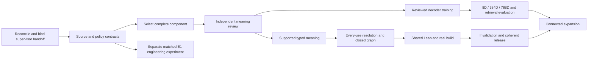

# LegalIR supervisor goals, subgoals and tasks

This is the supervisor handoff for the [comprehensive LegalIR roadmap](../legal_ir_uscode_corpus_improvement_plan_20261015.md)
and [span/graph/Lean execution design](../legal_ir_span_graph_lean_execution_plan_20261016.md).
It decomposes the existing LIR-01 through LIR-24 work into bounded child tasks.
It preserves those parent identities and dependency edges, and relates them to
the accelerator's existing LAC campaign without claiming equivalent completion.

The initial acceptance target is one complete reviewed definition, one complete
operative norm using it, and a second physical scope-valid use, connected through
typed graph records to actual `lake build legal` evidence. Later expansion is
20–40 connected provisions, then 200–500 reviewed passages, then complete selected
title/dependency neighborhoods with explicit unresolved coverage.

## Files and their roles

| File | Consumer and purpose |
| --- | --- |
| [goals.objectives.md](goals.objectives.md) | Supervisor goal heap: one root, seven workstream goals, 24 legacy-aligned subgoals, and separate handoff/engineering subgoals. |
| [tasks.todo.md](tasks.todo.md) | Native hand-authored Markdown task board: 64 bounded tasks with dependencies, objectives, inputs, outputs, acceptance and blockers. |
| [tasks.json](tasks.json) | Authoring manifest and dependency crosswalk. This is documentation data, **not** a claimed native JSON ingest schema. |
| [campaign.json](campaign.json) | Prepared handoff settings and purpose/resource proposals. This is a template, **not** an activated scheduler configuration. |
| [source_baseline.json](source_baseline.json) | Exact planning/source-file pins, attributed existing LIR statuses and related LAC headers. A snapshot is not fresh runtime admission or task completion. |
| [validate_plan.py](validate_plan.py) | Standard-library documentation checker and deterministic Markdown renderer. It checks this plan's structure; it does not execute the supervisor or prove task results. |

The task board is prepared and has **not been imported, enqueued or launched**.
Its `todo` and `blocked` fields describe this proposed refinement. They do not
overwrite existing task databases or historical completion evidence. All initial
completion modes are manual until exact task-specific acceptance commands and
job packets are materialized and reviewed. Runtime/review tasks start blocked;
only the source-only handoff reconciliation has no task dependencies.
Manual completion is not a dispatch block. Any future bootstrap must use a
reviewed finite task allowlist and current worker/resource policy; neither
manual mode nor this template authorizes dispatch by itself.

## Goal hierarchy

| Goal | Subgoals and outcomes |
| --- | --- |
| LIR-G000 | Source-grounded legal autoformalization, scoped graphs and a coherent Lean corpus. |
| LIR-G010 | Preserve assets/source identity and qualify execution ownership: LIR-01, LIR-02, LIR-03 and handoff tasks. |
| LIR-G020 | Select complete source components and obtain actual independent meaning/eligibility decisions: LIR-05, LIR-06. |
| LIR-G030 | Support complete typed meanings and provision assembly without deleting unsupported material: LIR-07, LIR-10. |
| LIR-G040 | Preserve graph identity, scoped senses, every definition use and reconstructable snapshots: LIR-04, LIR-08, LIR-09, LIR-11. |
| LIR-G050 | Shared semantics, deterministic modules, actual Lean checking and invalidation: LIR-12 through LIR-15. |
| LIR-G060 | Reuse training history, train structured heads, measure genuine dimensions/context and admit verified repair evidence: LIR-16 through LIR-20 and LIR-22. |
| LIR-G070 | Coordinated releases, measured costs and dependency-connected expansion: LIR-21, LIR-23, LIR-24. |

Leaf goal IDs `LIR-G101` through `LIR-G124` refer to the corresponding existing
LIR parent tasks. Task aliases such as `LIR-0501` and `LIR-0502` are new bounded
subtasks under LIR-05; they do not duplicate the original `LIR-05` queue record.
The JSON crosswalk records all original dependencies. Those edges are expanded
onto terminal subtasks in the Markdown board. In particular, 04→08, 09→10 and
11+14→15 remain enforced by dependency paths.



## Execution waves

1. **Handoff and reconciliation:** LIR-9001 through LIR-9004 bind current task
   authorities, source/worker/resource roles, actual job packets and genuine
   supervisor parsing/readback. Adopt completed registrations, decoder replay
   and the new byte target codec/example adapter before scheduling fresh work.
2. **Source and reviewed pilot:** complete LIR-01/02/03/05 refinements, prepare
   source-first packets, and obtain the real LIR-06 legal/formal decisions.
   Reuse retained candidate source populations; do not manufacture a selection,
   reviewer, effective date or governing-definition decision.
3. **Typed component and graph:** LIR-07/08/09/10/11 refine the exact supported
   representations, bind every physical use and close graph/companion integrity.
   The existing two-definition alias profile is not the complete norm milestone.
4. **Lean component:** LIR-12/13/14/15 generate shared semantics/modules, run
   actual `lake build legal`, audit assumptions/consequences and compare changed
   dependency builds against clean builds. This can proceed from reviewed ASTs
   without waiting for a new learned decoder head.
5. **Decoder and representation research:** LIR-17/18/19/20/22 use eligible
   reviewed supervision and frozen splits; compare source-only, latent-only and
   combined routes with genuine 8D/384D/768D producers. Keep missing, malformed,
   unsupported and abstaining cases in full-population accounting.
6. **Release and expansion:** LIR-21/23/24 seal coherent cache/model/graph/Lean
   versions, measure actual review/compute/storage costs and expand only through
   qualified dependency components.

The independent E1 lane, LIR-9101 through LIR-9108, tests conditions ranking on
exposed authored engineering targets. It need not wait for new statutory gold,
but requires its own source/asset/numerical/training qualification. It cannot
complete reviewed-training parent LIR-17 or establish statutory generalization.

## Matched E1 training subgoal

The E1 goal freezes two otherwise identical F18-derived arms: CE/retention and
CE/retention plus a conditions full-span margin. Both use the same four ordered
pointer tensors, only row 3 active, fresh Adam, seed 1729, batch size 12 and
32 updates per arm. There are 130 active scalars, 650 inactive stored scalars
and 38 fully frozen tensors. The margin arm alone adds coefficient 0.25 and
margin 1.0. Its negative domain contains every unpadded upper-triangle span
except exact gold; no top-k or overlap pruning. Full-batch normalization retains
absent/empty-domain graph-connected zeros.

The eight tasks freeze design, resolve assets/runtime relocation, implement a
new versioned profile, independently review it, qualify numerics, run both arms,
independently evaluate, and record the diagnostic release/acceptance decision.
The older F19 proposal combined freezing and margin in one arm; retain it as
history, not a causal comparison. Both outputs freeze before reference scoring.
All protected permissions, complete-rule loss IDs and scientific failures remain
visible. Initial parity, float32 overflow/tie/gradient controls and native training
admission are prerequisites, not claims supplied by this document.

## How the accelerator supervisor consumes this handoff

The inspected supervisor has two different Markdown routes:

- Its native legacy `parse_task_text` accepts `## TASK-ID Title` and `- Field:
  value`; `parse_goal_heap` accepts the separate goal records. The existing
  configured-board scheduler supports an explicit
  `source_binding.bootstrap_task_source: legacy-markdown` selection. Use that
  route for this board, with task prefix `## LIR-` and goal prefix `LIR-G`.
- Canonical `MarkdownTaskSource` additionally requires encoded canonical
  records, CIDs, plan roots and projection/revision commitments. This ordinary
  human-authored board does not supply those markers. A later conversion must
  use the real canonical materializer rather than fabricate them.

Treat `campaign.json` as input to a separately reviewed actual scheduler
configuration. Bind paths in the owning checkout, current source trees, task
namespace/revision and any paired-repository layout. Do not copy another
campaign's historical branch, provider, policy, database or resource grant.
LIR-9004 must verify actual parsing and the complete task/goal/dependency
population through the genuine native owner before activation.

The generic taskboard JSON ingestion path is not the default handoff here.
Its inspected population conversion can drop output metadata, and even its
validation path may mirror metadata into a local index. LIR-9004 must qualify
any chosen conversion and exact readback before use. Preserve full obligations,
status CAS and existing task identities; do not replace a live board wholesale.

The native task parser retains `Is schedulable` as metadata without establishing
an enforcement gate. This plan therefore uses real `blocked` statuses and an
explicit handoff activation stage. `Validation` is parsed as executable commands:
all initial fields are empty. Acceptance prose is kept in `Acceptance` instead.
The execution copy receives exact commands and completion mode only after
LIR-9003 binds its current job packet and verifier. No empty-command task is
automatically complete.

## Job packets and evidence-based completion

Every productive task packet must bind task revision/board namespace, exact
source/input/context/profile/checkpoint/toolchain roots, permitted input roles,
selected population, output ownership, commands, purpose-specific native grant,
resource lifecycle, frozen outputs, full coverage and independent acceptance.
Implementation packets also declare exact new/changed product and test paths
and shared-file lease keys. The task records' `Existing owners` are read-only
context, and their logical result paths do not broaden source-edit scope.
Source-only model inputs must not acquire targets or withheld answer graphs.
Evaluation opens role-authorized references only after candidate freeze.

Where a task coordinates training/generation and scoring, its `Stage packets`
metadata requires separate admitted producer and post-freeze evaluation jobs.
The primary resource stage grants no reference access to an evaluator. These
extra planning fields must be bound and checked by the real job materializer;
retention as Markdown metadata alone is not enforcement.

Purpose labels and resource proposals in the manifest are planning metadata.
Validation uses the existing validation owner; optimizer updates require the
actual training owner. A validation replay, registration result or filesystem
observer cannot authorize training. The proposed `semantic_review` label needs
an actual authorized reviewer capability; time passing or an agent's agreement
does not supply a legal decision. Lean work requires the exact chosen native
owner/toolchain. Publication and promotion have separate writer/acceptance roles.

Result paths in task records are logical repository handoff paths. Actual workers
write inside their positively admitted native attempt roots; a configured writer
publishes immutable references/results to those logical paths. The paths do not
expand a native writable grant. Bound memory, process, CPU/GPU, time, output and
storage before a run; preserve foreign claims/assets and retry only when the
input or blocking condition changes. The proposal grants no cap or ledger change.

A task may complete a diagnostic with a negative scientific result if its stated
deliverables and evidence gates pass. That does not complete a parent goal whose
acceptance requires an improvement or reviewed supported meaning. Preserve source
custody, legal applicability/review, typed validity, graph integrity, actual Lean
build and training/teacher eligibility as separate outcomes.

## Local documentation verification

From the datasets repository, run:

```bash
python3 docs/autoencoders/legal_ir_supervisor_plan/validate_plan.py
```

The checker reads this documentation and local source-path metadata only. It
checks JSON shape, unique IDs, goal hierarchy, task dependency closure/cycles,
all 24 parent mappings and critical edges, exact Markdown projection, reference
paths, prepared status, empty initial commands and blockers. It does not import
product code, open corpus/checkpoint/prediction bodies, contact the supervisor,
touch databases/leases or claim native execution compatibility was run.

Use `--render` only when deliberately updating the authoring JSON and its Markdown
projections together. After changing upstream inputs, refresh the recorded source
baseline and reconciliation before using old execution evidence.
