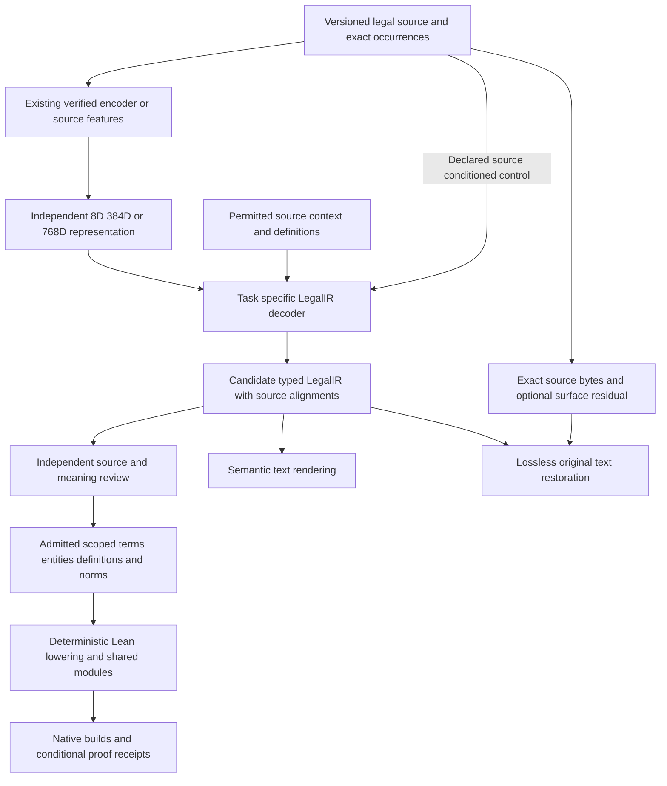

# LegalIR improvement plan for US Code graphs and Lean 4

Date: October 15, 2026. Implementation baseline: `12dd975181fed9f5a0ba3589f842b3055bb7b162`.

Implementation follow-up: the [citation identity repair and source-sampler integration](legal_ir_graph_citation_identity.md) now qualify the actual current release writer → private Parquet → citation-reader handoff. All 406 cases in the affected local suites passed, including 38 citation cases and the existing sampler's 29 cases. This closes a current-reader transport gap and adopts the parallel sampler; the malformed historical Hub export, statutory review, semantic decoder quality and Lean admission remain separate unfinished milestones. The table below retains the original research baseline.

The existing [source-response, adjudication, application, history and binding owners](legal_source_review_stack_integration_20261015.md) are now integrated with 1,565 passing local cases across 13 modules, preserving their original contributions and declaration-only effects. Their parent/alignment requests already support markup-v2 views, but standalone sampler records have distinct source-version identities and lack those exact request/preparation joins. The native semantic bridge's older paragraph interface is a separate gap. Shared visible text cannot substitute for either correspondence.

The additive [source-first sampling review intake](legal_source_sampling_review.md) now passes 76 local cases and prepares all 560 §101 subjects (134 candidate paragraphs and 426 controls), with every review still pending. It preserves the standalone sampler population and unsigned reviewer declarations; historical parent/alignment signatures, V2 meaning reviews, training gold and Lean admission remain separate gates.

The first milestone is one independently reviewed statutory definition connected to a complete norm that uses it, followed by a second use, represented in a scoped semantic graph and compiled into one Lean 4 project. Improve the LegalIR decoder against those reviewed meanings, then expand by dependency neighborhoods. Processing the whole cache can begin with inventory and diagnostic triage in parallel; admitting the whole cache as formalized law requires the later semantic and proof gates.

Reuse the existing source caches, embeddings, checkpoints, graph owners, review workflow and Lean builders. Preserve the 8D, 384D and 768D paths independently. Larger vectors and lower training loss are useful measurements, but complete legal meaning, graph composition and checked consequences determine progress toward the corpus.

This is a plan and evidence review. Its publication starts no inference, training, corpus migration, reviewer signing, model upload or Lean build.

## 1 Current findings and priorities

The [reconstruction and asset survey](evidence/legal-ir-uscode-plan-20261015/reconstruction-and-assets-survey.json), [pipeline and integration survey](evidence/legal-ir-uscode-plan-20261015/pipeline-and-integration-survey.json), and [Hub cache survey](evidence/legal-ir-uscode-plan-20261015/hub-cache-survey.json) record the inspected revisions, sources and limits. The existing [all-span processing plan](uscode_all_span_processing_plan_20261007.md) remains useful, but its pinned cache generation and several training cutoffs are historical.

| Finding | Consequence |
| --- | --- |
| F18 is published at immutable model archive `c9cce4586dd96518088662fb12831173e98e36cc`; its payload readback passed. | Reuse it as a retained experimental control. Archive custody does not establish a qualified teacher or portable numerical reload. |
| F17 and F18 both reconstruct complete training IR on 154/168 cases; both fresh development and fresh test panels remain 0/36 on raw and joint routes. F18 fails its predeclared acceptance gates. | Preserve named regressions and diagnose the errors before another fit. Do not promote F18 or repeat its unchanged recipe. |
| F17/F18 have latent conditioning disabled, a declared 384-value placeholder and zero external encoder calls. | Their scores measure source-conditioned decoder adapters, not GTE representation benefit. Earlier genuine 384/768 conditioning experiments remain separate evidence. |
| Contextual 384/768 replay achieved 48/48 ordered IR on an authored cohort but 0/48 original-prose equality. | Semantic IR reconstruction and original legal-text reconstruction need separate contracts, heads and denominators. |
| In a retained 20-row diagnostic sample, 96 literal cache matches have no coordinate intersection with nine proposed operative-text units. Many matches are citation, heading or amendment fragments. | Correct source-structured sampling and correspondence before treating cached fragments as norms. This sample does not estimate the quality of the complete cache. |
| Typed graph exchange, scoped lookup, shared Lean modules and incremental compilation exist. The current native definition/norm bridge is section-local and unary. | Extend those owners for actual reviewed provisions. Do not silently drop arguments, qualifiers or cross-section scope to fit the current grammar. |
| The source sampler and the five retained response, adjudication, application, history and binding owners are integrated. The standalone sampling review intake is separately qualified. | Reuse these owners while preserving their exact request domains. Complete actual source/meaning reviews and explicit occurrence/context correspondence before semantic admission. |

The [F18 report](../autoformalization/legal-modality-conditions-retention-20261015.md) distinguishes technical qualification, scientific failure, publication and remaining numerical limitations. The [completed F19 saved-score comparison](../autoformalization/legal-conditions-composition-20261015.md) and its separately authored counter agree on 60 panels, 54 scored sets, 81 comparison groups and six rank records. Both fixed combinations remain 154/168 complete training IR. Gold conditions spans already rank second or third within the actual top eight, with all six gold assignments feasible; the shorter prefix still outranks gold. This completes the diagnostic recount prerequisite below. The proposed F18 conditions-only freezing-plus-margin recipe is an engineering experiment, not the matched retained-CE causal comparison required in section 5. No composed checkpoint, new training, active-latent qualification or Lake build was executed by this diagnostic; its named old-tuning regression remains a promotion veto.

## 2 Define the reconstruction tasks

The intended pipeline has a semantic path and a surface-preservation path:



| Task | Inputs available to the measured decoder | Measure |
| --- | --- | --- |
| Vector reconstruction | The declared encoder representation | MSE/cosine plus verified producer identity; a representation diagnostic |
| Source to LegalIR | Declared source-text/token-feature path, latent path, or both, plus explicitly permitted context | Complete typed IR, rule count/order, exact facet spans, arguments, scope and abstention |
| LegalIR to semantic text | Predicted IR and declared public context | Preservation of reviewed legal meaning, including qualifiers and unresolved portions |
| LegalIR to original text | IR only, or a separately declared surface channel | Exact UTF-8 equality, normalized equality and edit distances, reported separately by available channel |
| Retained-source restoration | IR/source references plus exact retained bytes | Byte-exact transport and coverage; separate from learned source-free generation |
| LegalIR to logic and Lean | A supported, reviewed interpretation and declared semantics | Lossless lowering, actual compilation, explicit assumptions and checked consequences |

Evaluate latent-only, source-plus-latent and source-only routes separately, documenting exactly which source features each decoder receives. A source-conditioned model with a disabled latent is not a dimensional-bottleneck experiment.

Semantic IR commonly maps several wordings to one meaning. Exact original wording cannot generally be recovered from that meaning alone. The existing [round-trip scorer](legal_original_text_roundtrip.md) calculates the collision ceiling for its actual cohort; its balanced 60-row cohort has 30 semantic targets and a 50% IR-only exact-original ceiling. That is a cohort-specific observation, not a limit on richer representations.

Keep exact source bytes and offsets in a provenance envelope outside the semantic AST. If learned exact prose is required, train a separately registered surface decoder with an explicit style/residual channel and source-withheld evaluation. Report byte restoration, canonical rendering, retrieval and learned generation as different routes. An IR containing a pointer to the original document can restore it faithfully, but does not demonstrate source-free generative reconstruction.

## 3 Reconcile both caches and source identity

Freeze the [span cache](https://huggingface.co/datasets/justicedao/uscode-autoformal-span-cache) and [entity cache](https://huggingface.co/datasets/justicedao/uscode-autoformal-entity-cache) at immutable revisions before starting a campaign. Snapshot the original file manifest, schemas, producer versions and remote content hashes. The Viewer is an exploration interface; overlapping configurations and unavailable splits cannot define the processing denominator.

| Observed snapshot | Inventory and meaning |
| --- | --- |
| Span `ac68213001c649516036562ad031529c97c10b97` | 6,336 files and 3,852 Parquet files; 611 paired-v1 and 80 paired-v2 manifest/shard sets. The card's paired configuration exposes v1 only. These overlapping generations are not unique-span totals. |
| Entity `067c2a41affc6041fafb8237ae6df41bf4320008` | One 16,898,459-byte Parquet with 1,960,876 mixed records, 12 columns and 16 row groups. Footer statistics report admission/formalization flags false. |
| Entity endpoint defect | Complete footer groups 2–14 contain at least 1,597,955 edge rows with both `src` and `dst` empty. Other groups contain nonempty endpoints; the total malformed-edge count is not established. |

The Hub survey retains exact response bytes, pinned footer metadata and bounded real rows. Span Viewer requests returned HTTP 500; pinned files supply the observations above. Entity Viewer is not revision-pinned, so its totals are corroborated against the pinned file footer.

The entity total is a count of mixed graph records, not distinct legal entities. Repair endpoint-preserving export from retained original graph/source evidence before relying on its edges for provenance or semantic navigation. Do not guess endpoints from equal labels. Preserve the old export, write a versioned corrected generation, and reconcile duplicate/missing node identities, every typed endpoint and complete record counts against its source. If originals cannot recover an edge, retain an unresolved diagnostic record rather than inventing it. Keep the separately identified primary structural graph and this legacy cache distinct until their lineage is established. Before rebuilding, require an original-to-export-to-reimport regression with two distinct nodes and one typed edge, preserving endpoint namespace, relation, role and ordinal; empty or dangling endpoints must refuse acceptance. Then validate the complete corrected export against its retained source manifest.

Sampled paired source records contain `span_id`, `text`, `text_sha256`, `legal_id`, `revision` and `constitution`, without physical offsets or a statutory effective-date field. Entity rows lack the source span ID, text hash and revision needed for a reversible source join. Add explicit versioned mention/assertion-to-source mappings. A shared `legal_id` or literal text alone cannot establish that join. Sampled paired-v1/v2 vectors are 8D `mock:stable-sha256` diagnostics, including target-conditioned projections; zero projected loss does not qualify a GTE decoder or legal formalization.

The retained resume checkpoint footer identifies 443,905 mixed rows: 443,904 span-status records and one progress record. The producer progress counters report 22,379 `sealed`, 421,525 `gap`, and a legacy `pending_count` of 3,820,263. These are historical queue observations. Neither `sealed` nor a parser formula means independently reviewed law, and pending work is not a count of distinct source spans. Independently reconcile the current snapshot's rows, namespaces and aliases before adopting these as campaign totals.

Build three inventories: physical source occurrences, model/compiler observations, and semantic/proof assertions. One source occurrence may have many model outputs; one rule may require several source occurrences. Keep duplicate text occurrences distinct while reusing their immutable bytes.

Every source unit must bind:

- Source repository and immutable revision; original file hash and physical row/ordinal; legal citation and provision hierarchy.
- Source version/edition and separately declared legal applicability. Unknown dates remain unknown; a heading or model prediction cannot supply them.
- Raw text hash, exact occurrence, half-open Unicode and UTF-8 selectors, extraction profile and source-view identity. HTML, normalized visible text and historical Parquet text have different coordinate spaces.
- Complete paragraph/clause, list introduction, inherited scope and required context; source-role status and unresolved dependencies.
- Historical span IDs as aliases with a reproducible mapping. Reuse the original grouped-ordinal algorithm where it produced those IDs; current worker batch size must not redefine historical identity.

Use the existing parent occurrence/alignment and official-document-view owners. Prefer source structure to punctuation-only segmentation; retain complete clauses and shared qualifiers. Preserve statutory notes, editorial material, repeal markers, source credits and unknown roles as explicit strata. Notes may themselves carry operative provisions and must not be excluded indiscriminately. A markup role is a sampling observation until the source interpretation is reviewed.

The acquired candidate definition source, the [2024 edition of 10 USC 101](https://www.govinfo.gov/content/pkg/USCODE-2024-title10/html/USCODE-2024-title10-subtitleA-partI-chap1-sec101.htm), is a candidate dependency for the retained officer provisions. Establish its version, scope, physical selectors and legal applicability before asserting a definition-use relationship. Existing extraction-fit work should be reused. Missing acquisition observations must be recovered honestly or reacquired, rather than filled from an extraction success. The official [US Code downloads](https://uscode.house.gov/download.html) also provide structured source formats for later releases.

## 4 Build reviewed supervision and a connected pilot

Start with one actual definition, one complete norm that uses it, and a second use to test symbol sharing. The existing nine candidate operative units and acquired definition source are review inputs, not an already selected or representable pilot. Select the component by actual dependencies and review capacity. Expand to 20–40 connected provisions, then 200–500 reviewed passages, only after the smaller component works.

Use distinct source-correspondence, legal interpretation and formal-representation decisions. Ask the legal reviewer for a candidate-blind target before showing decoder alternatives. Have a separate formal reviewer check scope, operators and lowering. Record disagreement, alternatives, unsupported content and adjudication explicitly. Reuse existing review/trust owners; authenticated signatures bind a declaration to a selected registered key under the supplied policy. Human identity, independence, competence and legal correctness require separate evidence.

The historical review owners bind original parent/alignment replay inputs, including supported markup-v2 views. The [standalone sampling intake](legal_source_sampling_review.md) instead binds the independently replayed sampler bundle, exact subject and versioned question catalog. Shared view profiles do not make their source-version/occurrence identities interchangeable. Its unverified source findings and meaning proposals retain unresolved/disputed/unsupported states; no signed historical request or native semantic correspondence is fabricated.

Each selected unit receives an included, pending, disputed, unsupported or out-of-scope disposition. Only separately admitted targets receive training/evaluation masks. A compiler formula, cache status, successful graph seal or Lean build cannot manufacture those masks. Preserve complete target provenance through later corrections.

Freeze splits before fitting or selection. Group provisions with their revisions, near duplicates, derivative examples and actual semantic definition dependencies. Broad citation graphs can connect most of the corpus; use semantic dependency clusters and document crossing context explicitly. Shared public definitions may be inference context under a frozen policy, but withheld interpretations and answer graphs may not enter retrieval or features. Existing exposed "fresh" panels are regression diagnostics now; reserve new untouched components for a generalization claim.

The pilot's review checklist must include passive actors/recipients, coordinated duties, necessary approval, numerical limits, permissions, non-entitlement, condition/exception attachment, recurrence, effective dates and unresolved cross-references. A norm is complete only when every material part is represented or explicitly marked unsupported. Never shorten statutory text merely to fit a decoder or bridge.

## 5 Improve the decoder with attributable experiments

First run a target-free replay of the exact retained checkpoints through their compatible historical interfaces. Verify full tensor and artifact hashes, actual encoder mode, vocabulary/codec, schema/task, source hashes and optimizer state policy. Keep F15, F16, F17, F18, historical latent decoders and grouped decoders as different lineages. A shared nominal dimension does not make their weights compatible.

Use the completed independent F19 recount to select and preregister the next hypothesis. Saved-score analysis can prioritize an experiment without producing a trained composed model. Freeze selected cases, acceptance rules and budget before another numerical run.

| Experiment | Changed hypothesis | Required comparison |
| --- | --- | --- |
| Candidate coverage | Correct complete spans/rules are pruned or unavailable | Oracle candidate recall before ranking; top-k and output-budget sensitivity; source-only baseline |
| Conditions ranking | Correct boundaries exist but shorter quoted names outrank complete conditions | Same candidates, donor and budget; boundary/pairwise ranking versus retained CE control; two targeted errors plus all retention cases |
| Qualifier ownership | Conditions/time/exceptions attach to the wrong rule or argument | Explicit relation/owner targets, separate presence and ownership metrics, complete-rule retention |
| Grouped decoding | Multiple spans or clauses require ordered assembly | Rule count, stopping, list inheritance, repeated mentions and full paragraph coverage; no fixed-rule cap hidden in the denominator |
| Graph context | Retrieved definitions disambiguate a use | Same decoder with/without version-compatible retrieval; unrelated/shuffled context and retrieval-only controls |
| Active GTE conditioning | Verified latent information improves semantic reconstruction | Active, zero, permuted and source-only routes with identical source/data/budget; measured encoder calls and intervention effects |
| Compatible head transfer | Retained readouts improve initialization | Exact donor copies, zero-residual parity and frozen-head controls; compare with a declared fresh initialization arm |

For richer reviewed targets, use a typed AST decoder or compatible extensions to the existing heads. Preserve modality, quantifiers, argument sorts, actor/action/object roles, ordered Boolean structure, condition/exception/temporal attachments, definitions and explicit unresolved nodes. Constrained decoding can enforce structural validity; it cannot supply legal correctness. Pointer/copy mechanisms preserve exact literals and selectors while relation heads decide their role. Treat lexical coverage, candidate selection and semantic attachment as separate errors.

Use a preregistered objective with separately reported AST/token loss, exact-boundary loss, argument/attachment loss, modality loss, calibrated abstention and teacher-retention loss. Apply label masks to each objective and require traceable admitted targets. Tune coefficients only on development data. Solver failures become typed diagnostics first; resource exhaustion or unsupported lowering is not a negative legal label.

Promotion requires improved complete-rule performance on the selected evaluation design, the existing protected permission/retention gates, and no predeclared material loss-ID veto. Report seed variability for promotion claims; an engineering pilot can precede replication. A lower head loss, a higher aggregate with named regressions, or a successful upload is insufficient. Preserve failed experiments as reusable controls.

## 6 Keep 8D 384D and 768D paths parallel

The target model is **768D**, rather than 786D. The [gte-multilingual-base model card](https://huggingface.co/Alibaba-NLP/gte-multilingual-base) specifies 768 dimensions and an 8,192-token input ceiling. That ceiling is not evidence that the existing decoder reconstructs 8,192-token statutes. Input context, latent geometry, output token budget and rule cardinality are independent versioned capabilities.

| Lane | Preserve | Next qualification |
| --- | --- | --- |
| 8D | Actual historical linguistic teacher/producer, vector artifacts and decoder task | Establish genuine encoder and output lineage; retain its diagnostic/weak-label role unless independently qualified |
| 384D | Existing GTE-small vectors, matching decoder checkpoints and nominal 512-token producer profile | Demonstrate active representation benefit on reviewed, grouped source; retain earlier successful compatible states |
| 768D | Existing native multilingual vectors, saved decoder initialization and authentic producer receipts | Replay matched existing assets first, then qualify longer-context bands and supported output geometry |

Do not synthesize 768D inputs by padding 384D vectors, or relabel historical mock 8D vectors as GTE embeddings. Reuse an embedding only when source bytes, context, encoder/tokenizer revision, pooling, normalization, dimension, precision and truncation policy match. Native 768D embeddings that are missing require a new explicitly identified production job; record the missing cache entry rather than silently regenerating the whole corpus.

For transfer into the 768D decoder, copy compatible semantic readouts, vocabulary and schema-specific heads with tensor-by-tensor evidence. Reuse the [decoder reuse sequence](gte_decoder_reuse.md), [knowledge-transfer replay](gte_decoder_knowledge_transfer.md), and [native-input contract](gte_decoder_native_inputs.md). Introduce an explicit learned input adapter where interfaces differ; preserve donor predictions at initialization where the contract allows it. Optimizer resume versus fresh moments must be declared. Distill source-matched logits, typed structures and reviewed alignment relations using confidence and eligibility masks. Teacher disagreements remain visible. Existing compiler-derived weak labels retain that attribution; they are not independent legal gold.

A smaller teacher can initialize a wider student, but no transfer rule makes an unqualified teacher reliable. Keep 8D/384D baselines running while the 768D candidate is evaluated. Distinguish warm-start utility from proven semantic improvement and avoid assuming a fixed-width vector can losslessly encode arbitrary source length.

Widen context in separate 512, 1,024, 2,048, 4,096 and 8,192-token bands. At each band compare chunked and whole-context processing on matched sources; test complete section coverage, inherited qualifiers, cross-span references, truncation refusal, output overflow and resource use. Longer output/cardinality profiles require their own decoder changes and checkpoints. Do not silently truncate long laws.

## 7 Aggregate typed terms entities definitions and norms

Use [corpus graph records](../../ipfs_datasets_py/logic/autoformal/corpus_graph.py) and [graph exchange](../../ipfs_datasets_py/logic/autoformal/corpus_graph_exchange.py). The node record CID is distinct from a stable conceptual ID and its content payload CID. Typed edges must name the actual node record endpoints required by the schema. Keep structural/provenance graph edges distinct from admitted legal-semantic assertions.

| Object | Identity and meaning |
| --- | --- |
| Mention | Exact surface occurrence and coordinate space; repeated wording remains multiple mentions |
| Term sense | Scoped, versioned legal meaning of a spelling; equal text does not merge senses |
| Entity | A separately justified person, organization, office, event or other denotation; generic quantified categories need not name ground entities |
| Definition | Head sense, exact operator/body, applicable scope/time, source interpretation and review |
| Norm | Quantifiers, modality, argument roles, conditions/exceptions/time, applicability and complete source evidence |
| Resolution | Candidate inventory, selected binding or unresolved state, lookup route and decision evidence |

Reify definitions and norms so ordered arguments and shared qualifiers survive graph aggregation. Proposed semantic relationships include `MENTIONS`, `DENOTES`, `DEFINES`, `USES_DEFINITION`, `APPLIES_WITHIN`, `HAS_ARGUMENT`, `HAS_CONDITION`, `HAS_EXCEPTION` and version/change links; use or version the existing schema for each. Preserve alternative interpretations as separate branches instead of unioning their assertions.

Resolve definitions using explicit references and declared local/enclosing/import scopes, followed by role, sort, arity, version and applicability checks. Do not choose by lexical similarity, newest edition or nearest vector alone. An inclusion definition must not automatically become equivalence; exclusions, legal fictions and construction rules require reviewed operator semantics.

The existing [scoped resolver](scoped_definition_resolution.md) distinguishes known empty partitions, unavailable data, ambiguity and resolution. It binds caller-declared search routes; it does not discover or prove governing legal scope. Extend it with independently reviewed applicability and source-to-native-symbol bindings. A lookup result alone does not create `USES_DEFINITION`.

Assemble provisions by physical hierarchy and occurrence order, not hashed span IDs. Preserve shared introductions, coordinated clauses, definition dependencies, alternatives and the unresolved frontier. Compute semantic dependency closure with resumable bounds; two-hop citation closure is a diagnostic, not semantic completeness. Represent cycles explicitly and choose a supported simultaneous interpretation rather than forcing recursive executable definitions.

Keep source publication/edition, legal applicability and event/evaluation time separate. Potential conflicts remain separate source-bound assertions until evaluated under common scope/time and a declared conflict policy. Permission is not automatically duty, non-entitlement is not automatically prohibition, and obligation is not evidence that the action occurred.

## 8 Fold the graph into one Lean 4 corpus

Reuse [the definition/norm adapter](legal_corpus_definition_norm_adapter.md), [shared Lean builder](legal_corpus_shared_lake.md), [incremental builder](legal_corpus_incremental.md) and current family lowerers. The present bridge accepts a section-local explicit `means` definition and an exact unary norm grammar. It lacks general object roles, conditions, exceptions, timing and automatic cross-section definition bindings. A reviewed statutory component needing those features must use a separately versioned supported extension.

One corpus means a coherent release with shared symbols, complete imports and explicit semantic profiles, rather than one enormous source file:

```text
Legal/Core/{Entities,Scope,Definitions,Deontic,Time}.lean
Legal/USCode/Release_<id>/Title_<n>/Definitions.lean
Legal/USCode/Release_<id>/Title_<n>/Section_<id>.lean
Legal/Verification/<obligation>.lean
Legal/Manifest/<release and source graph bindings>
```

Deterministic lowering must preserve the admitted AST and reject unsupported operators without deleting text. Pin compiler code, semantic library, Lean/Lake versions, dependencies, generated files, imports and assumptions. Bind every Lean declaration back to graph assertion, interpretation and source occurrences.

The existing conditional theorem combines `∀x, D(x) ↔ B(x)`, `∀x, D(x) → O(A(x))`, and `B(e)` to derive `O(A(e))` under a supplied modal interpretation. It does not prove those statutory premises or actual action truth. Treat legal rules as represented content or explicit hypotheses; do not turn every generated rule into a trusted axiom and then report its own restatement as a proof of correct translation.

Require actual bounded native builds and every expected compiled artifact. Audit theorem assumptions and axiom dependencies against the selected profile, with no `sorry`, `admit` or hidden placeholder axioms. The current narrow conditional profile requires an empty printed axiom list; any future broader allowance must be explicit and separately reviewed. [Lean's propositions reference](https://lean-lang.org/doc/reference/latest/The-Type-System/Propositions/) describes the proof-level objects; correspondence to source law remains a separate review obligation.

Test meaningful positive and negative consequences, definition sharing, changed bindings, and assumptions that would make a result vacuous. Keep incompatible interpretation theories separate; an inconsistent union must not make every proposition appear established. A failed proof may indicate insufficient premises or an unsupported theory rather than a bad autoformalization.

Invalidate by full dependency keys: source and interpretation versions, definition/search partitions, review/admission decisions, semantic profile, imports, compiler and toolchain. New competing definitions can invalidate an old unique lookup even if its selected definition is unchanged. Store negative lookup dependencies. Require cold/warm/changed-definition builds and incremental versus clean artifact equivalence; unrelated modules should remain reusable.

## 9 Inventories databases registration and releases

Extend the existing [family/dimension inventory plan](ir_family_dimension_inventory_plan.json), [teacher transfer contract](teacher_student_transfer.md), checkpoint exchange and `ipfs_accelerate_py` ModelManager adapters. Keep LegalIR separate from CodebaseIR, IntentIR, SecurityIR and UI/UX IR. The existing four-family/twelve-cell inventory does not automatically include UI/UX IR; add it through an explicit profile rather than claiming a fifteen-cell deployment already exists.

The minimum checkpoint key is:

```text
IR family / schema version / decoder task / input and latent dimension roles
encoder and tokenizer revisions / token and output profiles / target codec
source and split generation / run and donor lineage / tensor and artifact hashes
```

Separate semantic JSON/AST, original-text reconstruction, span proposal, grouped decoding and any learned FOL/TDFOL output heads. Deterministic logic/Lean emitters are compiler artifacts with their own versions, not automatically new learned decoder checkpoints.

Use separate LegalIR8D/384D/768D inventories and physical registry/index databases with serialized writers. The shared source CAS can be deduplicated by immutable reference. Keep candidate, reviewed, proof and operational status namespaces separate. Start from proven DuckDB plus immutable Parquet/CAS; the retained DuckLake adapter/layout is not evidence of a qualified production lake. Qualify transaction, snapshot and restart behavior before adopting it. Quack metadata may project status and joins. Exact artifact/manifest identities establish custody; admission also requires the independently verified policy and evidence for that stage.

Reuse existing family repositories where present; proposed missing cells follow `Publicus/legal-ir-autoencoder-{8d,384d,768d}` after verifying current ownership and identities. Preserve the aggregate `Publicus/legal-ir-autoencoder` archive and previous releases. New repositories use the user's selected public visibility; existing visibility stays unchanged. Version schemas/tasks/profiles inside each dimension repository.

Import exact releases into ModelManager as retained, replay-qualified, experimental or promoted roles with accurate capabilities and immutable Hub commit/path/hash. Keep aliases from silently selecting another schema/task or unpromoted F18 state. Verify a cold resolver retrieves the exact artifact and a compatible isolated numerical reload reproduces recorded outputs before marking it load-qualified. Current F18 registration was not established by this review; make that a reconciliation work item, not a presumed completion.

Extend both caches additively with versioned `source_units`, `interpretations`, `reviews` and graph `mentions`, `nodes`, `edges`, `definitions`, `assertions`, `resolutions`, `issues` and `build_receipts` tables. Do not rewrite diagnostic rows into accepted rows. A coordinated release manifest binds exact span-cache commit, entity/graph-cache commit, model lineage and Lean corpus/toolchain outputs. Verify remote bodies at immutable commits before advancing the selected release. Resolve uncertain upload outcomes before retrying; retain the prior coherent release after a partial upload. Avoid a self-referential manifest commit hash by publishing referenced data first and storing the coordinator receipt separately.

## 10 Process all spans with explicit completion states

Begin a complete pinned inventory and inexpensive source/representability triage before waiting for a new teacher. Schedule model, graph and proof stages only where their input gates pass. Reuse existing span-ingestion leases, native resource owners, deferred-goal import and durable outbox behavior; inspect the current implementation before extending it.

Work keys bind source/context, family/dimension, encoder/checkpoint, schema/task/codec, inference settings and compiler/checker dependencies. A new model cannot inherit an old `sealed` result merely because the span ID matches. Content-based sharding preserves occurrences and exact batch manifests.

Each occurrence has a disposition for each stage: candidate produced, reviewed/admitted, unsupported, source unresolved, needs context, disputed, output/token overflow, checker failure, retryable technical failure or deferred. Queue leases and retries are operational states; semantic disagreement is durable work, not an infinite retry. Report all inventory rows, eligible rows, attempted rows and successful rows separately, with explicit unresolved coverage.

Workers write immutable result batches; a controller serializes physical database writes and publication. Bound input/output bytes, context tokens, peak RAM/GPU use, time, concurrent jobs and disk reservations. Restart from verified completed keys and owned lease identities. Preserve foreign work and existing model assets. Measure reviewed clauses per hour, accepted graph assertions, checked modules, review minutes, cache reuse, storage and cost per accepted component before choosing rollout concurrency. Do not infer total cost from row count or advertise throughput before a representative pilot.

The supervisor can use IntentIR to plan repair/context/review jobs against current inventories and CodebaseIR to ground implementation obligations. Those IRs remain separate from LegalIR legal assertions. Cached candidates or unknown proof obligations cannot satisfy a planner's proven precondition.

## 11 Milestones and acceptance

These milestones refine the existing corpus backlog; they do not create another task authority or enqueue work. Preserve the established LIR task dependencies, including LIR-04 before LIR-08, LIR-09 before LIR-10, and LIR-11/LIR-14 before LIR-15. Reconcile the separately retained broader LAC campaign before importing any jobs.

| Milestone | Concrete work and dependencies | Acceptance |
| --- | --- | --- |
| M0 Reconcile progress | Pin main, retained source owners, both caches, asset lineage and actual ModelManager roles; integrate qualified parallel contributions; recover endpoint-preserving entity export | Published/local/untracked states explicit; no duplicate owners; source/model aliases reproducible; every accepted edge has real versioned endpoints |
| M1 Correct source inputs | Adopt the existing structured sampler and view extractor; finish acquisition evidence and exact occurrence/context joins | Complete selected population and coordinate maps; no lost controls or invented source fields; every gap has a disposition |
| M2 Review one component | Candidate-blind source/meaning targets for definition and complete norm, then a second use; preregister splits/exposure | Actual independent decisions; zero gold masks on unresolved items; complete supported/unsupported accounting |
| M3 Represent and connect | Minimal typed profile extension, scoped binding and reconstructable graph using existing owners | Every argument/qualifier and typed endpoint preserved; exact source/interpretation companions; alternatives and dependencies explicit |
| M4 Build Lean component | Deterministic shared modules, meaningful conditional obligations, native builds and invalidation | All expected artifacts; declared assumption policy; no placeholders; changed-definition rebuild equals clean build |
| M5 Improve and transfer | Build on completed F19 recount; changed ranking/ownership/context arms; active 8/384/768 comparisons and compatible warm starts | Reviewed complete-rule gain under preregistered retention and uncertainty gates; genuine producer receipts; no latent-placeholder claims |
| M6 Expand and release | 20–40 connected provisions, then 200–500; inventory/triage whole cache; title/dependency rollout | Reconciled denominators; immutable cross-cache/model/Lean readback; reproducible restart and measured review/compute cost |

M0/M1, engineering profile controls and artifact-only diagnosis can proceed in parallel. Reviewed statutory graph admission waits for M2; supported Lean lowering waits for M3. Research model branches can run independently, but a statutory-quality or teacher-promotion claim waits for the required reviewed targets and evaluation design. Calendar estimates should follow the first measured review/compute pilot rather than override these dependencies.

### Evaluation dashboard

| Layer | Required reporting |
| --- | --- |
| Source | Unique occurrence accounting, recovered legacy aliases, extraction/context availability, token overflow and source-role sampling |
| Decoder | Candidate oracle recall; boundary/argument/attachment errors; modality confusion; count/stopping; full IR; abstention/coverage; named losses |
| Reconstruction | Exact original UTF-8, normalized equality, semantic fidelity and edit distances by IR-only/surface/source-retained route |
| Representation | Actual input producer/context, encoder calls, active/zero/permuted effects, seed variation and equal-budget comparison |
| Graph | Endpoint integrity, scoped sense/entity accuracy, definition-use resolution, unresolved/cyclic dependencies and alternative interpretations |
| Lean | Supported lowering coverage, actual module builds, conditional theorem outcomes, assumptions, placeholders and source-to-declaration traceability |
| Operations | Fresh/reused/stale keys, restart/lease behavior, changed-dependency rebuilds, human review time, throughput, disk and compute cost |

Choose semantic error thresholds and confidence procedures from the review design before final testing. Require exact mechanical integrity for accepted bundles and no material meaning omission in the small supported pilot. Report overall selected-population coverage beside supported-subset fidelity so abstention or unsupported cases cannot disappear from the denominator.

The sampler and the existing source-review owners are now integrated; the linked guide records qualification scope. A newly observed parallel contribution at `4e4ea1afa0226c62fdd28e1678cd4046feb90218` already implements unreviewed V2 definition-only candidates with title/section scope and ordered multiple-occurrence contributors. Qualify and integrate that existing bridge, corpus adapter and legacy Boolean refactor next rather than rebuilding them. A deliberate request/profile mapping for standalone sampled units and compatible V2 meaning reviews still needs exact source/version/occurrence/context references without invented historical parent-cache evidence; existing parent/alignment requests retain their original meanings and inputs. Then obtain the first actual definition/use source and interpretation reviews, complete supported norm/use bindings and address remaining representational gaps. A corrected graph-cache generation must reconcile its complete retained source manifest before publication. In parallel, use the completed F19 recount to implement and independently qualify the attributable ranking experiment. That produces better legal supervision and a connected graph/Lean target while preserving all previous decoder progress.
