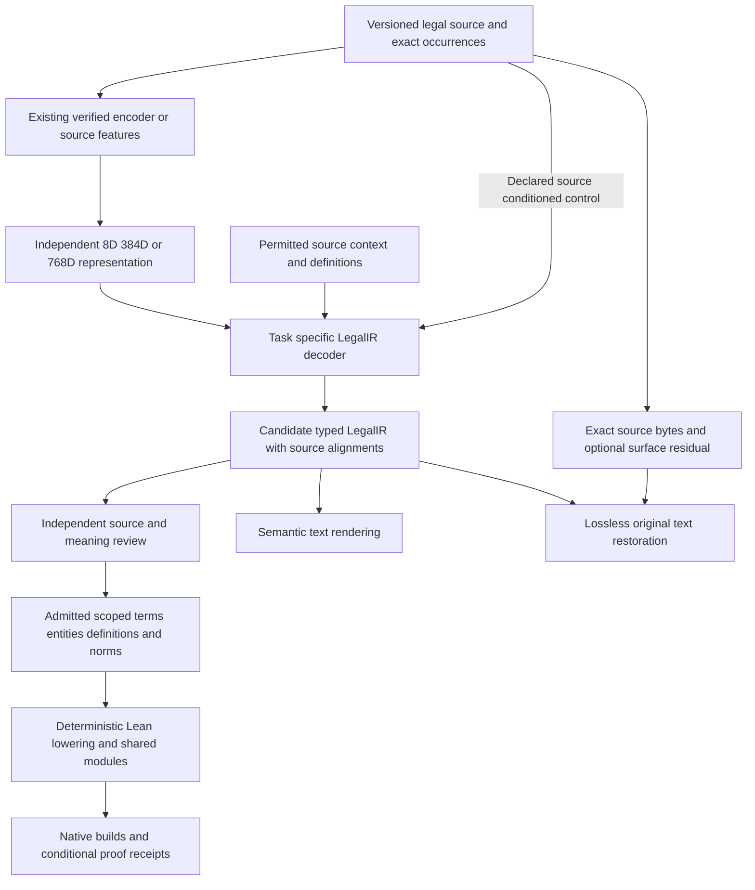

# LegalIR improvement plan for US Code graphs and Lean 4

**Current LegalIR handoff:** [autoformalization guide](../autoformalization/README.md) and [current state](../autoformalization/CURRENT_STATE.md). Source, review, graph and Lean documentation is maintained there; this document retains its existing model guidance and dated research history.

Current delivery view: the [October 18 consolidated roadmap](legal_ir_uscode_roadmap_20261018.md) reconciles subsequent implementation and adverse model results, includes the genuine 4096D path alongside 384D/768D, and orders the remaining source, meaning, training, graph and Lean gates. The dated observations below remain historical; use the consolidated milestone table for next-work planning.

Date: October 15, 2026. Original implementation baseline: `12dd975181fed9f5a0ba3589f842b3055bb7b162`.

Planning refresh: sources and existing plan inspected at published Datasets commit `234dc97a2fedb864c99add7f0d8e37ba81c785cf`; this is a reporting snapshot, not a new training runtime. The older live checkout remains at `74f5d98c8ffff3c284cffddf430091b5fc4c6f8c` with its existing edits preserved. This document was restored from the published plan into its previously absent local path and refined; no implementation files or task states were changed. Relative source/report links refer to that published tree where the older checkout lacks a file.

Read sections 3 and 12 for the refreshed cache inventory and ordered implementation work. The existing 24-task LIR backlog remains the authority; this plan refines its deliverables and acceptance conditions. The [bounded cache and code observation](evidence/legal-ir-uscode-plan-20261015/cache-and-code-refresh-20261015.json) distinguishes current Hub descriptors, mutable Viewer observations and historical corpus audits.

Implementation continuation: the [fresh cache census and source preparation report](legal_ir_cache_source_qualification_20261015.md) now verifies the newer entity file's full population, adds an explicit v2 endpoint diagnostic with 50 passing focused tests and a successful existing-scheduler run, and prepares the actual officer-definition/two-use review packet. All 1,722,395 edges still lack both endpoints. The source packet passes 122 mechanical checks; actual source/meaning reviews, graph repair, training eligibility and Lean qualification remain open. The earlier metadata-only observations below remain historical evidence of the planning stage.

The next [primary-graph recovery and navigation export](legal_ir_primary_graph_recovery_20261015.md) now rehashes all 74 selected source shards, independently regenerates the retained primary candidate, and exports a new companion-backed navigation table. All 119,134 nodes retain IDs and all 178,691 edges have unique declared endpoints; 35 focused tests and 70 receipt checks pass. This is a distinct manifest-selected generation, not a repaired replacement for the larger historical index. The exact legacy twelve-field writer, 13 unresolved citation targets, edition correspondence and reviewed legal meanings remain open. Failed qualification attempts and all false authority flags are retained; no training, Lean build, upload or backlog-state promotion occurred.

The additive [sampled-source to primary-section bridge](legal_ir_sampled_primary_bridge_20261015.md) now connects the actual 2024 officer-definition/two-use packet to that primary generation, with 119 passing tests and successful full-index/source-bundle replay. It preserves all 627 review subjects and the original six focused units, finding one exact section nomination for each of §101, §7213 and §7214. Edition correspondence, legal applicability and all 36 selected-subject context slots remain open; reviews, typed targets and training masks remain zero. A retained first integration failure was resolved by aligning the harness's per-file ceiling with the existing index allowance, without changing inputs or acceptance. The next concrete interface gap is cross-bundle evidence attachment in the existing sampling-review owner, followed by independent meanings and supported norm grammar; section nomination does not complete those stages.

The subsequent [cross-section review evidence extension](legal_ir_sampling_review_context_20261015.md) closes that attachment/response API gap, with 243 passing tests and successful actual-source replay. Eight pinned target-specific nominations connect the two norm candidates to four §101 passages; all 627 subjects remain pending, with zero actual responses, typed meaning targets or training masks. New context responses retain their distinct domain and cannot be substituted into v1 consumers. The next bounded integration is an explicit contextual-response handoff to the existing definition-binding path, while independent source/meaning review and complete norm grammar remain separate prerequisites. Preflight/admission failures are retained; the scheduler policy and original source packet were unchanged.

The additive [contextual definition-binding handoff](legal_ir_context_definition_binding_20261015.md) now closes that interface gap, with 215 passing cases and successful FOL/TDFOL actual-source replay. It preserves the base candidate, full 627-subject contextual population, and separate direct/related declaration states. A related citation cannot complete direct definition review. The retained requests concern **enlisted member**, so their two matching shared-scope nominations and zero contributor nominations are a mechanical control, not an officer-definition/use result. Actual reviews and training masks remain zero. Independent meaning/applicability review and richer norm grammar remain prerequisites for the intended connected component; no model training, Lean build or task-state promotion occurred.

The subsequent [contextual evidence to V2 definition-review correspondence](legal_ir_context_review_correspondence_20261015.md) now passes 153 selected tests and full replay of two retained **officer** alternatives. It reuses the previously isolated correspondence owner, preserves its 15 original function bodies and leaves the original subject's signing domain unchanged. Each alternative retains two scope and two contributor nominations and all 627 contextual subjects; their six/seven physical contexts overlap. Neither interpretation is selected, and zero actual reviews, training targets or Lean results are asserted. One ordinary-package startup test is explicitly deselected from this captured-source profile. The retained failed fixture and its test-only correction are recorded separately. The [norm-profile gap analysis](legal_ir_statutory_norm_profile_gaps_20261015.md) specifies the next representation work: typed roles, relational alternatives, approval necessity, capped counts, purpose and referents, with explicit unsupported states and countermodel tests. This advances the evidence interfaces without completing the first independently reviewed statutory component or changing LIR task authority.

The [existing norm-owner integration](legal_ir_norm_integration_20261015.md) now adopts and qualifies the isolated source-scope and relational adapters in the active checkout: 295 selected tests pass, with one actual Lake-build test excluded. Two retained statutory proposals preserve complete literal accounting, partial semantics and unresolved context. Eight separate authored formulas preserve ordered relations, quantifiers, O/P/F and condition direction, with nine saved finite counterexamples checked on typed and native trees. The source-scope owner remains byte-identical; the relational owner adds a post-lowering producer check and adversarial test. These are distinct source and syntax qualifications, not an admitted statutory source-to-formula join or trained decoder. The next work is explicit source/role/definition correspondence for an interpretation subject, followed by meaning review; equality/cardinality, counting scope, purpose, anaphora and actual Lean execution remain separate gaps.

Implementation follow-up: the [citation identity repair and source-sampler integration](legal_ir_graph_citation_identity.md) now qualify the actual current release writer → private Parquet → citation-reader handoff. All 406 cases in the affected local suites passed, including 38 citation cases and the existing sampler's 29 cases. This closes a current-reader transport gap and adopts the parallel sampler; the malformed historical Hub export, statutory review, semantic decoder quality and Lean admission remain separate unfinished milestones. The table below retains the original research baseline.

The existing [source-response, adjudication, application, history and binding owners](legal_source_review_stack_integration_20261015.md) are now integrated with 1,565 passing local cases across 13 modules, preserving their original contributions and declaration-only effects. Their parent/alignment requests already support markup-v2 views, but standalone sampler records have distinct source-version identities and lack those exact request/preparation joins. The older native paragraph bridge is a separate interface; the subsequently integrated V2 path described below now supports explicit unreviewed definition-only declarations. Shared visible text cannot substitute for checked source correspondence.

The [V2 definition integration](legal_definition_v2_integration_20261015.md) adopts the existing parallel bridge, corpus adapter and shared Boolean refactor with 732 passing cases across 23 modules. A retained §101 engineering probe preserves all 560 blocks, 134 candidates, 426 controls and 3,360 original open context obligations through FOL/TDFOL candidate export/readback. Its entire post-`means` definition body is one opaque unreviewed atom; it supplies no semantic training gold or Lean admission.

The subsequent [V2 context and review integration](legal_definition_v2_review_integration_20261015.md) now passes 966 unique cases across 30 modules, plus 22 separate passing subtests, with 501 listed inputs unchanged. Its retained §101 replay prepares exact FOL/TDFOL review subjects, each with six physical context packets, 36 open slots and a declared 40-artifact dependency inventory. Zero reviews or assessments were performed; subject preparation supplies no reviewed meaning or training eligibility.

The additive [source-first sampling review intake](legal_source_sampling_review.md) now passes 76 local cases and prepares all 560 §101 subjects (134 candidate paragraphs and 426 controls), with every review still pending. It preserves the standalone sampler population and unsigned reviewer declarations; historical parent/alignment signatures, V2 meaning reviews, training gold and Lean admission remain separate gates.

The additive [V2 definition-alias integration](legal_definition_use_v2_integration_20261015.md) now passes 302 cases across ten modules, including actual graph export/readback and competing-table invalidation. It preserves two definitions and adds an unreviewed alias assumption with one representative lookup. It supplies no actual statutory norm/use or per-occurrence governing lookup. The subsequently published [combined-use review domain](corpus_definition_use_review_v2.md) now binds the joint AST, alias and complete declared dependencies; actual independent statutory reviews, exposure correspondence and compatible V2 native qualification remain outstanding.

The [source-to-relational correspondence](legal_ir_source_relational_correspondence_20261015.md) now adds an unsigned, fully replayed companion with 335 passing tests and two fictional authored alternatives. It accounts for all source anchors and typed nodes, preserves exact inverse links and derives binder/argument/modal context without selecting source meaning. The original §7213/§7214 reports retain all 12 unresolved issues and 12 open context slots in total; no actual statutory formula is supplied by this phase. The next handoff is an explicit interpretation-review subject and applicable definition/context evidence, followed by independent meaning decisions. Existing signatures and null source bindings remain unchanged; no training or Lean execution is claimed.

The [norm interpretation review handoff](legal_ir_norm_interpretation_review_20261016.md) now passes 299 tests and a complete pending-review example. It reuses the existing signature/dependency owners with a distinct signing domain and compact subject that commits the full external evidence. Contextual nominations require an exact source/unit/occurrence join; all original issues and open slots persist. Synthetic signature tests supply no production reviews, and the retained example has zero reviews and unavailable trust. The exact historical §7213/§7214 targets match four existing nominations each in the 627-subject context packet, without selecting meanings. Next comes separately replayed typed definition-review evidence bound to exact proposed term uses, followed by independent source/meaning decisions; no governing-use or training admission is inferred.

The [norm term-use and definition-evidence companion](legal_ir_norm_definition_evidence_20261016.md) now connects exact proposed variable/predicate occurrences to separately replayed contextual definition alternatives and optional existing assessments. The new 29-case suite passes. Each occurrence retains its inverse source anchors, governing binder, argument position and modal ancestry. A shared complete context packet and exact required definition support are mandatory; unchanged endpoint signatures cannot authorize the new association. Two fictional alternatives and two repeated term uses remain four explicit nominations, with pending reviews and unresolved applicability. The next source-level work is a supported relational interpretation of an actual use provision and independent meaning/applicability review, followed by scoped graph composition and native Lean qualification. This companion does not supply statutory training targets or a learned decoder.

The first milestone is one independently reviewed statutory definition connected to a complete norm that uses it, followed by a second use, represented in a scoped semantic graph and compiled into one Lean 4 project. Improve the LegalIR decoder against those reviewed meanings, then expand by dependency neighborhoods. Processing the whole cache can begin with inventory and diagnostic triage in parallel; admitting the whole cache as formalized law requires the later semantic and proof gates.

Reuse the existing source caches, embeddings, checkpoints, graph owners, review workflow and Lean builders. Preserve the 8D, 384D and 768D paths independently. Larger vectors and lower training loss are useful measurements, but complete legal meaning, graph composition and checked consequences determine progress toward the corpus.

This is a plan and evidence review. Its publication starts no inference, training, corpus migration, reviewer signing, model upload or Lean build.

## 1 Current findings and priorities

The [reconstruction and asset survey](evidence/legal-ir-uscode-plan-20261015/reconstruction-and-assets-survey.json), [pipeline and integration survey](evidence/legal-ir-uscode-plan-20261015/pipeline-and-integration-survey.json), and [Hub cache survey](evidence/legal-ir-uscode-plan-20261015/hub-cache-survey.json) record the inspected revisions, sources and limits. The existing [all-span processing plan](uscode_all_span_processing_plan_20261007.md) remains useful, but its pinned cache generation and several training cutoffs are historical.

| Finding | Consequence |
| --- | --- |
| F18 is published at immutable model archive `c9cce4586dd96518088662fb12831173e98e36cc`; its payload readback passed. | Reuse it as a retained experimental control. Archive custody does not establish a qualified teacher or portable numerical reload. |
| F17 and F18 both reconstruct complete training IR on 154/168 cases; both fresh development and fresh test panels remain 0/36 on raw and joint routes. F18 fails its predeclared acceptance gates. | Preserve named regressions and diagnose the errors before another fit. Do not promote F18 or repeat its unchanged recipe. |
| F17/F18 have latent conditioning disabled, a declared 384-value placeholder and zero external encoder calls. | Their scores measure source-conditioned decoder adapters, not GTE representation benefit. Earlier genuine 384/768 conditioning experiments remain separate evidence. |
| Contextual 384/768 replay achieved 48/48 ordered IR on an authored cohort but 0/48 original-prose equality. | Semantic IR reconstruction and original legal-text reconstruction need separate contracts, heads and denominators. |
| In a retained 20-row diagnostic sample, 96 literal cache matches have no coordinate intersection with nine proposed operative-text units. Many matches are citation, heading or amendment fragments. | Correct source-structured sampling and correspondence before treating cached fragments as norms. This sample does not estimate the quality of the complete cache. |
| Typed graph exchange, scoped lookup, shared Lean modules and incremental compilation exist. The current native definition/norm bridge is section-local and unary. | Extend those owners for actual reviewed provisions. Do not silently drop arguments, qualifiers or cross-section scope to fit the current grammar. |
| The source sampler and the five retained response, adjudication, application, history and binding owners are integrated. The standalone sampling review intake is separately qualified. | Reuse these owners while preserving their exact request domains. Complete actual source/meaning reviews and explicit occurrence/context correspondence before semantic admission. |

The [F18 report](../autoformalization/legal-modality-conditions-retention-20261015.md) distinguishes technical qualification, scientific failure, publication and remaining numerical limitations. The [completed F19 saved-score comparison](../autoformalization/legal-conditions-composition-20261015.md) and its separately authored counter agree on 60 panels, 54 scored sets, 81 comparison groups and six rank records. Both fixed combinations remain 154/168 complete training IR. Gold conditions spans already rank second or third within the actual top eight, with all six gold assignments feasible; the shorter prefix still outranks gold. This completes the diagnostic recount prerequisite below. The proposed F18 conditions-only freezing-plus-margin recipe is an engineering experiment, not the matched retained-CE causal comparison required in section 5. No composed checkpoint, new training, active-latent qualification or Lake build was executed by this diagnostic; its named old-tuning regression remains a promotion veto.

The retained [paired-census quality audit](paired_census_quality_audit.md) separates canonical typed compiler outputs, compiler views and autoencoder outputs by their actual origins. Use it as a bounded sidecar when choosing supervision and repair targets; guided compiler agreement, fallback frames and copied producer flags are not independent decoder fidelity or reviewed meaning. Preserve all original observations and goals alongside any review hypotheses.

## 2 Define the reconstruction tasks

The intended pipeline has a semantic path and a surface-preservation path:



| Task | Inputs available to the measured decoder | Measure |
| --- | --- | --- |
| Vector reconstruction | The declared encoder representation | MSE/cosine plus verified producer identity; a representation diagnostic |
| Source to LegalIR | Declared source-text/token-feature path, latent path, or both, plus explicitly permitted context | Complete typed IR, rule count/order, exact facet spans, arguments, scope and abstention |
| LegalIR to semantic text | Predicted IR and declared public context | Preservation of reviewed legal meaning, including qualifiers and unresolved portions |
| LegalIR to original text | IR only, or a separately declared surface channel | Exact UTF-8 equality, normalized equality and edit distances, reported separately by available channel |
| Retained-source restoration | IR/source references plus exact retained bytes | Byte-exact transport and coverage; separate from learned source-free generation |
| LegalIR to logic and Lean | A supported, reviewed interpretation and declared semantics | Lossless lowering, actual compilation, explicit assumptions and checked consequences |

Evaluate latent-only, source-plus-latent and source-only routes separately, documenting exactly which source features each decoder receives. A source-conditioned model with a disabled latent is not a dimensional-bottleneck experiment.

Semantic IR commonly maps several wordings to one meaning. Exact original wording cannot generally be recovered from that meaning alone. The existing [round-trip scorer](legal_original_text_roundtrip.md) calculates the collision ceiling for its actual cohort; its balanced 60-row cohort has 30 semantic targets and a 50% IR-only exact-original ceiling. That is a cohort-specific observation, not a limit on richer representations.

Keep exact source bytes and offsets in a provenance envelope outside the semantic AST. If learned exact prose is required, train a separately registered surface decoder with an explicit style/residual channel and source-withheld evaluation. Report byte restoration, canonical rendering, retrieval and learned generation as different routes. An IR containing a pointer to the original document can restore it faithfully, but does not demonstrate source-free generative reconstruction.

## 3 Reconcile both caches and source identity

Freeze the [span cache](https://huggingface.co/datasets/justicedao/uscode-autoformal-span-cache) and [entity cache](https://huggingface.co/datasets/justicedao/uscode-autoformal-entity-cache) at immutable revisions before starting a campaign. Snapshot the original file manifest, schemas, producer versions and remote content hashes. The Viewer is an exploration interface; overlapping configurations and unavailable splits cannot define the processing denominator.

| Earlier observed snapshot | Inventory and meaning |
| --- | --- |
| Span `ac68213001c649516036562ad031529c97c10b97` | 6,336 files and 3,852 Parquet files; 611 paired-v1 and 80 paired-v2 manifest/shard sets. The card's paired configuration exposes v1 only. These overlapping generations are not unique-span totals. |
| Entity `067c2a41affc6041fafb8237ae6df41bf4320008` | One 16,898,459-byte Parquet with 1,960,876 mixed records, 12 columns and 16 row groups. Footer statistics report admission/formalization flags false. |
| Historical entity endpoint defect | Complete footer groups 2–14 gave a lower bound of 1,597,955 endpointless edges. The subsequently retained full legacy census reports 1,722,395 endpointless edges and 119,134 identity-missing nodes; see the [citation-identity report](legal_ir_graph_citation_identity.md). These are historical-export observations, not a census of the newer file below. |

The earlier Hub survey retains exact response bytes, pinned footer metadata and bounded real rows. Its span Viewer requests returned HTTP 500; pinned files supplied those observations. Its entity totals were corroborated against that pinned file footer. Keep that evidence under its original revision.

The new bounded inspection observes different Hub revisions:

| Current planning observation | Scope and limitation |
| --- | --- |
| [Span `6b18d5b1e324204aa2268c06e55207062d158609`](https://huggingface.co/datasets/justicedao/uscode-autoformal-span-cache/tree/6b18d5b1e324204aa2268c06e55207062d158609) | 7,362 repository files, including 2,444 paired-v1, 1,344 paired-v2 and 716 feature-pretraining files. Counts include artifacts and observations, not unique provisions. |
| [Entity `79d54378c5d6a89ab56e7a27e0f0ba867e800e19`](https://huggingface.co/datasets/justicedao/uscode-autoformal-entity-cache/tree/79d54378c5d6a89ab56e7a27e0f0ba867e800e19) | Parquet descriptor: 11,139,328 bytes; LFS SHA-256 `f5f07379d4ca913cb2d8d98505a4ecb01e4d0658039a2f4ff84fb4fb585e8233`. This inspection did not download and verify the full file. Its different bytes require a fresh identity/endpoint census. |
| Current Viewer services | Eight span configurations report 4,888 paired rows, 4,740 deferred goals, 10,091 evidence artifacts, 372 formal-logic texts, 26,952 census-v2, 1,184 census-v3, 32 retained outputs and 28,138 supervisor goals. Entity Viewer reports 1,960,876 mixed rows and 12 columns. Service observations are not independently bound to the pinned Hub revisions. |

Do not sum the overlapping Viewer configurations into a formalized-law denominator. The card configurations omit portions of the paired-v2 and feature-pretraining inventory. The legacy sampled mock/guided producer does not characterize every newer learned artifact. Conversely, checkpoint files do not demonstrate source-faithful inference over the corpus.

The current entity index's twelve columns are `record_kind`, `meta_category`, `graph_kind`, `label`, `legal_id`, `node_id`, `src`, `dst`, `logic_role`, `in_formula`, `admitted`, and `formalized`. It needs linked lossless assertion/source companions for this plan. The two sampled provenance rows with blank IDs establish an example, not the prevalence of a defect. Do not transfer the historical 1,722,395-edge count to the new file. A separate primary reconstruction of 119,134 nodes and 178,691 checked edges is useful input, but is not complete recovery of the legacy edge occurrences without lineage and multiplicity joins.

The entity total is a count of mixed graph records, not distinct legal entities. Repair endpoint-preserving export from retained original graph/source evidence before relying on its edges for provenance or semantic navigation. Do not guess endpoints from equal labels. Preserve the old export, write a versioned corrected generation, and reconcile duplicate/missing node identities, every typed endpoint and complete record counts against its source. If originals cannot recover an edge, retain an unresolved diagnostic record rather than inventing it. Keep the separately identified primary structural graph and this legacy cache distinct until their lineage is established. Before rebuilding, require an original-to-export-to-reimport regression with two distinct nodes and one typed edge, preserving endpoint namespace, relation, role and ordinal; empty or dangling endpoints must refuse acceptance. Then validate the complete corrected export against its retained source manifest.

Sampled paired source records contain `span_id`, `text`, `text_sha256`, `legal_id`, `revision` and `constitution`, without physical offsets or a statutory effective-date field. Entity rows lack the source span ID, text hash and revision needed for a reversible source join. Add explicit versioned mention/assertion-to-source mappings. A shared `legal_id` or literal text alone cannot establish that join. In the retained legacy paired-v1/v2 producer sample, vectors are 8D `mock:stable-sha256` diagnostics, including target-conditioned projections; zero projected loss does not qualify a GTE decoder or legal formalization.

The retained resume checkpoint footer identifies 443,905 mixed rows: 443,904 span-status records and one progress record. The producer progress counters report 22,379 `sealed`, 421,525 `gap`, and a legacy `pending_count` of 3,820,263. These are historical queue observations. Neither `sealed` nor a parser formula means independently reviewed law, and pending work is not a count of distinct source spans. Independently reconcile the current snapshot's rows, namespaces and aliases before adopting these as campaign totals.

Build three inventories: physical source occurrences, model/compiler observations, and semantic/proof assertions. One source occurrence may have many model outputs; one rule may require several source occurrences. Keep duplicate text occurrences distinct while reusing their immutable bytes.

Every source unit must bind:

- Source repository and immutable revision; original file hash and physical row/ordinal; legal citation and provision hierarchy.
- Source version/edition and separately declared legal applicability. Unknown dates remain unknown; a heading or model prediction cannot supply them.
- Raw text hash, exact occurrence, half-open Unicode and UTF-8 selectors, extraction profile and source-view identity. HTML, normalized visible text and historical Parquet text have different coordinate spaces.
- Complete paragraph/clause, list introduction, inherited scope and required context; source-role status and unresolved dependencies.
- Historical span IDs as aliases with a reproducible mapping. Reuse the original grouped-ordinal algorithm where it produced those IDs; current worker batch size must not redefine historical identity.

Use the existing parent occurrence/alignment and official-document-view owners. Prefer source structure to punctuation-only segmentation; retain complete clauses and shared qualifiers. Preserve statutory notes, editorial material, repeal markers, source credits and unknown roles as explicit strata. Notes may themselves carry operative provisions and must not be excluded indiscriminately. A markup role is a sampling observation until the source interpretation is reviewed.

The acquired candidate definition source, the [2024 edition of 10 USC 101](https://www.govinfo.gov/content/pkg/USCODE-2024-title10/html/USCODE-2024-title10-subtitleA-partI-chap1-sec101.htm), is a candidate dependency for the retained officer provisions. Establish its version, scope, physical selectors and legal applicability before asserting a definition-use relationship. Existing extraction-fit work should be reused. Missing acquisition observations must be recovered honestly or reacquired, rather than filled from an extraction success. The official [US Code downloads](https://uscode.house.gov/download.html) also provide structured source formats for later releases.

## 4 Build reviewed supervision and a connected pilot

Start with one actual definition, one complete norm that uses it, and a second use to test symbol sharing. The existing nine candidate operative units and acquired definition source are review inputs, not an already selected or representable pilot. Select the component by actual dependencies and review capacity. Expand to 20–40 connected provisions, then 200–500 reviewed passages, only after the smaller component works.

Use distinct source-correspondence, legal interpretation and formal-representation decisions. Ask the legal reviewer for a candidate-blind target before showing decoder alternatives. Have a separate formal reviewer check scope, operators and lowering. Record disagreement, alternatives, unsupported content and adjudication explicitly. Reuse existing review/trust owners; authenticated signatures bind a declaration to a selected registered key under the supplied policy. Human identity, independence, competence and legal correctness require separate evidence.

The historical review owners bind original parent/alignment replay inputs, including supported markup-v2 views. The [standalone sampling intake](legal_source_sampling_review.md) instead binds the independently replayed sampler bundle, exact subject and versioned question catalog. Shared view profiles do not make their source-version/occurrence identities interchangeable. Its unverified source findings and meaning proposals retain unresolved/disputed/unsupported states; no signed historical request or native semantic correspondence is fabricated.

Each selected unit receives an included, pending, disputed, unsupported or out-of-scope disposition. Only separately admitted targets receive training/evaluation masks. A compiler formula, cache status, successful graph seal or Lean build cannot manufacture those masks. Preserve complete target provenance through later corrections.

Freeze splits before fitting or selection. Group provisions with their revisions, near duplicates, derivative examples and actual semantic definition dependencies. Broad citation graphs can connect most of the corpus; use semantic dependency clusters and document crossing context explicitly. Shared public definitions may be inference context under a frozen policy, but withheld interpretations and answer graphs may not enter retrieval or features. Existing exposed "fresh" panels are regression diagnostics now; reserve new untouched components for a generalization claim.

The pilot's review checklist must include passive actors/recipients, coordinated duties, necessary approval, numerical limits, permissions, non-entitlement, condition/exception attachment, recurrence, effective dates and unresolved cross-references. A norm is complete only when every material part is represented or explicitly marked unsupported. Never shorten statutory text merely to fit a decoder or bridge.

## 5 Improve the decoder with attributable experiments

First run a target-free replay of the exact retained checkpoints through their compatible historical interfaces. Verify full tensor and artifact hashes, actual encoder mode, vocabulary/codec, schema/task, source hashes and optimizer state policy. Keep F15, F16, F17, F18, historical latent decoders and grouped decoders as different lineages. A shared nominal dimension does not make their weights compatible.

Use the completed independent F19 recount to select and preregister the next hypothesis. Saved-score analysis can prioritize an experiment without producing a trained composed model. Freeze selected cases, acceptance rules and budget before another numerical run.

| Experiment | Changed hypothesis | Required comparison |
| --- | --- | --- |
| Candidate coverage | Correct complete spans/rules are pruned or unavailable | Oracle candidate recall before ranking; top-k and output-budget sensitivity; source-only baseline |
| Conditions ranking | Correct boundaries exist but shorter quoted names outrank complete conditions | Same candidates, donor and budget; boundary/pairwise ranking versus retained CE control; two targeted errors plus all retention cases |
| Qualifier ownership | Conditions/time/exceptions attach to the wrong rule or argument | Explicit relation/owner targets, separate presence and ownership metrics, complete-rule retention |
| Grouped decoding | Multiple spans or clauses require ordered assembly | Rule count, stopping, list inheritance, repeated mentions and full paragraph coverage; no fixed-rule cap hidden in the denominator |
| Graph context | Retrieved definitions disambiguate a use | Same decoder with/without version-compatible retrieval; unrelated/shuffled context and retrieval-only controls |
| Active GTE conditioning | Verified latent information improves semantic reconstruction | Active, zero, permuted and source-only routes with identical source/data/budget; measured encoder calls and intervention effects |
| Compatible head transfer | Retained readouts improve initialization | Exact donor copies, zero-residual parity and frozen-head controls; compare with a declared fresh initialization arm |

For richer reviewed targets, use a typed AST decoder or compatible extensions to the existing heads. Preserve modality, quantifiers, argument sorts, actor/action/object roles, ordered Boolean structure, condition/exception/temporal attachments, definitions and explicit unresolved nodes. Constrained decoding can enforce structural validity; it cannot supply legal correctness. Pointer/copy mechanisms preserve exact literals and selectors while relation heads decide their role. Treat lexical coverage, candidate selection and semantic attachment as separate errors.

Use a preregistered objective with separately reported AST/token loss, exact-boundary loss, argument/attachment loss, modality loss, calibrated abstention and teacher-retention loss. Apply label masks to each objective and require traceable admitted targets. Tune coefficients only on development data. Solver failures become typed diagnostics first; resource exhaustion or unsupported lowering is not a negative legal label.

Promotion requires improved complete-rule performance on the selected evaluation design, the existing protected permission/retention gates, and no predeclared material loss-ID veto. Report seed variability for promotion claims; an engineering pilot can precede replication. A lower head loss, a higher aggregate with named regressions, or a successful upload is insufficient. Preserve failed experiments as reusable controls.

## 6 Keep 8D 384D and 768D paths parallel

Retain the existing **768D** exploration alongside the 384D baseline; vector width alone is not a promotion criterion. The [gte-multilingual-base model card](https://huggingface.co/Alibaba-NLP/gte-multilingual-base) specifies 768 dimensions and an 8,192-token input ceiling. That ceiling is not evidence that the existing decoder reconstructs 8,192-token statutes. Input context, latent geometry, output token budget and rule cardinality are independent versioned capabilities.

| Lane | Preserve | Next qualification |
| --- | --- | --- |
| 8D | Actual historical linguistic teacher/producer, vector artifacts and decoder task | Establish genuine encoder and output lineage; retain its diagnostic/weak-label role unless independently qualified |
| 384D | Existing GTE-small vectors, matching decoder checkpoints and nominal 512-token producer profile | Demonstrate active representation benefit on reviewed, grouped source; retain earlier successful compatible states |
| 768D | Existing native multilingual vectors, saved decoder initialization and authentic producer receipts | Replay matched existing assets first, then qualify longer-context bands and supported output geometry |

Do not synthesize 768D inputs by padding 384D vectors, or relabel historical mock 8D vectors as GTE embeddings. Reuse an embedding only when source bytes, context, encoder/tokenizer revision, pooling, normalization, dimension, precision and truncation policy match. Native 768D embeddings that are missing require a new explicitly identified production job; record the missing cache entry rather than silently regenerating the whole corpus.

For transfer into the 768D decoder, copy compatible semantic readouts, vocabulary and schema-specific heads with tensor-by-tensor evidence. Reuse the [decoder reuse sequence](gte_decoder_reuse.md), [knowledge-transfer replay](gte_decoder_knowledge_transfer.md), and [native-input contract](gte_decoder_native_inputs.md). Introduce an explicit learned input adapter where interfaces differ; preserve donor predictions at initialization where the contract allows it. Optimizer resume versus fresh moments must be declared. Distill source-matched logits, typed structures and reviewed alignment relations using confidence and eligibility masks. Teacher disagreements remain visible. Existing compiler-derived weak labels retain that attribution; they are not independent legal gold.

A smaller teacher can initialize a wider student, but no transfer rule makes an unqualified teacher reliable. Keep 8D/384D baselines running while the 768D candidate is evaluated. Distinguish warm-start utility from proven semantic improvement and avoid assuming a fixed-width vector can losslessly encode arbitrary source length.

Widen context in separate 512, 1,024, 2,048, 4,096 and 8,192-token bands. At each band compare chunked and whole-context processing on matched sources; test complete section coverage, inherited qualifiers, cross-span references, truncation refusal, output overflow and resource use. Longer output/cardinality profiles require their own decoder changes and checkpoints. Do not silently truncate long laws.

## 7 Aggregate typed terms entities definitions and norms

Use [corpus graph records](../../ipfs_datasets_py/logic/autoformal/corpus_graph.py) and [graph exchange](../../ipfs_datasets_py/logic/autoformal/corpus_graph_exchange.py). The node record CID is distinct from a stable conceptual ID and its content payload CID. Typed edges must name the actual node record endpoints required by the schema. Keep structural/provenance graph edges distinct from admitted legal-semantic assertions.

| Object | Identity and meaning |
| --- | --- |
| Mention | Exact surface occurrence and coordinate space; repeated wording remains multiple mentions |
| Term sense | Scoped, versioned legal meaning of a spelling; equal text does not merge senses |
| Entity | A separately justified person, organization, office, event or other denotation; generic quantified categories need not name ground entities |
| Definition | Head sense, exact operator/body, applicable scope/time, source interpretation and review |
| Norm | Quantifiers, modality, argument roles, conditions/exceptions/time, applicability and complete source evidence |
| Resolution | Candidate inventory, selected binding or unresolved state, lookup route and decision evidence |

Reify definitions and norms so ordered arguments and shared qualifiers survive graph aggregation. Proposed semantic relationships include `MENTIONS`, `DENOTES`, `DEFINES`, `USES_DEFINITION`, `APPLIES_WITHIN`, `HAS_ARGUMENT`, `HAS_CONDITION`, `HAS_EXCEPTION` and version/change links; use or version the existing schema for each. Preserve alternative interpretations as separate branches instead of unioning their assertions.

Resolve definitions using explicit references and declared local/enclosing/import scopes, followed by role, sort, arity, version and applicability checks. Do not choose by lexical similarity, newest edition or nearest vector alone. An inclusion definition must not automatically become equivalence; exclusions, legal fictions and construction rules require reviewed operator semantics.

The existing [scoped resolver](scoped_definition_resolution.md) distinguishes known empty partitions, unavailable data, ambiguity and resolution. It binds caller-declared search routes; it does not discover or prove governing legal scope. Extend it with independently reviewed applicability and source-to-native-symbol bindings. A lookup result alone does not create `USES_DEFINITION`.

Assemble provisions by physical hierarchy and occurrence order, not hashed span IDs. Preserve shared introductions, coordinated clauses, definition dependencies, alternatives and the unresolved frontier. Compute semantic dependency closure with resumable bounds; two-hop citation closure is a diagnostic, not semantic completeness. Represent cycles explicitly and choose a supported simultaneous interpretation rather than forcing recursive executable definitions.

Keep source publication/edition, legal applicability and event/evaluation time separate. Potential conflicts remain separate source-bound assertions until evaluated under common scope/time and a declared conflict policy. Permission is not automatically duty, non-entitlement is not automatically prohibition, and obligation is not evidence that the action occurred.

## 8 Fold the graph into one Lean 4 corpus

Reuse [the definition/norm adapter](legal_corpus_definition_norm_adapter.md), [shared Lean builder](legal_corpus_shared_lake.md), [incremental builder](legal_corpus_incremental.md) and current family lowerers. The legacy definition/norm bridge accepts a section-local explicit `means` definition and an exact unary norm grammar. The integrated V2 definition-only path supports explicit unreviewed title/section scope and multiple occurrences, while complete norm/use composition remains separate. It lacks general object roles, conditions, exceptions, timing and automatic cross-section definition bindings. A reviewed statutory component needing those features must use a separately versioned supported extension.

One corpus means a coherent release with shared symbols, complete imports and explicit semantic profiles, rather than one enormous source file:

```text
Legal/Core/{Entities,Scope,Definitions,Deontic,Time}.lean
Legal/USCode/Release_<id>/Title_<n>/Definitions.lean
Legal/USCode/Release_<id>/Title_<n>/Section_<id>.lean
Legal/Verification/<obligation>.lean
Legal/Manifest/<release and source graph bindings>
```

Deterministic lowering must preserve the admitted AST and reject unsupported operators without deleting text. Pin compiler code, semantic library, Lean/Lake versions, dependencies, generated files, imports and assumptions. Bind every Lean declaration back to graph assertion, interpretation and source occurrences.

The existing conditional theorem combines `∀x, D(x) ↔ B(x)`, `∀x, D(x) → O(A(x))`, and `B(e)` to derive `O(A(e))` under a supplied modal interpretation. It does not prove those statutory premises or actual action truth. Treat legal rules as represented content or explicit hypotheses; do not turn every generated rule into a trusted axiom and then report its own restatement as a proof of correct translation.

Require actual bounded native builds and every expected compiled artifact. Audit theorem assumptions and axiom dependencies against the selected profile, with no `sorry`, `admit` or hidden placeholder axioms. The current narrow conditional profile requires an empty printed axiom list; any future broader allowance must be explicit and separately reviewed. [Lean's propositions reference](https://lean-lang.org/doc/reference/latest/The-Type-System/Propositions/) describes the proof-level objects; correspondence to source law remains a separate review obligation.

Test meaningful positive and negative consequences, definition sharing, changed bindings, and assumptions that would make a result vacuous. Keep incompatible interpretation theories separate; an inconsistent union must not make every proposition appear established. A failed proof may indicate insufficient premises or an unsupported theory rather than a bad autoformalization.

Invalidate by full dependency keys: source and interpretation versions, definition/search partitions, review/admission decisions, semantic profile, imports, compiler and toolchain. New competing definitions can invalidate an old unique lookup even if its selected definition is unchanged. Store negative lookup dependencies. Require cold/warm/changed-definition builds and incremental versus clean artifact equivalence; unrelated modules should remain reusable.

## 9 Inventories databases registration and releases

Extend the existing [family/dimension inventory plan](ir_family_dimension_inventory_plan.json), [teacher transfer contract](teacher_student_transfer.md), checkpoint exchange and `ipfs_accelerate_py` ModelManager adapters. Keep LegalIR separate from CodebaseIR, IntentIR, SecurityIR and UI/UX IR. The existing four-family/twelve-cell inventory does not automatically include UI/UX IR; add it through an explicit profile rather than claiming a fifteen-cell deployment already exists.

The minimum checkpoint key is:

```text
IR family / schema version / decoder task / input and latent dimension roles
encoder and tokenizer revisions / token and output profiles / target codec
source and split generation / run and donor lineage / tensor and artifact hashes
```

Separate semantic JSON/AST, original-text reconstruction, span proposal, grouped decoding and any learned FOL/TDFOL output heads. Deterministic logic/Lean emitters are compiler artifacts with their own versions, not automatically new learned decoder checkpoints.

Use separate LegalIR8D/384D/768D inventories and physical registry/index databases with serialized writers. The shared source CAS can be deduplicated by immutable reference. Keep candidate, reviewed, proof and operational status namespaces separate. Start from proven DuckDB plus immutable Parquet/CAS; the retained DuckLake adapter/layout is not evidence of a qualified production lake. Qualify transaction, snapshot and restart behavior before adopting it. Quack metadata may project status and joins. Exact artifact/manifest identities establish custody; admission also requires the independently verified policy and evidence for that stage.

Reuse existing family repositories where present; proposed missing cells follow `Publicus/legal-ir-autoencoder-{8d,384d,768d}` after verifying current ownership and identities. Preserve the aggregate `Publicus/legal-ir-autoencoder` archive and previous releases. New repositories use the user's selected public visibility; existing visibility stays unchanged. Version schemas/tasks/profiles inside each dimension repository.

Import exact releases into ModelManager as retained, replay-qualified, experimental or promoted roles with accurate capabilities and immutable Hub commit/path/hash. Keep aliases from silently selecting another schema/task or unpromoted F18 state. Verify a cold resolver retrieves the exact artifact and a compatible isolated numerical reload reproduces recorded outputs before marking it load-qualified. Current F18 registration was not established by this review; make that a reconciliation work item, not a presumed completion.

Extend both caches additively with versioned `source_units`, `interpretations`, `reviews` and graph `mentions`, `nodes`, `edges`, `definitions`, `assertions`, `resolutions`, `issues` and `build_receipts` tables. Do not rewrite diagnostic rows into accepted rows. A coordinated release manifest binds exact span-cache commit, entity/graph-cache commit, model lineage and Lean corpus/toolchain outputs. Verify remote bodies at immutable commits before advancing the selected release. Resolve uncertain upload outcomes before retrying; retain the prior coherent release after a partial upload. Avoid a self-referential manifest commit hash by publishing referenced data first and storing the coordinator receipt separately.

## 10 Process all spans with explicit completion states

Begin a complete pinned inventory and inexpensive source/representability triage before waiting for a new teacher. Schedule model, graph and proof stages only where their input gates pass. Reuse existing span-ingestion leases, native resource owners, deferred-goal import and durable outbox behavior; inspect the current implementation before extending it.

Work keys bind source/context, family/dimension, encoder/checkpoint, schema/task/codec, inference settings and compiler/checker dependencies. A new model cannot inherit an old `sealed` result merely because the span ID matches. Content-based sharding preserves occurrences and exact batch manifests.

Each occurrence has a disposition for each stage: candidate produced, reviewed/admitted, unsupported, source unresolved, needs context, disputed, output/token overflow, checker failure, retryable technical failure or deferred. Queue leases and retries are operational states; semantic disagreement is durable work, not an infinite retry. Report all inventory rows, eligible rows, attempted rows and successful rows separately, with explicit unresolved coverage.

Workers write immutable result batches; a controller serializes physical database writes and publication. Bound input/output bytes, context tokens, peak RAM/GPU use, time, concurrent jobs and disk reservations. Restart from verified completed keys and owned lease identities. Preserve foreign work and existing model assets. Measure reviewed clauses per hour, accepted graph assertions, checked modules, review minutes, cache reuse, storage and cost per accepted component before choosing rollout concurrency. Do not infer total cost from row count or advertise throughput before a representative pilot.

The supervisor can use IntentIR to plan repair/context/review jobs against current inventories and CodebaseIR to ground implementation obligations. Those IRs remain separate from LegalIR legal assertions. Cached candidates or unknown proof obligations cannot satisfy a planner's proven precondition.

## 11 Milestones and acceptance

These milestones refine the existing corpus backlog; they do not create another task authority or enqueue work. Preserve the established LIR task dependencies, including LIR-04 before LIR-08, LIR-09 before LIR-10, and LIR-11/LIR-14 before LIR-15. Reconcile the separately retained broader LAC campaign before importing any jobs.

| Milestone | Concrete work and dependencies | Acceptance |
| --- | --- | --- |
| M0 Reconcile progress | Pin main, retained source owners, both caches, asset lineage and actual ModelManager roles; integrate qualified parallel contributions; recover endpoint-preserving entity export | Published/local/untracked states explicit; no duplicate owners; source/model aliases reproducible; every accepted edge has real versioned endpoints |
| M1 Correct source inputs | Adopt the existing structured sampler and view extractor; finish acquisition evidence and exact occurrence/context joins | Complete selected population and coordinate maps; no lost controls or invented source fields; every gap has a disposition |
| M2 Review one component | Candidate-blind source/meaning targets for definition and complete norm, then a second use; preregister splits/exposure | Actual independent decisions; zero gold masks on unresolved items; complete supported/unsupported accounting |
| M3 Represent and connect | Minimal typed profile extension, scoped binding and reconstructable graph using existing owners | Every argument/qualifier and typed endpoint preserved; exact source/interpretation companions; alternatives and dependencies explicit |
| M4 Build Lean component | Deterministic shared modules, meaningful conditional obligations, native builds and invalidation | All expected artifacts; declared assumption policy; no placeholders; changed-definition rebuild equals clean build |
| M5 Improve and transfer | Build on completed F19 recount; changed ranking/ownership/context arms; active 8/384/768 comparisons and compatible warm starts | Reviewed complete-rule gain under preregistered retention and uncertainty gates; genuine producer receipts; no latent-placeholder claims |
| M6 Expand and release | 20–40 connected provisions, then 200–500; inventory/triage whole cache; title/dependency rollout | Reconciled denominators; immutable cross-cache/model/Lean readback; reproducible restart and measured review/compute cost |

M0/M1, engineering profile controls and artifact-only diagnosis can proceed in parallel. Reviewed statutory graph admission waits for M2; supported Lean lowering waits for M3. Research model branches can run independently, but a statutory-quality or teacher-promotion claim waits for the required reviewed targets and evaluation design. Calendar estimates should follow the first measured review/compute pilot rather than override these dependencies.

### Evaluation dashboard

| Layer | Required reporting |
| --- | --- |
| Source | Unique occurrence accounting, recovered legacy aliases, extraction/context availability, token overflow and source-role sampling |
| Decoder | Candidate oracle recall; boundary/argument/attachment errors; modality confusion; count/stopping; full IR; abstention/coverage; named losses |
| Reconstruction | Exact original UTF-8, normalized equality, semantic fidelity and edit distances by IR-only/surface/source-retained route |
| Representation | Actual input producer/context, encoder calls, active/zero/permuted effects, seed variation and equal-budget comparison |
| Graph | Endpoint integrity, scoped sense/entity accuracy, definition-use resolution, unresolved/cyclic dependencies and alternative interpretations |
| Lean | Supported lowering coverage, actual module builds, conditional theorem outcomes, assumptions, placeholders and source-to-declaration traceability |
| Operations | Fresh/reused/stale keys, restart/lease behavior, changed-dependency rebuilds, human review time, throughput, disk and compute cost |

Choose semantic error thresholds and confidence procedures from the review design before final testing. Require exact mechanical integrity for accepted bundles and no material meaning omission in the small supported pilot. Report overall selected-population coverage beside supported-subset fidelity so abstention or unsupported cases cannot disappear from the denominator.

The sampler, existing source-review stack and parallel V2 definition contribution are now integrated; their linked guides retain each qualification scope and producer generation. The V2 bridge closes an engineering path from complete markup sampling to source-bound definition-only candidate graphs. It does not close the independent statutory review or complete definition-use component milestones.

The V2 occurrence-context and fixed-domain definition-review contribution at `8f33492f4a639aa0ee3218653c63e467cd01d3ea` is now integrated with its author and eight file bodies preserved. Retain earlier evidence under its original producer generation. The standalone unsigned intake keeps its own profile; historical parent/alignment requests retain their original inputs. The V2 signed interpretation schema has no exposure field, and checked correspondence from intake responses to that subject is still absent. Preserve exposure and independence evidence explicitly before using a target for held-out evaluation or teacher supervision; do not infer candidate blindness from authenticated signatures.

The additive `corpus_definition_use_v2.py` contribution from `6b5ee085a9ffc4cb2492552ca31b335badfd1fc1` is now integrated and qualified, with its three original file bodies preserved. Its candidate connects two definitions from distinct documents with exactly equal declared applicability through a separate alias assumption. The single-document §101 case cannot supply a positive component for that profile. Select and review actual source/applicability and meaning evidence before choosing same-document scope or richer normative features; do not manufacture source identities, applicability or an operative norm to fit the interface.

The new alias, joint AST and candidate `USES_DEFINITION` edge now have a compatible combined-use review subject/domain in `corpus_definition_use_review_v2.py`. Actual review decisions and the corresponding supported native qualification remain open. Original definition reviews cannot approve that new interpretation. Bind both originals, complete registry/route dependencies and exposure correspondence explicitly. All source/meaning/training/admission authority remains false pending those separate decisions; a candidate edge cannot satisfy a proven supervisor precondition.

The next bounded acceptance is one genuinely reviewed connected component: a complete definition, an actual source-backed norm/use and a second scope-valid use. Obtain authorized independent legal/formal decisions with explicit trust, applicability, exposure and unresolved dependencies. Preserve supported operators, sorts, arity, arguments, conditions, exceptions and timing. Reconstruct exact companions and closed typed graph endpoints; admit statutory `USES_DEFINITION` bindings only from reviewed evidence. Structural candidate edges retain false authority. Then qualify scoped resolution, supported lowering and actual pinned native Lean artifacts with the declared assumption policy.

Keep all 8D/384D/768D paths and family/schema/task checkpoint identities separate, reusing compatible retained assets. Continue the attributable ranking experiment informed by the completed F19 recount; statutory-quality and teacher promotion wait for reviewed supervision and matched evaluation. Corrected graph-cache publication still requires reconciliation against the complete retained source manifest. This advances legal supervision and a connected graph/Lean target while preserving previous decoder progress.

## 12 Implementation sequence for this planning refresh

The intended result is a reproducible chain from a versioned source occurrence to a reviewed LegalIR interpretation, a scoped graph assertion, and a checked Lean declaration or consequence. A cache observation, a decoder proposal, a reviewed meaning and a checked theorem remain different records. The following work refines the existing LIR-01–24 backlog in `lift_coding/artifacts/autoencoder-comprehensive-review-20261013/implementation-backlog.json`; it does not alter its statuses, create another scheduler or start a run.

### 12.1 Existing owners and concrete deliveries

Paths below are under `ipfs_datasets_py/` unless otherwise stated. They name implementation owners to extend, not evidence that all proposed behavior already runs.

| Delivery | Existing tasks and owners | Artifact and exit condition |
| --- | --- | --- |
| P0: pinned cache and runtime inventory | LIR-01–04; `logic/autoformal/span_cache_feed.py`, `legal_span_cache_intake.py`, `paired_span_census.py`; `logic/formalization/autoencoder/checkpoint_hub.py` | One compatibility manifest and complete current-generation census. Separate physical occurrences, observations, graph records and checkpoints. Reconcile the new entity export's IDs/endpoints from its actual bytes; every unrecovered item keeps a disposition. |
| P1: first reviewed statutory component | LIR-05–07; `legal_source_sampling.py`, `legal_statutory_context_v2.py`, `legal_source_sampling_review.py`, `legal_source_definition_bridge_v2.py` | Complete source, declared context and independent targets for one definition, an actual norm and a second use. Reviewer authority/independence, exposure and applicability are recorded. Missing semantics stays unsupported. |
| P2: lossless scoped graph | LIR-08–11; `corpus_graph.py`, `corpus_graph_exchange.py`, `scoped_definition_resolution.py`, `corpus_definition_use_v2.py`, `corpus_definition_use_review_v2.py` | Reimport preserves ASTs, identities, every role/qualifier and all source bindings. Actual norm uses have separately reviewed bindings. Every relevant occurrence is resolved or explicitly unresolved; the current first-occurrence alias adapter is insufficient by itself. |
| P3: compatible Lean component | LIR-12–15; `legal_family_routes.py`, `legal_corpus_lake.py`, `legal_corpus_shared_lake.py`, `legal_corpus_incremental.py`, `legal_graph_dependencies.py` | A supported V2 lowering profile, complete native build receipts, source-to-declaration manifest, conditional consequences and negative controls. Changed-definition incremental results agree with a clean build. |
| P4: measured decoder improvement | LIR-17–20,22; shared source/span/grouped decoders, `legal_scope_retention_selection.py`, `legal_ir_family_evaluator.py` | Frozen targets, matched baselines, explicit grammar/latent/context interventions and retained failures. Improve reviewed complete-IR reconstruction while passing existing retention gates; successful parsing or lower vector loss cannot satisfy this exit. |
| P5: performance and coherent release | LIR-21,23,24; existing DuckDB/Quack owners, span ingestion, checkpoint exchange and ModelManager consumers | Measured accepted units/sec and total preparation/review/build costs; restart and dependency invalidation qualification; immutable span/graph/model/Lean release manifest with complete remote readback when publication is separately undertaken. |

LIR-16 is already recorded as completed; do not repeat its temporal-comparison reconciliation as new progress. P0 and source acquisition can run alongside existing artifact-only error diagnosis. P2 depends on actual P1 meaning decisions; P3 and model engineering can develop against explicitly authored fixtures, but statutory-quality claims wait for reviewed real-source targets. P4 promotion and corpus expansion must not precede those gates.

### 12.2 Grammar and logic-family capability contract

Introduce a versioned capability registry for each checkpoint/decoder and compiler profile: supported node kinds, operators, argument sorts/arity, source/output length, rule cardinality, unresolved states and logic routes. Reuse the existing typed AST and family registry. A model trained for one O/P/F rule cannot faithfully represent a definition simply because its output compiles.

Extend grammar only when a selected complete source unit requires it, with paired positive and legally consequential mutation cases. Prioritize distinct definition/norm node types; `means` versus inclusion/exclusion; variable rule counts; actor/action/object bindings; conjunction/disjunction; nested conditions and exceptions; scope and temporal ownership. Preserve exact literals through pointers and identify abstract predicates through source-grounded typed symbols. Do not invent a named person to satisfy Lean: use a quantified variable of the correct declared sort. Example fixtures may instantiate that sort for a test, with their illustrative provenance explicit.

Current published `legal_family_routes.py` declares these boundaries:

| Family | Present source capability | Work needed for this corpus |
| --- | --- | --- |
| Canonical deontic LegalIR | The supported canonical O/P/F calendar/duration profile routes through `deontic`. | Preserve its interpretation and applicability. No silent reduction to ordinary propositional truth. |
| FOL | Independent closed one-carrier predicate/Boolean fragments can parse, round-trip and emit Lean. | Bind reviewed definitions and relations; extend sorts/arity through a separately qualified profile where needed. |
| Deontic FOL | Independent fragments support parameterized O/P/F without temporal operators. | State the selected modal interpretation and prove the supported translation obligations. Permission, duty and prohibition stay distinct. |
| Temporal FOL / TDFOL | Independent native fragments support discrete unbounded `Nat` temporal semantics; TDFOL also has deontic operators. | Supply a justified clock/calendar/effect mapping. Real statutory dates and deadlines are not automatically equivalent to this time model. |
| DCEC | The current LegalIR route supports a narrow ground predicate/O/P/F subset. | Cognitive, event, agent and quantified semantics remain unsupported on this route; add only for reviewed targets that need them. |
| Frame logic | Repository modules and parsers exist; the legal translation is explicitly unsupported. | Useful candidate for scoped entities/attributes after a typed mapping and preservation checks. A graph export alone is not that translation. |
| TLA+ | Repository compiler/execution modules exist; the legal transition-system translation is unsupported. | Consider a separate procedural profile for stateful statutory processes with explicit transitions, fairness and bounds. Static definitions do not need a forced TLA+ projection. |

These are capability observations, not new backend results. Parsing a separately supplied native fragment does not establish equivalence to the original legal rule. A renderer for a logic family must expose its interpretation, preserved operators and any unavailable constructs. Reject lossy routes instead of raising a nominal “all families” coverage score. Keep the source AST canonical; deterministic projections have their own versions, not one separately trained model per textual syntax.

### 12.3 Training and holdout protocol

1. **Audit and classify targets.** Preserve producer, conditioning and independence flags from paired caches. Separate model predictions, compiler weak labels, reviewed targets, rejected interpretations and incomplete material. The storage split named `train` is not an evaluation design. Unsupported or disputed facets receive no positive gold mask; reviewed rejection/abstention targets have their own task.
2. **Split before deriving examples.** Group by provision, amendment lineage, near-clone/template and actual semantic definition dependencies. Record crossings through shared public definitions. Freeze which source/context bytes may be retrieved; keep evaluation adjudications and resolved answer graphs out of training and retrieval indexes. Already inspected panels become regression/development data.
3. **Establish named controls.** Keep deterministic compilation, current source-only decoder, genuine frozen 384D latent decoder and each wider/source-conditioned branch separate. The same targets, source availability, budget and eligibility rules apply within a comparison. A padded latent, mock encoder or disabled head is labeled as such.
4. **Change one intervention at a time.** First reproduce a compatible baseline; then compare grammar extension, boundary/attachment objectives, active embeddings and graph context in separate matched experiments. For F19, hold candidates, donor, freezing policy and budget fixed while comparing the complete-condition ranking objective against the retained CE objective. Gold already appears within the inspected top eight; widening a beam is not the established remedy.
5. **Fit against reviewed structure.** Reuse `legal_ir_loss_configuration.py` and `structured_span_objective.py`. Report AST/type, pointer boundary, actor/action/object, O/P/F/negation, condition/exception attachment, scoped definition, time/unit and abstention losses separately. Add graph relation and complete-component targets through a versioned codec. Tune weights on development data; simple string-copy tokens must not dominate meaningful distinctions.
6. **Preserve parents and uncertainty.** Warm-start compatible tensor/schema heads and retain their bytes and optimizer policy. If a new head has no compatible donor, label that initialization separately. Use parent-regression replay and existing retention selection; failed gates remain vetoes. One seed may qualify plumbing; plan at least three matched seeds for a promotion comparison when feasible and report uncertainty by independent provision/dependency group, not by overlapping spans.
7. **Freeze free-running predictions before checking.** Measure exact IR and graph structure, semantic review and downstream compilation independently. A deterministic label substituted after a wrong prediction is a repair observation, not correct learned reconstruction. Log all enrolled units, failed fits, abstentions, unsupported targets and resource failures.

The first component validates the engineering chain; it cannot estimate generalization by itself. The next 20–40 connected provisions supply pilot review/compute measurements. The later 200–500 reviewed passages are a proposed expansion envelope, not a guaranteed adequately powered study. Select locked evaluation size and precision targets from observed group diversity, error costs and review capacity before running that final evaluation. Never choose examples or promotion thresholds from final holdout performance.

Maintain three distinct reconstruction contracts: **source → typed semantics**, **typed semantics → meaning-preserving normalized text**, and **exact source restoration** through stored bytes/offsets. The first two need independently assessed meaning. The third is a custody/transport property. None can be inferred from embedding MSE or from a self-consistent round trip alone.

### 12.4 Throughput and distributed fitting without changing semantics

Instrument source acquisition, context assembly, embedding, target preparation, fitting, free-running decoding, review, graph assembly and Lean builds separately. Report wall time, CPU time, device occupancy or measured utilization with its actual definition, peak RAM/VRAM, bytes read/written/transferred, failed-attempt work and cache hits. The optimization target is **reviewed accepted complete units per second**, alongside raw tokens/spans per second and all-enrolled coverage. Report startup/training costs and any amortization horizon explicitly.

Reuse exact embedding and target caches, length bucketing, batched forwards, resident approved workers and the existing one-factorization ridge path. Profile padding, JSON checkpoint serialization and host/device transfer before introducing new kernels. CUDA batching, mixed precision and compilation are new numerical profiles: compare their predictions and acceptance decisions against the pinned reference. `legal_span_device_batch_inference.py` is currently a native768-specific path, not a generic384 implementation obtained by changing a configuration string.

Keep distributed update semantics tied to the actual model:

| Existing route | What is exchanged | Required preservation |
| --- | --- | --- |
| Legacy sparse residual lineages | Their versioned sparse updates | Exact parent/schema lineage and the owner's specified merge operation. |
| Structured384 `low_rank_sparse_labels/v1` | Dense feature factors plus sparse class labels | Coordinator refits intended examples; retain earlier examples/statistics required for retention. This payload is not a gradient delta and a parent checkpoint does not contain all training statistics. |
| Formula FedAvg | Compatible formula-model client updates | Same vocabulary/configuration and weighting policy. Current clients use fresh optimizers; averaging is not exact Adam continuation. Preserve owner finalization. |
| Proposed richer graph head | No qualified exchange codec assumed | Define tensor/schema/vocabulary/optimizer/split identities and stale-update handling before enabling cross-host merging. |

Reuse `autoencoder_federated_formula.py`, `autoencoder_formula_exchange.py`, `scripts/ops/autoencoder/run_distributed_384.py` and the existing `duckdb_control` owners. One database writer per local store accepts idempotent, fenced worker receipts and immutable batch references. Workers do numerical work outside that transaction. Immutable Hub parent/update/merged versions carry hashes, exact base and schema compatibility; a stale or incompatible update is quarantined. Validate replay, retention and tuning panels before advancing a selected checkpoint pointer. Parallel workers, sparse updates and Hub synchronization must not silently create a different optimizer or train/evaluation population.

### 12.5 Lossless graph release and Lean qualification

Keep the entity index as a navigation projection. Add linked source, mention, term-sense, definition, norm, interpretation, resolution and proof/build tables using the existing graph/export owners. Each assertion must retain its exact source occurrence(s), full ordered typed AST, schema and semantic profile, applicability/time, review identity, dependencies and status. A mention's physical identity, a scoped sense, its denoted entity and a graph row's content hash are different keys.

Source-to-export-to-reimport qualification must cover repeated mentions, same spelling in different scopes, ordered/repeated arguments, exclusions, exceptions, alternative interpretations and unresolved references. Preserve original rows and publish corrected generations additively. Group related components with explicit import manifests: current bounded graph exchanges (one MiB, 4,096 nodes, 8,192 edges) do not establish whole-US-Code capacity. Missing partition imports must remain visible; do not silently truncate dependency closure.

For every Lean component, retain:

- Exact source, interpretation, graph and reviewed binding manifest; deterministic emitted declaration names and their reverse mappings.
- Semantic library/profile, `lean-toolchain`, Lake manifest, package/source hashes, generated files and expected import/declaration coverage.
- Actual version output, native build command, exit status, bounded logs, `.olean` identities and explicit per-theorem axiom output.
- Positive conditional consequences plus wrong-scope, changed-definition, modality-reversal, missing-condition and activated-exception controls; nonvacuity witnesses where the chosen fragment supports them.
- Cold/warm and changed-dependency receipts, including negative lookup partitions, compared with clean builds under identical inputs.

The intended native checks, once a generated project and an authorized execution profile exist, include `lean --version`, `lake --version`, `lake build`, and `lake env lean Legal/Verification/Assumptions.lean` from that project's root. The assumptions file must enumerate the actual generated theorem names with `#print axioms`; it is a proposed generated artifact, not a file presumed to exist now. Capture warnings and enforce the selected profile's placeholder/axiom policy. These commands were not run for this plan.

[Lean proof validation](https://lean-lang.org/doc/reference/latest/ValidatingProofs/) and the [Lake reference](https://lean-lang.org/doc/reference/latest/Build-Tools-and-Distribution/Lake/) explain the distinction between checking proof terms and building their dependencies. Trust behavior for native evaluation varies with Lean versions; audit the pinned toolchain's actual axiom dependencies instead of treating `native_decide` as universally kernel-only or searching only one historical axiom name. Translation fidelity and the applicability of the represented statute remain separate evidence obligations.

Release one coordinator manifest linking immutable span cache, entity/graph cache, legal checkpoint, semantic library, Lean project and qualification receipts. Preserve the precise statutory edition/release point; the [official US Code source downloads](https://uscode.house.gov/download.html) expose multiple releases, so a current source download must not silently replace the edition underlying a historical span. Release coverage counts distinct provisions and complete reviewed components; index rows, generated formulas and repeated builds have separate denominators.

### 12.6 First implementation handoff and stopping rules

The immediate handoff is P0 plus source selection for P1: inventory the two pinned cache generations, inspect the actual changed entity file, and prepare the smallest real definition/norm/two-use review bundle with exact source/context. In parallel, finish a source-level capability matrix and prepare the unchanged retained-CE control for the F19-informed comparison. Do not start another unchanged fit while source targets and representability are unresolved.

Before any new training/build campaign, write a run manifest specifying the eligible sources, immutable parent, output grammar, actual embedding path, optimizer/freezing policy, splits, seeds, compute/memory/disk limits and review allocation. Initial numerical work should be bounded to one engineering run and its matched control; size the later replicated run from those measured costs. Infrastructure exhaustion, missing context, incompatible schema, semantic ambiguity and failed retention are separate stop/disposition categories. Unsupported material is routed to grammar/context/review work, not retried indefinitely.

Completion of the first milestone means the source-reviewed component survives graph round trip, qualified lowering and actual Lean checks, with honest assumptions and complete traceability. Expansion follows only after semantic accuracy, coverage and end-to-end cost are measured. This plan changes documentation only: no cache repair, review, training, model promotion, native build, dataset upload or production mutation is claimed as completed by this refresh.
