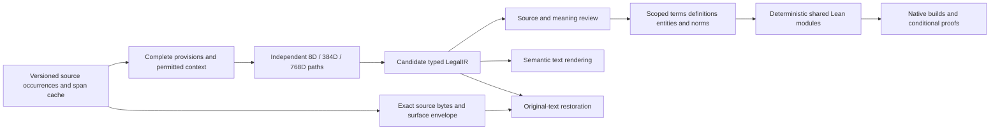
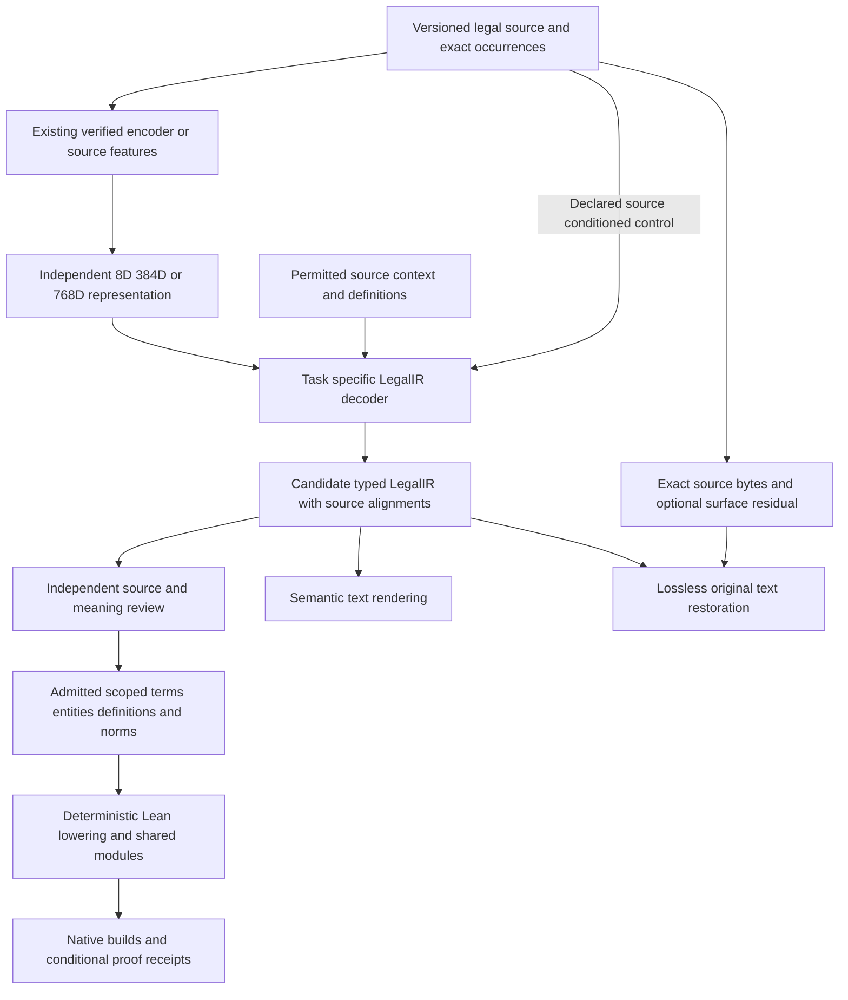

# LegalIR improvement plan for US Code graphs and Lean 4

Updated October 16, 2026. Reviewed repository baseline: `643c01860` on `main`,
including the merged decoder compatibility and numerical replay in PR #1318.
The original research baseline and prior qualification updates are preserved in
[the evidence history](#evidence-update-history). This roadmap refines the existing
LIR milestones and pilot specification; it creates no competing task authority.

The objective is a source-grounded pipeline from complete legal provisions to
predicted typed LegalIR, scoped graphs of terms/entities/definitions/norms, and a
coherent Lean 4 corpus. The first acceptance is **one reviewed definition, one
complete norm using it, and a second scope-valid use**, with exact source
companions and checked consequences. Whole-cache inventory and controlled decoder
research can proceed in parallel while that component is prepared.

The [span-to-graph-to-Lean execution design](legal_ir_span_graph_lean_execution_plan_20261016.md)
specifies the proposed combined decoder, training ablations, cache/graph contracts,
family support boundaries and ordered work packages against this baseline. It
refines this roadmap and the unchanged pilot specification; it does not enqueue
jobs or establish new training, review or build results. Both Hub revisions were
rechecked at 06:02 UTC in the [metadata-only refresh](evidence/legal-ir-span-graph-plan-20261016/hub-metadata-summary-v01.json).



## Active roadmap

There are two parallel lanes: source/review/graph/Lean preparation and attributable
model research. Engineering experiments may use declared synthetic, exposed or
compiler-derived targets; statutory-quality and teacher-promotion claims require
the separately eligible reviewed targets and frozen evaluation design.

| Stage | Concrete deliverable and reused work | Exit evidence |
| --- | --- | --- |
| 0. Reconcile assets and runtime | Inventory exact checkpoints, embeddings, codecs, saved predictions, source capsules and ModelManager aliases. Reuse compatible loaders, donor exports and current frozen-runtime protocol. | Immutable artifact/hash/role inventory; compatible numerical reload where required; every missing asset or incompatible interface explicit. Archive custody, reload qualification and promotion remain separate. |
| 1. Inventory both caches | Freeze revisions; account for physical files/rows, source occurrences, observation generations, aliases and goals. Use existing bundle/CAS readers and complete-source sampler. | Every selected row has a disposition and traceable original bytes; counts distinguish observations from unique physical provisions. No heading/amendment fragment is silently treated as an operative norm. |
| 2. Reconcile source and graph transport | Reuse the verified original-primary export, sampled-source association and new primary-bound review subject. Repair the malformed legacy entity export from original records while preserving multiplicity. | Exact endpoints, coordinate spaces, source versions and original-to-export joins; unrecoverable rows remain unresolved. Existing primary transport is reused, not rebuilt as a new semantic graph. |
| 3. Review one connected component | Bind an execution manifest to the unchanged component specification; prepare source-first legal/formal decisions, complete dependencies, applicability, exposure and disagreements. | Complete definition + complete norm + second physical use; explicit trust and downstream gold-eligibility policy; zero material omission/addition in the accepted pilot. Candidate-bearing packets are shown only after any claimed blind target collection. |
| 4. Represent and compose its meaning | Reuse source-scope, relational AST and typed-source join owners; add only the operators required by the reviewed meaning. Build scoped term senses, norms and per-occurrence governing-definition bindings. | Exact ordered AST/arguments/qualifiers, closed typed graph endpoints and companions, complete searched partitions and an explicit unsupported frontier. No label-similarity merge or representative lookup substitutes for all physical uses. |
| 5. Repair demonstrated decoder errors | Reuse F19 saved-score diagnosis and retained checkpoints. Compare boundary/ranking changes with a matched CE/retention control; separately test candidate recall, attachment, grouped assembly and graph context. | Frozen cases/initialization/candidates/freeze mask/optimizer/budget; targeted repairs plus protected complete-rule and named retention metrics. No repeated equivalent eight-row view experiment or retrospective acceptance of rejected updates. |
| 6. Qualify latent use and transfer | Compare source-only, latent-only and source-plus-latent routes with correct/zero/permuted inputs and retrieval controls. Reuse compatible decoder bodies and existing 768D initialization/alignment assets. | Target-free ordinary inference; measured producer/encoder calls; useful latent intervention effect and held-out semantic improvement. Task/codec-compatible warm starts remain distinct from qualified masked distillation supervision. |
| 7. Build the Lean component | Choose one exact existing execution profile; deterministically emit shared symbols/modules from supported reviewed ASTs, with explicit semantic parameters and hypotheses. | Actual `lake build legal`, every expected compiled artifact, source-to-declaration traceability, declared axiom policy, meaningful positive/negative consequence checks and incremental/clean agreement. Compilation alone does not establish correspondence to law. |
| 8. Expand and release | Grow the reviewed pilot to 20–40 provisions, then 200–500 passages, then title/dependency rollout. Maintain separate family/dimension/task inventories and coordinated model/cache/Lean manifests. | Measured review/compute/storage costs, restart and invalidation checks, immutable remote readback, exact ModelManager resolution and predeclared semantic/retention promotion gates. Whole-cache triage can begin before model promotion. |

The detailed sections below retain the existing work-item dependencies. In
particular, this table does not bypass the LIR review, native-checking or release
prerequisites. A complete pilot acceptance combines source, meaning, graph and
Lean evidence; an isolated decoder experiment can report its narrower result.
Stage 7 depends on the reviewed representations from stages 3–4, and can proceed
in parallel with decoder experiments 5–6.

## Current decision baseline

- **No qualified new teacher follows from low loss alone.** F17/F18 retain
  154/168 complete training IR and 0/36 on each exposed fresh development/test
  panel. F18/F19 used disabled latent conditioning. Contextual replay's 48/48
  semantic-IR result coexists with 0/48 original-prose equality on its authored
  cohort. Preserve those lineages and failures as controls.
- **The fixed-view diagnosis is complete at its stated scope.** Original saved
  view heads remain uniform over seven lanes; a structural update improved
  embedding reconstruction about 2.78% without legal reconstruction improvement.
  Later view proposals improved diagnostic CE but failed unchanged native
  acceptance and rolled back. Preserve the sidecars and rejections.
- **Source/graph engineering has advanced.** The original-primary transport
  covers 297,825 selected original-primary records. Typed joins preserve two partial §7213
  hypotheses and pending §7214. The newly published primary-bound review owner
  supplies a fresh dependency-closed definition-review subject; actual source
  equivalence, interpretation decisions, context closure and gold remain open.
- **Richer counting is now reconciled as a separate authored profile.** Original commit
  `2b9f325a080001272ac6dd3949cff5a4566281eb` supplies an authored fixed-at-most-three
  event/time-frame profile. Its [counted-frame owner](legal_counted_frame_v1.md)
  and the [selected paired-manifest inventory](legal_paired_manifest_inventory_v1.md)
  are now present through upstream `1211e6c17b3f5b8b1c9d838d6a5d94b53d9f5c4b`.
  The counted profile uses many-sorted FOL equality and specialized Lean text;
  it remains separate from the current relational request/join contract. It is
  not a generic cardinality engine, supported native TDFOL-equality route,
  reviewed §7214 interpretation or actual Lean build. Reuse these owners within
  their declared profiles; review determines required semantics and extensions.

## Pinned cache refresh

The [October 16 metadata snapshot](evidence/legal-ir-execution-plan-refresh-20261016/hub-metadata-summary.json)
retains exact public API responses and pinned cards. It downloaded no Parquet
payloads and ran no model, compiler, training or Lean job.

| Cache | Immutable revision observed | What is established |
| --- | --- | --- |
| [Span cache](https://huggingface.co/datasets/justicedao/uscode-autoformal-span-cache/tree/60501f3e920f6c9050cfc452e0d9fcc2b7c184f3) | `60501f3e920f6c9050cfc452e0d9fcc2b7c184f3` | 7,962 file descriptors, including 5,070 Parquet paths. These are overlapping file/generation inventories, not unique-span counts or successful formalizations. |
| [Entity cache](https://huggingface.co/datasets/justicedao/uscode-autoformal-entity-cache/tree/79d54378c5d6a89ab56e7a27e0f0ba867e800e19) | `79d54378c5d6a89ab56e7a27e0f0ba867e800e19` | Same 11,139,328-byte payload with LFS SHA256 `f5f07379d4ca913cb2d8d98505a4ecb01e4d0658039a2f4ff84fb4fb585e8233` as the retained full census. That census accounts for 1,960,876 mixed rows with no uniquely resolved edge endpoints. |

The span card distinguishes compiler/guided-compiler observations from learned
formula outputs and labels its readable formula audit as diagnostic. Preserve
those origins, complete artifacts and failed observations. A `train` storage
split, syntax flag, cached status or compiler agreement cannot supply legal gold.
The local verified primary export and malformed legacy entity cache remain
separate populations until their original derivation/multiplicity is reconciled.

## Immediate work packages

The [retained decoder output increment](legal_ir_decoder_output_integration_20261016.md)
now supplies tested candidate-only inspection with the original lexical/tagged
codecs and a small five-variant numerical replay. The continuation passed 173
native cases and 60+60 exact fresh-load sequences under the unchanged 160 GB
campaign cap, with a two-process replay allowance for pinned Torch startup.
All sixty first-pass outputs satisfy the retained grammar; all remain outside
the richer relational-request profile. Every primary variant is 0/2 against its
two exposed stored references. This establishes reproducibility and a specific
training gap, not statutory accuracy, a new teacher or a Lean build. Original
refusals and failed startup attempts remain archived with proper closeout.

1. **Asset and cache manifest.** Produce the joined compatibility inventory,
   current physical-occurrence census, immutable cache pins and explicit
   ModelManager status. Reuse matching vectors and weights; generate only missing
   compatible source/encoder/context entries through their own production jobs.
2. **Owner-bound pilot and review packets.** Select actual complete provisions,
   bind source/context/roles and record reviewer trust, applicability, exposure,
   disagreements and eligibility policy. Keep the existing authored pilot
   specification unchanged and leave pending decisions pending.
3. **Matched decoder experiment specification.** Freeze the chosen ranking or
   attachment hypothesis, retained CE control, tensor-freeze mask, protected
   cases, splits and budgets. Existing exposed diagnostics can guide engineering;
   reserve genuinely untouched reviewed components for promotion.
4. **Minimal semantic/profile gap list.** Derive required operators from the
   selected reviewed meaning; reuse typed joins and the counted-frame prototype
   where compatible. Do not weaken source text or invent passive agents,
   cardinalities, purposes, references or governing scope to fit a grammar.
5. **Graph/Lean and release contract.** Specify typed endpoints, per-use
   resolution, semantic-library/import closure, chosen native profile, conditional
   assumptions, invalidation keys and coherent cross-cache/model/corpus release.

These are deliverables, not claims that missing reviews or numerical runs have
already happened. Do not put calendar pressure ahead of semantic acceptance.
Warm-start preparation and the three dimension lanes can proceed independently;
reliable teacher promotion and corpus admission join at the required gates.

## 1 Current findings and priorities

The [reconstruction and asset survey](evidence/legal-ir-uscode-plan-20261015/reconstruction-and-assets-survey.json), [pipeline and integration survey](evidence/legal-ir-uscode-plan-20261015/pipeline-and-integration-survey.json), and [Hub cache survey](evidence/legal-ir-uscode-plan-20261015/hub-cache-survey.json) record the inspected revisions, sources and limits. The existing [all-span processing plan](uscode_all_span_processing_plan_20261007.md) remains useful, but its pinned cache generation and several training cutoffs are historical.

| Finding | Consequence |
| --- | --- |
| F18 is published at immutable model archive `c9cce4586dd96518088662fb12831173e98e36cc`; its payload readback passed. | Reuse it as a retained experimental control. Archive custody does not establish a qualified teacher or portable numerical reload. |
| F17 and F18 both reconstruct complete training IR on 154/168 cases; both fresh development and fresh test panels remain 0/36 on raw and joint routes. F18 fails its predeclared acceptance gates. | Preserve named regressions and diagnose the errors before another fit. Do not promote F18 or repeat its unchanged recipe. |
| F17/F18 have latent conditioning disabled, a declared 384-value placeholder and zero external encoder calls. | Their scores measure source-conditioned decoder adapters, not GTE representation benefit. Earlier genuine 384/768 conditioning experiments remain separate evidence. |
| Contextual 384/768 replay achieved 48/48 ordered IR on an authored cohort but 0/48 original-prose equality. | Semantic IR reconstruction and original legal-text reconstruction need separate contracts, heads and denominators. |
| In a retained 20-row diagnostic sample, 96 literal cache matches have no coordinate intersection with nine proposed operative-text units. Many matches are citation, heading or amendment fragments. | Correct source-structured sampling and correspondence before treating cached fragments as norms. This sample does not estimate the quality of the complete cache. |
| Typed graph exchange, scoped lookup, shared Lean modules and incremental compilation exist. The source definition bridge remains section-local and unary; the separately adopted relational fragment supports declared argument order, quantifiers and modal structure in partial unreviewed hypotheses. | Reuse both owners within their exact profiles. Preserve unsupported arguments, qualifiers and cross-section scope as explicit gaps before admitting actual reviewed provisions. |
| The source sampler and the five retained response, adjudication, application, history and binding owners are integrated. The standalone sampling review intake is separately qualified. | Reuse these owners while preserving their exact request domains. Complete actual source/meaning reviews and explicit occurrence/context correspondence before semantic admission. |

The [archived F18 report](https://github.com/endomorphosis/ipfs_datasets_py/blob/c13e83f4e82d5839465744eef19d4240ca378be0/docs/autoformalization/legal-modality-conditions-retention-20261015.md) distinguishes technical qualification, scientific failure, publication and remaining numerical limitations. The [completed F19 saved-score comparison](../autoformalization/legal-conditions-composition-20261015.md) and its separately authored counter agree on 60 panels, 54 scored sets, 81 comparison groups and six rank records. Both fixed combinations remain 154/168 complete training IR. Gold conditions spans already rank second or third within the actual top eight, with all six gold assignments feasible; the shorter prefix still outranks gold. This completes the diagnostic recount prerequisite below. The proposed F18 conditions-only freezing-plus-margin recipe is an engineering experiment, not the matched retained-CE causal comparison required in section 5. No composed checkpoint, new training, active-latent qualification or Lake build was executed by this diagnostic; its named old-tuning regression remains a promotion veto.

The retained [paired-census quality audit](paired_census_quality_audit.md) separates canonical typed compiler outputs, compiler views and autoencoder outputs by their actual origins. Use it as a bounded sidecar when choosing supervision and repair targets; guided compiler agreement, fallback frames and copied producer flags are not independent decoder fidelity or reviewed meaning. Preserve all original observations and goals alongside any review hypotheses.

## 2 Define the reconstruction tasks

The intended pipeline has a semantic path and a surface-preservation path:



| Task | Inputs available to the measured decoder | Measure |
| --- | --- | --- |
| Vector reconstruction | The declared encoder representation | MSE/cosine plus verified producer identity; a representation diagnostic |
| Source to LegalIR | Declared source-text/token-feature path, latent path, or both, plus explicitly permitted context | Complete typed IR, rule count/order, exact facet spans, arguments, scope and abstention |
| LegalIR to semantic text | Predicted IR and declared public context | Preservation of reviewed legal meaning, including qualifiers and unresolved portions |
| LegalIR to original text | IR only, or a separately declared surface channel | Exact UTF-8 equality, normalized equality and edit distances, reported separately by available channel |
| Retained-source restoration | IR/source references plus exact retained bytes | Byte-exact transport and coverage; separate from learned source-free generation |
| LegalIR to logic and Lean | A supported, reviewed interpretation and declared semantics | Lossless lowering, actual compilation, explicit assumptions and checked consequences |

Evaluate latent-only, source-plus-latent and source-only routes separately, documenting exactly which source features each decoder receives. A source-conditioned model with a disabled latent is not a dimensional-bottleneck experiment.

Semantic IR commonly maps several wordings to one meaning. Exact original wording cannot generally be recovered from that meaning alone. The existing [round-trip scorer](legal_original_text_roundtrip.md) calculates the collision ceiling for its actual cohort; its balanced 60-row cohort has 30 semantic targets and a 50% IR-only exact-original ceiling. That is a cohort-specific observation, not a limit on richer representations.

Keep exact source bytes and offsets in a provenance envelope outside the semantic AST. If learned exact prose is required, train a separately registered surface decoder with an explicit style/residual channel and source-withheld evaluation. Report byte restoration, canonical rendering, retrieval and learned generation as different routes. An IR containing a pointer to the original document can restore it faithfully, but does not demonstrate source-free generative reconstruction.

## 3 Reconcile both caches and source identity

Freeze the [span cache](https://huggingface.co/datasets/justicedao/uscode-autoformal-span-cache) and [entity cache](https://huggingface.co/datasets/justicedao/uscode-autoformal-entity-cache) at immutable revisions before starting a campaign. Snapshot the original file manifest, schemas, producer versions and remote content hashes. The Viewer is an exploration interface; overlapping configurations and unavailable splits cannot define the processing denominator.

| Original survey snapshot | Inventory and meaning |
| --- | --- |
| Span `ac68213001c649516036562ad031529c97c10b97` | 6,336 files and 3,852 Parquet files; 611 paired-v1 and 80 paired-v2 manifest/shard sets. The card's paired configuration exposes v1 only. These overlapping generations are not unique-span totals. |
| Entity `067c2a41affc6041fafb8237ae6df41bf4320008` | One 16,898,459-byte Parquet with 1,960,876 mixed records, 12 columns and 16 row groups. Footer statistics report admission/formalization flags false. |
| Entity endpoint defect | Complete footer groups 2–14 contain at least 1,597,955 edge rows with both `src` and `dst` empty. Other groups contain nonempty endpoints; the total malformed-edge count is not established. |

The Hub survey retains exact response bytes, pinned footer metadata and bounded real rows. Span Viewer requests returned HTTP 500; pinned files supply the observations above. Entity Viewer is not revision-pinned, so its totals are corroborated against the pinned file footer.

The entity total is a count of mixed graph records, not distinct legal entities. Repair endpoint-preserving export from retained original graph/source evidence before relying on its edges for provenance or semantic navigation. Do not guess endpoints from equal labels. Preserve the old export, write a versioned corrected generation, and reconcile duplicate/missing node identities, every typed endpoint and complete record counts against its source. If originals cannot recover an edge, retain an unresolved diagnostic record rather than inventing it. Keep the separately identified primary structural graph and this legacy cache distinct until their lineage is established. Before rebuilding, require an original-to-export-to-reimport regression with two distinct nodes and one typed edge, preserving endpoint namespace, relation, role and ordinal; empty or dangling endpoints must refuse acceptance. Then validate the complete corrected export against its retained source manifest.

Sampled paired source records contain `span_id`, `text`, `text_sha256`, `legal_id`, `revision` and `constitution`, without physical offsets or a statutory effective-date field. Entity rows lack the source span ID, text hash and revision needed for a reversible source join. Add explicit versioned mention/assertion-to-source mappings. A shared `legal_id` or literal text alone cannot establish that join. Sampled paired-v1/v2 vectors are 8D `mock:stable-sha256` diagnostics, including target-conditioned projections; zero projected loss does not qualify a GTE decoder or legal formalization.

The retained resume checkpoint footer identifies 443,905 mixed rows: 443,904 span-status records and one progress record. The producer progress counters report 22,379 `sealed`, 421,525 `gap`, and a legacy `pending_count` of 3,820,263. These are historical queue observations. Neither `sealed` nor a parser formula means independently reviewed law, and pending work is not a count of distinct source spans. Independently reconcile the current snapshot's rows, namespaces and aliases before adopting these as campaign totals.

The [metadata refresh](evidence/legal-uscode-pilot-evaluation-20261015/cache-metadata-summary.json) observed span revision `1683cad08b93bba1fa78c3ece594b12dcdc3c2aa` and entity revision `79d54378c5d6a89ab56e7a27e0f0ba867e800e19` on October 15 at 16:46 UTC. The pinned Hub API returned 7,406 span-cache file descriptors, including 4,653 Parquet paths. The entity API returned three files and one 11,139,328-byte Parquet descriptor with LFS SHA256 `f5f07379d4ca913cb2d8d98505a4ecb01e4d0658039a2f4ff84fb4fb585e8233`. These are reported metadata, not downloaded or independently validated payloads. The older inventory, footer schema and defect populations remain under their original generation; revalidate the changed entity payload before carrying those conclusions forward.

Both main revisions matched only at observation opening and closing. The span Viewer split endpoint returned HTTP 500, so the observation is `partial_failed`; no current span Viewer schema or row population was obtained. The entity Viewer returned a zero-row schema response and declared 1,960,876 mixed records. Viewer schemas/counts are unversioned and do not establish equality to pinned Hub bytes or a count of unique legal entities. Complete sibling lists and raw HTTP evidence remain in the private local observation; the compact published summary retains their commitments and HTTP status records.

The later [pinned payload census](legal_entity_cache_audit_20261015.md) downloaded and independently hash-verified that exact entity file after native admission. Its 99-group footer establishes 1,960,876 rows in this file; one complete census accounts for every row under the unchanged twelve-field owner. There are 238,452 node observations (119,318 with nonempty identities and 119,134 missing), 1,722,395 unresolved edge observations, nine categories, six logical relations and fourteen classification rules. Both missing-endpoint lookup counters equal the entire edge population; the diagnostic does not separately count blank versus dangling edge IDs. Six duplicate raw-row groups contain 1,722,389 extra instances. Preserve their occurrences: discarded endpoints may have collapsed distinct originals. Every semantic/training/proof authority flag remains false. Reuse verified primary graph originals and the actual writer/readback regression for an additive corrected generation with explicit lineage and unresolved multiplicity; do not present the separately reconstructed primary subset as a complete legacy repair.

The [completed original-primary candidate producer](legal_primary_corpus_export_20261015.md) uses an independently frozen 74-file selection of `justicedao/ipfs_uscode@5016b86a273ce5e4ffd066c5ae9f5fe494dd417e`, covering 46,241,258 original compressed bytes and all 297,825 selected rows. Its accepted output-manifest SHA256 is `5c94588706c54c8b8803e03971a18cc917aea754e31e7a9e1359f9c80b7021fd`. The explicit `manifest-selected-primary-entry-cid-canonical-parquet-2gib/v1` profile changes only the final-generation byte ceiling; the 1 GiB default and source/reconstruction bounds remain unchanged. A separately admitted consumer completed original-bound validation against that accepted manifest pin and the original selection/source in 281.13 seconds, retaining its receipt, unchanged producer inventory and native closeout. The complete 586-file generation is now independently replay-verified for its stated transport profile; the producer and consumer each executed three artifact checks, separate from pytest counts. Endpoint closure still includes 13 unresolved-citation placeholder nodes and 13 `CITES_UNRESOLVED` edges. This candidate supplies no semantic, training, accepted-graph or publication authority.

The additive [sampled-source/primary association owner](legal_sampled_primary_association_v2.md) now exposes this narrow interface without routing the 560-subject sampled-source component through the older 128-row flat bridge. It replays the existing unchanged correspondence, binds a separately pinned raw caller mapping and live original-primary index, preserves complete populations and lookup witnesses, and leaves unmatched anchors unresolved. The final native qualification passed 173 unique cases (88 new); a separate actual §101 replay prepared and revalidated both FOL/TDFOL associations against the independently retained full primary-index commitment, preserving all 560 pending subjects, six selected occurrences and 36 open slots. A declared anchor is not evidence that the official source and primary package contain equivalent law. Original-to-official source correspondence, authenticated review, semantic agreement, historical flat-cache reconstruction and training eligibility remain separate obligations.

The [association-bound definition-review adapter](legal_sampled_primary_definition_review_v2.md) now prepares a fresh subject through the existing public V2 review owner. Its superset manifest retains every old artifact/edge and adds the unchanged association, correspondence, old subject/manifest, exact primary witnesses and producer pins. The native qualification passed 207 unique cases (51 new), and a separately admitted fresh-interpreter consumer replayed retained FOL/TDFOL associations without invoking the earlier producer main. Each new closure retains the original 40 artifacts/39 edges and expands to 96/95 while preserving all 560 pending subjects by reference and all 36 selected open context slots; the complete old producer inventory remained unchanged. Old subjects and signatures keep their original scope. Existing graph/AST/context review remains distinct from an explicit official-source/primary equivalence decision, which this signing domain does not express. All open context and source/version/applicability obligations remain unresolved until independently supported.

Reuse the existing `PrimarySectionIndex` on its independently pinned original reconstruction candidate JSONL and report, together with `legal_span_section_bridge` and `legal_source_graph_proposals.required_primary_artifacts`. The index does not consume the new export lineage or canonical Parquet. Existing primary artifact commitments address original `record_json` bytes, so preserve original wrapper/record hashes and their declared original-to-export links. Before admitting semantic candidates, qualify the remaining original-to-official and semantic correspondence obligations using the retained original selection/reconstruction pins, physical shard/row/custody, source document/version/acquisition, coordinate space and exact intervals, ordered role/multiplicity and existing candidate/review-subject pins. Primary `entry_cid`, candidate graph-node record CID and source occurrence identity remain distinct. Reuse the completed retained §101 unsigned source-to-review-subject replay through its existing owner. Its completion supplies no primary correspondence, authenticated exposure or semantic agreement. Historical original-to-flat derivation separately needs pinned old bytes and original producer evidence, accounting for every repeated, conflicting, unmatched or unprovable physical occurrence. Content hashes and labels cannot choose between identical occurrences.

Use `python3 -B scripts/ops/legal_ir/observe_uscode_cache_metadata.py --output-directory <new-directory>` for another public metadata observation. Explicit `--span-revision` and `--entity-revision` select metadata for immutable commits without a live-head claim. This stdlib-only observer requests Hub metadata plus Viewer splits and zero-row schemas, with 8-MiB response, 32-MiB aggregate response, 80-request and 32-view bounds. It downloads no repository file bodies and imports no model, SDK or corpus owner. Unexpected row payloads are not archived; bounded error-only HTTP JSON may remain as diagnostic metadata. Corpus payload/schema validation still requires its existing admitted workload.

Build three inventories: physical source occurrences, model/compiler observations, and semantic/proof assertions. One source occurrence may have many model outputs; one rule may require several source occurrences. Keep duplicate text occurrences distinct while reusing their immutable bytes.

Every source unit must bind:

- Source repository and immutable revision; original file hash and physical row/ordinal; legal citation and provision hierarchy.
- Source version/edition and separately declared legal applicability. Unknown dates remain unknown; a heading or model prediction cannot supply them.
- Raw text hash, exact occurrence, half-open Unicode and UTF-8 selectors, extraction profile and source-view identity. HTML, normalized visible text and historical Parquet text have different coordinate spaces.
- Complete paragraph/clause, list introduction, inherited scope and required context; source-role status and unresolved dependencies.
- Historical span IDs as aliases with a reproducible mapping. Reuse the original grouped-ordinal algorithm where it produced those IDs; current worker batch size must not redefine historical identity.

Use the existing parent occurrence/alignment and official-document-view owners. Prefer source structure to punctuation-only segmentation; retain complete clauses and shared qualifiers. Preserve statutory notes, editorial material, repeal markers, source credits and unknown roles as explicit strata. Notes may themselves carry operative provisions and must not be excluded indiscriminately. A markup role is a sampling observation until the source interpretation is reviewed.

The acquired candidate definition source, the [2024 edition of 10 USC 101](https://www.govinfo.gov/content/pkg/USCODE-2024-title10/html/USCODE-2024-title10-subtitleA-partI-chap1-sec101.htm), is a candidate dependency for the retained officer provisions. Establish its version, scope, physical selectors and legal applicability before asserting a definition-use relationship. Existing extraction-fit work should be reused. Missing acquisition observations must be recovered honestly or reacquired, rather than filled from an extraction success. The official [US Code downloads](https://uscode.house.gov/download.html) also provide structured source formats for later releases.

## 4 Build reviewed supervision and a connected pilot

Start with one actual definition, one complete norm that uses it, and a second use to test symbol sharing. The existing nine candidate operative units and acquired definition source are review inputs, not an already selected or representable pilot. Select the component by actual dependencies and review capacity. Expand to 20–40 connected provisions, then 200–500 reviewed passages, only after the smaller component works.

Use distinct source-correspondence, legal interpretation and formal-representation decisions. Ask the legal reviewer for a candidate-blind target before showing decoder alternatives. Have a separate formal reviewer check scope, operators and lowering. Record disagreement, alternatives, unsupported content and adjudication explicitly. Reuse existing review/trust owners; authenticated signatures bind a declaration to a selected registered key under the supplied policy. Human identity, independence, competence and legal correctness require separate evidence.

The historical review owners bind original parent/alignment replay inputs, including supported markup-v2 views. The [standalone sampling intake](legal_source_sampling_review.md) instead binds the independently replayed sampler bundle, exact subject and versioned question catalog. Shared view profiles do not make their source-version/occurrence identities interchangeable. Its unverified source findings and meaning proposals retain unresolved/disputed/unsupported states; no signed historical request or native semantic correspondence is fabricated.

The new sampled-source binding owner replays an explicit interpretation request, complete bundle and exact ordered declarations through the existing V2 compiler and corpus adapter. It does not parse reviewer prose into an AST or establish agreement with that AST. Reuse the [qualified source-binding path](legal_definition_use_review_v2_integration_20261015.md) within its pinned scope, and retain independent exposure and meaning evidence. The combined alias-review domain covers its own joint interpretation; a general normative use still needs the supported representation and exact review scope required by the selected component.

The new [unsigned correspondence owner](legal_source_definition_review_correspondence_integration_20261015.md) mechanically joins that exact binding to the separately replayed V2 subject without extending its signed domain. Original file hashes, full canonical identities and internal digests remain distinct. The candidate commits its report transport: a pretty reserialization of that report refuses for the same graph even when decoded JSON is equal. Its finite native qualification passed; the exact-identity link supplies no authenticated exposure or semantic agreement.

Reuse this unsigned definition-only link rather than reimplementing it. The [actual retained-source replay](legal_retained_source_correspondence_20261015.md) now preserves the complete 560-subject population, exact original request/source/sampler bytes, new compact report transport and all six selected contexts through both FOL/TDFOL routes. Its 17 named checks establish same-process unsigned artifact correspondence, with no authenticated exposure or semantic agreement. The fictional control retains its separate qualification scope. Separately establish primary `entry_cid`/physical-row correspondence to original source occurrences and semantic candidate identities. These joins, historical flat-cache derivation, and authenticated exposure/semantic agreement remain distinct evidence obligations.

Each selected unit receives an included, pending, disputed, unsupported or out-of-scope disposition. Only separately admitted targets receive training/evaluation masks. A compiler formula, cache status, successful graph seal or Lean build cannot manufacture those masks. Preserve complete target provenance through later corrections.

Freeze splits before fitting or selection. Group provisions with their revisions, near duplicates, derivative examples and actual semantic definition dependencies. Broad citation graphs can connect most of the corpus; use semantic dependency clusters and document crossing context explicitly. Shared public definitions may be inference context under a frozen policy, but withheld interpretations and answer graphs may not enter retrieval or features. Existing exposed "fresh" panels are regression diagnostics now; reserve new untouched components for a generalization claim.

The pilot's review checklist must include passive actors/recipients, coordinated duties, necessary approval, numerical limits, permissions, non-entitlement, condition/exception attachment, recurrence, effective dates and unresolved cross-references. A norm is complete only when every material part is represented or explicitly marked unsupported. Never shorten statutory text merely to fit a decoder or bridge.

## 5 Improve the decoder with attributable experiments

First run a target-free replay of the exact retained checkpoints through their compatible historical interfaces. Verify full tensor and artifact hashes, actual encoder mode, vocabulary/codec, schema/task, source hashes and optimizer state policy. Keep F15, F16, F17, F18, historical latent decoders and grouped decoders as different lineages. A shared nominal dimension does not make their weights compatible.

Use the completed independent F19 recount to select and preregister the next hypothesis. Saved-score analysis can prioritize an experiment without producing a trained composed model. Freeze selected cases, acceptance rules and budget before another numerical run.

| Experiment | Changed hypothesis | Required comparison |
| --- | --- | --- |
| Candidate coverage | Correct complete spans/rules are pruned or unavailable | Oracle candidate recall before ranking; top-k and output-budget sensitivity; source-only baseline |
| Conditions ranking | Correct boundaries exist but shorter quoted names outrank complete conditions | Same candidates, donor and budget; boundary/pairwise ranking versus retained CE control; two targeted errors plus all retention cases |
| Qualifier ownership | Conditions/time/exceptions attach to the wrong rule or argument | Explicit relation/owner targets, separate presence and ownership metrics, complete-rule retention |
| Grouped decoding | Multiple spans or clauses require ordered assembly | Rule count, stopping, list inheritance, repeated mentions and full paragraph coverage; no fixed-rule cap hidden in the denominator |
| Graph context | Retrieved definitions disambiguate a use | Same decoder with/without version-compatible retrieval; unrelated/shuffled context and retrieval-only controls |
| Active GTE conditioning | Verified latent information improves semantic reconstruction | Active, zero, permuted and source-only routes with identical source/data/budget; measured encoder calls and intervention effects |
| Compatible head transfer | Retained readouts improve initialization | Exact donor copies, zero-residual parity and frozen-head controls; compare with a declared fresh initialization arm |

For the two diagnosed conditions errors, gold complete conditions spans already occur in the actual full-span top eight; a shorter prefix outranks them. Preregister a hardest-wrong valid-span margin against a matched CE/retention arm with the same donor, four-pointer-tensor freeze mask, candidates, optimizer and budget. Comparing only with the old differently frozen F18 run would confound the objective with the trainable parameter set. Report both repairs, complete-rule retention, protected permissions and named regressions. Diagnose oracle candidate recall separately on fresh components; two exposed ranking errors do not explain the whole 0/36 generalization failure.

Retain the completed [384D head-training diagnostic](legal_ir_head_training_probe_20261015.md) as an experimental control. On six training rows and two repeatedly inspected tuning rows, one structural update was accepted: raw embedding MSE fell from 0.001972491 to 0.001917703 (about 2.78%) and cosine increased from 0.827653 to 0.847531. Deontic IR cosine and cross-entropy did not improve. Both view-head proposals were rejected and rolled back; retain those decisions. This supplies no formula-decoder or legal-reconstruction improvement, independent holdout, gold eligibility or promotion.

The completed diagnostic prerequisite below addresses the observed four-versus-six target-support confound. It does not retrospectively accept rejected updates or change official scoring, Pareto checks or rollback. Fresh matched training must retain official and diagnostic results on identical baseline/proposal/final rows, select the applicable raw vocabulary independently of target-row support and sparse state keys, and preserve the existing acceptance and family/schema/task checkpoint contracts across the parallel 8D, 384D and 768D paths. The six observed IDs are not an exhaustive schema. Retain the qualified zero-key, epsilon-continuity, inactive-head, unknown-label, checkpoint/profile, cache and bad-update controls when integrating training telemetry.

The [fixed optimizer-lane diagnostic](legal_ir_fixed_view_vocabulary_20261015.md) now supplies a separate seven-class comparison from the existing multiview target owner: six declared core lanes plus the preserved ZKP lane, independent of target support and sparse checkpoint keys. This is a different namespace from payload-contract names; decompiler payloads collapse into the frame lane. Native a-01 passed 95 cases across three complete modules, including 44 new diagnostic cases, with 144 exact source pins and completed durability/release. On that unchanged production cohort, b-01 authenticated the original nineteen retained files and compared the parent and accepted structural state on the same two tuning rows with their original embeddings and complete targets. Both have uniform fixed-lane CE `ln(7) = 1.9459101490553132`; existing dynamic-support CE is `ln(4)` and `ln(6)` on the respective rows. This supplies no view-head or legal-reconstruction improvement. The adapter isolates caches, preserves original formula order, binds full evaluator context and refuses unsupported labels or codec profiles. Its checkpoint context remains a caller declaration; the outer probe independently authenticates actual bytes. Historical rejected proposal files contain rolled-back parent states and cannot rescore those proposals. The subsequently published training observer is now integrated unchanged. Native a-02 passed 122 unique cases across four complete modules on the combined source (146 pins); b-02 repeated the original-asset comparison (165 pins) with exactly matching fixed-view metrics, official readouts, state identities and target/loss context. Both completed native durability and release. These counts overlap the earlier 95-case roster and the author’s separate 240-case qualification; they are not additive coverage.

The parallel [published fixed-view training probe](legal_ir_fixed_view_probe_20261015.md) already supplies the proposed matched experiment on eight newly compiled targets from archived GTE-small inputs. Its temporary global and feature proposals improve seven-class CE from 1.945910 to 1.900527 and 1.897565, respectively, while both fail the unchanged native objective and roll back. The accepted structural proposal reproduces the 2.78% embedding reconstruction gain without improving the view head. Retain those proposal sidecars and rejection decisions; the new-target run and original-target replay have distinct target-generation and evaluator-context commitments. Their common normalization finding does not make their receipt contracts interchangeable. Do not schedule another equivalent eight-row experiment. Any later training-objective or acceptance-policy change needs a separately declared ablation with protected semantic and retention gates.

The next semantic experiment needs an independently reviewed, physically source-bound definition, one actual norm using it and a second scope-valid use. Reuse the existing correspondence, review/context and graph owners; create only missing reviewed targets. Freeze complete dependency neighborhoods, duplicates and prior exposure into training, development and genuinely untouched evaluation components. Measure exact original UTF-8 and normalized-text equality separately from canonical semantic AST/graph equality, fixed-view CE and embedding MSE/cosine. In the semantic measures, preserve modality, arguments, quantifiers, conditions, exceptions, timing and governing scope. Compare correct, shuffled and absent latent inputs under the same checkpoint/data/budget, with source-conditioned, retrieval and exact-surface restoration routes reported separately. Teacher qualification requires held-out semantic improvement within its explicitly declared source/context scope; claims of active-GTE or representation benefit additionally require demonstrated useful latent dependence. A source-conditioned teacher can qualify semantic supervision within its own scope without establishing that benefit. Low training loss alone cannot authorize distillation. Preserve the separate IR-family/schema/version/task/dimension checkpoint identities throughout.

For richer reviewed targets, use a typed AST decoder or compatible extensions to the existing heads. Preserve modality, quantifiers, argument sorts, actor/action/object roles, ordered Boolean structure, condition/exception/temporal attachments, definitions and explicit unresolved nodes. Constrained decoding can enforce structural validity; it cannot supply legal correctness. Pointer/copy mechanisms preserve exact literals and selectors while relation heads decide their role. Treat lexical coverage, candidate selection and semantic attachment as separate errors.

The adopted typed relational fragment supplies an existing bounded representation for this work; preserve its exact AST and structural correspondence rather than flattening it into the older seven-facet formula metric. Its current §7213 alternatives and §7214 pending declaration are exposed engineering cases, not reviewed decoder targets. Keep ordinary inference free of canonical targets, teacher-forced labels and target/loss feature caches; declare any oracle control separately. The earlier fixed-view checkpoint probe intentionally supplied target/loss context and cannot substitute for a latent-only semantic reconstruction control.

Use a preregistered objective with separately reported AST/token loss, exact-boundary loss, argument/attachment loss, modality loss, calibrated abstention and teacher-retention loss. Apply label masks to each objective and require traceable admitted targets. Tune coefficients only on development data. Solver failures become typed diagnostics first; resource exhaustion or unsupported lowering is not a negative legal label.

Promotion requires improved complete-rule performance on the selected evaluation design, the existing protected permission/retention gates, and no predeclared material loss-ID veto. Report seed variability for promotion claims; an engineering pilot can precede replication. A lower head loss, a higher aggregate with named regressions, or a successful upload is insufficient. Preserve failed experiments as reusable controls.

The additive [typed relational reconstruction diagnostic](legal_relational_reconstruction_v1.md) now compares independently pinned valid authored declarations through the existing relational validator and expression algebra. It separates exact artifact identity, ordered declared structure and lexical alpha agreement, with complete binder/argument/modal path diagnostics. It supplies no aggregate accuracy or invalid-output denominator, reviewed meaning or eligibility. Reuse the subsequently qualified batch evaluator below to retain missing, duplicate, malformed and abstaining outputs before these pair diagnostics support a decoder reconstruction comparison. The remaining inference bridge must preserve original generated byte/token and stop evidence, including invalid UTF-8 and framing outcomes, alongside that evaluator's UTF-8 request intake. The final native qualification passed 187 unique cases (84 new). A separate fresh-interpreter comparison of the two retained authored §7213 requests passed seven artifact checks, including two required refusals: self pairs agree, while the competing modal scopes remain structurally distinct despite matching signatures/roles. Source HTML/scope/join and prior producer execution were not rerun; this creates no reviewed statutory targets, learned predictions or training result.

The additive [typed relational batch evaluator](legal_relational_batch_evaluation_v1.md) now supplies the full selected-population accounting around that paired owner. Three independently pinned transports bind the ordered occurrence universe, explicit available/unavailable references and every submitted observation. Missing, duplicate, malformed, unverified, abstained, unsupported and invalid outputs stay in the selected denominator; valid outputs with unavailable references remain visible. It reports six structural diagnostics against both the complete selected population and valid comparable pairs, and never chooses a favorable duplicate. The exact supported fragment remains `tdfol/tdfol_default@1.0.0`; dimension/checkpoint and no-target declarations do not authenticate decoder inference, useful latent dependence or held-out membership. Final native qualification passed 299 unique cases (112 new and all 187 existing relational/reconstruction/algebra cases), with exact collection/call/JUnit populations. A separate fresh-interpreter retained exercise passed seven artifact checks, including two required refusals, while preserving ten authored accounting queries and twelve observations from the two exposed §7213 hypotheses. Exact/declared/alpha agreement remains one of ten selected queries and one of two comparable pairs, rather than a favorable denominator substitution; these are engineering controls, not ten laws or decoder predictions. Both native jobs completed durability and stopped-group/storage/lease release. The initial namespace-source failure and its exact correction remain separate retained history; tests, guards and selected populations were preserved. This is evaluation infrastructure, with no model training, reviewed targets, graph admission or Lean build.

## 6 Keep 8D 384D and 768D paths parallel

The [current asset reconciliation](legal_ir_asset_reconciliation_20261016.md)
locates later native-conditioning receipts, a 360/120-pair affine fit and saved
aligned/original-start interface checkpoints. The older zero-ready preparation
reports describe their own generations, not the latest saved work. Reuse the
compatible fitted generation after authenticating its exact native sources and
required outer runtime provenance; a fresh numerical reload remains separate.

The target model is **768D**, rather than 786D. The [gte-multilingual-base model card](https://huggingface.co/Alibaba-NLP/gte-multilingual-base) specifies 768 dimensions and an 8,192-token input ceiling. That ceiling is not evidence that the existing decoder reconstructs 8,192-token statutes. Input context, latent geometry, output token budget and rule cardinality are independent versioned capabilities.

| Lane | Preserve | Next qualification |
| --- | --- | --- |
| 8D | Actual historical linguistic teacher/producer, vector artifacts and decoder task | Establish genuine encoder and output lineage; retain its diagnostic/weak-label role unless independently qualified |
| 384D | Existing GTE-small vectors, matching decoder checkpoints and nominal 512-token producer profile | Demonstrate active representation benefit on reviewed, grouped source; retain earlier successful compatible states |
| 768D | Existing native multilingual vectors, saved decoder initialization and authentic producer receipts | Replay matched existing assets first, then qualify longer-context bands and supported output geometry |

Maintain separate semantic-AST, original-text/surface, span-proposal and grouped-decoding heads where their tasks/codecs differ. A decoder's internal latent width, encoder output width and token/output budgets are different capabilities. The selected migration decoder's existing 512-output-token primary head and 64-token grammar head do not become long-output models when encoder input grows. The 8D producer/token profile must be established from its actual lineage rather than inferred from the number eight.

Do not synthesize 768D inputs by padding 384D vectors, or relabel historical mock 8D vectors as GTE embeddings. Reuse an embedding only when source bytes, context, encoder/tokenizer revision, pooling, normalization, dimension, precision and truncation policy match. Native 768D embeddings that are missing require a new explicitly identified production job; record the missing cache entry rather than silently regenerating the whole corpus.

For transfer into the 768D decoder, copy compatible semantic readouts, vocabulary and schema-specific heads with tensor-by-tensor evidence. Reuse the [decoder reuse sequence](gte_decoder_reuse.md), [knowledge-transfer replay](gte_decoder_knowledge_transfer.md), and [native-input contract](gte_decoder_native_inputs.md). Introduce an explicit learned input adapter where interfaces differ; preserve donor predictions at initialization where the contract allows it. Optimizer resume versus fresh moments must be declared. Distill source-matched logits, typed structures and reviewed alignment relations using confidence and eligibility masks. Teacher disagreements remain visible. Existing compiler-derived weak labels retain that attribution; they are not independent legal gold.

A smaller teacher can initialize a wider student, but no transfer rule makes an unqualified teacher reliable. Keep 8D/384D baselines running while the 768D candidate is evaluated. Distinguish warm-start utility from proven semantic improvement and avoid assuming a fixed-width vector can losslessly encode arbitrary source length.

The retained [migration donors](gte_decoder_reuse.md) illustrate the compatibility boundary: the selected 384D source decoder has a 32-entry typed-JSON codec and an exposed 0/60 exact-target panel; the experimental 8D grammar head has an 18-entry codec and two synthetic examples. Neither supplies currently admitted semantic KD scope. The selected 384D donor's compatible V2 references and incompatible V3 references remain separate. Reuse the latest compatible saved initializer or fitted adapter after authenticated replay; do not reset learned bodies merely because a new experiment starts. Align only exact-source native vector pairs with training-only preprocessing. Keep each head's token positions, reference objective and eligible temperature-scaled KL separately normalized; direct sequence KL across incompatible codecs is invalid. A copied-weight retention result is useful evidence even while semantic KD masks remain zero.

For representation diagnostics, report squared L2, cosine and declared normalization/scaling alongside mean-coordinate MSE. Mean-coordinate MSE changes with dimension and must not become an automatic 8D/384D/768D ranking. For promotion, compare complete reviewed meaning and source coverage under matched input/context/output budgets.

Widen context in separate 512, 1,024, 2,048, 4,096 and 8,192-token bands. At each band compare chunked and whole-context processing on matched sources; test complete section coverage, inherited qualifiers, cross-span references, truncation refusal, output overflow and resource use. Longer output/cardinality profiles require their own decoder changes and checkpoints. Do not silently truncate long laws.

## 7 Aggregate typed terms entities definitions and norms

Use [corpus graph records](../../ipfs_datasets_py/logic/autoformal/corpus_graph.py) and [graph exchange](../../ipfs_datasets_py/logic/autoformal/corpus_graph_exchange.py). The node record CID is distinct from a stable conceptual ID and its content payload CID. Typed edges must name the actual node record endpoints required by the schema. Keep structural/provenance graph edges distinct from admitted legal-semantic assertions.

| Object | Identity and meaning |
| --- | --- |
| Mention | Exact surface occurrence and coordinate space; repeated wording remains multiple mentions |
| Term sense | Scoped, versioned legal meaning of a spelling; equal text does not merge senses |
| Entity | A separately justified person, organization, office, event or other denotation; generic quantified categories need not name ground entities |
| Definition | Head sense, exact operator/body, applicable scope/time, source interpretation and review |
| Norm | Quantifiers, modality, argument roles, conditions/exceptions/time, applicability and complete source evidence |
| Resolution | Candidate inventory, selected binding or unresolved state, lookup route and decision evidence |

Reify definitions and norms so ordered arguments and shared qualifiers survive graph aggregation. Proposed semantic relationships include `MENTIONS`, `DENOTES`, `DEFINES`, `USES_DEFINITION`, `APPLIES_WITHIN`, `HAS_ARGUMENT`, `HAS_CONDITION`, `HAS_EXCEPTION` and version/change links; use or version the existing schema for each. Preserve alternative interpretations as separate branches instead of unioning their assertions.

Resolve definitions using explicit references and declared local/enclosing/import scopes, followed by role, sort, arity, version and applicability checks. Do not choose by lexical similarity, newest edition or nearest vector alone. An inclusion definition must not automatically become equivalence; exclusions, legal fictions and construction rules require reviewed operator semantics.

The existing [scoped resolver](scoped_definition_resolution.md) distinguishes known empty partitions, unavailable data, ambiguity and resolution. It binds caller-declared search routes; it does not discover or prove governing legal scope. Extend it with independently reviewed applicability and source-to-native-symbol bindings. A lookup result alone does not create `USES_DEFINITION`.

Assemble provisions by physical hierarchy and occurrence order, not hashed span IDs. Preserve shared introductions, coordinated clauses, definition dependencies, alternatives and the unresolved frontier. Compute semantic dependency closure with resumable bounds; two-hop citation closure is a diagnostic, not semantic completeness. Represent cycles explicitly and choose a supported simultaneous interpretation rather than forcing recursive executable definitions.

Keep source publication/edition, legal applicability and event/evaluation time separate. Potential conflicts remain separate source-bound assertions until evaluated under common scope/time and a declared conflict policy. Permission is not automatically duty, non-entitlement is not automatically prohibition, and obligation is not evidence that the action occurred.

## 8 Fold the graph into one Lean 4 corpus

Reuse [the definition/norm adapter](legal_corpus_definition_norm_adapter.md), [shared Lean builder](legal_corpus_shared_lake.md), [incremental builder](legal_corpus_incremental.md) and current family lowerers. The legacy definition/norm bridge accepts a section-local explicit `means` definition and an exact unary norm grammar. The integrated V2 definition-only path supports explicit unreviewed title/section scope and multiple occurrences, while complete norm/use composition remains separate. It lacks general object roles, conditions, exceptions, timing and automatic cross-section definition bindings. A reviewed statutory component needing those features must use a separately versioned supported extension.

The adopted [V2 definition-use preparer](legal_corpus_definition_use_lake_v2.md) reuses native fragment rendering and closed local project transport. It keeps the alias as an explicit premise, original review blockers intact and `build_eligible=false`. The later [bounded V2 engineering-build adapter](legal_corpus_definition_use_build_v2.md) now exists, with explicit native binary expectations, bounded probes/processes, six expected compiled artifacts and three conditional theorem-axiom checks. Attributed retained author FOL/TDFOL examples contain those observations and are rehashed in the [parallel audit](evidence/legal-ir-source-review-correspondence-20261015/parallel-native-build-evidence-audit.json); this phase does not rerun or independently authenticate their historical processes. Engineering success retains false admission eligibility and does not prove a governing alias, installed library closure, per-occurrence resolution or cache validity. Preparing or building that conditional project cannot satisfy statutory review or gold admission.

Concurrent main also supplies a separate [native executor](legal_corpus_definition_use_native_v2.md), preserved unchanged by the [reconciliation](evidence/legal-ir-source-review-correspondence-20261015/upstream-reconciliation.json). Its typed lifecycle/executed-input contract differs from the build adapter's independent binary expectations and historical loader. Both currently use `legal-corpus-v2-definition-use-native-build/v1` with distinct profiles and receipt fields. Select by exact owner, profile, producer and closed validation contract; schema-only dispatch or receipt relabeling is unsupported. Keep their qualification evidence separate. Any consolidated execution/receipt schema needs an explicit version and combined intake, lifecycle, executed-input and historical-readback qualification.

For an actual-source engineering replay, first obtain compatible second-document evidence: the existing profile requires two distinct physical documents, one unary definition in each, a common declared applicability and one explicit alias in FOL or TDFOL. The retained single-document §101 replay cannot fill both endpoints. Preserve actual complete contexts and source/version pins, then reuse sampled-source binding, V2 composition, combined review and the exact preparation. Freeze its envelope and original assessment-file commitments before native admission. Unsupported scope, richer norms or missing source correspondence require explicit refusal or a separately versioned extension. Native conditional success cannot supply absent source interpretation, applicability or review decisions.

One corpus means a coherent release with shared symbols, complete imports and explicit semantic profiles, rather than one enormous source file:

```text
Legal/Core/{Entities,Scope,Definitions,Deontic,Time}.lean
Legal/USCode/Release_<id>/Title_<n>/Definitions.lean
Legal/USCode/Release_<id>/Title_<n>/Section_<id>.lean
Legal/Verification/<obligation>.lean
Legal/Manifest/<release and source graph bindings>
```

Deterministic lowering must preserve the admitted AST and reject unsupported operators without deleting text. Pin compiler code, semantic library, Lean/Lake versions, dependencies, generated files, imports and assumptions. Bind every Lean declaration back to graph assertion, interpretation and source occurrences.

The existing conditional theorem combines `∀x, D(x) ↔ B(x)`, `∀x, D(x) → O(A(x))`, and `B(e)` to derive `O(A(e))` under a supplied modal interpretation. It does not prove those statutory premises or actual action truth. Treat legal rules as represented content or explicit hypotheses; do not turn every generated rule into a trusted axiom and then report its own restatement as a proof of correct translation.

Require actual bounded native builds and every expected compiled artifact. Audit theorem assumptions and axiom dependencies against the selected profile, with no `sorry`, `admit` or hidden placeholder axioms. The current narrow conditional profile requires an empty printed axiom list; any future broader allowance must be explicit and separately reviewed. [Lean's propositions reference](https://lean-lang.org/doc/reference/latest/The-Type-System/Propositions/) describes the proof-level objects; correspondence to source law remains a separate review obligation.

Test meaningful positive and negative consequences, definition sharing, changed bindings, and assumptions that would make a result vacuous. Keep incompatible interpretation theories separate; an inconsistent union must not make every proposition appear established. A failed proof may indicate insufficient premises or an unsupported theory rather than a bad autoformalization.

Invalidate by full dependency keys: source and interpretation versions, definition/search partitions, review/admission decisions, semantic profile, imports, compiler and toolchain. New competing definitions can invalidate an old unique lookup even if its selected definition is unchanged. Store negative lookup dependencies. Require cold/warm/changed-definition builds and incremental versus clean artifact equivalence; unrelated modules should remain reusable.

Separate conditional kernel-artifact validity from legal eligibility. A compiled/proof artifact may remain reusable when its exact AST, hypotheses, semantic-library/import closure, compiler and toolchain bytes are unchanged. A source, applicability, interpretation, review or admission-policy change can still invalidate its use as an accepted legal/planning assertion. Retain both records and their status; reusing the conditional artifact does not renew the legal claim. Select one execution profile explicitly: the two existing native owners are not interchangeable, and executable hashes alone do not authenticate installed semantic-library closure.

## 9 Inventories databases registration and releases

Extend the existing [family/dimension inventory plan](ir_family_dimension_inventory_plan.json), [teacher transfer contract](teacher_student_transfer.md), checkpoint exchange and `ipfs_accelerate_py` ModelManager adapters. Keep LegalIR separate from CodebaseIR, IntentIR, SecurityIR and UI/UX IR. The existing four-family/twelve-cell inventory does not automatically include UI/UX IR; add it through an explicit profile rather than claiming a fifteen-cell deployment already exists.

The minimum checkpoint key is:

```text
IR family / schema version / decoder task / input and latent dimension roles
encoder and tokenizer revisions / token and output profiles / target codec
source and split generation / run and donor lineage / tensor and artifact hashes
```

Separate semantic JSON/AST, original-text reconstruction, span proposal, grouped decoding and any learned FOL/TDFOL output heads. Deterministic logic/Lean emitters are compiler artifacts with their own versions, not automatically new learned decoder checkpoints.

Use separate LegalIR8D/384D/768D inventories and physical registry/index databases with serialized writers. The shared source CAS can be deduplicated by immutable reference. Keep candidate, reviewed, proof and operational status namespaces separate. Start from proven DuckDB plus immutable Parquet/CAS; the retained DuckLake adapter/layout is not evidence of a qualified production lake. Qualify transaction, snapshot and restart behavior before adopting it. Quack metadata may project status and joins. Exact artifact/manifest identities establish custody; admission also requires the independently verified policy and evidence for that stage.

Reuse existing family repositories where present; the October 16 [asset reconciliation](legal_ir_asset_reconciliation_20261016.md) now verifies public metadata for all three `Publicus/legal-ir-autoencoder-{8d,384d,768d}` repositories at immutable commits. Preserve the aggregate `Publicus/legal-ir-autoencoder` archive and previous releases. New repositories use the user's selected public visibility; existing visibility stays unchanged. Version schemas/tasks/profiles inside each dimension repository.

Import exact releases into ModelManager as retained, replay-qualified, experimental or promoted roles with accurate capabilities and immutable Hub commit/path/hash. Keep aliases from silently selecting another schema/task or unpromoted F18 state. Verify a cold resolver retrieves the exact artifact and a compatible isolated numerical reload reproduces recorded outputs before marking it load-qualified. The historical read-only catalog reconciliation resolved all eight selected contextual/wording bindings and located the fitted bridge/interface states; its three missing F15/F17/F18 checkpoint declarations are now supplied by the [completed source-token component import](evidence/legal-ir-missing-component-import-20261016/README.md). Reuse those exact persisted bindings, preserving their separate roles and false runtime/teacher/proof authority. Their disabled 384-value placeholder must not create an active 384D lane.

Extend both caches additively with versioned `source_units`, `interpretations`, `reviews` and graph `mentions`, `nodes`, `edges`, `definitions`, `assertions`, `resolutions`, `issues` and `build_receipts` tables. Do not rewrite diagnostic rows into accepted rows. A coordinated release manifest binds exact span-cache commit, entity/graph-cache commit, model lineage and Lean corpus/toolchain outputs. Verify remote bodies at immutable commits before advancing the selected release. Resolve uncertain upload outcomes before retrying; retain the prior coherent release after a partial upload. Avoid a self-referential manifest commit hash by publishing referenced data first and storing the coordinator receipt separately.

## 10 Process all spans with explicit completion states

Begin a complete pinned inventory and inexpensive source/representability triage before waiting for a new teacher. Schedule model, graph and proof stages only where their input gates pass. Reuse existing span-ingestion leases, native resource owners, deferred-goal import and durable outbox behavior; inspect the current implementation before extending it.

Work keys bind source/context, family/dimension, encoder/checkpoint, schema/task/codec, inference settings and compiler/checker dependencies. A new model cannot inherit an old `sealed` result merely because the span ID matches. Content-based sharding preserves occurrences and exact batch manifests.

Each occurrence has a disposition for each stage: candidate produced, reviewed/admitted, unsupported, source unresolved, needs context, disputed, output/token overflow, checker failure, retryable technical failure or deferred. Queue leases and retries are operational states; semantic disagreement is durable work, not an infinite retry. Report all inventory rows, eligible rows, attempted rows and successful rows separately, with explicit unresolved coverage.

After pilot calibration, prioritize review by connected definition/use reuse, material semantic risk, model/compiler disagreement and uncertainty. Keep randomly selected audit components to measure selection bias. High confidence and parser/prover success can prioritize a candidate, but cannot manufacture a legal-meaning decision or gold mask. Bulk candidate processing and syntax/representability triage can expand while admitted semantic coverage grows through explicit review.

Workers write immutable result batches; a controller serializes physical database writes and publication. Bound input/output bytes, context tokens, peak RAM/GPU use, time, concurrent jobs and disk reservations. Restart from verified completed keys and owned lease identities. Preserve foreign work and existing model assets. Measure reviewed clauses per hour, accepted graph assertions, checked modules, review minutes, cache reuse, storage and cost per accepted component before choosing rollout concurrency. Do not infer total cost from row count or advertise throughput before a representative pilot.

Use purpose-specific native admission for validation, inference and training; one lane's successful receipt cannot authorize another. The published [kernel-custody contribution](kernel_custody.md) is a separate foundation: simulated observer tests passed, but the real delegated-service experiment refused native admission before its productive worker started. Container/GPU/Hub-worker descendant custody and cleanup remain unqualified by that experiment. Resolve the reviewed host-admission versus worker-confinement profile before that deployment, preserving the current scheduler/storage policy rather than broadening caps or claiming process-group sampling confines daemon-owned descendants. This does not erase the narrower completed CPU validation/replay evidence.

The supervisor can use IntentIR to plan repair/context/review jobs against current inventories and CodebaseIR to ground implementation obligations. Those IRs remain separate from LegalIR legal assertions. Cached candidates or unknown proof obligations cannot satisfy a planner's proven precondition.

## 11 Milestones and acceptance

These milestones refine the existing corpus backlog; they do not create another task authority or enqueue work. Preserve the established LIR task dependencies, including LIR-04 before LIR-08, LIR-09 before LIR-10, and LIR-11/LIR-14 before LIR-15. Reconcile the separately retained broader LAC campaign before importing any jobs.

| Milestone | Concrete work and dependencies | Acceptance |
| --- | --- | --- |
| M0 Reconcile progress | Pin main, retained source owners, both caches, asset lineage and actual ModelManager roles; integrate qualified parallel contributions; recover endpoint-preserving entity export | Published/local/untracked states explicit; no duplicate owners; source/model aliases reproducible; every accepted edge has real versioned endpoints |
| M1 Correct source inputs | Adopt the existing structured sampler and view extractor; finish acquisition evidence and exact occurrence/context joins | Complete selected population and coordinate maps; no lost controls or invented source fields; every gap has a disposition |
| M2 Review one component | Candidate-blind source/meaning targets for definition and complete norm, then a second use; preregister splits/exposure | Actual independent decisions; zero gold masks on unresolved items; complete supported/unsupported accounting |
| M3 Represent and connect | Minimal typed profile extension, scoped binding and reconstructable graph using existing owners | Every argument/qualifier and typed endpoint preserved; exact source/interpretation companions; alternatives and dependencies explicit |
| M4 Build Lean component | Deterministic shared modules, meaningful conditional obligations, native builds and invalidation | All expected artifacts; declared assumption policy; no placeholders; changed-definition rebuild equals clean build |
| M5 Improve and transfer | Build on completed F19 recount; changed ranking/ownership/context arms; active 8/384/768 comparisons and compatible warm starts | Reviewed complete-rule gain under preregistered retention and uncertainty gates; genuine producer receipts; no latent-placeholder claims |
| M6 Expand and release | 20–40 connected provisions, then 200–500; inventory/triage whole cache; title/dependency rollout | Reconciled denominators; immutable cross-cache/model/Lean readback; reproducible restart and measured review/compute cost |

M0/M1, engineering profile controls and artifact-only diagnosis can proceed in parallel. Reviewed statutory graph admission waits for M2; supported Lean lowering waits for M3. Research model branches can run independently, but a statutory-quality or teacher-promotion claim waits for the required reviewed targets and evaluation design. Calendar estimates should follow the first measured review/compute pilot rather than override these dependencies.

### Evaluation dashboard

| Layer | Required reporting |
| --- | --- |
| Source | Unique occurrence accounting, recovered legacy aliases, extraction/context availability, token overflow and source-role sampling |
| Decoder | Candidate oracle recall; boundary/argument/attachment errors; modality confusion; count/stopping; full IR; abstention/coverage; named losses |
| Reconstruction | Exact original UTF-8, normalized equality, semantic fidelity and edit distances by IR-only/surface/source-retained route |
| Representation | Actual input producer/context, encoder calls, active/zero/permuted effects, seed variation and equal-budget comparison |
| Graph | Endpoint integrity, scoped sense/entity accuracy, definition-use resolution, unresolved/cyclic dependencies and alternative interpretations |
| Lean | Supported lowering coverage, actual module builds, conditional theorem outcomes, assumptions, placeholders and source-to-declaration traceability |
| Operations | Fresh/reused/stale keys, restart/lease behavior, changed-dependency rebuilds, human review time, throughput, disk and compute cost |

Choose semantic error thresholds and confidence procedures from the review design before final testing. Require exact mechanical integrity for accepted bundles and no material meaning omission in the small supported pilot. Report overall selected-population coverage beside supported-subset fidelity so abstention or unsupported cases cannot disappear from the denominator.

The sampler, existing source-review stack and parallel V2 definition contribution are now integrated; their linked guides retain each qualification scope and producer generation. The V2 bridge closes an engineering path from complete markup sampling to source-bound definition-only candidate graphs. It does not close the independent statutory review or complete definition-use component milestones.

The V2 occurrence-context and fixed-domain definition-review contribution at `8f33492f4a639aa0ee3218653c63e467cd01d3ea` is now integrated with its author and eight file bodies preserved. Retain earlier evidence under its original producer generation. The standalone unsigned intake keeps its own profile; historical parent/alignment requests retain their original inputs. The V2 signed interpretation schema has no exposure field. The qualified sampled-source binding supplies explicit request/population geometry, with B01's complete selected suites passing and C02 replaying the retained source. It supplies no checked semantic agreement, authenticated exposure, human independence or training/evaluation admission. Preserve exposure and independence evidence explicitly before using a target for held-out evaluation or teacher supervision; do not infer candidate blindness from authenticated signatures.

The additive `corpus_definition_use_v2.py` contribution from `6b5ee085a9ffc4cb2492552ca31b335badfd1fc1` is now integrated and qualified, with its three original file bodies preserved. Its candidate connects two definitions from distinct documents with exactly equal declared applicability through a separate alias assumption. The single-document §101 case cannot supply a positive component for that profile. Select and review actual source/applicability and meaning evidence before choosing same-document scope or richer normative features; do not manufacture source identities, applicability or an operative norm to fit the interface.

The existing [combined-use review domain](corpus_definition_use_review_v2.md) now binds the alias, full joint AST, candidate `USES_DEFINITION` edge, both original candidates, complete registry/route dependencies and declared context population. Original definition reviews cannot approve that new interpretation. The qualified unsigned definition-only correspondence preserves exact source-to-subject identities without rewriting the subject or creating an assessment. Authenticated exposure and agreement with either the definition AST or combined meaning subject remain gaps, alongside actual independent source/applicability and legal/formal decisions. The executed source-binding replay establishes explicit declared geometry, not those semantic decisions. All source/meaning/training/admission authority remains false, and the combined assessment retains false accepted-view eligibility. The downstream owner and policy for statutory gold admission remain explicit unresolved bindings; a candidate edge or positive authenticated declaration cannot satisfy a proven supervisor precondition.

The next bounded acceptance is one genuinely reviewed connected component: a complete definition, an actual source-backed norm/use and a second scope-valid use. Obtain authorized independent legal/formal decisions with explicit trust, applicability, exposure and unresolved dependencies. Preserve supported operators, sorts, arity, arguments, conditions, exceptions and timing. Reconstruct exact companions and closed typed graph endpoints; admit statutory `USES_DEFINITION` bindings only from reviewed evidence. Structural candidate edges retain false authority. Then qualify scoped resolution, supported lowering and actual pinned native Lean artifacts with the declared assumption policy.

Keep all 8D/384D/768D paths and family/schema/task checkpoint identities separate, reusing compatible retained assets. Continue the attributable ranking experiment informed by the completed F19 recount; statutory-quality and teacher promotion wait for reviewed supervision and matched evaluation. Corrected graph-cache publication still requires reconciliation against the complete retained source manifest. This advances legal supervision and a connected graph/Lean target while preserving previous decoder progress.

## Evidence update history

Original research baseline: October 15, 2026, repository `12dd975181fed9f5a0ba3589f842b3055bb7b162`. The following historical updates retain their original generation and qualification scope. Their test counts overlap and are not summed.

Implementation follow-up: the [citation identity repair and source-sampler integration](legal_ir_graph_citation_identity.md) now qualify the actual current release writer → private Parquet → citation-reader handoff. All 406 cases in the affected local suites passed, including 38 citation cases and the existing sampler's 29 cases. This closes a current-reader transport gap and adopts the parallel sampler; the malformed historical Hub export, statutory review, semantic decoder quality and Lean admission remain separate unfinished milestones. The table below retains the original research baseline.

The existing [source-response, adjudication, application, history and binding owners](legal_source_review_stack_integration_20261015.md) are now integrated with 1,565 passing local cases across 13 modules, preserving their original contributions and declaration-only effects. Their parent/alignment requests already support markup-v2 views, but standalone sampler records have distinct source-version identities and lack those exact request/preparation joins. The older native paragraph bridge is a separate interface; the subsequently integrated V2 path described below now supports explicit unreviewed definition-only declarations. Shared visible text cannot substitute for checked source correspondence.

The [V2 definition integration](legal_definition_v2_integration_20261015.md) adopts the existing parallel bridge, corpus adapter and shared Boolean refactor with 732 passing cases across 23 modules. A retained §101 engineering probe preserves all 560 blocks, 134 candidates, 426 controls and 3,360 original open context obligations through FOL/TDFOL candidate export/readback. Its entire post-`means` definition body is one opaque unreviewed atom; it supplies no semantic training gold or Lean admission.

The subsequent [V2 context and review integration](legal_definition_v2_review_integration_20261015.md) now passes 966 unique cases across 30 modules, plus 22 separate passing subtests, with 501 listed inputs unchanged. Its retained §101 replay prepares exact FOL/TDFOL review subjects, each with six physical context packets, 36 open slots and a declared 40-artifact dependency inventory. Zero reviews or assessments were performed; subject preparation supplies no reviewed meaning or training eligibility.

The additive [source-first sampling review intake](legal_source_sampling_review.md) now passes 76 local cases and prepares all 560 §101 subjects (134 candidate paragraphs and 426 controls), with every review still pending. It preserves the standalone sampler population and unsigned reviewer declarations; historical parent/alignment signatures, V2 meaning reviews, training gold and Lean admission remain separate gates.

The additive [V2 definition-alias integration](legal_definition_use_v2_integration_20261015.md) records 302 passing cases across ten modules, including actual graph export/readback and competing-table invalidation. It preserves two definitions and adds an unreviewed alias assumption with one representative lookup. It supplies no actual statutory norm/use or per-occurrence governing lookup.

The [sampled-source definition binding](legal_source_sampling_definition_binding_v2.md) and [blank-handoff migration](legal_source_sampling_review.md#migrate-source-only-preparation-packets) are committed through `f9b69c7aa`. They connect explicit V2 requests to exact source-review populations while preserving blank, disputed and unsupported declarations. The separate [combined review owner](corpus_definition_use_review_v2.md), committed through `234dc97a2`, binds the exact alias and full joint AST in its fixed review domain. Reuse these existing correspondence and review owners.

The subsequent [combined-use review and sampled-source binding integration](legal_definition_use_review_v2_integration_20261015.md) qualifies those owners with 541 distinct passing cases across sixteen modules: A02 passed 297 and B01 passed 244. Its separate C02 actual §101 binding replay passed 15 named checks, including six refusal controls, for FOL/TDFOL, preserving all 560 pending subjects, 8,400 blank question slots and 3,360 original open context obligations. It binds the explicit “enlisted member” declaration with one opaque whole-body predicate; actual responses and reviews remain zero. The test counts overlap earlier qualifications and are not additive corpus coverage. Source geometry, authenticated fixture claims and candidate graphs supply no reviewed meaning, exposure authentication, training gold or Lean admission. Earlier native storage refusals retain their [original handoff-attempt scope](legal_source_review_handoff_storage_20261015.md); C02 does not execute that historical handoff driver or perform an actual-source handoff migration.

The [V2 native-preparation integration](legal_definition_use_native_preparation_integration_20261015.md) adopts the existing parallel `9ff4d29e` contribution with its three original files exact. It prepares nine source files, six modules and three conditional statements from the original combined assessment; that contribution was preparation-only. Its native attempt02 executed 300 cases with 297 passes and three cold-reader import failures. A narrow lazy-import repair preserves reasoning's 553 public exports. Attempt03 passed all 316 cases across thirteen complete modules in 134.86 pytest seconds, with 256 declared source pins; native durability and grant release completed. Both failed claims were recovered through the existing exact owner with evidence preserved. Earlier functional and integration counts overlap this roster. Source/semantic review, exposure correspondence and training-gold decisions remain separate gaps.

The subsequent [source/review correspondence integration](legal_source_definition_review_correspondence_integration_20261015.md) adds an exact unsigned link from a complete sampled-source binding to the existing unchanged V2 review subject and manifest. It retains complete population state, globally ordered roles and every physical occurrence/context/parent mapping, with all authority flags false and gold masks zero. Native attempt02 passed 296 cases across nine complete modules in 132.04 pytest seconds, with 213 unchanged declared source pins and completed durability/release. The fictional two-subject/six-context control is separate from the retained actual 560-subject C02 probe, which was not rerun in that 296-case phase. This phase also preserves and adopts the existing `d00ace8b` bounded V2 engineering-build adapter and its original three files as `8c79995d7`. The [parallel audit](evidence/legal-ir-source-review-correspondence-20261015/parallel-native-build-evidence-audit.json) rehashes retained author FOL/TDFOL observations recording six compiled modules and three empty-axiom checks per family; these are attributed historical observations, not a current compiler rerun, independent process authentication or a newer six-field native-validation claim.

The [retained-source correspondence follow-up](legal_retained_source_correspondence_20261015.md) now reuses the exact C02 source/request and historical sampler bytes through the unsigned owner. Native b-02 passed 17 named probe checks, including eight refusals, in 320.49554496607743 seconds, with 227 declared source pins and completed durability/release. Each FOL/TDFOL route retains all 560 pending subjects and six selected physical contexts with 36 open slots; it creates no review or exposure authentication. Its 64 standalone exports preserve inspectable correspondence/subject/input companions. Current producer origins require an explicitly new binding/candidate/subject generation; all historical artifacts and pins remain unchanged. Failed b-01 exposed the distinction between omitted and explicitly defaulted replay arguments: the corrected driver reuses the exact original sealed input binding, with no owner or validation weakening; exact native recovery retained its failed evidence. The separately adopted `4a88f05b1` namespace fix preserves overrides installed before a colliding child module first loads; native a-01 passed its complete 21-case import module in 15.626 pytest seconds, with 256 declared source pins, exact durable readback and released storage/grant. This namespace qualification and the actual-source probe are separate scopes; neither is a new model or admitted corpus result.

The subsequent parallel [V2 native executor](legal_corpus_definition_use_native_v2.md), contributed at `1b63e750a`, implements a separate conditional execution adapter over the existing preparation and review owners. Its guide reports 109 focused cases and two authored FOL/TDFOL projects with six conditional theorem observations. This update inspected its source and guide, preserved its three files unchanged, and did not reexecute that contribution or independently recount its private artifacts. Its fictional endpoints, unavailable trust, zero supplied reviews and original `build_eligible=false` remain explicit; these observations supply no statutory alias truth, training gold or unified-corpus admission.

The [primary-graph candidate exporter](legal_primary_graph_export.md) reuses the verified manifest, strict-record, reconstruction and actual Parquet writer owners. Its original native qualification passed 160 distinct authored-fixture cases, including 51 exporter cases. A separately versioned 2 GiB final-generation profile and consumer replay location now pass 189 cases, including the original 160 and 29 new profile/replay cases; these totals overlap and are not additive corpus coverage. The [actual original-primary producer](legal_primary_corpus_export_20261015.md) has completed a new candidate generation covering all 297,825 selected occurrences: 119,134 nodes and 178,691 edges, in 586 files totaling 1,342,890,287 bytes. It preserves exact original wrappers, physical multiplicity and all record encodings, with no lineage-only or quarantined rows and no reconstruction blockers. Separate original-bound consumer validation also passed against the frozen producer manifest, preserving the producer inventory and all 90 source pins, with completed native durability and resource release. Primary-to-official-source/semantic-candidate correspondence and historical flat-cache lineage/multiplicity remain separate unfinished jobs. This work changes neither model weights nor measured statutory accuracy.

The published [sampled-source/primary association](legal_sampled_primary_association_v2.md) now provides a separate unsigned mechanical link to original primary witnesses. Its actual FOL/TDFOL association preserves 560 pending subjects, six selected physical occurrences and 36 open context slots per route. Literal primary discovery and caller-declared anchors do not authenticate official-source equivalence, governing scope, interpretation or legal review. Reuse that contribution without extending the unchanged historical review subject's authority.

The [typed semantic integration](legal_typed_semantic_integration_20261016.md) adopts the existing parallel source-scope, strict relational-norm and source-to-typed join owners. Their three source bodies and tests remain unchanged; eight earlier shared files were already present byte-for-byte. Native a-01 passed 412 unique cases across eight complete modules with 200 exact pins. Separate b-01 passed nineteen replay checks, including eight refusals, with 232 exact pins and completed native durability/release. It reuses thirty original inputs, preserves all 67 units and 65 controls from the two selected pages, and generates new current-root reports with explicit historical lineage. Two §7213 partial hypotheses share one physical paragraph and retain nineteen provenance rows/six argument occurrences each; §7214 remains source-only pending. The two selected paragraph scope packets retain twelve original unresolved issues and twelve open slots. The supported single-Object fragment preserves ordered predicate arguments, binders, quantifiers, implication direction and O/P/F placement. Its source join retains partial unreviewed hypotheses and explicitly unresolved formal assumptions. Counting, purpose, anaphora, equality and richer sorts remain unsupported; full statutory norm AST, source lowering, graph admission and gold masks remain absent/zero. These results qualify representation/provenance mechanics, not semantic decoder accuracy or legal review.

The first milestone is one independently reviewed statutory definition connected to a complete norm that uses it, followed by a second use, represented in a scoped semantic graph and compiled into one Lean 4 project. Improve the LegalIR decoder against those reviewed meanings, then expand by dependency neighborhoods. Processing the whole cache can begin with inventory and diagnostic triage in parallel; admitting the whole cache as formalized law requires the later semantic and proof gates.

The [statutory component specification](pilots/uscode_definition_component/README.md) makes the requested roles, evidence, evaluation denominators and acceptance gates explicit. It is an authored specification with no selected source component, reviewer trust, actual results or eligibility bindings. A later immutable owner-bound manifest supplies those inputs. Using the initial component for design or fitting makes it an engineering pilot; generalization requires separately frozen, newly reviewed components.

The subsequent [current entity-cache census](legal_entity_cache_audit_20261015.md) now validates the changed pinned payload through the existing native owner. All 1,960,876 mixed rows are accounted for: all 1,722,395 edge observations fail both endpoint lookups, 119,134 node observations lack identity, and no edge has uniquely resolved endpoints. The run passed all four selected checks plus two pre-traversal refusal controls, with native durability and release recorded. This establishes a current repair denominator, not a usable graph, reviewed meaning, training improvement or Lean admission.

Reuse the existing source caches, embeddings, checkpoints, graph owners, review workflow and Lean builders. Preserve the 8D, 384D and 768D paths independently. Larger vectors and lower training loss are useful measurements, but complete legal meaning, graph composition and checked consequences determine progress toward the corpus.

This is a plan and evidence review, with the separately recorded native entity audit above. Its publication starts no inference, training, corpus migration, reviewer signing, model upload or Lean build.

The subsequent [retained-component registration](evidence/legal-ir-missing-component-import-20261016/README.md) closes three concrete availability gaps: F15, F17 and F18 now have exact ModelManager bindings to their existing checkpoint files and immutable public releases. The genuine manager and cold native readbacks retain the same three source-record identities in 687 records after a 684-record baseline; their canonical catalog projection IDs differ. All baseline metadata, activity, schema and indexes are preserved. These source-token components have no active embedding dimension, and their runtime, teacher and proof qualification remains false. The operation reuses saved assets and creates no training, inference or legal-accuracy result. Adopt the separately published [five-variant numerical replay](legal_ir_decoder_output_integration_20261016.md) before further fitting; its output-format and 0/2 primary-reference findings identify the next structured-head and discrimination work. Authenticate complete runtime closures for other selected lineages, and keep exact text reconstruction, semantic IR fidelity and selected-population coverage separate.

The [relational target and example contract](legal_relational_decoder_target_contract_v1.md) now qualifies fixed byte/control serialization of the existing typed request and candidate-only, original-input-replayed source/label separation. Native attempt02 passed 142 unique cases across three complete modules, with 255 source pins and completed native durability/release. These are authored engineering controls, not legal examples or a trained AST-action head. Every example keeps an unassigned split and zero training/evaluation-gold masks; pending source-only cases retain a null label. Optional 8D/384D/768D references preserve declared cache identities without opening vectors or authenticating producers. Freeze complete example populations, physical/component grouping, conflicting alternatives, exposure, actual output lengths and tensor/route/codec compatibility before fitting. Reuse the existing batch evaluator with a byte-preserving inference bridge for malformed framing/UTF-8 and incomplete outputs. Diagnose the initialization-time auxiliary connector with cached inputs and identical-prefix logits before attributing its retention gap to forgetting. The completed 60+60 replay remains the baseline; this increment repeats no model inference and changes no weights, reviews, graph admission or Lean artifacts.
