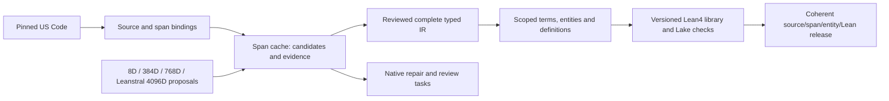

# Legal autoformalization

## Agent continuation recovery

The existing supervisor now has goal-aware recovery metadata for stale saved pauses, independent authorized work, exact owner polling and durable attempt/reconciliation history. Explicit pauses and execution holds remain effective; it does not issue execution or goal-resume authority. See [operations](docs/OPERATIONS.md#agent-owner-pauses-and-independent-continuations). Exact provider-turn observations can now be ingested into a durable continuation checkpoint, retaining refusal evidence, spent attempts and both histories. The local owning suite passed 95 tests and 171 subtests; rejected operations remain held.

## AArch64 Native policy fixtures — 2026-11-16

A separate audited run met seven Native policy-fixture expectations using eight actual Lean4.34.1 AArch64 commands (three version queries and five compilations). It accepted the empty-axiom conjunction, refused a wrong goal, unapproved Classical dependencies, wrong configured version and malformed quoted identifier, and accepted the three foundations only when explicitly approved. All seven retain authority disposition `reject`, zero pytest credit and false admission. This adds no cache-reuse, full-toolchain, AMD64 CI, statutory, model or corpus qualification and does not complete Phase1. See the [handoff](docs/HANDOFF.md#aarch64-native-policy-fixtures--2026-11-16).

## Kernel source screening and current verifier v2 — 2026-11-16

The existing Lean source screen now rejects active `run_elab`, `run_meta` and `by_elab` syntax. Kernel and cache support the same `lean-kernel-verification/v2` marker; receipt wire v3 and `LeanKernelBackend@1` remain unchanged. Old-v1 receipts cannot supply current accepted proof or cache reuse, and archived evidence is preserved. The earlier GREEN140 original passed 140 selected software cases (79 kernel/61 cache, including 13 new controls). After a separately measured stale fixture-pin failure and one-line pin repair, GREEN141 passed 141 unique software cases (80 kernel/61 cache), adding the ungated loader-contract regression; both final independent saved-output audits passed. See the [handoff](docs/HANDOFF.md#kernel-source-screening-and-current-verifier-v2--2026-11-16) for failure lineage and limits. No Native Lean, model-training, legal-review or corpus authority follows.

## AArch64 Native cache fixture — 2026-11-16

A separate current-v2 fixture ran Lean 4.34.1 on AArch64: one version command and two successful compilations with matching expected-declaration empty-axiom reports, followed by disk cache roundtrip and reuse without another compiler command. This checks a constructed `True` theorem with one explicit `True` assumption; it adds no reviewed statutory meaning, model result or corpus authority. It contributes zero pytest cases and does not complete Phase 1. See the [handoff](docs/HANDOFF.md#aarch64-native-cache-fixture--2026-11-16) for the audited scope and remaining Native coverage.

## Conditional whole-norm definition application in existing owners — 2026-11-16

Existing aggregate, Native, retained/live and incremental realization APIs now independently select `definition_application_profile="whole-norm-definition-expansion/v1"` and identity `None` or `"reviewed-source-use/v1"`. The default realization keeps 26 obligations; the selected application adds four, giving 30: exact typed expansion and conditional whole-norm equivalence for each of two distinct fictional norm uses. Equivalence quantifies arbitrary original interpretations **conditioned on the explicit `hSourceDefinition` hypothesis**; an empty axiom report does not establish that hypothesis or statutory definition applicability.

Separately audited results are Native2's two actual installed-Lean builds (30 empty-axiom reports per build), S100's 100 authored-compiler software controls and I21's 21 authored incremental controls. Their source epochs, artifacts and failures remain separate in the [handoff](docs/HANDOFF.md#conditional-whole-norm-definition-application--three-separate-current-scopes--2026-11-16). No statutory meaning/review, gold, corpus/release admission, model training or convergence follows; the 8D/384D/768D/4096D owners are unchanged.

## Reviewed definition realization in the existing owners — 2026-11-15

Shared, Native and incremental now support a constructed interpretation of one reviewed unary Object definition with a supported Boolean body. The fictional three-unit project retains two genuine norm-use units, three selected head occurrences and15 original+11 realization obligations. Explicit `reviewed-source-use/v1` carries exact current physical-use bindings; default callbacks and domains retain compatibility.

Separate software scopes passed58 cases,1 default incremental control and6 selected incremental controls at their recorded source epochs. Three current installed Lean cases also passed and were independently audited:15,15 and26 named empty-axiom reports across separate builds. Two compiler/library invalidation controls also passed separately in21.747s. [One evidence capsule](../../../docs/autoformalization/evidence/legal-ir-reviewed-definition-realization-source-use-20261115.json) preserves the two-control RED, historical peer79/default-Lean1, source transitions and remaining gates. No arbitrary-model equivalence, statutory meaning, governing-definition application, training, convergence or corpus authority follows.

## Reviewed source-use identity and concrete preservation

The explicit `reviewed-source-use/v1` mode keeps disjoint, currently reviewed source uses separate even when their IR is identical; default profiles retain their existing refusals. Separate software cohorts passed **102** and **26** cases, and **two installed Lean cases** checked 15 named preservation obligations each. [Exact source-bound evidence](../../../docs/autoformalization/evidence/legal-ir-reviewed-source-use-bindings-20261115.json) preserves failures and qualification limits; these fictional reviewed units establish no statutory meaning, model, training or corpus authority.

A separate three-case current-main compatibility check passed; historical qualification scopes and the later docs-only merge remain explicit in the same evidence record.

Positive-pair loss projection additionally requires explicitly selected, eligible `IRTrainingExample` records matching the complete pair identity. Decoding a shard alone keeps its rows nontraining. The [handoff](docs/HANDOFF.md) records the 78-case software qualification and external-authentication limits.

The legacy heuristic fuzzer now retains diagnostics and sanitized unverified proposals without exporting trusted training negatives. Explicit distrust and proposal markers are rejected even when verification is optional. The [93-case software qualification](../../../docs/autoformalization/evidence/legal-ir-legacy-fuzzer-proposal-boundary-20261115.json) preserves explicit caller compatibility and the separate typed PGIR-041 route; independent semantic evidence, training and convergence remain separate gates.

The existing positive-pair miner treats canonical recipes as unverified proposals. Typed caller-supplied evidence is required before a recipe pair can train or emit a relationship receipt; see the [handoff](docs/HANDOFF.md) for the 133-case qualification and its archive-authentication limits.

Bound Lean proof reuse now requires the advertised backend version to equal the kernel's observed native and toolchain version. All 142 Source-only cache controls pass; the fictional red controls and separate current Native scope are recorded in the [handoff](docs/HANDOFF.md). Historical native results remain bound to their original source epochs and are not inherited by this change.

Reviewed V2/V3 source-use preparation now requires one coordinate view per exact raw artifact; caller source labels cannot create a second physical use. The [24-case software correction](../../../docs/autoformalization/evidence/legal-ir-reviewed-source-raw-view-identity-20261115.json) preserves same-view disjoint uses and the separate historical 355-case qualification, without human legal review or proof/training/corpus admission.

Generated PGIR-041 mutation proposals no longer create independent semantic labels automatically. Default mining quarantines them; explicit caller-supplied labels must bind the current pair and pass the existing contracts. The completed original passed all 88 selected software cases (82 hard-negative and six retained metamorphic cases), with no failures, errors or skips. See the [handoff](docs/HANDOFF.md) for measured scope, preserved failures and the remaining LIR-22 evidence-integration gate. Caller metadata supplies no authenticated solver, directed proof, legal review or statutory gold.

Reviewed evaluation now rechecks live context permission on exit and freezes producer outputs before later callbacks. All61 selected software cases pass; see the [handoff](docs/HANDOFF.md) for exact scope and remaining model/legal gates.

Compiler diagnostics and proof-cache reuse now bind the current verifier profile; reviewed heldout contexts also enforce declared legal source identity across interpretations. Current source-only qualification and historical/native limits are recorded in the [handoff](docs/HANDOFF.md).

Relational roundtrip scoring now detaches and fences reference, role and governing-observation inputs. A reproduced false prose-equality report now refuses, and all 431 source-only regression cases pass. Legal/model/proof authority remains unqualified. See the [handoff](docs/HANDOFF.md).

Reviewed retrieval now supports a separately signed V4 context-set relation contract over V3 endpoints. Unknown pairs and analogies remain excluded from negatives; legal applicability is not inferred. See the [handoff](docs/HANDOFF.md) for source-only qualification and pending numerical/legal gates.

The supervisor adapter now validates explicitly requested parent/v2 and parent/v3 audit receipts against trusted runtime selection and recomputed sidecars. All 93 source-only software cases pass; task/completion/resource/admission authority is unchanged. Physical supervisor execution and model/legal/proof qualification remain open. See the [handoff](docs/HANDOFF.md).

The original parent now has an explicit trusted full-candidate audit using independently supplied request contexts and the shared scorer. All 233 selected source-only cases pass. Physical parent/v3 publication, supervisor adoption and model/legal/proof qualification remain open. See the [handoff](docs/HANDOFF.md).

Reviewed admission now rejects duplicate paragraph uses created by raw repackaging, unaligned views or artifact revision labels. All 355 canonical source-only checks pass. Legal source authenticity, real statutory review and native proof remain separate gates. See the [handoff](docs/HANDOFF.md).

The explicit v3 candidate audit now supports the existing many-sorted representation alongside object-only syntax. All 324 source-only software cases pass; legacy v1/v2 refusals and all legal/model/proof limits remain. See the [handoff](docs/HANDOFF.md).

The producer evaluator now offers a separate full-candidate syntax audit against caller-supplied source, context and interpretation identifiers. All 67 selected source-only cases pass; unsupported and incomplete outputs remain counted. Legal meaning, model quality and proof authority remain unverified. See the [handoff](docs/HANDOFF.md).

Explicit Qwen2 training conditioning now matches the selected inference prompt and body/EOS labels through a distinct recipe/checkpoint identity. All 93 selected tests pass, including a complete reviewed tiny-fixture job. The worker has a new source epoch: historical pretrained pairs require a fresh explicit transition before reuse. No actual pretrained fitting or legal/proof gain is claimed. See the [handoff](docs/HANDOFF.md). Historical actual-tokenizer capacity is now recorded: the largest complete public-layout training-shaped capacity sequence, including heldout rows, is 8197 positions, so an 8192 total-position window is insufficient. Current-checkout runtime and pretrained fitting remain unqualified.

The actual pretrained Qwen rich-context path now passes the explicit original-parent typed-structure audit on all three heldout queries. Outcomes {"abstained": 0, "complete": 0, "error": 0, "incomplete": 3, "invalid": 0, "unsupported": 0}; no quality or legal/proof gain is inferred. See the [handoff](docs/HANDOFF.md).

The actual pretrained Qwen source-only path now passes the explicit original-parent typed-structure audit on all three heldout queries. Outcomes {"abstained": 0, "complete": 0, "error": 0, "incomplete": 3, "invalid": 0, "unsupported": 0}; no quality or legal/proof gain is inferred. See the [handoff](docs/HANDOFF.md).

The trusted original-parent runtime can now publish a separate typed-structure audit after child wait and fresh admission checks. All 21 selected tests pass, including five physical success/revocation/tampering cases. Supervisor adoption, actual pretrained replay and legal/proof authority remain open. See the [handoff](docs/HANDOFF.md).

The reviewed producer evaluator now has an explicit canonical typed-expression audit, separate from payload equality and native proof. All 129 selected tests pass; a separate saved-Qwen audit preserves all incomplete cases and original artifacts without model replay. The default evaluator stays unchanged. See the [handoff](docs/HANDOFF.md).

The public-layout Qwen profile now runs through the actual pretrained source-only original-parent path on all three complete queries. A same-pair old-prompt control preserves sources, context and cooperative/output budgets. Layout outcomes: {"abstained": 0, "complete": 0, "error": 0, "incomplete": 3, "invalid": 0, "unsupported": 0}; control: {"abstained": 0, "complete": 0, "error": 0, "incomplete": 3, "invalid": 0, "unsupported": 0}. Both originals close durably. See the [handoff](docs/HANDOFF.md).

No fitting or legal-quality gain is claimed. New-profile actual rich dispatch, retention, fair A–F evaluation and real statutory/corpus/Lean gates remain open. The storage cap stays 250000000000 bytes, preserving earlier checkpoints, qualifications and failed claims.

The entries below retain their original qualification cutoffs. Use the current handoff for later results and remaining gates.

Actual pinned SmolLM2 BF16 weights now import into and restore from the existing checkpoint pair bit for bit. Three full source-only queries pass a bounded first-token generation probe with exact state restoration and an explicit GC/Linux unused-heap-release guard; complete-output quality, fair comparisons, rich-context capacity and full dense Adam capacity remain open. See the [handoff](docs/HANDOFF.md).

Explicit BF16 v5/v6 requests now reach the original-parent CLI, with complete source/rich contexts, checkpoint restore, six fixture abstentions and live parent trust checks. All75 selected cases pass with seven durable original closeouts. Native last-position projection preserves selected nonzero logits/full inputs under unchanged limits; the first resource refusal is retained. Actual pretrained weights, tokenizer rich capacity and statutory/corpus gates remain open. See the [handoff](docs/HANDOFF.md).

The existing local loader now has an explicit Llama/BF16 recipe, preserving float32 rotary state and default float32 T5/GPT2 behavior. All52 selected loader cases pass with two durable original closeouts; independent saved-pair/dispatch readback succeeds. Eight platform-conditional GPT-2 buffer cases skipped. This is real tiny-fixture software qualification; pretrained weights, original-parent BF16 CLI and full rich-context capacity remain pending. See the [handoff](docs/HANDOFF.md).

Pinned SmolLM2 metadata/tokenizer preflight passes with two selected cases and separate durable metadata/validation closeouts. Complete source-only pairs fit8192; rich sources exceed4096 and one rich pair exceeds8192. BF16 model tensors fit the existing checkpoint bound; float32 model tensors do not. Full dense BF16 Adam moments exceed the separate512MiB optimizer-checkpoint bound by1189120 bytes before overhead. No weights or models ran. See the [handoff](docs/HANDOFF.md) for the Llama/BF16 runtime and rich-capacity gates.

Full-target preflight rules out cached GPT-2 before fitting:all six complete targets exceed its1024 positions, with independently matched byte-BPE counts. The selected case passes with durable original closeout; no model runs or target truncation. Next is permitted longer-context tokenizer/model compatibility. See the [handoff](docs/HANDOFF.md).

Qualified actual-GTE ranked artifacts now feed the physical CLI, preserving original encoder/projection identities and dispatching all complete examples to a freshly restored local T5. All five selected cases pass with three durable original closeouts. The decoder still produces fixture abstentions; pretrained quality and statutory admission remain pending. See the [handoff](docs/HANDOFF.md).

Lossless v2 now passes the full local-fixture CLI:checkpoint restore, three decoder abstentions, original parent finish/wait/policy checks, post-child TRAIN revocation and policy denial. All24 scoped case executions pass with six durable original closeouts; the first v1 RSS refusal remains retained. CLI encoder vectors remain explicitly fictional; the earlier actual-GTE in-process result is separate. See the [handoff](docs/HANDOFF.md).

Explicit lossless context v2 now carries all complete actual-GTE-ranked examples to nine real local T5 forwards within the unchanged4096-token and1536MiB profile. All90 scoped cases pass across six durable original closeouts. Outputs are fixture abstentions; pretrained quality and statutory/corpus acceptance remain pending. See the [handoff](docs/HANDOFF.md).

The earlier v1 transport has a separately qualified complete-context capacity check against the local decoder. All three ranking arms refuse the fixed4096-token full-context batch; a separate source-only T5 baseline abstains on all three queries. The selected integration case and20 runtime cases pass with durable original closeouts. Full-context decoder dispatch and model quality remain pending. See the [handoff](docs/HANDOFF.md).

Frozen lexical/raw/aligned retrieval rankings now have complete-payload diagnostics, with all 60 owning metrics tests passing and durable original closeout. The retained candidate bank has no exact typed/local/full counterparts; semantic relevance and structural usefulness remain unscored. See the [handoff](docs/HANDOFF.md).

The reviewed retriever now includes a bounded lexical baseline. Actual cached GTE and one aligned checkpoint have frozen lexical/raw/aligned rankings for three source/dependency-disjoint heldout queries over the same four-view TRAIN bank. All 69 joint and 20 runtime tests pass with durable original-owner closeout. Semantic relevance and legal-applicability judgments remain unscored. See the [handoff](docs/HANDOFF.md).

Concrete mixed-sort preservation is adopted in the existing owners, with 423 Python cases and nine selected Lean builds qualified. See the [handoff](docs/HANDOFF.md) and [exact qualification](../../../workspace/test-logs/federal-corpus-audits/legal-ir-mixed-renderer-preservation-20261111-v01/qualification-summary-v02.json) for scope, retained failures and the remaining statutory, model and corpus gates.

Actual cached GTE source/formal outputs now reach the reviewed masked trainer: two source inputs and three complete formal candidates produce 51 native chunks and one real projection update. All 19 embedding-runtime tests pass with durable original-owner closeout; independent byte, review, geometry and checkpoint readback succeeds. Fixed heldout retrieval-quality comparisons remain next. See the [handoff](docs/HANDOFF.md).

The user-authorized250GB cap and prior source/ranked-decoder qualifications retain their own scopes. Real statutory review, pretrained decoder quality, whole-corpus admission, protected-root permission tests and hosted CI remain open.

## Qualified supervision and current frontier — 2026-11-10

All 204 fleet-monitor owning cases passed (75 functions, 612 phases, zero audit denials): 169 original cases and 35 dependency controls. The existing SDK v2 profile used the canonical C19 plugin, 21 real physical fixture cases and 15 bounded cold probes. Original Source, Native, process and storage custody closed; this successful run released its 64 MiB promise. The earlier 203-pass/one-plaintext-fixture-failure run and its retained promise remain separately recorded.

The existing fleet configuration now adds only the retained-capacity recovery oneshot and its existing timer as an observational dependency; all four original lanes are unchanged. A natural post-publication monitor cycle reported four healthy lanes and the dependency in fresh successful scheduled-idle state, with its timer active/waiting. The downstream probe and engineering watchdog also reported healthy at their own saved observation times. These asynchronous observations establish no exact-latest-report propagation or injected-failure result. Dependency diagnostics grant no restart, completion or automatic source-repin authority; failures use the existing unhealthy-fleet coding-repair path.

The repaired current capacity-watch CLI separately passed its whole 133-case owning cohort (62 functions, 399 phases, zero audits), with original custody closed and its successful 64 MiB promise released. That scope contains 33 explicit historical-version cases and 100 current cases (54 current-profile, 33 previously passing legacy and 13 stored-request-copy cases). Genuine 92c9 readiness separately checked and fsynced 73 files / 20,776,408 bytes with 153 full-identity entries, observed eligibility and wrote no ledger state. Readiness is not release or an evergreen action token.

The configuration Source1 write and separate readback were executed by delegated `/root/finish_enrollment_docs` under Root authorization; their accepted receipts are distinct from natural monitoring observations.

The capacity service's durable inputs preserve the original parent/request identity. Its controlled and natural timer cycles observed sufficient current capacity and made no mutating recovery call. These idle cycles do not prove a pressure-release path or recovery of unknown claims. Earlier proper 398/276 and aebb/ec90 closeouts retain separate custody and accounting evidence. The original 276 assertions passed while its outer owner failed; administrative closure does not change that result. SDK open-epoch9, supervisor17 and P5's original43 source-only qualification lineage also retain their distinct scopes.

Continue through the existing seven LIR phase subgoals and Phase 8 evaluation workstream. Reuse canonical source/span/entity intake, complete typed norms, reconstructable graphs, Lean/proof-cache owners and decoder/supervisor integration. Preserve spaCy-derived 8D, registered 384D/768D and Leanstral-derived 4096D lineage. No engineering result here asserts complete statutory meaning, whole-US-Code Lean admission, new model quality or scientific-task activation.

The saved scientific frontier remains 60 completed / 4 blocked under its existing operator hold; the four engineering lanes report the existing 145 completed tasks. These are captured board observations, not task-status edits. The maintained recovery capsule records the exact receipts and scopes.

See the [maintained recovery capsule](../../../docs/autoformalization/evidence/legal-ir-reviewed-producer-recovery-full225-20261109.json) for exact receipts, preserved historical outcomes and current workstream scopes.

**Recovery qualification, 2026-11-09:** [225 selected cases passed](../../../docs/autoformalization/evidence/legal-ir-reviewed-producer-recovery-full225-20261109.json) on the finite Root V4 post-barrier recovery extension, with all original custody closed and its 16 MiB claim durably released. Separate closeouts preserved the original own8084/own5d8 failures and files while releasing only their 64 MiB promises. See the [handoff](docs/HANDOFF.md); before-barrier and UNKNOWN histories, supervisor rollout and scientific gates remain separate.

**Reviewed retrieval source delivery, 2026-11-09:** the [nine-file source delivery](../../../docs/autoformalization/evidence/legal-ir-reviewed-retrieval-qualified-source-delivery-20261109.json) publishes the exact canonical owner/test/legacy-fixture bytes from the [294-case qualification](../../../docs/autoformalization/evidence/legal-ir-reviewed-retrieval-full-qualification-20261109.json), with no skips or deselections and closed original custody. It connects reviewed directed pair labels to the masked objective and current TRAIN-index retrieval, and retains complete selected typed examples as candidates. Decoder permission, governing-definition/proof bodies, real statutory review, pretrained-decoder gain and corpus admission remain separate gates. The earlier fixture-only publication remains historical. See the [handoff](docs/HANDOFF.md) for source and hosted-CI limits.

The separate [clean public-tree qualification](../../../docs/autoformalization/evidence/legal-ir-reviewed-retrieval-public-tree-qualification-20261109.json) passed all294 with137 compiled product buffers matching the selected public index; no private dependency changes were used.

**Resume checkpoint, 2026-11-09:** the [typed sampled-recovery profile](../../../docs/autoformalization/evidence/legal-ir-sampled-validation-recovery-20261109.json) passed **183 selected cases**, with original Source/native/process custody closed and its 16 MiB claim durably released. Separate administrative closeout released only the earlier own32 claim, preserving all 44 files; own64 remains retained. The earlier 80-case generation, failures and refusals retain their historical cutoffs. The restored decoder's 471-case cohort remains unrun. The saved supervisor catalogue shows 60 completed/four blocked, but executor verification reports `descriptor_changed` with no dispatch/completion authority. Continue from the [current handoff](docs/HANDOFF.md) and its exact evidence. No model, statutory, native Lean or convergence qualification follows.

**P4 qualification:** 225 selected declaration/mask/joint cases passed with closed original custody. The separate 68 structured cases never ran after an acquired-then-released native grant hit its admission deadline; manual metadata Source closure grants no storage recovery. The 293-case total remains unqualified. See the [handoff](docs/HANDOFF.md).

**Current retrieval source, 2026-11-09:** the [compatible nine-file reconciliation](../../../docs/autoformalization/evidence/legal-ir-reviewed-retrieval-current-compatible-source-port-20261109.json) preserves the rich-context APIs and installs reviewed declaration, mask and joint-retriever paths in their existing owners. The current declaration/mask/joint owners have the separate 225-case qualification; structured 68 remains unrun. The earlier 287-case result remains bound to its historical generation. See the [handoff](docs/HANDOFF.md) for exact APIs and evidence.

**Preservation closeout:** five actual Lean 4.34.1 cases and 23 empty-axiom reports closed successfully. The current 291 ordinary cases passed, but final storage accounting refused closeout and retained the original 16 MiB claim; preserve that outcome without repeating the tests. The native and 80-case recovery results retain their executed control generations; three later shared resource-control changes inherit no qualification.

**Actual proof-cache integration, 2026-11-09:** [243 ordinary cases and 11 actual Lean commands](../../../docs/autoformalization/evidence/legal-ir-native-proof-cache-roundtrip-20261109.json) check exact-obligation proofs through disk persistence/reopen and context-bound reuse. Changed proof contexts refuse; no compiler runs on cache reuse. This is fictional-source engineering with no statutory, model or corpus admission. See the [handoff](docs/HANDOFF.md) for source-generation and remaining qualification limits.

**Current F18 stage, 2026-10-30: the real v2 trainer completed a synthetic numerical probe after READY/RUN.** The [qualification](../../../docs/autoformalization/evidence/legal-ir-f18-v2-native-numerical-probe-20261030.json) covers disjoint 242/57 contract cohorts (299 cases / 897 phases), one fixture initialization and actual one-step training with two source-only captures. All source, native, process and storage custody closed. All 130 active conditions scalars changed; 38 frozen tensors and 650 inactive scalars stayed byte-equal. Both captures abstained, so no accuracy gain follows. Existing paired fits and 632-row parity were reused. Retained-data admission and producer authentication, reviewed legal meaning, graphs and Lean remain open. Both watchdog namespaces are observable: engineering 145/145; science 10 completed / 54 blocked, cursor 253. See the [handoff](docs/HANDOFF.md) for the existing parallel frontier.

**Current F18 stage, 2026-10-29: 27 authored outer v2 saved-file/metadata controls passed.** The [original-owned qualification](../../../docs/autoformalization/evidence/legal-ir-f18-outer-v2-saved-consumer-qualification-20261029.json) ran the unchanged current full fixture: all 56 source pins stayed unchanged, and real validation-owner source, native, process and storage custody closed in 117.200 seconds. Producer/parity/training witnesses inside these controls are fictional. This establishes saved-consumer engineering behavior, with no retained-v2 training/comparison, numerical-dispatch, legal or Lean grant. Earlier failed controls and the prepared source bundle remain retained. Optional prefix16/suffix11 templates are still unexecuted. See the [handoff](docs/HANDOFF.md) for the next gates.

[Current source qualification evidence](../../../docs/autoformalization/evidence/legal-ir-reviewed-programme-packet-index-source-qualification-20261028.json).

**Supervisor preparation cutoff, 2026-10-28:** **Native status at that cutoff was 2 completed and 62 blocked, cursor 220; LIR-9003 was blocked at revision 2.** Its criteria 0 and 2 were open; criterion 1 was satisfied only within the factual-index scope. Seven implementation cards were blocked non-packet dispositions because current task/revision, edit/test scope, lease and acceptance contracts were unbound. This did not assert that their implementations were absent or grant native amendment, completion, dispatch, retry, training, semantic review or supervision masks. The current read-only board observation appears below.

Fresh original-owned qualification passed **115 parent cases, 345 phases and 69 subtests** (JUnit summary 184, 2.243 seconds). The 65 legacy packet cases, 38 preparation CLI cases, 11 new normal-import cases and one saved-data rehearsal retain their declared scopes. Both earlier failed qualifications remain retained. The actual normal canonical producer and distinct verifier have now closed under separate original VALIDATION owners, using the immutable input and frozen report. They reproduce the factual 64-row index while LIR-9003 stays blocked at revision 2 with criteria 0 and 2 open. The producer bound 184 data/source pins; the verifier bound 190. Both released source, native, process and storage custody. This grants no productive execution or native completion.

The peer programme preparer is adopted in the existing owner; `programme-index prepare|verify` supplies metadata preparation and verification. See [current handoff](docs/HANDOFF.md) for scope, evidence and the existing 9103 implementation. **Current operations:** the dedicated runtime has separate accepted two-sample evidence on source `677329ab904ec1b15734a5c53021bc993dfca7d3`, release `1e35437a45b9e3e1e704`, with held/spent budgets and native history preserved. Accelerator [PR310](https://github.com/endomorphosis/ipfs_accelerate_py/pull/310) is officially merged at `345a8f60939f4baacfcc198091b9aec86618f3a7` (2026-10-28 17:05:34 UTC); this supersedes the earlier open/billing cutoff below. Runtime acceptance, publication, source qualification and scientific acceptance remain separate evidence.

The programme goal is the **entire pinned U.S. Code represented as reviewed formal logic, scoped term/entity/definition graphs and a versioned Lean4 corpus**. Reuse the existing **34-goal / 64-task native supervisor hierarchy** and the original 24 parent work items. The maintained [handoff](docs/HANDOFF.md), [task catalog](docs/guides/legal_ir_supervisor_task_catalog_20261016.md) and [training history](docs/TRAINING_HISTORY.md) contain the plan, dependencies, completed work and remaining gates.

The [2026-10-28 v2 trainer integration and pre-entry recovery qualification](../../../docs/autoformalization/evidence/legal-ir-f18-v2-trainer-integration-recovery-20261028.json) passed 241 pure/fake cases through the original validation owner. It extends the existing controller/worker and keeps both arm recipes and v2 output identities explicit. Its separate native probe hit the then-current inventory-count bound before any grant or child; no retained training or new rate ran. That failed probe and the narrow source-close recovery retain their original source bindings and remain separate from the current generation below.

The [opt-in v2 saved scorer](../../../docs/autoformalization/evidence/legal-ir-f18-v2-saved-scoring-20261028.json) now has200 passing authored cases. It checks independent caller context and every candidate generation without importing numerical owners or opening files. Physical authentication remains external; no retained-v2 outputs were compared. The [public headroom and fresh parity qualification](../../../docs/autoformalization/evidence/legal-ir-f18-inventory-headroom-parity-20261029.json) reuses the existing resource owner with a finite four-million-entry bound, the same 220GB cap and unchanged strict accounting. Separate original-owned qualifications passed three resource cases, 52 genuine numerical/capture cases and 242 pure controller/worker/recovery cases. Fresh v1 and v2 zero-step runs each matched all 194,812 binary32 head scalars, complete greedy/formal outputs and joint records across 632 rows. Both trainer routes now require their exact fresh raw parity result; the old v1 summary capsule is historical evidence and is refused as current `compute.initial_parity`.

The [current native-probe and metric-view qualification](../../../docs/autoformalization/evidence/legal-ir-f18-native-probe-metric-view-20261029.json) now exercises the actual original native grant and child READY/RUN lifecycle with 53 unchanged source pins. Its zero-model probe closed all custody in 169.05 seconds; original named-root accounting covered 2,088,443 entries. The isolated child now receives explicit `-B` before bootstrap, with 242 pure lifecycle/recovery cases requalified on 80 unchanged pins. This qualifies the zero-model trainer lifecycle; numerical trainer dispatch remains separate.

The existing metrics owner provides `f18_metric_capture_view`, preserving schemas, metadata, identity fields and chunk order while replacing occurrence scores with `None` in a detached view. Its 231-case pure qualification retains all 200 earlier cases and adds 31 projection controls. The thin outer v2 consumer joins the independent request, frozen outputs, recipes, checkpoints and training context using those existing owners; its separate 27-case authored qualification now passes. Neither scope authenticates a genuine v2 training producer or full numerical checkpoint state, or closes numerical dispatch, finite TRAIN-only admission, retained fit, legal accuracy or Lean gates. Public physical-v2 validation frontend reconciliation remains separate.

Start with one reviewed norm, its governing definition and two distinct statutory uses from the retained 2024 Title 10 pilot. Expand to 20–40 connected provisions, then bounded dependency components covering every requested occurrence in the selected release. Keep processed, unresolved, unsupported and admitted coverage separate. Model outputs enter the same review and admission path.

The four source widths have separate producer/checkpoint/task contracts: 8D is a compact control, 384D the first controlled student, 768D a matched comparison, and native Leanstral 4096D a source-representation lane whose teacher role needs fidelity evidence. Source width, actual bottleneck, sidecars, input context and complete output budget are distinct. The [2026-10-26 readiness review](../../../docs/autoformalization/evidence/legal-ir-training-programme-readiness-20261026.json) preserves already-completed restores and reference replays and records the then-open private/public Context150 source gap. The [2026-10-27 versioned source port](../../../docs/autoformalization/evidence/legal-ir-context150-owner-integration-20261027.json) adds the fixed opt-in `retained-context150-source-compatibility/v1` profile by reusing both retained Context150 product owners verbatim. The owning test now acquires its unchanged, hash-pinned original patch oracles from the existing tracked history archive. Default loader strictness is preserved; the shared source and bridge are unchanged. The separate public integration check passed 28 pure metadata/negative-path cases across 84 test phases and 10 selectors, with no checkpoint assets, model execution or denied external effects. This does not transfer the historical 38-case qualification or establish new checkpoint restores, inference, training or legal-quality results.

The [F18 four-tensor source adoption](../../../docs/autoformalization/evidence/legal-ir-conditions-fullspan-owner-adoption-20261027.json) reuses the existing worker implementation in its [prescribed optimizer owner](../../optimizers/logic_theorem_optimizer/legal_span_conditions_fullspan_training_v1.py). Five separate pure metadata controls passed, with no numerical framework, checkpoint assets or model execution. The old seven-test worker pass report supplies no original resource-closed numerical qualification. The later 26-case synthetic mechanics qualification covers actual forward/objective gradients and in-memory resume. A separate [retained-input authentication](../../../docs/autoformalization/evidence/legal-ir-f18-retained-input-authentication-20261027.json) now binds the selected physical F18 donor, F15 teacher/masks and 168/72/96 TRAIN population through the original loader, with no updates. The later [39-case checkpoint qualification](../../../docs/autoformalization/evidence/legal-ir-f18-four-tensor-persisted-resume-20261027.json) now covers a separate four-tensor delta format, exact disk resume and bounded continuation in that same owner. A separate [authentic zero-step roundtrip](../../../docs/autoformalization/evidence/legal-ir-f18-retained-zero-step-delta-roundtrip-20261027.json) reconstructs all 42 retained F18 tensors from a 122251-byte delta plus its required authenticated donor, with no forward or update. See the [API contract](docs/guides/legal_span_conditions_fullspan_training_v1.md). The subsequent [45-case capture qualification](../../../docs/autoformalization/evidence/legal-ir-f18-source-capture-qualification-20261027.json) extends that same owner with source-only capture from one restored runtime. A separate [632-case initial-parity run](../../../docs/autoformalization/evidence/legal-ir-f18-initial632-parity-20261027.json) matches all 194812 binary32 head values, complete greedy/formal outputs and joint outputs to the final trained F18. This closes the selected baseline-compatibility gate. The closed trainer controller now has separate pure/helper and zero-model original native qualification. The separate matched numerical pair has frozen candidate outputs. Its [saved-only comparison](../../../docs/autoformalization/evidence/legal-ir-f18-frozen-matched-scoring-20261027.json) measures no full-IR gain or margin advantage and one additional joint abstention per candidate; retained comparator and statutory gates remain open.

The following immutable release description retains its original unscored publication cutoff; the separate saved-only comparison above does not modify that Hub release or promote its weights.

The [later fixed-case diagnosis](../../../docs/autoformalization/evidence/legal-ir-f18-conditions-ranking-diagnosis-20261028.json) qualifies the joint producer-status guard and records persistent TRAIN head-ranking errors. Gold ranks 2 and 3 in the parent become 2 and 2 in both candidates; all remain in the top eight with positive gaps. The DEV abstention comes from an incompatible retained domain, with no DEV gold used. This diagnosis ran no new model or whole 624-row score.

The separate [prospective optimizer metadata contract](../../../docs/autoformalization/evidence/legal-ir-f18-optimizer-recipe-metadata-qualification-20261028.json) passed 160 pure cases (480 phases). It keeps immutable donor/v1 learning rate 0.001 separate from an explicit prospective TRAIN rate, using detached canonical validation with all authentication, parity, admission, execution and quality flags false. That metadata-only cohort selected no experiment rate or executable numerical profile. The separate [v2 numerical successor](../../../docs/autoformalization/evidence/legal-ir-f18-v2-numerical-qualification-20261028.json) now passes 32 genuine synthetic cases (96 phases), covering direct recipe-rate Adam, checkpoint persistence, disk resume and bounded updates. The [later capture and fresh retained parity](../../../docs/autoformalization/evidence/legal-ir-f18-v2-source-capture-parity-20261028.json) pass 52 synthetic cases (156 phases) and separately match all 194,812 binary32 head scalars, complete greedy/formal rows and joint records across 632 sources. Those 2026-10-28 results retain their source generation; use the current headroom, trainer and raw-parity bindings above before a prospective experiment. Fresh finite TRAIN-only admission remains required before any retained fit. The parity run used zero gradients/updates and selected no experiment rate. Fixture rates select no experiment; immutable v1 numerical source remains unchanged.

The two [experimental candidate deltas](https://huggingface.co/Publicus/legal-ir-autoencoder/tree/270a753c1f439ac106877e825d5f5a3577916510/releases/20261027-f18-four-tensor-conditions-pair-v1) are now published with [immutable byte-verification evidence](../../../docs/autoformalization/evidence/legal-ir-f18-four-tensor-hf-weight-publication-20261027.json). They require the existing final-F18 donor and remain unscored; this publication changes no default model.

The final merged, freshly original-owned [26-case genuine synthetic mechanics result](../../../docs/autoformalization/evidence/legal-ir-f18-conditions-fullspan-genuine-mechanics-20261027.json) qualifies corrected mixed168/absent/type wiring and synthetic gradients/parity/in-memory Adam continuation on its own exact source generation. At that mechanics cutoff authentic donor/source/teacher/mask admission remained open; the later selected-input check above closes only that physical authentication. The matched pair and later saved-only comparison close their separate finite-fit and parent-relative scoring gates. The fixed-case diagnosis records persistent ranking and compatibility failures. The separately versioned recipe, numerical mechanics, source capture and initial parity now have their own qualifications above. The current trainer/source-generation and zero-model native-probe qualifications above remain separate from numerical trainer dispatch, finite TRAIN-only admission, original retained comparator gates and statutory accuracy. The five-case source-adoption observation remains separate.

The latest read-only watchdog snapshot observes **145/145 engineering completion** and **5 completed / 59 blocked scientific tasks, cursor 232**, with the scientific executor unactivated. This is observation of existing board state, not a native completion performed by the saved-consumer work. The existing 34-goal / 64-task hierarchy and 24 parent items are unchanged. LIR-9001 retains its spent two-attempt budget and unresolved UNKNOWN provider history. The active watchdog covers both engineering and scientific namespaces; lifetime infrastructure actions remain 3 and 0, respectively. No retry, budget reset, dispatch or scientific acceptance follows from healthy services. See [operations](docs/OPERATIONS.md) and the [dual-namespace evidence](../../../docs/autoformalization/evidence/legal-ir-dual-namespace-watchdog-20261027.json).

The [2026-10-27 runtime retry-policy verification](../../../docs/autoformalization/evidence/legal-ir-runtime-retry-policy-verification-20261027.json) binds the four engineering lanes' owner-reported loaded generation to its actual ten source files and verifies the existing attempt-floor/journal protection before task selection and dispatch. The checkout's older Git HEAD did not prove that this privately adapted protection was absent. This read-only verification performed no deployment, restart, new tests, database access or provider call. The public closed automatic rearm selector (`0`/`1`) and its separate guards remain a source difference; this does not establish full PR301 byte equivalence, whole-process code attestation or an authenticated minimum attempt count. Engineering completion does not settle the 64-task scientific programme.

| Need | Canonical document |
| --- | --- |
| Continue the work or hand it to another coding agent | [Current status and next work](docs/HANDOFF.md) |
| Locate existing implementations and stage contracts | [Architecture and owner map](docs/ARCHITECTURE.md) |
| Plan the8D,384D,768D and genuine4096D source lanes | [Four-width delivery plan](docs/HANDOFF.md#four-source-widths) |
| Avoid repeating training and diagnostics | [Training and experiment history](docs/TRAINING_HISTORY.md) |
| Run bounded work and retain evidence consistently | [Operations](docs/OPERATIONS.md) |
| Find current owners and selected evidence | [Work catalog](docs/work_catalog.json) |
| Find original reports, retired plans and migration provenance | [Archive and migration map](docs/ARCHIVE.md) |
| Inspect the existing task records | [Backlog](docs/BACKLOG.json) |
| Bind native goals, parallel tasks and execution packets | [Supervisor task catalog](docs/guides/legal_ir_supervisor_task_catalog_20261016.md) |

The [work catalog](docs/work_catalog.json) is the single maintained owner/evidence index; [BACKLOG.json](docs/BACKLOG.json) holds the original 24 whole task records. Run `python ipfs_datasets_py/logic/autoformal/work_catalog.py --component definition-use-native` for one owner, `--tasks` for compact task output or `--task LIR-14` for one task, from the repository root. Full historical task records remain available in that one backlog; do not load the complete file into an agent's context by default. Task-level API guides live in [docs/guides](docs/guides/). Shared numerical training engines remain with their existing optimizer owners. The six [experimental profile adapters](docs/guides/experimental_autoencoder_profiles.md) and [parent native extension](docs/guides/legal_corpus_definition_use_native_v2.md#literal-parent-conditional-native-profile) are maintained here, with retained focused migration engineering qualification. Their checkpoint replay, runtime availability and statutory qualifications remain separate. They introduce no new default runtime or generic numerical backend.

New reusable LegalIR code belongs in this package, with regression tests in `tests/unit/logic/autoformal`. Update these documents in place. Dated run directories hold observations and frozen inputs; they are not alternative production implementations. A prepared graph, authenticated review or successful Lean compilation grants only the authority explicitly recorded by that stage.

## Retained engineering observations

The [focused public parent-correspondence check](../../../docs/autoformalization/evidence/legal-ir-source7346-public-parent-correspondence-20261026.json) reuses the existing 837-record/16-row assets and one unselected authored hypothesis. Its explicit namespace profile preserves all 13 original parent producer paths and records package-initializer bypasses. Source meaning, context, training eligibility and learned legal-text reconstruction remain open.

The [full-subsection(b) source-correspondence observation](../../../docs/autoformalization/evidence/legal-ir-source7346-full-b-parent-correspondence-20261025.json) reuses both authored v02 hypotheses and the original 837-record population. Nine typed-target references come from four lexical head anchors in each candidate; 48 other targets remain authored scaffolding. Literal accounting, semantic fidelity and latent-only legal-text reconstruction remain separate; source meaning, context and training eligibility are unresolved.

The [retained section7346(b) candidates](../../../docs/autoformalization/evidence/legal-ir-source7346-full-b-partial-candidates-20261025.json) include both exact authored v02 requests and their predicate/semantic-gap glossary. Two whole structural replay cases passed in the existing relational owner. These hypotheses remain partial, non-exhaustive, unreviewed and source-unbound, with all15 questions unanswered and zero supervision masks; they establish no whole-law formalization or width-specific numerical gain.
