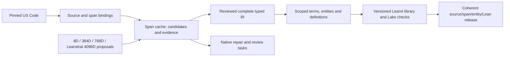

# Legal autoformalization

**Current F18 stage, 2026-10-29: 27 authored outer v2 saved-file/metadata controls passed.** The [original-owned qualification](../../../docs/autoformalization/evidence/legal-ir-f18-outer-v2-saved-consumer-qualification-20261029.json) ran the unchanged current full fixture: all 56 source pins stayed unchanged, and real validation-owner source, native, process and storage custody closed in 117.200 seconds. Producer/parity/training witnesses inside these controls are fictional. This establishes saved-consumer engineering behavior, with no retained-v2 training/comparison, numerical-dispatch, legal or Lean grant. Earlier failed controls and the prepared source bundle remain retained. Optional prefix16/suffix11 templates are still unexecuted. See the [handoff](docs/HANDOFF.md) for the next gates.

[Current source qualification evidence](../../../docs/autoformalization/evidence/legal-ir-reviewed-programme-packet-index-source-qualification-20261028.json).

**Supervisor preparation cutoff, 2026-10-28:** **Native status at that cutoff was 2 completed and 62 blocked, cursor 220; LIR-9003 was blocked at revision 2.** Its criteria 0 and 2 were open; criterion 1 was satisfied only within the factual-index scope. Seven implementation cards were blocked non-packet dispositions because current task/revision, edit/test scope, lease and acceptance contracts were unbound. This did not assert that their implementations were absent or grant native amendment, completion, dispatch, retry, training, semantic review or supervision masks. The current read-only board observation appears below.

Fresh original-owned qualification passed **115 parent cases, 345 phases and 69 subtests** (JUnit summary 184, 2.243 seconds). The 65 legacy packet cases, 38 preparation CLI cases, 11 new normal-import cases and one saved-data rehearsal retain their declared scopes. Both earlier failed qualifications remain retained. The actual normal canonical producer and distinct verifier have now closed under separate original VALIDATION owners, using the immutable input and frozen report. They reproduce the factual 64-row index while LIR-9003 stays blocked at revision 2 with criteria 0 and 2 open. The producer bound 184 data/source pins; the verifier bound 190. Both released source, native, process and storage custody. This grants no productive execution or native completion.

The peer programme preparer is adopted in the existing owner; `programme-index prepare|verify` supplies metadata preparation and verification. See [current handoff](docs/HANDOFF.md) for scope, evidence and the existing 9103 implementation. **Current operations:** the dedicated runtime has separate accepted two-sample evidence on source `677329ab904ec1b15734a5c53021bc993dfca7d3`, release `1e35437a45b9e3e1e704`, with held/spent budgets and native history preserved. Accelerator [PR310](https://github.com/endomorphosis/ipfs_accelerate_py/pull/310) is officially merged at `345a8f60939f4baacfcc198091b9aec86618f3a7` (2026-10-28 17:05:34 UTC); this supersedes the earlier open/billing cutoff below. Runtime acceptance, publication, source qualification and scientific acceptance remain separate evidence.

The programme goal is the **entire pinned U.S. Code represented as reviewed formal logic, scoped term/entity/definition graphs and a versioned Lean4 corpus**. Reuse the existing **34-goal / 64-task native supervisor hierarchy** and the original 24 parent work items. The maintained [handoff](docs/HANDOFF.md), [task catalog](docs/guides/legal_ir_supervisor_task_catalog_20261016.md) and [training history](docs/TRAINING_HISTORY.md) contain the plan, dependencies, completed work and remaining gates.

The [2026-10-28 v2 trainer integration and pre-entry recovery qualification](../../../docs/autoformalization/evidence/legal-ir-f18-v2-trainer-integration-recovery-20261028.json) passed 241 pure/fake cases through the original validation owner. It extends the existing controller/worker and keeps both arm recipes and v2 output identities explicit. Its separate native probe hit the then-current inventory-count bound before any grant or child; no retained training or new rate ran. That failed probe and the narrow source-close recovery retain their original source bindings and remain separate from the current generation below.

The [opt-in v2 saved scorer](../../../docs/autoformalization/evidence/legal-ir-f18-v2-saved-scoring-20261028.json) now has200 passing authored cases. It checks independent caller context and every candidate generation without importing numerical owners or opening files. Physical authentication remains external; no retained-v2 outputs were compared. The [public headroom and fresh parity qualification](../../../docs/autoformalization/evidence/legal-ir-f18-inventory-headroom-parity-20261029.json) reuses the existing resource owner with a finite four-million-entry bound, the same 220GB cap and unchanged strict accounting. Separate original-owned qualifications passed three resource cases, 52 genuine numerical/capture cases and 242 pure controller/worker/recovery cases. Fresh v1 and v2 zero-step runs each matched all 194,812 binary32 head scalars, complete greedy/formal outputs and joint records across 632 rows. Both trainer routes now require their exact fresh raw parity result; the old v1 summary capsule is historical evidence and is refused as current `compute.initial_parity`.

The [current native-probe and metric-view qualification](../../../docs/autoformalization/evidence/legal-ir-f18-native-probe-metric-view-20261029.json) now exercises the actual original native grant and child READY/RUN lifecycle with 53 unchanged source pins. Its zero-model probe closed all custody in 169.05 seconds; original named-root accounting covered 2,088,443 entries. The isolated child now receives explicit `-B` before bootstrap, with 242 pure lifecycle/recovery cases requalified on 80 unchanged pins. This qualifies the zero-model trainer lifecycle; numerical trainer dispatch remains separate.

The existing metrics owner provides `f18_metric_capture_view`, preserving schemas, metadata, identity fields and chunk order while replacing occurrence scores with `None` in a detached view. Its 231-case pure qualification retains all 200 earlier cases and adds 31 projection controls. The thin outer v2 consumer joins the independent request, frozen outputs, recipes, checkpoints and training context using those existing owners; its separate 27-case authored qualification now passes. Neither scope authenticates a genuine v2 training producer or full numerical checkpoint state, or closes numerical dispatch, finite TRAIN-only admission, retained fit, legal accuracy or Lean gates. Public physical-v2 validation frontend reconciliation remains separate.

Start with one reviewed norm, its governing definition and two distinct statutory uses from the retained 2024 Title 10 pilot. Expand to 20–40 connected provisions, then bounded dependency components covering every requested occurrence in the selected release. Keep processed, unresolved, unsupported and admitted coverage separate. Model outputs enter the same review and admission path.

The four source widths have separate producer/checkpoint/task contracts: 8D is a compact control, 384D the first controlled student, 768D a matched comparison, and native Leanstral 4096D a source-representation lane whose teacher role needs fidelity evidence. Source width, actual bottleneck, sidecars, input context and complete output budget are distinct. The [2026-10-26 readiness review](../../../docs/autoformalization/evidence/legal-ir-training-programme-readiness-20261026.json) preserves already-completed restores and reference replays and records the then-open private/public Context150 source gap. The [2026-10-27 versioned source port](../../../docs/autoformalization/evidence/legal-ir-context150-owner-integration-20261027.json) adds the fixed opt-in `retained-context150-source-compatibility/v1` profile by reusing both retained Context150 product owners verbatim. The owning test now acquires its unchanged, hash-pinned original patch oracles from the existing tracked history archive. Default loader strictness is preserved; the shared source and bridge are unchanged. The separate public integration check passed 28 pure metadata/negative-path cases across 84 test phases and 10 selectors, with no checkpoint assets, model execution or denied external effects. This does not transfer the historical 38-case qualification or establish new checkpoint restores, inference, training or legal-quality results.

The [F18 four-tensor source adoption](../../../docs/autoformalization/evidence/legal-ir-conditions-fullspan-owner-adoption-20261027.json) reuses the existing worker implementation in its [prescribed optimizer owner](../../optimizers/logic_theorem_optimizer/legal_span_conditions_fullspan_training_v1.py). Five separate pure metadata controls passed, with no numerical framework, checkpoint assets or model execution. The old seven-test worker pass report supplies no original resource-closed numerical qualification. The later 26-case synthetic mechanics qualification covers actual forward/objective gradients and in-memory resume. A separate [retained-input authentication](../../../docs/autoformalization/evidence/legal-ir-f18-retained-input-authentication-20261027.json) now binds the selected physical F18 donor, F15 teacher/masks and 168/72/96 TRAIN population through the original loader, with no updates. The later [39-case checkpoint qualification](../../../docs/autoformalization/evidence/legal-ir-f18-four-tensor-persisted-resume-20261027.json) now covers a separate four-tensor delta format, exact disk resume and bounded continuation in that same owner. A separate [authentic zero-step roundtrip](../../../docs/autoformalization/evidence/legal-ir-f18-retained-zero-step-delta-roundtrip-20261027.json) reconstructs all 42 retained F18 tensors from a 122251-byte delta plus its required authenticated donor, with no forward or update. See the [API contract](docs/guides/legal_span_conditions_fullspan_training_v1.md). The subsequent [45-case capture qualification](../../../docs/autoformalization/evidence/legal-ir-f18-source-capture-qualification-20261027.json) extends that same owner with source-only capture from one restored runtime. A separate [632-case initial-parity run](../../../docs/autoformalization/evidence/legal-ir-f18-initial632-parity-20261027.json) matches all 194812 binary32 head values, complete greedy/formal outputs and joint outputs to the final trained F18. This closes the selected baseline-compatibility gate. The closed trainer controller now has separate pure/helper and zero-model original native qualification. The separate matched numerical pair has frozen candidate outputs. Its [saved-only comparison](../../../docs/autoformalization/evidence/legal-ir-f18-frozen-matched-scoring-20261027.json) measures no full-IR gain or margin advantage and one additional joint abstention per candidate; retained comparator and statutory gates remain open.

The following immutable release description retains its original unscored publication cutoff; the separate saved-only comparison above does not modify that Hub release or promote its weights.

The [later fixed-case diagnosis](../../../docs/autoformalization/evidence/legal-ir-f18-conditions-ranking-diagnosis-20261028.json) qualifies the joint producer-status guard and records persistent TRAIN head-ranking errors. Gold ranks 2 and 3 in the parent become 2 and 2 in both candidates; all remain in the top eight with positive gaps. The DEV abstention comes from an incompatible retained domain, with no DEV gold used. This diagnosis ran no new model or whole 624-row score.

The separate [prospective optimizer metadata contract](../../../docs/autoformalization/evidence/legal-ir-f18-optimizer-recipe-metadata-qualification-20261028.json) passed 160 pure cases (480 phases). It keeps immutable donor/v1 learning rate 0.001 separate from an explicit prospective TRAIN rate, using detached canonical validation with all authentication, parity, admission, execution and quality flags false. That metadata-only cohort selected no experiment rate or executable numerical profile. The separate [v2 numerical successor](../../../docs/autoformalization/evidence/legal-ir-f18-v2-numerical-qualification-20261028.json) now passes 32 genuine synthetic cases (96 phases), covering direct recipe-rate Adam, checkpoint persistence, disk resume and bounded updates. The [later capture and fresh retained parity](../../../docs/autoformalization/evidence/legal-ir-f18-v2-source-capture-parity-20261028.json) pass 52 synthetic cases (156 phases) and separately match all 194,812 binary32 head scalars, complete greedy/formal rows and joint records across 632 sources. Those 2026-10-28 results retain their source generation; use the current headroom, trainer and raw-parity bindings above before a prospective experiment. Fresh finite TRAIN-only admission remains required before any retained fit. The parity run used zero gradients/updates and selected no experiment rate. Fixture rates select no experiment; immutable v1 numerical source remains unchanged.

The two [experimental candidate deltas](https://huggingface.co/Publicus/legal-ir-autoencoder/tree/270a753c1f439ac106877e825d5f5a3577916510/releases/20261027-f18-four-tensor-conditions-pair-v1) are now published with [immutable byte-verification evidence](../../../docs/autoformalization/evidence/legal-ir-f18-four-tensor-hf-weight-publication-20261027.json). They require the existing final-F18 donor and remain unscored; this publication changes no default model.

The final merged, freshly original-owned [26-case genuine synthetic mechanics result](../../../docs/autoformalization/evidence/legal-ir-f18-conditions-fullspan-genuine-mechanics-20261027.json) qualifies corrected mixed168/absent/type wiring and synthetic gradients/parity/in-memory Adam continuation on its own exact source generation. At that mechanics cutoff authentic donor/source/teacher/mask admission remained open; the later selected-input check above closes only that physical authentication. The matched pair and later saved-only comparison close their separate finite-fit and parent-relative scoring gates. The fixed-case diagnosis records persistent ranking and compatibility failures. The separately versioned recipe, numerical mechanics, source capture and initial parity now have their own qualifications above. The current trainer/source-generation and zero-model native-probe qualifications above remain separate from numerical trainer dispatch, finite TRAIN-only admission, original retained comparator gates and statutory accuracy. The five-case source-adoption observation remains separate.

The latest read-only watchdog snapshot observes **145/145 engineering completion** and **5 completed / 59 blocked scientific tasks, cursor 232**, with the scientific executor unactivated. This is observation of existing board state, not a native completion performed by the saved-consumer work. The existing 34-goal / 64-task hierarchy and 24 parent items are unchanged. LIR-9001 retains its spent two-attempt budget and unresolved UNKNOWN provider history. The active watchdog covers both engineering and scientific namespaces; lifetime infrastructure actions remain 3 and 0, respectively. No retry, budget reset, dispatch or scientific acceptance follows from healthy services. See [operations](docs/OPERATIONS.md) and the [dual-namespace evidence](../../../docs/autoformalization/evidence/legal-ir-dual-namespace-watchdog-20261027.json).

The [2026-10-27 runtime retry-policy verification](../../../docs/autoformalization/evidence/legal-ir-runtime-retry-policy-verification-20261027.json) binds the four engineering lanes' owner-reported loaded generation to its actual ten source files and verifies the existing attempt-floor/journal protection before task selection and dispatch. The checkout's older Git HEAD did not prove that this privately adapted protection was absent. This read-only verification performed no deployment, restart, new tests, database access or provider call. The public closed automatic rearm selector (`0`/`1`) and its separate guards remain a source difference; this does not establish full PR301 byte equivalence, whole-process code attestation or an authenticated minimum attempt count. Engineering completion does not settle the 64-task scientific programme.

| Need | Canonical document |
| --- | --- |
| Continue the work or hand it to another coding agent | [Current status and next work](docs/HANDOFF.md) |
| Locate existing implementations and stage contracts | [Architecture and owner map](docs/ARCHITECTURE.md) |
| Plan the8D,384D,768D and genuine4096D source lanes | [Four-width delivery plan](docs/HANDOFF.md#four-source-widths) |
| Avoid repeating training and diagnostics | [Training and experiment history](docs/TRAINING_HISTORY.md) |
| Run bounded work and retain evidence consistently | [Operations](docs/OPERATIONS.md) |
| Find current owners and selected evidence | [Work catalog](docs/work_catalog.json) |
| Find original reports, retired plans and migration provenance | [Archive and migration map](docs/ARCHIVE.md) |
| Inspect the existing task records | [Backlog](docs/BACKLOG.json) |
| Bind native goals, parallel tasks and execution packets | [Supervisor task catalog](docs/guides/legal_ir_supervisor_task_catalog_20261016.md) |

The [work catalog](docs/work_catalog.json) is the single maintained owner/evidence index; [BACKLOG.json](docs/BACKLOG.json) holds the original 24 whole task records. Run `python ipfs_datasets_py/logic/autoformal/work_catalog.py --component definition-use-native` for one owner, `--tasks` for compact task output or `--task LIR-14` for one task, from the repository root. Full historical task records remain available in that one backlog; do not load the complete file into an agent's context by default. Task-level API guides live in [docs/guides](docs/guides/). Shared numerical training engines remain with their existing optimizer owners. The six [experimental profile adapters](docs/guides/experimental_autoencoder_profiles.md) and [parent native extension](docs/guides/legal_corpus_definition_use_native_v2.md#literal-parent-conditional-native-profile) are maintained here, with retained focused migration engineering qualification. Their checkpoint replay, runtime availability and statutory qualifications remain separate. They introduce no new default runtime or generic numerical backend.

New reusable LegalIR code belongs in this package, with regression tests in `tests/unit/logic/autoformal`. Update these documents in place. Dated run directories hold observations and frozen inputs; they are not alternative production implementations. A prepared graph, authenticated review or successful Lean compilation grants only the authority explicitly recorded by that stage.

## Retained engineering observations

The [focused public parent-correspondence check](../../../docs/autoformalization/evidence/legal-ir-source7346-public-parent-correspondence-20261026.json) reuses the existing 837-record/16-row assets and one unselected authored hypothesis. Its explicit namespace profile preserves all 13 original parent producer paths and records package-initializer bypasses. Source meaning, context, training eligibility and learned legal-text reconstruction remain open.

The [full-subsection(b) source-correspondence observation](../../../docs/autoformalization/evidence/legal-ir-source7346-full-b-parent-correspondence-20261025.json) reuses both authored v02 hypotheses and the original 837-record population. Nine typed-target references come from four lexical head anchors in each candidate; 48 other targets remain authored scaffolding. Literal accounting, semantic fidelity and latent-only legal-text reconstruction remain separate; source meaning, context and training eligibility are unresolved.

The [retained section7346(b) candidates](../../../docs/autoformalization/evidence/legal-ir-source7346-full-b-partial-candidates-20261025.json) include both exact authored v02 requests and their predicate/semantic-gap glossary. Two whole structural replay cases passed in the existing relational owner. These hypotheses remain partial, non-exhaustive, unreviewed and source-unbound, with all15 questions unanswered and zero supervision masks; they establish no whole-law formalization or width-specific numerical gain.
