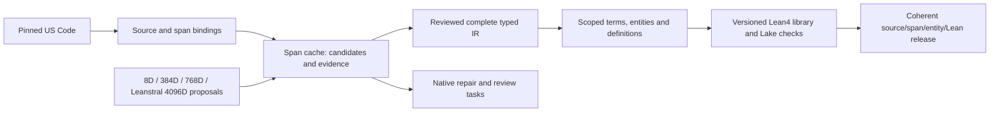

# Legal autoformalization

The programme goal is the **entire pinned U.S. Code represented as reviewed formal logic, scoped term/entity/definition graphs and a versioned Lean4 corpus**. Reuse the existing **34-goal / 64-task native supervisor hierarchy** and the original 24 parent work items. The maintained [handoff](docs/HANDOFF.md), [task catalog](docs/guides/legal_ir_supervisor_task_catalog_20261016.md) and [training history](docs/TRAINING_HISTORY.md) contain the plan, dependencies, completed work and remaining gates.

Start with one reviewed norm, its governing definition and two distinct statutory uses from the retained 2024 Title 10 pilot. Expand to 20–40 connected provisions, then bounded dependency components covering every requested occurrence in the selected release. Keep processed, unresolved, unsupported and admitted coverage separate. Model outputs enter the same review and admission path.

The four source widths have separate producer/checkpoint/task contracts: 8D is a compact control, 384D the first controlled student, 768D a matched comparison, and native Leanstral 4096D a source-representation lane whose teacher role needs fidelity evidence. Source width, actual bottleneck, sidecars, input context and complete output budget are distinct. The [2026-10-26 readiness review](../../../docs/autoformalization/evidence/legal-ir-training-programme-readiness-20261026.json) preserves already-completed restores and reference replays and records the then-open private/public Context150 source gap. The [2026-10-27 versioned source port](../../../docs/autoformalization/evidence/legal-ir-context150-owner-integration-20261027.json) adds the fixed opt-in `retained-context150-source-compatibility/v1` profile by reusing both retained Context150 product owners verbatim. The owning test now acquires its unchanged, hash-pinned original patch oracles from the existing tracked history archive. Default loader strictness is preserved; the shared source and bridge are unchanged. The separate public integration check passed 28 pure metadata/negative-path cases across 84 test phases and 10 selectors, with no checkpoint assets, model execution or denied external effects. This does not transfer the historical 38-case qualification or establish new checkpoint restores, inference, training or legal-quality results.

The [F18 four-tensor source adoption](../../../docs/autoformalization/evidence/legal-ir-conditions-fullspan-owner-adoption-20261027.json) reuses the existing worker implementation in its [prescribed optimizer owner](../../optimizers/logic_theorem_optimizer/legal_span_conditions_fullspan_training_v1.py). Five separate pure metadata controls passed, with no numerical framework, checkpoint assets or model execution. The old seven-test worker pass report supplies no original resource-closed numerical qualification. The later26-case synthetic mechanics qualification covers actual forward/objective gradients and in-memory resume. A separate [retained-input authentication](../../../docs/autoformalization/evidence/legal-ir-f18-retained-input-authentication-20261027.json) now binds the selected physical F18 donor, F15 teacher/masks and168/72/96 TRAIN population through the original loader, with no updates. New four-tensor persisted checkpoint/resume, remaining E1 parity assets and matched fits/scoring remain open; see the [current training history](docs/TRAINING_HISTORY.md#retained-f18-physical-input-authentication-2026-10-27).

The final merged, freshly original-owned [26-case genuine synthetic mechanics result](../../../docs/autoformalization/evidence/legal-ir-f18-conditions-fullspan-genuine-mechanics-20261027.json) qualifies corrected mixed168/absent/type wiring and synthetic gradients/parity/in-memory Adam continuation on its own exact source generation. At that mechanics cutoff authentic donor/source/teacher/mask admission remained open; the later selected-input check above closes only that physical authentication. Real paired fits/scoring and statutory accuracy remain open; the five-case source-adoption observation is not pooled with it.

The latest accepted native readback records **64 blocked tasks and no runnable scientific frontier**. LIR-9001's two-attempt budget is spent; administrative settlement leaves the provider outcome unknown. Use the existing handoff preview preparer and original-owner disposition before any retry or successor admission. Source, model and graph preparations may proceed under separately admitted scopes. The active minute watchdog observes the separate legacy engineering fleet; healthy operational status does not settle the scientific programme. See [operations](docs/OPERATIONS.md) and the [current evidence](../../../docs/autoformalization/evidence/legal-ir-training-programme-readiness-20261026.json).

| Need | Canonical document |
| --- | --- |
| Continue the work or hand it to another coding agent | [Current status and next work](docs/HANDOFF.md) |
| Locate existing implementations and stage contracts | [Architecture and owner map](docs/ARCHITECTURE.md) |
| Plan the8D,384D,768D and genuine4096D source lanes | [Four-width delivery plan](docs/HANDOFF.md#four-source-widths) |
| Avoid repeating training and diagnostics | [Training and experiment history](docs/TRAINING_HISTORY.md) |
| Run bounded work and retain evidence consistently | [Operations](docs/OPERATIONS.md) |
| Find current owners and selected evidence | [Work catalog](docs/work_catalog.json) |
| Find original reports, retired plans and migration provenance | [Archive and migration map](docs/ARCHIVE.md) |
| Inspect the existing task records | [Backlog](docs/BACKLOG.json) |
| Bind native goals, parallel tasks and execution packets | [Supervisor task catalog](docs/guides/legal_ir_supervisor_task_catalog_20261016.md) |

The [work catalog](docs/work_catalog.json) is the single maintained owner/evidence index; [BACKLOG.json](docs/BACKLOG.json) holds the original 24 whole task records. Run `python ipfs_datasets_py/logic/autoformal/work_catalog.py --component definition-use-native` for one owner, `--tasks` for compact task output or `--task LIR-14` for one task, from the repository root. Full historical task records remain available in that one backlog; do not load the complete file into an agent's context by default. Task-level API guides live in [docs/guides](docs/guides/). Shared numerical training engines remain with their existing optimizer owners. The six [experimental profile adapters](docs/guides/experimental_autoencoder_profiles.md) and [parent native extension](docs/guides/legal_corpus_definition_use_native_v2.md#literal-parent-conditional-native-profile) are maintained here, with retained focused migration engineering qualification. Their checkpoint replay, runtime availability and statutory qualifications remain separate. They introduce no new default runtime or generic numerical backend.

New reusable LegalIR code belongs in this package, with regression tests in `tests/unit/logic/autoformal`. Update these documents in place. Dated run directories hold observations and frozen inputs; they are not alternative production implementations. A prepared graph, authenticated review or successful Lean compilation grants only the authority explicitly recorded by that stage.

## Retained engineering observations

The [focused public parent-correspondence check](../../../docs/autoformalization/evidence/legal-ir-source7346-public-parent-correspondence-20261026.json) reuses the existing 837-record/16-row assets and one unselected authored hypothesis. Its explicit namespace profile preserves all 13 original parent producer paths and records package-initializer bypasses. Source meaning, context, training eligibility and learned legal-text reconstruction remain open.

The [full-subsection(b) source-correspondence observation](../../../docs/autoformalization/evidence/legal-ir-source7346-full-b-parent-correspondence-20261025.json) reuses both authored v02 hypotheses and the original 837-record population. Nine typed-target references come from four lexical head anchors in each candidate; 48 other targets remain authored scaffolding. Literal accounting, semantic fidelity and latent-only legal-text reconstruction remain separate; source meaning, context and training eligibility are unresolved.

The [retained section7346(b) candidates](../../../docs/autoformalization/evidence/legal-ir-source7346-full-b-partial-candidates-20261025.json) include both exact authored v02 requests and their predicate/semantic-gap glossary. Two whole structural replay cases passed in the existing relational owner. These hypotheses remain partial, non-exhaustive, unreviewed and source-unbound, with all15 questions unanswered and zero supervision masks; they establish no whole-law formalization or width-specific numerical gain.
