# Architecture and owner map

The maintained pipeline uses one implementation owner per stage. The [work catalog](work_catalog.json) records canonical owners and selected evidence; it is the maintained machine-readable index for this map. Imports below are relative to `ipfs_datasets_py.logic.autoformal` unless stated otherwise. The existing compiler and legal IR remain outside this package where already owned; adding a new wrapper does not replace them.

```mermaid
flowchart LR
  S[Versioned law source] --> I[Source/span/entity correspondence]
  I --> C[Complete source and context evidence]
  C --> D[Scoped definitions and norms]
  D --> R[Interpretation and every-use review]
  R --> G[Dependency graph component]
  G --> P[Conditional Lean preparation]
  P --> N[Owned full native build and receipts]
  N --> U[Shared incremental corpus]
```

| Stage | Existing owner/API | Boundary to preserve |
| --- | --- | --- |
| Source inventory and exact coordinates | `uscode_ingest.inventory_uscode_documents`; `inventory_uscode_source_coordinates` / `validate_uscode_source_coordinates` | Supplied decoded-text coordinates exist; physical source-row identity and coordinate transport have an opt-in qualified selected-branch profile; default adoption/current-source crosswalk still require complete witnesses. |
| Paired span production | Existing `uscode_dataset.USCodeParquetRecord.from_row`, `span_cache.SpanCache.enqueue`, ops ingest/publication owners; `paired_span_census.load_paired_census_bundle` for retained bundles | Reuse selected-branch opt-in physical capture and v3 complete-report manifest/feed/import transport in these existing owners; automatic publication/default adoption remain separate. Preserve legacy IDs and exact original/view coordinate namespaces; no `paired_span_census.inventory` API exists. |
| Selected source/span/entity correspondence | `legal_source_span_entity_join_v1.prepare_source_span_entity_join_manifest`; `legal_source_span_entity_census_v1.prepare_source_span_entity_census_v1` | Selected branch `431c9c7` adds coordinate join v2 to this same owner. Keep source, span and entity revision/row/hash namespaces distinct; metadata custody does not recover endpoints or establish meaning. |
| Cache-context intake | `legal_compact_source_context_cache_intake_v1.prepare_source_context_cache_intake_v1` | Selected branch `431c9c7` adds compact context intake v2 to this same owner. An authenticated transport row is not reviewed statutory meaning or gold. |
| Source and context review | `legal_source_sampling`, `corpus_source_review`, `corpus_source_review_packets`, parent source/occurrence adapters | Retain complete physical evidence, context obligations, explicit edition and occurrence identities. |
| Scoped definition lookup | `scoped_definition_resolution` | Use existing official or `*_parent_*_v1` registry/query/lookup/dependency functions for the actual profile. Preserve ambiguity and unresolved lookup. |
| Joint definition use | `corpus_definition_use_v2.prepare_definition_use_v2` / `prepare_parent_definition_use_v1` | The alias is an explicit unproved assumption. Keep the complete joint AST and original endpoint identities. |
| Combined review | `corpus_definition_use_review_v2` | Parent `prepare/build/assess/validate_*_v1` is a distinct signing domain. Endpoint signatures cannot approve the combined subject. |
| Norm interpretation and applicability | `legal_norm_content_*`, `legal_norm_definition_*`, `legal_bound_variable_definition_v1` | Declarations, authenticated custody, governing applicability and conditional instances remain different claims. |
| Graph interchange/dependencies | `legal_graph_dependencies` and existing corpus graph/exchange owners | Keep scoped senses, complete typed assertions, source witnesses and dependency invalidation; avoid lexical sense merges. |
| Conditional project preparation | `legal_corpus_definition_use_lake_v2` | Official `*_definition_use_corpus_v2` and parent `*_parent_definition_use_corpus_v1` remain separate profiles. Same six-module/nine-file renderer; no Lean process during preparation. |
| Native execution | `legal_corpus_definition_use_native_v2` | Official V2 and explicit `validate/build_parent_definition_use_native_v1` routes now exist in this owner, with separate receipt profiles. The original 19 parent migration controls and 30-case preparation keep their scopes. Two actual authored FOL/TDFOL projects qualified Lean4.34.1 execution and observed lifecycle closure; their pending review and explicit premises remain. The separate shared-parent native APIs now preserve the complete aggregate: **16/16 passed** for 16 main controls and **2/2 passed** for two actual authored aggregate projects ([record](../../../../workspace/test-logs/federal-corpus-audits/parent-shared-native-20261020-01/qualification-summary.json)). Stable unique theorem observations retain every component contributor, child review outcome and premise; no combined assessment or statutory authority is inferred. |
| Preservation | `legal_native_ast_preservation`; `legal_corpus_definition_use_preservation_*_v2` | Compilation, serialized-AST preservation, theorem lineage and kernel-type observations are distinct gates. |
| Shared/incremental corpus | `legal_corpus_shared_lake`; `legal_corpus_incremental` | Legacy shared/incremental qualification already exists. The distinct parent shared-preparation API is installed: **28/28 passed** ([main receipt](../../../../workspace/test-logs/federal-corpus-audits/parent-shared-preparation-20261020-01/qualification-summary.json)); two [physical-source controls](../../../../workspace/test-logs/federal-corpus-audits/parent-shared-physical-close-20261020-01/qualification-summary.json) are separately reused. Exact endpoint identities, complete child commitments, repeated contributor ordinals and conditional premises survive sharing. Supported conditional aggregate execution now has its own native profile and separate cohorts; the preparation remains preparation-only. The existing incremental owner exposes a distinct parent profile with 22 authored coordinator controls; its separate [installed-Lean qualification](../../../../workspace/test-logs/federal-corpus-audits/parent-shared-incremental-native-20261020-01/qualification-summary.json) is **2/2 passed** for two authored FOL/TDFOL cases (13 cold/0 warm/6 affected +7 reused/13 clean calls each), preserving real public replay, installed closure and exact affected/clean artifacts. This is a donor-interpretation change on unchanged physical text; the copied-text custody branch is not independent statutory evidence. The separate [4/4 installed-Lean warm-refusal cohort](../../../../workspace/test-logs/federal-corpus-audits/parent-shared-incremental-native-refusals-20261020-01/qualification-summary.json) now closes physical drift/re-signed revocation for two actual FOL/TDFOL cases plus two regressions (12 compiles, eight probes, six fresh conditional empty-axiom observations). New source/scope/lookup, producer/toolchain/library and failed-compiler descendant edges retain their own gates; no new modal/norm semantics or model/training authority follows. The legacy cache cannot consume this profile by relabeling its schema. Preserve the separate selected-path Git delivery boundary. |

Resource ownership remains in the existing optimizer `ValidationResourceReservation`, operations launcher and shared `logic/backends/process.py` tracker. The explicit `sampled_birth_bound_descendants` profile adds sampled custody of observed nested sessions; legal preparation/review/native orchestration stays here. See [operations](OPERATIONS.md) for original-owner post-exit evidence and source READ retention. The [current qualification](../../../../workspace/test-logs/federal-corpus-audits/parent-native-genuine-20261020-01/qualification-summary.json) records separate source-only, lifecycle and actual compiler scopes.

## Git delivery boundary

The work catalog describes current filesystem owners and attributed evidence, with separate selected-branch delivery metadata. The clean selected branch `agent/legal-ir-selected-landing-20261020` at `431c9c7715ba7165dbec27f362410ac7dd23983a` contains qualified opt-in raw capture, paired transport, context intake v2 and coordinate join v2. It remains unmerged/unpushed; the superproject pointer is unchanged. Top-level catalog APIs continue to describe installed primary owners, so newer selected APIs must not be assumed installed. See the [latest delivery boundaries](HANDOFF.md#latest-transport-delivery-and-remaining-graph-boundary). The [selected-path audit](../../../../workspace/test-logs/federal-corpus-audits/legal-ir-planning-review-20261020-01/landing-audit.json) distinguishes exact working bytes, current main/landing/full-norm commit coverage and owning tests. Land the required dependency closure in `external/ipfs_datasets`, including untracked adapters/native-context verifiers and package declarations, before a fresh clone can use it. Runtime supervision remains in `external/ipfs_accelerate`; LegalIR semantics and numerical kernels stay with their existing dataset owners. Artifact directories hold immutable run evidence and rejected attempts, not competing public implementations.

## Numerical implementation reuse

Compact content/role training and serving owners live under `ipfs_datasets_py.optimizers.logic_theorem_optimizer`. `legal_compact_content_role_trained_runtime_v1.score_prefixes` is the already-used bounded immutable score API. Preserve the selected checkpoint, source profile and original lifecycle observations rather than copy its model into a run directory.

`decoder_distillation_experiment_v2.bind_persistent_model` already implements `every_step` and matched `first_step` injection. `contextual_legal_ir_numeric` already restores a retained contextual model using persistent conditioning. These are different checkpoint/codec/input profiles from compact537 CP128. Reuse their implementation under an explicitly compatible profile; equal input width does not make a checkpoint interchangeable.

Six versioned adapters now live under `experimental/`; their focused migration engineering controls passed. They reuse the existing numerical engines and are not a new default serving/training route.

| Profile adapter | Canonical module | Preserved boundary |
| --- | --- | --- |
| Context initialization | `experimental.projected_context_decoder_v1` | Fixed 13-tensor parent and zero-initialized context columns. |
| Trained Context150 | `experimental.trained_projected_context_decoder_v1` | Fixed projection and training manifests; completed historical steps are not repeated. |
| Gated conditioning | `experimental.gated_conditioning_v1` | Explicit 13-to-15-tensor migration and original capsule format. |
| Gated training state | `experimental.gated_training_state_v1` | Fresh versus resumed Adam lineage; legacy inspection/restore is allowed, legacy-to-new packing is refused. |
| Journal training | `experimental.journal_training_session_v1` | Fixed anchors, update/cadence limits and checkpoint envelope. |
| Journal inference | `experimental.journal_inference_v1` | Matched journal state, BOS scoring and bounded session lifecycle. |

`experimental._legacy_source_bridge_v1` binds current producers to the bridge and permits only complete fixed historical recipes. Mixed recipes refuse. Ten additional complete-recipe metadata controls call genuine current owners without numerical execution, separately from the earlier CPU migration fixtures. Historical paths are declarations, not freshly authenticated files; original checkpoint/logit/optimizer parity and convergence have not been established by this port.

The [training history](TRAINING_HISTORY.md) identifies completed runs. The cross-modality [autoencoder handbook](../../../../docs/autoencoders/README.md) remains the owner for generic numerical infrastructure, UI/security/intent paths and their operations.

The existing shared `ir_decoder_profile_inventory` and `ir_model_manager_import` owners now expose a separate LegalIR4096 expected-producer metadata profile and asset binding. It preserves the original 12 decoder lanes and their IDs. The [92-case qualification](../../../../workspace/test-logs/federal-corpus-audits/source4096-registration-20261020-01/qualification-summary-02.json) covers exact declared identity, pin/readback fences and inert-manager behavior; it does not authenticate native producer execution, checkpoint IO, a physical store, publication or legal quality. The source profile is distinct from a decoder format and from the process/thread-bound native embedding capability. The same importer now also exposes `ir_model_source_record_id_v2` and `import_ir_model_manager_records_v2` for the published historical source/span binding. The [234-control reconciliation](../../../../workspace/test-logs/federal-corpus-audits/source4096-reconciliation-20261020-01/qualification-summary-01.json) preserves both contracts and all existing IDs in one owner and one registration loop; their library identities and producer authority remain separate. It does not repeat the retained catalog import or publication.

## Detailed guides

The consolidated guides whose primary implementation owners live in this module are consolidated in [guides/](guides/). Start with [source/span/entity join](guides/legal_source_span_entity_join_v1.md), [scoped lookup](guides/scoped_definition_resolution.md), [combined use](guides/corpus_definition_use_v2.md), [combined review](guides/corpus_definition_use_review_v2.md), [conditional preparation](guides/legal_corpus_definition_use_lake_v2.md), [native execution](guides/legal_corpus_definition_use_native_v2.md) and [experimental profile adapters](guides/experimental_autoencoder_profiles.md). Historical qualification sections in an API guide retain their named cohort/profile; the current [handoff](HANDOFF.md) records the latest boundary.

## Authority and identity

Raw file hashes, canonical record digests, source/version CIDs and selected trust identities are separate commitments. Keep original byte inputs and independent expected pins. A saved `authenticated` flag does not replace replay. A Lean theorem under donor/consumer/alias premises does not establish those premises as statutory facts. Build success and empty axiom output do not supply missing genuine source-meaning or every-use review.
