# Architecture and owner map

## Supervisor validation of audited parent receipts — 2026-11-15

The existing supervisor adapter now accepts parent/v1, typed parent/v2 and full-candidate parent/v3 only when their schema and audit fields match the exact trusted in-process runtime selection. Task DATA cannot enable an audit or select an importer. Each sidecar must occupy its fixed output path, match its byte descriptor and equal a fresh recomputation by the existing inference owner using the original request, child outputs, independent contexts and canonical source pins. After the last caller callback, the adapter reauthenticates the request, audited inputs, source closure, sidecars, parent/child receipts and original outputs. Resealed false reports and late sidecar/context/source changes refuse.

All **93 source-only software cases pass**: the entire 45-case dispatch module and 48 parent metadata controls, including 22 new cases. There are no failures, skips, source drift or numerical runtime imports. Accelerate control-plane contracts are explicitly imported from the canonical published checkout and their origin/hash is recorded. Earlier attempts retain one expected missing-validator failure, one Source admission timeout with zero tests and a 42-pass/three-failure run caused by the missing Accelerate import path; the corrected 45-case run and final 93-case run are separate records. Six controls use deliberately simulated CLI returns and receipts; they exercise adapter control flow and final-callback mutation refusal without a real child, original owner or model.

Default result/v1 remains; requested audited results use result/v2 and retain both sidecar descriptors. The adapter leaves task identity, status, holds, attempts, UNKNOWN history, completion authority, resource release and admission unchanged. **Physical supervisor/parent-v3 execution, current model/resource profiles and legal/native-proof/corpus qualification remain unverified.** Source-only acceptance of metadata is not an observed native execution, grant or promotion. Private assets and existing budgets remain on hold/unchanged. [Exact source captures, failed attempts and results](../../../../workspace/test-logs/federal-corpus-audits/legal-ir-peer-revision-reconciliation-20261109-v01/legal-supervisor-parent-audit-qualification-v01/qualification-summary.json).

## Trusted original-parent complete-candidate audit — 2026-11-14

The full-candidate aggregation now has one public owner, `evaluate_complete_norm_candidate_syntax`, shared by the evaluator and the original parent. The parent accepts a trusted in-process `candidate_syntax_profile` opt-in for the existing v2/v3 candidate contracts. Execution packets v1–v10 cannot select it. The fixed CLI forwards it only when selected; defaults retain parent/v1 and typed-only auditing retains parent/v2. The opted parent/v3 publishes a separate hashed `candidate-syntax-audit.json` after the existing FINISH and genuine child-wait boundary, fresh query/TRAIN policy checks and final artifact reauthentication. Source/context/selection facts come only from the request-bound independent context artifact, never from reference targets. Original child artifacts are preserved.

All **233 selected source-only software cases pass**: the whole 112-case metrics module, 73 evaluator controls and 48 parent metadata controls (36 new cases in total), with no failures, skips, source drift or numerical runtime imports. Twelve source/test pins bind this run, including the corrected admission epoch. Retained red baselines contain two missing-scorer failures and two missing-parent-feature failures. Controls cover callback errors, complete original-artifact joins, untrusted packet refusal, CLI forwarding, canonical source closure, combined sidecar charges including retained promises, individual output bounds and a last-callback context overwrite. No model, tokenizer runtime, pretrained asset or native Lean command runs; the worker is imported for DATA descriptors and JSON IO only.

**Physical original-parent/v3 publication, current resource/model profiles and supervisor adoption remain unqualified.** Metadata passes do not prove an actual FINISH/wait or resource closeout. The existing original owner still owns those execution gates; no new grant, budget, retry or source-profile approval is created. Real statutory meaning, training/gold, native proof, corpus admission and model-quality claims remain unverified. Private assets remain on hold, and historical checkpoints/qualifications retain their source epochs. [Exact source captures, red baselines and results](../../../../workspace/test-logs/federal-corpus-audits/legal-ir-peer-revision-reconciliation-20261109-v01/legal-parent-candidate-audit-qualification-v01/qualification-summary.json).

## Source-use identity in reviewed admission — 2026-11-14

The V2 and mixed V3 positive admission paths use one shared source-use checker in the existing V1 owner. Physical artifact/view/interval custody and declared legal source/release/edition/provision identity are separate checks. Artifact document revision remains provenance; it cannot add another occurrence of the same canonical view. Multiple unaligned views of one declared legal source/release fail explicitly. This supplies no source alias resolution, source authenticity, legal interpretation, proof or corpus authority. The 355-case canonical qualification and its failed originals are indexed in the current handoff; real statutory review remains pending.

## Explicit many-sorted complete-candidate syntax — 2026-11-14

The canonical candidate owner adds `validate_complete_norm_candidate_v3` with the distinct `unreviewed-complete-norm-candidate-syntax/v3` profile. It delegates object and many-sorted expressions to the existing relational lowering owners, retains all nine predicted fields exactly, and checks separately supplied source, governing-context and identifier-only selection facts. Mixed reports must retain their canonical schema/status, false authority/execution flags and zero semantic/consumer/training/gold masks. The public v1/v2 APIs retain their object-only refusals. No source text, legal interpretation, review, model or native proof is manufactured.

All **324 source-only software cases pass**: the complete 251-case candidate module (26 new cases) and 73 selected evaluator cases (six new cases, 67 retained), with no failures, skips, source drift or numerical imports. The genuine red baseline retains two missing-API failures and one legacy-refusal control pass; the evaluator red baseline retains its explicit v3-profile refusal. The evaluator selects v2 or v3 explicitly and binds the profile and independent known-fact digest into its cache identity. All three scripted fictional reference rows validate under v3; the v2 audit still reports the many-sorted row unsupported. Missing ordered roles, unknown profiles and changed selection IDs remain invalid/unsupported without dropping cases. A role-label swap can remain syntactically valid while exact role fidelity drops to 2/3, demonstrating that syntax is not source faithfulness. No generator, pretrained asset or native Lean command runs.

Legal meaning, authenticity, training/gold, proof, actual model quality, original-parent integration and corpus release remain unqualified. Historical checkpoints and qualifications keep their exact source epochs; the private-asset hold remains. The separately reproduced same-paragraph UTF-8/BOM admission defect awaits its own current-source repair and qualification. [Exact source captures, red baselines and green results](../../../../workspace/test-logs/federal-corpus-audits/legal-ir-peer-revision-reconciliation-20261109-v01/legal-mixed-candidate-syntax-qualification-v01/qualification-summary.json).

## Complete-candidate source-bound producer audit — 2026-11-14

The existing producer evaluator now accepts the explicit `unreviewed-complete-norm-candidate-syntax/v2` audit with separately supplied, closed known source/governing-context/identifier-only selection facts for every case. It delegates all nine candidate fields to the canonical candidate-v2 validator. References and known facts are checked before dispatch; facts never enter producer arguments or get inferred from reference targets. Changed declared source/context/selection identities refuse, callback fact mutation refuses, and audit policy plus known-fact digest enter a distinct cache identity. Defaults and existing payload scores stay unchanged.

All **67 selected source-only software cases pass**: 19 new audit cases and 48 retained producer/typed controls, with no skips, source drift or numerical imports. The original two missing-keyword failures and earlier pytest setup failure are retained separately. Tests use independently constructed fictional source declarations and scripted callbacks, with an import guard blocking Torch, Transformers, tokenizers and the training worker. The typed-expression and complete-candidate audits can coexist: all three reference formulas are canonical, while the full candidate owner validates two reference rows and leaves the many-sorted reference unsupported. Unsupported complete outputs, invalid complete outputs, all five noncomplete dispositions and callback errors keep the complete population denominator. No candidate is repaired. This is a source-only check under Source custody, not a Native/model/resource-profile qualification.

All legal meaning, source-authenticity, proof, training/gold and promotion claims remain false or unverified. A declared identifier match does not resolve an interpretation. The original-parent CLI, configured model producer, new-profile retention, actual pretrained fitting, real statutory review and corpus/Lean gates remain open. Private assets remain on hold. [Exact source captures and results](../../../../workspace/test-logs/federal-corpus-audits/legal-ir-peer-revision-reconciliation-20261109-v01/legal-complete-candidate-producer-audit-green-v02/qualification-summary.json).

## Closed actual-tokenizer training capacity — 2026-11-14

The closed actual-tokenizer capacity operation covers 18 complete rows: six source pairs and three rich heldout queries for each ChatML profile. The original profile needs 2040–7941 physical positions; the public-layout profile needs 2296–8197, with one row exceeding 8192. All fit the declared 32768-position model, full sources fit the 8192 source-token sub-bound, and full targets fit the 3500-token transport ceiling. Prompt frames match an independent native-template oracle; no body or EOS is truncated. Heldout capacity grants no training eligibility. This was one tokenizer-only operation, not an additional test count: no model weights, forward or fitting. Original Source/Native/process/wait custody closed and its own 8 MiB storage promise released durably. The exact historical source epoch remains frozen; publication does not qualify the current checkout, approve a current-source pretrained pair, or authorize private assets. [Closed evidence](../../../../workspace/test-logs/federal-corpus-audits/legal-ir-peer-revision-reconciliation-20261109-v01/legal-Qwen25-training-conditioning-capacity-v01/closed-capacity-observation.json).

## Explicit matching Qwen2 training conditioning — 2026-11-14

The existing Torch backend now accepts training_conditioning_profile only for the two closed Qwen2 causal ChatML profiles. Its selected training path shares the exact fixed public prompt builder with inference: complete source/context enters system/user/assistant framing, logical target BOS is omitted from physical input, every prompt label is masked, and the complete answer body plus EOS is supervised under the native causal shift. Every row must fit the full framed prompt plus full target before model mode, gradients or optimizer state can change. Nothing is truncated, repaired or projected. Marker injection and late malformed targets refuse the complete batch. Profile mutation during training refuses further progress. Default None retains the existing raw source-plus-target path and old recipe/configuration shapes.

The opt-in is bound into reviewed-local-decoder-recipe/v3 and torch-complete-reviewed-decoder-configuration/v4, producing distinct backend/checkpoint identity. Old recipes cannot smuggle the field, null/unknown profiles refuse before allocation, and local reconstruction restores the selected profile without training or registry reads. Exact resume matches the next native loss, parameter/Adam state and RNG. An existing reviewed mixed-job fixture performs one native tiny-model update on complete admitted fictional targets and retains its false qualification/promotion/real-training flags. This is supervised mechanics on fictional fixtures, not actual pretrained fitting or semantic learning.

All 93 selected tests pass: 22 new conditioning cases, 13 retained training/state/pipeline controls, and 58 generation/loader regressions. Both ChatML profiles match an independent native-template oracle, exact model inputs/labels and teacher-forced loss. Raw defaults, Llama/Qwen2 greedy/cache bodies, lossless framing/budgets, original policy refusals and state restoration are covered. The original baseline records one raw-path pass and two unsupported-profile failures. The first implementation records 27 passes/eight failures caused by a missed local byte-limit import during prompt extraction; that import is corrected through the canonical input owner. The next original records 34 passes/one test failure caused by assuming an unshuffled first training row. That assertion now independently joins the actual native input/labels to exactly one complete admitted record without reproducing the seeded permutation. All three failed originals close Source/Native/process/genuine-wait custody and preserve their 32 MiB claims and exact sources. Both successful originals close custody and release only their own 32 MiB promises durably under CPU 1, memory 3072 MiB and 300-second per-run deadlines. No global policy or 250000000000-byte cap changes.

This changes the worker source epoch. Earlier pretrained pairs, actual source/rich audit observations and checkpoints remain frozen historical evidence; none is silently relabelled as current-source compatible. Fresh current-source asset/capacity/pair construction and independent restoration must precede pretrained use of the new training profile. No actual model fitting, legal approval, statutory gold, native proof, corpus release, fair A–F or retention gain is established. CI records measured weights for the ten new functions in its already selected Qwen2 CPU family; hosted CI has not run. All 24 backlog statuses remain unchanged. The historical actual-tokenizer capacity operation is closed as recorded above. Next: obtain a fresh current-source resource binding and qualify a profile-bound pretrained pair/restoration after the private-asset hold is released, before any separately admitted fitting experiment. Keep real reviewed-meaning and protected-root permission gates open. [Exact evidence](../../../../workspace/test-logs/federal-corpus-audits/legal-ir-peer-revision-reconciliation-20261109-v01/legal-Qwen2-training-conditioning-qualification-v01/qualification-summary.json).

## Actual pretrained Qwen rich-context original-parent typed audit — 2026-11-14

One physical original-parent case now exercises the explicit typed-structure audit on the actual pinned Qwen2.5-0.5B-Instruct BF16 pair with all three complete heldout rich-context fictional queries. It preserves the public-layout prompt, qualified GTE retrieval with three complete permitted TRAIN examples per query, full source bytes, 3500-token ceiling and a 20-second cooperative policy per query. Model/checkpoint production owners are unchanged; the existing test helper forwards the trusted audit opt-in only when selected, preserves default parent/v1 assertions and independently recomputes the structural report after child exit. Artifact descriptors join the parent/v2 sidecar, original generation, reference population and exact metrics.

Observed outcomes: {"abstained": 0, "complete": 0, "error": 0, "incomplete": 3, "invalid": 0, "unsupported": 0}. Tokens after BOS: [1, 1, 1]. Canonical structural counts: {"canonical_formula": 0, "invalid_complete": 0, "not_checked": 3}, denominator three. Producer callback time 421.225 seconds includes state checks/guards, not isolated native compute. Incomplete outputs remain not_checked; canonical reference structure supplies no candidate or legal credit. No heldout reference body is offered to the decoder; only the separately admitted TRAIN examples enter retrieval context. Diagnostic prefix text remains DATA only.

The selected physical test passes. The prior v01 test also reported a pass after its outer owner disappeared, but lacks original outer closeout and is explicitly unqualified; its 32 MiB outer claim and all evidence remain preserved. This v02 run uses the same existing launcher in a detached session so observer interruption does not terminate the original owner. Only the fully closed v02 result supplies this qualification. The exact paired state is restored with zero optimizer steps; FINISH, genuine wait, current-admission and artifact checks complete. Original Source/Native/process custody closes and the own 32 MiB promise releases durably under CPU 1, memory 12288 MiB and an outer 780-second per-run deadline; global policy and the 250000000000-byte cap remain unchanged. CI adds the measured existing-parent-family test weight; hosted CI has not run. This qualifies actual pretrained public-layout rich-context audit integration, not complete LegalIR quality, fitting, proof, legal meaning, retention or supervisor parent/v2 adoption. All 24 task statuses remain unchanged. Next: reproduce and close the conditioning gap before fitting: the existing causal train_batch consumes raw source plus target tokens, whereas selected inference uses an explicit ChatML task/role frame. Qualify an explicit compatible training route and body/EOS label alignment using fictional fixtures, while preserving old defaults, all complete-norm facets and source bindings. Keep real accepted-meaning and full-output gates open. [Exact evidence](../../../../workspace/test-logs/federal-corpus-audits/legal-ir-peer-revision-reconciliation-20261109-v01/legal-Qwen25-rich-layout-parent-audit-qualification-v01/qualification-summary.json).

## Actual pretrained Qwen original-parent typed audit — 2026-11-14

One physical original-parent case now exercises the explicit typed-structure audit on the actual pinned Qwen2.5-0.5B-Instruct BF16 pair with all three complete heldout source-only fictional queries. It preserves the public-layout prompt, empty retrieval context, full source bytes, 3500-token ceiling and a 20-second cooperative policy per query. Model/checkpoint production owners are unchanged; the existing test helper forwards the trusted audit opt-in only when selected, preserves default parent/v1 assertions and independently recomputes the structural report after child exit. Artifact descriptors join the parent/v2 sidecar, original generation, reference population and exact metrics.

Observed outcomes: {"abstained": 0, "complete": 0, "error": 0, "incomplete": 3, "invalid": 0, "unsupported": 0}. Tokens after BOS: [9, 9, 9]. Canonical structural counts: {"canonical_formula": 0, "invalid_complete": 0, "not_checked": 3}, denominator three. Producer callback time 99.192 seconds includes state checks/guards, not isolated native compute. Incomplete outputs remain not_checked; canonical reference structure supplies no candidate or legal credit. No reference body is offered to the decoder. Diagnostic prefix text remains DATA only.

The selected physical test passes. The exact paired state is restored with zero optimizer steps; FINISH, genuine wait, current-admission and artifact checks complete. Original Source/Native/process custody closes and the own 32 MiB promise releases durably under CPU 1, memory 12288 MiB and an outer 780-second per-run deadline; global policy and the 250000000000-byte cap remain unchanged. CI adds the measured existing-parent-family test weight; hosted CI has not run. This qualifies actual pretrained source-only audit integration, not complete LegalIR quality, fitting, proof, legal meaning, actual rich audit, retention or supervisor parent/v2 adoption. All 24 task statuses remain unchanged. Next: advance the existing new-profile rich-context route with qualified GTE retrieval and the same explicit audit, preserving complete permitted context and every query; keep accepted-meaning and full-output gates open. [Exact evidence](../../../../workspace/test-logs/federal-corpus-audits/legal-ir-peer-revision-reconciliation-20261109-v01/legal-Qwen25-parent-typed-audit-qualification-v01/qualification-summary.json).

## Original-parent typed-structure audit — 2026-11-14

The existing reviewed inference parent now accepts the trusted in-process runtime opt-in typed_structure_profile=canonical-typed-expression-wire/v1. Request schemas remain closed and cannot enable it. After FINISH and genuine child wait, the parent authenticates the complete original source/reference, checkpoint, producer-argument and generation/output populations, independently recomputes the old exact metrics, and builds a separate canonical formula-wire/signature audit. Recorded batch exceptions retain every error row without inventing token output. Audit implementation sources are guarded. The parent then rechecks current query and TRAIN admission/context policy and original artifact/request bytes before writing the bounded, content-addressed typed-structure-audit.json sidecar and parent/v2 receipt. The storage check includes existing external charges. Default runtime None retains parent/v1 and the old forwarding shape.

All 21 selected tests pass: 16 metadata/binding cases plus five actual child-process cases. Healthy source-only and shared-rich paths publish the sidecar only after child reap; late query revocation, TRAIN revocation and output tampering refuse both sidecar and parent receipt. Canonical references and all three tiny-model abstentions remain in each healthy denominator. The original closes Source/Native/process/genuine-wait custody and releases its own 32 MiB promise durably, using CPU 1, memory 3072 MiB and a 600-second per-run deadline. The earlier combined 180-second physical run timed out after one case; its failed 32 MiB claim, receipts and partial output remain preserved. A preceding 16-case metadata run also passed and closed durably; it is a prior source epoch, not additional current test coverage.

This is software qualification on tiny fixture models. No actual pretrained Qwen audit-path replay, fitting, native proof, legal meaning, semantic-gold admission or retention gain is established. The supervisor adapter still rejects parent/v2; supervisor adoption is not qualified. The generic producer convenience method remains unchanged. Hosted CI has not run. Existing parent CI selectors already include the new tests; measured per-function weights are added. All 24 task statuses and global policies remain unchanged. Next: qualify actual pretrained output through this explicit parent audit route, then retain full-output and reviewed-meaning gates. [Exact evidence](../../../../workspace/test-logs/federal-corpus-audits/legal-ir-peer-revision-reconciliation-20261109-v01/legal-parent-typed-audit-qualification-v01/qualification-summary.json).

## Opt-in canonical typed-expression audit in the existing producer evaluator — 2026-11-14

The existing semantic-metrics owner now exposes evaluate_complete_norm_typed_structure. It parses complete TypedExpression formula wires using the canonical AST/signature owner and requires exact roundtrip bytes under the existing canonical JSON recipe. Missing digests, ignored extra fields, coerced identities, bad signatures/kinds, non-formula roots and malformed typed wires receive no canonical-formula credit. It never fills defaults into an accepted candidate. Every reference must pass before a report is issued, and the producer evaluator preflights references before dispatch. Noncomplete dispositions remain in the complete original denominator as not_checked, not malformed complete outputs. Input mutation refuses the report. These checks concern formula wire/signature structure, not logic-family semantics, legal roles, source fidelity or native proof.

The generic reviewed producer evaluator accepts explicit typed_structure_profile=canonical-typed-expression-wire/v1. It binds that opt-in into configuration and a distinct metric/cache identity, adds a separate canonical_typed_structure report, and labels formal_checks_status canonical_typed_structure_only_no_native_proof. The default report/cache shape remains unchanged. Native proof, actual toolchain verification, source fidelity and corpus flags remain false; accepted_semantic_count remains unknown. Unsupported profile data refuses before callback. The native producer convenience method and original-parent CLI do not yet expose this opt-in; no new physical audit-path qualification is inferred.

All 129 selected tests pass: 26 new audit cases and 103 retained controls, including the whole semantic-metrics owning file, producer bridge regressions and two default-retention controls. Positive and mutated canonical ASTs, digest/default/coercion checks, reference refusal before callback, incomplete denominators, input mutation, cache separation and the distinction between valid structure and unequal meaning are tested. A separate original audits both saved actual Qwen prompt arms, authenticating original closed owners and exact artifact descriptors, joining source IDs/bytes/output rows and recomputing their original exact metrics unchanged. Each arm has three canonical reference formulas and three incomplete candidates classified not_checked. No model, native proof or training is rerun, and old artifacts are reread unchanged. This is historical saved-artifact observation without current legal-admission replay.

Both originals close Source/Native/process/genuine-wait custody and release only their own 16 MiB and 8 MiB promises durably. CPU 1/1536 MiB/180-second profiles use existing policy. AST implementation pins and exact source captures are retained. CI adds measured new producer-audit weights and its explicit selector to the existing CPU family; the full metrics file is already selected by the contracts job. Hosted CI is not run. Old failures, source generations, checkpoint identities, 24 task states and global limits stay unchanged.

Next: extend the existing actual-producer/CLI audit adapter explicitly, with post-child artifact/current-policy checks and no promotion of structural validity into semantic gold. Keep native proof/family semantics, full-rich pretrained output, independently reviewed statutory meaning, admitted fitting, retention and corpus/Lean release as separate remaining gates. [Exact evidence](../../../../workspace/test-logs/federal-corpus-audits/legal-ir-peer-revision-reconciliation-20261109-v01/legal-canonical-typed-structure-qualification-v01/qualification-summary.json).

## Actual Qwen public-layout source generation and same-pair control — 2026-11-14

The existing original-parent source-only fixture now selects the new fixed-layout conditioning profile explicitly while preserving its original defaults. Two distinct physical cases evaluate all three complete heldout queries with the same fresh pretrained pair, exact source bytes/empty context, 3500-token ceiling and 120-second cooperative policy. Independent artifact joins verify the entire reference population, decoder declaration and source records. Layout frames are 661/666/662 tokens; old-prompt frames are 405/410/406. Only the conditioning profile differs in generation policy; the full source, target and output bounds remain intact.

Layout tokens after BOS: [60, 60, 60], outcomes {"abstained": 0, "complete": 0, "error": 0, "incomplete": 3, "invalid": 0, "unsupported": 0}. Old-prompt control tokens: [60, 60, 60], outcomes {"abstained": 0, "complete": 0, "error": 0, "incomplete": 3, "invalid": 0, "unsupported": 0}. Producer callback wall times are 397.493s and 398.519s respectively, including guards and state checks. These sequential single-run observations are not isolated native compute, matched hard-wall timing or a general quality gain. Complete-norm scores, raw generated dispositions and independently decoded emitted prefixes remain distinct; diagnostic prefix text is not filled, repaired or promoted to a candidate.

Both real children restore the exact BF16 pair and preserve model/optimizer/RNG state. Both original parents complete FINISH, genuine wait, post-child current-review and authenticated-output checks. CPU 1/12288 MiB/780-second outer envelopes contain the existing 600-second private profile; observer wait remains 1200 seconds. Both original Source, Native, process and wait scopes close and their own 32 MiB promises release durably. No production code, global policy, storage cap or old checkpoint identity changes. CI records the new measured fixture weight in the existing parent family; hosted CI is not run.

This qualifies new-profile actual pretrained source-only integration on fictional reviewed fixtures. It establishes no legal meaning, complete-output fidelity gain, training, retention or corpus/Lean acceptance. Next: inspect and extend the existing independent typed-AST/formal-validity integration with mutation controls before spending another full inference run. The current producer evaluator explicitly reports formal checks not performed. Keep new-profile full-rich dispatch with qualified GTE context as a separate open gate, preserving every field and context byte. Keep the fair A–F, admitted-fitting, real statutory and proof/corpus gates open. [Exact evidence](../../../../workspace/test-logs/federal-corpus-audits/legal-ir-peer-revision-reconciliation-20261109-v01/legal-Qwen25-layout-source-qualification-v01/qualification-summary.json).

## Actual public-layout capacity and fresh pretrained pair — 2026-11-14

The exact actual Qwen tokenizer now checks all three complete source-only and all three complete rich frames for qwen2-chatml-field-layouts/v1. Fixed layouts add 256 tokens per frame: source frames 661/666/662, rich frames 5745/5750/5746. Complete source/context bytes, all three TRAIN examples per rich query and the complete shared query population remain unchanged. The full 3500-token ceiling reserves at most 9249 of the actual 32768 positions. All six complete targets remain 1634–2452 tokens including BOS/EOS and fit unchanged. No model weights or model forwards enter this capacity operation; the old pair supplies immutable recipe/tokenizer DATA only.

A separate current-source import reuses the authenticated immutable Qwen2.5-0.5B safetensors. Every one of 494032768 parameters across 290 stored BF16 tensors matches bit for bit, with the tied head/embedding alias, full 151936-row head and 151665-token native domain preserved. Fresh Adam remains empty at step 0. Its checkpoint digest and backend identity are distinct from the old pair because the tokenizer implementation/source identity has advanced; no old receipt or checkpoint is relabelled. A third original restores this exact pair through the canonical loader, independently compares every stored tensor again, and verifies exact canonical configuration and matched-pair receipts. Current admission is empty loader-test DATA; registry callbacks reject access and receive zero reads. No forward, fitting or legal permission is issued.

All three original Source, Native, process and genuine-wait scopes close and their own promises release durably. Existing CPU 1 profiles reserve respectively 1536/6144/8192 MiB, work 180 seconds and storage 8/1200/16 MiB. The storage cap remains 250000000000 bytes; prior failed claims and old assets remain preserved. These are three owned numerical/asset operations, not pytest cases or pretrained output-quality evidence. The 76-case layout software qualification retains its separate scope.

Next: wire the fresh closed pair and exact layout capacity into the existing original-parent source-only evaluation, preserving all three queries, full output ceiling and explicit finite policy; retain old-prompt controls for a matched comparison. Then extend actual rich evaluation without replaying the qualified GTE encoder. New-profile physical generation, retention, admitted fitting, complete-output fidelity, real statutory meaning and corpus/Lean gates remain open. [Exact evidence](../../../../workspace/test-logs/federal-corpus-audits/legal-ir-peer-revision-reconciliation-20261109-v01/legal-Qwen25-layout-assets-qualification-v01/qualification-summary.json).

## Explicit public-field-layout ChatML profile — 2026-11-14

The existing numerical worker adds opt-in qwen2-chatml-field-layouts/v1 under the existing closed Qwen generation policy. It appends fixed public layouts for role objects, complete TypedExpression/LogicNode fields, governing/source bindings, definition-use and cross-reference evidence. It reiterates canonical JSON and abstention when required facts are absent. No caller schema, target value, decoder answer prefix or fabricated dependency is accepted. The original qwen2-chatml-complete-legal-ir/v1 instruction remains byte-for-byte unchanged, and its selected native regressions still pass. Generation preserves complete source/context framing and the entire requested output budget; the supported attention/runtime remains CPU BF16 eager.

One baseline selected case reproduces refusal of the formerly unknown profile; its failed 32 MiB claim remains retained. Seventy selected cases then pass, covering independent native full-prefix/cached frames, greedy body, exact paired state, preforward full-budget/control/target refusals, old ChatML/loader controls and source/rich request v9/v10 closed DATA. A separate six-case original tests both old and new reviewed producers in healthy, original-policy-denied and mutated-policy modes. Native fixture forwards are observed for both healthy producer paths; the new conditioning profile gives a distinct committed input profile, with entry/exit model/optimizer state matching. All 76 selections are distinct. Two test-source epochs are captured separately; the production worker is identical across the two passing originals.

Each original reserves CPU 1/1536 MiB/180 seconds and 32 MiB storage through existing policy. Source, Native, process and genuine-wait custody close; only the two successful promises release durably. Ordinary default fixture context remains 2048; the explicit tiny-layout fixture requests a consistent 4096 model/frontend/backend context. No global limit changes. CI adds measured weights to existing CPU/parent families; hosted CI is not executed.

This qualifies software contracts on untrained native fictional fixtures, not the actual pretrained new prompt, complete-output quality, real legal meaning or corpus/Lean admission. The changed worker is a new source epoch: prior Qwen pairs, receipts and measurements stay frozen and are not relabelled. Fresh current-source paired import/restore and actual-tokenizer complete source/rich frame/target capacity are required before new-profile pretrained generation. The existing retention consumer still requires its own explicit compatible qualification. Next: perform that exact asset/capacity/pair transition, then a bounded actual full-population comparison; do not call these software passes a model-quality gain. [Exact evidence](../../../../workspace/test-logs/federal-corpus-audits/legal-ir-peer-revision-reconciliation-20261109-v01/legal-Qwen2-layout-qualification-v01/qualification-summary.json).

## Tokenizer contract cost and saved incomplete output diagnosis — 2026-11-14

A separately owned tokenizer-only diagnostic loads the exact actual Qwen tokenizer and recipe, without model weights or model forwards. Unprofiled pipeline serialization takes 0.322s; the complete live tokenizer contract takes 0.650s. A separate cProfile call takes 1.249s including profiling overhead; its largest self-time entry is the ordinary-JSON preflight visitor over 759383 nodes, followed by JSON encoding. This does not isolate the whole production guard or justify skipping live checks, cached authorization or a claimed end-to-end speedup. Contract identities match across observations.

Native decoding of the saved three 20-second and three 120-second prefixes shows that time is not the sole obstacle: the 120-second first case repeats inland_council role strings; other cases emit role string arrays and prose assumptions. The public complete-norm contract requires argument_roles entries shaped as objects with symbol and roles, not strings. The current fixed task names nine fields but provides no field layouts. Prefixes remain incomplete diagnostic DATA, never repaired outputs, candidates or legal interpretations. This motivates a separate opt-in public-schema conditioning profile rather than another unmodified longer inference run. Existing prompts and historical observations must retain their identities.

Original returns 0 with Source/Native/process/genuine-wait closure and durable release of its 8 MiB promise. CPU 1/1536 MiB, 240-second Root and 120-second diagnostic limits use existing policy. This is one tokenizer diagnostic, not pytest cases, training, model-quality or statutory/corpus qualification. Next: implement and independently test fixed public field-layout conditioning with no query targets, preserving the original profile and complete-frame budgets. [Exact evidence](../../../../workspace/test-logs/federal-corpus-audits/legal-ir-peer-revision-reconciliation-20261109-v01/legal-Qwen25-tokenizer-profile-qualification-v01/qualification-summary.json).

## Three-query Qwen source-only generation at 120 seconds — 2026-11-14

The existing actual-pretrained physical fixture now accepts an explicit generation budget while retaining its original 20-second default. A separate 120-second case preserves all three heldout queries, exact complete source wires/native frames, immutable pretrained pair, source-only context and full 3500-token output ceiling. Independent saved-result joins verify the complete reference population and checkpoint identity; only the generation-policy time field differs. This is a budget-sensitivity experiment, not matched-hard-wall or source-versus-rich quality evidence.

Observed tokens after BOS: [60, 60, 61]; outcome counts: {"abstained": 0, "complete": 0, "error": 0, "incomplete": 3, "invalid": 0, "unsupported": 0}. Full-nine payload exact numerator: 0/3. Producer callback wall time is 400.424 seconds, with guards/state checks included; whole JUnit time is 474.734 seconds. These are not isolated model compute or monetary-cost estimates. EOS/invalid/incomplete outcomes remain distinct in the saved original outputs.

One selected physical case passes. Original child restored the exact BF16 model/optimizer pair, kept it unchanged, and the parent completed FINISH/wait/current-review/authenticated-output checks. Root reserves CPU 1/12288 MiB/780 seconds; the existing private 12288 MiB/600-second profile and the 1200-second observation wait are unchanged. Original Source, Native, process and genuine-wait custody close and the successful 32 MiB promise releases durably. No production code, old policy/checkpoint identity, global scheduler or storage cap changes. The earlier busy admission did not start an original or create a new claim.

Next: inspect complete generated structures and measured failure modes before any admitted fitting or further inference expansion; reconcile the separate existing Qwen retention qualification. Retain real statutory reviews, fair A–F comparisons, semantic-quality gain and corpus/Lean acceptance as open gates. [Exact evidence](../../../../workspace/test-logs/federal-corpus-audits/legal-ir-peer-revision-reconciliation-20261109-v01/legal-Qwen25-source-budget-qualification-v01/qualification-summary.json).

## Full-shape CPU SDPA kernel diagnostic closes without runtime promotion — 2026-11-14

A separately admitted synthetic CPU diagnostic compares native SDPA grouped-query attention with explicit sevenfold key/value head repetition, using identical BF16 inputs at Qwen’s full rich shape: Q [1,14,5494,64], K/V [1,2,5494,64], causal masking and zero dropout. One untimed setup and one measured operation per arm, native GQA first, yield 17.241 seconds and 17.252 seconds. Outputs are bit-identical for this sample. This is no evidence of a head-repetition speedup; single-sample order and synthetic operands do not establish universal numerical equivalence or full-decoder latency. No weights, model forward or fitting runs. The production runtime stays eager; do not add an SDPA runtime based on these observations.

The original numerical owner returns 0 with no errors or source drift; Source, Native, process and genuine-wait custody close and its 8 MiB storage promise releases durably. CPU 1/8192 MiB, a 240-second Root envelope and a 120-second body deadline use existing policies. This is one numerical diagnostic, not pytest cases.

Both preceding full-model attention attempts fail in their resource owner on the disk-ledger lock and write no final comparison. The second also fails storage finalization, leaving its failed 32 MiB claim ACTIVE. Its original terminal reports native release and stopped sampled processes; independent current scheduler inspection proves the original owner lease absent. Only our exact idle metadata retainer is terminated after birth-bound inspection and unchanged source checks. This administrative closure is not a successful original-parent receipt or storage release. Preserve both failed attempts and claims; do not retry the same unmodified full-model comparison.

Next: return to complete-output decoder evaluation and reconcile the existing Qwen retention contract with an independently closed qualification before admitted fitting. Any longer inference experiment needs an explicit finite existing resource envelope and must report full outputs, incompletes and its exact population. Real statutory review, fair A–F comparison, admitted fitting and corpus/Lean gates remain open. [Exact evidence](../../../../workspace/test-logs/federal-corpus-audits/legal-ir-peer-revision-reconciliation-20261109-v01/legal-Qwen25-attention-kernel-qualification-v01/qualification-summary.json).

## Native attention comparison interrupted by resource-owner lock failure — 2026-11-14

The bounded eager/SDPA full-frame diagnostic starts under the existing CPU 1/12288 MiB envelope but its original resource owner fails in check_limits with `disk ledger lock unavailable`. No final numerical comparison artifact is written. The original returns 1; Source, Native, process and genuine-wait custody close, with no source drift. Its failed 32 MiB promise remains retained. This establishes no timing, numerical equivalence, SDPA support or new runtime qualification. The successful earlier eager CPU profile remains separately qualified. A later ledger observation identifies holder PID 3045917; a fresh retry must follow an actual holder-state change and use a new request identity. Do not change the active request, reset claims or weaken existing limits.

Next: add durable per-arm diagnostic observations before retry so a final resource failure does not erase intermediate measurements, then run a fresh bounded comparison after the observed lock holder changes. Full model inputs and exact state-restoration checks remain required; production runtime stays eager. [Failed original readback](../../../../workspace/test-logs/federal-corpus-audits/legal-ir-peer-revision-reconciliation-20261109-v01/legal-Qwen25-native-attention-compare-v01/failed-attempt-readback.json).

## Exact native Qwen rich prefill and cached-step CPU profile — 2026-11-14

A separate owned numerical diagnostic restores the exact Qwen2.5 BF16 pair and reconstructs the longest complete frame from the qualified rich run: 5494 tokens for fixture:rich-mixed-q/unit-2, with every permitted TRAIN/context byte preserved. It profiles one full native eager prefill and one subsequent native DynamicCache decode step, both projecting only the last position. The first selected token matches the qualified rich run exactly. The cache advances 5494→5495 positions; checkpoint model/optimizer/RNG state matches before and after, and original training modes are restored. There is no fitting, profile change or target/training registry access.

With CPU profiling enabled, native prefill takes 106.154 seconds and the cached step 0.326 seconds. Loader restoration takes 37.707 seconds; entry and exit pair comparisons take 6.273 and 6.271 seconds. Largest selected self-CPU entries across both forwards are softmax 22.372 seconds, copy 18.773 seconds and bmm 14.077 seconds; mm is 8.403 seconds. Nested operator totals are not added together. Trace overhead and Python/model costs are included. This does not isolate production review/IPC guard costs or permit subtracting this single diagnostic from the three-query callback timings. It does show that the profiled complete prefill is much longer than the configured 20-second cooperative generation window, while the cached step is far shorter. The earlier six-shape BF16/FP32 result still provides no basis for a dtype switch.

This is one complete diagnostic frame and two forwards, not a shortened generation benchmark or a replacement for the three-query/full 3500-output tests. The loader's current-admission value is empty DATA; no reviewed-producer, real legal or corpus authority is issued. Complete-frame and immutable checkpoint lineage remain exact. The existing model, backend and all production sources stay byte-identical to the import and CLI qualifications. Original Source, Native, process and genuine-wait custody close, with the 32 MiB promise released durably. The explicit Root envelope is CPU 1/12288 MiB/600 seconds, with a 420-second diagnostic deadline and 1200-second observation wait. Existing global policies and old failed claims stay unchanged.

Next: compare the native SDPA attention implementation against eager on this same complete frame as an explicitly unqualified diagnostic, recording numerical/greedy differences and restoring the original configuration before pair checks. Do not promote an attention/runtime profile from this CPU trace alone. Reconcile existing Qwen retention qualification and keep complete-output quality, fair A–F evaluation, admitted fitting and real statutory/corpus/Lean gates open. [Exact evidence](../../../../workspace/test-logs/federal-corpus-audits/legal-ir-peer-revision-reconciliation-20261109-v01/legal-Qwen25-native-prefill-qualification-v01/qualification-summary.json).

## Fixed Qwen population comparison and bounded CPU linear diagnostic — 2026-11-14

Independent saved-artifact joins verify identical complete reference populations, source texts, query IDs, decoder checkpoint and generation policy for the source-only and rich Qwen runs. Context differs intentionally: zero versus three complete retrieved TRAIN examples per query. Source frames are 405/410/406 tokens and rich frames 5489/5494/5490; emitted tokens after BOS are 10/10/10 versus 1/1/1. Both arms have three incomplete and zero complete outputs. Producer callback wall clocks are 102.376 seconds and 393.407 seconds; these include guards and state checks. Whole-test/owner times remain separately labelled. No isolated CPU/GPU compute or monetary cost is inferred, and cost per correctly accepted formalization remains undefined because no formalization was accepted. This is a fixed-population observation join, not retention or a matched hard-wall/A–F quality result. No model reruns for this join.

A separate bounded Root operation measures native torch.nn.functional.linear on synthetic, equally BF16-quantized operands and their exact FP32 upcasts. Shapes use the authenticated Qwen dimensions 896/4864 and observed maximum source/rich frames 410/5494, plus one-token decode. Each dtype has one warmup and three timed samples, with one Torch thread. BF16 is faster on all six measured shapes: FP32/BF16 median time ratios range 1.249–3.260. At the largest MLP-up shape, BF16 median is 0.1301 seconds and FP32 is 0.3671 seconds. Output rounding differences are measured rather than assumed equivalent. The diagnostic loads no model weights, performs no model forward or fitting, and qualifies no FP32 decoder/checkpoint. These primitive timings do not establish end-to-end speedup or prove the cause of the long callback times. They provide no basis for replacing the current BF16 profile with FP32.

The successful original reserves CPU 1/1536 MiB, a 180-second Root envelope and an explicitly bounded 90-second diagnostic, with 8 MiB storage. Source, Native, process and genuine-wait custody close and the successful promise releases durably. The first original is refused by a ledger lock during precheck, before any diagnostic check executes; all custody closes and its failed promise remains retained. A fresh request starts only after the observed holder changes. No production source, checkpoint identity, legal task state or global resource policy changes. This is one synthetic numerical diagnostic, not six pytest cases or an end-to-end model benchmark.

Next: profile an exact full native prefill separately from guard/state-check work before considering attention/runtime changes, keeping complete frames and immutable pretrained lineage. Reconcile the already present Qwen retention contract with its current qualification evidence. Real statutory review, complete-output quality, fair A–F comparisons, admitted fitting and corpus/Lean gates remain open. [Exact evidence](../../../../workspace/test-logs/federal-corpus-audits/legal-ir-peer-revision-reconciliation-20261109-v01/legal-Qwen25-compute-diagnostic-qualification-v01/qualification-summary.json).

## Actual GTE context reaches pretrained Qwen2 through rich v10 CLI — 2026-11-14

The original-parent request/v10 CLI now joins the already qualified actual-GTE joint rankings to the exact pretrained Qwen2.5 pair. All three fixed heldout queries retain all three complete TRAIN examples, including typed ASTs and source links, through shared_json_v2. The encoder is not rerun: its independently closed original, projection checkpoint, query population and ranking commitments stay bound by the existing qualified-input reader. No query reference target enters the decoder context. The child restores the actual BF16 pair; entry/exit state matches. The parent acknowledges FINISH, genuinely waits, rechecks query/TRAIN admission, context policy and authenticated outputs after child exit.

Observed emitted tokens after BOS per query: 1 / 1 / 1. Outcome counts: {"abstained": 0, "complete": 0, "error": 0, "incomplete": 3, "invalid": 0, "unsupported": 0}. Full-wire and complete-target checks run independently after child exit and preserve every context byte. All native frames plus the full 3500-token output reservation fit the 32768-position model, and every full target fits the unchanged 3500-token ceiling. Source/context sub-bounds remain explicitly 8192; byte/expansion limits and all populations stay fixed. The 20-second generation limit remains cooperative and can be exceeded by a full native prefill; this is not a matched hard-wall or fair A–F quality comparison.

All eleven selected cases pass: actual pretrained rich generation, a descriptor-only packet/no-vendor-import check, eight changed GTE/Qwen evidence refusals and the existing tiny Qwen rich regression. The physical parent retains descriptors rather than a second model or raw checkpoint. A shared lazy tokenizer is instantiated only after the real child exits. Only existing test-fixture owners change; no production model/loader/generation source or prior checkpoint identity changes. CI records measured weights in the existing parent family, with explicit local artifacts still required for model cases.

The named qualification reserves 12288 MiB/600 seconds privately under a real 12288 MiB/780-second Root envelope, CPU 1. A 1200-second original-parent observation wait covers admission and cleanup without changing Native execution authority. Ordinary 1536/3072 MiB/120-second and source-only 8192 MiB/180-second profiles stay unchanged; the existing global scheduler and 250 GB storage cap stay unchanged. The baseline refuses the formerly unsupported profile and retains 32 MiB. A first control has nine passing bodies and one post-child lazy-tokenizer scope failure; its 32 MiB is retained, all custody closes, and it gets no qualification credit. The scope import is fixed in a fresh control; all ten controls then pass. The unexecuted actual-v01 ticket stays frozen as a superseded source epoch. Both successful originals close Source, Native, process and genuine-wait custody and release only their own 32 MiB promises durably.

This establishes actual full-rich producer integration on fictional reviewed cases. It establishes no real statutory meaning, semantic fidelity, model-quality gain, fitting or corpus/Lean acceptance. Next: independently join source-only/rich outcome and compute records on the fixed population, then reconcile the Qwen retention contract already present in the canonical consumer with its current qualification evidence before any admitted fitting experiment. Real statutory review, fair A–F comparisons and all remaining legal/proof/corpus gates remain open. [Exact evidence](../../../../workspace/test-logs/federal-corpus-audits/legal-ir-peer-revision-reconciliation-20261109-v01/legal-Qwen25-rich-CLI-qualification-v01/qualification-summary.json).

## Actual pretrained Qwen2 source-only original-parent generation — 2026-11-14

The exact imported Qwen2.5 pair now reaches the genuine original-parent request/v9 CLI. All three fixed heldout source units remain complete and retain their original split assignments; source-only projection offers no TRAIN rows to this decoder. Native frames are 405/410/406 tokens. The request keeps a 3500-token output ceiling, explicit 8192-token source bound, model 32768 positions and 20-second cooperative generation limit per row. Each query emits ten native tokens after logical BOS 151643, then stops incomplete without EOS. All three outputs are incomplete, with zero complete LegalIR and zero full-nine-payload exact scores. Thirty emitted tokens establish at least thirty native forwards, not quality or source-faithfulness gains.

The original child restores the actual BF16 checkpoint pair, and entry/exit model/optimizer/RNG state matches. The original parent acknowledges FINISH, genuinely waits, rechecks current review and authenticated outputs, and rejects no required source bytes. Independent post-child native tokenizer/frame checks match every source wire. The parent retains asset descriptors rather than model-checkpoint bytes. No download, fitting or weight publication runs. This is actual pretrained generation on explicitly fictional reviewed fixtures, not statutory meaning review or a fair A–F comparison.

All seven selected cases pass: one actual Qwen source-only generation, five altered-evidence refusals and the old tiny Llama v7 healthy regression. The refusals cover changed pair pins, open import closeout, broken original-request join, changed restoration pins and open restoration closeout. The existing evidence-input helper gets a distinct closed v2 Qwen domain and binds both independently closed numerical operations; old v1 SmolLM meanings stay unchanged. The existing actual-generation body is shared, and the existing physical fixture adds only named 8192 MiB/180-second qualification; ordinary 1536/3072 MiB and 120-second defaults remain. The enclosing real Root reserves 8192 MiB/300 seconds through the same scheduler policy, changing no global limit.

The baseline refuses the previously unsupported profile before model setup and retains 32 MiB. Both successful originals close Source, Native, process and genuine-wait custody and release 32 MiB each durably. No production owner or checkpoint identity changes; CI records measured weights through its existing parent selector, with explicit local evidence still required for model cases. Each result retains its execution source epoch. Next: actual pretrained full-rich generation with all three complete TRAIN examples per query, using the already qualified real-tokenizer/full-target capacity and a separately declared resource envelope. Output quality, fair comparisons, fitting, retention and statutory/corpus/Lean gates remain open. [Exact evidence](../../../../workspace/test-logs/federal-corpus-audits/legal-ir-peer-revision-reconciliation-20261109-v01/legal-Qwen25-CLI-source-qualification-v01/qualification-summary.json).

## Exact full Qwen2.5 pair import and independent loader restoration — 2026-11-14

All 494032768 stored pretrained parameters across 290 tensors import bit for bit from the immutable Qwen2.5 safetensors into the existing BF16 Torch checkpoint pair. A separate original then restores that pair through load_local_reviewed_decoder_runtime_v3 and independently compares all 290 tensors to the same authenticated safetensors. Both operations preserve tied output/embedding storage; fresh Adam stays empty at step zero. The model checkpoint is 988173691 bytes and optimizer checkpoint 7785 bytes, within the explicit Qwen-only 2 GiB state profile. No forward, gradient, fitting, download or registry publication runs in either operation.

The complete native tokenizer retains 151665 IDs, while the model retains 151936 rows; 271 padding rows remain outside its token domain. Native BOS is absent from the vendor frontend configuration. The explicit local recipe names the model's existing endoftext token 151643 as logical BOS, with ChatML start 151644 and EOS 151645, without adding tokens. Runtime/model positions are 32768; the vendor tokenizer's 131072 length remains recorded as distinct metadata. The native loader preserves float32 rotary state and verifies the exact model/optimizer/RNG pair and configuration identity. Restoration uses empty admission DATA and a target/training registry that raises on access; zero reads occur. It supplies no reviewed-source or legal approval.

The two existing Root originals declare 6144 MiB/1200 MiB and 8192 MiB/16 MiB memory/storage respectively, with CPU 1 and the unchanged 180-second work profile. They use the existing scheduler policy, changing no global limit. Both close Source, Native, process and genuine-wait custody, then release only their own promises durably. Exact compiled-source observations and captured production sources retain each execution epoch. No production owner, old checkpoint identity, legal task state or failed claim changes. The first restoration control fails at its final observation because it compares Python optimizer tuples directly with JSON lists; its 16 MiB stays retained and all custody closes. A fresh control compares exact canonical configuration bytes and records the tuple/list representation explicitly; no production owner changes and the failed operation receives no qualification credit. These are two successful numerical operations, not additional pytest cases. The earlier tiny full-rich matrix and actual-tokenizer capacity retain their own scopes.

The next step is actual pretrained source-only and complete-rich generation through the original-parent CLI, with an explicitly admitted memory envelope and the same full populations/output ceilings. Native generation outcomes, complete LegalIR quality, fair A–F comparisons, fitting, retention, statutory review and corpus/Lean acceptance remain open. [Exact evidence](../../../../workspace/test-logs/federal-corpus-audits/legal-ir-peer-revision-reconciliation-20261109-v01/legal-Qwen25-pair-qualification-v01/qualification-summary.json).

## Complete rich Qwen2 v10 physical parent qualification — 2026-11-14

Qwen2 request/v10 now passes the physical original-parent CLI with all three complete rich queries and all three complete TRAIN examples per query, using shared_json_v2. Five selected cases pass: Qwen2 healthy, context-policy denial, post-wait TRAIN revocation, post-wait query revocation, and the old Llama v8 healthy regression. The healthy run restores the BF16 paired checkpoint, preserves exact entry/exit state and emits three native EOS abstentions. The parent verifies FINISH, genuine wait, current query/TRAIN admission, context policy and authenticated outputs after the child exits. Both revocation controls reject parent publication despite a completed child cycle. Denial preserves its original PermissionError before output.

The existing tiny native fixture now supports the same fixed public typed-schema codec for Qwen2, keeping BOS 0/start 1/EOS 2, unknown=None, eight separate model-padding rows and independently reconstructed float32 RoPE. The codec uses public schema vocabulary and exhaustive byte coverage, never selected answers or source values. Independent post-child capacity checks preserve every context byte and complete target: source lengths 3977/3978/3983, native frames 4208/4209/4214 and full 3500-token output reservations 7707/7708/7713 within 8192 positions. Complete target lengths 1225/1459/1832 remain below 3500. Source budget 4096 and explicit context budget 8192 are independent. These are fictional-codec counts; the pinned real Qwen tokenizer retains its separate metadata/capacity evidence.

Only three existing fixture/check helpers change and one test function is added; existing test bodies and all three production owners remain unchanged. The baseline fails at the previous explicit Qwen rich-fixture restriction and retains 8 MiB. Four successful originals close Source, Native, process and genuine-wait custody and durably release 8 MiB/32 MiB/8 MiB/8 MiB. CI uses the existing parent selector and measured weights. A separate query/Llama request is refused on the 60-second ledger lock before any record, native lease or child exists; it runs zero tests and receives no qualification or release credit. Its terminal/source disposition is preserved. A fresh combined request later reaches the 180-second deadline without complete JUnit and retains 32 MiB; all observed identities and its native lease close, with no qualification credit. The same two complete cases then run separately under the unchanged limits. Each original keeps its source-pin epoch; later peer changes receive no qualification transfer.

This is full-context software qualification with tiny fictional EOS weights and declared-vector retrieval, not actual pretrained output, legal meaning or an actual-GTE CLI result. The immutable full Qwen payload has since been acquired and independently authenticated in a separate closed original; none of those weights are used by these tiny-fixture tests. Exact pretrained paired import/runtime, complete-output quality, fair comparisons, fitting and retention remain open. Next: prepare a new exact Qwen2 paired import under independently admitted real memory/storage, preserving the acquired LFS/header provenance and old checkpoint epochs. Statutory review, semantic fidelity, corpus and Lean gates remain open. [Exact evidence](../../../../workspace/test-logs/federal-corpus-audits/legal-ir-peer-revision-reconciliation-20261109-v01/legal-Qwen2-rich-qualification-v01/qualification-summary.json).

## Immutable full Qwen2.5 weights acquired and authenticated — 2026-11-14

The complete Qwen/Qwen2.5-0.5B-Instruct safetensors payload is now available locally at immutable revision 7ae557604adf67be50417f59c2c2f167def9a775. The bounded original download first authenticates the closed metadata lineage and queries the same immutable revision with blob identities. All 988097824 bytes match its LFS SHA-256; the 32280-byte tensor header matches the earlier captured header exactly. Configuration, complete tokenizer, generation settings, README and Apache2 LICENSE bytes are copied from their authenticated metadata descriptors. An independent streaming readback rehashes every asset and checks the immutable API/LFS/header joins. No tokenizer, vendor model, forward, fitting or registry publication executes.

The original uses the existing Root validation profile with 1536 MiB and a 1100 MiB storage promise. Source, Native, process and genuine-wait custody close with zero source drift, and the successful promise releases durably. The 250 GB ledger cap and all earlier failed claims remain intact. This establishes weight-byte and license-label provenance; it grants no model-quality, legal-meaning or training authority.

Next:prepare a new exact Qwen2 paired checkpoint import under independently admitted real memory/storage, binding the explicit 2 GiB state profile and preserving the old SmolLM checkpoint epochs. The tiny source/rich physical fixtures remain separate software qualifications. Full pretrained runtime, complete LegalIR output quality, fair A–F comparisons, fitting, retention and real statutory/corpus/Lean gates remain open. [Exact evidence](../../../../workspace/test-logs/federal-corpus-audits/legal-ir-peer-revision-reconciliation-20261109-v01/legal-Qwen25-full-assets-qualification-v01/qualification-summary.json).

## Qwen2 source-only v9 physical parent qualification — 2026-11-14

The explicit Qwen2 request/v9 now passes the physical original-parent CLI with independent tiny native BF16 EOS assets. Four selected cases pass: Qwen2 healthy, producer-policy denial, query-review revocation after child wait, and the old Llama v7 healthy regression. The healthy Qwen2 run restores the model/optimizer pair, preserves complete source inputs, emits three native EOS abstentions, and passes the original parent FINISH, genuine wait, current admission and authenticated output checks. Native paired state matches on entry and exit. Asset preparation remains a separate genuinely waited child; the parent retains no preparation model. Policy denial precedes child output. Post-wait review revocation rejects publication of parent-cycle.json despite a completed child cycle.

Only the existing physical packet fixture and shared source-only test helper change. The three production owners remain byte-identical to the 155-case contract qualification. The initial baseline rejects Qwen2 at the old Llama-only fixture assertion; its failed 8 MiB promise remains retained. Both successful originals close Source, Native, process and genuine-wait custody, then release 8 MiB and 32 MiB durably. CI selects the new test through its existing parent family and records its measured weight. Results remain bound to each original source-pin epoch; later peer edits receive no qualification transfer.

This qualifies fictional source-only software behavior. Full-rich Qwen2 v10 physical execution, actual pretrained weights, full-output quality, fitting and retention remain open. No statutory meaning review, legal fidelity, corpus or Lean result is established. Next: extend the existing typed-schema Qwen2 fixture for the complete shared_json_v2 rich population, then run healthy, policy-denial and post-wait query/TRAIN revocation checks. [Exact evidence](../../../../workspace/test-logs/federal-corpus-audits/legal-ir-peer-revision-reconciliation-20261109-v01/legal-Qwen2-physical-source-qualification-v01/qualification-summary.json).

## Reviewed Qwen2 producer, parent DATA and explicit context budget — 2026-11-14

The canonical producer/input/inference owners now have separate Qwen2 contracts. Generation-policy v2 binds native Qwen2 cache,its ChatML conditioning and qwen2-full-context-8192/v1. Requests v9(source-only) and v10(complete rich TRAIN context) require that policy,the opted-in Qwen2/BF16 runtime and mixed admission V3. V10 additionally requires shared_json_v2 and an independently declared matching context-budget profile. Old request versions1–8 retain their old runtime/policy meanings and512MiB state bound;Qwen2 requests use the already explicit2GiB state profile.

Producer policy/observation v4 and a distinct Qwen2 input-profile prefix bind runtime,whole generation policy,checkpoint/context commitments and full before/after state. Parent callbacks compare the complete request-derived load and producer policy before/after trusted decisions,and saved output bytes must carry the matching observation/commitment/profile digest. Context-use policy v3 and pure-input receipt v2 bind the opt-in8192-token sub-bound. Standalone generation and input preparation retain4096by default;the larger bound must be named explicitly. Complete source budgets remain independent,and byte/expansion/native-resource limits do not change. These DATA versions supply no model,training,context-use or legal-review permission.

The baseline has68cases:22unsupported features and46already-held rejection controls. The new implementation passes155selected cases in one original:72new and83regressions. Native tiny Qwen2 source-only factory evaluation runs through actual source records/forwards,commits the new runtime/policy,changes profile identity with the time budget,and preserves original policy denial/mutation and matched paired state. Pure DATA controls retain a complete5000-character context above4096and below8192,refuse larger contexts,and still enforce a smaller independent source budget. This scalar DATA fixture is a budget/roundtrip test,not a reviewed legal-example or model-forward capacity claim. Request/parent/output tests reject version mixing,runtime changes,oversized/legacy checkpoint bounds,context-budget downgrades,changed policies,digests and malformed mappings before model construction. New malformed-mapping cases are added after the baseline. The prior Qwen2 native framing and legacy Llama policy/input/parent controls also pass. Existing test bodies are AST-identical;one fixture helper is extended and ten new test functions plus three DATA helpers are added. CI records measured weights and selects the new worker family.

The successful original closes Source/native/process/genuine-wait custody and releases32MiB durably;the failed red32MiB remains retained. Native fixture setup may perform its existing tiny Adam preparation step;no pinned Qwen2 weight payload or pretrained fitting runs. Source-only fixture generation uses its small output control budget,not a pretrained complete-output benchmark. Qwen2 v9/v10 physical original-parent execution,full-rich native forwards,the real-tokenizer path and actual full weights remain unqualified. The existing retention consumer still rejects the new producer prefix until explicitly extended and independently checked;no old receipt or checkpoint is relabelled.

Next:extend the existing physical fixture packets for Qwen2 v9/v10,then run separate healthy,policy-denial and post-wait query/TRAIN-revocation originals with full context/output commitments. Reuse the pinned tokenizer/full-target capacity evidence before acquiring exact full weights under resource admission. Real statutory review,legal fidelity,fair A–F/retention,fitting,corpus and Lean gates remain open. [Exact evidence](../../../../workspace/test-logs/federal-corpus-audits/legal-ir-peer-revision-reconciliation-20261109-v01/legal-Qwen2-reviewed-source-v01/qualification-summary.json).

A focused follow-up strengthens the new healthy source-factory test with observational native pre-forward hooks. It records 6 genuine Qwen2 forwards across all 3 source rows, no labels, and one native forward per emitted token after logical BOS. Entry/exit paired state matches. That one case has its own closed/durable 8 MiB original; the production source is unchanged and only that new test body is strengthened. This yields 156 case executions over 155 distinct test node IDs, not 156 independent selections. [Native forward witness](../../../../workspace/test-logs/federal-corpus-audits/legal-ir-peer-revision-reconciliation-20261109-v01/legal-Qwen2-reviewed-source-v01/qualification-with-forward-witness.json).

## Qwen2 native ChatML separates logical BOS from message start — 2026-11-14

The existing generation owner now accepts explicit qwen2-chatml-complete-legal-ir/v1 only with the exact opted-in CPU/BF16 eager Qwen2 backend. Its configured BOS must name native <|endoftext|>, EOS must name <|im_end|>, and <|im_start|> must be a distinct in-domain marker. The full system/task, exact complete source wire and assistant role prefix are encoded through the actual maintained tokenizer. The logical output BOS stays in the returned transport only; it is not prepended to the native assistant prefix. Every frame must contain exactly three native message starts, two message ends and no configured BOS. Embedded control markers refuse explicitly. The fixed public nine-field task instruction contains no selected/reference answer.

All14new cases fail at the old unsupported conditioning profile. The new implementation passes47selected cases with two durable original closeouts:14new,32Qwen2/runtime/Llama-framing regressions and one genuine old Llama v7 parent-CLI smoke case. Two complete query frames and four native greedy steps per query match independently executed uncached Qwen2 logits through both full-prefix and owned native KV generation. Cache/input/mask observations retain every source token; these untrained outputs are incomplete controls,not quality gains. Whole-batch framed capacity refuses before any forward;BOS/start/end injection,target fields,wrong marker mapping and foreign model controls refuse. Original post-forward PermissionError preserves its exact instance and paired model/optimizer/RNG state. Independently prepared native Qwen2 local assets with unk_token=None and BOS0/start1/EOS2 restore through the real loader and produce two EOS abstentions; eight model-padding rows remain separate from the tokenizer. The failed red32MiB stays retained;the green32MiB and old CLI8MiB close and release durably.

Only the existing Torch generation method changes in production. Two existing fixture helpers are generalized and five new test functions added;existing test bodies are AST-identical. A new capacity assertion is aligned with the existing generation-budget error contract after the initial unsupported-profile red;the red source is captured. CI records five measured weights in already selected families. No context/output shortening, token/resource-cap change, pretrained weight acquisition or model fitting occurs in this scope. The tiny random/native-EOS fixtures are explicitly fictional software controls,not legal reviews or pretrained accuracy.

After both successful originals close with zero source drift,a separate evaluator/owning-test edit lands. The framing worker and its owning test source still match their execution pins. The post-closeout peer changes and current bytes are captured;all47case results retain the original complete source-pin epochs. No qualification transfers to the later evaluator or current whole CLI stack.

Qwen2 reviewed generation-policy/factory and parent request profiles remain unqualified,as does actual full-rich execution:the existing4096context sub-bound still needs an explicit versioned longer-context route for the pinned complete inputs. Next:bind Qwen2 conditioning/cache/checkpoint and complete-context budgets through the existing reviewed producer and original-parent contracts,with matched policy/revocation/output-authentication controls. Then qualify independently pinned full weights under actual resource admission. Earlier pretrained receipts remain frozen at their original source identities. Statutory reviews,semantic fidelity,fair A–F/retention,fitting,corpus and Lean gates remain open. [Exact evidence](../../../../workspace/test-logs/federal-corpus-audits/legal-ir-peer-revision-reconciliation-20261109-v01/legal-Qwen2-chatml-source-v01/qualification-summary.json).

## Explicit Qwen2 paired runtime and padded-vocabulary refusal — 2026-11-14

The canonical local loader and Torch backend now support opt-in builtin-qwen2-bfloat16/v1 on CPU. The profile accepts only native Qwen2 model/configuration, BF16 parameters, eager full attention and independently reconstructed default float32 RoPE buffers. The existing Llama witness now selects exact Qwen2 classes through one private family adapter; no duplicate numerical implementation or remote-code/model loader is added. Closed recipe/tokenizer/asset policies and original admission callbacks remain. This profile alone has a2GiB bound for each paired state; default/T5/GPT2/Llama512MiB bounds and global validation/storage/memory limits stay unchanged.

The tokenizer retains its complete actual vocabulary. Model embedding/head dimensions may include up to4096padding rows, while BOS/EOS must match the independently owned tokenizer and its IDs must be contiguous. Native logits retain the full model head. Any selected argmax outside the tokenizer domain raises explicitly before a token is appended; unused rows are never assigned synthetic token strings or silently masked. Full-prefix and explicit builtin-qwen2-dynamic-kv/v1 raw-source generation project only the next position and preserve the full source. Configuration v3 commits the profile, state cap and padded-output refusal policy; old default configurations retain their schema and fields.

All11new cases fail before implementation. Afterward59selected cases pass with two separate durable original closeouts:11new Qwen2 cases,35artifact/loader/source-policy regressions and13strict Llama recipe/rotary/allocation/cleanup controls. Real tiny native Qwen2 with eight padded rows restores independently prepared model/Adam state at step1 and CPU RNG, then emits two EOS abstentions through raw/full-prefix and native cache. Actual padded argmax, modified rotary state and the original post-forward PermissionError all refuse while restoring exact state/buffers/RNG. Sliding/dynamic-rope/dtype/vocabulary/byte-bound denials precede allocation; asset denial precedes vendor import. The fixture itself performs one native Adam update before loader entry to provide real moments; the loader performs no fitting, downloads or from_pretrained call. The failed red32MiB stays retained; both positives release32MiB durably. Existing test bodies are AST-identical, with one extended fixture and four new functions; CI records measured weights in the existing selected loader family.

This is standalone local-runtime qualification with a tiny actual vendor model and fictional byte tokenizer, not the pinned0.5B weights, its real padded vocabulary or a legal-quality result. Qwen2 ChatML conditioning, reviewed generation-policy/factory and original-parent CLI profiles still need explicit contracts and their own qualification. The candidate metadata/tokenizer preflight remains valid at its original scope; the earlier SmolLM pretrained observations remain frozen at their old worker identities. Next:Qwen2-specific native ChatML/BOS framing and full-population/context capacity controls, then reviewed request/parent integration before independently pinned weights and fitting. Real statutory review, semantic fidelity, fair A–F/retention, corpus and Lean gates remain open. [Exact evidence](../../../../workspace/test-logs/federal-corpus-audits/legal-ir-peer-revision-reconciliation-20261109-v01/legal-Qwen2-runtime-source-v01/qualification-summary.json).

## Pinned Qwen2.5 candidate fits complete rich inputs and targets — 2026-11-14

The next candidate is Qwen/Qwen2.5-0.5B-Instruct at immutable revision7ae557604adf67be50417f59c2c2f167def9a775. A bounded original metadata fetch records the revision resolution, independently reopens that immutable revision, captures the public Apache2 license/configuration/tokenizer and reads only the safetensors header. No weight payload, vendor model code, forward or fitting runs. The original closes all custody and durably releases32MiB. This is metadata/license-label provenance, not legal-source review or weight authenticity.

The existing fixed-population preflight reconstructs and authenticates the same three complete shared_json_v2 rich source wires. The candidate vendor template yields framed inputs[5489, 5494, 5490]tokens; conservatively reserving all3500new tokens requires[8989, 8994, 8990]positions, within32768. All three complete heldout targets and all three complete TRAIN targets fit the unchanged3500-token ceiling. Exact native wire roundtrips and original source-wire hashes match; no difficult clause, context field or target is removed. This conservative capacity reservation does not define a candidate BOS/generation profile or establish a fair runtime comparison.

All6selected cases pass:one new complete-population case,three new broken hash/request-join/open-original controls and two existing SmolLM capacity regressions. The validation original also closes Source/native/process/genuine-wait custody and durably releases32MiB. Only the existing owning helper and two new test functions change; existing test bodies are identical. CI selects the new family and records measured weights. The first request fails before native import/resource-owner construction because a7MB tokenizer was incorrectly source-pinned against the4MiB source snapshot limit. Its request/stderr/empty attempt and own childless-wrapper retirement remain; no standard parent closeout or release qualification is assigned. The fresh request uses the pinned metadata receipt to commit the large tokenizer descriptor, and authenticates its full bytes once before parsing. No source-pin limit is widened.

Candidate execution still needs an explicit Qwen2/BF16 runtime and conditioning profile:the model BOS151643 differs from native ChatML start151644;the configuration has151936vocabulary rows while the tokenizer enumerates151665IDs. The271extra model rows must not silently become token IDs. Declared BF16 tensors require988065536B, exceeding the existing512MiB checkpoint bound. That bound and all resource limits remain unchanged. Next:extend the canonical loader/backend under a separately explicit bounded profile, with independent tiny-weight restoration/invalid-token/state-preservation controls, before full weights or fitting. Current-source pretrained baseline remains3incomplete/0complete;legal fidelity, fair A–F/retention, statutory review and corpus/Lean gates remain open. [Exact evidence](../../../../workspace/test-logs/federal-corpus-audits/legal-ir-peer-revision-reconciliation-20261109-v01/legal-Qwen25-capacity-source-v01/qualification-summary.json).

## Actual rich ChatML capacity requires a longer-context baseline — 2026-11-14

The existing full-target preflight now has an opt-in native vendor-template diagnostic. It preserves the exact three complete shared_json_v2 rich source wires and all nine-field targets. Full framed inputs require5777/5788/5781tokens. Reserving the unchanged3500-token BOS-to-EOS answer ceiling, with the assistant-start marker already in the frame, requires9276/9287/9280positions. All three exceed the actual pinned SmolLM2 configuration8192. Even the known complete reference lengths require7782/8268/8918positions:two exceed8192. Reference lengths are diagnostics only and do not choose inference budgets.

The new native-tokenizer case and existing full-target preflight both pass with genuine original Source/native/process/wait closure and durable8MiB release. No weights, forward, fit, download, target/context shortening, runtime position extension or cap change occurs. Only the owning preflight helper and one new test change; existing test bodies stay identical, and CI records the measured function weight. The selected framed-rich-capacity DATA is the current scope; old embedded metadata/runtime-refusal labels in the reused historical preflight report are not current loader capability claims. [Exact evidence](../../../../workspace/test-logs/federal-corpus-audits/legal-ir-peer-revision-reconciliation-20261109-v01/legal-Smollm-rich-framed-capacity-source-v01/qualification-summary.json).

This resolves the next decision:raising only the software input cap cannot make this complete population fit this model. Retain its actual source-only3incomplete/0complete baseline. The next bounded step is independently pinned longer-context model/tokenizer/license and complete-population capacity preflight before acquiring weights or fitting; any new dtype/runtime/model-size policy must be explicit. Actual rich producer execution, useful complete outputs, fair A–F/retention evaluation, statutory reviews, semantic fidelity and corpus/Lean gates remain open.

## Actual pretrained CLI under user-authorized 3 GiB allowance — 2026-11-14

The user authorized increasing the blocking cap. A fresh original request reserves3072MiB, and an explicit private-owner profile uses the same allowance; ordinary fixtures keep1536MiB. The existing global scheduler policy, CPU/child slots, time budgets, complete3500-token output ceiling, source wires and three heldout query assignments remain unchanged. The storage cap stays250GB. Every earlier failure, checkpoint identity and retained failed storage claim remains preserved.

The actual pinned SmolLM2-135M-Instruct checkpoint now passes the standard original-parent source-only v7 CLI test in101.89s. It reaches the authenticated producer, completes all three attempts and restores exact paired state. All three outputs are incomplete; zero complete outputs is the measured quality result, not LegalIR or legal-fidelity success. Three separate negative controls reject changed pair evidence, an unclosed import and a mismatched request. Both originals close Source/native/process/genuine-wait custody and durably release their8MiB estimates. No fitting or downloads occur. [Exact evidence](../../../../workspace/test-logs/federal-corpus-audits/legal-ir-peer-revision-reconciliation-20261109-v01/legal-pretrained-memory-cap-3072-v01/qualification-summary.json).

Next: retain this fixed three-query actual-producer baseline, resolve complete rich-context capacity for the actual tokenizer, and connect reviewed retention/evaluation under explicit fitting admission. Real statutory meaning reviews, semantic fidelity, fair A–F comparison, dense Adam capacity, protected validation roots, corpus release and native/hosted Lean CI remain open.

## Retire tokenizer construction inputs before checkpoint restoration — 2026-11-14

The existing local loader now releases its large parsed tokenizer JSON after recording full raw/canonical hashes, and releases the original native tokenizer and raw tokenizer input after the maintained frontend owns the complete actual backend. Small completed recipe/config wire buffers also retire after hashing. Raw model/optimizer checkpoint bytes, full vocabulary/merges, original policy/current-review callbacks and every independent numerical decode/comparison remain. This changes one existing loader body, without changing limits, GC thresholds or allocator policy.

Six native loader cases reproduce the parsed-object lifetime before the change and pass after it across T5, GPT2 and CPU BF16 Llama. Both successful restoration and original PermissionError/CPU-RNG preservation are checked. A single35-case original additionally requalifies the7 artifact-buffer/authentication controls and22 numerical/source/policy regressions. That original closes Source/native/process/genuine-wait custody and durably releases its32MiB estimate; the six-failure red retains32MiB. Existing test bodies are AST-identical; CI adds one measured weight in the already selected loader family.

Read-only observations from the preceding actual pretrained parent CLI show the peak during local checkpoint restoration, before any source-producer/generation policy. The46 samples include child RSS1386618880B and combined child/parent/outer-owner RSS1641897984B above the1536MiB limit. These are sampled values, not universal peaks; the original failed8MiB claim remains. The single-buffer reader alone did not close actual RSS. Removing constructor temporaries is now software-qualified, but a fresh source-bound actual-weight import and CLI operation must prove the new full-model result. No old checkpoint is relabelled or silently migrated. Actual pretrained rich capacity, fitting/fidelity, real statutory review and corpus/Lean/permission-root/hosted-CI gates remain separate. [Original evidence](../../../../workspace/test-logs/federal-corpus-audits/legal-ir-peer-revision-reconciliation-20261109-v01/legal-local-loader-temporaries-source-v01/qualification-summary.json).

## Checkpoint artifact reader uses one owned materialization buffer — 2026-11-14

The canonical _reviewed_decoder_artifact reader now streams authenticated chunks into one owned BytesIO buffer and returns immutable bytes, rather than retaining every chunk while joining a second full payload. Full byte count, SHA256, ordinary path/ancestry, single-link regular file and before/after inode/size/timestamp checks remain. Verification-only reads remain streaming. Buffer allocation stays within descriptor cleanup, and the owned buffer closes on success or failure. No numerical kernel, parser, token limit, admission/permission rule or resource cap changes.

Two concrete CPython allocation reproducers fail before the change:4MiB and8MiB inputs reach traced peaks8390441B and16779021B. Both pass after the change within7MiB and13MiB test bounds, alongside five short-read/verification-only/bad-digest/mid-read mutation/growth controls. A separate22-case original qualifies existing T5/GPT2/BF16 local restoration, asset denial, changed assets, mixed-domain forwards, late revocation, exception cleanup and profiled source-producer behavior. Existing test bodies are AST-identical; CI adds two measured weights and selects this artifact family. Both successful originals close all original custody and release their32MiB estimates durably. The red32MiB claim and a first green whose seven bodies pass but final disk-ledger lock fails remain retained; body success alone receives no qualified credit.

The motivating actual pretrained parent-CLI attempt, with descriptor-only parent and all three fixed fictional queries, is cancelled by the original1536MiB watchdog before a producer result. Its8MiB claim and closed failure remain. Earlier two setup failures also remain at their original input/source identities. This artifact change establishes an avoidable allocation reduction, not full-model RSS success. A fresh actual-weight import is required because worker identity changes; the new pair and CLI operation must close independently under unchanged limits. No earlier checkpoint is silently rewritten or relabelled, and no source/context/target is shortened. Pretrained rich capacity, fitting, legal fidelity/reviews, corpus and native Lean/permission-root/hosted-CI gates remain separate. [Original scopes](../../../../workspace/test-logs/federal-corpus-audits/legal-ir-peer-revision-reconciliation-20261109-v01/legal-artifact-buffer-source-v01/qualification-summary.json).

## Complete rich ChatML generation through the original parent CLI — 2026-11-14

The existing rich fixture path now qualifies explicit request v8 with complete source-known context and all three complete TRAIN examples, losslessly transported with shared_json_v2. Four separately closed original owners cover completion, post-child TRAIN revocation, post-child query revocation and original context-policy denial. A fifth original preserves the existing v6 BF16 rich path. Every successful original closes Source/native/process/genuine-wait custody and releases only its existing8MiB reservation durably. Production worker/inference bytes, admission/permission checks and per-run CPU1/memory1536MiB/child1/work120s bounds remain unchanged. Existing test bodies are AST-identical; only shared fixture helpers and one added parametrized test change, with a measured CI weight.

The native ChatML fixture uses the existing input-independent public-schema Unigram lexicon, with all source/AST/example bytes retained. Its8192-position model configuration accommodates framing while source and context budgets stay4096 and the full output ceiling stays3500. Independent post-child readback counts source tokens3977/3978/3983, native frames4208/4209/4214 and full reservations7707/7708/7713. Complete nine-field reference targets require1225/1459/1832 tokens and roundtrip exactly; references are tokenized only after genuine child exit, never provided as generation inputs. The model selects EOS through native logits and yields three abstentions, preserving exact paired state. This is software/capacity qualification of that fixture tokenizer, not a pretrained fidelity or applicability result.

Two failed8MiB attempts remain retained: the first strict loader rejects fixture identity before generation; a second independent native reconstruction pinpoints only frontend _should_update_post_processor true/false bookkeeping after the first constructor installs a postprocessor. Creating the frontend from its completed native serialization before snapshotting matches the loader without weakening any identity field. Model and optimizer configurations agree in the diagnostic. A pre-owner admission wait expires without a promise and the same unexecuted request starts only after verified holder exits.

The actual pinned SmolLM2 tokenizer remains a distinct capacity problem: its earlier complete rich wires exceed the existing4096 source bound; this fixture result does not supersede that refusal. No context/target truncation, fixture-as-legal-review claim, training, checkpoint migration or resource-cap increase occurs. Next: a fresh source-bound actual pretrained pair and genuine source-only v7 parent CLI operation, then permitted full-rich capacity resolution and retention/evaluation integration. Real statutory reviews, faithful targets, A–F fitting/quality, corpus, protected permission roots and native Lean/hosted CI gates remain open. [Original receipts](../../../../workspace/test-logs/federal-corpus-audits/legal-ir-peer-revision-reconciliation-20261109-v01/legal-profiled-rich-source-v01/qualification-summary.json).

## Reviewed ChatML generation through the original parent CLI — 2026-11-14

Fresh v7 source-only requests now qualify through the actual parent CLI with independently prepared native CPU BF16 Llama assets and exact ChatML markers. Three separately closed original owners cover normal completion, propagation of the original parent policy denial, and rejection of a query review revoked after the child completed. The completion case restores the exact model/empty-Adam pair, records three EOS abstentions, authenticates generation policy and full input-profile identity, and verifies FINISH, genuine wait, current review and authenticated output checks. A fourth separately closed original preserves the existing v5 BF16 source-only physical path. All four success claims release their existing8MiB reservations durably; no per-run CPU, memory, child, time or storage bound changes.

The new asset helper builds complete valid recipe/config/tokenizer/license/checkpoint artifacts in the existing waited preparation child. The physical parent retains descriptors rather than model/optimizer objects; tokenizer reconstruction is deferred until inference exits and derives special IDs from actual frontend settings. The native fixture weights select EOS through actual model logits; no hook, reference target, training or pretrained quality is claimed. Original worker/inference production bytes are unchanged. Two failed fixture attempts remain preserved with retained8MiB claims: the first is rejected by strict backend identity; the second independently narrows the mismatch to tokenizer frontend state. Constructing a fresh frontend at its final4096-token limit fixes the fixture without weakening the identity check. Three earlier unexecuted requests remain unissued at their original source identities.

Next: extend this qualified original-parent profile to rich-context v8 and explicitly qualify its full input capacity; current-source pretrained execution requires a fresh source-bound pair. Actual pretrained fidelity remains zero valid candidates in the earlier frozen three-query baseline. Reviewed statutory meaning, semantic/retention/A–F training comparisons, protected permission roots, corpus and native Lean/hosted CI gates remain separate. [Original receipts](../../../../workspace/test-logs/federal-corpus-audits/legal-ir-peer-revision-reconciliation-20261109-v01/legal-profiled-physical-source-v01/qualification-summary.json).

## Explicit generation policy in reviewed producer and request contracts — 2026-11-14

The existing admission-V3 source-producer factory now accepts an explicit closed generation_policy/v1 selecting native Llama KV cache, ChatML complete-LegalIR conditioning and a finite positive per-row loop duration. The unchanged None path keeps earlier producer/observation schemas and generation defaults. The new mode uses producer-policy/v3 and observation/v3, commits the exact policy into its input-profile hash and live input-mutation checks, and forwards only those declared numerical settings. Backend ownership, full current reviews, split/context checks, matched checkpoint entry/exit, source-only argument screening and original denials remain. Changing duration changes the input-profile identity; mutating the bound policy in a callback is detected.

New closed request v7(source-only) and v8(rich) require both the existing explicit BF16 runtime/admission-V3 domain and this generation policy. V1–v6 meanings and fields remain unchanged; unknown/downgraded/missing profiles, budgets, fields and domains fail as DATA before model imports. The existing child dispatch forwards the policy. The original parent compares both loader and producer ASSET payloads with the original request before and after its trusted policy callback. Authenticated output bytes must additionally contain observation/v3, the requested policy and the matching full input-profile hash. These checks reuse the existing original owner/channel/FINISH/wait/current-admission/output lifecycle and grant no new execution or legal authority.

All54 new cases pass in one durably closed original; a separate 63-case original qualifies existing source-factory and request regressions. Native fixture cases exercise real reviewed source evaluation and exact paired state with declared settings, and preserve original policy denial and input-mutation rejection. Parent matching and post-byte output checks are DATA tests, not physical parent execution. The first red has three invalid fixture RoPE setups; the corrected independent fixture rebuilds native RoPE when its context changes and binds its actual decoder declaration. A second red reproduces31 contract failures with23 passing rejection controls. Both red32MiB claims remain retained. The first combined green exceeds its productive bound and has no qualification credit; it also retains32MiB. The split scopes keep every original bound. An overbroad legacy selection stays unissued. Earlier tests are AST-identical; existing CI adds five measured weights and selects the new worker functions.

Next: construct independently valid ChatML/BF16 recipe/config/tokenizer/checkpoint assets in the existing short-lived preparation child and qualify a fresh v7 through the genuine original-parent CLI, including post-wait current review and policy denial. V8 rich DATA does not establish framed-rich native capacity or execution. Actual pretrained results remain frozen to their prior source-pinned pair; these source changes require an explicit fresh pair and no automatic migration. Model quality, fitting, actual statutory review, corpus/Lean/permission-root/hosted-CI gates remain separate. [Exact original scopes](../../../../workspace/test-logs/federal-corpus-audits/legal-ir-peer-revision-reconciliation-20261109-v01/legal-reviewed-generation-policy-source-v01/qualification-summary.json).

## Actual pretrained ChatML generation under an explicit loop budget — 2026-11-14

A fresh source-pinned pair imports all134515008 original BF16 parameters into the existing checkpoint/empty-Adam/RNG format without fitting. Its original320MiB preparation closes durably. Three separate requests cover the complete frozen fictional query population using the same pair, complete native ChatML frames,3500-token output ceiling and declared20s per-row cooperative autoregressive-loop budget. Reserved positions3956/3967/3960 remain within4096, covering every complete reference length2006/2481/3138 without source or target truncation. Original CPU1/1536MiB/four-child/180s-validation/420s-Popen limits remain unchanged.

Original completed producer queries: 3/3. Dispositions: {'completed_incomplete': 2, 'completed_invalid': 1}. Complete norm candidates: 0; exact complete reference-payload matches: 0. Each successful original restores all parameters against the pinned safetensors again, preserves the final checkpoint/empty-Adam/RNG pair exactly, and closes Source/native/process/genuine-wait/durable-storage custody. Independent data readback compares every source/task/role prefill, one-token continuation, full mask, absolute position and observed native argmax with the returned prefix. Incomplete results are counted as declared generation outcomes; operational failures receive no producer or semantic credit. Only successful estimates release. The observer reads full references after model execution; the model receives no reference IR.

Generation API wall times for original successes: [22.551339, 15.081787, 22.240804] seconds. These include preflight and state capture/restoration around the guarded loop; the20s cooperative limit is not a whole-API or kernel interruption guarantee. Original-owner durations separately include admission/census/bookkeeping. Prefixes without EOS are not parsed or promoted to complete norms. Semantic/legal accuracy, source-correspondence correctness and cost per correctly accepted legal formalization remain unscored; conditional complete-payload accuracy is undefined when no complete candidate exists. This unfinetuned technical fixture baseline establishes neither legal meaning nor improved model quality or fair A–F performance.

Next: expose the explicit conditioning/cache/time commitments through the existing reviewed producer and request/parent policy owners with backward-compatible versioned admission, then qualify the original-parent path and retention/evaluation joins. Preserve historical raw-conditioning failures and all source-pinned pairs. Rich context still needs its own full-capacity/framing qualification; full dense Adam, actual statutory review, corpus/Lean/permission-root/hosted-CI gates remain open. [Exact originals and independent population readback](../../../../workspace/test-logs/federal-corpus-audits/legal-ir-peer-revision-reconciliation-20261109-v01/legal-Smollm-framed-population-v01/qualification-summary.json).

## Explicit per-row generation stopping preserves outer denials — 2026-11-14

The existing Torch generate_batch accepts optional max_generation_seconds, a finite positive ordinary number; invalid types, nonpositive/nonfinite values and overflowing integers fail before native imports or caller guards. The default None retains the old untimed behavior and reads no generation clock. Every full source/framed-source plus complete requested output ceiling still passes before the first row clock. Each row independently starts its monotonic loop budget after preflight. Before each forward, the existing current execution/source/pipeline guard runs first; elapsed budget then stops the loop with outcome=incomplete, reason=generation_time_limit_without_eos and the actually generated token prefix. A row can expire before its first forward after successful preflight. No reference clause, target or source is shortened to admit the request.

This is cooperative stopping, not a hard execution grant or kernel interruption: a native forward and its checks may overrun the soft duration. An observed EOS from that forward is still classified normally. Original PermissionError and ValidationResourceError objects propagate unchanged, even when the soft budget is spent; no outer cancellation, policy denial or cleanup failure is converted into an incomplete producer result. Exact parameter/optimizer/gradient/mode/RNG restoration remains in the original owner, and final current guards still run. The original CPU1/1536MiB/child/work/Popen limits are unchanged.

Twenty original missing-API failures reproduce the gap; all149 selected positive cases pass with original Source/native/process/genuine-wait closure and durable release of the successful32MiB estimate. The failed original32MiB remains retained. New controls cover per-row reset and whole-source inputs under both raw/ChatML and full-prefix/cached profiles, disabled-clock compatibility, full-capacity refusal before timing, original post-forward permission/native-resource denial, EOS from an overrunning cooperative forward, pre-first-forward expiry, and real T5/GPT2 state preservation. Deterministic test clocks replace only the worker module alias, not resource-owner clocks. Existing tests and every other production owner body remain AST-identical. Existing CI selects eight new test functions with measured weights.

Next: explicitly import the original pinned pretrained weights into a fresh source-pinned pair, then run each complete frozen fixture source with ChatML,3500 output positions and the same declared20s per-row loop budget under original hard resource bounds. Independently bind the actual native frames/tokens and complete producer dispositions before evaluating quality. This software qualification is not actual timed/framed pretrained execution, reviewed producer/CLI adoption, rich-context qualification, fitting, fair A–F gains or statutory/corpus/Lean admission. Preserve all old checkpoints, failures and legal-review gaps. [Exact original red/green evidence](../../../../workspace/test-logs/federal-corpus-audits/legal-ir-peer-revision-reconciliation-20261109-v01/legal-generation-time-source-v01/qualification-summary.json).

## Explicit ChatML task and role framing in the existing decoder — 2026-11-14

The existing Torch generate_batch accepts optional conditioning_profile="chatml-complete-legal-ir/v1" for exact CPU BF16 eager Llama and an actual fast tokenizer whose native IDs1/2 mean the ChatML start/end markers. The unchanged default is raw-source-bos/v1. A fixed public LegalIR task/schema description and complete source wire form system/user messages, ending with the fixed assistant role header. Logical output BOS represents this prefilled role boundary; only autonomous body tokens and EOS enter the existing complete-nine-field validation. No generated header is stripped, reference field filled, answer prefix supplied by callers or source shortened. Full framed input plus the entire requested output capacity passes for every row before any forward. Current pipeline/source/policy checks, row-private cache checks, invalid/incomplete/abstention accounting and exact model/Adam/gradient/mode/RNG restoration remain.

All 129 selected cases pass with original Source/native/process/genuine-wait closure and durable release of the successful32MiB estimate. The21 new cases independently render the pinned vendor-style native template, compare nonzero native greedy body tokens under full-prefix and cached execution across two whole-source rows, trace every input/mask/cache/position, preserve raw default inputs, reject wrong native models/markers, target/prefix fields and source control tokens, reject an oversized second framed row before the first forward, and propagate the original post-forward denial. Explicit authored-logit controls count empty EOS as abstention and reject a genuinely generated assistant header as invalid, without stripping it. These controls are not learned quality. The first red run has17 missing-API failures and four oracle-return-format failures; the independent native oracle now explicitly requests return_dict=False. A second original red run reproduces all21 missing-API failures. Both failed32MiB promises remain retained; old test bodies and all other production owner bodies are AST-identical. Existing CI selection includes nine new tests with measured weights.

A separate original1MiB tokenizer-only operation uses the pinned SmolLM2 metadata, vendor chat template and actual byte-BPE. Complete frame lengths are [457, 468, 461]; reserving the full3500-token logical BOS/EOS output budget uses [3956, 3967, 3960] positions within4096 for all three complete sources. Reference lengths2006/2481/3138 remain fully covered. The actual native template and direct Rust tokens agree and the complete source/task/role text roundtrips. The fixed instruction is observed from canonical owner AST; this metadata operation does not execute production generate_batch, load weights or construct/forward/train a model. Its original custody closes durably. No resource or source/output bound changes.

This qualifies the low-level framing protocol and pinned tokenizer capacity, not actual pretrained ChatML generation, rich-context framing, reviewed producer/physical CLI adoption, translation fidelity or legal admission. Earlier pretrained success belongs to its original source generation and raw conditioning. The source change requires an explicit fresh checkpoint pair; no old-source migration occurs. Next: add explicit bounded generation stopping so long cases can return recorded incomplete outputs before outer cancellation, then prepare a fresh pair and evaluate the full fixed population under declared framing and compute bounds. Wire any reviewed use through existing producer/request/policy owners with versioned commitments. Rich capacity, bounded fitting, fair A–F comparisons and genuine statutory/corpus/Lean/permission-root/hosted-CI gates remain open. [Exact original evidence](../../../../workspace/test-logs/federal-corpus-audits/legal-ir-peer-revision-reconciliation-20261109-v01/legal-chatml-conditioning-source-v01/qualification-summary.json).

## Actual pretrained restoration after bounded dense finiteness checks — 2026-11-14

A fresh source-pinned checkpoint pair imports all134515008 pinned BF16 parameters into the existing model/empty-Adam/RNG format; its original320MiB preparation closes durably without fitting or forward execution. A fresh query2 request uses this pair, the same complete source and the3500-token ceiling covering all complete references. The108-case dense-finiteness qualification remains separate; both earlier query2 restoration RSS refusals and retained8MiB claims remain unchanged. The new original runtime closes successfully and releases its8MiB estimate. All restored parameters independently match the original safetensors and the final model/empty-Adam/RNG pair is exact. Full source prefill, each one-token continuation, every native argmax, mask and absolute position match the saved producer trace. The returned outcome is invalid (invalid_complete_norm_json). The caller still explicitly performs GC and Linux unused-heap release at current guard boundaries. These observations do not establish an uninstrumented loader, physical CLI, full-population reliability or model/legal quality. No CPU, memory, child, time, source or target bound changed. Next: complete the remaining runtime/framing and live tokenizer validation-cost gaps using existing owners; preserve whole targets, mutable-pipeline/revocation checks, historical checkpoints and failed reservations. [Exact original evidence](../../../../workspace/test-logs/federal-corpus-audits/legal-ir-peer-revision-reconciliation-20261109-v01/legal-Smollm-finite-restoration-v01/qualification-summary.json).

## Bound dense checkpoint finiteness temporaries without omitting values — 2026-11-14

A fresh actual135M request after restoration-guard placement still exceeds the unchanged1536MiB owner-plus-child RSS bound before a loader receipt. That original failure closes cleanly and retains its8MiB; the guard placement qualification is not treated as an RSS fix. The existing _finite_state performs whole-tensor torch.isfinite operations, including a roughly28-million-element BF16 embedding. Thirteen original failures reproduce the oversized temporary calls; two controls preserve existing scalar/nesting/type and aggregate-byte behavior.

Only the existing _finite_state body changes. Dense tensors are traversed with basic narrow views, preserving strides, zero strides and complex values without a flatten copy; every native isfinite input has at most65536 elements and every logical element remains checked. Aggregate tensor bytes, nesting, scalar/type checks, nonfinite rejection and other-layout native behavior are unchanged. No tensor, source, target, dtype, checkpoint state or independent comparison is removed. All 108 selected positive cases pass, including the prior49 loader/generation checks and the existing Torch teacher-forcing/resume/snapshot/pipeline/state controls. Original Source/native/process/genuine-wait custody and durable release close; red failures retain their32MiB promise. All earlier test bodies are AST-identical. Existing CI selection includes four new tests with measured weights; no runtime/resource cap changes.

The first expanded green request retained its failed32MiB estimate after107 passes and one unpinned fixture-import failure; the fresh successful request declares the existing source-producer observed dependency closure. The overbroad287-pin request was refused before native/storage admission under the unchanged256-source cap; only its own verified childless metadata wrapper was retired, without a standard original-parent qualification. This qualifies bounded dense validation temporaries and compatibility, not an actual135M RSS or semantic-quality improvement. Next: explicitly import the same original weights into a fresh source-pinned pair and run a fresh complete-ceiling query under unchanged limits. Preserve older checkpoint identities and failed requests; no automatic migration or replay. Full-population reliability, task/framing, live tokenizer contract cost, bounded fitting, physical CLI and genuine statutory/corpus/Lean/hosted-CI gates remain open. [Exact original red/green evidence](../../../../workspace/test-logs/federal-corpus-audits/legal-ir-peer-revision-reconciliation-20261109-v01/legal-finite-state-chunks-source-v01/qualification-summary.json).

## Actual pretrained restoration after current-guard placement — 2026-11-14

A fresh source-pinned checkpoint pair imports all134515008 pinned BF16 parameters into the existing model/empty-Adam/RNG format; its original320MiB preparation closes durably without fitting or forward execution. A fresh query2 request uses this pair, the same complete source and the3500-token ceiling covering all complete references. The49-case guard qualification remains separate, and the old query2 restoration RSS refusal and its retained8MiB claim remain unchanged. The new original runtime remains unsuccessful; its8MiB estimate is retained. A loader receipt was not observed, but no successful producer result is admitted from this failed original operation. The caller still explicitly performs GC and Linux unused-heap release at current guard boundaries. These observations do not establish an uninstrumented loader, physical CLI, full-population reliability or model/legal quality. No CPU, memory, child, time, source or target bound changed. Next: complete the remaining runtime/framing and live tokenizer validation-cost gaps using existing owners; preserve whole targets, mutable-pipeline/revocation checks, historical checkpoints and failed reservations. [Exact original evidence](../../../../workspace/test-logs/federal-corpus-audits/legal-ir-peer-revision-reconciliation-20261109-v01/legal-Smollm-guard-restoration-v01/qualification-summary.json).

## Refresh current guard at independent checkpoint decode boundaries — 2026-11-14

The existing Torch restore_checkpoint now accepts an optional callable execution_guard, rejects invalid callbacks before native imports, and propagates original permission denials unchanged. The local reviewed loader passes its existing current guard before the first decode, after temporary decoded objects die and before independent verification, and before its next independent recheck. Every existing independent checkpoint/state/RNG comparison remains. The original caller can reclaim unused heap at the actual restoration boundary; no memory, time, token or process limit changes. Direct backend callers retain the default optional behavior. Thirteen original red cases reproduce the missing API/order and49 selected cases pass with original Source/native/process/genuine-wait closure and durable storage release. Historical failures retain their reservations. Existing test bodies remain unchanged; existing CI selection includes three new tests with measured weights. This qualifies guard placement, not actual135M restoration, physical CLI, semantic accuracy or legal admission. The next step is a fresh source-pinned pretrained pair and bounded runtime qualification; earlier checkpoint identities are preserved. [Original evidence](../../../../workspace/test-logs/federal-corpus-audits/legal-ir-peer-revision-reconciliation-20261109-v01/legal-restore-current-guard-source-v01/qualification-summary.json).

## Full-reference output capacity: one invalid EOS result and two operational refusals — 2026-11-14

The actual pinned SmolLM2 model now has a fresh source-pinned pair for the qualified cache owner. The new original320MiB preparation owner imports all134515008 BF16 parameters and closes successfully; old pairs keep their original identities. A3500-token output ceiling covers all three complete fixture references (2006/2481/3138 boundary-inclusive tokens). Complete source lengths326/337/330 plus this ceiling stay within the unchanged4096 context bound. No query, clause, target or example was shortened. The model process loads only closed source records and a scalar capacity manifest; reference IR is not supplied to generation.

The original three-query batch enters cached generation but reaches its validation deadline; its8MiB claim remains retained. Three fresh independently bounded per-query requests then cover the entire fixed population, with the same pair, source/target capacities, CPU1/1536MiB/four child slots,180s validation bound and declared160s caller guard. No failed request or promise is reset. Query0 reaches the original deadline after191 observed native next-token events and publishes no producer result; query1 genuinely reaches EOS with tokens[1,520,9531,198,2], literal text "assistant\n", and rejects as invalid_complete_norm_json; query2 hits the owner-plus-child RSS guard during restoration before publishing a loader/producer result. All three original Source/native/process lifecycles close cleanly. Only the completed query1 releases its8MiB; failed batch/query0/query2 estimates remain charged. Partial native observations are not promoted to admitted outputs.

For the completed case, an independent data readback reconstructs every whole-source prefill and one-token continuation, full masks/positions and every observed native argmax against returned token IDs. Actual restored parameters match the pinned safetensors, and the final original model/empty-Adam/RNG pair matches exactly. The generation API takes4.253942294s wall and4.252917968s process CPU in this single completed case, including guards, state capture/restoration and profiling; these are not raw forward-kernel timings. Zero complete norm candidates emerge from the three attempted cases. Deadline/RSS refusals are operational dispositions, not semantic negatives or model abstentions; typed-AST/semantic accuracy and cost per correctly accepted legal formalization remain undefined. This is a limited fictional-population baseline, not proof of legal meaning, fair A–F gains, complete-population decoder quality or physical CLI readiness.

Next verified gaps: add current execution/asset/source guard boundaries before repeated checkpoint deserialization so unused heap can be released at the critical restoration point; profile repeated tokenizer/implementation authentication without weakening mutation/revocation checks; and implement explicit task/framing for the instruction-tuned decoder rather than silently stripping its role header or filling targets. Preserve the36-case cache qualification and all earlier frozen successes/refusals. Bounded fitting, actual statutory review, corpus/Lean/permission-root/hosted-CI gates remain open. [Exact population, capacity, per-query originals and failures](../../../../workspace/test-logs/federal-corpus-audits/legal-ir-peer-revision-reconciliation-20261109-v01/legal-Smollm-full-output-v01/full-population-disposition-summary-v01.json).

## Explicit row-private Llama KV cache preserves complete prefill — 2026-11-14

The existing numerical generation owner now accepts the closed opt-in generation_profile="builtin-llama-dynamic-kv/v1" for exact CPU BF16 eager built-in Llama. The original full-prefix path remains the default. Unknown/type-invalid profiles refuse before native imports or execution guards; other native model types refuse before forward. The cache profile prefills every source token and BOS once, then advances only the last generated token with complete attention masks and explicit absolute positions. Each row owns a newly empty native DynamicCache of exact full-attention DynamicLayer objects. Offloading, replacement/missing producer caches, wrong layer topology and source/prefix tensor dimensions fail explicitly; no caller-provided cache or target prefix is accepted. All existing context/output capacity checks, current source/policy callbacks, EOS/invalid/incomplete counting and exact numeric/RNG restoration remain in the original owner.

Thirteen original failures reproduce the missing profile API. After implementation, all36 selected cases pass:13 new cache cases plus23 previous numerical/loader/lifetime checks. The new cases independently evaluate nonzero BF16 native full-prefix greedy tokens at short and long complete sources, compare the unchanged default and explicit cache across two separate rows, capture actual complete prefill and one-token continuation/masks/positions, verify row isolation/cache disposal and checkpoint state, and exercise cache faults and original post-forward PermissionError identity. Selected greedy tokens agree; no universal bitwise or greedy equivalence is inferred across numerical profiles. The measured input-position counts are [([2720, 2720], 38136, 5454), ([587, 587], 8274, 1188)]. These are input-position measurements, not a measured wall-time or pretrained-quality gain. Successful original Source/native/process/durable storage custody closes and releases only its32MiB estimate; the13 original red failures retain their32MiB. Existing tests and all other implementation bodies are AST-identical. Existing CI prefix selects the new cases and measured costs are indexed without changing matrix, deadlines or resource bounds.

This is low-level numerical execution DATA, not admission of retrieval, legal use, checkpoint migration or resource authority. The earlier actual SmolLM2 source-only probe remains a frozen full-prefix/GC-and-Linux-unused-heap-trim qualification with three incomplete four-token outputs. Actual pretrained cached execution, a complete-output evaluation budget, current-reviewed physical CLI integration, source dependence, retention, rich tokenizer capacity, bounded fitting, fair A–F comparisons and genuine statutory/corpus/Lean/hosted-CI gates remain open. Next: explicitly prepare a new source-pinned pair from the same permitted original weights, then measure a full output budget sufficient for every complete reference without truncating clauses or loosening existing bounds. [Exact red/green owners, source versions and native parity](../../../../workspace/test-logs/federal-corpus-audits/legal-ir-peer-revision-reconciliation-20261109-v01/legal-llama-dynamic-cache-source-v01/qualification-summary.json).

## Actual pretrained SmolLM2 checkpoint restoration and source-only probe — 2026-11-14

The actual pinned SmolLM2 BF16 tensors now pass through the existing TorchReviewedDecoderBackend checkpoint format and explicit local Llama/BF16 runtime. A separately admitted preparation owner copies and checks all134515008 unique stored parameters bit for bit, preserves the tied output embedding and writes the original model/empty-Adam/RNG pair with pretrained=True and optimizer progress0. A fresh original owner restores the pair through load_local_reviewed_decoder_runtime, then independently compares every restored tensor against the pinned safetensors again. No fitting, remote resolver or download occurs. Both original owners return0 with no source drift or custody errors and close Source/native/process/durability custody, releasing only their own320MiB/8MiB estimates under unchanged CPU1/1536MiB/180s productive/420s original-Popen bounds.

The actual pretrained model receives all three complete source-only heldout fixture queries ([326, 337, 330] boundary-inclusive tokens), with no target supplied to the numerical generation call. Independently evaluated native first greedy tokens are[520, 520, 520]; the existing generation owner agrees for all three and preserves exact checkpoint/empty-Adam/RNG state. Captured native calls independently reconstruct every complete source plus each generated prefix and native last-position projection. With the explicit four-token probe budget, outcomes are{'incomplete': 3}, with zero complete typed-IR candidates. This budget cannot express the complete reference IR: the operation qualifies runtime transport and first-token behavior only, not translation accuracy, complete generation, source dependence, A–F fairness, pretrained gain or statutory use. The source population remains explicitly fictional; actual statutory review is still unavailable.

The first two actual runtime attempts remain RSS refusals with their original8MiB claims charged. V2 includes the qualified temporary-model lifetime fix but still does not fit. V3 explicitly collects unreachable objects and invokes Linux malloc_trim at the caller-owned execution-guard boundaries; this releases unused allocator pages without editing model tensors, checkpoint bytes, inputs, output budgets or resource bounds. The saved before/after RSS observations and exact numeric restoration checks bind this guard. A read-only BytesIO micro-observation finds no full input-archive copy in its constructor, so no speculative replacement reader was introduced. This qualification requires the recorded memory-management guard; it does not prove that an uninstrumented loader or the physical CLI now fits.

Next: qualify a complete-output inference budget and efficient bounded generation on the same complete inputs, then evaluate actual model outputs with independent source/target/retention checks. Rich context still exceeds the actual tokenizer/source limit; full dense BF16 Adam moments still exceed the optimizer checkpoint bound. Do not shorten clauses/examples/targets, infer legal admission from this numerical loader, or transfer this qualification to changed sources. No task status, model/resource bound or historical identity is promoted. [Exact original owners, source bindings and measured outputs](../../../../workspace/test-logs/federal-corpus-audits/legal-ir-peer-revision-reconciliation-20261109-v01/legal-Smollm-pretrained-runtime-v03/qualification-summary.json).

## Release temporary decoded model before independent restoration verification — 2026-11-14

Actual SmolLM2 preparation imported all134515008 pinned BF16 parameters into the original Torch model/fresh-empty-Adam/RNG pair, and that original320MiB owner closed successfully. Independent bounded weights-only readback compares all272 saved tensor rows bit for bit with the pinned safetensors, preserves tied embedding storage and confirms paired configuration digests, empty Adam, progress0 and CPU RNG. This establishes the saved pretrained pair; it does not establish inference quality or legal admission.

The first actual135M runtime restoration was stopped by the unchanged1536MiB owner-plus-child RSS guard before publishing a loader receipt. Its native lease and observed owner/child processes close, but a separate60s ledger-lock timeout prevents failure retention and leaves its8MiB active claim charged. Its immutable terminal remains failed. The legacy metadata parent cannot classify that closed-native/active-storage shape; only this operation’s own childless metadata wrapper was retired after checking exact original process identities absent and exact native lease absent, without altering the terminal, native lease or storage claim. Other Source holders were not terminated. No actual runtime or source-generation success is inferred.

The existing restore_checkpoint retained the first decoded model and its state-dict view while restored_checkpoint_matches independently decoded the pair again. Three real T5/GPT2/BF16-Llama weakref lifetime tests reproduce that overlap. The canonical fix drops only those temporary state/model/optimizer references before the existing independent comparison. The live model and optimizer keep their restored state; unchanged saved bytes, parameter/Adam metadata, signed-zero and RNG checks still run. All23 selected loader/numerical cases pass after the fix, with genuine original Source/native/process/durability closeout; the original three red failures retain8MiB. Existing tests and all other implementation bodies remain AST-identical. Existing CI prefix selects the new test and its measured weight is recorded; no memory, token, CPU, child, productive or Popen bound changes. This is a qualified lifetime fix, not proof that the actual135M restoration now fits.

Next: prepare a new explicitly source-pinned pretrained pair from the same original weights and run a fresh actual runtime request under the unchanged bounds. Preserve the old successful pair and failed runtime identities; do not automatically migrate checkpoint/backend identity or replay runtime-v01. Complete-output capacity, efficient full-budget generation, rich tokenizer capacity, bounded fitting, fair A–F comparisons and actual statutory reviews/corpus/Lean/hosted-CI gates remain open. [Exact red/green originals, source generations and independent saved-pair readback](../../../../workspace/test-logs/federal-corpus-audits/legal-ir-peer-revision-reconciliation-20261109-v01/legal-restore-decoded-lifetime-source-v01/qualification-summary.json).

## Actual pinned SmolLM2 weights acquired and verified — 2026-11-12

Acquired the actual public HuggingFaceTB/SmolLM2-135M-Instruct model.safetensors at revision12fd25f77366fa6b3b4b768ec3050bf629380bac: 269060552 bytes, SHA256 5af571cbf074e6d21a03528d2330792e532ca608f24ac70a143f6b369968ab8c. The pinned model API supplies the LFS size/digest and Apache2 license label; the full streamed payload matches both, and its complete tensor header is byte-identical to the original metadata-only ranged fetch. Exact config/tokenizer/special-token/README bytes accompany the payload. The existing DaemonResourceReservation owns this acquisition directly under the existing250GB ledger and native scheduler:CPU1/1536MiB/one process slot,320MiB storage estimate,180s work/210s native and60s download bounds. No validation launcher was reused: that launcher has a closed model_weights_downloaded=False contract, while this separate acquisition receipt truthfully records True. No child process, model/tokenizer execution, training, checkpoint registration or model/legal-quality claim occurred. Source leases and native custody close; original durable finalization releases only this operation’s estimate. Independent bounded Source/native streaming readback rehashes all269MB against the pinned LFS and checks the complete envelope, assets and actual released ledger row. Next: import the exact pretrained tensors into the existing explicit BF16 checkpoint-pair preparation and qualify source-only autonomous generation; do not credit transport as runtime or quality. Rich-context tokenizer capacity and full dense Adam checkpoint capacity remain separately unresolved. Genuine statutory reviews and corpus/Lean/hosted-CI gates remain open. [Exact sources, acquisition and independent readback](../../../../workspace/test-logs/federal-corpus-audits/legal-ir-peer-revision-reconciliation-20261109-v01/legal-Smollm-assets-v01/qualification-summary.json).

## Pinned SmolLM2 full-Adam checkpoint capacity — 2026-11-12

The pinned BF16 SmolLM2 model tensors fit the model checkpoint bound, but that does not establish full-parameter training capacity. A source-pinned original owner independently checked the saved safetensors header:134515008 unique stored parameters occupy269030016 bytes; the tied output embedding is not double counted. Conditional on every parameter receiving dense BF16 AdamW moments, the two moments alone require538060032 bytes, exceeding the unchanged512MiB (536870912-byte) optimizer-checkpoint bound by1189120 bytes before step tensors, RNG, metadata or serialization. The existing explicit local loader places all model parameters in AdamW. Independent integer shape enumeration agrees. The original operation returns0, closes Source/native/process custody and durably releases its own1MiB estimate. No weights, tokenizer, model or optimizer were executed or downloaded; this is a conditional necessary-size refusal, not measured training, serialized size or proof that every parameter receives gradients. Source-only pretrained inference with a fresh empty optimizer remains a separate possible qualification. Before full-parameter fitting, qualify an explicit bounded selective-parameter/adapter or alternative optimizer profile through existing owners; preserve full source/targets, the full-parameter baseline and checkpoint identities. Actual rich tokenizer capacity and genuine statutory/corpus gates remain independently open. [Exact original custody, producer and readback](../../../../workspace/test-logs/federal-corpus-audits/legal-ir-peer-revision-reconciliation-20261109-v01/legal-Smollm-Adam-capacity-v01/qualification-summary.json).

## Explicit BF16 source/rich requests reach the original-parent CLI — 2026-11-12

New closed request v5 (source-only) and v6 (rich TRAIN context) opt into runtime_profile="builtin-llama-bfloat16/v1" in the existing mixed-sort admission V3 domain. V1–v4 retain their original closed fields and meanings; new versions require the exact profile and current domain, reject omission/type/downgrade/unknown-profile swaps before model imports, and forward only the explicit profile through the existing fixed child to the qualified local loader. The original CLI, lifecycle owner, request/artifact identities, source gates, current reviews and context policy are reused.

All75 selected cases pass across seven original owners:20 numerical/loader checks,50 DATA/policy controls, BF16 source-only v5, BF16 rich v6 healthy/post-wait TRAIN revocation/original context denial, and an existing float32 v3 supervisor-to-CLI regression. Original Source/native/process/durability custody closes for every successful owner, releasing only its own1/8/32MiB estimate. Both healthy BF16 paths restore the real independently prepared Llama/Adam fixture, produce three autonomous EOS abstentions each and reach original-parent FINISH/wait/current-admission/current-TRAIN/context-policy/output-byte checks as applicable. Post-child revocation leaves the genuinely completed child visible but prevents the parent result; policy denial preserves the original exception and publishes no inference output. Complete source/typed-IR contexts and immutable assets remain intact.

The original two valid-version failures (12 controls passed) and first rich local-group resource refusal remain retained with their1MiB/8MiB promises. The rich fixture vocabulary has53549 entries; projecting logits for every source position creates an unnecessary sequence-by-vocabulary tensor. The existing generation owner now requests the exact built-in Llama native logits_to_keep=1 API while still feeding the entire source and generated prefix into attention. Other model paths are unchanged. Selected nonzero BF16 fixtures at585 and2633 source tokens have bit-equal native full/selected logits and equal first greedy tokens; hooks prove every output head sees one position, and exact pair restoration passes. No input, example, target, model parameter, token bound, memory, CPU, child count or deadline was reduced or raised to obtain the current passes. Original before/after source/checkpoint identities stay separate; superseded unexecuted requests receive no credit.

Bounded Source/native readback opens actual saved BF16 pairs without model execution, verifies byte-equal model/Adam/RNG state and identical configuration/tokenizer bytes against the refused rich attempt, BF16 parameter/Adam moments and float32 steps, linked configuration digests, original checkpoint progress, exact source/token/dispatch/receipt hashes, all three complete TRAIN examples and original parent fences for both healthy paths. The immutable fixture preparation receipts bind genuinely waited short-lived preparation children and fresh canonical compiled-source observations; no second model is retained by the physical parent. The first observer used the wrong Unicode escaping; its strict hash assertion refused, its Source/native contexts closed, and the corrected independent ASCII-escaped canonical reconstruction passes without any model rerun. Existing CI prefixes select the new cases and measured costs are indexed without changing matrix/deadlines; hosted execution remains unqualified.

These are explicitly fictional reviewed populations, declared embedding/ranking vectors and a zero-head local Llama fixture. They establish the BF16 physical route and bounded numerical behavior, not actual GTE/SmolLM2 execution, pretrained gain or statutory meaning. Next: register/admit permitted actual pretrained weights and measure complete-output/source-dependence/retention outcomes; independently resolve the actual tokenizer’s rich-capacity refusal, preserving every query/example/target. The earlier native GTE and local-loader qualifications keep their own frozen scopes. Genuine statutory reviews, protected permission roots and corpus/Lean release remain pending. [Exact sources, original closeouts, parity and independent readback](../../../../workspace/test-logs/federal-corpus-audits/legal-ir-peer-revision-reconciliation-20261109-v01/legal-llama-BF16-CLI-source-v01/qualification-summary.json).

## Explicit local Llama/BF16 recipe and rotary-state preservation — 2026-11-11

The existing loader now accepts explicit runtime_profile="builtin-llama-bfloat16/v1" in either original admission domain. It requires a closed reviewed-local-decoder-recipe/v2 with parameter_dtype="bfloat16" and consistent Llama configuration. Default builtin-t5-gpt2-float32/v1 retains the old closed v1 T5/GPT2 recipe. The original asset policy sees the BF16 opt-in before artifact/model imports. Wrong/default profile, v1 schema, dtype mismatch, remote-code metadata, advanced RoPE, oversized dimensions and byte bounds refuse before model construction/materialization. No profile, source/checkpoint identity or legal permission is silently upgraded.

Known built-in default RoPE has two nonpersistent float32 frequency buffers. Meta construction checks their exact registration and topology; CPU materialization reconstructs their deterministic formula. Unexpected or changed buffers/scaling refuse. BF16 applies to parameters while RoPE stays float32. Generation checks the rotary recipe after caller guards and preserves original rotary values alongside existing weights, Adam state, gradients, modes and RNG, including after a real forward followed by buffer mutation or the original caller denial. Existing training, checkpoint serialization, context codec and all other owner method bodies are AST-unchanged.

All52 selected cases pass across two original-owner cohorts:16 new cases and36 existing cases. All21 captured local-loader functions were selected; eight parameterized GPT2 buffer cases skip because the installed Transformers implementation has no such nonpersistent buffers. They receive no pass credit. Every original Source/native/process/durability lifecycle closes and each successful owner releases its32MiB estimate under unchanged1CPU/1536MiB/four-child/180s productive/420s original-wait limits. The baseline unsupported-keyword TypeError and failed8MiB promise remain preserved. The local fixture independently creates a real BF16 Llama and nonzero Adam moments, then zeros model parameters; the loader performs no fitting/download and restores the original pair. A real BOS-only prefix forward yields one EOS abstention. Both v2/v3 domains, pre-import policy denial, metadata refusals, unknown meta buffers and failed-forward rollback pass. Existing T5/GPT2 behavior retains its own fresh controls.

Separate bounded Source/native readback opens the actual saved pair with weights-only deserialization, verifies BF16 parameter/moment tensors, float32 Adam steps, shared configuration digest and retained progress, reconstructs the exact byte-token source and dispatched BOS without a tokenizer/model rerun, and checks5376 unique materialized bytes (5360 parameters plus16 deterministic buffer bytes). Original fixtures and readback establish local software behavior, not pretrained quality or statutory meaning. The existing CI prefix selects the new functions; measured weights are indexed with no matrix/deadline change, and hosted execution is unqualified.

Next: carry the explicit profile through the existing inference asset/request and original-parent CLI contracts before admitting actual permitted pretrained weights and measuring full-output/source-dependence/retention outcomes. Rich capacity remains a separate unresolved gate:the pinned SmolLM2 tokenizer fits all complete source-only pairs, but none of its rich sources fits4096 and one rich pair exceeds8192. Keep every example, target field and query denominator. Earlier actual-GTE/float32 CLI qualifications retain their frozen source/checkpoint identities and grant no new BF16/parent or automatic checkpoint migration authority. Genuine statutory review and corpus/Lean release remain open. [Exact sources, original owners and independent pair readback](../../../../workspace/test-logs/federal-corpus-audits/legal-ir-peer-revision-reconciliation-20261109-v01/legal-llama-BF16-runtime-source-v01/qualification-summary.json).

## Pinned longer-context tokenizer: source-only fits; rich capacity and runtime remain open — 2026-11-11

An original bounded metadata operation fetched SmolLM2-135M-Instruct revision12fd25f77366fa6b3b4b768ec3050bf629380bac:the model API/license declaration, configuration, tokenizer assets, card and only the safetensors header through exact HTTP byte ranges. No weight payload was downloaded. The header/API agree on134515008 BF16 parameters (269030016 tensor bytes). Float32 conversion would require538060032 bytes, exceeding the unchanged536870912-byte checkpoint bound. The current physical local runtime supports float32 T5/GPT2; Llama/BF16 needs an explicit versioned extension rather than a bound increase or dtype relabeling.

Two selected cases pass under one original validation owner, separately from the successful metadata operation; both original Source/native/process/durability lifecycles close and each releases its own8MiB promise. The shared test helper preserves the earlier GPT-2 report exactly, and all other preexisting test bodies are AST-identical. All three production transport/worker/inference owners remain byte-identical. Existing reviewed_actual_fast CI selection covers the optional new case; an explicit immutable DATA descriptor is required, absent assets skip honestly, and hosted execution stays unqualified.

The actual pinned fast tokenizer satisfies the existing distinct-boundary/lossless pipeline contract. Heldout source-only inputs need326/337/330 tokens; full targets2006/2481/3138; complete source-only causal pairs2332/2818/3468, all within the model8192 positions. TRAIN targets need1991/2457/3123 tokens. Complete rich sources need5646/5657/5650 tokens, all exceeding the existing4096 source ceiling. Rich pairs7652/8138/8788 fit8192 for only two of three queries. These are capacity diagnostics, not admitted new inference inputs or quality results. No difficult clauses, TRAIN examples, target fields or queries were removed.

A separate bounded Source/native reader implements individual-digit splitting, byte-to-Unicode mapping, regex pretokenization and ranked BPE merges from the pinned vocabulary. All12 wire hashes, counts and UTF8 reconstructions match, without executing a tokenizer backend, model or optimizer. It also checks original API/header tensor identities and exact preservation of the old GPT-2 producer report.

Next: qualify an explicit built-in Llama/BF16 extension through the existing runtime owner under unchanged resource/byte bounds, and resolve rich-context capacity as its own gate. A source-only pretrained baseline must retain every full target and must not substitute for the outstanding rich-context comparison. Any later weights, full-output generation or fitting require their own original admission and measured outcomes. Actual statutory review, relevance/usefulness judgments, pretrained A-F/retention comparisons and corpus/Lean release remain pending. [Exact metadata, counts and closed original owners](../../../../workspace/test-logs/federal-corpus-audits/legal-ir-peer-revision-reconciliation-20261109-v01/legal-Smollm-capacity-source-v01/qualification-summary.json).

## Full-target capacity rejects cached GPT-2 before fitting — 2026-11-11

The existing numerical worker test owner now has an explicit pinned-DATA capacity preflight. It reads the already-qualified physical actual-GTE input population, verifies its closed original owner, reconstructs the exact three previously dispatched complete rich records and their receipt hashes, and measures all six full nine-field targets with the cached native GPT-2 tokenizer. No weights are loaded, model or optimizer executed, targets shortened, legal labels created or runtime/token limits changed. The actual shared BOS/EOS remains rejected by the existing reviewed tokenizer contract; these diagnostic counts add two boundary positions without asserting admitted transport.

The selected case passes with original Source/native/process custody closed and durable release of8MiB. Heldout complete targets require1910/2365/3025 positions; the three TRAIN targets require1900/2350/3019. Source-only causal pairs require2223/2682/3339 and rich pairs6111/6570/7227 positions. None fits the actual1024-position model, including the smallest target alone. The existing3-token fixture generation budget therefore cannot support any full output. The unchanged fixture abstentions remain software integration evidence, never a fair full-output quality comparison.

A separately bounded Source/native reader implements byte-to-Unicode mapping, regex pretokenization and ranked pair merges in Python from the frozen tokenizer vocabulary/merge table. All12 source/target token counts, exact UTF8 reconstructions and wire hashes agree; it invokes no tokenizer backend, model or optimizer. All preexisting worker-test bodies are AST-identical and all three production transport/worker/inference owners stay byte-identical. The existing CPU CI command selects the optional case, with an explicit descriptor required and an honest skip when absent; hosted execution remains unqualified.

Next: measure a permitted longer-context byte-level pretrained tokenizer and complete target coverage, then check physical dtype/checkpoint/resource compatibility before extending the existing loader. The public [SmolLM2-135M-Instruct config](https://huggingface.co/HuggingFaceTB/SmolLM2-135M-Instruct/blob/main/config.json) declares8192 positions, distinct BOS/EOS and bfloat16; its [model card](https://huggingface.co/HuggingFaceTB/SmolLM2-135M-Instruct) labels Apache2.0. This is candidate metadata only: no download, actual tokenizer capacity, numerical execution or model-quality qualification follows. Existing statutory review, pretrained A-F comparisons, retention and corpus/Lean gates remain open. [Exact producer, independent BPE and original closeout](../../../../workspace/test-logs/federal-corpus-audits/legal-ir-peer-revision-reconciliation-20261109-v01/legal-pretrained-capacity-source-v01/qualification-summary.json).

## Qualified actual-GTE artifacts reach the physical CLI — 2026-11-11

The existing physical fixture can now receive an explicit qualified actual-GTE DATA bundle instead of producing declared vectors. The reader checks exact original qualification/closed-owner/request links, original ranked producer bytes and the original projection checkpoint. It distinguishes the serialized checkpoint file SHA from the canonical checkpoint digest, preserving both identities. The preparation child reads that frozen DATA only and constructs the existing local T5/Adam assets; it does not rerun GTE or fitting. Original projection provenance is carried into the fresh CLI encoder declaration and preparation receipt.

All five selected cases pass in three original-owner cohorts:three changed-provenance refusals, one actual-GTE-artifact physical CLI case and one existing declared-vector v2 compatibility case. Every original Source/native/process/storage lifecycle closes with durable release of its1MiB or8MiB promise. The first three setup errors and failed1MiB promise remain retained; the failed comparison mixed the serialized checkpoint blob SHA with the canonical projection digest. Original files were not rewritten and no resource, process, token or deadline bound was broadened.

The real CLI restores its current local decoder checkpoint, dispatches the exact original GTE-ranked complete TRAIN arguments for all three heldout queries, generates three autonomous BOS/EOS abstentions and passes original-parent finish/wait/current-review/policy/artifact checks. Bounded Source/native readback reproduces every dispatched record/token/receipt hash, checks all three complete TRAIN source/IR examples against current reviewed inputs, and proves the original projection, ranked argument bytes and context selections reached the new physical decoder unchanged. The original encoder/projection run and current decoder run keep separate identities; no model, ranking or optimizer is rerun by readback.

These remain explicitly fictional reviewed legal populations and a local zero-head decoder fixture. Actual cached GTE feature provenance is now connected to the physical CLI; no pretrained-decoder quality, statutory meaning or proof/corpus authority follows. The existing parent CI prefix selects the new cases and its measured weight is indexed. The artifact-dependent tests require an explicit immutable qualified input descriptor and skip honestly if absent; hosted execution remains unqualified. Next: permitted pretrained/full-output decoder comparisons and source-dependence/retention evaluation, with actual legal review and corpus/Lean gates still open. [Exact qualification and original-to-current lineage](../../../../workspace/test-logs/federal-corpus-audits/legal-ir-peer-revision-reconciliation-20261109-v01/legal-actual-GTE-CLI-source-v01/qualification-summary.json).

## Lossless v2 physical CLI and original-parent controls — 2026-11-11

The existing physical inference fixture and original-parent test now accept explicit shared_json_v2 while retaining the original plain/v1 parameter IDs and default. The real CLI restores the persisted local T5/Adam pair in its inference child, consumes all three complete TRAIN source/typed-IR examples for three heldout sources, records three autonomous BOS/EOS abstentions, and reaches the original parent finish/wait/current-review/context-policy/output-byte checks. Source inputs contain3977/3978/3983 tokens under the unchanged4096 ceiling. The three production transport/worker/inference owner files remain byte-identical to the preceding90-case v2 qualification.

All24 case executions (23 distinct selected cases) pass in six original-owner cohorts:healthy v2, TRAIN revocation after child completion, original policy denial, existing healthy v1 physical flow, 19 request/policy controls, and a repeated healthy v2 case after completed fixture setup heap cleanup. The first v1 physical rerun hit the original RSS cap and its failed8MiB promise remains retained. Subsequent fixture-only garbage collection/allocator trimming returns unused setup pages before the unchanged inference child; model inputs, checkpoints and all limits stay fixed. Earlier v2/controls and later v1/v2 healthy observations retain their two owning-test source generations; all assertions and production owner bytes are unchanged. Every original owner closes Source/native/process and durability custody and releases its own8MiB or1MiB promise. Revocation leaves the genuinely completed child cycle visible but prevents the final parent result; denial preserves the original exception and creates no inference outputs. Assets remain unchanged. These are selected software scopes, not whole-file/project or hosted-CI qualification. The existing parent prefix selection already includes the new three parameters; the shard cost table now uses the ceiling of their slowest observed pytest body without changing parallelism or timeouts.

Separate bounded Source/native readback checks all original finish/wait/policy/artifact flags, exact request and loader asset hashes, canonical source/typed-IR population, and dispatch/receipt commitments. It reconstructs v2 through the old v1 codec plus an independent tag conversion and the original fixed tokenizer; no model, ranking or optimizer is rerun. The preparation child's observed compiled canonical buffers all match the admitted source capture.

The CLI preparation uses declared fictional384D vectors and a real one-step projection/ranking fixture. Actual GTE encoding was not executed in this physical CLI scope; the prior actual-GTE nine-forward in-process qualification retains its own evidence. The decoder is an explicit local zero-head fixture, so these abstentions establish neither pretrained quality nor statutory meaning. Next: bind qualified actual-GTE artifacts into this physical path, then the permitted pretrained/full-output comparisons. Independent legal review, semantic usefulness/relevance, protected permission roots and corpus/Lean release remain pending. [Exact sources, closeouts and independent readback](../../../../workspace/test-logs/federal-corpus-audits/legal-ir-peer-revision-reconciliation-20261109-v01/legal-shorttag-cli-source-v01/qualification-summary.json).

## Versioned lossless v2 context reaches actual local decoder — 2026-11-11

The existing context codec now has explicit pack/unpack v2 APIs and shared_json_v2 opt-in. Only container tags change (object=0/array=1); scalar types, ordered arrays, complete typed payloads and UTF8 survive. The original canonical v1 graph/pack/unpack and source-only preparer are AST-unchanged. V2 translates into the existing v1 reference/expansion validator, rejects cross-version and bool/float tag aliases, and retains all node/depth/wire/expanded bounds, including the conservative16KiB bound on its translated v1 preimage. Source generation, matched worker policy commitments and inference request/policy DATA readers bind the exact v2 schema; default v1 and legacy denial behavior remain.

All90 cases pass across six original-owner cohorts:47 whole codec cases,19 selected CLI request/policy controls, three actual GTE/v2 decoder method cases, one actual v1 compatibility case and20 whole embedding-runtime cases. Every original owner closes Source/native/process and durability custody, releasing its own1MiB or32MiB promise. This is not whole worker/inference/project or hosted-CI qualification. The missing API failure and both original RSS refusals remain retained; no memory, CPU, token, deadline or process cap was raised.

Actual cached GTE representations, one masked projection update and lexical/raw/aligned rankings now each supply all three full TRAIN examples (four formal views including an alias) to real local fixture T5 forwards for all three heldout sources. All nine source inputs fit the unchanged4096-token ceiling (maximum4027); output budget remains3 tokens. Independent bounded Source/native readback checks the old v1 inverse against v2, every complete TRAIN source/IR, reference separation, tokenizer IDs, dispatched-record and receipt hashes, ranking/index/endpoint links and all query denominators without rerunning models, ranking or fitting. Projection parameter states, initialization/configuration, GTE vectors/inputs, target populations, tokenizer and decoder checkpoint bytes match across the three independently bound runs; full projection provenance identities remain distinct.

The first full-context attempt hit the original1536MiB RSS limit. Garbage collection alone reduced resident pages by about2.6MiB and still failed. At the completed encoder boundary, collection plus supported Linux allocator trimming returns unused heap pages without altering live tensors or checkpoints; the lexical observation falls from about844MiB to566MiB before decoder allocation. All three v2 cases then pass under the same admitted profile. Live TRAIN revocation after a real forward and policy denial before dispatch reject publication; the numerical owner restores its original model/optimizer pair. Existing v1 still refuses all three complete-context batches and its separate source-only baseline abstains three times on the same decoder checkpoint.

The local fixture has a zero head: the nine v2 outputs are autonomous BOS/EOS abstentions, with no complete output or pretrained-quality gain claimed. Semantic relevance/usefulness, real statutory meaning, corpus/proof authority and teacher approval remain unprovided. The new method parameters are explicitly enrolled in the existing contracts CI command. Next: qualify the explicit v2 physical original-parent CLI path and permitted pretrained-decoder/full-output comparisons, retaining complete targets and the same context/resource policies. [Exact sources, original closeouts, retained failures and independent readback](../../../../workspace/test-logs/federal-corpus-audits/legal-ir-peer-revision-reconciliation-20261109-v01/legal-shorttag-source-v01/qualification-summary.json).

## Actual GTE ranked-context capacity and separate T5 baseline — 2026-11-11

Actual cached GTE TRAIN/formal and heldout representations, one reviewed masked projection update and lexical/raw/aligned rankings now feed the existing ranked complete-context adapter and local Torch source producer in one integration case. The same three heldout queries, four TRAIN formal views (three unique full typed payloads), local checkpoint and fixed4096-source/3-output token limits are retained. Every arm preserves the complete context and refuses its full three-query batch before model execution when any source exceeds the bound. All nine query/method pairs remain in the evaluation denominators as producer errors with an explicit capacity diagnosis; they are not semantic negatives or accuracy results.

A separate source-only numerical baseline runs the real local fixture T5 on all three complete sources and yields three autonomous BOS/EOS abstentions. It does not qualify rich-context dispatch, pretrained quality or statutory meaning. Current TRAIN revocation and policy denial block the rich factory before a forward; exact model/optimizer restoration is checked. Independent bounded Source/native readback restores all nine complete context wires/token sequences, three source-only records, original TRAIN payloads, reference population, projection/index/endpoint links and each batch capacity decision without rerunning encoders, rankings or models.

The selected integration case and the complete20-case embedding-runtime file pass in two separately closed original-owner cohorts, each with durable32MiB release. Earlier missing-helper/capacity assertion failures and grouped deadline failure remain retained; limits were not broadened. The original GTE numerical body is unchanged and the new case is explicitly enrolled in the existing contracts CI command. Hosted CI and the whole training-worker suite are unqualified. A separately closed native preflight replaces only container-format tags in a proposed explicit v2 wire: all nine complete payloads round-trip through the existing v1 codec, and the unchanged tokenizer reports a maximum4027 source tokens (95 fewer per input). The proposed format is not implemented or admitted for model execution. Next: extend the existing lossless transport with the explicit versioned format, retain v1 behavior and validation bounds, then qualify full-context forwards before measuring decoder quality. Real statutory review, relevance/usefulness judgments, pretrained A-F comparisons and corpus/Lean release remain open. [Exact qualification, failures and independent readback](../../../../workspace/test-logs/federal-corpus-audits/legal-ir-peer-revision-reconciliation-20261109-v01/legal-actual-GTE-decoder-source-v01/qualification-summary.json).

## Frozen retrieval to complete-payload diagnostics — 2026-11-11

The existing semantic-metrics owner now joins frozen reviewed-retriever DATA to independently committed complete heldout reference and TRAIN candidate payloads. It reuses the existing twelve literal structural/custody comparators, retains every query and explicit abstention, counts aliases once per query, reports eligible-index match availability, and leaves conditional rates unavailable when no exact counterpart exists. Checkpoint/query/index identities and query-specific eligible candidate populations must agree across methods. Cutoff configuration is detached and included in the closing mutation fence. These checks authenticate no producer, legal review or source split.

All 60 cases in the complete owning metrics test file pass; original Source/native/process custody closes with durable release of its 1 MiB promise. The genuine missing-API baseline and four reproduced configuration/population failures remain retained, separately from the earlier successful 56-case generation. The existing contracts CI command now includes the complete metrics test file; hosted execution remains unqualified.

Bounded Source/native posthoc evaluation consumes the already frozen lexical/raw/aligned rankings for all three heldout queries and four candidate views (three unique payloads). It checks 108 direct calls to the existing comparator without rerunning encoders, rankers or optimization. No query has an exact typed-expression, local-structure or full-payload counterpart in that index: conditional rates for those metrics are unavailable, rather than evidence of semantic error. Empty assumptions/cross-reference facets match literally for all queries. Semantic relevance, structural usefulness and legal applicability remain unscored. Next: explicit independent structural-analogy/relevance criteria and judgments, then permitted pretrained decoder comparisons. Real statutory review, protected permission roots and corpus/Lean release remain pending. [Exact qualification and retained observations](../../../../workspace/test-logs/federal-corpus-audits/legal-ir-peer-revision-reconciliation-20261109-v01/legal-retrieved-payload-source-v01/qualification-summary.json).

## Lexical baseline and fixed actual GTE heldout rankings — 2026-11-11

The current reviewed joint retriever now supports explicit `mode="lexical"`, reusing the existing `BM25FrameSelector` over complete, independently bound TRAIN formal encoder text. Its source-only query and current pair/endpoint review, split, family/source/reference exclusions and context limits match the raw/joint routes. Candidate IDF is fitted only to the eligible TRAIN bank for each query. The existing selector keeps k1=1.5, b=0.75, its 0.05 matched-term bonus and six-place scores. Frozen producer/row commitments bind candidate text, ranker source bytes are recorded and checked through inference, and the neural forward is avoided. Explicit 2 MiB document and four-million token-comparison budgets refuse excess work without clipping.

All 69 joint-retriever cases pass across complete disjoint function partitions; all 20 embedding-runtime cases pass in a fresh full-file cohort. These three original owners close Source/native/process custody and durably release their 32 MiB promises. The genuine missing-mode baseline, initial source-size precondition failure and the earlier successful runtime generation with an unintended returned-helper warning remain separately preserved. The corrected runtime wrapper returns None, and the fresh full runtime cohort treats PytestReturnNotNoneWarning as fatal. Existing numerical kernels and raw/joint/random behavior retain their owning regression checks; prior checkpoints keep their frozen source identities.

The existing reviewed rich component fixture supplies three TRAIN units, four formal views including a definition alias, and three source/definition/provision/legal-dependency/near-duplicate-disjoint heldout sources. Actual cached GTE encodes complete TRAIN/formal inputs, fits one masked projection step, and then separately encodes the heldout sources. Lexical, raw GTE and aligned GTE rank the same four views with top_k=4 and the same frozen checkpoint. Full QUERY reference IR remains in a separate evaluation capture; only source inputs and opaque exclusion hashes enter ranking. The complete ranked lists and scores are retained. Separate bounded native readback restores original TRAIN review byte inputs, replays legal-dependency disjointness, reproduces BM25 scores exactly and checks raw and scalar-projection scores within 2e-6. No optimizer is rerun during readback.

These are actual fixed heldout ranking comparisons, not measured semantic accuracy. Cross-component semantic relevance and legal-applicability judgments remain unprovided and unscored; no hit-rate or legal acceptance is inferred. Formal aliases remain representation alternatives. The next task is separate independent structural-usefulness evaluation and explicit relevance annotation under the intended purpose, followed by the permitted pretrained decoder comparisons. Statutory review, protected permission roots, hosted CI and corpus/Lean release remain open. The existing CI command and triggers already cover these owners; no workflow, resource limit or budget was broadened. [Exact sources, original closeouts, fixed rankings and independent checks](../../../../workspace/test-logs/federal-corpus-audits/legal-ir-peer-revision-reconciliation-20261109-v01/legal-reviewed-lexical-source-v01/qualification-summary.json).

## Actual GTE source and formal masked fit — 2026-11-11

The existing V3 reviewed composition route now has an actual cached GTE-small source/formal training operation. Two complete fictional source inputs produce two native chunks; three complete formal candidates, including one representation alias, produce 49 native chunks. The unchanged raw 512-token route refuses all three complete formal inputs. All 22,755 source/formal UTF-8 bytes survive; maximum actual forward counts are 18 source tokens and 252 formal tokens. Both sides use the same explicit byte-weighted mean/L2/float32 profile. Original endpoint identities, complete typed IR, governing dependencies and the six directed pair labels remain unchanged while actual vector commitments receive a fresh fictional whole-ledger review. Three positives and one explicitly permitted negative enter the objective; the unknown and analogy pairs remain excluded. One actual Torch projection update changes all four parameter arrays, records loss 0.19480878114700317 and produces an exactly restored checkpoint. Training/evaluation gold masks remain zero.

All 19 cases in the complete embedding-runtime test file pass in 25.234 seconds with zero skips; the original source/native/process lifecycle closes with durable release of its 16 MiB promise. The new case took 9.892 seconds within that cohort; the original outer owner took 167.119 seconds. The preexisting test AST prefix and all production numerical modules are unchanged. Separate bounded source/native root-phase readback restores all ten original review byte leaves, reproduces the current signed endpoint/pair handoff, checks every original source selector and complete formal input against reviewed endpoints, and binds every resulting vector to checkpoint input. Independent Decimal80 weighted geometry has zero float32 difference across all five parent vectors. The first diagnostic join confused content-derived input IDs with pair row IDs; that failed diagnostic/control file is retained and the corrected observer independently verifies the request digest. No encoder or optimizer is reexecuted during readback.

This qualifies actual encoder-to-masked-training integration on fictional TRAIN data. It supplies no heldout accuracy, model-quality comparison or statutory admission. Formal aliases are representation alternatives, not distinct statutory uses. Prior 602-case declared-vector integration and earlier native source/chunk/composition qualifications retain their exact generations. Existing CI command and both path triggers already cover this test; hosted CI remains unqualified. Next: fixed source/dependency-grouped lexical/raw-GTE/aligned heldout comparison with independent reference targets and permitted TRAIN context, followed by the pretrained decoder comparisons. Real source/edition/meaning/definition review, protected roots and corpus/Lean release remain open. [Exact operation, checkpoint and independent readback](../../../../workspace/test-logs/federal-corpus-audits/legal-ir-peer-revision-reconciliation-20261109-v01/legal-actual-GTE-joint-source-v01/qualification-summary.json).

## Reviewed V3 complete-composition training route — 2026-11-11

The existing V3 pair preparer now accepts the explicit `representation_stage="complete_chunk_composition"` opt-in. Default raw behavior and public V2 remain unchanged. Independently reviewed whole-ledger signatures still commit both complete lane hashes and replay original endpoint training permissions, definitions, source bytes, context, splits and current dependencies. Both lanes require the same exact pinned profile. The query retriever permits only raw or composed native384 DATA whose complete profile and stage equal the checkpoint's source profile. Unknown and analogy pairs remain outside the objective, and current pair/endpoint revocation blocks use. All602 cases across six whole owning files pass with zero skips across six disjoint cohorts covering every function/parameter case in the six owning files under unchanged180s validation limits; each original Source/native/process custody closes and all six32MiB promises are durably released. Two fictional declared-vector cases execute one actual Torch optimizer step, exact checkpoint save/restore, raw/joint heldout source-only ranking and current-review abstention. These are software integration controls, not actual GTE joint fitting or retrieval quality. The combined cohort hit the unchanged180s deadline without completing and remains failed; its32MiB promise, the genuine missing-keyword baseline and earlier pre-child ledger-lock failure remain separately preserved. For the latter, read-only locked native absence and unchanged ledger/process/source observations preceded stopping only our own obsolete observer; no normal original closeout, replay or storage release is claimed. Existing CI command/filters already cover all changed tests; hosted CI is unqualified. Next: feed actual complete GTE source/formal TRAIN vectors through this opt-in, retain a bounded masked checkpoint, then compare frozen lexical/raw/aligned heldout outputs. Statutory review, pretrained decoder quality, protected roots and corpus/Lean release remain open. [Exact evidence](../../../../workspace/test-logs/federal-corpus-audits/legal-ir-peer-revision-reconciliation-20261109-v01/legal-reviewed-composition-source-v01/qualification-summary.json).

## Complete formal IR reaches native GTE as byte-bound chunks — 2026-11-11

The existing embedding receipt owner now exposes `prepare_native384_complete_chunks` and `bind_native384_complete_chunk_receipt` through the opt-in `gte-small-native384-complete-utf8-byte480/v1` profile. Every original UTF-8 byte and nonzero source offset survives contiguous code-point-safe chunks; independently pinned original inputs, full ordered native receipt, bounds and missing/over-budget outcomes replay without omission. Raw512-token inference, existing receipt functions and all prior owner AST nodes remain unchanged. All270 cases across four complete owning files pass in18.267s with zero skips and closed original Source/native/process custody plus durable8MiB release. The actual native case first confirms six complete formal inputs remain refused by the raw limit, then produces92 GTE-small chunk vectors covering all six complete nine-field fictional IRs, with a maximum253 actual forward tokens. Exact receipt/model/input/byte-range identities and complete reconstruction are independently read back. This is complete chunk coverage and native inference; parent vectors remain `None`, aggregation/semantic admission/runtime attestation flags stay false, and no legal-quality result follows. Missing-API, source-capture and strict-inventory failures retain their original1/8/8MiB promises. The existing symlink refusal assertion remains inside finally cleanup of its own link; inventory was not weakened. The receipt owning file joins the existing CI contracts command and both triggers with matrix/limits/permissions unchanged; hosted execution is unqualified. Next: explicit composed parent representations from these complete receipts, then actual native masked fitting and fixed retrieval comparisons; preserve raw baselines and source/role/group identities. [Exact source, full cohort and four actual artifacts](../../../../workspace/test-logs/federal-corpus-audits/legal-ir-peer-revision-reconciliation-20261109-v01/legal-native384-complete-chunk-source-v01/qualification-summary.json).

## Native GTE source receipts and float32 loader repair qualified — 2026-11-11

The existing alignment lane owner now exposes `prepare_native384_receipt_lane_bundle`: independently pinned canonical native384 receipt DATA binds the exact ordered source population, float32 vectors, tokens and producer assets without reading the declared file, normalizing values, dropping unavailable rows or granting semantic/runtime authority. Actual cached GTE-small inference revealed that current loading kept published F16 weights despite the existing CPU float32 execution contract; both receipt and cached source loaders now explicitly cast before unchanged validation. All192 cases across the full lane/runtime/device owning files pass in6.669s with zero skips and closed original Source/native/process custody plus durable1MiB release (205 pins/154 compiled sources). The native case genuinely encodes six independently reviewed fictional source texts, preserves14/16/19/15/17/18 token sequences and exact receipt vectors, and compares the real cached path within1e-5. These are actual GTE source outputs, not source/formal fitting or legal-quality results. Earlier missing-API/F16 failures and the192-body-pass/outer-symlink failure retain their1MiB promises. The real link-control assertions remain inside finally cleanup that restores its own regular fixture; inventory is unchanged. Three owning files now join the existing CI contracts command and both triggers with matrix/limits/permissions unchanged; absent cached model assets explicitly skip the native case in other environments. Hosted CI is unqualified. A separate closed actual-tokenizer observation disables the asset's128-token truncation/padding defaults and matches all six qualified native source sequences; complete nine-field formal wires require4308/3353/2576/2592/3377/4310 tokens, all above the unchanged512 raw limit. Next: explicit complete-formal input handling, then actual native masked fitting/fixed retrieval comparison; never clip fields or impersonate another producer. Statutory review, pretrained decoder comparisons and corpus/Lean gates remain open. [Exact sources, native artifacts and original closeout](../../../../workspace/test-logs/federal-corpus-audits/legal-ir-peer-revision-reconciliation-20261109-v01/legal-native384-lane-source-v01/qualification-summary.json).

## Authorized250GB cap and closed ranked physical controls — 2026-11-11

On explicit user instruction, the shared storage cap increases from220000000000 to250000000000 bytes. The ledger migration changes only the top-level limit and preserves all2683 existing reservation records byte-for-byte in the unchanged suffix; historical failed promises/results and UNKNOWN markers remain. The existing watcher has a fresh actual Source29/configuration and preserved unit resource settings; it observes the new cap and reports idle capacity with zero disposition/reconciliation calls. Per-worker campaign50GB, individual1/8MiB validation promises, CPU/memory/process/deadline and tokenizer/model limits remain unchanged. All28 cap/migration/accounting controls pass under one closed original owner; the capture-missing campaign import refusal is retained separately. The physical fixture now seeds its private ledger from the host cap; its historical220GB setup refusal remains retained. Fresh actual ranked shared-context T5 healthy, late-TRAIN-revocation and policy-denial cases each pass with closed original Source/native/process custody and durable8MiB release. Healthy generation preserves all three complete selected TRAIN examples for all three heldout sources and produces three `[257,0]` abstentions; checkpoint/provenance/evaluation identities link. This is31 selected cases across four exact-source cohorts, not pretrained/GTE/statutory quality or whole-project qualification. Earlier failed220GB closeouts remain failed. Genuine statutory review, model comparisons, corpus/Lean/hosted CI and protected-root permission tests remain open. [Exact migration, sources and closed cohorts](../../../../workspace/test-logs/federal-corpus-audits/legal-ir-peer-revision-reconciliation-20261109-v01/authorized-cap-250GB-20261111-v01/qualification-summary.json).

## Actual ranked shared-context T5 body passes; outer storage fails — 2026-11-11

The existing physical fixture now isolates actual one-step Torch ranking together with asset preparation, preserving the complete topK4-selected three-example mixed TRAIN component and independently replaying it for the shared-context v4 CLI. The actual local fixture T5/Adam pair restores and generates all three BOS-to-EOS abstentions; ranking checkpoint/provenance, complete source arguments and physical producer evaluation link independently. One pytest body passes in73.434s, with197 request pins,173 parent/164 child compiled sources and no drift/foreign imports/audit violations. All actual Source/native/process custody closes. However, original final accounting exceeds the fixed220000000000-byte cap by5692153 bytes: owner returns1 and retains8MiB. This is a physical body observation, not whole-run qualification. Preserve the earlier population-order token refusal (4116/4117/4122 tokens and retained8MiB), unused whole-source prototype measurements, unexecuted/superseded requests and exact failed closeouts. Actual ranking supplies the selected order; no complete example/field/clause, tokenizer or token limit changed. Fresh late-TRAIN-revocation and policy-denial requests remain prepared but unexecuted until genuine capacity headroom exists; never replay a failed owner or reset a claim. All24 prior metadata/20 wire/12 codec cases and previous plain-rich physical cohorts keep their executed source scopes. Fixture vectors/T5 abstentions are not pretrained/GTE quality, statutory meaning, corpus, permission-test or hosted-CI qualification. [Exact evidence](../../../../workspace/test-logs/federal-corpus-audits/legal-ir-peer-revision-reconciliation-20261109-v01/legal-ranked-shared-context-source-v01/ranked-physical-progress-summary.json).

## Shared context admitted-route opt-in; metadata qualified — 2026-11-11

The admitted source-producer factories and existing v4 CLI request now expose the explicit V3-heldout-only shared DATA opt-in (`context_transport="shared_json_v1"`; `training_context.transport`). Policy schema v2 and cache input commitments bind transport, codec schema and262144-byte expanded limit, preserving16KiB wire/4096-token bounds and current complete TRAIN/QUERY review, source and dependency screens. The trusted original parent still decides context permission. All24 DATA cases pass in one closed original owner with durable1MiB release: five request cases, eight policy/implicit-upgrade/downgrade/budget guards and eleven retained v4 domains. DATA tests forbid model imports. The valid-request rejection baseline and its failed1MiB claim remain preserved; the first temporary preparer failed before request/owner creation and was corrected in a fresh name. This qualifies metadata/policy guards only: admitted producer execution, physical full-three-example shared CLI, current revocation/denial and ranked model integration remain pending. Prior12/20-case source generations and earlier physical plain-rich cohorts retain their original evidence; qualification does not transfer to changed worker/CLI bytes. Permission tests, hosted CI and real model/statutory quality remain open. [Exact evidence](../../../../workspace/test-logs/federal-corpus-audits/legal-ir-peer-revision-reconciliation-20261109-v01/legal-ranked-shared-context-source-v01/admitted-integration-progress-summary.json).

## Explicit shared-context generation DATA transport — 2026-11-11

Explicit shared-context DATA transport now reaches the existing generation input preparer and low-level worker wire validator through `context_transport="shared_json_v1"` and `reviewed-source-with-shared-training-context/v1`. The wire retains16KiB and4096-token limits; canonical expansion has an explicit262144-byte bound and all record/query-target screens run on expanded records. The legacy plain profile/default remains unchanged. All20 codec/worker-wire pytest cases pass in one closed original owner with durable1MiB release. A separate closed native-owned observation executes the actual preparer and unchanged53549-token frontend: all three complete source wires round-trip in4072/4073/4078 tokens, while default plain transport refuses. This is input transport, not physical model execution, context permission or statutory meaning. Admitted producer/CLI opt-in, independent current context policy and expanded-content admission remain the next integration. Previous missing-profile reproduction, original12-case generation, failed attempts and tokenizer prototype observations remain separate. Permission tests and hosted CI remain unqualified. [Exact evidence](../../../../workspace/test-logs/federal-corpus-audits/legal-ir-peer-revision-reconciliation-20261109-v01/legal-ranked-shared-context-source-v01/wire-qualification-summary.json).

## Complete-context lossless DATA codec qualified — 2026-11-11

The existing training input owner now exposes bounded lossless DATA packing/unpacking for complete reviewed context, preserving scalar types, UTF-8, ordered arguments and detached repeated containers. All12 focused pytest cases passed in3.895s with closed original Source/native/process custody and durable1MiB release; malformed references, expansion bombs and budget overflow refuse without truncation. The complete three-example fixture packs to8583 bytes/3801 actual fixed-tokenizer tokens; proposed complete source wires measure4072/4073/4078 tokens under the unchanged4096 limit. Those are tokenizer observations, not decoder execution or context permission. The legacy decoder remains closed to this schema. Earlier collection failures, missing-API baseline and pre-grant capacity refusal remain preserved. The new test file joins the existing CI contracts command and both path triggers; matrix, limits and permissions are unchanged; hosted CI is unqualified. Permission tests remain unavailable because all four configured roots have writable ancestors and no protected root is known. Next: explicit opt-in shared-context worker/CLI integration with independent current policy and expanded-content checks, then physical ranked decoding. [Exact evidence](../../../../workspace/test-logs/federal-corpus-audits/legal-ir-peer-revision-reconciliation-20261109-v01/legal-ranked-shared-context-source-v01/qualification-summary.json).

The existing V3 ranked-context and frozen heldout-producer APIs compose on the same complete reviewed TRAIN component and split; no new production wrapper is needed. Existing fixture owners now reuse that exact component. Five selected cases cover actual Torch ranking, current independent context guards and exact JSON retention while preserving false producer/model authentication flags. Physical ranked decoder and actual-model quality remain separate pending gates.

The configured rich CLI has four separately closed physical qualifications covering V3 healthy/revocation/policy behavior and V2 rich compatibility. Only test fixture setup changed: genuinely waited local asset preparation precedes original inference, with a post-wait tokenizer-only parent. Original assertion bodies and the default numerical fixture block remain identical; no production permission or numerical machinery was replaced. Ranked decoder integration and whole-file/hosted-CI gates remain pending.

Configured request/v4 metadata/domain handling now has a fresh closed23-case original-owner qualification. Physical inference remains unqualified after an actual1536MiB owner/child RSS refusal; isolate fixture asset construction without changing the model, complete input, original guards or resource limits.

`legal_structured_retrieval.prepare_reviewed_ranked_training_context_v3` now joins current ranked candidates to the existing single-component complete TRAIN context inputs. It preserves query/split mapping and selected endpoint provenance, replays the existing complete context consumer and grants no later context permission. Seven new adapter cases plus eleven candidate/V2 controls have separate closed original-owner qualifications; whole-file and physical ranked decoder qualification remain pending.

The explicit V3 rich candidate route has an eleven-body, two-group in-memory confirmation with genuine current-index numerical projection and full replay. This does not supply original-owner pytest qualification or decoder-context permission; both remain separate gates.

The rich candidate adapter now has explicit V3 builder/replay-validator entry points with matching current retriever and consumer domains. Selected indexed, exposure-bound definition examples retain complete AST/source custody and explicit body scope; no supplemental lookup or decoder-context permission is supplied. The full eleven-case original-owner confirmation remains pending; see HANDOFF.md for preserved failures and the zero-test capacity refusal.

Reviewed pair declarations and mask handoff share one implementation with fixed V2/V3 entry points, separate signing domains and matching endpoint validation/current assessment. V3 preserves complete mixed-sort canonical IR; multiple positives are retained and unknown/analogy pairs stay masked. The existing joint retriever now has explicit V3 trainer/checkpoint/current-index dispatch through the same numerical engine. V2 remains fixed to its prior domain. Fourteen preallocation contracts retain their separate scope. A later seven-case original-owner cohort now qualifies actual V3 numerical updates, exact JSON restore and current-index query/refusal behavior, with four V2 controls; the full rich candidate/decoder join remains pending.

Configured request/v4 combines the existing V3 QUERY/TRAIN consumer domain and full rich TRAIN context; it reuses the existing transport, original parent/child inference and post-wait guards. The implementation is present, but full runtime qualification remains blocked by existing storage admission. Legacy request/v1-v3 keep their domains. See HANDOFF.md for exact failed-owner and unexecuted physical scopes.

The maintained pipeline uses one implementation owner per stage. The [work catalog](work_catalog.json) records canonical owners and selected evidence; it is the maintained machine-readable index for this map. Imports below are relative to `ipfs_datasets_py.logic.autoformal` unless stated otherwise. The existing compiler and legal IR remain outside this package where already owned; adding a new wrapper does not replace them.

The [qualified reviewed-retrieval delivery](../../../../docs/autoformalization/evidence/legal-ir-reviewed-retrieval-qualified-source-delivery-20261109.json) keeps the four existing owners: `alignment_relation_declarations` binds complete reviewed directed pair populations, `alignment_relation_mask_handoff` derives only explicitly reviewed positive/permitted-negative masks, `legal_joint_retrieval` owns numerical fitting and freshly replayed TRAIN-index ranking, and `legal_structured_retrieval` builds complete selected-example candidates. Unknowns and analogies remain unlabelled for the objective; current authority/revocation, grouped splits and source-only query identity are replayed. Candidate examples do not grant decoder-context, controlling-authority, supplemental-definition/proof-body or corpus permission. The 294-case source-specific software qualification and existing legacy checkpoint profile remain distinct from real legal review and learned-quality claims.

```mermaid
flowchart LR
  S[Versioned law source] --> I[Source/span/entity correspondence]
  I --> C[Complete source and context evidence]
  C --> D[Scoped definitions and norms]
  D --> R[Interpretation and every-use review]
  R --> G[Dependency graph component]
  G --> P[Conditional Lean preparation]
  P --> N[Owned full native build and receipts]
  N --> U[Shared incremental corpus]
```

| Stage | Existing owner/API | Boundary to preserve |
| --- | --- | --- |
| Generic kernel proof and exact-context cache reuse | Existing `logic.backends.kernel.lean` and `logic.legal_ir.proof_cache` owners | [Current formal/context identity](../../../../workspace/test-logs/federal-corpus-audits/legal-ir-native-proof-cache-roundtrip-20261109-v01/context-type-identity-v01/formal-content-qualification-summary-v01.json):103 private owning-file cases, exact Source adoption and independent readback. Canonical JSON binds request/kernel/reuse context, every assumption and every included obligation. Historical243 ordinary/11 Lean commands retain their original source generation; no new native Lean or statutory/model authority follows. Separate [current a722 native roundtrip](../../../../workspace/test-logs/federal-corpus-audits/legal-ir-native-proof-cache-roundtrip-20261109-v01/context-type-identity-v01/native-current-a722-roundtrip-v01/independent-GREEN-native-cache-saved-DATA-v02.json) qualifies one caller-owned helper with3 actual Lean commands (1 version/2 compile), disk reopen and0-call exact reuse; one-test ffd fixture-pin adoption has separate Source readback. No pytest-case, statutory, model or release authority. |
| Source inventory and exact coordinates | `uscode_ingest.inventory_uscode_documents`; `inventory_uscode_source_coordinates` / `validate_uscode_source_coordinates` | Supplied decoded-text coordinates exist; physical source-row identity and coordinate transport have an opt-in qualified selected-branch profile; default adoption/current-source crosswalk still require complete witnesses. |
| Paired span production | Existing `uscode_dataset.USCodeParquetRecord.from_row`, `span_cache.SpanCache.enqueue`, ops ingest/publication owners; `paired_span_census.load_paired_census_bundle` for retained bundles | Reuse selected-branch opt-in physical capture and v3 complete-report manifest/feed/import transport in these existing owners; automatic publication/default adoption remain separate. Preserve legacy IDs and exact original/view coordinate namespaces; no `paired_span_census.inventory` API exists. |
| Selected source/span/entity correspondence | `legal_source_span_entity_join_v1` legacy and explicit v2/v3 APIs; `legal_source_span_entity_census_v1` v1/v2/v3 APIs | Selected branch `431c9c7` added coordinate join v2 to this same owner. Later main `f7ca2d79` also publishes wire join-v3 and census-v3. Keep source, span and entity revision/row/hash namespaces distinct; metadata custody does not recover endpoints or establish meaning. |
| Cache-context intake | `legal_compact_source_context_cache_intake_v1.prepare_source_context_cache_intake_v1` | Selected branch `431c9c7` adds compact context intake v2 to this same owner. An authenticated transport row is not reviewed statutory meaning or gold. |
| Programme handoff packet review | `supervisor_loop.prepare_handoff_execution_packet_v1` | Model-bound or explicit control-metadata previews for LIR-9001–9004; exact supplied bindings, declared roles/scopes/budgets, all authority false. Actual bytes/current native revision/admission remain separate gates. |
| Source and context review | `legal_source_sampling`, `corpus_source_review`, `corpus_source_review_packets`, parent source/occurrence adapters | Retain complete physical evidence, context obligations, explicit edition and occurrence identities. |
| Reviewed TRAIN relation route | Existing `logic.formalization.autoencoder.alignment_relation_declarations.prepare_reviewed_relation_declaration_v2`, `alignment_relation_mask_handoff.compile_reviewed_train_relation_masks_v2`; optimizer `legal_joint_retrieval.train_reviewed_retriever` / `ReviewedLegalJointRetriever` | [Compatible source reconciliation](../../../../docs/autoformalization/evidence/legal-ir-reviewed-retrieval-current-compatible-source-port-20261109.json): implementation present, runtime unqualified. Reviewed input/mask replay remains required; source delivery supplies no numerical or training authority. |
| Reviewed rich retrieval contexts | Existing optimizer `legal_structured_retrieval` V2/V3 consumers and candidate owners, with `legal_span_consumer_binding` and `legal_ir_evaluation_artifacts` | Direct TRAIN and explicit mixed-sort heldout callback profiles retain complete IR, sources and governing definitions with current review and dependency separation. See the handoff for exact focused receipts. Ranked/numerical routes, configured decoder context transport and statutory admission retain separate gates. |
| Scoped definition lookup | `scoped_definition_resolution` | Use existing official or `*_parent_*_v1` registry/query/lookup/dependency functions for the actual profile. Preserve ambiguity and unresolved lookup. |
| Joint definition use | `corpus_definition_use_v2.prepare_definition_use_v2` / `prepare_parent_definition_use_v1` | The alias is an explicit unproved assumption. Keep the complete joint AST and original endpoint identities. |
| Combined review | `corpus_definition_use_review_v2` | Parent `prepare/build/assess/validate_*_v1` is a distinct signing domain. Endpoint signatures cannot approve the combined subject. |
| Norm interpretation and applicability | `legal_norm_content_*`, `legal_norm_definition_*`, `legal_bound_variable_definition_v1` | Declarations, authenticated custody, governing applicability and conditional instances remain different claims. |
| Explicit mixed-sort Lean text | `legal_relational_norm_v1.prepare_mixed_relational_norm_v1` / `validate_mixed_relational_norm_v1`; existing shared `native_family_lean_emitters.SortedFormulaRenderer` / `sorted_relational_document` ([guide](guides/legal_relational_norm_v1.md#explicit-mixed-sort-relational-profile)) | Separate source carriers, raw quantifiers/equality and exact O/P/F placement; Unit supplies only unused fields. Separate 21-case pure and one-case compiler snapshots; no native TDFOL/corpus dispatch, source meaning or learning/gold admission. |
| Typed norm-content responses | `legal_norm_content_responses_v1` ([guide](guides/legal_norm_content_responses_v1.md)) | Bind complete response bodies to exact original-domain signed claims; retain dissent and pending variants without selecting meaning, definition applicability or governing use. Source publication supplies no reviewers, trust decisions or learning/gold authority. |
| Norm-content adjudication custody | `legal_norm_content_adjudication_v1` ([guide](guides/legal_norm_content_adjudication_v1.md)) | Authenticate a common declaration under its separate signing domain after full original/current response replay. Preserve variants and dissent; every choice remains unapplied, applicability stays open and semantic/learning/gold authority stays false or zero. |
| Unsigned norm content declarations | `legal_norm_content_declaration_v1` ([guide](guides/legal_norm_content_declaration_v1.md)) | Retain exact historical source/AST/coverage and definition-use proposals; declarations are unsigned, unapplied and confer no semantic or learning authority. |
| Retained/current declaration binding | `legal_norm_content_declaration_binding_v1` ([guide](guides/legal_norm_content_declaration_binding_v1.md)) | Replay current inputs and preserve both complete generations with an exact ordered obligation ledger. Historical raw commitments remain declared; current raw bytes are independently checked. No author, meaning or applicability is authenticated. |
| Exact-use definition-applicability custody | `legal_norm_definition_applicability_v1` ([guide](guides/legal_norm_definition_applicability_v1.md)) | Replay each nominated occurrence and its definition endpoints, retaining separate signing/time/context inputs. A declaration stays unapplied; governing use, meaning, complete-context readiness and semantic/learning/gold authority remain pending or false/zero. |
| Candidate norm/definition custody | `corpus_norm_definition_adapter`: existing legacy build/validate/export plus explicit `build_parent_norm_definition_graph_v1` / `validate_parent_norm_definition_graph_v1` / `export_parent_norm_definition_graph_v1` | Replay the complete original companion; retain every alternative, ordered nomination, exact typed use and opaque source/context reference. The [parent profile](guides/legal_corpus_norm_definition_adapter.md#explicit-parent-literal-nomination-projection) has a separate accepted 15-case qualification on its pinned snapshot; the later delivery base has source-only compatibility review. Closed custody endpoints supply no semantic entity, governing edge, applicability or signature authority. Reviewed mixed-sort V3 candidate build/validate now has selected private60 qualification and exact canonical byte adoption; [explicit API and scope](guides/legal_corpus_norm_definition_adapter.md#explicit-reviewed-mixed-sort-candidate-graph-v3). Complete typed custody supplies no mixed native preservation or corpus admission. |
| Graph interchange/dependencies | `legal_graph_dependencies` and existing corpus graph/exchange owners | Keep scoped senses, complete typed assertions, source witnesses and dependency invalidation; avoid lexical sense merges. |
| Wire graph candidate custody/export | `corpus_proposed_graph_adapter.prepare_coordinate_graph_corpus_v2` / `validate_coordinate_graph_corpus_v2` / `export_coordinate_graph_corpus_output_v2` ([guide](guides/legal_corpus_proposed_graph_adapter.md)) | Existing wire graph-v3 / eligibility-v4 / join-v3 replay preserves all output slots and typed ASTs through the original writer/readback. The separate ten-case follow-up retains its own scope; source/census adoption, meaning and corpus/Lean admission remain pending, with zero masks. |
| Conditional project preparation | `legal_corpus_definition_use_lake_v2`; `legal_corpus_parent_bound_norm_lake_v1` | Official V2, literal-parent and explicit `*_bound_norm_definition_corpus_v1` remain separate profiles. The new profile preserves a complete quantified/modal norm alongside an explicitly conditional definition instance in six modules/nine files; no Lean process runs during preparation. |
| Native execution | `legal_corpus_definition_use_native_v2` | Official V2 and explicit `validate/build_parent_definition_use_native_v1` routes now exist in this owner, with separate receipt profiles. The original 19 parent migration controls and 30-case preparation keep their scopes. Two actual authored FOL/TDFOL projects qualified Lean4.34.1 execution and observed lifecycle closure; their pending review and explicit premises remain. The separate shared-parent native APIs now preserve the complete aggregate: **16/16 passed** for 16 main controls and **2/2 passed** for two actual authored aggregate projects ([record](../../../../workspace/test-logs/federal-corpus-audits/parent-shared-native-20261020-01/qualification-summary.json)). Stable unique theorem observations retain every component contributor, child review outcome and premise; no combined assessment or statutory authority is inferred. |
| Preservation | Existing `legal_native_ast_preservation` and `legal_native_ast_preservation_native`; `legal_corpus_definition_use_preservation_*_v2` | Four explicit unary, Object-relational, fixed-three counted and mixed three-carrier profiles. Mixed has five concrete full-value/renderer/closedness/direct and ordered-role obligations over arbitrary including empty carriers; raw emitter and semantics are unchanged. [Current qualification: 423 Python cases and nine selected native builds](../../../../workspace/test-logs/federal-corpus-audits/legal-ir-mixed-renderer-preservation-20261111-v01/qualification-summary-v02.json) does not grant mixed native AST/TDFOL/parser, general compiler, model, statutory or corpus authority. Compilation, value preservation, review, aggregate integration and release remain distinct gates. |
| Shared/incremental corpus | `legal_corpus_shared_lake`; `legal_corpus_incremental` | Legacy shared/incremental qualification already exists. The distinct parent shared-preparation API is installed: **28/28 passed** ([main receipt](../../../../workspace/test-logs/federal-corpus-audits/parent-shared-preparation-20261020-01/qualification-summary.json)); two [physical-source controls](../../../../workspace/test-logs/federal-corpus-audits/parent-shared-physical-close-20261020-01/qualification-summary.json) are separately reused. Exact endpoint identities, complete child commitments, repeated contributor ordinals and conditional premises survive sharing. Supported conditional aggregate execution now has its own native profile and separate cohorts; the preparation remains preparation-only. The existing incremental owner exposes a distinct parent profile with 22 authored coordinator controls; its separate [installed-Lean qualification](../../../../workspace/test-logs/federal-corpus-audits/parent-shared-incremental-native-20261020-01/qualification-summary.json) is **2/2 passed** for two authored FOL/TDFOL cases (13 cold/0 warm/6 affected +7 reused/13 clean calls each), preserving real public replay, installed closure and exact affected/clean artifacts. This is a donor-interpretation change on unchanged physical text; the copied-text custody branch is not independent statutory evidence. The separate [4/4 installed-Lean warm-refusal cohort](../../../../workspace/test-logs/federal-corpus-audits/parent-shared-incremental-native-refusals-20261020-01/qualification-summary.json) now closes physical drift/re-signed revocation for two actual FOL/TDFOL cases plus two regressions (12 compiles, eight probes, six fresh conditional empty-axiom observations). New source/scope/lookup, producer/toolchain/library and failed-compiler descendant edges retain their own gates; no new modal/norm semantics or model/training authority follows. The legacy cache cannot consume this profile by relabeling its schema. Preserve the separate selected-path Git delivery boundary. |

The unchanged graph adapter has a fresh [33-case / 99-phase compatibility result](../../../../docs/autoformalization/evidence/legal-ir-graph-companion-integration-20261024.json) against current public dependencies: 26 graph cases including a shared-companion conditional-preparation check, two existing endpoint/genuine Parquet controls and five checks of the already-published selector. Original 81-case graph, 30-case selector and 41-case core scopes remain separate. Two typed uses share one fictional source anchor; closed nomination-reference custody creates no legal entity or governing-definition edge. Source joins, meaning and applicability remain unresolved with zero masks. The profile declares six pinned initializer bypasses, with only `logic/__init__.py` observed bypassed; the other five were uninstantiated. Its 149 checked compile/exec-filename observations do not attest code-object identity or the whole package/environment. Original source/compute/storage custody closed; no new model, training or Lean execution occurred.

The [bound-variable definition consumer](guides/legal_bound_variable_definition_v1.md) is now source-available with its original relational review, scope correspondence, norm/definition evidence and contextual replay dependencies. The ten existing owners and twelve facade delegates are indexed in the same catalog; the [historical/source-port ledger](../../../../docs/autoformalization/evidence/legal-ir-bound-definition-owner-port-20261023.json) keeps original103-case and separate conditional-native observations distinct from the separate closed52-case /156-phase authored public integration. The original norm is unchanged. The same [Lake owner](guides/legal_corpus_definition_use_lake_v2.md#complete-relational-norm-with-a-conditional-bound-definition-version-1) now implements a distinct authored complete-norm/bound-definition project, with a separate [native route](guides/legal_corpus_definition_use_native_v2.md#bound-norm-definition-native-profile-version-1) in its existing executor. Its nine files/six modules share one `Interpretation`; two or three conditional obligations retain `hDefinition` and any `hMembership`. Exact norm-body preservation is only a definitional alias identity, with no norm-driven membership or source binding promotion. Source-bound statutory composition, governing applicability and real source/meaning review remain separate gates. Current qualification is recorded in the [handoff](HANDOFF.md#bound-norm-corpus-engineering-profile-2026-10-23); the namespace-scoped engineering profile freezes and pins two real integration initializers while bypassing their execution, so it does not qualify full package integration.

Resource ownership remains in the existing optimizer `ValidationResourceReservation`, operations launcher and shared `logic/backends/process.py` tracker. The explicit `sampled_birth_bound_descendants` profile adds sampled custody of observed nested sessions; legal preparation/review/native orchestration stays here. See [operations](OPERATIONS.md) for original-owner post-exit evidence and source READ retention. The [current qualification](../../../../workspace/test-logs/federal-corpus-audits/parent-native-genuine-20261020-01/qualification-summary.json) records separate source-only, lifecycle and actual compiler scopes.

The existing reviewed decoder worker has source for the explicit V3 heldout-rich route and a separate pure-input capacity check. Its fixed tokenizer fixture preserves complete source/AST data under the unchanged4096-token and16KiB context bounds. The physical numerical route remains unqualified after failed controls and storage-admission refusals; no new runtime or corpus authority follows.

Pre-model V3 rich opt-in refusals use a real reviewed binding with a negative-only inert backend, preserving all four original cases and adding wrong-operation/domain controls. Their direct in-memory qualification is separate from physical checkpoint/model transport, which remains unqualified under current storage admission.

The explicit V3 rich heldout decoder factory has a separate closed5-case physical T5 qualification: complete TRAIN ASTs reach actual encoder inputs with exact checkpoint/RNG and present-review guards. Its three healthy outputs abstain. This does not qualify the rich configured CLI, pretrained quality or statutory/corpus admission.

## Git delivery boundary

Current Git presence at public `fd7b7594ff782aaa5994b8a2be1e28d6c279ecb1` includes `legal_paired_payload_intake_v1`, `legal_paired_manifest_inventory_v1` and `corpus_parent_occurrence_adapter`. Sparse working-tree absence requires materialization, not a new port. Resolve the exact original producer receipts and source-view/segmentation/ID code/configuration bodies identified in the [handoff](HANDOFF.md#selected-pilot-and-replay-input-follow-up) before nominating a different bounded population; preserve the exhausted lookup results and null physical joins. At that Git-delivery cutoff, the compatible persistent numerical consumer, cumulative grammar/forward budgets and terminal `no_selection` accounting remained the next integration step. Reuse the now-published `legal_compact_content_persistent_runtime_v3` and its [accepted source-pinned comparison](../../../../docs/autoformalization/evidence/legal-ir-compact-persistent-branch-generation-20261024.json); that integration is complete and the 0/4 typed/exact baseline remains unchanged.

The following selected-branch account retains its original observation cutoff.

The work catalog describes current filesystem owners and attributed evidence, with separate selected-branch delivery metadata. The clean selected branch `agent/legal-ir-selected-landing-20261020` at `431c9c7715ba7165dbec27f362410ac7dd23983a` contains qualified opt-in raw capture, paired transport, context intake v2 and coordinate join v2. It remains unmerged/unpushed; the superproject pointer is unchanged. Top-level catalog APIs continue to describe installed primary owners, so newer selected APIs must not be assumed installed. See the [latest delivery boundaries](HANDOFF.md#latest-transport-delivery-and-remaining-graph-boundary). The [selected-path audit](../../../../workspace/test-logs/federal-corpus-audits/legal-ir-planning-review-20261020-01/landing-audit.json) distinguishes exact working bytes, current main/landing/full-norm commit coverage and owning tests. Land the required dependency closure in `external/ipfs_datasets`, including untracked adapters/native-context verifiers and package declarations, before a fresh clone can use it. Runtime supervision remains in `external/ipfs_accelerate`; LegalIR semantics and numerical kernels stay with their existing dataset owners. Artifact directories hold immutable run evidence and rejected attempts, not competing public implementations.

## Numerical implementation reuse

The separate [bound native4096 loader](../../../optimizers/logic_theorem_optimizer/legal_span_bound_native4096.py)
reuses the existing [native binding](../../../optimizers/logic_theorem_optimizer/legal_span_native4096_binding.py)
and [numerical owner](../../../optimizers/logic_theorem_optimizer/legal_span_native4096_numeric.py),
with the [dimensional](../../../optimizers/logic_theorem_optimizer/legal_span_bound_dimensions.py),
[context](../../../optimizers/logic_theorem_optimizer/legal_span_context_binding.py) and
[CPU restore](../../../optimizers/logic_theorem_optimizer/legal_span_dimensions_cpu_inference.py)
dependencies. `load_bound_inference_checkpoint` validates a raw-pinned intact
model file without live training batches; it restores internally and returns
detached JSON, with no optimizer, forward or native capability. The existing
[bound-training guide](guides/legal_source_span_bound_training.md#bound-native4096-model-only-checkpoint-loading)
documents this distinct profile. The [portable publication observation](../../../../docs/autoformalization/evidence/legal-ir-bound4096-publication-20261022.json)
separates historical 47-plus-three model-only qualification from any fresh
public-checkout contract results; neither grants source/meaning or Lean authority.

Compact content/role profiles live under `ipfs_datasets_py.logic.formalization.autoencoder` and reuse numerical kernels under `ipfs_datasets_py.optimizers.logic_theorem_optimizer`. `legal_compact_content_role_trained_runtime_v1.score_prefixes` is the already-used bounded immutable score API. Preserve the selected checkpoint, source profile and original lifecycle observations rather than copy its model into a run directory.

The generic [compact training v2](guides/legal_compact_content_training_v2.md) already accepts1–16 complete ordered authored rows with3–512-ID targets, up to16 updates per call, immutable population/source-group commitments and exact named-Adam resume. Its [trained runtime v2](guides/legal_compact_content_trained_runtime_v2.md) supplies model-only scoring/generation; the existing [prepared runtime v3](guides/legal_compact_content_prepared_runtime_v3.md) reuses one operation-local model for a bounded call. It is384-only with the fixed537 codec; its engineering-fixture contract does not admit real statutes by relabeling their origin. The [four-row owning regression](../../../../tests/unit/logic/autoformal/test_legal_compact_content_training_v2.py) has a [closed one-case resume qualification](../../../../docs/autoformalization/evidence/legal-ir-varied-compact-resume-20261023.json): five uninterrupted updates match three plus two resumed updates, except immediate parent provenance. This is ten physical updates and five unique update positions; no legal or heldout accuracy is measured. Reuse this owner rather than implement another generic trainer. Larger reviewed populations or other codecs need a compatible explicit extension in the existing numerical owner.

`decoder_distillation_experiment_v2.bind_persistent_model` already implements `every_step` and matched `first_step` injection. `contextual_legal_ir_numeric` already restores a retained contextual model using persistent conditioning. These are different checkpoint/codec/input profiles from compact537 CP128. Reuse their implementation under an explicitly compatible profile; equal input width does not make a checkpoint interchangeable.

Six versioned adapters now live under `experimental/`; their focused migration engineering controls passed. They reuse the existing numerical engines and are not a new default serving/training route.

| Profile adapter | Canonical module | Preserved boundary |
| --- | --- | --- |
| Context initialization | `experimental.projected_context_decoder_v1` | Fixed 13-tensor parent and zero-initialized context columns. |
| Trained Context150 | `experimental.trained_projected_context_decoder_v1` | Fixed projection and training manifests; completed historical steps are not repeated. |
| Gated conditioning | `experimental.gated_conditioning_v1` | Explicit 13-to-15-tensor migration and original capsule format. |
| Gated training state | `experimental.gated_training_state_v1` | Fresh versus resumed Adam lineage; legacy inspection/restore is allowed, legacy-to-new packing is refused. |
| Journal training | `experimental.journal_training_session_v1` | Fixed anchors, update/cadence limits and checkpoint envelope. |
| Journal inference | `experimental.journal_inference_v1` | Matched journal state, BOS scoring and bounded session lifecycle. |

`experimental._legacy_source_bridge_v1` binds current producers to the bridge and permits only complete fixed historical recipes. Mixed recipes refuse. Ten additional complete-recipe metadata controls call genuine current owners without numerical execution, separately from the earlier CPU migration fixtures. Historical paths are declarations, not freshly authenticated files; original checkpoint/logit/optimizer parity and convergence have not been established by this port.

The [training history](TRAINING_HISTORY.md) identifies completed runs. The cross-modality [autoencoder handbook](../../../../docs/autoencoders/README.md) remains the owner for generic numerical infrastructure, UI/security/intent paths and their operations.

The existing shared `ir_decoder_profile_inventory` and `ir_model_manager_import` owners now expose a separate LegalIR4096 expected-producer metadata profile and asset binding. It preserves the original 12 decoder lanes and their IDs. The [92-case qualification](../../../../workspace/test-logs/federal-corpus-audits/source4096-registration-20261020-01/qualification-summary-02.json) covers exact declared identity, pin/readback fences and inert-manager behavior; it does not authenticate native producer execution, checkpoint IO, a physical store, publication or legal quality. The source profile is distinct from a decoder format and from the process/thread-bound native embedding capability. The same importer now also exposes `ir_model_source_record_id_v2` and `import_ir_model_manager_records_v2` for the published historical source/span binding. The [234-control reconciliation](../../../../docs/autoformalization/evidence/legal-ir-source4096-reconciliation-20261020.json) preserves both contracts and all existing IDs in one owner and one registration loop; their library identities and producer authority remain separate. It does not repeat the retained catalog import or publication.

## Detailed guides

The consolidated guides whose primary implementation owners live in this module are consolidated in [guides/](guides/). Start with [source/span/entity join](guides/legal_source_span_entity_join_v1.md), [scoped lookup](guides/scoped_definition_resolution.md), [combined use](guides/corpus_definition_use_v2.md), [combined review](guides/corpus_definition_use_review_v2.md), [conditional preparation](guides/legal_corpus_definition_use_lake_v2.md), [native execution](guides/legal_corpus_definition_use_native_v2.md) and [experimental profile adapters](guides/experimental_autoencoder_profiles.md). Historical qualification sections in an API guide retain their named cohort/profile; the current [handoff](HANDOFF.md) records the latest boundary.

## Authority and identity

Raw file hashes, canonical record digests, source/version CIDs and selected trust identities are separate commitments. Keep original byte inputs and independent expected pins. A saved `authenticated` flag does not replace replay. A Lean theorem under donor/consumer/alias premises does not establish those premises as statutory facts. Build success and empty axiom output do not supply missing genuine source-meaning or every-use review.

The [parent-bound norm project consumer](guides/legal_corpus_definition_use_lake_v2.md#parent-literal-norm-with-a-conditional-bound-definition) delegates the existing raw-pinned renderer and retains the complete report once in its existing JSON input file. Twelve retained case observations from a failed wrapper and a separate isolated one-case qualification retain their own receipts; they are not one successful thirteen-case run. The pure preparer remains unregistered and `build_eligible=false`. The [existing native owner’s parent-bound extension](guides/legal_corpus_definition_use_native_v2.md#parent-bound-definition-native-contract) has separate original R-source pure/native receipts; current-public pure compatibility and source publication do not establish a new public native execution or statutory admission.

## Complete native384 parent composition — 2026-11-11

The explicit byte-weighted mean/L2/float32 composition now produces six parent vectors from all92 actual GTE chunks covering six complete fictional formal IRs. All364 cases across five whole owning files pass with zero skips; original Source/native/process custody closes and the32MiB promise is durably released. Independent orthogonal geometry checks480:360 weights against float32(0.8,0.6); missing chunks and cancelled means remain unavailable, and existing native receipt normalization refusal stays upstream. Raw chunk vectors and raw512-token policy are unchanged. The DATA lane has its own complete_chunk_composition stage, pinned model/profile and upstream mean identity, and grants no execution or semantic authority. It performs no numerical replay itself. The existing raw-only reviewed route still refuses composed data until an explicit reviewed opt-in is implemented. Mean pooling is a fixed baseline, loses order information and has no established legal retrieval quality. The missing-API baseline and363-pass/one test-boundary failure remain preserved with their original promises. The existing CI contracts command and both triggers include the fifth owner test file; hosted CI is unqualified. Next: explicit reviewed TRAIN composition route, actual source/formal masked fit and frozen lexical/raw/aligned comparisons. Real statutory review, pretrained decoder quality, corpus/Lean admission and protected-root permission tests remain open. [Exact original evidence](../../../../workspace/test-logs/federal-corpus-audits/legal-ir-peer-revision-reconciliation-20261109-v01/legal-native384-composition-source-v01/qualification-summary.json).
