# Architecture and owner map

The maintained pipeline uses one implementation owner per stage. The [work catalog](work_catalog.json) records canonical owners and selected evidence; it is the maintained machine-readable index for this map. Imports below are relative to `ipfs_datasets_py.logic.autoformal` unless stated otherwise. The existing compiler and legal IR remain outside this package where already owned; adding a new wrapper does not replace them.

```mermaid
flowchart LR
  S[Versioned law source] --> I[Source/span/entity correspondence]
  I --> C[Complete source and context evidence]
  C --> D[Scoped definitions and norms]
  D --> R[Interpretation and every-use review]
  R --> G[Dependency graph component]
  G --> P[Conditional Lean preparation]
  P --> N[Owned full native build and receipts]
  N --> U[Shared incremental corpus]
```

| Stage | Existing owner/API | Boundary to preserve |
| --- | --- | --- |
| Source inventory and exact coordinates | `uscode_ingest.inventory_uscode_documents`; `inventory_uscode_source_coordinates` / `validate_uscode_source_coordinates` | Supplied decoded-text coordinates exist; physical source-row identity and coordinate transport have an opt-in qualified selected-branch profile; default adoption/current-source crosswalk still require complete witnesses. |
| Paired span production | Existing `uscode_dataset.USCodeParquetRecord.from_row`, `span_cache.SpanCache.enqueue`, ops ingest/publication owners; `paired_span_census.load_paired_census_bundle` for retained bundles | Reuse selected-branch opt-in physical capture and v3 complete-report manifest/feed/import transport in these existing owners; automatic publication/default adoption remain separate. Preserve legacy IDs and exact original/view coordinate namespaces; no `paired_span_census.inventory` API exists. |
| Selected source/span/entity correspondence | `legal_source_span_entity_join_v1` legacy and explicit v2/v3 APIs; `legal_source_span_entity_census_v1` v1/v2/v3 APIs | Selected branch `431c9c7` added coordinate join v2 to this same owner. Later main `f7ca2d79` also publishes wire join-v3 and census-v3. Keep source, span and entity revision/row/hash namespaces distinct; metadata custody does not recover endpoints or establish meaning. |
| Cache-context intake | `legal_compact_source_context_cache_intake_v1.prepare_source_context_cache_intake_v1` | Selected branch `431c9c7` adds compact context intake v2 to this same owner. An authenticated transport row is not reviewed statutory meaning or gold. |
| Source and context review | `legal_source_sampling`, `corpus_source_review`, `corpus_source_review_packets`, parent source/occurrence adapters | Retain complete physical evidence, context obligations, explicit edition and occurrence identities. |
| Scoped definition lookup | `scoped_definition_resolution` | Use existing official or `*_parent_*_v1` registry/query/lookup/dependency functions for the actual profile. Preserve ambiguity and unresolved lookup. |
| Joint definition use | `corpus_definition_use_v2.prepare_definition_use_v2` / `prepare_parent_definition_use_v1` | The alias is an explicit unproved assumption. Keep the complete joint AST and original endpoint identities. |
| Combined review | `corpus_definition_use_review_v2` | Parent `prepare/build/assess/validate_*_v1` is a distinct signing domain. Endpoint signatures cannot approve the combined subject. |
| Norm interpretation and applicability | `legal_norm_content_*`, `legal_norm_definition_*`, `legal_bound_variable_definition_v1` | Declarations, authenticated custody, governing applicability and conditional instances remain different claims. |
| Typed norm-content responses | `legal_norm_content_responses_v1` ([guide](guides/legal_norm_content_responses_v1.md)) | Bind complete response bodies to exact original-domain signed claims; retain dissent and pending variants without selecting meaning, definition applicability or governing use. Source publication supplies no reviewers, trust decisions or learning/gold authority. |
| Norm-content adjudication custody | `legal_norm_content_adjudication_v1` ([guide](guides/legal_norm_content_adjudication_v1.md)) | Authenticate a common declaration under its separate signing domain after full original/current response replay. Preserve variants and dissent; every choice remains unapplied, applicability stays open and semantic/learning/gold authority stays false or zero. |
| Unsigned norm content declarations | `legal_norm_content_declaration_v1` ([guide](guides/legal_norm_content_declaration_v1.md)) | Retain exact historical source/AST/coverage and definition-use proposals; declarations are unsigned, unapplied and confer no semantic or learning authority. |
| Retained/current declaration binding | `legal_norm_content_declaration_binding_v1` ([guide](guides/legal_norm_content_declaration_binding_v1.md)) | Replay current inputs and preserve both complete generations with an exact ordered obligation ledger. Historical raw commitments remain declared; current raw bytes are independently checked. No author, meaning or applicability is authenticated. |
| Exact-use definition-applicability custody | `legal_norm_definition_applicability_v1` ([guide](guides/legal_norm_definition_applicability_v1.md)) | Replay each nominated occurrence and its definition endpoints, retaining separate signing/time/context inputs. A declaration stays unapplied; governing use, meaning, complete-context readiness and semantic/learning/gold authority remain pending or false/zero. |
| Candidate norm/definition custody | `corpus_norm_definition_adapter.build_norm_definition_graph_v1` / `validate_norm_definition_graph_v1` / `export_norm_definition_graph_v1` | Replay the original companion; retain every alternative, ordered nomination, exact typed use and opaque source reference. Closed candidate endpoints supply no semantic entity, governing edge, applicability or signature authority. |
| Graph interchange/dependencies | `legal_graph_dependencies` and existing corpus graph/exchange owners | Keep scoped senses, complete typed assertions, source witnesses and dependency invalidation; avoid lexical sense merges. |
| Wire graph candidate custody/export | `corpus_proposed_graph_adapter.prepare_coordinate_graph_corpus_v2` / `validate_coordinate_graph_corpus_v2` / `export_coordinate_graph_corpus_output_v2` ([guide](guides/legal_corpus_proposed_graph_adapter.md)) | Existing wire graph-v3 / eligibility-v4 / join-v3 replay preserves all output slots and typed ASTs through the original writer/readback. The separate ten-case follow-up retains its own scope; source/census adoption, meaning and corpus/Lean admission remain pending, with zero masks. |
| Conditional project preparation | `legal_corpus_definition_use_lake_v2` | Official V2, literal-parent and explicit `*_bound_norm_definition_corpus_v1` remain separate profiles. The new profile preserves a complete quantified/modal norm alongside an explicitly conditional definition instance in six modules/nine files; no Lean process runs during preparation. |
| Native execution | `legal_corpus_definition_use_native_v2` | Official V2 and explicit `validate/build_parent_definition_use_native_v1` routes now exist in this owner, with separate receipt profiles. The original 19 parent migration controls and 30-case preparation keep their scopes. Two actual authored FOL/TDFOL projects qualified Lean4.34.1 execution and observed lifecycle closure; their pending review and explicit premises remain. The separate shared-parent native APIs now preserve the complete aggregate: **16/16 passed** for 16 main controls and **2/2 passed** for two actual authored aggregate projects ([record](../../../../workspace/test-logs/federal-corpus-audits/parent-shared-native-20261020-01/qualification-summary.json)). Stable unique theorem observations retain every component contributor, child review outcome and premise; no combined assessment or statutory authority is inferred. |
| Preservation | `legal_native_ast_preservation`; `legal_corpus_definition_use_preservation_*_v2` | Compilation, serialized-AST preservation, theorem lineage and kernel-type observations are distinct gates. |
| Shared/incremental corpus | `legal_corpus_shared_lake`; `legal_corpus_incremental` | Legacy shared/incremental qualification already exists. The distinct parent shared-preparation API is installed: **28/28 passed** ([main receipt](../../../../workspace/test-logs/federal-corpus-audits/parent-shared-preparation-20261020-01/qualification-summary.json)); two [physical-source controls](../../../../workspace/test-logs/federal-corpus-audits/parent-shared-physical-close-20261020-01/qualification-summary.json) are separately reused. Exact endpoint identities, complete child commitments, repeated contributor ordinals and conditional premises survive sharing. Supported conditional aggregate execution now has its own native profile and separate cohorts; the preparation remains preparation-only. The existing incremental owner exposes a distinct parent profile with 22 authored coordinator controls; its separate [installed-Lean qualification](../../../../workspace/test-logs/federal-corpus-audits/parent-shared-incremental-native-20261020-01/qualification-summary.json) is **2/2 passed** for two authored FOL/TDFOL cases (13 cold/0 warm/6 affected +7 reused/13 clean calls each), preserving real public replay, installed closure and exact affected/clean artifacts. This is a donor-interpretation change on unchanged physical text; the copied-text custody branch is not independent statutory evidence. The separate [4/4 installed-Lean warm-refusal cohort](../../../../workspace/test-logs/federal-corpus-audits/parent-shared-incremental-native-refusals-20261020-01/qualification-summary.json) now closes physical drift/re-signed revocation for two actual FOL/TDFOL cases plus two regressions (12 compiles, eight probes, six fresh conditional empty-axiom observations). New source/scope/lookup, producer/toolchain/library and failed-compiler descendant edges retain their own gates; no new modal/norm semantics or model/training authority follows. The legacy cache cannot consume this profile by relabeling its schema. Preserve the separate selected-path Git delivery boundary. |

The unchanged graph adapter has a fresh [33-case / 99-phase compatibility result](../../../../docs/autoformalization/evidence/legal-ir-graph-companion-integration-20261024.json) against current public dependencies: 26 graph cases including a shared-companion conditional-preparation check, two existing endpoint/genuine Parquet controls and five checks of the already-published selector. Original 81-case graph, 30-case selector and 41-case core scopes remain separate. Two typed uses share one fictional source anchor; closed nomination-reference custody creates no legal entity or governing-definition edge. Source joins, meaning and applicability remain unresolved with zero masks. The profile declares six pinned initializer bypasses, with only `logic/__init__.py` observed bypassed; the other five were uninstantiated. Its 149 checked compile/exec-filename observations do not attest code-object identity or the whole package/environment. Original source/compute/storage custody closed; no new model, training or Lean execution occurred.

The [bound-variable definition consumer](guides/legal_bound_variable_definition_v1.md) is now source-available with its original relational review, scope correspondence, norm/definition evidence and contextual replay dependencies. The ten existing owners and twelve facade delegates are indexed in the same catalog; the [historical/source-port ledger](../../../../docs/autoformalization/evidence/legal-ir-bound-definition-owner-port-20261023.json) keeps original103-case and separate conditional-native observations distinct from the separate closed52-case /156-phase authored public integration. The original norm is unchanged. The same [Lake owner](guides/legal_corpus_definition_use_lake_v2.md#complete-relational-norm-with-a-conditional-bound-definition-version-1) now implements a distinct authored complete-norm/bound-definition project, with a separate [native route](guides/legal_corpus_definition_use_native_v2.md#bound-norm-definition-native-profile-version-1) in its existing executor. Its nine files/six modules share one `Interpretation`; two or three conditional obligations retain `hDefinition` and any `hMembership`. Exact norm-body preservation is only a definitional alias identity, with no norm-driven membership or source binding promotion. Source-bound statutory composition, governing applicability and real source/meaning review remain separate gates. Current qualification is recorded in the [handoff](HANDOFF.md#bound-norm-corpus-engineering-profile-2026-10-23); the namespace-scoped engineering profile freezes and pins two real integration initializers while bypassing their execution, so it does not qualify full package integration.

Resource ownership remains in the existing optimizer `ValidationResourceReservation`, operations launcher and shared `logic/backends/process.py` tracker. The explicit `sampled_birth_bound_descendants` profile adds sampled custody of observed nested sessions; legal preparation/review/native orchestration stays here. See [operations](OPERATIONS.md) for original-owner post-exit evidence and source READ retention. The [current qualification](../../../../workspace/test-logs/federal-corpus-audits/parent-native-genuine-20261020-01/qualification-summary.json) records separate source-only, lifecycle and actual compiler scopes.

## Git delivery boundary

Current Git presence at public `fd7b7594ff782aaa5994b8a2be1e28d6c279ecb1` includes `legal_paired_payload_intake_v1`, `legal_paired_manifest_inventory_v1` and `corpus_parent_occurrence_adapter`. Sparse working-tree absence requires materialization, not a new port. Resolve the exact original producer receipts and source-view/segmentation/ID code/configuration bodies identified in the [handoff](HANDOFF.md#selected-pilot-and-replay-input-follow-up) before nominating a different bounded population; preserve the exhausted lookup results and null physical joins. At that Git-delivery cutoff, the compatible persistent numerical consumer, cumulative grammar/forward budgets and terminal `no_selection` accounting remained the next integration step. Reuse the now-published `legal_compact_content_persistent_runtime_v3` and its [accepted source-pinned comparison](../../../../docs/autoformalization/evidence/legal-ir-compact-persistent-branch-generation-20261024.json); that integration is complete and the 0/4 typed/exact baseline remains unchanged.

The following selected-branch account retains its original observation cutoff.

The work catalog describes current filesystem owners and attributed evidence, with separate selected-branch delivery metadata. The clean selected branch `agent/legal-ir-selected-landing-20261020` at `431c9c7715ba7165dbec27f362410ac7dd23983a` contains qualified opt-in raw capture, paired transport, context intake v2 and coordinate join v2. It remains unmerged/unpushed; the superproject pointer is unchanged. Top-level catalog APIs continue to describe installed primary owners, so newer selected APIs must not be assumed installed. See the [latest delivery boundaries](HANDOFF.md#latest-transport-delivery-and-remaining-graph-boundary). The [selected-path audit](../../../../workspace/test-logs/federal-corpus-audits/legal-ir-planning-review-20261020-01/landing-audit.json) distinguishes exact working bytes, current main/landing/full-norm commit coverage and owning tests. Land the required dependency closure in `external/ipfs_datasets`, including untracked adapters/native-context verifiers and package declarations, before a fresh clone can use it. Runtime supervision remains in `external/ipfs_accelerate`; LegalIR semantics and numerical kernels stay with their existing dataset owners. Artifact directories hold immutable run evidence and rejected attempts, not competing public implementations.

## Numerical implementation reuse

The separate [bound native4096 loader](../../../optimizers/logic_theorem_optimizer/legal_span_bound_native4096.py)
reuses the existing [native binding](../../../optimizers/logic_theorem_optimizer/legal_span_native4096_binding.py)
and [numerical owner](../../../optimizers/logic_theorem_optimizer/legal_span_native4096_numeric.py),
with the [dimensional](../../../optimizers/logic_theorem_optimizer/legal_span_bound_dimensions.py),
[context](../../../optimizers/logic_theorem_optimizer/legal_span_context_binding.py) and
[CPU restore](../../../optimizers/logic_theorem_optimizer/legal_span_dimensions_cpu_inference.py)
dependencies. `load_bound_inference_checkpoint` validates a raw-pinned intact
model file without live training batches; it restores internally and returns
detached JSON, with no optimizer, forward or native capability. The existing
[bound-training guide](guides/legal_source_span_bound_training.md#bound-native4096-model-only-checkpoint-loading)
documents this distinct profile. The [portable publication observation](../../../../docs/autoformalization/evidence/legal-ir-bound4096-publication-20261022.json)
separates historical 47-plus-three model-only qualification from any fresh
public-checkout contract results; neither grants source/meaning or Lean authority.

Compact content/role profiles live under `ipfs_datasets_py.logic.formalization.autoencoder` and reuse numerical kernels under `ipfs_datasets_py.optimizers.logic_theorem_optimizer`. `legal_compact_content_role_trained_runtime_v1.score_prefixes` is the already-used bounded immutable score API. Preserve the selected checkpoint, source profile and original lifecycle observations rather than copy its model into a run directory.

The generic [compact training v2](guides/legal_compact_content_training_v2.md) already accepts1–16 complete ordered authored rows with3–512-ID targets, up to16 updates per call, immutable population/source-group commitments and exact named-Adam resume. Its [trained runtime v2](guides/legal_compact_content_trained_runtime_v2.md) supplies model-only scoring/generation; the existing [prepared runtime v3](guides/legal_compact_content_prepared_runtime_v3.md) reuses one operation-local model for a bounded call. It is384-only with the fixed537 codec; its engineering-fixture contract does not admit real statutes by relabeling their origin. The [four-row owning regression](../../../../tests/unit/logic/autoformal/test_legal_compact_content_training_v2.py) has a [closed one-case resume qualification](../../../../docs/autoformalization/evidence/legal-ir-varied-compact-resume-20261023.json): five uninterrupted updates match three plus two resumed updates, except immediate parent provenance. This is ten physical updates and five unique update positions; no legal or heldout accuracy is measured. Reuse this owner rather than implement another generic trainer. Larger reviewed populations or other codecs need a compatible explicit extension in the existing numerical owner.

`decoder_distillation_experiment_v2.bind_persistent_model` already implements `every_step` and matched `first_step` injection. `contextual_legal_ir_numeric` already restores a retained contextual model using persistent conditioning. These are different checkpoint/codec/input profiles from compact537 CP128. Reuse their implementation under an explicitly compatible profile; equal input width does not make a checkpoint interchangeable.

Six versioned adapters now live under `experimental/`; their focused migration engineering controls passed. They reuse the existing numerical engines and are not a new default serving/training route.

| Profile adapter | Canonical module | Preserved boundary |
| --- | --- | --- |
| Context initialization | `experimental.projected_context_decoder_v1` | Fixed 13-tensor parent and zero-initialized context columns. |
| Trained Context150 | `experimental.trained_projected_context_decoder_v1` | Fixed projection and training manifests; completed historical steps are not repeated. |
| Gated conditioning | `experimental.gated_conditioning_v1` | Explicit 13-to-15-tensor migration and original capsule format. |
| Gated training state | `experimental.gated_training_state_v1` | Fresh versus resumed Adam lineage; legacy inspection/restore is allowed, legacy-to-new packing is refused. |
| Journal training | `experimental.journal_training_session_v1` | Fixed anchors, update/cadence limits and checkpoint envelope. |
| Journal inference | `experimental.journal_inference_v1` | Matched journal state, BOS scoring and bounded session lifecycle. |

`experimental._legacy_source_bridge_v1` binds current producers to the bridge and permits only complete fixed historical recipes. Mixed recipes refuse. Ten additional complete-recipe metadata controls call genuine current owners without numerical execution, separately from the earlier CPU migration fixtures. Historical paths are declarations, not freshly authenticated files; original checkpoint/logit/optimizer parity and convergence have not been established by this port.

The [training history](TRAINING_HISTORY.md) identifies completed runs. The cross-modality [autoencoder handbook](../../../../docs/autoencoders/README.md) remains the owner for generic numerical infrastructure, UI/security/intent paths and their operations.

The existing shared `ir_decoder_profile_inventory` and `ir_model_manager_import` owners now expose a separate LegalIR4096 expected-producer metadata profile and asset binding. It preserves the original 12 decoder lanes and their IDs. The [92-case qualification](../../../../workspace/test-logs/federal-corpus-audits/source4096-registration-20261020-01/qualification-summary-02.json) covers exact declared identity, pin/readback fences and inert-manager behavior; it does not authenticate native producer execution, checkpoint IO, a physical store, publication or legal quality. The source profile is distinct from a decoder format and from the process/thread-bound native embedding capability. The same importer now also exposes `ir_model_source_record_id_v2` and `import_ir_model_manager_records_v2` for the published historical source/span binding. The [234-control reconciliation](../../../../docs/autoformalization/evidence/legal-ir-source4096-reconciliation-20261020.json) preserves both contracts and all existing IDs in one owner and one registration loop; their library identities and producer authority remain separate. It does not repeat the retained catalog import or publication.

## Detailed guides

The consolidated guides whose primary implementation owners live in this module are consolidated in [guides/](guides/). Start with [source/span/entity join](guides/legal_source_span_entity_join_v1.md), [scoped lookup](guides/scoped_definition_resolution.md), [combined use](guides/corpus_definition_use_v2.md), [combined review](guides/corpus_definition_use_review_v2.md), [conditional preparation](guides/legal_corpus_definition_use_lake_v2.md), [native execution](guides/legal_corpus_definition_use_native_v2.md) and [experimental profile adapters](guides/experimental_autoencoder_profiles.md). Historical qualification sections in an API guide retain their named cohort/profile; the current [handoff](HANDOFF.md) records the latest boundary.

## Authority and identity

Raw file hashes, canonical record digests, source/version CIDs and selected trust identities are separate commitments. Keep original byte inputs and independent expected pins. A saved `authenticated` flag does not replace replay. A Lean theorem under donor/consumer/alias premises does not establish those premises as statutory facts. Build success and empty axiom output do not supply missing genuine source-meaning or every-use review.
