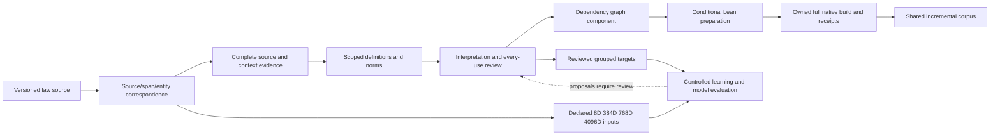

# Architecture and owner map

The maintained pipeline uses one implementation owner per stage. The [work catalog](work_catalog.json) records canonical owners and selected evidence; it is the maintained machine-readable index for this map. Imports below are relative to `ipfs_datasets_py.logic.autoformal` unless stated otherwise. The existing compiler and legal IR remain outside this package where already owned; adding a new wrapper does not replace them.

Corpus construction and model promotion have separate gates. Reviewed manual or compiler-produced typed targets can proceed through graph and Lean owners while learning is evaluated independently. Model-produced candidates enter the same source, meaning and applicability review; model quality alone grants no corpus admission.

| Stage | Existing owner/API | Boundary to preserve |
| --- | --- | --- |
| Source-package metadata | `legal_source_package_intake_v1.prepare_source_package_intake_v2` / `validate_source_package_intake_v2`, alongside unchanged v1 APIs | Explicit wire metadata only: five pinned files, primary-manifest delegation, exact alias/path/features/count reconciliation. No table/Arrow measurement, remote authentication, legal review or source/span/entity join upgrade. |
| Source inventory and exact coordinates | `uscode_ingest.inventory_uscode_documents`; `inventory_uscode_source_coordinates` / `validate_uscode_source_coordinates` | Opt-in source-coordinate transport is integrated in this checkout; default corpus adoption and current-source crosswalk still require complete witnesses. Supplied-view coordinates are not original HTML or Parquet-file offsets. |
| Paired span production | Existing `uscode_dataset.USCodeParquetRecord.from_row`, `span_cache.SpanCache.enqueue`, ops ingest/publication owners; `paired_span_census.load_paired_census_bundle` for retained bundles | The existing cache, paired-v3 complete-report manifest, feed and payload intake are integrated here. Automatic publication/default adoption remain separate. Preserve legacy IDs and exact original/view coordinate namespaces; no `paired_span_census.inventory` API exists. |
| Selected source/span/entity correspondence | `legal_source_span_entity_join_v1` v1/v2 plus explicit v3 prepare/validate APIs; explicit `legal_source_span_entity_census_v1` v1/v2/v3 APIs | The [237-case primary qualification](../../../../workspace/test-logs/federal-corpus-audits/legal-ir-coordinate-primary-integration-20261022-01/qualification-summary-01.json) covers authored join transport. Coordinate census-v2 separately binds an exact prior detailed entity census and original file. Source, span and entity revisions/rows/hashes stay separate; this sibling custody does not recover endpoints or establish meaning. |
| Cache-context intake | `legal_compact_source_context_cache_intake_v1.prepare_source_context_cache_intake_v1` / `prepare_source_context_cache_intake_v2`, with matching validators | Existing v1 and explicit coordinate v2 retain complete cache records and caller associations under strict producer pins. All inference views remain null; coordinate transport is not reviewed source meaning, context permission or gold. |
| Target eligibility census | `legal_source_span_target_eligibility_v1`: strict legacy APIs, named retained-coordinate v1, public `_v2`, explicit `_v3` and wire-coordinate `_v4`, with matching validators | Five explicit contracts. Public v2/v3 replay original join-v2 inputs; v4 replays original wire-coordinate join-v3 inputs with the fixed HF metadata profile. Its [318-case/954-phase qualification](../../../../docs/autoformalization/evidence/legal-ir-hf-wire-coordinate-eligibility-20261024.json) preserves the existing source_span_formula_v1 audit and declared 0/384 dimensions. Mechanical expressibility authorizes no inference view, source meaning or training/gold/graph/Lean use. |
| Source and context review | `legal_source_sampling`, `corpus_source_review`, `corpus_source_review_packets`, parent source/occurrence adapters | Retain complete physical evidence, context obligations, explicit edition and occurrence identities. The [explicit parent-capacity profile](guides/corpus_parent_occurrence_adapter.md#explicit-complete-parent-capacity) keeps complete fields, legacy defaults and original replay commitments; actual section101 bank/definition preparation remains separate. |
| Source-correspondence request custody | `legal_source_correspondence_requests_v1`: legacy `_v1`, coordinate `_v2` and explicit wire `_v3` prepare/validate/hash APIs | V2 keeps graph-v2/eligibility-v3 ancestry; v3 requires wire graph v3/eligibility v4/join v3 plus independent unchanged v1 banks. Its [local103-case/309-phase qualification](../../../../docs/autoformalization/evidence/legal-ir-hf-wire-coordinate-source-correspondence-20261024.json) and [three-case/nine-phase current-public dependency check](../../../../docs/autoformalization/evidence/legal-ir-hf-wire-coordinate-source-correspondence-public-integration-20261024.json) preserve separate source/namespace/orchestration scopes. Complete physical/output alternatives and unsigned questions remain unselected; no source/edition/meaning or training/gold/Lean authority follows. |
| Scoped definition lookup | `scoped_definition_resolution` | Use existing official or `*_parent_*_v1` registry/query/lookup/dependency functions for the actual profile. Preserve ambiguity and unresolved lookup. |
| Joint definition use | `corpus_definition_use_v2.prepare_definition_use_v2` / `prepare_parent_definition_use_v1` | The alias is an explicit unproved assumption. Keep the complete joint AST and original endpoint identities. |
| Combined review | `corpus_definition_use_review_v2` | Parent `prepare/build/assess/validate_*_v1` is a distinct signing domain. Endpoint signatures cannot approve the combined subject. |
| Norm interpretation and applicability | `legal_norm_content_*`, `legal_norm_definition_*`, `legal_bound_variable_definition_v1` | Declarations, authenticated custody, governing applicability and conditional instances remain different claims. Existing `legal_norm_definition_evidence_v1` now has an explicit parent-literal prepare/validate nomination profile, retaining whole original review/candidate populations, exact typed targets and separate unavailable contexts. Its [29-case/87-phase qualification](../../../../docs/autoformalization/evidence/legal-ir-parent-norm-definition-evidence-20261024.json) covers authored nomination custody; it creates no definition instance, application, Lake project or semantic authority. The separate explicit parent bound-variable prepare/validate consumer now generates unary conditional source under unverified hDefinition and optional hMembership, with whole parent nomination replay and no norm rewrite. Its [29-case/87-phase qualification](../../../../docs/autoformalization/evidence/legal-ir-parent-bound-variable-definition-20261025.json) covers authored prepared-source custody. The separate [retained standalone Lean observation](../../../../docs/autoformalization/evidence/legal-ir-parent-bound-variable-definition-native-20261025.json) passed three native checks/five enrolled toolchain/compiler commands: both unchanged files compiled under explicit premises and the invalid Iff-as-body term was rejected. These retained-file observations alone preserve the prepared-report flags and do not qualify governing applicability or corpus admission. The separate [parent-bound project/native qualification](../../../../docs/autoformalization/evidence/legal-ir-parent-bound-norm-definition-native-integration-20261025.json) now covers the explicit companion/native profiles below, without changing those historical claims. |
| Graph interchange/dependencies | `legal_graph_dependencies` and existing corpus graph/exchange owners | Keep scoped senses, complete typed assertions, source witnesses and dependency invalidation; avoid lexical sense merges. |
| Coordinate graph proposal | `legal_span_cache_intake.prepare_coordinate_source_graph_intake_v1` / `_v2` / `_v3`, with matching validators | Graph v1 uses public eligibility v2; graph v2 uses explicit eligibility v3; wire graph v3 uses eligibility v4 and wire join v3 with the fixed HF metadata profile. Its [101-case/303-phase qualification](../../../../docs/autoformalization/evidence/legal-ir-hf-wire-coordinate-graph-intake-20261024.json) retains complete ordered proposals and physical/input custody. All proposals remain unreviewed; no entity/definition binding, source/edition crosswalk, model/training, graph or Lean admission. |
| Coordinate corpus custody | `corpus_proposed_graph_adapter.prepare_coordinate_graph_corpus_v1` / `_v2`, matching validators and `export_coordinate_graph_corpus_output_v1` / `_v2` | V1 preserves graph-v2 / eligibility-v3 ancestry; explicit v2 requires wire graph v3 / eligibility v4 / join v3 and the fixed HF metadata profile. Its [90-case/270-phase qualification](../../../../docs/autoformalization/evidence/legal-ir-hf-wire-coordinate-graph-corpus-20261024.json) covers full ordered candidate custody, existing exclusive bundle export/readback and final original/live-return/file checks. Correspondence v3 now has its own unsigned-request custody qualification over wire graph v3, without consuming a corpus-v2 report or exporting bundles. No semantic graph or Lean admission. |
| Candidate norm/definition custody | `corpus_norm_definition_adapter`: legacy graph APIs and `build_parent_norm_definition_graph_v1` / `validate_parent_norm_definition_graph_v1` / `export_parent_norm_definition_graph_v1` | Reuse the [published parent nomination profile](guides/legal_corpus_norm_definition_adapter.md#explicit-parent-literal-nomination-projection). Original fifteen-case snapshot and separate six-case current-primary check preserve exact typed uses, every nominated alternative and opaque source/context references. Closed custody edges establish no governing definition, legal entity or applicability. |
| Conditional project preparation | `legal_corpus_definition_use_lake_v2`; `legal_corpus_parent_bound_norm_lake_v1` | Official V2 and parent V1 retain separate strict profiles; parent V1 already supports decoded literal-parent unary Boolean definitions. Explicit `prepare/validate/load/write_bound_norm_definition_corpus_v1` packages one complete unchanged relational norm beside its conditional definition in six modules/nine files. Bound-norm v1 specifically requires original raw-HTML/official-V2 replay and does not compose the sibling parent ports. No Lean process during preparation. Direct `prepare_parent_norm_corpus_v1`, `validate_parent_norm_corpus_v1` and `parent_norm_preparation_sha256` separately replay parent correspondence-v2 into four modules/seven files; the [68-case/204-phase qualification](../../../../docs/autoformalization/evidence/legal-ir-parent-complete-norm-project-20261024.json) covers authored preparation only. The separate [direct native qualification](../../../../docs/autoformalization/evidence/legal-ir-parent-complete-norm-native-20261024.json) records the unchanged four-module/seven-file project and its alias identity. The explicit companion `prepare_parent_bound_norm_definition_corpus_v1`, matching validator and full-preparation hash now package the unchanged norm beside its parent-bound conditional in six modules/nine inputs ([separate integration](../../../../docs/autoformalization/evidence/legal-ir-parent-bound-norm-definition-native-integration-20261025.json)); reviewed semantic definition application remains open. |
| Native execution | `legal_corpus_definition_use_native_v2` | Official V2 and explicit `validate/build_parent_definition_use_native_v1` routes now exist in this owner, with separate receipt profiles. The original 19 parent migration controls and 30-case preparation keep their scopes. Two actual authored FOL/TDFOL projects qualified Lean4.34.1 execution and observed lifecycle closure; their pending review and explicit premises remain. The separate shared-parent native APIs now preserve the complete aggregate: **16/16 passed** for 16 main controls and **2/2 passed** for two actual authored aggregate projects ([record](../../../../workspace/test-logs/federal-corpus-audits/parent-shared-native-20261020-01/qualification-summary.json)). Stable unique theorem observations retain every component contributor, child review outcome and premise; no combined assessment or statutory authority is inferred. The explicit `validate_parent_norm_native_v1`, `build_parent_norm_native_v1` and `parent_norm_compilation_receipt_sha256` APIs separately qualify the complete authored parent-norm project: 23 cases / 69 phases, four modules/seven inputs and one definitional alias identity, with the independently observed intended bad-proof rejection ([record](../../../../docs/autoformalization/evidence/legal-ir-parent-complete-norm-native-20261024.json)). The separate `validate_parent_bound_norm_definition_native_v1`, `build_parent_bound_norm_definition_native_v1` and receipt-hash APIs cover the companion six-module/nine-input profile: 32/96 pure and 2/6 actual-native controls, six observed commands (four ordinary probes/two owned builds), with two/three empty-axiom conditional theorem observations ([record](../../../../docs/autoformalization/evidence/legal-ir-parent-bound-norm-definition-native-integration-20261025.json)). No norm truth, statutory meaning or model accuracy is inferred. |
| Preservation | `legal_native_ast_preservation`; `legal_corpus_definition_use_preservation_*_v2` | Compilation, serialized-AST preservation, theorem lineage and kernel-type observations are distinct gates. |
| Retained packet/index observations | Existing `legal_corpus_definition_use_preservation_packet_v2` and `legal_corpus_definition_use_preservation_index_v2` owners | Official V2 keeps its exact twelve-module/fifteen-theorem/49-file profile; the separate direct parent-norm 23-file route keeps its selected qualification. The [29-file packet](guides/legal_corpus_definition_use_preservation_packet_v2.md#opt-in-parent-bound-normdefinition-packet) and [three index APIs](guides/legal_corpus_definition_use_preservation_index_v2.md#opt-in-parent-bound-normdefinition-index) reuse those owners with fifteen key dimensions and UNKNOWN/CANDIDATE/NONE negative observations. The [qualification record](../../../../docs/autoformalization/evidence/legal-ir-parent-bound-norm-definition-preservation-20261025.json) binds 47 packet cases / 141 phases, 40 index controls / 120 phases and three separate one-case / three-phase SQL cohorts in body_with_membership only; proof usability, outer-operation acceptance and four eligibility masks stay false/zero. The original 49-file reader still rejects parent/shared/incremental receipts. |
| Shared/incremental corpus | `legal_corpus_shared_lake`; `legal_corpus_incremental` | Legacy shared/incremental qualification already exists. The distinct parent shared-preparation API is installed: **28/28 passed** ([main receipt](../../../../workspace/test-logs/federal-corpus-audits/parent-shared-preparation-20261020-01/qualification-summary.json)); two [physical-source controls](../../../../workspace/test-logs/federal-corpus-audits/parent-shared-physical-close-20261020-01/qualification-summary.json) are separately reused. Exact endpoint identities, complete child commitments, repeated contributor ordinals and conditional premises survive sharing. Supported conditional aggregate execution now has its own native profile and separate cohorts; the preparation remains preparation-only. The existing incremental owner exposes a distinct parent profile with 22 authored coordinator controls; its separate [installed-Lean qualification](../../../../workspace/test-logs/federal-corpus-audits/parent-shared-incremental-native-20261020-01/qualification-summary.json) is **2/2 passed** for two authored FOL/TDFOL cases (13 cold/0 warm/6 affected +7 reused/13 clean calls each), preserving real public replay, installed closure and exact affected/clean artifacts. This is a donor-interpretation change on unchanged physical text; the copied-text custody branch is not independent statutory evidence. The separate [4/4 installed-Lean warm-refusal cohort](../../../../workspace/test-logs/federal-corpus-audits/parent-shared-incremental-native-refusals-20261020-01/qualification-summary.json) now closes physical drift/re-signed revocation for two actual FOL/TDFOL cases plus two regressions (12 compiles, eight probes, six fresh conditional empty-axiom observations). New source/scope/lookup, producer/toolchain/library and failed-compiler descendant edges retain their own gates; no new modal/norm semantics or model/training authority follows. The legacy cache cannot consume this profile by relabeling its schema. Preserve the separate selected-path Git delivery boundary. |

Resource ownership remains in the existing optimizer `ValidationResourceReservation`, operations launcher and shared `logic/backends/process.py` tracker. The explicit `sampled_birth_bound_descendants` profile adds sampled custody of observed nested sessions; legal preparation/review/native orchestration stays here. See [operations](OPERATIONS.md) for original-owner post-exit evidence and source READ retention. The [current qualification](../../../../workspace/test-logs/federal-corpus-audits/parent-native-genuine-20261020-01/qualification-summary.json) records separate source-only, lifecycle and actual compiler scopes.

## HF wire metadata intake

Use the existing `legal_source_package_intake_v1` owner for both contracts. The additive `prepare_source_package_intake_v2` and `validate_source_package_intake_v2` require request schema `legal-source-package-intake-request/v2`, report schema `legal-source-package-intake/v2` and explicit `metadata_profile="hf-default-parquet-envelope/v1"`. Supply the same five independently pinned raw files (`manifest.json`, `release_metadata.json`, `dataset_configs.json`, `dataset_infos.json`, `README.md`), immutable caller-declared Hub revision, release identity and graph population. Use the existing `source_package_intake_sha256` helper for an independent complete-report commitment. The v2 validator regenerates the report through the genuine primary-manifest selector.

The profile binds logical `publicus-ir-graphrag/v2` to wire alias `publicus-ir-graphrag-v2`, reconciles all three wire declarations, requires the exact sorted normalized data descriptor population and checks standard DatasetInfosDict string-envelope features. Routing, legacy and recovery artifacts cannot enter the advertised wire population. README validation compares the current producer's fixed canonical frontmatter and its `dataset_info`/`configs` regions; it uses no general YAML parser. Other frontmatter layouts are unsupported. Raw prose remains retained and uninterpreted.

Counts are descriptor declarations: the retained fixture has six advertised files / eleven envelope rows, including two corpus rows. Its 20,881 compressed Parquet bytes differ from 4,623 declared Arrow bytes. Intake does not open those tables or measure Arrow bytes, so coherent metadata changes alone cannot establish physical correctness, unique-law counts or legal coverage. All authority flags remain false and both learning/gold masks are plain integer zero.

The [closed 99-case qualification](../../../../workspace/test-logs/federal-corpus-audits/legal-ir-programme-review-20261022-05/hf-wire-intake-01/qualification-summary-v01.json) comprises all 45 unchanged v1 cases plus 54 v2 cases / 297 phases. Its five portable metadata fixture files are exact retained outputs of the prior qualified producer campaign; no producer, loader, model or Lean campaign was rerun. Three genuine leaf sources executed under explicit namespace parents; public package initializers and the whole pytest environment are outside that qualification. Historical v1 reports retain their original source generations. That 99-case receipt did not qualify a join consumer; the explicit wire-coordinate v3 composition has separate evidence below.

The later [108-case boundary qualification](../../../../docs/autoformalization/evidence/legal-ir-hf-wire-intake-boundaries-20261024.json) preserves all 99 preceding cases and adds nine controls for whole-line frontmatter delimiters, literal triple-hyphen paths, plain-boolean logical roles and the default key/ordered features. Its 324 phases and original source/native/storage lifetime closed, using the same retained metadata without Arrow, producer or loader execution. The older 99-case receipt retains its original source generation. This extends the existing intake-v2 API; the separately qualified join-v3 consumer below retains a distinct source generation.

The first invocation ran zero cases after a control-file source drift. Original no-child compute cleanup was independently verified; its empty 64 MiB storage claim remains retained because the existing recovery profiles do not cover this state. The fresh invocation closed its own source/native/storage custody. Both observations are preserved in the qualification; no failed credit is added to the 99 passing cases.

The explicit `prepare_source_span_entity_join_manifest_v3` / `validate_source_span_entity_join_manifest_v3` consumer uses `paired-coordinate-hf-wire-three-cache-join/v1`: one complete paired-v3 bundle and strict wire intake v2, with opening/closing source replay, detached source reports and final input/owner/file/result custody checks. Its [123-case / 369-phase qualification](../../../../docs/autoformalization/evidence/legal-ir-hf-wire-coordinate-join-20261024.json) reuses all 48 legacy and 35 prior coordinate cases plus 40 v3 controls. Source metadata remains declaration-only; paired fixture table verification belongs to the existing payload reader. Join v1/v2 keep legacy intake. The separately qualified eligibility-v4 consumer now accepts original wire-coordinate join-v3 inputs. The separately qualified graph-v3 consumer now replays eligibility-v4 originals into unreviewed proposals. The separately qualified corpus-v2 consumer now composes wire graph v3 / eligibility v4 / join v3 with complete candidate custody and existing bundle export/readback. The separately qualified correspondence-v3 consumer now binds wire graph-v3 rows to independent unchanged v1 source-review banks. The separately qualified wire census-v3 companion keeps its own scope; the focused current-public correspondence check and publication are closed. Source/edition crosswalk, native/default consumer adoption and semantic admission retain separate gates. Null selections, unresolved correspondence/entity bindings, zero masks and false authority remain.

## Git delivery boundary

The completed profile/corpus publication is datasets main `36f5177f6f89c7897cb2b7ec83fbf2da0d83c511`, pinned by parent `a3461d59006419a7479b70345e312ae76ebf4cd0`; see the [completed delivery receipt](../../../../workspace/test-logs/federal-corpus-audits/legal-ir-planning-review-20261020-01/merge-02/merge-delivery-complete-v02.json). It includes the earlier coordinate stack and later `43a93776` → `2eed1959` → `adce3ed2` profile/corpus successors, preserving main's newer dependencies and direct `legal_context_obligations` import. Its reviewed source generation passed 395 cases / 1,185 phases. Earlier delivery cutoffs below remain historical; do not assign another landing for these completed stacks. Later selected deliveries retain their separate receipts and status. Primary runtime adoption remains separate.

The work catalog describes current filesystem owners and attributed evidence, with separate selected-branch delivery metadata. The clean selected branch `agent/legal-ir-selected-landing-20261020` at `431c9c7715ba7165dbec27f362410ac7dd23983a` contains qualified opt-in raw capture, paired transport, context intake v2 and coordinate join v2. Its original delivery cutoff was unmerged/unpushed; the later [local cached-main ancestry observation](../../../../workspace/test-logs/federal-corpus-audits/coordinate-eligibility-20261020-01/local-git-ancestry-01.json) includes that head. The completed datasets/parent publication above supersedes that earlier delivery cutoff; dirty primary runtime adoption still needs an exact profile comparison. Top-level catalog APIs continue to describe installed primary owners, so newer selected APIs must not be assumed installed. See the [latest delivery boundaries](HANDOFF.md#latest-transport-delivery-and-remaining-graph-boundary). The [selected-path audit](../../../../workspace/test-logs/federal-corpus-audits/legal-ir-planning-review-20261020-01/landing-audit.json) distinguishes exact working bytes, current main/landing/full-norm commit coverage and owning tests. Preserve the published dependency closure in `external/ipfs_datasets`; compare remaining local adapters/native-context verifiers and later profile changes against that baseline, then selectively land only missing source/test/package/documentation deltas and verify them in a fresh checkout. Runtime supervision remains in `external/ipfs_accelerate`; LegalIR semantics and numerical kernels stay with their existing dataset owners. Artifact directories hold immutable run evidence and rejected attempts, not competing public implementations.

The separate selected eligibility delivery at `d4f62d9` extends the existing target-eligibility owner with `source_span_target_join_originals_sha256` and the explicit v2 prepare/validate APIs. They require independently committed `join_originals` and genuine opening/closing public join replay. Its 249-case qualification remains the original implementation contract and the dependency stack is now published at datasets `9eee15b8`. The overlapping historical-report-only prototype was withdrawn. Current consumer contracts distinguish strict legacy v1, named retained-coordinate v1, corrected public original-input v2 and explicit original-input v3. Public v2 and v3 require independently committed originals and opening/closing join replay; the named retained-only v1 does not claim upstream reexecution. Their current source generations remain separate from the attributed 249-case historical qualification; no historical report or request is silently upgraded.

The [closed consumer qualification](../../../../workspace/test-logs/federal-corpus-audits/legal-ir-coordinate-consumer-integration-20261022-01/qualification-summary-01.json) passed **94 authored cases / 282 phases** for the existing context/eligibility source integration under its fresh source pins. Original native, storage and source READ custody closed. The prior 237-case coordinate qualification retains its original generation. Source selection, current-edition correspondence, entity meanings and independent meaning/applicability review remain pending; learning/gold masks stay zero. This adds no model-width, training, graph or Lean qualification.

The [closed primary integration](../../../../workspace/test-logs/federal-corpus-audits/legal-ir-coordinate-graph-primary-integration-20261022-01/qualification-summary-01.json) passed **152 authored cases / 456 phases** across41 census,65 graph-v1/v2 and46 corpus controls under fresh current-source pins. Original native, storage and source READ custody closed. Census is sibling physical evidence; graph entity bindings remain unavailable and no missing endpoint is repaired. Source/edition correspondence, reviewed meaning, complete norms/definitions/distinct uses and training/gold admission remain pending. This supplies no model, training, convergence proof or Lean admission. Historical qualification receipts retain their original producer and scope.

The [closed primary correspondence integration](../../../../workspace/test-logs/federal-corpus-audits/legal-ir-coordinate-correspondence-primary-integration-20261022-01/qualification-summary-01.json) passed **59 authored cases / 177 phases** for the existing adapter under fresh source pins. The original graph-intake-v2 report and seven-field originals are replayed; a corpus output report cannot substitute for them. Original native, storage and source READ custody closed. Requests remain unsigned and source-review questions unanswered; selections remain null and learning/gold masks zero. Source/edition correspondence, intended producer occurrence, reviewed meaning and governing-source adoption remain pending. This adds no model, training, convergence proof or Lean admission. Historical qualifications retain their original producer and authority scopes.

The [preservation packet/index reconciliation — 153 cases / 459 phases passed](../../../../workspace/test-logs/federal-corpus-audits/legal-ir-preservation-index-primary-integration-20261022-01/qualification-summary-01.json) qualifies 47 real-SQL persistence, 47 packet-index and 59 store-regression authored-fixture cases under current dependencies. Packet execution claims remain synthetic; actual SQL writes and cold close/reopen use fixture entries. One unchanged exact stdlib cold-index child retains its 20-second timeout. The declared path-only reasoning namespace executes genuine required leaf modules while the public reasoning package initializer remains unexecuted and unqualified. Original native, storage and source READ custody closed. Historical 68/153-case and DuckDB 1.5.5 two-compiled-packet receipts retain their original scope; no new historical packet replay or Lean execution is claimed. The existing official-V2 49-file reader still rejects parent/shared/direct-incremental receipts, and its UNKNOWN/CANDIDATE/NONE index supplies no legal proof-cache, model/training or Lean admission.

## Numerical implementation reuse

The separate new-source routes already exist. The fixed48 normative cache
contract remains closed; it does not describe the input coverage of these
other explicit contracts. Reuse the following compatibility owners rather
than copying numerical code into `autoformal`:

| Existing owner in `logic/formalization/autoencoder` | Public entry points | Preserved boundary |
| --- | --- | --- |
| `arbitrary_native_source_cache` | `plan_arbitrary_native_source_cache`, `validate_arbitrary_native_source_cache`, `producer_pins` | Exact source-bound384/768 cache records; literal paragraph geometry is not interpreted legal clauses. |
| `arbitrary_native_legal_ir_runtime` | `prepare_arbitrary_native_legal_ir_runtime`, `open_arbitrary_native_legal_ir_autoencoder` | New source inputs with selected normative32 states; input support does not expand the saved vocabulary or qualify meaning. |
| `arbitrary_native_span_runtime` | `prepare_arbitrary_native_span_runtime`, `open_arbitrary_native_span_decoder` | Retained raw384/source-only pointer heads; one flat O/P/F rule and one copied span per facet. |
| `ir_cell_target_compatibility` | `preflight_ir_cell_cached_targets`, `inspect_normative_legal_ir_targets`, `preflight_normative_legal_ir_targets`, `preflight_compact_role_bos_sources`, `inspect_counted_content_prefix_v1` | Preserve original cells and normative fixed-codec/runtime-bound inspection. Compact role/source/BOS preflight binds ordered receipts and declared context to fixed537 capacity with inspector-only labels; conditioning compatibility and context permission remain unqualified, with generation readiness false and no execution packet. The separate counted28 inspector derives one authored singleton sequence and checks finite prefixes, with genuine public decoding at completion; it supplies no trained source reconstruction. |
| `legal_counted_content_head_v1` | `create_counted_content_head_v1`, `load_counted_content_head_v1`, `score_counted_content_head_v1`, `evaluate_counted_content_head_v1` | Existing seeded counted28/384 profile has actual CPU float32 initialization, strict restore and unmasked logits (46-case qualification). Its caller-supplied conditioning space remains unverified; zero counted updates, label-only target context, autonomous generation, training and statutory fidelity retain their separate gates. |
| `legal_counted_content_head_transfer_v1` | `create_transferred_counted_content_head_v1`, `validate_transferred_counted_content_head_v1`, `score_transferred_counted_content_head_v1`, `evaluate_transferred_counted_content_head_v1` | Existing distinct donor-transferred counted28 profile: ten exact nonlexical copies and23 shared/five full537-mean rows across three lexical tensors (39-case qualification). Zero new counted updates; caller-vector and target-derived context remain unqualified. Reuse this owner; a corpus trainer and autonomous serving remain separate gates. |
| `legal_counted_threshold_numerical_view_v2` | `build_counted_threshold_numerical_view_v2`, `score_counted_threshold_numerical_view_v2`, `evaluate_counted_threshold_numerical_view_v2` | Separate four-API vocabulary view of the unchanged seeded384 counted28 checkpoint. Three authored limits use 27 exact spellings/one row-10 schema relabel and identity numeric IDs; 46 focused cases qualify unmasked observations, not new weights/training or autonomous/legal reconstruction. |

The [native-cache guide](guides/arbitrary_native_legal_input_cache.md) and
[pointer guide](guides/retained_pointer_cache.md) retain actual eight-source
pilot results. The [training history](TRAINING_HISTORY.md#existing-new-source-pilots)
and [next output-contract specification](guides/normative_cached_legal_ir_runtime.md#next-implementation-delta)
separate completed input integration from missing complete-target/head coverage.

Compact content/role training and serving owners live under `ipfs_datasets_py.logic.formalization.autoencoder`. Source leases and resource admission retain their existing optimizer owners. `legal_compact_content_role_trained_runtime_v1.score_prefixes` is the already-used bounded immutable score API. Preserve the selected checkpoint, source profile and original lifecycle observations rather than copy its model into a run directory.

The generic [compact training v2](../../formalization/autoencoder/legal_compact_content_training_v2.py) already accepts1–16 complete ordered authored rows with3–512-ID targets, up to16 updates per call, immutable population/source-group commitments and exact named-Adam resume. Its [trained runtime v2](../../formalization/autoencoder/legal_compact_content_trained_runtime_v2.py) supplies model-only scoring/generation. It is384-only with the fixed537 codec; its engineering-fixture contract does not admit real statutes by relabeling their origin. The [completed four-row regression](../../../../docs/autoformalization/evidence/legal-ir-varied-compact-training-20261023.json) passed one case/three phases with10updates and12forwards, exact five-versus-three-plus-two resume apart from immediate-parent lineage, and matching fixed-BOS scores. This is a synthetic fixture qualification, with no source-space or legal-accuracy claim. Reuse this owner rather than implement another generic trainer. Larger reviewed populations or other codecs need a compatible explicit extension in the existing numerical owner.

The role-weighted/scope/CP128 warm-start profiles remain distinct fixed-two-row,46-label contracts. CP128 cannot be resealed as genericv2's validated zero-step v1 initialization; any weights-only bridge needs an explicit source/codec/space contract and fresh Adam. Counted28/threshold heads already supply seeded, transferred and three-form numerical observations; their compatible corpus trainer and autonomous-serving qualification are separate gaps. Neither compact537 nor an existing grouped trainer is a drop-in counted28 training interface.

`decoder_distillation_experiment_v2.bind_persistent_model` already implements `every_step` and matched `first_step` injection. `contextual_legal_ir_numeric` already restores a retained contextual model using persistent conditioning. These are different checkpoint/codec/input profiles from compact537 CP128. Reuse their implementation under an explicitly compatible profile; equal input width does not make a checkpoint interchangeable.

The [compact persistent v1](../../formalization/autoencoder/legal_compact_content_persistent_v1.py) owner now reuses that model for an explicit384/537 training/checkpoint/model-only-prefix-score contract. The [two-mode fixture qualification](../../../../docs/autoformalization/evidence/legal-ir-compact-persistent-conditioning-20261023.json) covers14 named tensors, fresh named Adam, mode/source-space refusal and exact resume, with20 physical updates/38 forwards. Its6 public APIs do not supply autonomous typed generation, native-source compatibility or reviewed-law training. Preserve the unchanged genericv2 and CP128 owners and their distinct source/codec/optimizer contracts.

The additive [persistent runtime v1](../../formalization/autoencoder/legal_compact_content_persistent_runtime_v1.py) now supplies fixed-BOS `generate_from_bos` and bounded-identity `generation_sha256` for that exact14-tensor profile. Its [closed retained-state qualification](../../../../docs/autoformalization/evidence/legal-ir-compact-persistent-generation-20261023.json) reuses trained checkpoints without fitting, restores one model per call, consumes one token incrementally and applies the existing scope/completion-budget/typed-decoding owners. The model-serving projection excludes optimizer/population/explicit-target data; whole-checkpoint validation still reads retained commitments. The original v1 four-call cohort blocked after17 IDs; that is a historical source generation. Forced lookahead, witness/branch selection and the [selected numerical branch runtime v3](../../../../docs/autoformalization/evidence/legal-ir-compact-persistent-branch-generation-20261024.json) are already qualified, with separate no_selection/EOS boundary controls. The latest genuine cohort retains0/4 typed/exact outputs on two exposed authored384 fixture rows,128GRU forwards and4,032prefix calls. Reuse those owners and outputs. Next inspect cost/failure evidence, close native-space/head compatibility and reviewed target/context eligibility, and preregister quality evaluation; do not rebuild the completed consumer or infer statutory/general four-width accuracy from these fixtures. Existing legacy batch adapters reject the new schema, so a downstream batch/graph intake remains separate. Preserve the trainer and older runtime source generations.

Six versioned adapters now live under `experimental/`; their focused migration engineering controls passed. They reuse the existing numerical engines and are not a new default serving/training route.

| Profile adapter | Canonical module | Preserved boundary |
| --- | --- | --- |
| Context initialization | `experimental.projected_context_decoder_v1` | Fixed 13-tensor parent and zero-initialized context columns. |
| Trained Context150 | `experimental.trained_projected_context_decoder_v1` | Fixed projection and training manifests; completed historical steps are not repeated. |
| Gated conditioning | `experimental.gated_conditioning_v1` | Explicit 13-to-15-tensor migration and original capsule format. |
| Gated training state | `experimental.gated_training_state_v1` | Fresh versus resumed Adam lineage; legacy inspection/restore is allowed, legacy-to-new packing is refused. |
| Journal training | `experimental.journal_training_session_v1` | Fixed anchors, update/cadence limits and checkpoint envelope. |
| Journal inference | `experimental.journal_inference_v1` | Matched journal state, BOS scoring and bounded session lifecycle. |

`experimental._legacy_source_bridge_v1` binds current producers to the bridge and permits only complete fixed historical recipes. Mixed recipes refuse. Ten additional complete-recipe metadata controls call genuine current owners without numerical execution, separately from the earlier CPU migration fixtures. Historical paths are declarations, not freshly authenticated files; original checkpoint/logit/optimizer parity and convergence have not been established by this port.

The [training history](TRAINING_HISTORY.md) identifies completed runs. The cross-modality [autoencoder handbook](../../../../docs/autoencoders/README.md) remains the owner for generic numerical infrastructure, UI/security/intent paths and their operations.

The existing shared `ir_decoder_profile_inventory` and `ir_model_manager_import` owners now expose a separate LegalIR4096 expected-producer metadata profile and asset binding. It preserves the original 12 decoder lanes and their IDs. The [92-case qualification](../../../../workspace/test-logs/federal-corpus-audits/source4096-registration-20261020-01/qualification-summary-02.json) covers exact declared identity, pin/readback fences and inert-manager behavior; it does not authenticate native producer execution, checkpoint IO, a physical store, publication or legal quality. The source profile is distinct from a decoder format and from the process/thread-bound native embedding capability. The same importer now also exposes `ir_model_source_record_id_v2` and `import_ir_model_manager_records_v2` for the published historical source/span binding. The [234-control reconciliation](../../../../workspace/test-logs/federal-corpus-audits/source4096-reconciliation-20261020-01/qualification-summary-01.json) preserves both contracts and all existing IDs in one owner and one registration loop; their library identities and producer authority remain separate. It does not repeat the retained catalog import or publication.

The existing optimizer owner `legal_span_bound_native4096` separately exposes `load_bound_inference_checkpoint` for pinned model-only restoration without training inputs. Its [50-control qualification](../../../../workspace/test-logs/federal-corpus-audits/native4096-inference-load-20261020-01/compatible-cpu-02/qualification-summary-01.json) includes three actual retained CPU states, 69 exact model tensors and nine genuine named-moment validations, without optimizer construction or a forward. It uses the unchanged numerical/binding/codec owners; saved provenance remains historical and decoding still requires a freshly issued native capability. No separate runtime implementation or default 4096 router was added.

## Detailed guides

The consolidated guides whose primary implementation owners live in this module are consolidated in [guides/](guides/). Start with [source/span/entity join](guides/legal_source_span_entity_join_v1.md), [scoped lookup](guides/scoped_definition_resolution.md), [combined use](guides/corpus_definition_use_v2.md), [combined review](guides/corpus_definition_use_review_v2.md), [conditional preparation](guides/legal_corpus_definition_use_lake_v2.md), [native execution](guides/legal_corpus_definition_use_native_v2.md) and [experimental profile adapters](guides/experimental_autoencoder_profiles.md). Historical qualification sections in an API guide retain their named cohort/profile; the current [handoff](HANDOFF.md) records the latest boundary.

## Authority and identity

Raw file hashes, canonical record digests, source/version CIDs and selected trust identities are separate commitments. Keep original byte inputs and independent expected pins. A saved `authenticated` flag does not replace replay. A Lean theorem under donor/consumer/alias premises does not establish those premises as statutory facts. Build success and empty axiom output do not supply missing genuine source-meaning or every-use review.

## Published bound-norm profile reused in primary, 2026-10-24

The existing Lake/native owners expose the selected bound-norm APIs without default adoption or changes to older profile contracts. The [42-case / 126-phase current pure qualification](../../../../docs/autoformalization/evidence/legal-ir-bound-norm-corpus-primary-integration-20261024.json) reuses exact published postimages and current peers. Its synthetic compiler controls do not refresh the historical two-case/six-phase actual Lean4.34.1 observation. Complete norm packaging retains explicit definition/membership premises, all alternatives and source-unbound relational syntax. Existing decoded-parent custody now also feeds the separately qualified direct complete authored parent-norm project (68 cases/204 phases, four modules/seven files). That preparation preserves the complete supplied relational/native norm with original correspondence. The separate explicit parent-norm native profile now has an [accepted authored execution observation](../../../../docs/autoformalization/evidence/legal-ir-parent-complete-norm-native-20261024.json); its alias identity supplies no norm truth or statutory meaning. Unary Boolean definition adapter/review/native ports remain separate. The separately [qualified parent-bound companion/native profile](../../../../docs/autoformalization/evidence/legal-ir-parent-bound-norm-definition-native-integration-20261025.json) now supplies authored unchanged-norm/conditional-definition packaging and actual execution. Reviewed semantic composition and governing applicability remain pending; the explicit premises are not established by compilation. Source/edition/meaning review, physical entity bindings, two distinct statutory uses and graph/corpus admission remain pending. Fresh original-input preparation is required after producer/path-generation changes; historical frozen outputs are not canonical outputs. The original failed native-v01 192 MiB retained-storage disposition remains unresolved here; no resource release is inferred.

## Parent review and blank worksheet: closing custody, 2026-10-24

Use the existing `prepare_parent_norm_review_evidence_v1` and `validate_parent_norm_review_evidence_v1` under `unsigned-parent-literal-occurrence-review/v1` (`legal-parent-norm-review-evidence/v1`). Supply the complete parent correspondence v2, its independently retained canonical hash and the closed nine-field original `correspondence_inputs`, including the exact physical-parent replay. The evidence retains explicit manifest/source-version/occurrence/companion/context identities, all six unavailable context requirements, every repeated issue, seven semantic questions, complete authored typed syntax and declared dependency custody. Reuse `build_parent_norm_content_template_v1` and `validate_parent_norm_content_template_v1` in the existing content owner for `unsigned-parent-literal-content-worksheet/v1` (`legal-parent-norm-content-template/v1`). Both require the complete preparation and its independent hash plus the original correspondence/hash/replay; worksheet validation also requires its independent complete report hash. All answers, process/exposure declarations, evidence and governing decisions remain blank or unknown. This worksheet cannot be submitted through legacy response/signing/adjudication APIs. The selected literal can be an interior slice or unclassified region. Whole-field context, governing edition, legal meaning, definition applicability and graph/Lean corpus admission remain open; training/gold masks remain zero. Existing 128 MiB aggregate snapshot, 8 MiB output and 512-obligation limits refuse overflow without truncation. The narrow hardening checks original/detached inputs, parsed requests and actual retained validator/dependency objects after the final genuine callback, then checks the returned bytes through direct encoding. Public schemas, fields and function signatures retain the selected peer contract.

The fresh focused qualification passed **16 cases / 48 phases from 10 selectors**, including genuine preparation/worksheet controls and targeted late-mutation refusals. It uses declared parent namespaces and checked source buffers; bypassed initializers, entire owning modules and full package startup remain unqualified. The peer original 40-case/120-phase campaign retains its own frozen generation. The earlier alternate 74-case/222-phase candidate was not installed after overlap was discovered; these counts are never combined. Its failed fixture attempt, supported 256 MiB storage closeout and unrun stale capture remain separate evidence. No model, training, law download or Lean build ran for this hardening. See the [qualification evidence](../../../../docs/autoformalization/evidence/legal-ir-parent-norm-review-closing-custody-20261024.json).

## Selected parent response and parallel result reconciliation, 2026-10-24

The selected parent response boundary extends the existing content owner after original parent preparation and the blank worksheet. It binds ordered typed answers, independently committed raw evidence and physical replay; unavailable context remains unresolved. Use the [single maintained contract](guides/legal_norm_content_responses_v1.md). The parallel references-only implementation is retained uninstalled, with separate frozen-source evidence. Signing, adjudication, definition, semantic graph, numerical and Lean consumers keep their existing admission contracts. See the [reconciliation evidence](../../../../docs/autoformalization/evidence/legal-ir-parent-response-peer-reconciliation-20261024.json).

**Wire census v3.** Wire source intake v2 and join v3 now feed the explicit census-v3 companion alongside an independently pinned prior entity census. The paired manifest is v3 while its payload intake remains v2. One shared physical-row projection retains coordinate order; the complete intake stays once inside the join. Entity binding checks verify the original file/footer and add no semantic association or graph admission. See the [maintained contract](guides/legal_source_span_entity_census_v1.md) and [qualified evidence](../../../../docs/autoformalization/evidence/legal-ir-hf-wire-coordinate-entity-census-20261024.json).

**Wire-coordinate semantic proposals v1, 2026-10-24.** Reuse `legal_source_graph_proposals.py` for explicit per-output semantic sidecars over wire graph-v3, then the existing semantic graph builder and general proposed-graph corpus adapter for supported proposals. The physical census supplies custody evidence and no semantic crosswalk. Keep the legacy section bridge and coordinate corpus-v2 contracts separate. The [selected engineering evidence](../../../../docs/autoformalization/evidence/legal-ir-wire-coordinate-semantic-proposals-20261024.json) qualifies only the declared focused fixture/source profile; legal review, learning and Lean gates remain open.
