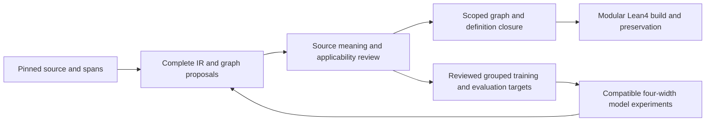

# Current handoff

**Section101 definition custody:** The [actual unreviewed A/B qualification](../../../../workspace/test-logs/federal-corpus-audits/legal-ir-programme-review-20261022-05/source101-parent-definition-v01/actual-parent-bank-v01/paged-inventory-v01/officer-definitions-v01/qualification-summary-v01.json) prepares, validates and adapts both retained officer definitions against the complete7347-record parent bank. Ten genuine public entries yielded distinct candidate graphs: A15nodes/23edges and B16nodes/25edges. Exact source spans, reports, graph seals and original source/native/storage custody closed under the declared197-source scoped runtime (96executed,17production-required;14namespace/8bypass policy,4actuallyobserved). Both remain unreviewed, with unresolved scope and null governing meaning/edition/asof/per-use decisions; all masks0. No model, training, Lean or accepted graph/corpus admission is supplied.

**Conditions full-span margin kernel, 2026-10-26:** [36 focused cases passed](../../../../docs/autoformalization/evidence/legal-ir-conditions-fullspan-margin-kernel-20261026.json), including seven supplied-logit Torch controls. The new opt-in numerical loss preserves old checkpoint-pinned objective bytes and does not change default decoding. Reuse the [kernel and F18 matched-training subgoals](TRAINING_HISTORY.md#conditions-full-span-margin-kernel-2026-10-26); actual four-tensor model integration, paired training and statutory accuracy remain open.

**Complete-parent capacity:** The [actual section101 paged bank](../../../../workspace/test-logs/federal-corpus-audits/legal-ir-programme-review-20261022-05/source101-parent-definition-v01/actual-parent-bank-v01/paged-inventory-v01/actual-bank-v01/qualification-summary-v01.json) now closes complete original build/validation:45-column row39,71,688characters/72,690UTF8bytes,16cache rows and7,347records (7,318leaves+29pages;11,090,042-byte bundle). The qualified explicit128k source and ordered-record-refs-pages/v1 inventory selectors retain all original1MiB/8192-record/16MiB caps. Three saved upstream reports were reused unchanged, and source/native/storage custody closed. Both parent-bound officer-definition alternatives now have separate qualified custody but remain unreviewed; governing edition, meaning/applicability and graph/Lean/training admission remain open with masks0. Forty-case engineering qualification and historical837/G/E/refusal evidence retain their separate generations.

**Retained section 7346(b), focused public dependency check:** The [closed public observation](../../../../docs/autoformalization/evidence/legal-ir-source7346-public-parent-correspondence-20261026.json) uses public `f53da5716608117ffa8ad858c799559a6f127af0` leaf-module bytes with explicit synthesized namespaces. The original public parent manifest, all 13 producer paths/pins, 837 records and 16 cached rows remain unchanged. Six direct owner calls produced 61 witnessed original function entries, including 12 required nested parent replays. One unselected de-dicto hypothesis retains 11 anchors/57 typed targets: 9 references from 4 lexical heads and 48 scaffolds. All 6 meaning issues, 6 unavailable context requirements and 15 review questions remain open; authority is false and masks 0. Normal package initialization, installed runtime equivalence, semantic fidelity and latent-only legal-text reconstruction remain unqualified. No new model, training, embedding, checkpoint, solver, graph/corpus admission or Lean build is supplied. Earlier private and public campaigns keep their separate counts and generations.

**Section7346(b) partial source correspondence:** The [closed current-primary observation](../../../../docs/autoformalization/evidence/legal-ir-source7346-full-b-parent-correspondence-20261025.json) passed two whole cases using one common original-parent scope and both retained v02 hypotheses. Actual original-function witnesses record 10 scope preparations, nine scope validations, eight relational preparations/validations each, four correspondence preparations, two correspondence validations and 20 required nested parent replays. Each alternative accounts for 11 anchors/57 typed targets: nine typed-target references from four lexical head anchors and 48 scaffolding targets; all six meaning issues and missing governing context remain open. Complete 327-character literal accounting establishes no semantic IR fidelity or latent-only legal-text reconstruction accuracy, and copied source provenance is not model decoding. Both interpretations stay partial/unselected/source-unbound, all 15 questions unanswered and masks0. No model, embedding/checkpoint, semantic graph/corpus or Lean-build qualification is added. The prior relational-only and peer native/corpus deliveries keep their separate generations.

**Section7346(b) partial authored candidates, v02:** The [structural replay record](../../../../docs/autoformalization/evidence/legal-ir-source7346-full-b-partial-candidates-20261025.json) publishes exact raw UTF-8 requests, parsed JSON and the predicate/semantic-gap register, including the explicit Law(law) Object guard. Two whole JUnit cases passed in the current-primary relational owner with four observed prepare entries. Two direct validator calls and full-report equality follow the pinned observer control flow; no separate phase-event inventory exists, so no six-phase count is inferred. Each candidate has51 LogicNodes, five binders, one modal node,14 predicate occurrences and57 structural mapping rows. Both remain non-exhaustive, partial/unassessed authored hypotheses with null source binding, no selected alternative or governing definition/edition, all15 questions unanswered and zero masks. The unexpanded law descriptor and shared modifiers remain unresolved. A separate static comparison matches23 producer files to publicc59 Git bytes; it does not qualify public deployment. No source-scope/correspondence execution, original parent rebuild, model/training, embedding/checkpoint change or Lean build occurred. Earlier physical/public-f8 binding and peer graph/Lake/index qualifications retain their own generations.

**Counted source/label adoption verified:** [Datasets PR1386](https://github.com/endomorphosis/ipfs_datasets_py/pull/1386) is merged at `73290fa97ec4d480a98af3238117340d69ea368e`. [Parent PR631](https://github.com/endomorphosis/lift_coding/pull/631) adopts the newer datasets descendant `348e61e65422a952d8ca4c348a4eaac0a119b1e3`, including [PR1387](https://github.com/endomorphosis/ipfs_datasets_py/pull/1387); the verified parent main is `c28903b9724b06a267f58b5a6ed185ecc3d6b285`. The [effective-adoption receipt](../../../../workspace/test-logs/federal-corpus-audits/legal-ir-counted-decoder-example-20261022-01/public-dependency-integration-v01/publication-v01/effective-adoption-v01.json) preserves the original separate158/249 qualifications, prior275 evidence, static source/initializer reviews and six unexecuted optional controls. Redundant parent PR632 was closed and only its temporary branches were removed. Preserve newer typed counted-relation work and the separate68-case parent-norm preparation qualification. This delivery supplies no new fitting, model accuracy, source meaning, compatible native conditioning, permitted context, graph/Lean admission or training/evaluation eligibility; masks stay zero.

The [unsigned parent-response collection qualification](../../../../workspace/test-logs/federal-corpus-audits/legal-ir-programme-review-20261022-05/parent-norm-response-collection-20261024-root-f2c91b64/qualification-summary-v02.json) passed **19 cases / 57 phases** (17 new controls and two selected legacy cases). The existing content owner now retains an independently pinned ordered population, every exact answer variant, respondent and candidate proposal, with genuine original parent replay and supplied raw-evidence custody. Member reports must be freshly regenerated under the selected owner generation. Role strings, agreement or differing principal IDs establish no authentication, human independence, quorum or selected legal meaning. Context and definition applicability remain unresolved; authority stays false and training/gold masks zero. Historical response 23/69, peer alternative 42/126 and other source-qualified campaigns retain their separate generations. The first native attempt remains failed after 18 passed cases, 55 passed phase events and one fixture setup error; the exact original storage closeout released only its reservation and retained all 17 files. Only the separately passed retry receives qualification credit; the fixture uses a distinct real temporary directory, with no product change.

The [filled unsigned parent-response qualification](../../../../workspace/test-logs/federal-corpus-audits/legal-ir-programme-review-20261022-05/parent-norm-responses-20261024-root-a64d82f1/qualification-summary-v01.json) passed **23 cases / 69 phases** (20 new controls and three selected legacy cases) on the original frozen195 generation, including imported adapter `2d977fa6…`. The later canonical `0de6dafb…` adapter is preserved through the separately pinned static selected-parent-path compatibility review; its new coordinate APIs were not qualified by this run. The existing content owner now binds caller-supplied typed declarations and complete independently committed raw evidence to genuine opening and closing original parent/correspondence replay. All six unavailable context requirements and definition applicability remain unresolved. No authenticated review, signed/content adjudication, accepted statutory meaning, model accuracy, graph or Lean admission is supplied; authority remains false and training/gold masks stay zero. Earlier review/worksheet 40-case / 120-phase and peer closing-custody 16-case / 48-phase evidence retain separate source generations.

The [unsigned parent review and blank worksheet qualification](../../../../workspace/test-logs/federal-corpus-audits/legal-ir-programme-review-20261022-05/parent-norm-review-20261024-root-c5a19e73/qualification-summary-v01.json) passed **40 cases / 120 phases** (35 new controls and five selected legacy cases) on the captured current producer sources. The existing owners now regenerate occurrence-bound review inventories and blank manual worksheets through genuine opening and closing original parent/correspondence replay. These unsigned fixtures supply no completed review, signature, governing edition, accepted statutory meaning, source-bound relational norm, model accuracy, graph or Lean admission; authority remains false and training/gold masks remain zero.

The [parent literal scope and correspondence qualification](../../../../workspace/test-logs/federal-corpus-audits/legal-ir-programme-review-20261022-05/parent-norm-scope-20261024-root-932c992e/qualification-summary-v01.json) passed **185 cases /555 phases** (149 existing +36 parent fixtures). The existing owners now replay original Parquet/cache occurrences, preserve exact character and UTF8 anchors, and check complete authored lexical-to-typed correspondence. The selected occurrence may be a fragment or unclassified region; edition, context, complete legal meaning, graph admission, training and Lean corpus admission remain open. Both failed attempts and their separate original storage closeouts are retained.

**HF wire prerequisites and focused dependency check:** Reuse the exact intake-v2 and explicit coordinate join-v3 source, owning tests and five retained authored metadata fixtures. Historical intake 108 cases / 324 phases and join 123 cases / 369 phases remain separate. The [new current-public dependency check](../../../../docs/autoformalization/evidence/legal-ir-hf-wire-public-dependency-integration-20261024.json) passed only three existing cases / nine phases with public span_cache and pytest-helper bytes preserved; private test orchestration and explicit namespace parents remain separate from whole-package qualification. No model, corpus-law table scan, remote loader or Lean work ran. Reuse the separate [eligibility-v4 qualification](../../../../docs/autoformalization/evidence/legal-ir-hf-wire-coordinate-eligibility-20261024.json) within its original scope: 318 authored cases / 954 phases, comprising 275 preceding cases and 43 new controls. Its original-input wire-join-v3 replay and `source_span_formula_v1` target audit do not authorize inference or learning. Reuse the separately [qualified graph-v3 route](../../../../docs/autoformalization/evidence/legal-ir-hf-wire-coordinate-graph-intake-20261024.json) for original-input eligibility-v4/wire-join-v3 replay into unreviewed proposals. Its historical local qualification (101 authored cases / 303 phases: 65 retained cases plus 36 wire controls) and the [focused public dependency check](../../../../docs/autoformalization/evidence/legal-ir-hf-wire-coordinate-graph-public-integration-20261024.json) (three existing cases / nine phases) retain separate source, namespace and orchestration scopes. The separately [qualified local corpus-v2 route](../../../../docs/autoformalization/evidence/legal-ir-hf-wire-coordinate-graph-corpus-20261024.json) passed 90 authored cases / 270 phases (46 preceding corpus controls + 44 new wire controls), including existing candidate/export readback and final original/return/file custody. The separate [focused current-public corpus check](../../../../docs/autoformalization/evidence/legal-ir-hf-wire-coordinate-graph-corpus-public-integration-20261024.json) passed only three existing cases / nine phases, covering genuine preparation and validation, existing writer/readback and a post-writer closing refusal. It retains its own public dependency, namespace and private orchestration scope; it does not repeat, pool or requalify the historical 90-case cohort. Both routes preserve unreviewed proposals and zero training/gold masks. The separately [qualified local correspondence-v3 route](../../../../docs/autoformalization/evidence/legal-ir-hf-wire-coordinate-source-correspondence-20261024.json) passed 103 authored cases / 309 phases (59 preceding correspondence controls + 44 wire controls), preserving independent v1 banks, unsigned questions and final original/parsed/return/file custody. Reuse the separately [qualified wire census-v3 companion](../../../../docs/autoformalization/evidence/legal-ir-hf-wire-coordinate-entity-census-20261024.json) within its original 64-case/192-phase scope (62 wire controls plus two existing v2 cases). The separate [focused current-public census check](../../../../docs/autoformalization/evidence/legal-ir-hf-wire-coordinate-entity-census-public-integration-20261024.json) passed only three existing cases / nine phases: bytes roundtrip and independent closing refusals for entity-file and paired-file drift. It retains its own initializer, namespace and private pytest-orchestration scope; it does not repeat, pool or requalify the historical 64-case cohort or the preceding 41-case census qualification. The companion binds the prior authored census and original physical files without fresh entity-row replay, supplies no semantic entity association and keeps training/gold masks zero. This source-correspondence-v3 adoption reuses its original qualification and separately checked public dependencies; graph, corpus and census campaigns retain their individual scopes. The separately [qualified current-public correspondence check](../../../../docs/autoformalization/evidence/legal-ir-hf-wire-coordinate-source-correspondence-public-integration-20261024.json) passed three existing cases / nine phases on public943e plus exact8fcc/830b overlays. Its scope and the recorded public graph/corpus three-case checks remain distinct; original local103/309 is not rerun or pooled. Source/edition/meaning, definition applicability and graph/Lean admission remain open, with training/gold masks zero; these fixture results establish no decoder quality or wider model compatibility. The [separate current-public eligibility-v4 check](../../../../docs/autoformalization/evidence/legal-ir-hf-wire-coordinate-eligibility-public-integration-20261024.json) passed three existing cases / nine phases; it does not repeat or pool the historical 318-case cohort or establish model quality.

The [target-free persistent-v3 boundary controls](../../../../docs/autoformalization/evidence/legal-ir-compact-persistent-boundary-controls-20261024.json) passed 2 cases / 6 phases on unchanged runtime and retained inputs: one genuine first-forward no_selection proof and one explicitly score-replaced EOS instrumentation case. They establish no learned accuracy; the primary result remains 0/4 typed/exact IRs and legal-text reconstruction is unmeasured. The failed cacheprovider attempt remains unqualified and separate. Legal-text work reuses the existing [contextual reconstruction scorer](../../formalization/autoencoder/contextual_legal_ir_output.py) and [profile-specific original-text roundtrip scorer](../../formalization/autoencoder/ir_legal_text_roundtrip.py); the current flat canonical renderer has no scope-preserving compact537 inverse. Keep the decoded quantified/modal TypedExpression intact and use the existing [unsupported-inverse receipt contract](../../bridge/decompiler.py) until a reviewed typed inverse or explicit retained-surface route is enrolled.

**Canonical runtime adoption, 2026-10-24:** Reuse the qualified canonical runtime (`9c19…`). The [separate audit](../../../../docs/autoformalization/evidence/legal-ir-compact-persistent-preflight-alternative-recovery-20261024.json) records nine recovered cases for an **unselected** preflight alternative; its four primary calls achieved **0/4 typed and exact reconstructions**. Those results apply only to the pinned alternative, whose native job remains failed.

**Publication closed, 2026-10-24:** [Datasets PR #1369](https://github.com/endomorphosis/ipfs_datasets_py/pull/1369) merged the qualified runtime, tests and measurement plan as `cc17b45ee092eaf77194fa6838fb65357015d2ea`; [parent PR #614](https://github.com/endomorphosis/lift_coding/pull/614) adopts it as `e525e4a936170c3936a143f664f1d99166974dec`. The normal merges preserve peer graph delivery, all eight other submodule pointers and the original task histories. Both temporary feature branches were removed. Reuse the completed fixed-weight result below; hosted CI supplied no pass because account billing prevented jobs from starting.

**Persistent branch-selector runtime qualified; no reconstruction gain, 2026-10-24:** Reuse the [v3 source and evidence](../../../../docs/autoformalization/evidence/legal-ir-compact-persistent-branch-generation-20261024.json). A separate fake-loop profile passed 6 cases / 18 phases; the genuine comparison passed 2 cases / 6 phases with four exposed calls and two BOS references. Typed candidates, exact compact IDs and exact compact content/AST matches remain **0/4**. Both every_step calls selected 30 new IDs, then blocked with 34 inspections left; both first_step calls selected 32, then exhausted their grammar allowance. These different dispositions establish neither saturation nor a conditioning winner. Original source/native/storage custody closed. The earlier 600-second attempt and failed metadata reader remain separate; the early observer snapshot remains UNQUALIFIED. Preserve all 24 tasks, peer graph/HF records, weights and width/schema/task profiles. Legal-text/source-byte reconstruction is unmeasured here and needs its separate head/sidecar/task. The next scientific gate is reviewed complete targets and permitted context; profiling, cache investigation and per-call durability are engineering follow-ups, not a blind-fit or larger-encoder justification.

Start with the current priorities and bounded tasks below. The [dated delivery observations](ARCHIVE.md#recorded-delivery-observations) retain their original evidence and source cutoffs in the existing archive map. The detailed contracts and four-width protocol remain in this handoff; use the [catalog](work_catalog.json) to select one owner and its latest evidence.

## Whole US Code goal and supervised delivery

The programme goal is **the entire explicitly selected US Code release → exact source spans → complete scoped LegalIR/entities/definitions → closed reviewed graphs → preserved modular Lean4 corpus**. The machine-readable hierarchy now lives in the existing [BACKLOG.json](BACKLOG.json) under `programme_goal_hierarchy`: one `LIR-WHOLE-USCODE` goal, seven phase subgoals and references to the unchanged original 24 tasks. This is the maintained plan, not a replacement task queue. Read the hierarchy and each `current_programme_directive` before retained historical `next_actions`; original dependencies govern acceptance even when a preparation task can advance independently.

The first corpus deliverable remains one complete supported norm, its governing definition and **two genuinely distinct operative physical uses**; then 20–40 connected provisions, budgeted closed dependency components and finally the whole pinned manifest. Two interpretations or two typed references from one source occurrence do not supply two uses. Reviewed manual/compiler targets can advance through graph, Lean and release without a successful learned decoder. Model proposals return through the same independent source/meaning/applicability gates.

| Existing phase subgoal | Original task references | Completion gate |
| --- | --- | --- |
| `LIR-PHASE-01` lineage and qualification | LIR-01,03,16 | Exact producer/checkpoint/codec/optimizer and source-profile lineage; preserve completed temporal comparison. |
| `LIR-PHASE-02` source and interpretation | LIR-02,05,06 | Physical source/span/entity/offset custody, governing edition/context and independent complete meaning/every-use decisions. |
| `LIR-PHASE-03` complete norms and definitions | LIR-07,09,10 | Lossless complete typed targets, selected logic-family support and positive/negative/ambiguous scoped definition closure. |
| `LIR-PHASE-04` semantic graph | LIR-04,08,11 | Distinct occurrence/mention/sense/entity/definition/norm identities, reviewed edges, closed dependencies and source-AST-graph reconstruction. |
| `LIR-PHASE-05` modular Lean | LIR-12–15 | Exact project/import/artifact closure, explicit premises/axioms, pinned actual build, preservation/non-vacuity/negative controls and affected-versus-clean equality. |
| `LIR-PHASE-06` model quality and cost | LIR-17–20,23 | Compatible inputs, frozen reviewed grouped targets and controls, autonomous complete semantic outputs and whole-session cost. |
| `LIR-PHASE-07` release and expansion | LIR-21,22,24 | Immutable readback, repair admission, complete coverage/disposition ledger and staged whole-manifest reconciliation. |

**Source selection and whole-corpus coverage.** The user-selected repository is `justicedao/ipfs_uscode`, with observed revision `91ca1838853ac82d7a12dd4ab47d9686f47667f9`, declared profile `publicus-ir-graphrag/v2`, upstream revision `006dd603185b283c54648dd4aef3c2cbe650981a` and release point `us/pl/119/102`. The observed span/entity revisions remain `60501f3e920f6c9050cfc452e0d9fcc2b7c184f3` / `79d54378c5d6a89ab56e7a27e0f0ba867e800e19`. The latest public/ungated metadata-only observation at 2026-10-26T22:30Z retains those same revisions and reports 2802 source files, 7962 span files and 3 entity files (last-modified dates October 14/15/15 respectively). These file counts are not corpus denominators. These identities do not select a governing legal edition or legal-as-of date; both and the actual enrolled physical manifest remain unresolved. Refresh and bind the selected manifest/files/config/schema through existing intake owners. The observed Viewer rejects the slash-containing configuration; use explicit pinned file/config selection and the existing qualified release compatibility owner, retaining named legacy compatibility. Do not assume an older default Parquet schema, broad-glob heterogeneous tables or equate Viewer failure with physical absence. Preserve original qualified source 5016b86a and span 7651 generations; latest heads and metadata do not update their producer/schema/source contracts or historical receipts.

The finite release manifest defines the population, including all titles, provisions/subunits and physical source occurrences. Population counts stay null until authenticated inventory is selected; this refresh performs no download/census. Record exact row/file/manifest/source-view hashes and both Unicode/UTF8 offset systems, source edition/context, producer/profile, dependency component and review/revocation references. Preserve separate source, meaning/applicability, typed-IR, graph, Lean, eligibility and release statuses. Each stage records `enrolled`, `proposed`, `review_required`, `unresolved`, `unsupported`, `reviewed`, `graph_closed`, `compiled`, `admitted`, `failed`, or independently justified `excluded_non_normative` / `excluded_out_of_scope` dispositions. These values are not an automatic authority ladder: compilation cannot approve meaning. Alternatives, repeated observations and dependency reuse must not inflate counts; unknown labels remain unscored.

Report enrollment, source-bound/reviewed/representable/attempted/complete/exact/meaning-reviewed/graph-closed/kernel-checked/admitted counts and every unresolved/unsupported/failed/excluded partition. Report exactness over reviewed representable targets separately from yield over all enrolled sources. Whole-corpus completion requires every manifest member and dependency accounted, every in-scope normative provision admitted through the source/meaning/complete-IR/graph/Lean gates and every exclusion independently witnessed. Remaining eligible unsupported/unresolved/failed norms keep the goal incomplete. Mixed entity-index records, compiler fallback rows and engineering cards do not count as formalized laws.

**Four declared source systems and a separate compression study.** Reuse the retained two-source/eight-vector panel and existing weights/captures. Keep mock/hash8, spaCy 8D features and learned 8D formula donor distinct; raw GTE-small 384D mean/L2, transformed/residual 384D and fictional sparse 384D are distinct spaces. A residual projection of 8 that still sends 384 coordinates is not an 8D-only bottleneck. Native multilingual GTE 768D CLS/L2 remains a separate producer; authored 60/60 restricted wording is not legal fidelity. Leanstral 4096D is causal hidden/source width, with retained last/L2/512-token features and source-text side channels where declared, not a trained4096 legal bottleneck or teacher authority. Preserve the missing original384/768 operation packets and selected-worktree replayer/publication boundaries rather than recapture the assembled panel.

First compare compatible native encoder systems on identical reviewed source/dependency groups, complete targets, independently permitted context, objective, selector and output budget; report compute/capacity differences. Separately hold one frozen encoder and compatible decoder family fixed for 8/384/768/4096 bottleneck-only routes, eliminating raw-vector/text/token/residual bypasses. Do not pad or relabel vectors/checkpoints. GTE-small retains 512 input tokens; longer source composition and768 input bands 1024/2048/4096/8192 each require explicit coverage/qualification. Input width, actual bottleneck, decoder input/hidden width, vocabulary and output budget remain separate fields.

Before fitting, freeze source-occurrence/definition/dependency/amendment/near-duplicate grouped TRAIN/DEV/held-out populations, exposure records, complete target/codec/projection census, checkpoint selection, objective, seed groups and finite resource/success/retention/refusal rules. Use source-only, zero/latent-disabled, shuffled-source and retrieval controls, plus matched every-step/first-step conditioning. Save autonomous BOS-to-EOS outputs before reference parsing; score complete exact AST, ordered roles, binders/scope, modality/polarity, counting, conditions/exceptions, time and definition binding, including all enrolled refusals/failures. Keep teacher-forced loss, vector MSE/cosine, canonical prose, generated source-free prose and source-sidecar original-byte restoration separate. Require at least three independent seed groups and a fresh grouped holdout before generalization claims. Profile whole-session hashing/tokenization/lock/cache/grammar/model/checkpoint/review/Lean costs before scaling.

**Four first preparation jobs under the existing supervisor.** The existing 135 completed LIRAE cards are engineering inventory, not 135 admitted provisions or completion of the original 24 scientific tasks. Keep their task IDs, meaning and CIDs. The protected plan/checker remains `legal_ir_autoencoder_supervisor_plan.json` and `scripts/ops/legal_ir/legal_ir_supervisor_contract.py`; the four strict-shard supervisors, existing board/namespace `legal-ir-autoencoder-v1`, claims, shared merge queue/landing branch and `ipfs_accelerate` admission remain the dispatch authority. Root owns adoption, deployment and publication. The selected preparation route retains `grok-implement`,48000 context tokens and the sealed Grok4.7→Codex6.1Sol high fallback on `primary_quota_exhausted`.

| Lane / existing task card | Preparation Goal id / original parent | Inspectable preparation output |
| --- | --- | --- |
| 0 / `LIRAE-LIR02-SOURCE-01` | `LIR-02.source-review-preparation-v1` / LIR-02 | Exact original-input source/span/entity dossier request, offset/edition/context/crosswalk issue inventory and independent meaning/every-use questions. |
| 1 / `LIRAE-LIR07-IR-02` | `LIR-07.typed-ir-interface-preparation-v1` / LIR-07 | Complete candidate constructor/role/binder/vocabulary census, lossless codec/logic-family/graph/output-budget compatibility and a demonstrated missing-interface recipe or reuse-only finding. |
| 2 / `LIRAE-LIR12-LEAN-03` | `LIR-12.lean-compatibility-preparation-v1` / LIR-12 | Selected AST-to-current parent/direct/conditional/native/preservation compatibility and exact imports/premises/axioms/artifact preparation closure; no compiler rerun. |
| 3 / `LIRAE-LIR17-PROFILE-03` | `LIR-17.conditions-fullspan-training-preparation-v1` / LIR-17 | Versioned opt-in F18 four-tensor model/optimizer wiring and owning tests, exact donor/teacher/partition provenance and finite separately admitted qualification/training/scoring contracts; no paired fit by this preparation acceptance. |

Each child has a unique preparation goal with the original LIR task as parent. Completing a child records engineering preparation only; it does not satisfy that parent's independent legal review dependencies or authorize training, native work or admission. Reuse existing complete-parent, source correspondence, codec/semantic graph, Lean/preservation and numerical owners; propose code only for an evidenced missing interface. The first three jobs may complete by authenticated qualified reuse of current APIs with exact candidate/request/evidence closure; changing an owner or test is not a completion requirement when that closure already meets the request. Do not add exporters simply to make a diff. The numerical job addresses the actual missing versioned model/optimizer wiring in `optimizers/logic_theorem_optimizer/legal_span_conditions_fullspan_training_v1.py`, reusing F18 and the published margin kernel without editing those owners or `structured_span_objective.py`. Copy all 42 authenticated F18 states, freeze 38 including modality, and select `start.weight`, `start.bias`, `end.weight`, `end.bias` in that order with only conditions row 3 active: 130 active/780 stored/650 inactive scalars. F15 supplies the masked-KL teacher. Genuine model/optimizer gradient, parity and resume qualification retains finite original source/resource admission; the matched coefficient 0/0.25 fits remain a separate admitted intervention. All run-specific outputs stay in the existing workspace evidence hierarchy. Retained F17/F18 adverse results, F19 diagnostic and the 36-case margin kernel are completed work; their next actual integration/training intervention remains separately admitted.

**Storage, release and bounded recovery.** Reusable source/span/review/graph/Lean implementation belongs in canonical `external/ipfs_datasets` owners; numerical and supervisor machinery retain their existing external owners. Use existing content-addressed HF/IPFS/ModelManager references for weights, vectors, source objects and captures; do not copy large payloads into plans/boards/repositories or create duplicate checkpoint trees. Preserve all original selected/last/initial states, failures and receipts. A release binds physical source/span/entity manifests, edition/context/review/revocation, complete IR/graph/definitions/dependencies, any model/codec/conditioning/surface profiles, Lean source/import/toolchain/artifact/preservation/assumption closure and coverage/cost ledgers. Immutable readback and dependency-complete delivery precede atomic selected-release/superproject pointer changes; interruption retains the previous usable release.

Reuse `legal-ir-autoencoder-v1-monitor.timer` / `.service` and `legal-ir-validation-input-recovery.timer` / `.service`, plus the existing `ipfs-taskboard-legal-ir-watchdog.service` and `ipfs-taskboard-legal-ir-repair.service` diagnostic bridge. Create no second monitor or recovery loop. The reported160 focused restart-race hardening checks are pending root adoption and live service-generation verification; they are not current deployed recovery or legal/model qualification. Classify stale projection/input drift, source/merge conflicts, resource pressure, legal-review blocks, compiler/model failures and service-generation races separately. Automatic recovery stays within existing configured retry/backoff/deadline/admission bounds and retains each incident/attempt; repeated identical incidents escalate. Before restart result acceptance, verify prior worker/child drain, claims and original source/native/storage custody plus the new generation. Recovery cannot supply legal meaning, increase resource/output caps, bypass leases or independent review, recapture weights by default, force completion or promote models.

## Current execution priorities after artifact review

**Next corpus and model milestones:** Reuse the parent-norm preparation/native delivery merged by [datasets PR1390](https://github.com/endomorphosis/ipfs_datasets_py/pull/1390) at `24975003f13d3b6fbd82ad29231e126eea068630`. [Parent PR635](https://github.com/endomorphosis/lift_coding/pull/635) adopted descendant `ef7f1ad53813701d411f168ddf35dee2d641dee7`, including [PR1391](https://github.com/endomorphosis/ipfs_datasets_py/pull/1391)'s portable guide links, in parent commit `27883a77a5bacb929d43f3bf4e92f2ae3b11f440`; retain any newer peer progress. The separate68/204 preparation and23/69 native qualifications keep their original scopes. The [bounded review](../../../../workspace/test-logs/federal-corpus-audits/legal-ir-programme-review-20261022-05/comprehensive-plan-refresh-20261024-01/request-followup-01/review-summary-v03.json) retains its historical source/public cutoff; its older348e61e comparison is no longer a pending publication gate. The scientific milestone remains one reviewed complete source-bound norm, its governing definition and two genuinely distinct physical uses, followed by 20–40 connected provisions. Reuse the matched four-width panel and existing decoders; compare compatible systems on the same reviewed targets and permitted context, with a separate experiment for bottlenecks that exclude other information paths. Retain the original 24 tasks and existing seven-phase plan; semantic review, autonomous model accuracy and corpus admission remain separate gates.

The [refreshed bounded reuse review](../../../../workspace/test-logs/federal-corpus-audits/legal-ir-programme-review-20261022-05/comprehensive-plan-refresh-20261024-01/review-summary-v04.json) rechecked five indexed artifact candidate pairs, seven prototype originals and all 66 current declared owners without model imports. Three definition/use/review mirrors are exact duplicates; the Lake/native candidates have newer canonical successors. Six experimental adapters are already canonical, and the remaining host-specific gated harness has no demonstrated missing consumer. The latest [public comparison](../../../../workspace/test-logs/federal-corpus-audits/legal-ir-programme-review-20261022-05/comprehensive-plan-refresh-20261024-01/public-owner-comparison-v02.json) records 65 indexed owners at datasets fdab590e69dbe26a646ecf29db9c3270d57a8387: 56 identical, nine differing and zero absent; the subsequently indexed authored semantic-proposal owner is outside that comparison. Earlier 55/10 and later delivery observations retain their own cutoffs. Reconcile only selected differing dependency/test/guide closures; a different blob is not automatically an unlanded port. This is an indexed review, not an exhaustive artifact census or new runtime qualification.

**Selected delivery execution:** source-correspondence v3 is merged in [datasets PR1383](https://github.com/endomorphosis/ipfs_datasets_py/pull/1383) at `f7ca2d799555ddde866d877cb775c2a1ee8edca6` and adopted by [parent PR629](https://github.com/endomorphosis/lift_coding/pull/629) at `c36030ca4dede5918adae1a0cbfede067c92a87d`. The [final closeout](../../../../workspace/test-logs/federal-corpus-audits/legal-ir-programme-review-20261022-05/wire-correspondence-01/publication-v01/final-bundle-v01/final-closeout-v02.json) preserves exact8fcc/830b source/test bytes, original103/309 and separate public3/9 qualifications, peer Title10 work and all24 task records. The selected merged branches were removed; hosted CI supplied no passing qualification. A fresh 66-owner comparison at that datasets generation gives56 identical, ten differing and zero absent from public Git. Earlier65-owner/nine-difference observations retain their populations and cutoffs. Reconcile only a selected consumer's differing closure. The existing counted join/decoder companions and their tests/guides remain reuse candidates; source-binding/BOS preflight has additional generation dependencies. No new fitting, encoder operation, Lean build or scientific task completion follows from publication.

The current primary Lake source `5c98152d…` provides the direct complete authored parent-norm preparation, separately [qualified by 68 cases / 204 phases](../../../../docs/autoformalization/evidence/legal-ir-parent-complete-norm-project-20261024.json): 26 new parent-norm cases and 42 selected regressions. Its four-module/seven-file project retains complete supplied typed/native content, physical parent correspondence, unresolved context, null relational source binding and zero masks. The selected older bound-norm qualification pins Lake `8a43095f…` and a separate raw-HTML/definition profile; historical native receipts do not qualify execution of this direct decoded-Parquet profile. Reuse the existing prepare/validate/hash and separate parent-norm native APIs. The [authored native execution boundary](../../../../docs/autoformalization/evidence/legal-ir-parent-complete-norm-native-20261024.json) is separately qualified. Reuse the explicit [parent-literal nomination companion](guides/legal_norm_definition_evidence_v1.md#explicit-parent-literal-nomination-companion), whose separate [29-case/87-phase qualification](../../../../docs/autoformalization/evidence/legal-ir-parent-norm-definition-evidence-20261024.json) covers authored custody, before extending substantive norm/definition composition and review. Exact authored nominations preserve both endpoint populations. Reuse the separate [parent-literal conditional consumer](guides/legal_bound_variable_definition_v1.md#explicit-parent-literal-conditional-consumer), whose separate [29-case/87-phase qualification](../../../../docs/autoformalization/evidence/legal-ir-parent-bound-variable-definition-20261025.json) covers authored prepared-source custody, for generated instances under explicit unverified hDefinition and optional hMembership. A separate [retained conditional Lean observation](../../../../docs/autoformalization/evidence/legal-ir-parent-bound-variable-definition-native-20261025.json) passed three native checks using five enrolled toolchain/compiler commands: two version probes and three compiler invocations. Both exact retained files compiled, with one and two empty-axiom observations respectively; the missing-membership proof-term control failed with the intended type mismatch. The original prepared reports and 29/87/16 qualification remain unchanged. The separate [parent-bound project/native integration](../../../../docs/autoformalization/evidence/legal-ir-parent-bound-norm-definition-native-integration-20261025.json) now supplies explicit conditional packaging through the companion preparer and existing native owner: 32 pure cases / 96 phases and two actual-native cases / six phases, with six modules/nine inputs and two or three conditional theorem observations. Governing applicability and reviewed semantic definition composition remain unresolved. Governing source/edition/meaning, every-use applicability, graph/corpus admission and model quality remain separate gates.

Reuse the existing programme and its original 24 task records. The historical documentation consolidation moved 157 guide bodies; six experimental profiles also have canonical successors. Later guide migrations and profile extensions keep their own receipts. Indexed source mirrors and older parent Lake/native candidates are history, with canonical successors already present. Select a missing consumer/profile before another port, and preserve the original checkpoints, failed attempts and source commitments. [ARCHIVE.md](ARCHIVE.md) records these migrations; [ARCHITECTURE.md](ARCHITECTURE.md) maps the current owners.

The three [selected Hub revisions](#three-datasets-and-the-actual-source-representations) remain unchanged in the [2026-10-24 bounded metadata recheck](../../../../workspace/test-logs/federal-corpus-audits/legal-ir-programme-review-20261022-05/comprehensive-plan-refresh-20261024-01/hub-metadata-review-v02.json). The user selected `justicedao/ipfs_uscode`; governing edition and legal-as-of date remain unprovided. Span-cache compiler, fallback and mock-vector observations retain their provenance and review status. Entity-index rows need authenticated endpoints and scoped meanings before aggregation. Corpus membership, a storage split named `train`, vector similarity and successful compilation are separate from reviewed legal interpretation.

**Supervisor dispatch view:** the original24 records in [BACKLOG.json](BACKLOG.json) now carry a `current_programme_directive` with phase, next task and completion gate. Read it before historical `next_actions`, which retain superseded experiments and their evidence. Existing task IDs, dependencies, statuses, claims and the deployed board remain unchanged; this adds no replacement queue or automatic dispatch. Reuse completed wire join/eligibility/graph/corpus/census/correspondence and persistent-v3 selector consumers. Current work is source/edition/meaning and every-use definition review, complete-norm parent/native composition, compatible native conditioning and controlled quality evaluation. Agents may prepare dossiers, proposals and engineering changes; they must retain missing human/legal decisions as unresolved.

The corpus release path is source custody → independently reviewed complete typed targets → scoped graph closure → actual Lean qualification → immutable release. Reviewed manual or compiler-produced targets can advance on this path without a successful learned decoder. The model path reuses the reviewed targets with compatible, independently permitted conditioning, grouped train/development/held-out splits and autonomous reconstruction gates; these control model promotion. Model-produced candidates re-enter the same source, meaning and applicability review before graph or corpus admission. Expand the connected statutory component to 20–40 provisions, then budgeted dependency-component batches, and report coverage and quality for each path separately.

The immediate scientific deliverable is **one complete source-bound norm, its governing definition and two genuinely distinct uses**, then the original **20–40-provision** pilot. Existing §7213 interpretations share one occurrence; the §7214 counted proposal is partial. Complete source/edition custody, physical span/entity correspondence and independent meaning/applicability decisions are still missing. Keep their training/gold masks zero. Select another eligible connected component if the retained candidate cannot supply the required source occurrences and governing definition; do not manufacture a second use from an interpretation alternative.

The first complete delivery has four inspectable outputs, using the existing owners and evidence hierarchy:

1. **Source dossier — LIR-02,05,06.** Bind one complete norm, its candidate definition and two distinct operative uses to exact source/span/entity revisions, files, physical rows, original/view offsets and the selected legal edition. Retain ambiguous matches and missing endpoints. The existing §7346(c) row4 adoption route is a candidate; its unsigned packets and editorial paired row2 do not supply missing decisions or a second operative use.
2. **Reviewed interpretation — LIR-06,07,09,10.** Record complete typed content and independently assessed meaning and definition applicability for each use. Preserve modality, negation, ordered roles, binders, cardinality, conditions, exceptions and time. Every accepted target must survive a lossless codec round-trip and its selected logic-family projection; unsupported constructors, vocabulary and budgets remain explicit dispositions. Extend a lowering only when this selected target demonstrates a missing case.
3. **Scoped graph — LIR-04,08–11.** Assemble occurrences, mentions, scoped senses, entities, definition bodies/applicability and complete norms through the existing semantic graph and corpus adapters. Require closed endpoints and a source→AST→graph round-trip with retained original text and surface/coordinate sidecars. Preserve competing interpretations, negative definition lookups, dependency coverage and unresolved frontiers. Retrieval ranks nominate candidates; they do not merge legal senses or establish equivalence.
4. **Checked Lean component — LIR-12–15,21–23.** Produce one reconstructable modular project with explicit imports, premises, source maps and an actual pinned build. Require the selected AST-preservation/axiom policy, negative controls and an affected rebuild that agrees with a clean build. Use the current proof-store and preservation owners; qualify the specific parent/shared/incremental packet/index profile when needed, because the retained official-V2 reader does not accept those receipts. Expand the accepted component to the original 20–40-provision pilot before wider release.

**Source-bound complete-norm composition: reuse current preparation first — LIR-02,06–10,12–14.** The current existing Lake owner also declares `prepare_parent_norm_corpus_v1` and `validate_parent_norm_corpus_v1`. The [request follow-up review](../../../../workspace/test-logs/federal-corpus-audits/legal-ir-programme-review-20261022-05/comprehensive-plan-refresh-20261024-01/request-followup-01/review-summary-v02.json) records the historical installed-source observation with qualification then pending; the later 68-case / 204-phase pure preparation qualification is recorded separately below. At that earlier observation the parent-norm execution adapter was unregistered, `build_eligible=false` and compilation `not_run` at that observation. Refresh the latest selected receipt and reuse that producer before assigning another implementation. The separate direct parent-norm execution profile now has a [qualified authored native observation](../../../../docs/autoformalization/evidence/legal-ir-parent-complete-norm-native-20261024.json). Reviewed substantive norm/definition composition and review remain open; reuse the existing preparation/native owners before assigning further implementation. Earlier source hashes and bound-norm native receipts retain their original scope.  The published [bound-norm Lake/native profile](guides/legal_corpus_definition_use_lake_v2.md#published-bound-norm-profile-reused-in-primary-2026-10-24) is now reused in these existing owners: complete unchanged relational norm plus conditional definition, nine files/six modules, explicit hDefinition/hMembership and definitional preservation. Its [fresh current-source pure qualification](../../../../docs/autoformalization/evidence/legal-ir-bound-norm-corpus-primary-integration-20261024.json) is 42 cases / 126 phases; historical two-case/six-phase Lean evidence keeps its original closure. This packaging does not close the source-bound statutory composition gap. Relational v1 still requires null source_binding; bound-norm v1 scope/norm/definition correspondence requires complete original-HTML and official-V2 endpoint replay. Decoded-Parquet literal-parent custody and the direct [complete authored parent-norm project](guides/legal_corpus_definition_use_lake_v2.md#complete-authored-norm-from-an-exact-parent-occurrence) now compose through genuine correspondence-v2 replay and unchanged relational/native ASTs. Its [focused pure qualification](../../../../docs/autoformalization/evidence/legal-ir-parent-complete-norm-project-20261024.json) passed 68 cases / 204 phases (26 new parent-norm cases and 42 selected regressions), in its explicit frozen-source namespace scope. Four modules/seven in-memory files retain unresolved context, null relational source binding and zero masks; compilation was not run. Existing unary Boolean definition adapter/review/native ports remain separate. The [explicit parent-bound companion and existing native owner](../../../../docs/autoformalization/evidence/legal-ir-parent-bound-norm-definition-native-integration-20261025.json) now compose the unchanged norm with its conditional unary definition in six modules/nine inputs; 32 pure cases / 96 phases and two actual-native cases / six phases have separate scopes. The separate [direct native route](../../../../docs/autoformalization/evidence/legal-ir-parent-complete-norm-native-20261024.json) qualifies the authored four-module/seven-file project and its alias identity under the selected namespace scope. Complete reviewed norm/definition composition remains open. Current content declaration/adjudication retains partial/unassessed coverage and no ready selection. Bind complete source-to-typed correspondence, governing edition, substantive meaning and every-use definition applicability before a statutory graph/native composition. Preserve all alternatives, source-unbound/partial contracts and zero masks; two typed uses of one anchor do not supply two physical statutory uses. Prepare fresh outputs when actual producer paths/generations change; never relabel the historical worktree/frozen preparations as current canonical outputs. The [qualified parent literal scope](guides/legal_source_norm_scope_v1.md) and [authored correspondence v2](guides/legal_norm_scope_correspondence_v1.md) now provide complete original physical replay, exact literal anchors and exhaustive authored typed mapping for decoded-Parquet occurrences (185 cases /555 phases). These profiles preserve partial semantics, unresolved context and null relational source binding; compatibility beyond the explicit parent-bound project and substantive review remain separate. The [unsigned parent review inventory](guides/legal_norm_interpretation_review_v1.md#unsigned-parent-literal-occurrence-review-evidence) and [blank worksheet](guides/legal_norm_content_responses_v1.md#unsigned-parent-review-worksheet) now consume this parent correspondence with complete original replay (40 cases / 120 phases; 35 new and five selected legacy controls). They preserve all unavailable context requirements, source issues and partial semantics; actual responses, signing/adjudication compatibility and reviewed complete source-bound composition remain open. Their declared dependency manifest establishes artifact custody only, and all authority/readiness flags remain false with zero masks. The [filled unsigned parent-response consumer](guides/legal_norm_content_responses_v1.md#filled-unsigned-parent-response) now retains supplied typed declarations and exact raw-evidence commitments through complete original replay (23 cases / 69 phases; 20 new and three selected legacy controls on frozen195 sources with adapter2d977fa6). Later adapter0de6dafb is preserved by static selected-path nonoverlap, without qualifying its coordinate APIs. All unavailable parent-context requirements and definition applicability remain unresolved. This response transport authenticates no reviewer or legal meaning; signing/adjudication compatibility and complete reviewed source-bound composition remain open, with authority false and zero masks. Reuse the qualified direct-parent 23-file preservation index and its stated public-generation/process-local-store limits. The opt-in 29-file parent-bound packet/index extension is now [qualified](../../../../docs/autoformalization/evidence/legal-ir-parent-bound-norm-definition-preservation-20261025.json): 47 packet cases / 141 phases, 40 index controls / 120 phases, and three separate SQL cohorts of one case / three phases each. Actual SQL covers body_with_membership only; all results remain bound to the retained frozen producer paths. Reuse the existing [packet](guides/legal_corpus_definition_use_preservation_packet_v2.md#opt-in-parent-bound-normdefinition-packet) and [index](guides/legal_corpus_definition_use_preservation_index_v2.md#opt-in-parent-bound-normdefinition-index) owners; the direct-parent 23-file and original official-V2 49-file profiles keep their separate scopes. The [unsigned parent-response collection](guides/legal_norm_content_responses_v1.md#collection-of-supplied-unsigned-parent-responses) now preserves the bounded complete supplied roster and all exact variants/proposals through original replay (19 cases / 57 phases; 17 new and two selected legacy controls). Fresh member regeneration is mandatory after producer changes. No vote, quorum, authenticated review or accepted interpretation is supplied; governing context/edition, every-use definition applicability and reviewed complete source-bound composition remain open with zero masks.

Model improvement is a parallel, separately evaluated branch under LIR-17–20,23. Reuse the [four-source-width panel](#four-source-widths), compatible retained states, completed persistent-conditioning/sum70 work and [predicate-reference parity](guides/legal_compact_content_role_warmstart_runtime_v1.md#predicate-reference-model-view-parity). The [qualified branch-aware persistent runtime v3](../../../../docs/autoformalization/evidence/legal-ir-compact-persistent-branch-generation-20261024.json) now supplies the numerical selector consumer: its separate six simulated-loop cases / 18 phases and two genuine cases / six phases retain four calls with 0/4 typed or exact IRs, zero training and 4,032 prefix calls. Reuse that delivery and its cumulative grammar-work, terminal no_selection, UNKNOWN-choice and model-token accounting. Inspect the retained blocked/exhausted trajectories and costs before selecting another policy or fit; this result establishes no reconstruction gain or conditioning winner. Freeze reviewed complete targets, independently permitted context, source/definition-grouped splits, native-space/head compatibility and checkpoint selection before statutory fitting. Compare compatible 384D every-step versus matched first-step conditioning, then the four native encoder systems on common targets. Keep the single-encoder bypass-free bottleneck study separate. Score autonomous complete ASTs, semantic choices and every refusal; finite updates and replay do not establish convergence or legal fidelity.

Keep reusable semantics, graph/review and Lean integration in `logic/autoformal`; numerical kernels and checkpoint profiles retain their existing formalization/legal-IR/optimizer owners. Supervisor execution stays in `external/ipfs_accelerate`. Land only selected source/test/package/documentation deltas in dependency order, with filesystem installation, Git publication, engineering qualification and legal/corpus admission tracked separately. The existing release builder's homogeneous Viewer metadata profile and the selected proof-packet reader profile are bounded compatibility work, not reasons to add another graph store, Lean runner or task board.

**§7346 candidate occurrence records, 2026-10-23:** The [closed materialization and independent saved-file audit](../../../../workspace/test-logs/federal-corpus-audits/legal-ir-programme-review-20261022-05/source7346-occurrences-01/qualification-summary-v01.json) supplies two previously nominated lexical candidates through the existing `corpus_source` builder and validator. The b(2) mention uses character[645,660)/UTF8[648,663); c uses character[817,832)/UTF8[820,835). Both contain `warrant officer`, with a shared span CID and distinct occurrence record CIDs. The unchanged historical parent/version, all 150 original occurrence records and both interpretation alternatives are retained. These records establish coordinate-bound candidate identities only: cache bindings, complete use interpretations, governing definition/applicability, source adoption and legal edition remain pending; masks stay zero. The first loader attempt failed before emitting records, with partial owner entry and no qualification credit. Its original terminal and three files remain intact; a separate original-owner closeout released its 16 MiB reservation. The successful retry preserves checked source execution while delegating CID package resource lookup to its physical loader. This operation runs no tests, models, training, graph or Lean build.

| Goal / subgoals within the original tasks | Existing work and implementation home | Next tasks and completion gate |
| --- | --- | --- |
| **1. Consolidate and preserve baselines — LIR-01,03; reuse completed LIR-16** | [Catalog](work_catalog.json), [archive/migration map](ARCHIVE.md), existing source/test deliveries and exact checkpoint lineages. | Compare only the selected dependency closure in its external submodule. Separate installed, committed, published and qualified generations. Reuse delivered correspondence, context and counted symbolic/numerical code; an old locked worktree is not proof that code needs landing. Retain rejected states, failures and missing original receipts. |
| **2. Establish source and reviewed pilot — LIR-02,05,06** | [Source join](../legal_source_span_entity_join_v1.py), source/context and [combined review](../corpus_definition_use_review_v2.py); existing unsigned adoption packets. | First close one complete norm, its governing definition and two distinct physical uses. Reuse the existing section7346(c) row4 pending adoption kit; independently resolve occurrence, governing edition, complete meaning and definition applicability. The companion b(2)/c anchors still need two genuine physical cache/use bindings and reviewed endpoints. Paired row2 is editorial text (`10 App.:1036.`), not the second operative use. Reuse the [qualified §7346 parent evidence](../../../../workspace/test-logs/federal-corpus-audits/legal-ir-programme-review-20261022-05/source7346-parent-evidence-01/qualification-summary-v01.json): one complete parent at physical row 2720 and all sixteen cache rows (eight per paired bundle). Genuine parent-corpus build and validation preserve separate cache/version identities; paired intake and provenance classifications remain prior inert inputs. The older bundle of six parents and 4,941 records excludes §7346 and cannot supply this tuple. The predecessor containing 13 parent rows and the two lexical occurrence CIDs remain unchanged; the second paired/typed statutory use, governing definition and legal source/meaning decisions remain open. Reuse the [actual scope and correspondence observation](../../../../workspace/test-logs/federal-corpus-audits/legal-ir-programme-review-20261022-05/source7346-parent-scope-01/qualification-summary-scope-correspondence-v01.json): the 112-character candidate and its 29 anchors passed original-input scope validation; both unchanged authored alternatives passed correspondence validation with all 36 supplied typed targets retained in each. Five targets have provisional source links and 31 remain unmapped per alternative; interpretation and every-use applicability remain unreviewed. Reuse the original A/B reports and pending adoption kit. Each new correspondence consumer must perform its required original-input replay; no separate duplicate authoring or relational campaign is needed. Keep the older7213/7214 alternatives and negative lookups. Then enroll20–40 connected provisions with source/definition/amendment-grouped splits. |
| **3. Represent complete targets — LIR-07,10** | [Norm AST](../legal_relational_norm_v1.py), relational/content codecs, counted28 and threshold-v2 factories/codecs in their existing owners. | Census complete target constructors and budgets before fitting. Preserve modality, polarity, ordered roles, all binders, cardinality, conditions, exceptions, scope and time. Every target must round-trip or retain an explicit unsupported/OOV/overbudget disposition. Existing counted fragments do not establish complete statutory or Lean support. |
| **4. Improve the learned proposal path — LIR-17–20,23** | Compatible retained 384D/768D states, native caches, existing conditioning/trainer/runtime and the separately qualified persistent branch runtime v3. | Reuse the completed numerical selector integration; its four genuine calls retain 0/4 typed/exact results. Inspect blocked/exhausted traces and the recorded search cost before selecting a changed policy. Reuse the [source/head declaration inspector](guides/normative_cached_legal_ir_runtime.md#sourcehead-conditioning-contracts) (30 authored metadata cases / 90 phases) and [original checkpoint/TRAIN provenance binder](guides/normative_cached_legal_ir_runtime.md#original-checkpoint-and-train-provenance), whose 21 authored cases/63 phases and four retained-artifact cases/12 phases have separate qualifications. Actual compatible basis/adapters, reviewed targets, independently permitted context, grouped splits and checkpoint selection still precede fitting. The [original384 saved-metadata audit](guides/normative_cached_legal_ir_runtime.md#original-384d-saved-metadata-lineage) preserves distinct CPU paragraph/CUDA clause paths and24same-text bit differences; reuse the completed two-population overlap audit and prepared two216-input diagnostic request batches. Genuine source/input validation, resource admission and native capture remain pending; keep the null profile unchanged. Keep conditioning, codec, selector, objective and architecture changes separate; count every failure/refusal. |
| **5. Assemble scoped semantic graphs — LIR-04,08–11** | [Semantic graph](../legal_semantic_graph.py), [scoped definitions](../scoped_definition_resolution.py), existing census, dependency, graph-intake and corpus-exchange owners. | Authenticate entity endpoints or make a separately versioned source-bound projection, preserving the defective original cache. Distinguish occurrences, mentions, scoped senses, denoted entities, definitions, complete norms and competing interpretations. Require endpoint closure, per-use applicability and lossless source/AST/graph round-trip; retain unresolved frontiers and negative lookups. Reuse the [two §7346 proposed graphs](../../../../workspace/test-logs/federal-corpus-audits/legal-ir-programme-review-20261022-05/source7346-parent-graphs-01/qualification-summary-parent-graphs-v01.json): each preserves its unchanged depth-27 request as 693 ordered nodes and 692 tree edges. Four derived lexical occurrences supply four shared mention identities across both alternatives, while the original 837-record/16-cache population remains unchanged. All four remain unreviewed lexical mentions inside the same physical(c) occurrence (character733:845, paired-v1 row4); a second distinct typed statutory use remains unestablished. Fresh original-parent replay establishes physical custody; edition, meaning, entity/definition resolution and every-use applicability remain unresolved. Keep the separate focused-test qualification and frozen f929 scope/correspondence evidence in their original scopes. The separate thirteen owning cases exercise unchanged canonical test c841 with the declared pytest temporary-path adapter `semantic-graph-depth-parent:numbered_false/v1`; this changes only that fixture directory allocation within original owned outputs. Future scope/correspondence consumers require the current producer generation and their required original-input replay when source pins differ; retain the frozen f929 observations as inert historical evidence and reuse existing authoring and pending decisions. Reuse the [qualified literal-parent corpus custody](../../../../workspace/test-logs/federal-corpus-audits/legal-ir-programme-review-20261022-05/source7346-parent-corpus-01/qualification-summary-parent-corpus-v01.json): the separate sixteen owning engineering cases cover bounded relational input/restoration. The actual operation preserves both original graph byte populations and unchanged requests through fresh replay of the original 837-record parent tuple, then writes and reads one candidate-only aggregate of 16 custody nodes and 15 edges. The four lexical mentions remain opaque inside each retained proposal; no entity, term-sense or definition projection is supplied. The same one physical(c) source and all source/edition/meaning/definition/second-use decisions remain unresolved. Keep the original graph and historical scope/correspondence observations in their separate frozen generations. Reuse the [qualified explicit lexical-occurrence projection](../../../../workspace/test-logs/federal-corpus-audits/legal-ir-programme-review-20261022-05/source7346-lexical-projection-01/qualification-summary-lexical-corpus-v01.json): its separate 41 owning engineering cases retain their recorded source generation and cohorts. This subsequent opt-in operation reuses the same four already derived occurrence records and the unchanged original 837-record parent and A/B graph inputs. It preserves the prior opaque base candidates verbatim while exposing four shared physical occurrence nodes, producing two 13-node/16-edge snapshots and a 20-node/27-edge candidate-only aggregate with genuine bundle write/readback. Original mention identities remain separate from denotation, entity-cache endpoints, term senses and definition semantics; interpretation evidence stays in edges and sidecars. The same one physical(c) source and unresolved source/edition/meaning/definition/distinct-use decisions remain unchanged, with false authority and zero training/gold masks. Keep the previous opaque-corpus and graph/scope qualifications in their separate frozen generations. Reuse the published [parent norm/definition nomination graph](../../../../docs/autoformalization/evidence/legal-ir-parent-norm-definition-graph-20261025.json) in the existing adapter. Its fifteen-case/forty-five-phase frozen qualification remains separate from the [six-case/eighteen-phase current-primary check](../../../../workspace/test-logs/federal-corpus-audits/legal-ir-programme-review-20261022-05/parent-norm-definition-graph-v01/current-primary-adoption-v01/qualification-summary-current-primary-v01.json). Exact typed uses, nominated definition alternatives and opaque source/context commitments round-trip through candidate corpus envelopes; these authored fixtures supply no actual §7346 governing definition, accepted entity meaning or distinct statutory uses. All source/edition/meaning/applicability decisions and zero masks remain unchanged. |
| **6. Build one modular Lean corpus — LIR-12–15** | Existing family routes, [native build](../legal_corpus_definition_use_native_v2.py), shared/incremental corpus, preservation and [proof store](../../common/duckdb_proof_store.py). | Extend only the selected missing complete-norm/source-bound lowering in its existing owner. Emit shared definitions once, explicit imports/premises and complete manifests. Run actual pinned `lake build legal`; reconcile every expected module/artifact, preservation, axiom policy, non-vacuity and negative controls. Source/review/definition/toolchain changes must invalidate the affected closure, whose result must match a clean build. Authored FOL/TDFOL builds remain engineering evidence. |
| **7. Release, repair and expand — LIR-21–24** | Existing [release producer](../../../processors/legal_data/uscode_hf_release.py), IPFS/HF manifests, repair classification and Accelerate supervision. | Reuse the locally qualified opt-in `hf-default-parquet-envelope/v1` profile in the existing [release builder](../../../processors/legal_data/uscode_hf_release.py): safe `publicus-ir-graphrag-v2` alias/default, exact homogeneous file inventory, standard JSON and named card infos, measured Arrow statistics and strict physical/metadata validation. The [closed loader qualification](../../../../docs/autoformalization/evidence/legal-ir-uscode-hf-wire-loader-20261023.json) passed 49 authored cases / 147 phases with datasets 5.1.0, including actual default/named materialized/streaming loads and an original-loader wrong-count refusal. Optional parent initializers and hosted viewers remain outside this local leaf qualification. `None` preserves the original generation and logical IDs; retained legacy/recovery artifacts are not advertised as unqualified HF streams. The explicit source-intake v2 now has a [closed boundary qualification](guides/legal_source_span_entity_join_v1.md#hf-wire-intake-v2-boundary-qualification): 108 authored cases / 324 phases preserve all 99 earlier cases and add nine card-framing and logical-role controls, reusing the same five metadata files. It reads no table bodies and does not measure Arrow bytes or map source aliases. The explicit [wire-coordinate join v3](guides/legal_source_span_entity_join_v1.md#explicit-hf-wire-coordinate-join-v3) now composes intake v2 with the existing complete paired-v3 transport; its [closed qualification](../../../../docs/autoformalization/evidence/legal-ir-hf-wire-coordinate-join-20261024.json) passed 123 authored cases / 369 phases. Join v1/v2 retain legacy intake. The separately [qualified eligibility-v4 consumer](../../../../docs/autoformalization/evidence/legal-ir-hf-wire-coordinate-eligibility-20261024.json) now replays original wire-coordinate join-v3 inputs. The separately [qualified graph-v3 consumer](../../../../docs/autoformalization/evidence/legal-ir-hf-wire-coordinate-graph-intake-20261024.json) now replays eligibility-v4 originals into unreviewed proposals. The separately [qualified corpus-v2 consumer](../../../../docs/autoformalization/evidence/legal-ir-hf-wire-coordinate-graph-corpus-20261024.json) now composes wire graph v3 / eligibility v4 / join v3 with complete candidate custody and existing graph export. The separately [qualified correspondence-v3 consumer](../../../../docs/autoformalization/evidence/legal-ir-hf-wire-coordinate-source-correspondence-20261024.json) now binds wire-graph-v3 rows to unchanged independent v1 review banks without answering questions or selecting sources. The separately qualified wire census-v3 companion keeps its own scope; crosswalk, current-public correspondence and native consumers retain separate adoption gates. The original five-file intake keeps its legacy-wrapper semantics. Remote publication, source/edition/meaning decisions and graph/Lean admission remain open. Read back immutable source/span/entity/review/graph/model/Lean artifacts before changing the selected-release pointer. Preserve assumptions, alternatives, unresolved/excluded records and costs. Classify repairs before admitting training pairs; expand only by qualified dependency components after the connected pilot passes. |

**Coordinate-aware primary integration, 2026-10-22:** the [closed qualification](../../../../workspace/test-logs/federal-corpus-audits/legal-ir-coordinate-primary-integration-20261022-01/qualification-summary-01.json) passed **237 authored cases / 711 phases** for the existing six-source cache/paired-v3/feed/intake/join closure, with original native, storage and source READ closeout. The existing [join guide](guides/legal_source_span_entity_join_v1.md#explicit-coordinate-profile-v2) now documents both active entry points. Exact original span indices and complete coordinate reports survive transport; the two primary portable-report APIs and their original helper/test definitions remain unchanged. The consumer integration below retains its separate source generation and qualification boundary. Physical pilot/cache/entity correspondence, governing edition, complete norm and independent meaning/applicability decisions remain pending; all learning/gold and semantic authority gates remain unchanged.

**Coordinate consumer integration, 2026-10-22:** the [closed focused qualification](../../../../workspace/test-logs/federal-corpus-audits/legal-ir-coordinate-consumer-integration-20261022-01/qualification-summary-01.json) passed **94 authored cases / 282 phases** for coordinate context intake v2 and corrected target eligibility. The existing owner keeps four distinct contracts: strict legacy v1, named retained-coordinate v1, public v2 with mandatory original join inputs, and explicit original-input v3. Public v2 and v3 replay the genuine coordinate join before and after the census; inference views remain null. Original native, storage and source READ custody closed. The prior 237-case coordinate qualification retains its original generation. Source selection, current-edition correspondence, entity meanings and independent meaning/applicability review remain pending; learning/gold masks stay zero. This adds no model-width, training, graph or Lean qualification.

**Coordinate census/graph/corpus primary integration, 2026-10-22:** the [closed focused qualification](../../../../workspace/test-logs/federal-corpus-audits/legal-ir-coordinate-graph-primary-integration-20261022-01/qualification-summary-01.json) passed **152 authored cases / 456 phases**: 41 census, 65 graph-v1/v2 and 46 corpus-custody/export controls. Three existing owners and their tests reuse exact public extensions while preserving all105 original definitions. Graph v1 replays public original-input eligibility v2; graph v2 and corpus custody retain explicit eligibility-v3 ancestry. Original native, storage and source READ custody closed. Census is sibling physical evidence; graph entity bindings remain unavailable and no missing endpoint is repaired. Source/edition correspondence, reviewed meaning, complete norms/definitions/distinct uses and training/gold admission remain pending. This supplies no model, training, convergence proof or Lean admission. Historical qualification receipts retain their original producer and scope.

**Coordinate source-correspondence primary integration, 2026-10-22:** the [closed focused qualification](../../../../workspace/test-logs/federal-corpus-audits/legal-ir-coordinate-correspondence-primary-integration-20261022-01/qualification-summary-01.json) passed **59 authored cases / 177 phases** (56 coordinate-v2 and three existing legacy-bank controls). The existing owner genuinely replays graph-v2/eligibility-v3 originals and independent legacy review banks, retaining every physical/output slot and complete original paired row. Both primary source/test prefixes and all 53 definitions remain exact. Original native, storage and source READ custody closed. Requests remain unsigned and source-review questions unanswered; selections remain null and learning/gold masks zero. Source/edition correspondence, intended producer occurrence, reviewed meaning and governing-source adoption remain pending. This adds no model, training, convergence proof or Lean admission. Historical qualifications retain their original producer and authority scopes.

**Preservation packet/index primary reconciliation — 153 cases / 459 phases passed, 2026-10-22:** the [closed focused qualification](../../../../workspace/test-logs/federal-corpus-audits/legal-ir-preservation-index-primary-integration-20261022-01/qualification-summary-01.json) passed 47 real-SQL persistence, 47 packet-index and 59 store-regression authored-fixture cases. Unit packet execution claims remain synthetic; actual SQL writes and cold close/reopen use fixture entries. One unchanged exact stdlib cold-index child retains its 20-second timeout. The declared path-only reasoning namespace executes genuine required leaf modules; the public reasoning package initializer was not executed and remains unqualified. Original native, storage and source READ custody closed for this generation. Historical 68/153-case qualifications and the separate DuckDB 1.5.5 two-compiled-packet replay retain their original source scopes; no historical packet replay or Lean execution is repeated here. Reuse the existing official-V2 reader/index, with no parent/shared/direct-incremental support. UNKNOWN/CANDIDATE/NONE observations confer no proof usability, statutory meaning, training/gold, model or Lean admission.

**Current programme recheck, 2026-10-22:** the [comprehensive metadata reconciliation](../../../../workspace/test-logs/federal-corpus-audits/legal-ir-programme-review-20261022-04/programme-review-v01.json) reuses the indexed artifact survey, completed consolidation and retained training receipts, and refreshes the selected source/graph/Lean owners, three Hub repository heads and public Git delivery. The unchanged Hub revisions are source `91ca1838853ac82d7a12dd4ab47d9686f47667f9`, spans `60501f3e920f6c9050cfc452e0d9fcc2b7c184f3` and entities `79d54378c5d6a89ab56e7a27e0f0ba867e800e19`. Fresh Hub metadata reads do not repeat the earlier row/census observations or grant legal-currentness authority. The source Viewer still refuses its slash-containing config; reuse pinned manifest/file intake. Historical six340-update fits plus six170-update continuations mean3,060 physical updates within that campaign, separately from CP128 and N/F runs. CP128 v05 runtime, BOS parity and bounded100-ID reconstruction are completed; exact token/AST reconstruction is0/2 while typed completion is2/2. Varied counted factory67, codec81 and numerical-view46 cohorts are completed engineering. Coordinate237, consumer94, graph/corpus152 and correspondence59 integrations are completed transport. Reuse all those results. The maintained programme and original24 task records remain here; this review executes no model, test, training, corpus scan, database or Lean build.

**Reuse and scientific review, 2026-10-22:** the [bounded reconciliation evidence](../../../../docs/autoformalization/evidence/legal-ir-reuse-and-corpus-plan-review-20261022.json) updates this existing programme and the same 24 tasks. It records no new training or corpus qualification. Public datasets main was `353009c0be49ae7803222e409df782df66b73211` ([PR1339](https://github.com/endomorphosis/ipfs_datasets_py/pull/1339)); parent main was `ba1a4216380a4e1e95e2b14771ac977265966cd9` ([PR585](https://github.com/endomorphosis/lift_coding/pull/585)). These are observed starting revisions, not a claim that pending local sources are already public. Source publication and the dirty primary are distinct generations.

### Next bounded tasks within the existing programme

The [current reuse review](../../../../docs/autoformalization/evidence/legal-ir-programme-next-tasks-20261023.json) retains its original preparation cutoff. The later [completed four-row regression](../../../../docs/autoformalization/evidence/legal-ir-varied-compact-training-20261023.json) and separate §7346 owner replay below supersede those unrun statuses within this same plan. It reuses the historical artifact survey, original24 tasks and existing code; it does not create a replacement roadmap or supervisor. The three Hub revisions and README hashes were rechecked and remain unchanged. The span cache's `train` split is a storage label, and the retained mock8 compiler campaign supplies diagnostic proposals rather than reviewed labels.

| Original tasks / subgoal | Concrete next task using existing work | Completion evidence and remaining limits |
| --- | --- | --- |
| **LIR-01,03 — reconcile delivery** | Reuse counted symbolic PR1354, numerical PR1355, context PR1352 and preservation PR1356 with their parent adoptions. At the cached-public `6477402` cutoff, generic compact v2 and role-warmstart training/runtime bodies also match primary. The existing WIDTH diagnostics bundle remains branch-only: datasets `00edc35f` (two paths) and Accelerate `732d60e0` (four paths). | If supervisor diagnostics are selected, reconcile that six-path bundle with newer monitor bodies, reuse its historical120-case scope and qualify only changed integration boundaries. Preserve intentional primary/public eligibility/context generations. Private crosswalkv2 and selected-worktree spaCy8/4096 replay are optional deltas; no entire-branch merge or replacement APIs. Installed, published and qualified remain distinct. |
| **LIR-02,05,06 — source metadata consumer** | Reuse intake v2 (108/324), wire join v3 (123/369), eligibility v4 (318/954), graph v3 (101/303), corpus v2 (90/270), and the [correspondence-v3 qualification](../../../../docs/autoformalization/evidence/legal-ir-hf-wire-coordinate-source-correspondence-20261024.json) (103/309: 59 preceding controls + 44 wire controls). | Existing owners preserve complete wire originals, one carrier per ancestry layer and independent v1 review banks. Correspondence v3 shares its row/binding engine with v2 and holds actual opening/closing graph/source returns, parsed inputs, runtime/callbacks and physical files through final serialization. Questions stay unsigned/unanswered and alternatives unselected. Wire census v3 has its separate 64-case/192-phase qualification; current-public correspondence adoption remains separate and ordinary wire joining stays unselected. Source/edition/meaning, governing definitions, inference and learning/gold/graph/Lean admission remain unresolved. |
| **LIR-02,05,06,07 — one interpretable source component** | Reuse the [two prepared §7346(c) requests](../../../../workspace/test-logs/federal-corpus-audits/legal-ir-planning-review-20261020-01/review-11/7346-relational-interpretation-candidate-v01/manifest.json) and original adoption/source packets. Reuse the [closed two-request owner replay](../../../../workspace/test-logs/federal-corpus-audits/legal-ir-planning-review-20261020-01/review-11/7346-relational-interpretation-candidate-v01/owner-replay-v01/qualification-summary-v01.json), then obtain substantive source/edition/meaning/definition/every-use decisions. | Both original requests passed prepare, complete-report commitment/readback and authoritative validation: two whole cases passed, with four prepare entries established by the executed control path. Original compute, storage and source custody closed. Each prepared report retains31core nodes, four binders, eight predicates, one modal node and36mapping rows; source binding remains null, all authority flags remain false and training/gold masks remain zero. Both move the Secretary guard outside obligation relative to the cached formula; list existence also has two alternatives. No conservative refinement, governing definition or reviewed use is established. |
| **LIR-17,19 — varied fixture mechanics qualified** | Reuse the [closed four-row owning qualification](../../../../workspace/test-logs/federal-corpus-audits/legal-ir-planning-review-20261020-01/review-11/compact-varied-population-candidate-v01/execution-v01/attempt-varied-population-v01/exports/test-result.json) and its [original source/native closeout](../../../../workspace/test-logs/federal-corpus-audits/legal-ir-planning-review-20261020-01/review-11/compact-varied-population-candidate-v01/execution-v01/controller-complete-varied-population-v01.json). The existing generic `legal_compact_content_training_v2` and `legal_compact_content_trained_runtime_v2` remain the owners; do not rerun this completed case. Reviewed compatible populations remain a separate prerequisite for statutory fitting. | One owning case passed three recorded phases. Five uninterrupted updates match three plus exclusive save/load plus two: exact weights/named Adam/population/runtime/progress parity except immediate-parent lineage. Ten physical updates cover five unique trajectory steps;12forwards,19model constructions and two fixedBOS scores on one row. Original source, native and storage custody closed. Source encoding and free-running generation were not run; fictional384 fixtures establish no source-space compatibility, statutory/heldout accuracy or training gain.  The [independent saved-evidence audit](../../../../docs/autoformalization/evidence/legal-ir-varied-compact-training-20261023.json) matched all18 artifacts and both537-coordinate BOS arrays and recomputed10 retained losses; the planned final prelaunch review files are absent. Preserve that recorded limit. |
| **LIR-04,08–11 — scoped graph component** | Use original parent/scope replay inputs with existing graph/adapters and scoped-definition lookup. Retain occurrence, mention, scoped sense, entity, definition, norm and interpretation identities separately. | Exact ordered AST replay and endpoint/provenance closure; governing-definition use requires an independent applicability decision. Missing entity endpoints need an explicit source-bound projection, never a spelling join or silent cache repair. Proposed graph preparation and reviewed semantic selection remain separate. |
| **LIR-17–20,23 — controlled learned proposals** | Reuse persistent/sum70/reference/pure-witness/selector mechanics and the qualified numerical branch consumer. Preserve the separate simulated and genuine cohorts and their unchanged checkpoint profiles. | Four retained genuine calls remain 0/4 typed/exact. Keep cumulative query/forward/no_selection and model-versus-witness accounting; inspect actual cost before further search. Quality fits need reviewed complete targets, grouped splits, compatible native conditioning and independently permitted context. For 4096D retain source-only/latent-disabled controls. A true bottleneck study removes every bypass. |
| **LIR-12–15,21–24 — Lean and corpus release** | Reuse supported family/native/shared/incremental/preservation owners. Complete one reviewed component, then the original20–40-provision connected pilot and dependency-component batches. | Actual pinned `lake build legal`, complete import/module/artifact readback, declared semantics/premises/axioms, non-vacuity and negative controls. Source/definition/review/toolchain changes invalidate affected users, whose outputs must match a clean build. Compilation checks formal inputs; legal fidelity remains a separate gate. |

**Execution and promotion:** planning and authored engineering work do not close the scientific DAG. The installed user units explicitly select the legacy Markdown board for `legal-ir-autoencoder-v1`; the [scoped readback](../../../../workspace/test-logs/federal-corpus-audits/legal-ir-programme-review-20261022-05/width-diagnostics-reconciliation-v01/coordination-v01/legacy-deployment-readback-v01.json) observed135completed tasks and zero active workers across four lanes. A typed transport binding is not required by this deployment. Refresh its actual units, board and lane projections before assigning new work; these sequential saved observations confer no global ownership claim and do not complete the24scientific tasks. This is coordination information, not a request to renew user authorization. Source leases, native/resource admission and finite requests retain their existing owners. Reuse the completed saved predicate-reweight arithmetic; it is not an implemented warm-start policy or a new fit. Keep all unprovided source/meaning/graph/training/gold/Lean decisions false or unresolved.

**Delivery reuse before new assignment:** Context datasets PR #1352 / parent #598, counted symbolic PR #1354 / parent #600, counted numerical PR #1355 / parent #601, and preservation PR #1356 / parent #602 are completed deliveries; reuse their selected catalog receipts. The [closed preservation publication](../../../../workspace/test-logs/federal-corpus-audits/legal-ir-preservation-publication-20261023-01/publication-closeout-v01.json) delivers its existing packet/index, preservation/AST and SQL dependencies. The [bounded owner coverage](../../../../workspace/test-logs/federal-corpus-audits/legal-ir-preservation-publication-20261023-01/catalog-owner-coverage-v01.json) found all 50 distinct primary owner paths present publicly; the [seven generation differences](../../../../workspace/test-logs/federal-corpus-audits/legal-ir-preservation-publication-20261023-01/catalog-generation-differences-triage-v01.json) retain separate profiles and qualification scopes. That is path coverage, not whole-source equality or automatic runtime adoption. The older eight-different/five-absent and thirteen-delta lists remain historical cutoffs. Select another port only for a demonstrated consumer need, with its exact dependency/test/guide closure and fresh live claim. An unmaterialized sparse-checkout file is not evidence of absence from public Git; check the immutable tree and blob. Preserve selected-worktree-only replayers, conditional archival harnesses, peer successors and original failures without another loader, registry or training/capture/restore campaign merely for publication.

**Completed operations to exclude from the queue:** CP128/weighted128/scope128, both real native384 conditioning preparations (51/47 tokens), all-three whole-target normative32 rejection diagnostics, counted28/293-ID codec roundtrip and BOS-v2 capacity controls, genuine spaCy8/Leanstral4096 captures, selected parent-coordinate comparisons, authored incremental Lean builds and already published/registered4096 assets. Native conditioning preparation does not establish trained conditioning-space compatibility. Counted codec replay and scripted BOS controls do not establish a learned counted decoder. The 135-task successor board remains distinct from scientific completion.

**Retained CP128/source/BOS actual metadata integration, 2026-10-22:** The separate [retained-checkpoint/native384 observation](../../../../workspace/test-logs/federal-corpus-audits/legal-ir-retained-role-bos-preflight-20261022-01/qualification-summary-v02.json) now joins the intact authored CP128 checkpoint with the two existing native384 rows through the genuine public preflight. One direct data operation made two role inspections and four source preparations; both rows are embedded and both targets remain pending. The 284/242-byte sources retain complete 51/47-token receipt identities and one shared 11,415-byte receipt. The same exact 1,128-byte authored fixture context is declared for both rows, with no asserted source correspondence or independent inference permission. BOS allowance 100 remains metadata only. Native GTE384 compatibility with CP128 authored sparse conditioning is unqualified. Original native/storage/source custody closed; model restores, numerical forwards, encoder replay, generation and training were zero. Readiness stays false, the execution packet null and masks/authority zero/false. The original owned execution took 298.113 seconds against its unchanged 300-second cap; this timing includes observational controls and is not a throughput or inference-speed result. Inspect that cost before batch expansion. The earlier 254-case engineering cohort and completed native captures were reused without rerunning them. The first saved-metadata audit refused an extra namespace-initializer assumption; the corrected metadata-only successor preserves that failed receipt and the unchanged successful operation.

**Compact decoder-example source integration, 2026-10-22:** the existing [companion](guides/legal_compact_decoder_example_v1.md) now has a [separate current-main qualification](../../../../docs/autoformalization/evidence/legal-ir-compact-decoder-example-current-main-20261022.json): **275 authored cases / 825 passed phases**, reusing its original source/test bytes. The historical275-case generation remains separate. Original source/model inputs stay intact; compact content, target-derived context and archival identity remain label compartments. Two earlier zero-case setup/collection failures and their complete closeouts are retained; the successful retry changed only owned logging and one router source pin. Original native/storage/source READ closed, with no model/training execution, inference-context permission, token-savings claim, reviewed legal meaning or Lean admission. Newer primary counted-profile work retains its own scope.

**Normative target inspection API delivery, 2026-10-22:** the existing compatibility owner and `checkpoint_hub` preserve cached-cell behavior and add [pure target inspection and source-bound preflight](guides/normative_cached_legal_ir_runtime.md#runtime-bound-fixed-codec-inspection). The [portable delivery evidence](../../../../docs/autoformalization/evidence/legal-ir-normative-target-binding-current-main-20261022.json) separates the historical **190-case/570-phase** and **229-case/687-phase** qualifications from a **new current-main 229-case/687-phase** authored-fixture integration. The fresh run reused the exact three qualified source/test postimages, preserved nine newer public successors, verified 215 outer source pins and closed original source/native/storage custody. Fixtures retain explicit native-admission doubles; `admitted:false` and cooperative sampled birth-bound custody remain unchanged. These engineering results supply no reconstruction-quality score, reviewed statutory target, model/encoder execution, training eligibility, service adoption or Lean authority.

**Selected source-coordinate observation, 2026-10-22:** the [closed two-row observation](../../../../workspace/test-logs/federal-corpus-audits/legal-ir-selected-parent-coordinates-20261022-01/observation-summary-v02.json) reuses complete retained decoded fields2674/2675 (5,837 UTF8 bytes). The existing inventory and full-report replay produced 130 local sentence spans; comparison preserves all15 historical observations/13 text hashes, with 15 matching and 0 unmatched observations. All 45 matching references across 32 distinct sentence positions are retained; 3 observations have multiple positions and none is selected as the historical occurrence. This is normalized whole-sentence comparison, not arbitrary substring search or reconstruction of historical global span IDs. Original parent-file/row/revision custody is reused; original native/storage/source READ closed. Physical paired-cache/entity bindings, official edition, complete statutory meaning and definition/distinct-use reviews remain unresolved; masks stay zero. Reuse the result instead of repeating source extraction or the earlier130-candidate and1,522-occurrence campaigns.

**Selected native768 source preparation, 2026-10-22:** the [closed two-source qualification](../../../../workspace/test-logs/federal-corpus-audits/legal-ir-selected-native768-sources-20261022-01/qualification-summary-v03.json) supplies genuine GTE multilingual 768D vectors for the retained 284/242-byte heading-prefixed7213/7214 inputs. The new public entry point in the existing dimension source owner delegates the unchanged CPU float32 CLS/L2 producer: all138 checkpoint tensors loaded, complete 71/55 token sequences retained without truncation, and four guarded forwards including the complete/bare comparison. Existing cache preparation and independent validation both return two ready local-derived source rows, preserving their exact local SourceSpans and occurrence IDs separately from native content-derived IDs. This supplies no original paired-cache/entity or official-edition binding. The exact100 authored cases/300phases include27 new boundary controls and explicit diagnostic backends; the genuine model observation is separate. Attempt01’s child-limit refusal, attempt02’s zero-case collection error and the metadata-only preparation failure remain preserved separately; the successful attempt03 closed original storage/native/source access. Reuse these inputs instead of re-encoding them. This closes the two-input768 source gap only; cross-width source intersections, reviewed complete norms, source/edition/entity/definition decisions, training eligibility and Lean admission remain open.

## Planning decision after the artifact review

**Earlier source-review reconciliation, 2026-10-21:** the [completed source-review request-custody delivery](../../../../workspace/test-logs/federal-corpus-audits/legal-ir-planning-review-20261020-01/merge-03/merge-delivery-complete-v01.json) records datasets main `4b163db3eedf65b4cced31dc3246b0649ff2dbfb` ([PR1332](https://github.com/endomorphosis/ipfs_datasets_py/pull/1332)) and parent main `1231ee11bb49724e153592d6494b5c5874f57657` ([PR578](https://github.com/endomorphosis/lift_coding/pull/578)). The public source catalogue has **33 owners / 75 evidence records**; the same **59 authored engineering cases / 177 phases** passed against its current-main dependency generation, with original native/storage/source-READ closeout. The selected external-plugin59-case capsule remains a separate generation. This publication does not install the new v2 APIs into the dirty primary: its 34 local components, newer evidence and runtime sources retain their own scope. Hosted failures record jobs not started because of the GitHub billing lock; no passing hosted CI or new model, training, reconstruction-quality, source/meaning or Lean qualification is claimed. Current native-pilot supervisor claim authority remains unavailable.

**Counted source/label companion and declared head, 2026-10-22:** the [closed consumer/spec qualification](../../../../workspace/test-logs/federal-corpus-audits/legal-ir-counted-decoder-example-20261022-01/qualification-summary.json) extends the existing [example companion](guides/legal_compact_decoder_example_v1.md) and [numerical profile inventory](guides/legal_compact_content_head_v1.md#declared-counted28-head-specification). All **249 cases** passed: 59 original companion and 97 original inventory regressions, 40 new companion controls, 52 new head-spec controls and one retained §7214 observer. The original source-only example is retained unchanged, including its null old label, physical source group and exposed/unassigned status; only `/source_example/model_input` supplies source/context. Both joins replay against identical complete scope and original raw inputs. Counted correspondence, projection, all293IDs and55provenance rows match the retained peer generation; target-derived context and identities remain separate labels. The independent counted28 specification declares13shapes, three lexical537→28changes, 31,180parameters/124,720float32bytes at32/16/16, a512ID ceiling and expected raw native GTE384 input. No tensors, checkpoint, prefix scorer or runtime are created or registered; old537head/token bytes remain unchanged. Original native/storage/source READ closed. Reuse prior170/275 and native-conditioning observations; they were not repeated. Next supply varied reviewed complete targets and independently permitted context, then qualify counted prefix/generation and the compatible numerical runtime before training. Heading-prefixed vectors remain separate from the normalized operative source. Prior35 unsigned review obligations, source/edition and full norm/definition/distinct-use meaning remain unresolved; integer-zero masks and false authority persist. No learned reconstruction, source-to-model equivalence, convergence or new Lean qualification is supplied. These 249 passes qualify the frozen source generation. Two shared metadata owners gained append-only BOS-preflight APIs after its source READ closed; their observed original prefixes and function/class ASTs remain unchanged. The [bounded post-close observation](../../../../workspace/test-logs/federal-corpus-audits/legal-ir-counted-decoder-example-20261022-01/post-close-dependency-static-delta-review-01.json) describes those additions and supplies no qualification for the newer APIs.

**Counted singleton prefix inspection, 2026-10-22:** the [closed focused qualification](../../../../workspace/test-logs/federal-corpus-audits/legal-ir-counted-prefix-inspection-20261022-01/qualification-summary.json) binds **85 cases**: 76 new owning controls, eight selected unchanged regressions and one retained-target observer. The existing [compatibility owner](guides/normative_cached_legal_ir_runtime.md#counted-singleton-prefix-inspection) derives the fixed 293-ID sequence through genuine counted request, projection and encoding APIs. All 294 prefix states belong to one finite singleton-language check, not 294 training samples. Empty input allows only BOS; each proper prefix has one forced next ID; exact completion alone invokes the public counted decoder. Bounded wrong/OOV sequences remain rejected evidence; malformed types, pins, context and codec refuse before lazy owners. Producer/origin and caller/detached/returned-report/final-serialization fences preserve the inspected generation. The existing counted owner, companion, head/transfer inventory, Hub and legacy537 implementations remain unchanged. Original native/storage/source READ closed. This qualification binds its frozen source generation. One-content/one-context completion is source-independent and context remains target-derived; no numerical head, scorer, generation runtime, model training, reviewed legal meaning, complete norm, inference-context permission, source-to-model equivalence, convergence or Lean admission is qualified. Masks remain integer zero and authority false. Reuse prior170/249/79/254/275, native8/384/768/4096 and BOS observations without another campaign.

**Counted head contract and native inputs, 2026-10-22:** the existing profile inventory now combines the peer head specification with a complementary transfer plan in [a separate counted28 head contract](guides/normative_cached_legal_ir_runtime.md#declared-counted28-head-contract). Its [closed merged qualification](../../../../workspace/test-logs/federal-corpus-audits/legal-ir-counted-head-contract-20261022-01/qualification-summary-v02.json) passed79cases/237phases across the peer specification, complementary transfer controls, two preserved source4096 controls and one authored singleton/transfer observer. The plan binds all13tensor shapes, ten nonlexical/three lexical initialization roles,28token rows, an explicit384 conditioning-space declaration and a fresh optimizer requirement. Public537-to-counted28 vocabulary comparison finds23shared spellings/five new; donor hashes and tensor geometry remain declared metadata, with no actual checkpoint validation or transfer. Two archival-ID variants retain one content and one context; a fixed grammar can force the target independently of the source, so this is no varied training population or accuracy result. Reuse the separately qualified249-case counted source/label companion and peer head specification; their original source-only/null example and separate partial label remain intact. Our competing three-API draft remains uninstalled; its earlier66-case source generation is retained separately. Original12registry lanes and old head/trainer/kernel/count-owner bytes remain preserved; the separately qualified seeded counted28 numerical adapter below now supplies checkpoint restore and unmasked observations; the separate singleton prefix inspector supplies no numerical runtime, and grammar-constrained numerical serving and trainer remain unimplemented. Reuse the [prior native-input/format observations](../../../../workspace/test-logs/federal-corpus-audits/legal-ir-counted-decoder-profile-20261022-01/qualification-summary-v01.json): two bit-exact native384 preparations with51/47complete tokens, three full declarations unsupported/OOV/over512 by normative32, and the separately peer-qualified293-ID counted fragment. Do not repeat the peer170aggregate, actual7214operation, completed training or source encoding, or install the superseded sibling. Next implement an explicitly versioned numerical consumer using existing kernels and a broader source-separated target language/population; independently preserve heading-versus-operative correspondence, permitted context, exposure and review. Source/edition, complete norm/entity/definition/two-use meaning and applicability remain unresolved; learning/gold masks stay integer zero. The successful merged metadata/fixture run has original source/native/storage closed; the earlier zero-case preowner failure and missing normal closeout remain preserved separately. No model training, inference, weight promotion or Lean qualification is supplied.

**Selected physical source replay, 2026-10-21:** the [closed observation](../../../../workspace/test-logs/federal-corpus-audits/legal-ir-coordinate-source-correspondence-20261021-01/pilot-physical-replay-v01/observation-summary-v01.json) retains both complete 45-field source rows 2674/2675 and one exact raw-field occurrence of each operative clause. Execution used the separately frozen 36f5177 source generation, with original source/native/storage closeout. One bounded historical-prefix replay through row 2675 retained all 130 candidates: 15 progress matches, 115 unlisted and no hash/legal-ID mismatches. The 15 matches reproduce the separately completed progress lookup; both operative whole candidates include their headings and are unlisted in this pinned ledger. Their full hashes remain distinct from the inner raw-clause hashes. This original-ID replay resolves the operative heading/text/hash question for these two targets; it does not run the source-coordinate inventory or establish raw-coordinate mappings for all 15 observations. Preserve both prior lookup generations and the original 1,522-occurrence row39 lookup; do not repeat those or the 130 candidates. Reuse the [closed exact-ID paired lookup](../../../../workspace/test-logs/federal-corpus-audits/legal-ir-coordinate-source-correspondence-20261021-01/pilot-physical-replay-v01/paired-manifest-lookup-v01/observation-summary-v01.json): 611 paired-v1 files/4,888 rows at `765176c6db79ba65c1697c21dead43666350b730` and486 paired-v2 files/3,888 observed rows at `60501f3e920f6c9050cfc452e0d9fcc2b7c184f3` were already checked for these same two exact heading-prefixed span IDs, yielding zero exact-ID matches with original source/native/storage custody closed. Reuse its two unresolved coverage records and retained derived texts. The v2 independent total and485 per-file independent counts, target manifest mappings, same-text/different-ID aliases and membership beyond these declared rosters remain unresolved or unmeasured. Further paired payload intake needs separately supplied matching immutable manifest/file/row provenance; this result supplies no global or text-hash absence claim. Paired rows/producers, governing definition, edition, meaning and per-use reviews remain unresolved; no training/gold or Lean admission is supplied.

**Earlier compatible corpus publication, 2026-10-21:** the [completed profile and corpus integration](../../../../workspace/test-logs/federal-corpus-audits/legal-ir-planning-review-20261020-01/merge-02/merge-delivery-complete-v02.json) records datasets main `36f5177f6f89c7897cb2b7ec83fbf2da0d83c511` ([PR1331](https://github.com/endomorphosis/ipfs_datasets_py/pull/1331)) and parent main `a3461d59006419a7479b70345e312ae76ebf4cd0` ([PR577](https://github.com/endomorphosis/lift_coding/pull/577)). The reviewed source generation passed **395 distinct engineering cases / 1,185 phases** across the complete 275-case eligibility suite and 120-case graph/corpus/current-context cohort, with original native, storage and source-READ closeout. Hosted check annotations record the GitHub billing lock; no passing hosted CI is claimed. Publication and the parent pin preserve the active dirty primary and do not install a different runtime generation here.

**Earlier coordinate publication, 2026-10-21:** the [completed coordinate publication](../../../../workspace/test-logs/federal-corpus-audits/legal-ir-coordinate-main-publication-20261021-01/delivery-complete-v01.json) verifies datasets main `9eee15b82105db9bf0113df503eef3f8a7d6765d` and parent main `53d0caef2ac2964d2c6b225c4687e6e51c4f8472`. The `d4f62d9` → `3623a46` → `f9253ab` → `73841dee` eligibility/census/graph stack is published, with **47 focused integration cases / 141 passed phases** and original resource closeout. Later references to those deliveries as unmerged describe their historical receipt cutoffs, not another landing assignment. The active dirty primary retains its own runtime generations; publication does not install them here.

The later `43a93776` → `2eed1959` → `adce3ed2` source-custody, graph-v2/eligibility-v3 and lossless corpus-custody/export work is included in this reviewed integration. Preserve four explicit contracts: strict v1, published original-input v2 with mandatory `join_originals`, separately named and versioned retained v1, and explicit original-input v3. Graph v1 retains its published original-v2 consumer; graph v2 and corpus custody retain original-v3 ancestry. The obsolete private `context._context_obligations` dependency is resolved by importing and pinning the maintained `legal_context_obligations` owner directly beside context; newer main graph, context and parent-page implementations remain preserved. Earlier 43-case, 46-case, 47-case and 55-case receipts retain their own source generations and historical cutoffs. Do not assign another landing or repeat those campaigns; exact source/edition correspondence, supplied meaning and applicability, complete norm/definition/use closure and native admission remain separate work.

This review reused the cataloged training history and selected original results rather than repeating the historical artifact census. The bounded review initially indexed 31 components; the three pre-existing new-source owners brought that cutoff to 34 components. The current catalog also indexes the target-compatibility owner and preserves the same 24 task records; its later evidence must survive reconciliation with main's earlier catalog. On 2026-10-21, bounded public Hub API, README and Viewer-schema reads confirmed the three dataset revisions below unchanged. The paired Viewer reports 4,888 observations and the entity Viewer 1,960,876 records; these are storage populations, not reviewed formalizations. No payload scan, model inference, training, tests or Lean build ran in this planning review.

Continue this plan and the original 24 tasks; do not start another implementation tree. The selected artifact receipts confirm reusable source/span joins, scoped definition/use/review owners, six migrated experimental adapters, shared preparation and actual conditional aggregate Lean builds. Original reports, checkpoints, frozen sources and failed attempts remain evidence. Reusable APIs, their tests and maintained documentation belong in the datasets submodule; numerical engines retain their existing shared owners.

The [completed main-delivery receipt](../../../../workspace/test-logs/federal-corpus-audits/legal-ir-planning-review-20261020-01/merge-01/merge-delivery-complete-v01.json) records datasets main `5beb7f4f7f03307f37684908cbb85ae977fc08b6` and parent main `b4cc72cafc267a850c1f88defc1cf9926a05e4bf`, independently rechecked against GitHub on 2026-10-21. Datasets PRs [1329](https://github.com/endomorphosis/ipfs_datasets_py/pull/1329) and [1330](https://github.com/endomorphosis/ipfs_datasets_py/pull/1330) delivered the selected raw-row/coordinate/paired/context/v2 three-cache transport, reconciled importer, selected 53-source-file dependency closure, packaged resources and maintained programme. Parent [PR576](https://github.com/endomorphosis/lift_coding/pull/576) pins that datasets revision and preserves Accelerate `e227152f7ae3cbd404c5da22f21d4b5612ebef2b`, including the typed ModelManager reader. The selected local delivery cohorts passed 445 cases; hosted CI jobs did not start because of the recorded GitHub billing lock. These engineering checks do not establish statutory meaning or reconstruction accuracy. The delivered parent replay/transport sources include the later shared-Lake generation. Its 61-case engineering cohort does not requalify native cache/artifact reuse; earlier aggregate, incremental and warm-refusal results retain their complete original source generations. Revalidate the selected native closure before adopting old compiled artifacts.

The [latest indexed artifact reconciliation](../../../../workspace/test-logs/federal-corpus-audits/legal-ir-planning-review-20261020-01/review-05/reconciliation-review.json) separates published work from later selected branches and installed qualifications. Its catalog population is its historical cutoff; preserve subsequent evidence additions. The earlier [remote landing snapshot](../../../../workspace/test-logs/federal-corpus-audits/legal-ir-planning-review-20261020-01/review-04/current-remote-landing.json) and [pipeline comparison](../../../../workspace/test-logs/federal-corpus-audits/legal-ir-planning-review-20261020-02/pipeline-review.json) remain historical observations. The primary checkout at `74f5d98` and its stale remote-tracking ref do not negate the completed public delivery. Its strict-v1 join/context copies must not overwrite main's delivered v2 implementations. Reconcile later source/test/guide deltas selectively rather than copy the dirty tree or repeat the completed landing.

The selected transport head `431c9c7715ba7165dbec27f362410ac7dd23983a` is already included in the published delivery. Its original summaries preserve their earlier unmerged cutoff. Reuse opt-in physical-row capture, complete coordinate-report/cache transport, paired/context feeds and the v2 three-cache join. Exact current-source/edition correspondence, entity meanings and reviewed target eligibility remain separate: the engineering route preserves false authority and integer-zero learning/gold masks.

The next vertical deliverable is **one source-bound complete norm, its governing definition and two genuinely distinct uses**, joined across the retained source/span/entity evidence, decoded into supported typed IR and assembled through the existing graph owners. Reuse the parent shared-native route for its supported definition/use components. Its qualified unary Boolean definition/alias fragment does not establish complete norm or modal-operator semantics; explicitly implement and qualify any missing full-norm/native projection in the existing owners before claiming an end-to-end norm build. Keep real source/meaning/applicability decisions and unsupported grammar explicit. This pilot checks integration; the original 20–40-provision task and independently grouped learning evaluation remain separate milestones.

In parallel, reconcile only later selected delivery deltas, close the exact source/edition crosswalk and further actual-native source/scope/lookup and producer/toolchain invalidation; reuse the separately qualified installed-Lean warm refusal coverage below. Then compare compatible retained 384D conditioning arms, followed by 768D, limited-feature 8D and genuine 4096D systems on the same reviewed target contract. The original training campaigns and the now-qualified gated-state/saved-prefix replay are complete. No new training, inference, Lean build or publication is implied by this review.

The additive coordinate target-eligibility census is now qualified and committed on `agent/legal-ir-coordinate-eligibility-20261020` at `d4f62d9db14d6064359d881d82695611cfc6d763`. Its [qualification](../../../../workspace/test-logs/federal-corpus-audits/legal-ir-coordinate-target-eligibility-20261020-01/qualification-summary.json) records **249 cases / 747 passed phases**: 92 legacy regressions, 42 genuine coordinate-join controls, 103 authored consumer-binding controls and 12 runtime metadata/argument guards. The [eight-path Git delivery](../../../../workspace/test-logs/federal-corpus-audits/legal-ir-coordinate-target-eligibility-20261020-01/git-delivery-receipt-v01.json) preserves all 230 qualified source postimages in a clean isolated worktree. It reuses the complete existing source-span registry/consumer profile. V2 performs genuine opening/closing original join replay and preserves exact references; all training/gold masks remain integer zero. Primary still exposes strict v1; this selected delivery is unmerged/unpushed and does not update the superproject pointer. Source/edition/meaning decisions and the complete typed-IR graph bridge remain open. The first 248/249 attempt remains unqualified; its missing metadata source witnesses were corrected without product/test changes, and its original storage owner released the 128 MiB promise while preserving all 342 files. Do not assign this completed v2 census or the original historical training again.

The [coordinate entity-census follow-up](../../../../workspace/test-logs/federal-corpus-audits/legal-ir-coordinate-entity-census-20261021-01/qualification-summary.json) qualifies **41/41 cases and 123 passed phases**: 37 new coordinate-companion cases and four existing entity-reader regressions. The selected delivery ports the already-qualified detailed entity reader and tests, then adds explicit census v2 APIs while preserving the complete original v1 source prefix. The new cohort uses one tiny authored 16-row census; companion operations decode zero entity rows. The original real-corpus 141-case qualification and 1,960,876-row census are reused separately, without a new real-cache scan. Genuine join replay, complete coordinate ancestry, opening/closing entity binding and final paired-file metadata witnesses remain separate sequential observations; the final witness is neither a second payload hash nor an atomic snapshot. Entity meanings remain null and all training/gold masks stay integer zero. Six source/test/guide/evidence paths are committed at `f9253ab4491b7b1cfdbbd09eb0350877ad75e986` on `agent/legal-ir-coordinate-entity-census-20261021`, stacked on `3623a46`; unmerged/unpushed with no superproject-pointer change. The broader runtime lifecycle suite is a separate qualification; this run proves its own normal granted-owner cleanup only. Current-source/edition correspondence, reviewed eligibility and complete typed-IR graph intake remain open. Do not implement the coordinate census bridge again.

The [coordinate graph-intake adoption](../../../../workspace/test-logs/federal-corpus-audits/legal-ir-coordinate-graph-adoption-20261021-01/qualification-summary.json) reuses the original **25/25 cases and 75 passed phases** (22 coordinate cases and three legacy regressions); no duplicate implementation or cohort was created. The exact two source/test deltas extend `legal_span_cache_intake` and its owning tests. Genuine opening/closing v2 eligibility replay retains every formal-output occurrence, physical reference and global coordinate index; existing semantic-graph calls preserve the complete ordered AST. Support is limited to mechanically supported `typed_deontic` / `typed-deontic-rule/v1` outputs projected as `canonical_rules_v1` proposals. Other families remain lossless unresolved outputs. Independently nominated HTML/source occurrences do not establish coordinate-to-graph or current-edition correspondence; selected occurrences remain null, masks integer zero and all review/admission authority false. Entity-census bindings and governing definitions are not consumed. Four source/test/guide/evidence paths are committed at `73841dee310d74f5425130e2b81114e18851ee4a` on `agent/legal-ir-coordinate-graph-intake-20261021`, stacked on `f9253ab`; all 232 qualified source postimages and the six preceding census-delivery paths are preserved. This is a local unmerged/unpushed delivery, with no primary runtime or superproject-pointer change. Reuse the versioned graph-v2/eligibility-v3 proposal bridge on `2eed1959` and its qualified lossless corpus custody/export successor on `adce3ed2`, described below. Independently supplied source/edition/review evidence remains separate.

The later [source-custody reconciliation](../../../../workspace/test-logs/federal-corpus-audits/legal-ir-target-eligibility-reconciliation-20261021-01/git-delivery-receipt-v03.json) is committed as `43a937761c936fdb3feb083071b97b47f17dd3eb` on `agent/legal-ir-source-custody-reconciliation-20261021`, with 15 selected paths, closed source-WRITE custody and no push, merge or primary eligibility/cache installation. Reuse its separate 240-case eligibility/cache-loader, 59-case no-child lifecycle, 146-case empty-UNOPENED recovery and 47-case inspection qualifications. Its original-input replay is explicitly `prepare_source_span_target_eligibility_v3` / `validate_source_span_target_eligibility_v3`; retained-row v2 and strict v1 remain distinct. The older `73841dee310d` graph slice calls original-input replay through v2 with `join_originals`. The explicit versioned port and its focused qualification are now delivered on `2eed1959`, described below; reuse that complete contract rather than substituting a function name in the historical slice. Preserve both original qualification generations; no second census or graph builder is needed.

A parallel historical-report-only prototype reused the same v2 names/schema and was [withdrawn from all three modified paths](../../../../workspace/test-logs/federal-corpus-audits/coordinate-eligibility-20261020-01/overlap-withdrawal-02.json) after its first cohort failed (143/144 cases passed; the import census also refused unenrolled dependencies). Its source snapshots, failures and unexecuted correction remain evidence; its 64 MiB reservation was released through the original recovery owner with all files retained. It supplies no qualified v2 result and must not replace the stronger original-input replay contract on `d4f62d9`. Before installing another profile, refresh the maintained catalog, latest delivery receipts and active owner in the existing task queue.

The [supported-target coordinate follow-up](../../../../workspace/test-logs/federal-corpus-audits/legal-ir-coordinate-supported-target-20261020-01/qualification-summary.json) adds **4/4 cases and 12 passed phases**: two new dimension declarations (0 and 384) over one authored source, plus two existing genuine coordinate regressions. Both compiler routes are mechanically supported through original-input v2 join replay, while source/meaning/review decisions remain unresolved and all training/gold masks stay integer zero. The 384 declaration supplies no latent vector or model execution. The unchanged 249-case qualification is reused separately. Three test files, the existing guide and an evidence summary are committed at `3623a46f713037b05f33236e7a308959aa206d09` on `agent/legal-ir-coordinate-supported-target-20261021`, stacked on `d4f62d9`; unmerged/unpushed with no superproject-pointer change. The default marker fixture remains unchanged. Coordinate entity-census compatibility is qualified by the selected `f9253ab` follow-up above; source-bound typed-IR graph intake remains open.

The selected source-custody reconciliation is committed on `agent/legal-ir-source-custody-reconciliation-20261021` at `43a937761c936fdb3feb083071b97b47f17dd3eb` ([Git delivery](../../../../workspace/test-logs/federal-corpus-audits/legal-ir-target-eligibility-reconciliation-20261021-01/git-delivery-receipt-v03.json)). Four disjoint bounded engineering cohorts qualify **492 cases / 1,476 passed phases**: 240 eligibility/cache controls, 59 validation-lifecycle controls, 146 explicit reserved-recovery controls and 47 nonpersistent inspection controls. The selected eligibility/cache profiles remain branch-only; their current primary counterparts are preserved. The primary native lifecycle/recovery owners are installed. An original-owner administrative recovery released the abandoned **96 MiB** promise with complete row readback and a fresh disk census, retaining all original files and abnormal failure history; it does not establish historical native-grant release or qualify the old failed run. The historical `d4f62d9` / `c8b9cbe4` original-input v2 delivery remains separate; explicit original-input v3 now coexists with retained-row v2 on this selected branch. All training/gold masks remain zero. Reuse the qualified `f9253ab` entity-census and `73841dee` typed-deontic / `canonical_rules_v1` graph-intake proposal slices above. The historical 25-case graph slice calls the `c8b9cbe4` original-input v2 API; the explicit versioned v3 port and focused qualification needed to combine these contracts are now delivered on `2eed1959`, described below. A complete norm, its governing definition and genuinely distinct uses, current-edition/source correspondence, meaning/review decisions and Lean admission remain separate open requirements. Do not repeat their census, prior training or proposal implementation.

The explicit coordinate graph port now closes the recorded eligibility API gap through the new `prepare_coordinate_source_graph_intake_v2` / `validate_coordinate_source_graph_intake_v2` profile, which genuinely replays original-input eligibility v3. Its [qualification](../../../../workspace/test-logs/federal-corpus-audits/legal-ir-coordinate-graph-v3-port-20261021-01/qualification-summary.json) passes **43 cases / 129 setup, call and teardown phases**: 22 adapted coordinate controls, 18 focused compatibility/reference/closing controls and three unchanged raw-row regressions. One existing graph projection loop is reused; historical graph v1 and its original `73841dee` / `c8b9cbe4` qualification remain separate, with no implicit retained-v2 fallback or claim of drop-in compatibility. Eleven selected paths are committed at `2eed195955f10b6a054e1cd61bee8b23fe4646d4` on `agent/legal-ir-coordinate-graph-v3-port-20261021`, stacked on `43a93776` and retaining the exact `f9253ab4` entity-census dependencies ([delivery](../../../../workspace/test-logs/federal-corpus-audits/legal-ir-coordinate-graph-v3-port-20261021-01/git-delivery-receipt-v02.json)). The primary graph, eligibility and cache runtime bytes remain unchanged; this new graph-v2/eligibility-v3 combination is branch-only and unmerged/unpushed. Every physical/output occurrence and ordered AST is retained; source selection remains null, learning/gold/source-binding masks remain zero and all review/admission authority false. A complete norm, its governing definition and genuinely distinct uses, current-edition/source correspondence, entity/meaning/applicability review and Lean admission remain open. Reuse this qualified proposal bridge instead of duplicating it.

The [coordinate corpus custody/export qualification](../../../../workspace/test-logs/federal-corpus-audits/legal-ir-coordinate-corpus-custody-20261021-01/qualification-summary.json) passed **46 cases / 138 setup, call and teardown phases**: 43 new coordinate controls and three unchanged official-view adapter regressions. The additive APIs in `corpus_proposed_graph_adapter` genuinely replay graph v2 and original-input eligibility v3, preserve every physical/output occurrence and ordered AST, require independently pinned complete proposal/source inputs, and export through the existing graph exchange with bundle readback. Four source/test/guide/evidence paths are committed at `adce3ed285598d6c9d659313d733286403459163` on `agent/legal-ir-coordinate-corpus-custody-20261021`, stacked on `2eed1959` ([delivery](../../../../workspace/test-logs/federal-corpus-audits/legal-ir-coordinate-corpus-custody-20261021-01/git-delivery-receipt-v01.json)); all 232 qualified source postimages are preserved. This local delivery is unmerged/unpushed; primary runtime and the superproject pointer remain unchanged. The original native/storage owners and source READ closed; later primary native-owner changes do not inherit this historical qualification. Parent/relational code is preserved without new qualification. Source selection remains null, masks integer zero and review/admission authority false. Current-edition/source correspondence, entity meanings, governing definitions, a complete norm with distinct uses, semantic review and Lean admission remain open. Reuse this completed proposal-custody/export slice rather than assign it again.

The [coordinate-originals source-correspondence qualification](../../../../workspace/test-logs/federal-corpus-audits/legal-ir-coordinate-source-correspondence-20261021-01/qualification-summary.json) passed **59 cases / 177 setup, call and teardown phases**, comprising 56 new cases and three unchanged declared-source regressions in two disjoint 30/29-case cohorts. The additive v2 APIs in `legal_source_correspondence_requests_v1` genuinely replay graph v2 and original-input eligibility v3, then link every declared physical/output occurrence to complete unchanged unsigned source-review requests using independently nominated exact physical identities and full paired-row bytes. Repeated and competing bank references, unsupported outputs and missing nominations remain explicit; no text-only match or producer receipt is invented. Six source/test/guide/evidence paths are committed at `2186b38351bab840c9c85a5055a947d81d673c69` on `agent/legal-ir-coordinate-source-correspondence-20261021`, stacked on `adce3ed2` ([delivery](../../../../workspace/test-logs/federal-corpus-audits/legal-ir-coordinate-source-correspondence-20261021-01/git-delivery-receipt-v02.json)). All 222 captured correspondence/source/test dependency postimages match committed blobs; the separately retained current pytest plugin is an explicit external qualification-harness exception, with the parent native profile preserved in Git. This local delivery remains unmerged/unpushed; primary runtime and the superproject pointer are unchanged. Original native/storage/source owners closed for this declared qualification generation. Each request's sixteen review questions remain unanswered, source selections null, masks integer zero and authority false. Source/current-edition correspondence, operative source joins, legal meaning, per-use applicability, a complete norm with governing definition and distinct uses, reviewed adoption, learning/gold eligibility and Lean admission remain open. The dependency stack through source-custody 43a93776, graph 2eed1959 and corpus adce3ed2 is already reconciled and published in datasets main `36f5177f` and parent `a3461d59`. Its 395-case /1,185-phase,235-source integration is a separate source generation. Reconcile only this later six-path source-correspondence delta against the maintained main/context-obligations owner, and qualify the changed integration boundary; the 59-case result does not inherit that newer-main qualification. Reuse existing typed norm/definition/review owners and do not rebuild or re-land the completed dependency bridge.

## What is already complete

| Area | Current evidence and practical implication |
| --- | --- |
| CP128 role-priority continuation | The fixed CP38→CP128 continuation completed 90 updates. Preserve its checkpoint and named Adam lineage; there is no remaining update in that campaign. |
| Completion-budget decoding | Implemented and previously qualified. Both physical CP128 budget cohorts completed: each produced 2/2 typed outputs and 0/2 exact reconstructions on the same two exposed authored examples. Do not count these as four independent examples. |
| Minimal zero-conditioning diagnostic | One score call, two forwards, one model lifetime and zero training/generation. At prefix 19 scores change slightly; at prefix 39 all 537 scores equal both retained originals. No full/scope/budget argmax changes. This is an exposed posthoc diagnostic, not statutory or held-out accuracy. |
| Persistent conditioning | Existing `bind_persistent_model` supports matched `every_step` and `first_step` modes; the retained contextual serving path already uses it. Reuse it under a compatible profile rather than implement it again. |
| Context150 branch | Completed. Field results improved from 96/240 to 142/240 while exact reconstruction worsened from 2/60 to 0/60. Do not repeat those 150 steps or describe the field gain as exactness improvement. |
| Literal-parent definition lookup/use | Closed qualification: 141 cases / 423 phases. This supplies engineering coverage, without genuine source-meaning or applicability decisions. |
| Parent combined-use review | Installed and qualified: 25 new parent cases plus three official regressions, 84 phases. The signing/review domain is distinct from endpoint reviews. |
| Parent conditional Lake preparation | Installed and later qualified in the separate workspace cohort: 26 parent cases plus four official regressions; all 46 direct pins and original source/native/storage releases recorded. This is project preparation; no native Lean build ran. |
| Parent shared definition/use preparation | Main cohort: **28/28 passed**, 21 new preparation cases plus seven existing regressions (four legacy, two parent and one official); [original qualification](../../../../workspace/test-logs/federal-corpus-audits/parent-shared-preparation-20261020-01/qualification-summary.json). Two separately qualified physical-source mutation controls are [reused on the same code](../../../../workspace/test-logs/federal-corpus-audits/parent-shared-physical-close-20261020-01/qualification-summary.json). Exact shared donor modules preserve both distinct physical consumers and every repeated contribution. This cohort qualifies preparation only; the separate aggregate-native and incremental cohorts below retain their own execution scopes. No model or training result follows. |
| Parent shared conditional native execution | Main cohort: **16/16 passed**, 16 cases (11 new simulated/early controls and five existing regressions); separate actual cohort: **2/2 passed**, two authored FOL/TDFOL projects. The [original aggregate record](../../../../workspace/test-logs/federal-corpus-audits/parent-shared-native-20261020-01/qualification-summary.json) binds 18 `.olean` artifacts, 30 exact executed inputs and 12 conditional observations across the two projects. Full child intakes, pending review and explicit premises survive. These are engineering compiler checks. The separate incremental owner and its qualifications below retain their own scope; statutory/model qualification remains open. |
| Parent incremental cache coordinator | **22/22 passed**, 20 new authored controls plus two legacy regressions; [closed qualification](../../../../workspace/test-logs/federal-corpus-audits/parent-shared-incremental-20261020-01/qualification-summary.json). The existing incremental owner now exposes a distinct parent profile. Authored 13 cold/0 warm/6 affected +7 reused/13 clean calls cover dependency and lookup invalidation, frozen-source custody and publication/cleanup refusals. Original source/review replay and compiler observations are substituted; the separate installed-Lean qualification below supplies its own execution evidence. |
| Parent incremental installed-Lean execution | **2/2 passed**; [separate native qualification](../../../../workspace/test-logs/federal-corpus-audits/parent-shared-incremental-native-20261020-01/qualification-summary.json). Two authored FOL/TDFOL cases each retain three components and four build stages: 13 cold module compiles, zero warm compiles, six affected compiles with seven reused modules, and 13 clean compiles. Affected artifacts match clean artifacts. Across both cases: eight build stages, 64 direct Lean module compiles and 16 version probes, with original public source/review replay and installed-library closure checks. The changed donor is an explicit unreviewed `all`→`any` interpretation of the same physical text. A copied-text branch has separate engineering custody; it is not independent statutory evidence. Actual-native review/revocation and closing physical-mutation refusals have their separate qualification below; this positive cohort retains its original scope. No new modal/norm, statutory or model/training qualification follows. |
| Parent incremental genuine-validator warm refusals | **24/24 passed**: 22 earlier regressions plus two new controls; [closed qualification](../../../../workspace/test-logs/federal-corpus-audits/parent-shared-incremental-genuine-refusals-20261020-01/qualification-summary.json). Genuine public source/review validators reject late physical drift at warm closing with zero fresh calls and retain the original frozen project/artifacts; a freshly re-signed registry revocation rejects an old assessment at warm opening before probes or compilation. Fictional authored source, test credentials and authored compiler/probe/library/lifecycle observations remain explicit. The producer-pin fixture repair preserves same-process compatibility without resetting production guards. This cohort qualifies no actual installed-Lean negative cache/artifact profile, statutory meaning or model/convergence result. |
| Parent incremental installed-Lean warm refusals | **4/4 passed**: two existing regressions and two actual FOL/TDFOL cases; [qualification](../../../../workspace/test-logs/federal-corpus-audits/parent-shared-incremental-native-refusals-20261020-01/qualification-summary.json). Actual totals: 12 module compiles, eight version probes and six conditional observations. Closing physical drift retains six historical artifacts per family with zero new compiles; re-signed revocation stops before probes/output. Cold caches stay unchanged. Fictional sources, test credentials and explicit assumptions retain statutory/model limits. |
| Parent shared historical replay bytes | **61/61 passed**; [qualification](../../../../workspace/test-logs/federal-corpus-audits/parent-shared-replay-transport-20261020-01/qualification-summary.json). Existing parent/shared owners now transport complete public replay arguments under independent byte/input/manifest pins. Export replays supplied source/review inputs; loading returns historical data only. Physical artifacts/current trust remain caller obligations; no Lean/model/training result. |
| Parent shared local replay files | Retry03 **25/25 passed**; [qualification](../../../../workspace/test-logs/federal-corpus-audits/parent-shared-replay-files-20261020-03/qualification-summary.json). Existing shared owner now writes/reads bounded local historical payloads under four independent pins, with exclusive writes, file/directory sync and complete stable readback. The six unchanged physical symlink/FIFO cases now passed under the [explicit V2 validation profile](../../../../workspace/test-logs/federal-corpus-audits/legal-ir-physical-validation-profile-20261021-01/qualification-summary.json). Separate owner cohorts passed 92 contract checks, 15 physical controls and seven affected regressions (107 distinct owner cases). V2 declares exact live special-file slots and uses productive-child umask 077; final sealing remains strict. All successful original source/native/storage owners closed. The first V2 attempt remains unqualified; its 96 MiB promise was explicitly recovered with ten files retained. Retry02's eight progress marks still supply no JUnit qualification. Phase01 ran zero tests; its historical reserved-claim snapshot is unchanged, while the later [original storage-only reconciliation](../../../../workspace/test-logs/federal-corpus-audits/parent-shared-replay-files-20261020-01/reserved-recovery-candidate-v01/operational-closeout-v01/operational-summary-v01.json) released the original 96 MiB claim with actual postwrite census and original recovery source READ closure. No normal phase01 native/source history or additional test qualification is reconstructed. No current trust, physical-source copy, Hub or Lean/model result. |
| Fixed authored A/B full-norm composition | Original 14-case extraction remains qualified. Separate [clean-main integration](../../../../workspace/test-logs/federal-corpus-audits/full-norm-main-integration-20261020-01/qualification-summary.json) passed 15 targeted controls, including a closing producer fence and exact retained-source parity; [PR #1325](https://github.com/endomorphosis/ipfs_datasets_py/pull/1325) merged into `origin/main` at `a16cbff8bcfb`. Hosted jobs could not start because of account billing. No native Lean or statutory qualification. |
| Source-package metadata intake delivery | Existing source and tests reused byte-for-byte; [45 synthetic cases](../../../../workspace/test-logs/federal-corpus-audits/source-package-main-integration-20261020-01/qualification-summary.json) passed in an independent sparse checkout, with original source/native/storage release. [PR #1326](https://github.com/endomorphosis/ipfs_datasets_py/pull/1326) merged at `a3345ce01107`. Private runtime captures were excluded; table custody, legal meaning and model quality remain separate. |
| Official V2 conditional native builds | Existing native owner and preservation routes remain available for their original profiles. Their premises and synthetic-fixture limitations survive. |
| Installed source migration | Six experimental profile adapters and the parent native extension are installed in this module. The original 88-case migration retains its focused engineering scope; the later recipe/lifecycle and actual parent-native results below are separate. No original checkpoint replay is implied. |
| Retained gated replay execution | Fresh05 passed both cases: four complete model/Adam restores, two teacher-forced forwards and 49,404 exact saved logits. Five owner controls passed separately. Zero updates; target-free generation and next-update continuation remain unqualified. Failed02/04 retain their separate histories. |
| Current parent-native qualification | Twenty current recipe/process controls and two actual authored FOL/TDFOL builds qualified through the existing owners. Lean4.34.1 execution remains conditional on explicit fixture premises; source meaning, review, statutory admission and model convergence remain open. |
| Distribution navigation | Explicit package-data and sdist rules now include the canonical documentation/catalog. [Five focused packaging/catalog controls passed](../../../../workspace/test-logs/federal-corpus-audits/autoformal-packaging-20261020-01/qualification-summary.json): the built fixture worked after source removal and excluded runtime data. Full release-wheel and inference qualification remain separate. |

The [training history](TRAINING_HISTORY.md) retains checkpoint identities, experiment counts and interpretation limits. The [backlog](BACKLOG.json) preserves the original 24 ordered task records and dependencies; a partial feature above does not complete its entire pipeline task. For an agent handoff, use `python ipfs_datasets_py/logic/autoformal/work_catalog.py --tasks` or `--task LIR-14` from the repository root. These compact views avoid loading the full historical records by default; the complete records remain in the single canonical backlog.

The six reusable experimental profiles now have canonical adapters under `experimental/`: context initialization, trained Context150, gated conditioning/state, and journal training/inference. The fixed [source bridge and profile guide](guides/experimental_autoencoder_profiles.md) preserve declared historical identities and shared numerical owners. Original gated baseline/per-step states now have a bounded complete-state and teacher-forced logit replay in05. Target-free generation, next-update continuation and journal replay remain pending; the explicit Context150 profile has the bounded restore qualification below. Legacy gated-state inspection/restore does not authorize packing a new update under a historical producer. Run-specific controllers and host paths remain archival inputs.

**Source migration: 88 unique controls passed** — 64 experimental, 19 parent-native, two catalog and three official native regressions. The single [qualification record](../../../../workspace/test-logs/federal-corpus-audits/autoformal-source-migration-20261019-01/qualification-summary.json) binds the exact source/test identities, durable outputs and original source/native/storage releases. The first full run failed two optional-dependency probes; its separate failed disposition remains recorded. That cohort performed no original checkpoint/logit/optimizer replay, convergence test or real parent Lean execution. The later parent-native result below has its own scope.

**Catalog navigation: 19 controls passed** — the summary distinguishes seven archived prototypes, six installed canonical successors and one unselected harness. The checker validates successor/evidence links, the 24-task dependency graph and metadata from an explicit `--repo-root`. The [qualification record](../../../../workspace/test-logs/federal-corpus-audits/autoformal-catalog-followup-20261020-01/qualification-summary.json) binds 57 passed test phases and the original source/native/storage releases. An earlier request was refused before native admission after concurrent source changes; its record is retained. This is navigation qualification, with no model, training or Lean execution.

**Retained gated replay: two cases qualified** — [Two retained gated-state cases passed](../../../../workspace/test-logs/federal-corpus-audits/autoformal-retained-gated-replay-20261020-01/qualification-summary-05.json) in fresh replay05 through the canonical adapters: four complete model/named-Adam restores and two teacher-forced saved-prefix forwards. All 49,404 logit coordinates matched the original pre-update references exactly. Each arm restores step1 and final step2; its one 46-token forward uses step1 weights and the saved pre-update step2 prefix/reference. Final step2 is restored without a forward. Caller model/Adam/JSON and CPU RNG controls passed; cursor/progress checks are metadata only. The genuine Dynamo preflight ran before test instrumentation. This is a target-exposed authored oracle, not target-free inference or statutory accuracy. No backward pass, optimizer update, autonomous generation or new training occurred. Next-update continuation, Context150 target-free output replay and journal replay remain unqualified.

**Earlier replay04 test-instrumentation failure** — [Replay04 reached both selected cases and both failed](../../../../workspace/test-logs/federal-corpus-audits/autoformal-retained-gated-replay-20261020-01/independent-failed-replay-review-04.json) during the first restore/Adam construction, before named optimizer moments or any GRU forward could be checked. The test replaced distinct public Torch functions with one sentinel; lazy Adam initialization then imported genuine torch._dynamo and rejected duplicate object rules. The pinned source and both traces imply two restore entries and two Adam/base-Optimizer constructor entries, with zero completed restores/Adam constructors, GRU forwards, backward passes, updates or generation. These are partial path-derived observations; no per-arm success counters or saved-logit reports were produced. The source READ, native compute and observed descendant/group scope closed normally. Its selected 64 MiB storage claim was later released through the original owner, preserving all four failure artifacts. See the [actual storage cleanup receipt](../../../../workspace/test-logs/federal-corpus-audits/autoformal-retained-gated-replay-20261020-01/failed-replay-storage-closeout-04.json). All six original assets are unchanged. The owning test's genuine Dynamo preflight was installed after this failure. The separately recorded replay05 qualifies its bounded original-state and saved-prefix behavior only; failed04 supplies no equivalence or model-quality result.

[Five resource-owner cases passed](../../../../workspace/test-logs/federal-corpus-audits/autoformal-retained-gated-replay-20261020-01/owner-qualification-summary-03.json) after the installed partial child-attachment correction: the genuine blocked-child failure, two rejected-identity controls and two existing attachment/tracked-scope regressions. Original source, compute and storage closed. These five cases qualify ownership and cleanup; they supply no checkpoint or model-quality result.

**Earlier retained gated replay failure before pytest** — [The retained gated-state replay attempt was blocked before pytest](../../../../workspace/test-logs/federal-corpus-audits/autoformal-retained-gated-replay-20261020-01/attachment-ledger-failure-analysis.json). Earlier attempt02 executed neither optional case: zero checkpoint restores, Adam allocations, GRU forwards, backward passes or updates. A native grant was allocated, but child attachment failed on the disk-ledger lock before the productive startup barrier opened. The base owner had recorded an in-memory child identity before the failure; its descendant tracker was not yet retained, so cleanup could not establish its normal tracked-scope closure. The [exact later inspection](../../../../workspace/test-logs/federal-corpus-audits/autoformal-retained-gated-replay-20261020-01/current-custody-inspection-02.json) reports the native grant absent; historical native release remains unknown. The [owning source controller closeout](../../../../workspace/test-logs/federal-corpus-audits/autoformal-retained-gated-replay-20261020-01/partial-attachment-source-closeout-observation-02.json) records its observed exit and reap, closing that source READ without a normal context-release receipt. The [original storage cleanup attempt](../../../../workspace/test-logs/federal-corpus-audits/autoformal-retained-gated-replay-20261020-01/storage-closeout-attempt-02.json) was refused on its inspection lock before reconciliation; its 64 MiB promise was initially retained. A [later explicit reconciliation](../../../../workspace/test-logs/federal-corpus-audits/autoformal-retained-gated-replay-20261020-01/storage-closeout-attempt-03.json) released that selected storage claim through its original owner and preserved all original failure artifacts. Historical native release remains unknown. This earlier attempt02 supplies no checkpoint parity or model-quality qualification, and no training should be repeated to address that infrastructure failure.

**Current recipe/process and parent-native qualification: 22 unique cases passed** — the corrected cohort03 contains ten genuine complete-recipe metadata controls and ten sampled-descendant lifecycle controls; cohort04 contains two actual authored FOL/TDFOL builds with `leanprover/lean4:v4.34.1`. The [combined original-receipt audit](../../../../workspace/test-logs/federal-corpus-audits/parent-native-genuine-20261020-01/qualification-summary.json) binds four version probes, two builds, 12 nonempty `.olean` artifacts, 18 exact executed input readbacks and six empty axiom-dependency observations, together with original source/native/storage closeout. The fictional assessments remain pending review; the theorems retain their donor/consumer definitions and explicit alias, interpretation, carrier and time premises. This closes bounded engineering execution only, with no model run, source-to-model equivalence, statutory admission or convergence claim.

Original run01 remains failed: 18 passes and two CID-dependency metadata import-guard failures, with compute/source closed and its full 64MiB storage claim retained. The correction admits only declared CID helper code and two authenticated codec tables; it does not replace a dependency or change product behavior. Request02 was never launched and is superseded by the fresh request04. The qualified20-control and two-build cohorts remain distinct from that failed attempt and the earlier88-case migration.

**Retained Context150 source compatibility:** the exact parent, step-zero and step150 checkpoints and saved candidate/termination/token-count observations were recovered. Default strict parent loading remains blocked by two shared-source identity changes: `tree_pin.py` and `ui_ux_ir/decoder.py`; the [experimental profile guide](guides/experimental_autoencoder_profiles.md#parent-source-compatibility-preflight) records both exact retained/current hashes. The source metadata preflight reports this drift before numerical loading and preserves the strict loader gates. [31 focused checks / 93 phases](../../../../workspace/test-logs/federal-corpus-audits/autoformal-context-preflight-20261020-01/qualification-summary.json) passed against the merged owning-test file; this successful cohort records its original source/native/storage releases. This does not qualify checkpoint loading, weights, logits, optimizer continuation or statutory quality. The explicit profile below now supplies the separately declared shared-source compatibility contract and bounded restore qualification; historical-tree replay alone would reproduce an archive. The retained free-running files do not contain raw logits or complete generated-token lists. Retry02's separate 7-pass/24-failure import-fence cohort remains unqualified, with null native/storage disposition and a conservatively retained 128 MiB promise; no owner recovery was performed. Retry03's earlier 31-case pass did not install stale tests: its source-preimage check refused before WRITE. Retry04 passed the same checks but remained uninstalled after two bounded WRITE waits and a later zero-second admission refusal, then a fourth attempt acquired and released WRITE while refusing changed runtime source before replacement. Retry07 preserves current parent/gated progress and freshly qualifies only the selected metadata controls against updated runtime sources; documentation alone does not require a new test cohort.

**Retained Context150 explicit profile:** The explicit `retained-context150-source-compatibility/v1` profile is installed in the two existing context owners. It binds the exact parent/initial/step150 canonical values, physical-file declarations, complete historical producer recipes and complete current shared consumer recipe. Default loaders stay strict and original checkpoints are unchanged. 38 focused cases passed: 36 metadata/structural controls and two retained CPU checkpoint restores. The initial and step150 models each match all 13 saved tensors; the parent is a validated tensor/lineage anchor, not a third model restore. No forward pass, autonomous generation, optimizer creation, update or training ran. Original source, native compute and storage closeout were checked. Target-free candidate/termination/token-count replay is prepared but remains unexecuted after the two original-owner admission refusals recorded below. The retained outputs have no raw-logit or full generated-token oracle. Historical auxiliary/Adam continuation, journal replay, strongest384 wording-baseline selection and legal quality remain separate open work. The historical Context150 result remains142/240 fields and0/60 exact targets; restoration does not qualify accuracy or promotion. See the [profile guide](guides/experimental_autoencoder_profiles.md#explicit-retained-context150-compatibility-profile) and [focused qualification](../../../../workspace/test-logs/federal-corpus-audits/autoformal-context150-profile-20261020-01/qualification-summary.json).

**Prepared Context150 output replay: admission refused twice.** Target-free Context150 output replay is prepared with 144 pinned source/control/CID-table files for two sequential existing repository-pipeline inference phases: initial and step150, the same 60 previously exposed authored inputs per arm, batch 12 and maximum 512 tokens. Attempt 01 was refused at the existing disk-ledger startup lock; attempt 02 was refused by the supervisor's host_cpu_high_watermark before native host admission. Both original source READ leases closed and neither inference child started. No new restore, generation, output-parity qualification or training occurred. Original native parent/phase and disk reservations were not acquired; native release observations remain null with the not-acquired reason. The existing 38-case metadata/restore qualification is unchanged. Retry 02 archives the exact controls and a prepare-only retry utility; after host pressure permits, freeze a fresh attempt from plan 02 and recheck source/input identities through the original owners. The historical field gain from 96/240 to 142/240 and exact-target regression from 2/60 to 0/60 remain unchanged. Output replay, historical full-token/raw-logit parity, auxiliary/Adam continuation, journal replay and statutory semantic quality are not qualified by these admission observations. See the [verified admission review](../../../../workspace/test-logs/federal-corpus-audits/autoformal-context150-output-replay-20261021-02/admission-review.json) and [prepare-only resume instructions](guides/experimental_autoencoder_profiles.md#prepared-context150-output-replay).

## Current implementation boundary

Parent-compatible conditional Lake preparation is installed and **qualified by the later separate workspace run-02**, recorded at 2026-10-19T20:21:28Z. Its qualification summary binds 26 parent cases plus four official regressions, all 46 direct source pins, JUnit, complete durable outputs and original source/native/storage release. Its installation receipt recovers the 19:48:42 source installation, and its fixture-installation receipt binds the newer test. This closes project-preparation qualification only; no native Lean process ran.

The earlier artifact cohort remains distinct: attempt 01 timed out; attempt 02 refused before admission after source drift; attempt 03 was cancelled after 865.371 seconds because its deliberate symlink fixture violated the runner's continuous symlink-free inventory. There is no final case/phase count for attempt 03. Its source READ release is recorded, while native/storage release remains unknown. The later success does not close these earlier dispositions.

The qualified test uses a `/proc/<pid>/fd/<descriptor>` directory alias without creating an owned symlink. That branch and the former interior-file symlink branch are different coverage claims; do not claim original interior-file symlink qualification. The older fixture-optimization proposal is stale and must not be applied.

The existing `legal_corpus_definition_use_native_v2` owner now also exposes `validate_parent_definition_use_native_v1`, `build_parent_definition_use_native_v1` and `parent_compilation_receipt_sha256`, using current `LegalCorpusParent` preparation and its complete input commitment. Official V2 behavior remains separate. The original 19 parent controls retain their synthetic compiler scope. The separately qualified two authored FOL/TDFOL projects supply actual Lean4.34.1 build and observed-lifecycle evidence; they do not supply genuine statutory source or meaning review. Parent-compatible shared preparation is now installed in `legal_corpus_shared_lake`: **28/28 passed** covers 28 main cases: 21 new and seven existing regressions (four legacy, two parent and one official), with two separately qualified physical-source controls [reused independently](../../../../workspace/test-logs/federal-corpus-audits/parent-shared-physical-close-20261020-01/qualification-summary.json). The [main receipt](../../../../workspace/test-logs/federal-corpus-audits/parent-shared-preparation-20261020-01/qualification-summary.json) records this preparation cohort separately from those two controls and the earlier native builds. The versioned profile replays complete original combined-review inputs, retains every child manifest and input binding, and shares a module only when its full source identity, native fragment, imports and bytes agree. Repeated component entries remain repeated contributors rather than distinct statutory examples. Closing physical-source replay is sequential and does not provide an atomic multi-file snapshot. The existing native owner now provides four distinct aggregate APIs: `parent_shared_preparation_sha256`, `validate_parent_shared_definition_use_native_v1`, `build_parent_shared_definition_use_native_v1` and `parent_shared_compilation_receipt_sha256`. Its [separate qualification](../../../../workspace/test-logs/federal-corpus-audits/parent-shared-native-20261020-01/qualification-summary.json) is **16/16 passed** for 16 main controls and **2/2 passed** for two actual authored FOL/TDFOL aggregate builds, keeping simulated lifecycle observations distinct from real Lean execution. Full component intakes, review outcomes and explicit premises remain separate; a stable unique theorem union retains every contributor without fabricating a combined assessment. The compiler route supplies bounded engineering execution only. The same incremental owner retains its distinct parent profile and 22 authored coordinator controls in the [existing owner guide](guides/legal_corpus_incremental.md#parent-shared-definition-use-profile). Its separate [installed-Lean qualification](../../../../workspace/test-logs/federal-corpus-audits/parent-shared-incremental-native-20261020-01/qualification-summary.json) is **2/2 passed** for two authored FOL/TDFOL cold/warm/affected/clean cases with original input replay. This installed-Lean result alone does not qualify negative review/revocation or closing physical-mutation paths. The genuine-validator warm refusal cohort supplies its separate authored-compiler coverage, and the installed-Lean warm refusal cohort separately qualifies those two negative paths on real cold artifacts. Further source/scope/lookup and producer/toolchain invalidation, genuine statutory source/meaning decisions and model/training qualification remain open. Preserve the original profile boundaries rather than fabricating paragraph indices or norm records.

A source-only call-graph follow-up locates repeated parent reconstruction in the existing review/context/binding owners; see the [shared-preparation guide](guides/legal_corpus_shared_lake.md#same-operation-replay-cost). Investigate bounded same-operation reuse with full source/path/FD/producer fences and fresh review/revocation replay. This is not measured timing attribution or a permission to remove closing checks.

## Next work, in dependency order

Use [First bounded deliverables](#first-bounded-deliverables) as the current queue within the same 24 task IDs. The delivery and model tables retain qualification details; their historical pending statements do not create additional assignments. Source authentication, target/graph design and compatible model evaluation can proceed in parallel under existing claims and resource admission. Training promotion and statutory corpus admission retain their source/meaning and representability dependencies.

## Cache producer and offsets

The sentence inventory owner is `uscode_ingest.inventory_uscode_documents`, used by `scripts/ops/legal_ir/ingest_ipfs_uscode_corpus.py` and `legacy_span_intake.py`. `paired_span_census` captures paired observations; it has no `inventory` function. Preserve the per-document production and historical 64-document identity recipes. The explicitly selected [source-coordinate API](guides/uscode_source_coordinates.md) adds replayable ranges in exact supplied text without changing legacy IDs. Its [original qualification](../../../../workspace/test-logs/federal-corpus-audits/source-coordinates-20261020-01/qualification.json) records 31 passed controls / 93 phases and complete original source/native/storage closeout.

The explicit cache profile is now installed with byte identity bound to the [36-case candidate qualification](../../../../workspace/test-logs/federal-corpus-audits/coordinate-cache-20261020-01/candidate-validation-retry/qualification.json). Its 108 passed phases and 75 hash-checked sealed files cover the existing `SpanCache` report/reference store, pending/claim/fenced-worker transport and immutable exchange references. Tests ran on exact private candidate copies; installation is a separate identity check, not an additional canonical runtime run. Portable complete-report bytes are now separately qualified: [24 cases / 72 phases](../../../../workspace/test-logs/federal-corpus-audits/coordinate-cache-20261020-01/portable-report-01/qualification.json), comprising 20 new controls and four existing regressions. The existing owner exports ordered bytes, a stateless loader validates them against an independent report pin, and a fresh cache reuses atomic intake without legacy backfill. Those canonical receipt cutoffs did not include the later opt-in raw-capture and coordinate transport chain already completed on the selected branch above. That chain is now published through PRs1329/1330; reuse it. Automatic file/Hub publication remains a separate gate, and an exchange reference still needs its complete report. The original 64 MiB attempt remains [failed and retained](../../../../workspace/test-logs/federal-corpus-audits/coordinate-cache-20261020-01/candidate-validation/failure-reconciliation.json) with unknown completed-case count; the successful retry changed only storage to 128 MiB. No legal meaning, model/training, native Lean or remote publication is qualified, and LIR-02 remains in progress.

Dataset cards describe available caches and a 384D producer; they do not authenticate selected row correspondence or compatibility with CP128's authored vectors. No new cache adoption, model download or publication follows from this consolidation.

## Documentation status

The two earlier proposals to append zero-probe results to four plans and the old backlog were **not applied**: both original 300-second source-WRITE waits timed out before acquisition. Those proposals and refusal receipts remain historical evidence. This module handoff incorporates the completed result directly and replaces the four active append-plan entry points. It does not reinterpret the old proposals as successful applications.

Use [ARCHITECTURE.md](ARCHITECTURE.md) to find an owner and [OPERATIONS.md](OPERATIONS.md) to prepare bounded execution. New results should update this page, the existing backlog and the relevant work-catalog entry in place, with a targeted evidence reference. Do not create a parallel ownership registry or evidence index.

The broader prior consolidation already maintained 157 model/legal guides. Their latest bodies are now the module guides; adding the new experimental profile guide brings the current module total to 158. The prior catalog and documentation roots are compatibility pointers. No shared numerical implementation was copied or ported by moving those guides. None of the 8D,384D,768D or4096D profiles has independently qualified statutory teacher quality merely through this reorganization. Consult a later original-owner reconciliation if it supersedes the observation cutoff recorded here.

## Comprehensive delivery plan: reviewed 2026-10-20

**Current plan reconciliation, 2026-10-23:** the [bounded reuse review](../../../../docs/autoformalization/evidence/legal-ir-programme-plan-reconciliation-20261023.json) reconciles the existing artifact inventory, current external owners, selected peer deliveries and unchanged three Hub revisions. That receipt recorded51components/173evidence records at its cutoff. Use the maintained catalog for current navigation counts; those counts do not measure scientific completion. The goal/subgoal/task table in [current priorities](#current-execution-priorities-after-artifact-review) and original24 backlog records are the execution plan. Reuse completed source/graph/Lean infrastructure and model observations; finish only demonstrated integration and scientific gaps.

**Current delivery boundary:** reuse merged warm-start runtime PR #1350, paired generation PR #1351 and parent #597, alongside native768 API PR #1343 and bound4096 loader PR #1347 / parent #595. The current [saved source-sensitivity study](../../../../docs/autoformalization/evidence/legal-ir-cp128-warmstart-source-sensitivity-20261023.json) is posthoc metadata analysis of already accepted reports, not another source port or native run. Earlier owner-map counts and main revisions retain their recorded cutoff; they are not refreshed current-head assertions here. Exact remaining T legacy dependency closure and authenticated task ownership must be resolved through existing owners. Coordinate compatibility was separately merged in PR #1352 / parent #598; this documentation adopts no product source and does not substitute for its original qualification. The [deployed task-source review](OPERATIONS.md#legalir-task-source-and-migration-boundary) now identifies the explicit legacy route and scoped-status prerequisite. The [matched reference coverage plan](guides/legal_compact_content_role_warmstart_runtime_v1.md#matched-reference-coverage-plan-2026-10-23) specifies the eight missing diagnostic cells; the separately named `score_reference` API was published in [PR #1361](https://github.com/endomorphosis/ipfs_datasets_py/pull/1361). Its exact published 14,195-byte source (`70db2213…`) and 23,968-byte test (`653c1d4f…`) passed23 authored contract cases/69 observed phases; the eight genuine matched reference cells remain unrun. The current primary 25,575-byte source (`c97366d6…`) preserves that entire source prefix and appends an opt-in `score_predicate_reference` boundary, with a 52,499-byte test (`b199ea6b…`). The original peer adoption receipt remains an unqualified installation snapshot. The subsequent [closed predicate-reference qualification](guides/legal_compact_content_role_warmstart_runtime_v1.md#predicate-reference-model-view-parity) qualifies these exact current source/test bytes on 48 cases / 144 phases, including four model-only restores/full-reference forwards and 98,808 saved-score parity coordinates, with zero training or generation. Preserve that completed result separately from the historical 23/69 contract qualification and the eight unrun legacy cells. This documentation reconciliation adds no numerical execution, autonomous reconstruction, learning gain, convergence, native-GTE compatibility or legal/Lean authority.

**Current reconciliation, 2026-10-22:** this is the one maintained programme for the three requested datasets, four source widths and eventual unified Lean4 corpus. The [selected artifact, source-profile and publication review](../../../../workspace/test-logs/federal-corpus-audits/legal-ir-programme-review-20261022-05/programme-review-v03.json) reuses the indexed historical survey rather than scanning or rebuilding every experiment. Keep the original 24 task IDs, their dependencies and acceptance criteria. The operational board's 135 completed tasks are engineering delivery; the scientific backlog still has 12 in progress, 11 proposed and one completed task.

The delivery path is **immutable law source → exact span occurrences and complete typed targets → scoped term/entity/definition/norm graph → reviewed dependency component → supported Lean modules and kernel/build receipts → versioned incremental corpus**. Source/meaning review and narrow integration work can proceed in parallel. Training promotion depends on reviewed representable targets and independently permitted context; neither a vector cache nor successful compilation supplies those decisions.

**Reuse and consolidation decisions:** six archived experimental profiles already have canonical successors; definition/use/review, source joins, graph transport, shared/incremental Lean machinery, native input caches and retained loaders already exist. The sole cataloged unselected gated-training harness remains historical until a demonstrated versioned-port need exists. Preserve original checkpoints, captures, failed attempts and old plans as evidence. Production imports belong to existing external owners, never dated artifact or workspace implementations. The archive survey and detailed migration map remain the inventory; this review adds no competing plan, registry, task board or supervisor.

**Earlier delivery snapshot, 2026-10-22:** native768 API PR #1343, bound4096 loader PR #1347 / parent #595, and warm-start runtime PR #1350 are complete. At that recorded datasets main `4cf625ed0e5e6a10fd827400bd553077411e832a`, 48 catalog entries represent 47 distinct source paths: 34 match public main, eight differ and five are absent. One ingestion path has two compatibility IDs. The published warm-start runtime is byte-identical to primary; do not prepare another port. Parent main `21dc7c76` still pinned datasets `a06149b6` at the 23:25 UTC observation; refresh the existing delivery owner before adopting the successor. The [landing policy](#landing-policy-and-duplicate-work-controls) identifies the remaining closure and context-intake/span-cache pin mismatch. Local availability, publication and exact-generation qualification remain separate fields. The later paired-generation delivery PR #1351 / parent #597 is complete. Before selecting another bundle, compare its exact current owner/test/guide closure with immutable public main; the saved 48-entry census is not the current pending-work roster. The current primary context consumer and span cache both bind `442d96a5…`; the specific public cache-pin mismatch is repaired at immutable datasets `d86f166dff0c0ae686dfba1c9a14dda1e204e940` (PR #1352 / parent #598). Reuse that closed delivery and check only the remaining selected dependency closure before another landing.

**Immediate scientific deliverable:** select one complete norm, its governing definition and two genuinely distinct physical uses, then expand to the existing 20–40-provision pilot. Bind source/span/entity revisions, physical rows, original/view offsets, edition, complete typed content, scoped lookup and independently permitted context. Preserve missing endpoints, alternative interpretations and negative lookups. Use competent source/meaning/every-use review through the existing owners; keep unreviewed learning/gold masks zero. A source-bound versioned graph projection may be needed where the entity cache lacks endpoints; lexical similarity cannot repair those endpoints.

**Immediate numerical decision:** reuse the completed six-state observation and this [saved trace study](../../../../docs/autoformalization/evidence/legal-ir-cp128-warmstart-source-sensitivity-20261023.json). Four successful trained pipelines supplied eight reports; two earlier failed zero wrappers supply four separately accepted partial-custody observations. Counts are known: 800 new trained forwards/eight restores and 400 retained zero forwards/four restores, with no rerun for this analysis. Original zero failures, missing executed archives and incomplete late guards remain historical facts; saved recovery does not qualify their original pipelines. The accepted saved-only [source-sensitivity result](../../../../docs/autoformalization/evidence/legal-ir-cp128-warmstart-source-sensitivity-20261023.json) compares four checkpoint pairs across the two exposed authored384 rows at 400 identical generated prefixes. 160/400 paired prefixes have a nonzero centered score difference; raw537 argmax agrees at 400/400 prefixes. Maximum absolute centered delta is 0.000415956. For all 4 checkpoint pairs, recorded raw and centered deltas are exactly zero at every prefix length from 51 through 100 (200 paired prefixes / 107400 paired coordinates). This is an observation of these saved shared trajectories, not a general causal explanation. Each prefix subtracts its mean537 score delta before centered RMS/max calculation, so a vocabulary-wide constant shift does not count as changed relative preference. These are descriptive paired coordinates, not independent sources or a semantic-correctness test. No further forward, fit, width comparison or conditioning intervention is admitted by this result. Follow the reviewed source/target/context/representability and grouped-evaluation gates below using existing cached assets.

The earlier follow-up review rechecked 19 selected catalog records. The later [hash-check cutoff](../../../../workspace/test-logs/federal-corpus-audits/autoformal-context-preflight-20261020-01/selected-evidence-hash-check.json) covered all 22 records selected in that recorded catalog snapshot against their byte counts and SHA-256 hashes. The earlier review also independently inspected retained model results and checkpoint descriptors. The three Hub revisions below were unchanged on 2026-10-20. These checks establish the custody and reported contents of selected evidence, not a replay of the models or legal validation. The full historical survey is reused rather than rescanning or reconstructing its 470 artifact directories.

### Reconciliation and Git landing: follow-up review, 2026-10-20

The [bounded landing audit](../../../../workspace/test-logs/federal-corpus-audits/legal-ir-planning-review-20261020-01/landing-audit.json) authenticated all 22 pre-existing selected catalog records and inspected 60 selected implementation/documentation/test paths. It reused the earlier historical survey rather than repeating a census of the artifact directories. The accompanying [architecture audit](../../../../workspace/test-logs/federal-corpus-audits/legal-ir-planning-review-20261020-01/architecture-audit.json) checked source contracts and retained qualification boundaries. The [Hub metadata review](../../../../workspace/test-logs/federal-corpus-audits/legal-ir-planning-review-20261020-01/hub-metadata-review.json) independently confirmed the same three revisions below using bounded metadata and README reads. No dataset payload, model, encoder, training or Lean run was performed for this planning review.

**Filesystem installation is not Git landing.** In the historical 26-owner catalog population audited against local `main` at `74f5d98c8ffff3c284cffddf430091b5fc4c6f8c`, four current owner postimages matched the commit, three were locally modified and 19 were absent from that commit. Maintained package documents/catalog, six experimental adapters, full-norm integration, native384/native768 custody verifiers, prepared training and the bound native4096 integration include untracked installed files. Their owning tests and packaging rules are part of the landing closure. A documentation-only commit would leave advertised routes unavailable from a clone.

The previously audited `legal-ir-plaintext-definition-landing` head `afe24ee179bcc6d6b5a05a3de6694408450ddc3b` is 570 commits ahead of that local main, but contains only four identical audited owner postimages, seven differing ones and lacks 15. The separate `agent/legal-ir-full-norm-main-integration-20261020` branch contains an existing full-norm port. Reconcile selected files, source-profile dependencies, owning tests and receipts before constructing small dependency-ordered commits; a wholesale branch merge or a copied artifact tree is not the landing plan. Record the selected postimage and required Git commit per deliverable. Keep immutable model/data/checkpoint artifacts in their existing evidence/storage homes, with portable descriptors where the profile supports them.

Track these readiness fields independently: current bytes/API available; committed in the selected submodule branch; focused engineering qualification; retained-checkpoint replay; reviewed source/meaning qualification; native corpus/release admission. The original 24 `LIR-*` task IDs and dependencies remain the programme. The October20 supervisor's separate 135-task `LIRAE-*` board recorded 133 completions: this mostly establishes 94 USC and 36 Constitution inventory tasks, not reviewed statute semantics. Its two completed WIDTH384/768 observations authenticate frozen identity projections with cosine1/MSE0 by construction; they do not qualify learned reconstruction. At that historical cutoff, the original WIDTH08/4096 jobs lacked exact compatible same-source inputs; the later successor captures are recorded below. The original saved-only4096 contract still forbids a new encoder run. Other retained4096 experiments remain available under their own profiles. Use a separately declared bounded cohort for genuinely new production; do not revise historical task requirements or mark the scientific roadmap complete from operational task counts.

The initial selected-path Git landing and exact source/cache transport are published. The current critical path is **reconcile later profile generations → exact physical joins and reviewed connected pilot → complete typed targets/scoped graph → supported parent native/shared/incremental corpus**. In parallel, qualify the one retained numerical adapter needed by the pilot. Model comparison and training promotion follow reviewed targets; further infrastructure or duplicate fixture runs do not substitute for these deliveries.

### Latest transport delivery and remaining graph boundary

The [three-worker review](../../../../workspace/test-logs/federal-corpus-audits/legal-ir-planning-review-20261020-02/artifact-reuse-review.json), [pipeline review](../../../../workspace/test-logs/federal-corpus-audits/legal-ir-planning-review-20261020-02/pipeline-review.json) and [four-width review](../../../../workspace/test-logs/federal-corpus-audits/legal-ir-planning-review-20261020-02/four-width-review.json) retain selected file/evidence pins. The [bounded Hub metadata review](../../../../workspace/test-logs/federal-corpus-audits/legal-ir-planning-review-20261020-02/hub-metadata-review.json) rechecked the same three dataset revisions at 23:20 UTC on October20 without downloading dataset payloads. These are planning checks; no model or native qualification was performed by this review.

| Completed selected-branch delivery | Scope to reuse; outstanding boundary |
| --- | --- |
| [Paired transport](../../../../workspace/test-logs/federal-corpus-audits/legal-ir-coordinate-paired-transport-20261020-01/delivery-summary.json): 278 cases / 834 phases | Opt-in original physical-row provenance, v3 full-report manifest, existing feed/import CLI and unchanged legacy rows. Adoption/publication is a separate operation. |
| [Compact source-context intake](../../../../workspace/test-logs/federal-corpus-audits/legal-ir-coordinate-context-intake-20261020-01/delivery-summary.json): 594 cases / 1,782 phases | Complete report once per bounded v3 manifest, exact references/indices, preserved slots on missing/corrupt input. Independently chosen source associations remain caller declarations. |
| [Three-cache coordinate join](../../../../workspace/test-logs/federal-corpus-audits/legal-ir-coordinate-three-cache-join-20261020-01/delivery-summary.json): 128 cases / 384 phases | 45 genuine source-package metadata controls, 48 explicitly substituted legacy orchestration controls and 35 genuine coordinate-owner controls. Source/span/entity custody is not endpoint recovery, current-source equivalence or meaning review. |

The three original delivery summaries record selected branch `431c9c7` before merge. A later [local Git ancestry observation](../../../../workspace/test-logs/federal-corpus-audits/coordinate-eligibility-20261020-01/local-git-ancestry-01.json) records that head as an ancestor of locally cached `origin/main` at `4e1bda64d50f3bc3ba69878a0d6eafd9bfbe4b9a`, without a fresh remote query. The complete transport profile is still separate from primary installation. The original `d4f62d9` eligibility receipt predates the now-completed publication; the latest publication receipt above closes that delivery with its census/graph dependency stack. Their test populations overlap and must not be added into a count of unique statutory examples. Original failed harness attempts and resource-closeout evidence remain attached. The initial dependency/test/package closure is published in PR1330. Reconcile only later selected changes and their affected compatibility boundaries before wider adoption.

The remaining semantic bridge preserves the legacy `legal_span_cache_intake._paired_observation` refusal for paired observations; v3 still carries v2 rows. The selected coordinate graph-intake profile on `73841dee310d` now provides the separately qualified proposal-preparation slice described above, through genuine opening/closing v2 eligibility replay. Do not implement it again. Primary retains its legacy profile until selected dependencies land. Independent HTML nomination still leaves coordinate/current-edition correspondence unresolved and grants no source/review eligibility. Reuse the completed graph-v2/original-input-eligibility-v3 port on `2eed1959` and the qualified lossless corpus custody/export adapter on `adce3ed2`. Next qualify complete source/edition-bound typed records and reviewed entity/definition/norm aggregation through their existing owners. The relational graph request retains null `source_binding`; neither transport nor a graph proposal can fill it. All learning/gold masks remain integer zero until separately reviewed adoption.

### Parallel ownership and next experiment

Use the existing supervisor/queue and four concurrent roles: source/cache lineage; typed IR/scoped graph/native preservation; checkpoint compatibility/evaluation; and coordinator/independent reviewer. The coordinator checks original receipts, source leases, finite budgets and dependency states before assigning work; workers write to separate selected paths and retain failures. No second task board or artifact-local scheduler is needed. Source/scope/review decisions stay explicit and machine-readable. Agents may retry transient acquisition under bounded policy, repair deterministic implementation defects, or choose another eligible unblocked task; they cannot invent missing edition/meaning decisions or bypass a historical saved-only profile.

First numerical proposal **C1**: reuse the qualified compact persistent-conditioning mechanics and fixed-BOS runtime and, after closing native-space compatibility and selecting a complete reviewed/representable task, compare existing `every_step` and equal-capacity `first_step` conditioning. This is a new quality decision, not another checkpoint/resume qualification. Use one frozen source-grouped split, tokenizer/codec, initialization, objective, selector and 512-token source and fixed output-completion contract. A diagnostic cap is 32 updates per arm / 64 total, checkpoints every 8 and at most 1,200 seconds per arm; final admission also needs an original resource envelope. A provisional eight training/four development independent groups is only a feasibility panel, not a held-out legal benchmark or checkpoint-promotion criterion. Do not run if target eligibility, corpus profile or codec is missing. Record autonomous BOS outputs before scoring, all failed/refused examples, zero/shuffled/source-only controls and severe role/modality/scope/negation/cardinality errors. Use reviewed CE first; teacher losses and predicate reweighting remain separate screened interventions. Do not repurpose CP128's fixed 537-entry vocabulary or inference-only states as resumable optimizers. Advance to a larger independently grouped held-out cohort, then compatible 768D/8D/4096D systems, only after this finite decision supplies useful source-dependence and structural evidence.

### Three datasets and the actual source representations

The [public Hub API and all three revision-pinned READMEs](../../../../workspace/test-logs/federal-corpus-audits/legal-ir-programme-review-20261022-05/comprehensive-plan-refresh-20261024-01/hub-metadata-review-v02.json) were rechecked on 2026-10-24; all three repository revisions remain unchanged. The snapshots contain metadata only and do not adopt a governing legal edition. The bounded Viewer metadata and one-row samples below retain their 2026-10-22 observation cutoff. Repository revisions remain identical to the October19/20 metadata reviews:

| Dataset | Observed repository revision | Role and remaining adoption requirement |
| --- | --- | --- |
| [US Code source](https://huggingface.co/datasets/justicedao/ipfs_uscode/blob/91ca1838853ac82d7a12dd4ab47d9686f47667f9/README.md) | `91ca1838853ac82d7a12dd4ab47d9686f47667f9` | Card declares `publicus-ir-graphrag/v2`, `entry_cid`, GTE-small384 with mean pooling/L2, source revision `006dd603185b283c54648dd4aef3c2cbe650981a`, and release point `us/pl/119/102`. Dataset commit, upstream source revision and governing legal edition are separate identities. |
| [Span cache](https://huggingface.co/datasets/justicedao/uscode-autoformal-span-cache/blob/60501f3e920f6c9050cfc452e0d9fcc2b7c184f3/README.md) | `60501f3e920f6c9050cfc452e0d9fcc2b7c184f3` | Paired source/conversion observations, compressed evidence and deferred repair goals already exist. This campaign's legacy input is explicitly `mock:stable-sha256/8`; its guided compiler emits formulas. It is not the learned formula donor or an authenticated semantic8D source encoder. Storage split `train` and syntactic agreement do not establish gold. |
| [Entity cache](https://huggingface.co/datasets/justicedao/uscode-autoformal-entity-cache/blob/79d54378c5d6a89ab56e7a27e0f0ba867e800e19/README.md) | `79d54378c5d6a89ab56e7a27e0f0ba867e800e19` | Card selects `autoformal/uscode/kg-logic-index.parquet`. It supplies no sufficient endpoint/semantic producer declaration by itself. Reuse the completed physical census and authenticate selected rows and companion declarations. |

These are observed revisions for planning, not newly adopted cache generations. Only bounded metadata and row samples were read; no Parquet shard, model or weights were downloaded by this review. Cards do not establish selected physical-row correspondence, original offsets, legal currency, meaning or checkpoint compatibility. Authenticate the chosen files and complete paired manifests through the existing intake owners before use. Keep current v2 source rows, historical parent monolith rows and recovery quarantine profiles distinct; a failed Dataset Viewer configuration is not evidence that physical source artifacts are absent.

The current US Code Dataset Viewer reports an invalid slash-containing configuration name for the card's `publicus-ir-graphrag/v2` declaration. Use explicitly pinned file/config selection for the pilot. Reuse the already qualified local viewer-compatible profile in `processors/legal_data/uscode_hf_release.py` and the 108-case intake-v2 boundary delivery; preserve logical profile IDs, source bytes and legacy correspondence. Qualify and publish the selected dependency-complete release before claiming hosted Viewer repair; no new alias implementation or loader campaign is needed solely for this planning review. No Hub metadata was changed or release published by this review.

The 2026-10-22 bounded Viewer observation distinguishes heterogeneous configurations: `paired_spans`4,888; `census_v2`26,952; `census_v3`1,184; `deferred_goals`4,740; `evidence_artifacts`10,091; `formal_logic_text`372; `retained_outputs_v1`32; and `supervisor_goals_v2`28,138. Do not sum these as unique spans or gold examples. The entity Viewer reports1,960,876 mixed index records, not that many formalized laws. Viewer counts/samples are service-current rather than revision-addressed; authenticate actual selected shard manifests before enrollment. Reuse the existing typed-table/manifest readers instead of loading the source card's broad Parquet glob across corpus, vector, BM25 and graph tables.

A single bounded `paired_spans` sample explicitly declares mock inputs, `semantic_embeddings:false` and `projected_target_conditioned:true`; its projected cosine1/loss0 therefore measures target-conditioned vectors. Its compiler abstains. A sampled formal-logic occurrence is a retained fallback rather than learned formula generation. These are examples of measurement hazards, not a new whole-cache failure rate. Preserve weak/diagnostic/fallback provenance and review masks when reusing observations; agreement between guided and direct compilers is not independent legal validation.

The [source-selection record](../../../../workspace/test-logs/federal-corpus-audits/legal-ir-programme-review-20261022-05/user-source-selection-20261023-v01.json) binds the user's `justicedao/ipfs_uscode` repository selection to the separately observed release tuple above. It supplies no governing edition or legal-as-of date: both remain null. Keep Hub revision `91ca1838…`, declared upstream revision `006dd603…` and release point `us/pl/119/102` separate from the retained `USCODE-2024-title10` pilot and the older `5016b86a…` source generation. Physical crosswalk, original occurrences and independent meaning/applicability decisions remain open; this record performs no row intake or pilot regeneration.

### Plaintext samples and exact source coordinates

Model inputs and human review samples should contain statutory plaintext and explicit context fields. Keep XML/HTML acquisition bytes in the original evidence store; do not mix tags or serialized source envelopes into the language to be learned. Preserve headings, paragraph hierarchy, cross-references, conditions, exceptions, tables and amendment-history labels through the declared text-view contract. A markup check must distinguish serialization tags from literal legal text and comparison symbols; silently stripping everything between angle brackets is not an acceptable transformation.

Reuse `legal_parent_text_views`, `legal_statutory_context`, `legal_parent_source_alignment`, `corpus_parent_occurrence_adapter` and `corpus_parent_alignment_adapter`. Existing parent-literal views bind exact decoded Parquet text with Unicode-point and UTF-8 half-open coordinates and no normalization. Official normalized and rendered views have their own origins. Those offsets are not Parquet-file offsets or an authenticated raw-HTML byte map. Keep each original text hash, view/normalizer version, coordinate origin, selected range and context witness; record unavailable mappings explicitly. Extend an existing view owner only when a required raw-to-visible map is demonstrably missing.

The supplied-text coordinate APIs and explicit `SpanCache.enqueue_source_coordinates` profile already exist. Selected branch `431c9c7` additionally retains the opt-in original physical-row capture, exact decoded-field hashes, coordinate-report bytes, paired v3 manifest transport, feed/import CLI, compact context intake v2 and three-cache coordinate join v2 in the existing owners. These preserve legacy/default behavior and the existing three Arrow tables/v2 row schemas. A v3 manifest carries the ordered full report once with references and original global span indices; it does not turn caller-declared source associations into independently authenticated semantics. Adopt only the selected dependency closure with its tested source pins. Default corpus adoption, automatic publication, current-source crosswalk and reviewed complete-IR graph binding remain open. A normalized text hash does not recover a missing original occurrence.

The original parent/alignment/review-packet work already retains large candidate populations. In particular, the [original review-packet receipt](../../../../../../artifacts/legal-corpus-review-packets-20261014-01/actual-replay-03/integration-receipt.json) records 418 units, 26 whole source views, 60 comparisons and 1,202 selector projections, with zero actual reviews. Select the connected pilot from this retained work where compatible. Packet generation and plaintext extraction should not be scheduled again merely because the genuine interpretation decisions remain missing. Adversarial fixtures for a changed text contract should cover Unicode byte/character differences, duplicate occurrences, shared qualifiers, embedded markup and notes mistaken for operative rules.

### Retained connected-pilot inputs

Reuse the original `connected-pilot-handoff` and `connected-pilot-references` catalog entries: the retained 2024 Title 10 §101(b)(1) definition alternatives, two partial hypotheses over one §7213 paragraph, and §7214 as a genuinely distinct, source-only second use. The alternatives are not independent statutory examples. The hypotheses each retain 19 unresolved obligations; §7214 has no accepted norm AST or definition-applicability decision. Review responses and the legal-as-of decision remain absent.

The existing 16-row/150-candidate source/span/entity census covers different source sections; it does not bind this pilot. Reuse the original review views and packets rather than generating them again. The next selected-component inputs are exact span-cache files/rows and producer identities for these sections, physical source-occurrence choices, authenticated entity correspondences or explicit unresolved dispositions, governing edition/context, and competent meaning and per-use applicability decisions. No previously blank response or independently retrieved source head supplies those decisions.

### Cache defects and reusable graph recovery

The retained entity-census companion records **1,722,395 edge rows with both endpoints empty** in a population of 1,960,876 records. Its 16 selected paired rows have 150 candidate source occurrences, but selected occurrences and semantic bindings remain null. This is a recovered defect, not an unperformed census. Follow the `entity-census-completion` and `entity-census-readback` entries in the work catalog. LIR-02/04 must either recover authenticated exporter endpoint lineage or produce a separately versioned graph projection from source-bound typed records using the existing graph owners. Preserve the original defective index; neither label equality nor vector similarity can reconstruct its missing identity commitments.

A separate completed primary-graph recovery has **119,134 nodes and 178,691 edges with resolved declared endpoints** (`primary-graph-recovery` in the catalog). Reuse its transport/navigation work and retain its 13 unresolved citation placeholders. Its source repository revision is `5016b86a273ce5e4ffd066c5ae9f5fe494dd417e`, distinct from the currently observed revision above. Establish a file/manifest correspondence before sharing source identities. Resolved endpoints do not establish reviewed legal meaning or repair the separate entity cache. No new full census or graph-recovery run is scheduled by this plan.

The [rebased indexed planning review](../../../../workspace/test-logs/federal-corpus-audits/legal-ir-planning-review-20261020-01/review-04/plan-review.json) preserves the earlier immutable Hub metadata and artifact observations while incorporating the later source-import reconciliation, selected-pilot findings and actual native warm-refusal coverage. Reuse completed censuses, source/review packets, graph recovery, training diagnostics, checkpoint publication/import and shared/incremental Lean evidence. This documentation review adds no experiment or task board. Historical active-voice planning paths are classified in the [archive map](ARCHIVE.md#older-planning-entry-points); their original evidence and still-applicable contracts remain intact.

### Four source widths

The bounded Hub metadata recheck confirms GTE-small at `17e1f347d17fe144873b1201da91788898c639cd` uses mean pooling/L2, 384 source coordinates and a 512-token input limit; multilingual GTE at `9bbca17d9273fd0d03d5725c7a4b0f6b45142062` uses CLS/L2, 768 coordinates and an 8192-token input limit. These are different producers/tokenizers/pooling recipes. Reuse existing native vectors and exact source views; a projected or padded384 vector is not a native multilingual768 capture. Keep the original producer pin when restoring retained assets; this metadata observation does not repin a checkpoint.

[Leanstral-2603](https://huggingface.co/mistralai/Leanstral-2603) at `410f315f41cdb7e6ed1330dbb5cda88ede250064` declares `dim=4096` in `params.json`: a causal model hidden width, rather than a ready legal autoencoder or a learned4096 bottleneck. Its card advertises256k context and recommends at most200k; the configuration's larger positional maximum supplies no qualification of a longer operating profile. Reuse the retained full-causal last/L2 captures and their actual source limits. Native extraction, a projected4096 vector and Lean proof-agent use remain distinct tasks. Select teachers by independent task fidelity; width or compilation alone does not identify a superior teacher.

**The matched source panel already exists:** reuse the [retained alignment](../../../../workspace/test-logs/federal-corpus-audits/legal-ir-retained-four-width-alignment-20261022-01/alignment-summary-01.json) for complete literal `born-alive-10-1059-n` (1,326 UTF8 bytes) and `born-alive-1-8-b` (560 bytes): two sources and eight retained8D/384D/768D/4096D vectors. Their producer token counts in source order are8D289/109,384D304/120,768D335/139 and4096D299/111. Select the actual384/768 `native_embedding` arrays, separately from historical transformed decoder inputs and identity-projection diagnostics. This panel differs from the284/242-byte heading-prefixed7213/7214 native384/native768/BOS panel; do not mix source populations or count alternate interpretations as distinct occurrences.

Original temporary384/768 producer/cache packets and their operation-closeout receipts remain missing. Reconstructed requests are not preserved original packets or a current runtime capability. Alignment is passive source custody, not decoder calibration, live capability, governing-definition applicability or independently reviewed targets. Do not re-encode these sources to recreate a panel that is already assembled. Any genuinely missing current capability must follow its existing producer/replay contract; a saved JSON receipt cannot mint one.

Genuine spaCy8 target-aware feature reconstruction (cosine1/MSE0) has no formula head. Leanstral's two independent native captures/four vectors establish repeatability, separately from learned reconstruction. The historical learned8D formula donor and mock/hash guidance remain different producers. Select a common complete target and independently permitted context before claiming four-lane semantic comparison. These two source slices are an engineering panel; they do not establish the required governing-definition/two-use component. Reuse the completed seeded counted28, actual transfer and three-form numerical-view controls while qualifying only missing trainer/autonomous-serving/source-space interfaces.

For the first matched comparison, freeze common complete targets and a short-source panel under the retained512-token GTE/Leanstral profiles. Retain spaCy's own declared bounds and report each tokenizer's counts. The [multilingual GTE card](https://huggingface.co/Alibaba-NLP/gte-multilingual-base) specifies768 dimensions and8192 input tokens; the retained wording comparisons used512-token input/output contracts. Widen input context separately through1024/2048/4096/8192 and qualify target/output completion at each band. Source width is distinct from learned bottleneck, transmitted bypasses and output grammar; different encoder families constitute a systems comparison, not an isolated dimension ablation.

The user-selected genuine spaCy8 and Leanstral4096 successor profiles completed through the [original supervisor gates and expected-CID callbacks](../../../../workspace/test-logs/federal-corpus-audits/legal-ir-spacy8-leanstral4096-board-20261021-01/normal-supervisor-completion-v01.json), bringing the engineering board to 135/135 completed tasks. Their [closed captures and offline-consumer qualification](../../../../workspace/test-logs/federal-corpus-audits/legal-ir-spacy8-leanstral4096-board-20261021-01/qualification-summary-v01.json) cover the same two complete born-alive source occurrences: 221 ordinary cases passed 663 observed phases and three physical alias cases passed without an instrumented physical phase count. SpaCy8 restores the retained linguistic checkpoint and measures target-aware feature reconstruction; Leanstral4096 measures repeatability from exactly two independent full-forward operations producing four source vectors. Protected gates consume fixed, independently reviewed captures and original resource-closeout evidence without another encoder execution. The [completion and monitoring closeout](../../../../workspace/test-logs/federal-corpus-audits/legal-ir-spacy8-leanstral4096-board-20261021-01/completion-summary-v01.json) binds the actual task callbacks, the peer-source projection-race correction, controlled service-generation refresh, and current fleet observations. The older formula donor, saved-only contract and historical 4096D 0/12 result remain historical; the existing 384/768 profiles remain unchanged. These are bounded engineering results. Learned compression, statutory/formula fidelity, legal or proof review, and Lean corpus qualification remain separate work in the 24-task scientific programme. The following two monitoring receipts describe their earlier cutoffs. Their pending-input descriptions are superseded, and the obsolete optional prerequisite attachment was retired during successor installation.

The following stale-backpressure receipt records its original delivery cutoff: the existing lane monitor requires a fresh status from the current service run before a native backpressure label can suppress the ready-work deadline. The [focused qualification](../../../../workspace/test-logs/federal-corpus-audits/legal-ir-stale-backpressure-20261021-01/qualification-summary.json) passed **68 engineering cases / 204 phases** (all66 lane cases, including7 new regressions, plus2 existing fleet integrations). The two-file Accelerate correction is installed and committed locally at `cd863ba0`, unmerged/unpushed. Genuine current retry, capability and resource fences remain. At this historical cutoff, the8D/4096D tasks still required authentic inputs and reviewed replay support; the later genuine successor captures and expected-CID callbacks above completed those original engineering tasks. A new decoder or statutory profile retains its own compatibility and review gates.

The following historical fleet-report snapshot includes [declared width prerequisites](../../../../workspace/test-logs/federal-corpus-audits/legal-ir-width-prerequisite-diagnostics-20261021-01/qualification-summary.json), qualified by **120 engineering cases**: 116 ordinary cases with 348 observed phases and four genuine FIFO/symlink cases whose phases were not separately instrumented. The [local deliveries](../../../../workspace/test-logs/federal-corpus-audits/legal-ir-width-prerequisite-diagnostics-20261021-01/git-delivery-receipt-v01.json) are datasets `00edc35f` and Accelerate `732d60e0`, both unmerged/unpushed. Reuse the existing supervisor contract inspector and fleet monitor instead of creating another input registry. The pinned report separates required same-source vectors, producer/head contracts and the missing reviewed replay route; `input_availability` remains `not_inspected`. Its deployed-validator context pin invalidates the attachment if that source changes. At that cutoff the validator, original task contracts and8D/4096D completion fences were unchanged; this diagnostic performed no encoder, numerical replay, training or Lean admission. Its pending-input descriptions and retired optional attachment supply no current recapture task. Reuse the completed genuine successor profiles above and preserve newer monitor generations. The four-lane monitoring and recovery timers retain their separate operational scope.

The spaCy8/Leanstral repeatability replayer remains an existing selected-worktree delivery; its completion receipt records no push/merge into main. Reconcile that exact delivery only if a public replayer is needed; the primary lacks `scripts/ops/legal_ir/replay_born_alive_width.py`. The separate bound4096 model-only loader is already merged. Board completion, registration, public availability and callable numerical compatibility are separate fields.

These are four representation/decoder lanes. Each retains its own source producer, decoder task and checkpoint lineage; none is a qualified statutory teacher merely because of its width. Embedding width, learned bottleneck width, decoder input width, vocabulary and generation budget must each be recorded. Preserve source-only, decoder-only, catalog-selection and guided-compiler results as different tasks.

| Lane | Existing work to reuse | Proposed role and remaining gate |
| --- | --- | --- |
| **8D** | Separate historical linguistic features, genuine spaCy frozen-feature captures and13-tensor/1,918-parameter learned formula donor with18-token vocabulary/64-token output cap. The span-cache `mock:stable-sha256/8` campaign is a different producer. | Cheap feature/control and compatible donor lane. SpaCy cosine1/MSE0 is target-aware feature reconstruction, not formula fidelity. Verify producer/decoder compatibility; do not relabel hash vectors or the linguistic checkpoint as trained semantic latents. |
| **384D** | GTE-small mean/L2 source caches with512-token input contract; later compatible wording/contextual states, persistent conditioning and CP128/Context150/journal owners. | First economical student. Distinguish raw GTE, core/transformed and authored sparse384 conditioning. An8-wide residual projection still transmits384D through its bypass. Reuse weights; declare a fresh optimizer when the selected state has none. |
| **768D** | Pinned multilingual GTE CLS/L2 source producer and compatible retained wording/contextual heads; native producer supports8192 input tokens but retained comparisons use512. | Parallel student/retrieval lane on identical reviewed source groups and complete targets. Start under matched short-source contracts; qualify longer input bands separately and preserve selected/rejected state lineage. |
| **Leanstral4096D** | Frozen local full-forward causal LM features, last pooling/L2/512-token contract; separate source-span decoder and merged model-only bound loader. The retained span pilot is4096→4→16(hidden8) and also consumes source text. | Representation/proposal lane and independently tested Lean assistance.4096 is source hidden width, not a trained compression bottleneck or teacher authority. Preserve the source-text side channel and process-bound capability; use source-only/latent-disabled controls and screen any distillation targets independently. |

Keep 8D, 384D, 768D and 4096D available as parallel declared lanes with independent producers, checkpoint inventories, decoder tasks, context limits and eligibility. The first comparison measures the existing encoder systems on common reviewed targets; it does not isolate width. Match the complete target contract, input permissions, objective, selector and output budget, and report compute/capacity differences. A separate later bottleneck experiment can hold the frozen 4096D source representation fixed while testing 8/384/768/4096D latents through a declared semantic-decoder interface; remove full-vector residuals and raw-text/token bypasses and account for decoder capacity. This is a new explicitly selected compatibility profile, not permission to pad, reshape or relabel existing checkpoints. Reuse compatible fitted 768D weights before proposing new donor combinations. Scheduler admission controls concurrency; the first quality experiment with 384D does not retire the other lanes. Metadata registration, callable runtime and independently reviewed legal quality remain distinct.

**Historical8D producer boundary (original2026-10-20 cutoff):** The [static recovery assessment](../../../../../../artifacts/legal-ir-parallel-20261020/continuation-1713/width8/assessment.json) authenticates all five historical donor source files and the exact frozen empty-core binding. That core consumes externally supplied vectors; its original two inputs were explicitly synthetic. The recovered assets contain no compatible text-to-8D producer for the selected statutory spans. Keep the existing linguistic feature baseline and learned formula donor as distinct capabilities. Source-feature reuse with the frozen donor requires a separately declared transfer profile and compatibility evidence; do not bypass the existing codec/formula-head guards. Further original-profile recovery needs a specific independently preserved external producer or same-source vector receipt, rather than another broad search. This closed source/core provenance only and did not complete WIDTH08 at that cutoff. The later genuine spaCy8 successor above completed the original board task. Transfer compatibility between that feature producer and the historical formula donor, and reviewed statutory inputs, remain separate requirements.

The original 384D autoencoder's `projection_width=8` is a residual down/up path that still feeds a 384-wide decoder; it is not an 8D-only inference deployment. The separate learned 8D formula donor, linguistic teacher and mock/hash cache producer must retain their distinct names. Later 384D/768D wording selected states declare `optimizer_resumable=false`: reuse their weights for compatible inference, and declare a fresh optimizer if a new training experiment uses them. Existing matched persistent-conditioning support covers 8/384/768 profiles; the genuine 4096D source-span path has its own ownership and checkpoint contract. Do not pad a vector or rename a projection to bridge those interfaces.

See [training history](TRAINING_HISTORY.md), [chronological four-width guide](guides/four_width_training.md) and the [retained reuse register](../../../../docs/autoencoders/evidence/legal-ir-four-dimension-reuse-20261018.json). Earlier dated “unavailable” entries are observations at their original cutoffs. The later [native384](../../formalization/autoencoder/legal_native384_contexts.py) and [native768](../../formalization/autoencoder/legal_native768_contexts.py) custody verifiers already rejoin retained vectors to source-only inputs; they do not run an encoder or turn classifier outputs into embeddings. The separate4096 native capability is process/thread bound; a JSON receipt alone cannot recreate it.

The retained GTE-small producer uses mean pooling/L2 and a 512-token input ceiling. The multilingual producer supports 768D and 8192 input tokens, but the retained comparisons use 512-token contracts. The historical 8D formula grammar has 18 vocabulary entries and a 64-token output cap; the retained 384D typed-JSON donor has a different codec and 512-token output cap. Record producer input, lexical source and decoder output limits independently for each selected profile. A residual 384D route with an 8-wide down/up projection still transmits 384D when the bypass is present.

The genuine 4096D route is a **frozen Leanstral native LM feature producer plus a separate learned decoder**. Its retained worker performs a full native forward with causal attention, last pooling and L2 normalization under a 512-token context. The [source-span integration](../../../../../../artifacts/legal-ir-native4096-live-integration-20261017-01/summary.json) labels 4096 as source-input representation width and records that the native encoder was not trained. Its byte/span consumer also requires source text. The retained October17 pilot uses a4096→4 source projection and16-wide bidirectional conditioning state (hidden8); a16-wide projection is an owner default, not that retained pilot. Keep that route separate from the formula-sidecar lineage and from vector-only reconstruction. Leanstral's architecture dimension does not establish a learned 4096D compression bottleneck. The upstream [Leanstral parameter file](https://huggingface.co/mistralai/Leanstral-1.5-119B-A6B/blob/main/params.json) declares `dim=4096`; retain the local quantized revision, causal/full-forward extraction, pooling and normalization profile separately from the upstream default. This hidden width does not describe the model parameter count.

### Landing policy and duplicate-work controls

**Current selected-public comparison, 2026-10-22:** the [bounded review](../../../../workspace/test-logs/federal-corpus-audits/legal-ir-programme-review-20261022-05/programme-review-v03.json) follows the seven-file PR #1350 successor from `a06149b6` to `4cf625ed0e5e6a10fd827400bd553077411e832a`. Its runtime blob exactly matches primary, and none of the other 13 differing/missing owner paths changed. The 48 catalog entries / 47 unique paths now comprise 34 identical, eight differing and five absent source paths. Remaining absent owners are the already qualified counted head, donor transfer, threshold target factory, threshold codec/prefix and threshold numerical view. The eight differences cover context intake, an eligibility docstring, shared-corpus replay helpers, two Context150 adapters, profile inventory, target compatibility and the compact example. Reuse existing code/tests/evidence in dependency order, preserving each qualification generation. Parent adoption of the warm-start publication was not yet observed at this cutoff; follow the existing owner rather than create a duplicate delivery.

**Public integration hazard resolved, 2026-10-23:** the former public context pin `0c25ad7e…` did not match public SpanCache `e35f5333…`. The qualified strict public generation is now delivered by datasets PR #1352 and parent PR #598; reuse its [closed delivery](../../../../workspace/test-logs/federal-corpus-audits/legal-ir-context-public-closure-20261023-01/publication-closeout-v01.json). Primary still uses its separately qualified `2be0505a…` owner with cache `442d96a5…`; neither primary source nor historical receipts were changed. No dynamic hash fallback, historical allowlist or source/meaning authority was introduced. Eligibility's differing docstring remains distinct from executable behavior. Compare remaining bundles against their actual public closure before another selective landing.

| Work | Maintained owner |
| --- | --- |
| Source/cache adoption, legal target contracts, graph/review integration, proposed decoding orchestration, Lean corpus composition and this plan | `external/ipfs_datasets/ipfs_datasets_py/logic/autoformal`, with its existing owning tests and module guides. |
| Numerical architecture, tensor/checkpoint/optimizer contracts, retained decoder and teacher engines | Existing `logic/formalization/autoencoder`, `logic/legal_ir`, `optimizers/logic_theorem_optimizer` and installed `autoformal/experimental` adapters. Extend their one owner; retain checkpoint-compatible imports. |
| Model/provider routing and host admission | Existing `external/ipfs_accelerate` embeddings/LLM routers, supervisor scheduler and `DatabaseTaskSource`, reached through current adapters. Autoformal's queue already delegates transactional execution ownership. |
| Content-addressed artifact storage | Existing IPFS backend/storage contracts and `external/ipfs_kit`; add a storage capability only for a demonstrated missing contract. |
| Runtime observations, immutable checkpoints, captures, failed attempts and resource closeouts | Existing evidence roots, indexed by the single module work catalog. They are data and must not become an importable second implementation. |

Before proposing a task, locate its existing API, selected checkpoint and decisive completion/failure receipt. Compare the intended change to the installed source. Read a dated plan only for historical context. A new run must state the missing hypothesis or compatibility edge, source/profile pins, complete enrolled population, finite work/resource envelope and acceptance rule. Replaying updates is physical work, not new unique learning. Preserve earlier failed/unknown dispositions even when a later cohort succeeds.

**Already complete; do not schedule again:** the initial six 8D/384D/768D fits and their six continuations; old affine/interface preparations; completed wording/retention interventions; Context150; weighted128 and scope128 comparisons; CP38→CP128; both CP128 budget cohorts; zero-prefix19/39; gated step8/journal step11 and BOS64 controls; native768/native4096 engineering integrations; six-profile extraction; 141-case lookup/use; 28-case combined review; 30-case parent preparation; the88-case source migration; the20 current recipe/process controls; the two authored parent-native builds; the28 current parent-shared preparation controls; the two independently qualified physical-source controls reused without rerun; the aggregate-native main cohort (**16/16 passed**); its separate two-case actual Lean cohort (**2/2 passed**); the 22 authored parent incremental coordinator controls; the mixed 24-case warm-refusal cohort (22 regressions plus two new genuine-validator controls, with authored compiler/cache observations); the two installed-Lean incremental cases (**2/2 passed**); and the four-case installed-Lean warm-refusal cohort (two regressions plus two actual FOL/TDFOL cases). The two positive installed-Lean incremental cases cover eight direct-compiler build stages on authored declarations, not eight new statutory examples. A newly changed contract may need its own focused validation, with an explicit reason; it must not be described as unfinished historical work.

The [older artifact plan](../../../../../../artifacts/legal-ir-uscode-plan-consolidation-20261018-v01/plan.md) remains historical evidence even where its preserved body uses active language. This handoff is the maintained programme. The catalog's `source-coordinates` and `uscode-source-coordinates` entries reference the same existing `uscode_ingest.py` owner; retain compatibility IDs without implementing a second ingestion path. The selected physical-row ingest and coordinate transport were committed on `431c9c7` and are included in the published coordinate dependency stack at datasets `9eee15b8`, parent `53d0caef`. Reuse their closed delivery records rather than assign another implementation. Primary runtime generations and the later `43a93776` / `2eed1959` / `adce3ed2` integrations remain separate.

For LIR-02,03,06, reuse existing source-application, stored-source adoption requests and norm/definition binding owners. Their declaration/custody receipts do not yet apply governing-law decisions. Bind competent edition/occurrence/context/meaning responses, then qualify the narrowly missing authorized application effect in the existing versioned adoption owner. Do not create another generic adjudication system or infer applied governing source from a signed declaration.

### Delivery sequence and acceptance gates

| Priority / existing tasks | Reuse first | New deliverable and exit criterion |
| --- | --- | --- |
| **P0: reconcile only remaining delivery and preserve compatible states** — LIR-01,03 | Existing catalog/migration map; completed native768 and bound4096 publications; merged warm-start PR #1350; native384/768 verifiers and six canonical experimental adapters. | Reuse the qualified public e35 context closure and verified parent adoption above; next select one remaining existing dependency-complete bundle at a time. Compare exact owner/test/guide postimages and source/codec/optimizer gates with immutable public main. Reuse unchanged qualifications; qualify only changed source/profile boundaries. Preserve strict Context150 and gated-state contracts; do not repeat training, captures or restore assays to establish publication. |
| **P0: authenticate a connected statutory pilot** — LIR-02,05 | Source intake, paired payload/manifest intake, source/span/entity join and completed census companion. | One real definition, a complete supported norm and two genuinely distinct statutory uses with pinned three-dataset files/rows, original text, governing edition/context and producer/configuration. Retain duplicates/missing/ambiguous joins. Version the original-UTF8 offset map rather than infer it from normalized text or historical64-document ordinals. |
| **P0: obtain and bind meaning decisions** — LIR-03,06 | Source/occurrence review, norm-content/applicability, scoped lookup and combined-review owners. | Competent source/edition/meaning and every-use applicability decisions for the complete subject, with explicit trust and unresolved alternatives. Candidate-blind review and deterministic independent commitments are needed; synthetic signatures, endpoint-only signatures, compiler agreement and model confidence cannot supply them. |
| **P1: assemble complete scoped graphs** — LIR-04,07–11 | Semantic graph/graph round-trip, entity/assertion declarations, proposed-graph adapter, scoped registry/query/dependency and existing entity census. | Resolve the missing-endpoint branch above, then bind the selected versioned graph to actual semantic companions. Preserve ordered complete ASTs, scopes, definitions, shared conditions/exceptions, modality, temporal limits and competing senses. Exact source/AST/graph round-trip and every reference/use binding must verify. Unsupported operators/legal sorts remain explicit rather than truncated. |
| **P1, parallel engineering: extend the qualified parent Lean route** — LIR-12–14 | Qualified parent preparation, two actual authored FOL/TDFOL builds, installed native builder and existing preservation/lineage owners. | First check the selected norm constructors against the actual native fragment. Reuse qualified definition/use builds; add and qualify only the missing complete-norm/native integration in the existing owners. Bind the reviewed statutory pilot when its source/meaning decisions exist; qualify preservation, non-vacuity, rejection and invalidation for that exact profile. Reuse complete input/artifact, theorem/axiom and original-closeout evidence from the two fixture builds. The19 synthetic native controls remain separate; actual fixture compilation supplies no reviewed statutory meaning. |
| **P1: unify and incrementally rebuild** — LIR-13,15 | Qualified parent shared preparation and conditional aggregate-native route; existing incremental owner. | Reuse complete child commitments, exact source-bound sharing, supported aggregate execution and the installed parent incremental profile. Its authored installed-Lean cold/warm/affected/clean result is **2/2 passed**: changed donor interpretations invalidate both Alias/Joint paths and root while a separate custody branch reuses verified artifacts. Reuse the authored genuine-validator refusals and the separate **4/4 passed** actual FOL/TDFOL warm-refusal integration below. Closing physical drift and re-signed revocation are qualified within that native cohort; broader source/scope/lookup, toolchain/producer changes and failed-compiler descendant behavior retain their own execution gaps. Newly selected statutory components retain their own source/review and preservation gates. Never fabricate old paragraph indices or norm records. |
| **P2: improve the learned path on reviewed data** — LIR-17–20 | Current typed/compact label contracts, retained384/768 states, persistent/control conditioning and existing trainer/runtime. | Freeze reviewed source-grouped train/development/held-out populations and run the comparison below. Promote only a declared supported profile with improved autonomous structural/semantic results and retained refusal/calibration behavior. |
| **P1/P2: seal and expand** — LIR-21–24 | Existing content-addressed manifests, graph dependencies, Lean receipts and repair queue. | One release binds source/span/entity revisions, meaning decisions, scoped graph, model/producer versions, Lean toolchain/module/`.olean` hashes, assumptions, unresolved counts and cost. Reconstruct from pinned inputs. Expand by qualified dependency components after invalidation and review coverage pass. |

The disclosed authored CP128 objective comparison and six-state autonomous evaluation are complete; reuse their original mechanics, generation and failure/recovery receipts. The saved reference audit measures14/28 semantic matches, separately from156 forced singleton matches. It admits no new fit and establishes neither reviewed statutory training nor native-GTE source compatibility. Reuse the completed threshold1/2/3 factory, codec, prefix inspection and numerical view. Generic compact training-v2 already supports variable populations and its four-row resume/fixed-BOS qualification is complete. Its trained runtime already implements generation; qualify that existing route for a compatible selected profile. Reuse the separately qualified fixed-BOS persistent autonomous runtime for the exact14-tensor profile; its four exposed calls were blocked after17IDs with0/4 typed, exact-ID or exact-AST results. Preserve native-space, reviewed-quality and downstream batch/graph-intake gaps; do not relabel it as a trained-v2 checkpoint. A compatible counted28/threshold corpus trainer and its autonomous-serving qualification remain profile-specific work.

Baseline/state custody, source/meaning review and parent-native engineering can advance in parallel. Semantic training promotion and a released statutory corpus depend on reviewed source-bound targets. The pipeline can retain unreviewed proposals and diagnostic failures while those decisions are pending.

The legacy shared/incremental engineering cohort already records full16/warm0/affected8 with8 reused/clean16. Retain that completed result. Current `legal_corpus_shared_lake` also exposes `prepare/validate/load/write_parent_shared_definition_use_corpus_v1`, explicitly marked preparation-only with Lean compilation not run. Its exact current source and owning tests are now bound by the [qualified 28-case main receipt](../../../../workspace/test-logs/federal-corpus-audits/parent-shared-preparation-20261020-01/qualification-summary.json); two physical-source mutation controls retain their [separate original qualification](../../../../workspace/test-logs/federal-corpus-audits/parent-shared-physical-close-20261020-01/qualification-summary.json) and are reused without rerun. Do not schedule another implementation of the same preparer. The [conditional aggregate-native route](../../../../workspace/test-logs/federal-corpus-audits/parent-shared-native-20261020-01/qualification-summary.json) now records **16/16 passed** for 16 main controls separately from **2/2 passed** for two actual authored builds. Reuse those supported observations while preserving their pending legal review and explicit premises. The installed parent incremental profile has 22 passing authored coordinator controls for dependency and lookup invalidation. Its separate [installed-Lean result](../../../../workspace/test-logs/federal-corpus-audits/parent-shared-incremental-native-20261020-01/qualification-summary.json) is **2/2 passed** for two authored FOL/TDFOL cases, with 13 cold/0 warm/6 affected +7 reused/13 clean module calls per family and exact affected/clean artifact equality. The separate mixed 24-case cohort qualifies genuine-validator warm review/revocation and closing physical-mutation refusals with authored compiler/cache observations. Its narrower scope is unchanged; the later **4/4 passed** actual FOL/TDFOL warm-refusal integration below separately qualifies its native closing-drift and re-signed-revocation cases. Preserve the separate Git-landing boundary and avoid another legacy fixture build or generic corpus builder.

### Concrete autoencoder improvement programme

**Current decoder decision:** reuse the completed persistent runtime v1, forced-lookahead/witness work, selected branch-aware runtime v3 and separate no_selection/EOS boundary controls. Their original source generations and failures remain separate. The latest selected genuine cohort has four calls on two exposed authored384 fixture rows,0/4 typed or exact reconstructions,128GRU forwards and4,032prefix calls; it is not a four-width statutory-quality estimate. Do not schedule those consumers as absent or repeat the same fixed-weight trajectory. Next close reviewed complete targets, independently permitted context and native-space/head compatibility, then preregister a grouped quality comparison. The [fresh width review](../../../../workspace/test-logs/federal-corpus-audits/legal-ir-programme-review-20261022-05/comprehensive-plan-refresh-20261024-01/width-reuse-review-v02.json) records exact producers/checkpoints, exposed-set limits and separate source-system versus true-bottleneck studies.

**Input integration and first target diagnostic are implemented:** the [training history](TRAINING_HISTORY.md#existing-new-source-pilots) retains the eight-source native 384D pilot, 16 normative candidates and 64 pointer dispositions. The existing compatibility owner provides [pure fixed-codec inspection](guides/normative_cached_legal_ir_runtime.md#in-memory-fixed-codec-inspection) and [runtime-bound inspection](guides/normative_cached_legal_ir_runtime.md#runtime-bound-fixed-codec-inspection), qualified with 229 cases /687 passed phases (190 existing +39 new). The added route replays selected checkpoint/source/preprocessing metadata through the three existing genuine preparation owners and keeps labels outside preparation/inference. Physical-span custody remains profile-specific; reviewed targets, legal edition/context, exposure grouping, source meaning and compatibility with complete target profiles remain separate work. The same 24 task records/statuses and acceptance criteria remain intact. Tests used explicit authored/native-admission fixtures; no model restore/forward, new training, native producer attestation or legal/Lean admission follows.

**Reuse the completed content and review work:** the [complete-target handoff](guides/normative_cached_legal_ir_runtime.md#complete-target-handoff-and-counted-profile-port-contract) connects the existing relational byte codecs, 537-token head and thirteen-tensor transfer ledger, trained/prepared role runtimes, completion-budget policy and review-response owners. [CP128, weighted128 and scope128](TRAINING_HISTORY.md#compact-role-priority-cp128) already ran; do not schedule them as unfinished training. The next bounded change needs independently pinned target/source/context/review and exposure correspondence plus a compatible corpus and conditioning profile. Counted join v2 is an authored fragment with equality and extra sorts outside legacy537 content grammar. Separate counted28 and threshold-v2 symbolic/codec contracts now exist and are published; their engineering results do not supply complete statutory meaning or unsupported Lean lowerings. This handoff adds no model execution, training or qualification.

**Previously completed compact intake is now reconciled:** the existing source-separated compact companion passed275 authored cases; the separate fixed-token intake passed272. Both retained section7213 alternatives already measured101 content IDs including BOS/EOS, for one physical occurrence. These labels fit512 total IDs but need100 new IDs from BOS, beyond the original role/budget v1 runtime’s64-new-ID allowance. Reuse the [existing companion and measured target census](TRAINING_HISTORY.md#reconciled-compact-example-and-token-intake); choose an explicitly compatible consumer and retain target-derived context as label information. These are saved engineering results with historical dependency/closeout limits, not new execution or learned/legal accuracy.

**Explicit BOS capacity consumer, finite engineering qualification:** the existing budget owner adds `generate_from_bos_v2`, fixing BOS and accepting a required plain integer 1..511 newly selected IDs including EOS, under 512 total. Original `generate` remains 1..64. The same loop, intact role-checkpoint validation and target-free serving projection are reused; no new head or training was added. The audited cohort passed 67 cases / 201 phases using genuine source-factory and syntax/budget producers with authored checkpoint/session/score controls. Original source/native/storage custody closed for this cohort and all three retained failed attempts. The whole report remains bounded at 16 MiB; the allowance 511 case emits 100 scripted IDs. Actual checkpoint restores and numerical forwards remain zero. See the [operation and qualification limits](guides/legal_compact_content_completion_budget_v1.md#explicit-bos-generation-v2). Capacity does not supply actual learned reconstruction, permitted context, native conditioning-space compatibility or graph/Lean authority. Preserve the peer normative32 full-declaration overflow separately from the counted28/293-ID fragment and legacy537 content profile.

**Source/BOS compatibility preflight:** the existing compatibility owner and thin Hub delegate add [pure source/role/BOS inspection](guides/normative_cached_legal_ir_runtime.md#compact-role-sourcebos-preflight), preserving ordered physical occurrence identities, unavailable source dispositions, exact context declarations and inspector-only targets. Fixed537 encoding measures 101 total IDs as100 newly selected IDs including EOS; the explicit v2 allowance does not make raw native GTE384 conditioning compatible with CP128’s authored sparse basis or make target-derived context blind. Every report remains `generation_ready=false` and `execution_packet=null`, with zero masks and false authority. The [audited cohort](../../../../workspace/test-logs/federal-corpus-audits/legal-ir-role-bos-source-preflight-20261022-01/qualification-summary-v01.json) passed254 cases /762 phases (229 retained +25 new), using authored checkpoint/inspector/conditioner reports and genuine factory/snapshot/token/budget controls. Successful02 closed original source/native/storage custody. Failed01 remains a preserved zero-case pre-resource refusal with administrative source-controller closure, null original native terminal and unknown child birth; it acquired no native/storage grant. Those254 fixture cases did not exercise the actual checkpoint/native-conditioner composite. The separate [successful actual metadata observation](../../../../workspace/test-logs/federal-corpus-audits/legal-ir-retained-role-bos-preflight-20261022-01/qualification-summary-v02.json) now supplies two genuine role inspections and four source preparations, with both targets still pending and no model or generation execution; reuse it rather than repeat it.

**Baseline selection is now concrete:** the [retained-state inventory and pilot checklist](guides/normative_cached_legal_ir_runtime.md#retained-baseline-selection-and-next-statutory-profile) identifies the384D/768D CE states and zero controls. Twelve raw assets freshly match their recorded hashes; no model was loaded or replayed. The fixed48 runtime stays closed, while the [existing arbitrary-source cache/runtime](guides/arbitrary_native_legal_input_cache.md) already accepts new 384D/768D inputs and the [retained pointer runtime](guides/retained_pointer_cache.md) has its own bounded route. The saved normative32 vocabulary and pointer grammar cannot represent complete arbitrary statutes. Complete reviewed targets and a compatible output/head generation must precede the proposed conditioning experiment; do not build another source adapter. One of27 current source owners differs from historical replay pins; qualify that importer compatibility without repeating training.

The source-custody/graph/corpus landing is complete at datasets `36f5177f6f89c7897cb2b7ec83fbf2da0d83c511` and parent `a3461d59006419a7479b70345e312ae76ebf4cd0`; reuse its 395-case / 1,185-phase integration and completed `merge-02` receipt above. Later deliveries retain separate status and active owners. Preserve all later primary catalog additions during selective reconciliation.

The retained-state selection starts from the later restricted normative-wording states: 384D CE gives 31/48 exposed V3 retention versus 20/48 control and 60/60 authored wording versus 55/60; 768D CE gives 48/48 retention versus 46/48 and 60/60 wording in both arms. These are compatible candidate baselines only: their conditions/exception/time lists are empty, their evaluation panels are exposed, and optimizer state is absent. Preserve the exact producer/task/codec and declare a fresh optimizer for any new fitting. Context150, CP128, gated replay and genuine4096 restoration retain their separate contracts and completed observations. A first new learning decision requires complete representable reviewed targets and a source-grouped split; loading a checkpoint or fitting the original examples again is not that decision.

The current numerical gap is narrower than another head or transfer implementation: the seeded counted28 adapter already passed46cases and actual donor transfer passed39cases. Ten nonlexical tensors and three lexical tables have an explicit transferred profile. Its three singleton teacher-forced initialization losses do not measure learned statutory quality, and the retained-parent transfer did not beat the seeded counted28 baseline. Broaden complete reviewed targets and independently permitted source-only context before qualifying a corpus trainer or autonomous generation route. Keep distillation from4096 as a conditional future experiment until the proposed teacher wins on reviewed complete outputs; representation width and Lean-related pretraining grant no teacher authority. The [saved predicate-only reweight diagnostic](../../../../docs/autoformalization/evidence/legal-ir-cp128-saved-predicate-reweight-20261023.json) has also completed: reuse its fixed-score loss/analytic-gradient arithmetic. It is not a pending model probe or measured training benefit; the separately qualified predicate-sum70 state and model-view already implement the new objective mechanics. A measured quality comparison remains a separate preregistered intervention. Preserve the current LIR-17 actor/context/condition/readout work and its selected evidence before assigning another fit.

The CP128 runtime prerequisite and bounded reconstruction diagnostic have now run. Reuse v05, BOS-score parity and the100-new-ID result:2/2 typed completions,0/2 exact tokens/ASTs,200 forwards,2 restores and zero updates. Preserve earlier runtime/reader failures as history rather than scheduling the same diagnostic again. Both generated AST hashes were identical; a longer allowance alone did not repair content. Native GTE conditioning and independent context permission remain unqualified.

The authored full537 weighted CE/67 versus scope_conditional/67 comparison from identical CP128 tensors and fresh Adam now has both closed gradient/resume mechanics and the [complete retained-state autonomous observation](../../../../docs/autoformalization/evidence/legal-ir-cp128-warmstart-generation-20261022.json). Six states over two exposed rows produced12/12 typed completions but0/12 exact IDs/ASTs;8/8 paired full-ID sequences are unchanged. This bounded two-step result establishes no measured objective benefit, convergence or saturation. Reuse all score, generation and failed-wrapper recovery evidence. The next model decision requires reviewed complete representable targets, independently permitted context and a compatible native source/head profile. Any longer authored fit needs a separately preregistered learning hypothesis, budget, checkpoint selector and acceptance rule; it must not be scheduled merely to repeat this observation. Keep predicate-weight1→4/denominator67→70, conditioning, vocabulary, target, selector and bottleneck changes as separate interventions. Strict checkpoint validation reads exposed historical targets; target-free numerical serving does not make the experiment heldout. Native GTE conditioning and statutory training/graph/Lean authority remain unqualified. The accepted saved-only [source-sensitivity result](../../../../docs/autoformalization/evidence/legal-ir-cp128-warmstart-source-sensitivity-20261023.json) compares four checkpoint pairs across the two exposed authored384 rows at 400 identical generated prefixes. 160/400 paired prefixes have a nonzero centered score difference; raw537 argmax agrees at 400/400 prefixes. Maximum absolute centered delta is 0.000415956. For all 4 checkpoint pairs, recorded raw and centered deltas are exactly zero at every prefix length from 51 through 100 (200 paired prefixes / 107400 paired coordinates). This is an observation of these saved shared trajectories, not a general causal explanation. Each prefix subtracts its mean537 score delta before centered RMS/max calculation, so a vocabulary-wide constant shift does not count as changed relative preference. These are descriptive paired coordinates, not independent sources or a semantic-correctness test.

1. **Separate content from source identity.** Reuse the existing typed AST and compact codec; predict structural content, binders, predicate/role references and modality. Keep original source occurrence, archival reconstruction sidecars, reviewer identities and corpus admission outside the predicted content. A vocabulary or role context derived from the expected target is label information; an inference route needs independently available vocabulary/context.
2. **Reuse learned donors and frozen source encoders first.** Select compatible 384/768 checkpoints and the exact8D donor/feature control. Match source rows and typed targets. A comparison between different encoders is a systems comparison; it cannot isolate dimensionality. Raw/PCA/AE reconstruction into a full-width decoder does not establish a smaller-latent runtime. If a later experiment is intended to isolate bottleneck width, hold source producer, target contract and training/selection rules fixed, vary the bottleneck explicitly, and account for decoder capacity and compute. Keep that experiment separate from the current cross-encoder systems comparison.
3. **Reuse qualified conditioning mechanics; compare quality with the objective fixed.** The existing `bind_persistent_model` and qualified `legal_compact_content_persistent_v1` already provide matched384D every-step/first-step conditioning, the14-tensor source adapter, named fresh Adam and exact checkpoint/resume mechanics. Reuse their closed two-case qualification. Reuse that profile’s qualified persistent autonomous runtime and saved four-call result; next qualify the selected native source-space binding and reviewed grouped quality inputs, preserving source/codec/context/schema declarations. Its downstream batch/graph intake remains separate. Generic trained-v2 generation already exists but does not accept a relabeled persistent checkpoint. Freeze objective, data, optimizer budget, initialization, selector, tokenizer and output budget for a reviewed quality comparison. Zero adapter initialization proves wiring parity; the observed adapter updates prove mechanics, not learned legal source use. The matched `first_step` arm includes a learned residual and differs from the original initial-hidden-only donor, which remains a separate reference. Reuse the completed predicate-sum70 state qualification separately; predicate reweighting and selector quality changes remain distinct ablations. Real-law fitting and promotion still require reviewed complete targets and independently permitted inference context. These engineering compatibility tasks can proceed alongside source review.
4. **Use source-dependence and failure controls.** Preregister source-only/zero/shuffled-source controls with independently fixed legal context; include changed actor, argument order, modality, negation, exception, definition scope and time. Evaluate complete autonomous outputs; target-prefix likelihood and constructor forcing are diagnostics. Reuse the completed posthoc zero probe as background rather than repeat it as new holdout evidence.
5. **Treat bottleneck and supervision changes separately.** First measure recoverable structure and source-dependence. Then test reviewed predicate/ordered-role/binder/definition heads or a source-group contrastive objective one at a time. Keep true negatives distinct from missing/unreviewed labels; never force ambiguous interpretations into a single positive target. Track auxiliary-loss interference with exact AST reconstruction.
6. **Add lanes only against the frozen task.** Evaluate the strongest compatible 768D state on the same selected sources; retain8D limited-feature and zero/source-only baselines. Reuse completed genuine4096D captures; qualify only missing same-source vectors, decoder compatibility and current lifecycle. Reuse cached vectors, disclose missing coverage and abstentions, and measure encoder/hash/I/O, decoder, review and Lean cost separately.
7. **Use proofs as structured feedback.** Classify parse/type, binding/scope, source/context, meaning/applicability, dependency and Lean-preservation failures through existing repair/qualification owners. Successful compilation supplies a technical observation; it cannot label an interpretation correct. A repair becomes training evidence only after the relevant source/meaning review and exposure gates.

**Decoder architecture decision after the bounded controls:** keep the compatible GRU and typed AST/action stream as the first student. Its inference contract must track legal symbol references, ordered roles, binder/sort state, explicit EOS and unsupported/OOV/overbudget outcomes. Report raw logits, grammar-assisted completion and autonomous reconstruction separately; a tiny target-specific grammar can force valid output without learned source use. Only a measured source-sensitivity, binding or long-range failure should trigger a versioned tree/action decoder with cross-attention to independently permitted source/context tokens. Hold data, target semantics, budget, checkpoint selector and evaluation fixed; disclose pointer/retrieval side information and retain source-only/latent-disabled controls. Vector reconstruction remains an auxiliary objective. Leanstral distillation requires screened complete targets and a measured teacher advantage; compilation alone cannot supply semantic gold.

### Decoder inheritance and progressive context

Under LIR-01,03,17–20, preserve the existing [dual-donor reuse implementation](guides/gte_decoder_reuse.md). First select the strongest compatible retained384/768 state for the actual task; later wording states and compact CP128 are different profiles. Reuse an already fitted compatible 768D state before recreating an older initialization. When a new 768D generation is needed, copy the authenticated compatible 384D decoder body and separate 8D formula body, preserving each codec and input convention. Reuse the existing 768→384 boundary and condition 32→8 connector. Authenticate inherited tensors and reload/parity using original inputs; do not repeat completed initialization or interface fits. New connectors have their own lineage and fresh optimizer. Preserve the existing linguistic formula-head prohibition; using linguistic features with the learned formula donor requires a separately declared transfer profile.

Weight inheritance can reuse authenticated compatible parameters before teacher accuracy is established. Training on predictions requires screened supervision: use reviewed reference CE first, then admit separately masked 384D and 8D teacher losses only within qualified scope. Their vocabularies and normalized losses remain separate. Keep copied bodies frozen while qualifying a genuinely missing interface fit; selectively unfreeze only as a new generation. Preserve donor snapshots, expose donor disagreements, and compare with the inherited initialization and source-only/zero/shuffled controls. Do not merge donor Adam moments, pad vectors, slice unrelated coordinates or use raw cross-space MSE. A train-only interface alignment acts on explicitly paired source representations and does not rename them as native vectors.

After a stable short-span task exists, qualify input context through 512, 1024, 2048, 4096 and 8192-token bands under the multilingual producer, preserving complete meaning units, exact offsets, overlap identity and governing context. Freeze the split before constructing longer groups. Test input truncation, target representability, output completion and memory separately at every band. The 512-token donors cannot supervise unseen long-range meaning; use reviewed long-context targets or a separately qualified teacher. Leanstral context changes require their own producer profile. Longer windows and codec/output-budget changes remain separate ablations, and none retires the 8D/384D paths.

The training contract should retain both directions: source plaintext/context → complete typed IR, and IR → normalized readable text. Preserve original wording and coordinates in archival sidecars. Cycle consistency, teacher forcing and `lake build` success are separate diagnostics; none replaces independently reviewed interpretation. Existing unreviewed cache outputs can support explicitly labeled diagnostic or weak-supervision work, but must not silently become semantic gold or the final holdout. Promote a new checkpoint only against the declared independent qualification contract.

### Decoder output and logic-family contract

The intended learned path is source plaintext plus independently available context → authenticated frozen source producer → checkpoint-compatible conditioning → complete typed AST proposal → scoped graph and supported family projection → Lean4. Reuse the existing numerical, codec, graph and emitter owners. Context, symbol tables, governing definitions and inference vocabulary must come from available source/context evidence; an expected target cannot provide hidden candidate lists or interpretation decisions.

Compare existing `every_step` against parameter-matched `first_step` conditioning first. Preserve each checkpoint's projection, recurrent state, gates, objective and optimizer lineage. Record source width, actual bottleneck and source/vector bypasses separately. Reuse type, binder and codec checks, and qualify completion-aware decoding for the selected new grammar/output budget. Return a complete supported AST or an explicit unsupported/unfinished/uncertain disposition. Missing constructors require a versioned grammar/profile extension; extra updates cannot create absent equality, counting or scoped modal semantics.

| Existing capability | Scope to preserve | Next qualification |
| --- | --- | --- |
| `family_qualification` | Eight declared syntax fragments: FOL, deontic, temporal, combined TDFOL, DCEC, CEC, frame and propositional. | Require full input consumption and exact typed/printed round-trip for each selected output; syntax supplies no cross-family equivalence. |
| `legal_family_routes` and native emitters | Five independent fragment routes: FOL, deontic FOL, temporal FOL, TDFOL and narrow ground DCEC. Complete canonical O/P/F rules currently use the deontic route. | Add only required versioned projections with explicit semantics and preservation; retain unsupported cognitive/event, calendar, sort and frame cases. |
| Actual parent shared/incremental corpus | Authored FOL/TDFOL unary Boolean definitions and assumed aliases, including closed real-cache refusal coverage. | A complete reviewed statutory norm requires its own source-binding companion/profile, complete-norm/native projection, preservation/non-vacuity controls and actual pinned `lake build legal`. Preserve v1 null-source-binding restrictions. |

Token reconstruction, vector MSE, autonomous AST fidelity and native compilation remain separate measurements. For source-text/pointer paths, include source-only and latent-disabled controls alongside zero/shuffled-vector controls. Qualify a compatible corpus trainer instead of widening the existing two-row prepared profile silently. Genuine spaCy8 source vectors already exist; compatibility with the historical learned8D formula donor and reviewed statutory targets remains unqualified. Keep that precise transfer gap and the required4096D source-text path explicit throughout the four-system comparison.

### Representability and throughput gates — LIR-07,17–20,23

Before fitting, freeze a target census for constructors, ordered roles, predicate arity, binder depth, definition scope, conditions/exceptions, temporal operators and token/node limits. Record whether each complete target can pass source-to-IR encoding, lossless codec round-trip and the selected logic-family projection. Keep unsupported grammar, missing vocabulary, ambiguous meaning and wrong learned prediction as separate outcomes. The existing compact codec's local allowed-token mask does not guarantee that a prefix can finish within budget. Report representable coverage over all enrolled sources and exact reconstruction both over the representable subset and over all enrolled sources. A richer grammar is a separately versioned intervention; increasing training steps cannot supply an absent constructor.

The saved `weighted128-timing` receipt reports source-input checks of 297.438 s inside a 353.646 s unweighted-arm `advance` interval, and 297.972 s inside 356.322 s for the weighted arm; each completed 128 updates. These are nested observations on a shared machine, excluding preparation, closeout and caller durable I/O. They motivate investigating repeated validation costs; they do not establish a new speedup or a cost estimate for another model/profile.

Reuse [prepared training](../../formalization/autoencoder/legal_compact_content_scope_prepared_training_v2.py), the installed journal adapters and [source embedding](../../formalization/autoencoder/source_embeddings_384.py) owners. Prepared training already restores one model/Adam and caches row tensors/masks; its current two-row, 47-token, 537-vocabulary, denominator-67 profile is not a general statutory-corpus trainer. Qualify a compatible corpus profile in those owners before comparing throughput. Preserve source-change detection, state validation, update order, objective, Adam/cursor/RNG, replay and required checkpoint durability. The fixed journal's hard-three budget and anchors are not a reusable permission to train another corpus.

Measure cache-hit and cache-miss paths separately. Reuse authenticated source vectors; batch only genuinely missing inputs through the existing encoder (up to 128 texts per call). That owner verifies assets each call, serializes shared model/tokenizer access and refuses inputs beyond 512 tokens. Retain source offsets and context across any semantic subchunks; do not silently truncate or assume more callers improve a serialized route. Count asset hashing, tokenization, lock wait, encoder work, decoder work, validation and durable I/O separately.

The actual CP128/native384 metadata operation took298.113seconds against its unchanged300-second cap, including observational controls and repeated validation. Alongside the nested weighted128 timings above, this makes validation/hash/I/O cost a concrete investigation before batch expansion. Profile the existing owners and optimize one measured cause at a time while preserving source-change detection, state/RNG/optimizer parity and durable checkpoints; do not infer decoder throughput or promise a speedup from that whole-operation interval.

For the first performance comparison, keep data, seed, update count, objective, checkpoint selection, precision and acceptance fixed; vary one session/batching implementation at a time. Report completed updates and examples per whole-session second, autonomous outputs per second, accepted exact outputs per second, peak memory, checkpoint bytes and end-to-end source-to-graph/Lean cost. Include failures, warm/cold setup and all replay work. With zero accepted outputs, accepted throughput is zero and cost per accepted output is undefined. Training speed may improve while reconstruction regresses; neither alone promotes a checkpoint. Record source width, actual bottleneck, projection width, hidden width, decoder input and vocabulary separately: a residual down/up projection still transmits a full-width source vector.

### Graph contract for aggregation

Reuse the current graph owners and add only missing compatible bindings. The aggregate must distinguish document versions and physical occurrences; span observations; lexical mentions; scoped legal senses; denoted entities; definition bodies and applicability; complete norms/typed assertions; review decisions; and formal modules. A term-surface hash is a cache lookup identity, not sufficient evidence to merge senses.

Definition/use edges must bind the exact mention, governing scoped definition, complete lookup/query coverage and applicability decision. Preserve negative lookups and alternative senses so an added definition or changed search partition can invalidate affected users. Role order, binder scope, conditions, exceptions and temporal scope stay in complete typed content. Split dependency cycles into supported components only after their explicit semantic/import contract exists; an omitted dependency is not a solved cycle.

The existing `legal_semantic_graph` already losslessly encodes ordered ASTs and separately handles semantic declarations. Syntax-tree edges do not become actor/action or legal-equivalence edges merely by renaming them. The remaining work is source-reviewed semantic binding and component assembly, including entity endpoint companions, not a second generic graph builder.

Reuse the existing `logic/common/duckdb_proof_store.py`, proof coordination/service/migration owners and `logic/proof_corpus/duckdb_repository.py` for proof-cache storage. Reuse `legal_corpus_definition_use_preservation_packet_v2` and `legal_corpus_definition_use_preservation_index_v2`: their official-V2 observational receipt projection and explicit-connection SQL write/readback already exist. Reuse the completed 153-case/459-phase current-dependency composition as well as the historical 68/153-case and DuckDB 1.5.5 two-packet receipts, each at its original source and execution scope. Only a demonstrated missing profile, changed dependency or unqualified invalidation edge needs fresh work. Bind exact source/edition/context, complete IR/render profile, reviewed interpretation and revocation, positive and negative definition-lookup coverage, model/producer identity where applicable, and exact Lean toolchain/library/import closure through the existing closed authority-key contract. Unknown key dimensions remain errors. Reuse the already qualified explicit-connection durable transaction/readback; changed current dependencies and any new invalidation profile need separate qualification from the default process-local store. Parent/shared/direct-incremental receipts remain unsupported by this retained reader; semantic retrieval supplies candidates, not proof-cache authority.

Lean Lake project/build owners are separate from DuckLake metadata. Existing DuckLake `source_corpus` / `autoencoder_history` sinks remain optional isolated sinks, and Quack remains authenticated transport. The selected graph/Lean release must bind its physical storage generation and durable writer; metadata availability does not admit a proof.

### Reconstruction contract for model promotion

The intended cycle is legal text → complete LegalIR → legal text. Enroll and score its parts separately, using the existing typed IR, compiler/decompiler, codec and runtime owners. `ir_legal_text_roundtrip` already owns detached canonical-rendering and original-byte scoring; reuse it, while qualifying any new learned prose head separately:

The [retained original-text measurement](../../../../docs/autoformalization/evidence/legal-ir-source384-original-text-roundtrip-20261026.json) and [existing guide](../../../../docs/autoencoders/legal_original_text_roundtrip.md) now record one retrospective score of 60 old raw-CE test predictions: 3/60 exact IR, 0/60 exact original UTF-8, 0/60 whitespace-collapsed exact and 0/60 joint exactness. All 60 canonical renderings completed; 3 exact-IR outputs still used different original wording. Keep the old 97/240 varying-path metric separate from the seven new facet counts, including constant empty qualifiers. The empirical same-IR surface ceiling is not a global model bound. No decoder/encoder/checkpoint restore, new training, learned prose head or fresh independent holdout was evaluated; source/native/storage custody closed.

| Task | Required measurement and retained information |
| --- | --- |
| Source vector → source vector | Native-space MSE/cosine, producer/transform identity and bypass accounting. This is a representation diagnostic. |
| Text/vector plus declared context → semantic LegalIR | Autonomous BOS-to-EOS completion and complete canonical AST exactness, plus actors/ordered roles, binders/scope, modality/negation, conditions/exceptions, time and counting; every refusal/failure stays in the denominator. Record teacher-forced loss separately. |
| Semantic LegalIR → generated legal prose | Declared normalized-text exactness and independent checks that the emitted prose preserves the full typed meaning. Canonical AST replay through an available parser is an additional engineering check, with parser limitations retained. |
| LegalIR plus retained surface/source sidecar → original UTF8 | Exact byte equality, source digest and original/view span-map replay. Report sidecar size, retrieval/copy use and a source-only/latent-disabled control separately from learned generation. |

Two wordings can encode the same semantic IR. Original spelling, layout and punctuation therefore require preserved surface information or an explicit lossless residual if exact recovery is required. A successful source-sidecar replay verifies archival round-trip; source-free model reconstruction has its own score. The existing flat renderer is not a complete inverse for every compact/counting/scope profile. Qualify only the selected missing inverse after complete target representability is established.

For warm start, restore a task-compatible fitted384 or768 state first. Reuse a genuine8D learned formula donor only with its original input/codec contract; the cache's mock8D guidance and spaCy feature autoencoder supply different supervision. Copy shared decoder tensors only when architecture, vocabulary and schema agree; fit explicit source adapters on already paired native vectors and retain donor lineage. Reuse the existing distillation owner: within-head distribution comparisons require the same codec/reference prefix; different output heads can combine normalized scalar losses, not unrelated vocabulary positions. Incompatible tensors and absent optimizer moments require an explicit migration/fresh optimizer. Never manufacture missing native embeddings or merge donor Adam states.

First compare retained384 every-step versus matched first-step conditioning on frozen reviewed targets, with valid/zero/shuffled-source and source-only controls. Existing exposed CP128 and persistent-v3 diagnostics remain adverse background, not a held-out statutory benchmark. Compare the native four-producer systems on common eligible source/dependency groups; run a separate single-producer, bypass-free bottleneck study for a dimension ablation. Widen768D source context through512/1024/2048/4096/8192 only as separate measured profiles. GTE-small retains its native512 limit; longer provisions need an explicit chunk/context composition profile with all clauses and dependencies accounted for. Decoder output budget, grammar capacity and complete-target coverage remain independent of the encoder input limit.

### Inventory and corpus expansion gates

Reuse the [existing checkpoint inventories and model delivery contracts](#checkpoint-inventories-and-model-delivery) for family/schema/task separation, physical catalogs, genuine persisted ModelManager discovery and immutable Hub publication. Preserve their recorded upload/restore limits and reconcile only missing selected assets.

The entity cache currently advertises1960876 rows in its index configuration, not that many reviewed legal entities. Before expansion, use the existing intake/census/join owners to count node/edge/meta records, distinct physical occurrences, missing endpoints and unresolved senses separately. Retain full typed AST/provenance records outside the compact lookup index. Batch by closed dependency component: reviewed norm/definition/two-use pilot →20–40 connected provisions →budgeted components. Persist resumable source/profile-bound progress and explicit proposal/review/build statuses through existing queue/store/exchange owners; changing a source, definition, review, model or toolchain invalidates affected descendants. A release manifest must bind all three cache revisions, graph snapshot, selected models, Lean sources/toolchain and actual build/preservation evidence. Agent preparation can run in parallel with review; no missing human/legal decision is silently supplied by a compiler, model or proof agent.

### Evaluation, release and immediate queue

Freeze sample counts, source-group exclusions and acceptance criteria before fitting. Group repeated spans, common source occurrences, interpretation alternatives and shared definition families to prevent leakage; record dependency sharing and use a stricter disconnected-component cohort for claims beyond known context. Already exposed wording/development sets remain exposed. Report each distinct group once, physical repetitions separately, all enrolled failures/refusals, and uncertainty appropriate to the population size.

| Measure | Required observation |
| --- | --- |
| Vector reconstruction | MSE/cosine against the exact native source representation; identify identity projections and bypasses. This measures vectors, separately from legal reconstruction. |
| Token training | Teacher-forced CE/perplexity under the declared codec and objective; reference-prefix access is training/diagnostic information. |
| Autonomous semantic IR | Complete exact canonical typed AST from BOS, completion and abstention over all enrolled sources; ordered operands/binders survive declared normalization. |
| IR to legal prose | Generate from the declared IR inputs without the expected source text; report normalized-text exactness and independently reviewed meaning fidelity separately. |
| Original text recovery | Exact UTF-8 byte equality, distinguishing source-free generation from source-map/retained-surface restoration. Report the supplied information and route for every score. |
| Legal structure | Separate modality/polarity, ordered roles, binder count/scope, conditions/exceptions, definition binding and temporal correctness against reviewed targets. |
| Graph | Exact provenance and AST round-trip; scoped sense/entity/link accuracy; dependency closure, alternative and unresolved coverage. |
| Lean | Actual pinned project build and complete receipt; supported AST preservation, theorem lineage/axiom policy, non-vacuity, negative controls and invalidation. Explicit legal assumptions remain assumptions. |
| Practical cost | Actual encoder/hash/cache I/O, decoder steps/forwards/updates, memory, wall time, review effort, Lean work and complete resource closeout. Nested intervals are not additive speedup evidence. |
| Supervisor context cost | Measure actual transmitted tokens and retrieval/cache misses for the same task/accepted result. Reuse a versioned capsule of selected source/definition/graph/proof references with independent inference permissions. Vector width and minified prose alone do not establish token savings or preserved task satisfaction. |

Use an explicit enrollment funnel: `N_enrolled`, `N_reviewed`, `N_representable`, `N_attempted`, `N_complete`, `N_exact`, `N_meaning_reviewed`, `N_graph_closed` and `N_kernel_checked`. Report exactness over reviewed representable targets and exact-output yield over all enrolled sources; the latter measures coverage, not accuracy for unknown labels. Enumerate unsupported grammar, OOV, budget overflow, abstentions, incomplete outputs and unknown labels separately; unknown labels remain unscored rather than silently excluded. Require lossless codec roundtrip for accepted targets and zero silent truncation. Freeze thresholds and the selector before fitting; a small integration component is not a population-level quality estimate.

Convergence acceptance belongs to LIR-19/23: predeclare the optimization algorithm, data/seed groups, fixed update and resource budget, checkpoint selector, and semantic/generalization thresholds before fitting. Retain complete learning curves and autonomous outputs at fixed checkpoints; report stability across independent seeds on a larger holdout after the small feasibility panel. A falling loss or a finite plateau is bounded empirical evidence. A mathematical convergence claim requires a separate explicit objective, assumptions and theorem; it does not prove statutory fidelity. Lean verifies the emitted formal claims under their recorded assumptions, while independent source/meaning review establishes whether those claims express the selected law.

A semantic AST can represent several different wordings. Guaranteed original-byte restoration therefore requires retained lossless surface information, source maps or the original source object. Keep that archival route available for the user's legal text→LegalIR→legal text requirement, while measuring learned source-free text generation separately. A pointer/source-text-conditioned decoder must also report its source-only and latent-disabled baselines: successful copying does not establish that its vector retained the law. Every benchmark record must declare actual inputs, target/task, codec, output cap, exposure group and all enrolled failures/refusals.

### First bounded deliverables

This is the current queue within the original 24 task IDs. Read `python ipfs_datasets_py/logic/autoformal/work_catalog.py --task LIR-02 --full` for the targeted next actions. Published delivery is recorded above; later branch qualifications retain their separate profiles and original receipts. Do not assign completed training, source capture, census, restore or authored Lean campaigns again.

The [current supervisor-scope review](../../../../docs/autoformalization/evidence/legal-ir-supervisor-reference-plan-20261023.json) identifies the original four-lane deployment as explicit legacy-Markdown authority under `legal-ir-autoencoder-v1`. Its declared engineering board has135 completed tasks; fresh board/checkpoint/status and fleet observations are the operational navigation. This is separate from the24-task scientific programme and supplies no authenticated scientific task claim or global reservation. Select the actual repository/board/claim authority and refresh the relevant owner/dependencies through the existing supported adapter before new dispatch; preserve the original resource/source controls. The older `artifacts/legal-ir-supervisor-recovery-20261018-04/progress-01.json` observation at2026-10-19T00:17:01Z remains immutable history: LIR-9001 was blocked at revision13, attempt2 failed, with no authorized retry/rearm/successor. It is not the current fleet status. Do not infer a new owner from that old PID/worktree or reopen the exhausted historical task. Existing `supervisor_queue` continues to handle its supported repair kinds; proposed typed/other task kinds require their selected supported authority and adapter.

Use the detailed [delivery gates](#delivery-sequence-and-acceptance-gates) as the single programme sequence. The immediate bounded actions are:

1. **Reuse completed delivery; select only demonstrated deltas — LIR-01,03.** Reuse completed bound4096 PR #1347 / parent #595, warm-start runtime PR #1350, paired generation PR #1351 / parent #597, context closure PR #1352 / parent #598, counted symbolic PR #1354 / parent #600, counted numerical PR #1355 / parent #601 and preservation PR #1356 / parent #602. Their source and qualification scopes remain separate. The coverage/triage review above supersedes older missing-path lists without adopting every private generation: replay-file helpers, Context150 restore extensions, counted companions and BOS-prefix consumers need a selected consumer and exact compatibility review before another port. Reuse completed source captures, coordinate/graph/correspondence integration, CP128/v05/BOS100 and counted/threshold controls. Reuse the qualified explicit wire-coordinate join v3 for its declared metadata profile; next select only a demonstrated downstream consumer edge, preserving existing census/eligibility/crosswalk/graph/native contracts and all review gates. Reuse the published bound-norm conditional packaging now integrated under fresh 42-case pure qualification; do not recreate its renderer/native adapter or relabel its historical native receipts. Compose the selected full-norm scope/correspondence with existing decoded-parent custody/definition ports only when the complete statutory dossier demonstrates that missing compatibility edge. Refresh authenticated live claims before execution assignment; planning and saved ownership are not a live grant.
2. **Close one real connected component — LIR-02,04–11.** Supply one complete norm, its candidate governing definition and two genuinely distinct physical uses, bound to immutable source/span/entity files and rows, original/view offsets, governing edition and independently permitted context. Resolve selected endpoint/cross-revision lineage, meaning and every-use applicability through existing review owners; retain alternatives and negative lookups. Keep unreviewed masks0. Then grow to the original20–40-provision pilot, with complete typed/cardinality/exception/time content and lossless scoped graph roundtrip; two interpretations of one occurrence do not satisfy two uses. For historical inspection, reuse the retained A/B dossier unchanged. If current validators are selected, the [existing original-input preparation route](../../../../workspace/test-logs/federal-corpus-audits/legal-ir-programme-review-20261022-05/pilot-original-input-preparation-source-review-20261023-v01.json) supports a bounded unsigned re-preparation through current context/source/definition bindings, norm correspondence, norm review evidence and exact-use definition nominations. Refresh only mechanically derived commitments; preserve source bytes, declarations/ASTs, both alternatives, unanswered questions, null selections/governing uses and zero masks. Keep historical subjects intact and attach no old review commitments to a changed subject. Missing originals or unexpected legal-content changes must refuse. No missing production API/profile is demonstrated; a run-specific evidence operation needs no new adapter, template or framework and establishes no complete norm or statutory eligibility.
3. **Make one new model decision after reusing the completed observation — LIR-17–20,23.** The six-state CP128 BOS100 comparison and original-owner zero-storage recovery are complete; reuse12/12 typed,0/12 exact IDs/ASTs, one generated AST and8/8 unchanged paired sequences. Preserve the two original exit1 zero wrappers and the successful later-state pipelines as different custody populations. No evaluator, zero-forward or mechanics rerun is needed. First obtain reviewed representable real-law targets, independently permitted source context and compatible native conditioning. Then compare retained384D every-step versus parameter-matched first-step conditioning with objective/data/budget fixed, followed by compatible768D, genuine spaCy8 and Leanstral4096 systems on identical source/definition-grouped targets. Keep grammar, source-side information, optimizer lineage, selectors and exposure explicit; report complete autonomous ASTs and zero/shuffled/source-only/latent-disabled controls. A longer authored fit, new architecture or distillation is a separately reviewed hypothesis, with no gain assumed from width, syntax completion or lower loss. First reuse the [saved source-sensitivity result](../../../../docs/autoformalization/evidence/legal-ir-cp128-warmstart-source-sensitivity-20261023.json) and its raw-versus-mask diagnosis; it admits no new fit or source profile.

Graph assembly and native implementation can progress through their existing owners in parallel with source/meaning review. Statutory release still needs the selected complete-norm projection, actual pinned Lean build/preservation and explicit assumptions, durable proof-store receipt/invalidation adapter, reconstructable immutable release and review-qualified dependency expansion — LIR-12–15,21–24. Reuse the authored shared/native/incremental builds and refusal controls; measure only missing profile/toolchain/source dependencies. Lossless retained-source byte recovery, IR-only prose generation and learned source-free text reconstruction remain different measurements.

The [authored counted-frame owner](guides/legal_counted_frame_v1.md) has been recovered into canonical autoformal source, tests and documentation from the original three-file delivery. Its [later qualification](../../../../workspace/test-logs/federal-corpus-audits/legal-ir-counted-frame-adoption-20261021-01/qualification-summary-v02.json) separates 109 migration controls from one actual Lean build of the emitted definition and three constructive conditional theorems in a separate retry. The first cohort passed those 109 controls but failed its native case because the project omitted the definition module from its Lake roots; the failure and all files are retained, with a separate original-owner storage closeout. The 109 controls were not rerun. Preparation remains nonexecuting, and historical no-build receipts keep their scope. Section 7214 source correspondence, complete norm/definition/distinct-use meaning and review remain pending. Reuse this owner rather than recreate counting or add another readiness framework.

### Selected pilot and replay-input follow-up

Continue these subgoals within the task IDs above. The [selected-pilot review](../../../../workspace/test-logs/federal-corpus-audits/legal-ir-planning-review-20261020-01/selected-pilot-bindings-review-03.json) locates retained §7213/§7214 source rows2674/2675, while the saved paired-cache examples are a heading and a citation. The [bounded historical-index lookup](../../../../workspace/test-logs/federal-corpus-audits/legal-ir-planning-review-20261020-01/selected-pilot-census-lookup-03.json) retains all1,522 §101/source39 occurrences:172 archived progress matches and1,350 unlisted occurrences, with zero exact text-hash matches to the selected officer definition. Different historical sentence and HTML-derived views can explain that result; it establishes neither missing legal content nor equivalence. The index covers source rows0–127 and cannot supply rows2674/2675. Progress matches do not authenticate physical paired-cache rows.

The [completed owned progress-identity lookup](../../../../workspace/test-logs/federal-corpus-audits/legal-ir-planning-review-20261020-01/data-01/owned-progress-lookup-complete-v02.json) inspected the pinned historical progress ledger at `765176c6db79ba65c1697c21dead43666350b730`:443,905 ledger rows and443,904 unique span identities, with zero duplicate span identities. The complete bounded query retained15 observations—four for§7213 and eleven for§7214—all with the same legal ID and a different text hash from the selected pilot text. None of the three selected text hashes occurs anywhere in this pinned ledger; the selected officer-definition hash is not listed. This is an identity/text-view result, not evidence that legal content is absent or equivalent. Original native/storage/source-READ closeout and all236 unchanged source pins were independently verified. No model, training or Lean operation ran; training/gold masks remain integer zero. The15 rows do not establish exact pilot-text or physical paired-cache correspondence.

The [selected-source replay](../../../../workspace/test-logs/federal-corpus-audits/legal-ir-selected-pilot-source-20261021-01/qualification-summary.json) passed one bounded case and retained all 45 original columns for historical parent rows 39, 2674 and 2675. The existing public reader and validator each replayed the selected population under default bounds, with original native/storage/source READ closeout. Row 39 uses a qualified scanner pin, not the independent Arrow oracle for 13 other rows. The [separate saved-text comparison](../../../../workspace/test-logs/federal-corpus-audits/legal-ir-selected-pilot-source-20261021-01/postcapture-exact-text-comparison-01.json) finds the complete numbered 63-character officer definition once in row 39, and the complete 193/163-character operative units once in rows 2674/2675. Its 59-character sentence and 31-character phrase checks are nested within that same officer occurrence; they are not additional statutory examples or uses.

The matched officer definition is retained §101 sampling record `/records/148`; `/records/145` is the distinct scope opener. This new literal witness leaves earlier nominations unchanged. The full 102-character scope unit has no exact match; its unchanged 77-character body matches once. The stored heading spacing differs, and no normalization was applied. A body slice does not replace the complete scope unit. These half-open character/UTF8 positions describe the captured decoded text, not Parquet-file or original HTML offsets, and are a derived literal witness rather than a replay of the canonical occurrence-selector owner. The older 1,522-occurrence index and zero full-unit hash result keep their original scope; they do not establish absence from this complete parent field. Reuse these captures. Official edition/legal-as-of, physical span-cache producer/row bindings, entity correspondence, meaning and per-use applicability remain pending; learning/gold masks stay zero.

1. **LIR-02,05,06 — close selected physical joins.** First reuse the closed `inventory_uscode_source_coordinates` / `validate_uscode_source_coordinates` observation on the two retained complete-parent UTF8 fields, including every matched emitted sentence position and all unmatched historical views. This segmentation/text-view comparison is now closed in the selected observation above; reuse its complete matched/unmatched ledger before physical cache binding. It does not reconstruct historical span IDs. Locate the operative officer-definition and two use spans with exact file/row/producer commitments. Reuse the source/span/entity join and census owners; preserve ambiguous, absent and repeated occurrences. Bind available entity correspondences and retain unresolved endpoints. Derive only missing selected views rather than rerunning a full census.
2. **LIR-12–14 — specify the missing complete-norm profile.** The relational v1 owner deliberately requires null `source_binding`; the merged full-norm owner supports fixed authored A/B alternatives. Extend the existing typed IR/graph/native owners under an explicit new profile where needed. Preserve §7214's “not more than three officers” restriction. Reuse the authored counted-frame syntax and separate native evidence; complete statutory semantics and norm integration remain unqualified. Reuse the qualified counted-only profile and its separate actual §7214 partial proposal with all 55 provenance rows. A source-bound complete statutory norm and reviewed definition/use integration remain separate next steps. Retain all participant, context and duties restrictions; the two existing §7213 hypotheses each still have19 unresolved obligations.
3. **LIR-05,06,17–20 — obtain eligible targets before comparison training.** Reuse the retained reviewer packets and obtain source/edition/context/meaning and per-use applicability decisions. The inspected pilot has zero actual review responses, pending legal-as-of and no complete reviewed norm. Keep training/evaluation masks pending; headings, diagnostic mock vectors and compiler-guided labels cannot supply independently reviewed gold. Then compare compatible8D/384D/768D/4096D lanes under the existing source-grouped protocol.
4. **LIR-13,15,21 — retain complete public replay inputs.** The [transport review](../../../../workspace/test-logs/federal-corpus-audits/legal-ir-planning-review-20261020-01/replay-input-retention-review-03.json) identifies the existing bounded capture and typed commitment stream. Reuse the [qualified bounded bytes codec and shared export/load APIs](guides/legal_corpus_shared_lake.md#complete-historical-public-replay-input-bytes); do not implement them again. Reuse the [qualified bounded local file APIs](guides/legal_corpus_shared_lake.md#bounded-local-historical-replay-files) for explicit storage under independent payload/input/project pins. Hub publication and complete separately pinned physical-artifact retention/transport under original locators remain separate work. Preserve original public signatures without regenerating credentials; private signing keys are unnecessary. Loading returns historical data: invoke unchanged public preparation/validation, compare the independently retained manifest and separately supply any current source/review/revocation context before build/cache reuse. Owner source changes produce new preparation generations; prior native/cache receipts stay historical. Keep the original 48MiB expanded-input and8MiB project bounds with a separate64MiB wire ceiling. Further native invalidation/current-context policy remains open; do not repeat unchanged positive campaigns.

The [counted source-correspondence v2 profile](guides/legal_source_typed_norm_join_v1.md#explicit-counted-frame-correspondence-v2) now extends the existing join owner. Its [qualification](../../../../workspace/test-logs/federal-corpus-audits/legal-ir-counted-source-correspondence-20261021-01/qualification-summary.json) passed **158 authored engineering cases**: 98 existing relational/source-only controls and 60 counted-only controls. Both original source and counted owners replay completely. The new ledger preserves49 nodes and six binders, all ordered membership/equality operands, original unresolved issues and counting assumptions; it invents no native AST paths. Original native/storage/source-READ custody closed. The fictional Unicode fixtures do not establish a statutory interpretation. The retained §7214 source-only report is unchanged; complete norm/modality/participant integration, definition/use meaning, physical span/entity bindings, graph/review admission and model convergence remain pending. Training/gold masks stay integer zero; no model, training or Lean build ran. Reuse this profile rather than implementing another counted correspondence owner.

The [first retained §7214 counted proposal](../../../../workspace/test-logs/federal-corpus-audits/legal-ir-7214-counted-proposal-20261021-01/qualification-summary.json) now exercises that same canonical owner on the exact original 7,017-byte HTML and 163-character selected unit. **Four new data-operation cases passed**; the earlier 158-case engineering qualification was reused. Current sampling was regenerated and is identical to the retained sampling; current scope has a separate producer generation. The selected sealed source records, normalized-view selector and complete original declaration remain identical. The proposal retains all 55 provenance rows, six original issues, six open context slots and eight introduced assumption groups. Only four `Member` rows nominate the two existing whole numerical/personnel anchors; the other 51 rows are explicitly introduced and unresolved. These are four syntax occurrences in one paragraph, not distinct statutory uses. Original native/storage/source-READ custody closed. The historical source-only report remains unchanged; full norm, deontic/participant/duties meaning, reviewed definition/use closure, physical span/entity bindings and graph/native/model admission remain pending. No training, model or Lean run occurred; masks stay zero.

The [unsigned counted-fragment review inventory](../../../../workspace/test-logs/federal-corpus-audits/legal-ir-counted-review-evidence-20261021-01/qualification-summary.json) extends the existing interpretation-review owner and guide. **104 cases passed**: all 54 original relational/signature regressions, 49 new unsigned controls and one retained §7214 observer. The observer reuses the closed actual proposal without repeating its four-case campaign or the 158/109-case join/count campaigns. Its 35 ordered obligations preserve six original context slots, six source issues, eight introduced groups, eight authored counted assumptions and seven semantic questions. All 55 node/binder provenance rows remain once in the embedded correspondence; 12 declared artifacts and 11 edges support the existing reverse invalidation owner. Complete original join/source/count replay, independent report pins and opening/closing input/producer fences are mandatory. The new profile is unsigned and emits no native AST or signable subject. Existing relational signing and full-norm gates remain strict. Original native/storage/source READ closed; legal meaning, edition/as-of, complete norm and definition/use review remain unresolved. No model, training, Lean or corpus scan ran; masks remain zero.

The [qualified counted compact round-trip](../../../../workspace/test-logs/federal-corpus-audits/legal-ir-counted-compact-roundtrip-20261022-01/qualification-summary.json) extends the existing counted-frame owner and guide with a separate fixed many-sorted content/context/identity profile and 28-entry lexical codec. **170 distinct cases qualified**: all 109 original counted controls, 60 new controls and one retained §7214 observer. 169 passing cases from the retained first attempt plus one corrected targeted retry; the original 169/170 attempt is retained. The complete 293-ID sequence preserves all 49 nodes, six binders, six equalities, ordered roles and the authored event/time/maximum/distinctness declaration. Canonical original identities reconstruct exactly against independently pinned original bytes; original transport whitespace remains a separate hash. The new producer generation genuinely rebuilds counted report → source join → unsigned review from unchanged original requests/source. All 55 provenance rows and 35 obligation payloads survive; six original context IDs persist while 29 derived review IDs change with the correspondence hash. Old809d/104/158 generations remain historical. Legacy Object-only content/token/head files remain byte-identical; no existing checkpoint is declared compatible. Context remains target-derived, not independently permitted inference input. Original native/storage/source READ closed. This is fixed-profile symbolic transport, not general grammar, learned reconstruction, complete statutory semantics, model convergence or new Lean qualification. Masks and authority remain zero/false.

### Checkpoint inventories and model delivery

Extend the existing [profile inventory](../../formalization/autoencoder/ir_decoder_profile_inventory.py), [ModelManager importer](../../formalization/autoencoder/ir_model_manager_import.py) and [Hub publisher](../../formalization/autoencoder/ir_model_hub_publish.py). Keep LegalIR separate from IntentIR, SecurityIR, CodebaseIR and other families. Each checkpoint binds family, schema/version, decoder task/output format, producer/revision/transform, source width, actual bottleneck/bypasses, input/output limits, codec, architecture, objective and lineage. Retain separate mutable writers and physical DuckDB/DuckLake catalogs per family/dimension; schema/task/profile generations remain explicit inside their inventory. Reuse the same authenticated cached embeddings and source assets, producing only missing selected inputs under a declared new profile.

The [October 4 publication handoff](../../../../docs/autoencoders/pilots/intent_codebase_grounding/ir_model_publication_handoff.json) records 665 checkpoint blobs across 17 public repositories and persisted ModelManager readback. It also records no active-process refresh, incomplete workspace coverage and no runtime-ready/model-quality qualification. Reuse those immutable publication receipts; do not upload the 665-blob batch again or treat it as coverage of later checkpoints. Reconcile selected later assets by content hash, import only missing profile records, verify the configured store through a fresh persisted readback and supported supervisor refresh, and publish missing assets with immutable Hub revision and anonymous readback. New family/dimension repositories use the user's public visibility preference; preserve existing visibility.

The original ModelManager lane binding remains 8/384/768. A separate **LegalIR4096 expected-producer metadata binding** is now supported by the existing `ir_decoder_profile_inventory` and `ir_model_manager_import` owners: [92 controls passed](../../../../workspace/test-logs/federal-corpus-audits/source4096-registration-20261020-01/qualification-summary-02.json), 86 new and six existing regressions, against exact private candidates whose installed bytes match the qualification. The original 12 cells, lane IDs and detached components retain their contracts. `build_ir_source_representation_profile` / `validate_ir_source_representation_profile` describe the declared Leanstral full-forward or reclaim producer, last/L2 transform, exact UTF8/no-normalization input and untruncated 512-token policy. Library content digests retain multiplicity but omit paths; this metadata normalization is not the native owner's path-sensitive library closure.

The importer requires an independently byte-pinned complete source profile and a distinct deterministic asset ID, rejects mixed legacy/decoder/source profiles and rechecks the profile through factory and persisted-readback boundaries.

That metadata cohort used an inert manager and did not qualify source producer execution, vectors, checkpoint tensor/IO or runtime readiness. The separate retained-state loading result below covers only its declared CPU restoration profile. Authenticate retained historical producer receipts separately and use the existing typed native capability for execution. The generic Hub publisher needs no width-specific implementation, and no publication was performed. Complete physical catalog creation/readback, registration through a genuine persisted manager, runtime loading, semantic evaluation and corpus admission remain separate delivery gates.

**Selected 384D/768D catalog discovery, 2026-10-21:** the [portable discovery evidence](../../../../docs/autoformalization/evidence/legal-ir-retained-catalog-discovery-20261021.json) records DATA04's successful reuse of the existing `IRPersistentCatalogSource`: one actual read-only snapshot containing 690 IR bindings and four exact same-result matches for the retained 384D/768D CE/zero selectors, with zero not-found results. Deterministic owned temp, memory/spill limits and extension controls were set at connection; the fixed first SQL disabled external access before settings or catalog SQL, and effective hardening was verified. External access disabled throughout connection initialization is not claimed. All 249 source pins were reverified; original native, selected storage and source-READ custody closed, preserving six files (77,589 bytes). Stored `trained` and readiness flags remain declarations. This verifies metadata discovery only: no checkpoint/companion payload, new weights, ModelManager construction, registration/service refresh, source/runtime compatibility, reconstruction quality, model, training or Lean execution was checked. Current 8D/4096D bindings and supervisor adoption were outside this operation.

Preserve the distinct earlier attempts: DATA02 failed before any settings/catalog SQL or snapshot; its underlying native cause remains unknown. DATA03 directly captured `_duckdb.PermissionException` with `temp_directory_change_blocked`, also before settings/catalog SQL or a snapshot. Both original closeouts completed, retaining their four failed files (2,930 and 3,683 bytes respectively). DATA03 does not retroactively diagnose DATA02, and DATA04 does not relabel either failed attempt. Historical registration and immutable Hub byte-roundtrip evidence, companion portability and running-service discovery retain their separate scopes.

**Retained companion publication and reuse, 2026-10-21:** eight original retained companion files (25,397,561 bytes) and their release manifest are now public at the [immutable release](https://huggingface.co/Publicus/legal-ir-autoencoder/tree/be0d0226235144c8d67cb2d1ca35828d5c3a8710/releases/retained-normative-companions-20261021-v1). The unchanged publisher verified all nine paths using committed sizes and Git blob identities; no anonymous full-byte download roundtrip was performed. These are retained preprocessors, raw donor, native input caches and source-production metadata, with no training or selected decoder checkpoint republication.

Reuse the existing canonical P-generation source/checkpoint preflight described above; its complete targets remain absent. The isolated public-checkout T attempt refused full cache equality because nine saved P-root producer paths differ from T-root rebuild paths despite identical code hashes. This is a necessary mismatch, not an exclusive-cause claim. Original cache and receipts are unchanged; the drafted T-origin portability attempt was not executed because the completed peer preflight was reused. The first companion publication attempt failed with HTTP 401 and was closed with its evidence preserved. An intervening anonymous metadata observation found all nine planned paths absent at its unchanged reported head; this is not a global rollback claim. A separately admitted attempt then completed the publication above using read-only lookup of the existing login, without credential refresh or authentication-store changes. All original source, native and selected storage custody closed. The [portable delivery evidence](../../../../docs/autoformalization/evidence/legal-ir-retained-native384-companion-delivery-20261021.json) preserves these distinct receipts. Asset publication and source/checkpoint consistency do not qualify complete legal targets, source relocation, model inference, reconstruction quality or live supervisor adoption.

**Retained native4096 assets: actual publication and retained-catalog import** — The three original October17 checkpoint files are now public at [Publicus/legal-ir-autoencoder-4096d](https://huggingface.co/Publicus/legal-ir-autoencoder-4096d/tree/7f1621e79eef7592d0cfdb06cbc2f11370e24dc5), with anonymous full-byte readback. The genuine selected retained ModelManager catalog at `external/ipfs_accelerate/model_manager.duckdb` increased from **687 to690 records**. All687 baseline rows'33 fields and activity, schema and indexes were preserved; three per-insert storage reads, cold native readback, genuine cold-manager projection and three typed catalog resolutions passed. The original compute/storage owner and writer lock finalized; both source READs closed. Separate cohorts passed134 importer controls (three legacy filesystem cases excluded),94 typed-catalog controls (two excluded) and42 inert registration-driver controls. [Public delivery evidence](../../../../docs/autoformalization/evidence/native4096-retained-assets-20261020.json) records the exact bindings and remaining gates; [PR1328](https://github.com/endomorphosis/ipfs_datasets_py/pull/1328) merged the delivery documentation. Hosted CI is not claimed as passing.

This actual operation used the **public merged v2 importer**: independent checkout W at `f52945c0cd4259b763fd433b11a0de7011938bd7`, with importer bytes identical to main merge `90455f48b4f69366ea2804f1c9122f13f82a357a`. Accelerate's compatible typed reader merged at `edc9242d58035fba32eda3bf44087c03a3b71b18`. The canonical importer now supports both explicit contracts through shared registration logic: [234 controls passed](../../../../workspace/test-logs/federal-corpus-audits/source4096-reconciliation-20261020-01/qualification-summary-01.json), including three metadata-only checks that preserve the published record IDs. The v1 expected-producer profile and v2 historical source/span binding retain distinct schemas, library identity rules and IDs; no automatic conversion occurs. Both source-reference types retain caller byte caps and factory/readback fences. The three legacy FIFO/symlink controls were excluded from this bounded regular-file evidence profile. This reconciliation used an inert manager and did not repeat publication, database registration, model loading, training or Lean execution.

**Retained native4096 model-only loading** — The existing `legal_span_bound_native4096.load_bound_inference_checkpoint(path, expected_sha256=...)` now loads a pinned historical checkpoint without live training/tuning batches. [50 controls passed](../../../../workspace/test-logs/federal-corpus-audits/native4096-inference-load-20261020-01/compatible-cpu-02/qualification-summary-01.json): 47 inert contract cases and three genuine CPU restores of the published split-first, uninterrupted-final and resumed-final files. All 69 model tensors matched exactly; nine genuine named-moment validation calls covered the two source-parent checks and bound state per file. Checkpoint bytes/content/progress and caller CPU RNG remained unchanged. No Adam or optimizer was constructed or resumed, and no forward, backward, update, decoder inference or native encoder ran. The original numerical/binding/codec owners and stored implementation identities are unchanged. Training and `decode_bound_sources` retain their existing live-capability gates.

The first attempt passed the 47 contract cases but refused all three real-state cases before restoration because the launcher exposed user-site Torch 2.13. The successful cohort reused the original October17 path-selection recipe to remove only the injected user-site entry and verify the existing virtual-environment Torch 2.9.1 CPU origin; it changed no checkpoint or version gate. The [original refusal](../../../../workspace/test-logs/federal-corpus-audits/native4096-inference-load-20261020-01/failure-analysis-01.json) remains retained. This is a model-loading qualification; fresh source embeddings, runtime inference, supervisor discovery, legal meaning and corpus/Lean admission remain separate gates.

The retained pilot is **4096→4→16 with required source text**, hidden8 and token embedding4,512 native context tokens and a frozen encoder. These are two authored-example smoke-test checkpoints: zero decoded examples and two overlap abstentions, with no held-out statutes or8D/384D teacher distillation demonstrated. Publication and genuine metadata availability do not establish model-runtime, source compatibility, teacher or proof qualification. The MCP service's separate state database and other manager processes were not refreshed. Inventory/routing, compatible decoder execution, supervisor discovery, held-out legal semantic reconstruction, entity graphs and Lean meaning/proof admission remain separate gates.

### Resource and reuse defaults for the implementation plan

Execution must use the existing native/resource owners. Queue supported compiler/decompiler repair work through `autoformal.supervisor_queue` into the accelerate supervisor's `DatabaseTaskSource`; inspect the selected supervisor's supported interface for other orchestration. Direct bounded native qualification retains its existing execution owner. Pin the actual policy and declared per-task memory, CPU, process, GPU and storage limits; keep runtime admission enabled. Use existing cache and model-session owners, bounded batches and queues, and shared resident models where their lifecycle supports it. Parallelize independent source/graph components and independent build dependencies only within admitted capacity. Plan validation of outside-load backoff, bounded cancellation and resumable progress through these owners; do not increase capacity or relax headroom to make a campaign start.

If a provider is needed, route through the existing provider adapter and supervisor retry policy. Require finite retries, `Retry-After` handling, jittered backoff and a wall-clock/cost budget; preserve rate-limited, timeout, cancelled and not-started work separately from model failures. Verify these behaviors for the selected route before a larger run. A cache hit must match source text/context, producer, model/checkpoint, codec and governing dependency identities; vector width or a matching term string alone cannot authorize reuse.

Keep implementation and maintained documentation in the external owners above. Update this handoff, the existing work catalog and the same24-task backlog after receipt-backed progress. Original artifacts remain immutable evidence with their existing locators; no new dated implementation tree, registry or parallel supervisor is needed.

**Saved source-sensitivity context, 2026-10-23:** Reuse the existing 418-unit review-packet population with its original source/meaning decisions still pending. The 16 paired cache rows with 150 candidate occurrences are distinct from the eight native384 pilot inputs and sixteen generated outputs; neither population supplies the missing reviewed complete targets. A proposed crosswalk v2 still needs an authenticated current claim and must preserve the exact legacy dependency closure in T; the selected fourteen legacy fences already match both checkouts. Its future qualification must refresh exact T intake/dependency file hashes after separately merged coordinate-compatibility PR #1352 / parent #598; the earlier T coordinate mismatch is a historical audit cutoff. Preserve current-source, edition, context, representability and exposure-group eligibility through existing owners before fitting. Current typed LegalIR task ownership remains unestablished; the [deployed task-source and migration review](OPERATIONS.md#legalir-task-source-and-migration-boundary) identifies the explicit legacy workers and the nonempty owner-scope prerequisite. No new endpoint, port, encoder, model training, or duplicate plan is supplied by this study.

## Published bound-norm profile reused in primary, 2026-10-24

The [integration evidence](../../../../docs/autoformalization/evidence/legal-ir-bound-norm-corpus-primary-integration-20261024.json) binds the four exact published source/test postimages and current peer closure. Original 24 tasks and all peer records are preserved.

The [fresh primary qualification](../../../../docs/autoformalization/evidence/legal-ir-bound-norm-corpus-primary-integration-20261024.json) passed 42 authored cases / 126 phases from 17 unchanged selectors against current peer dependencies. Compiler responses in these controls are synthetic. The published original source closure separately passed two actual Lean4.34.1 cases / six phases; that historical observation is not current-dependency native qualification. Only the selected pure-v02 run supplies this fresh 42-case result. The earlier pure-v01 guard failure observed 28 passed and 14 failed calls, retains zero cohort qualification credit and is never combined with v02. Its original retained 128 MiB terminal and separate supported storage closeout are bound in the integration evidence; preserved-file counts/bytes come from genuine postwrite receipts. No model, training, new Lean build, default adoption or full-package qualification is claimed. The two explicitly bypassed integration/reasoning initializers remain unqualified; genuine other initializers retain only this selected-control scope. These 42 controls do not qualify either entire owning test module. The old native-v01 fixture failure retains its original 192 MiB retained-storage receipt, with no administrative release proved here. The numbered=False native-fixture repair and successful native-v02 remain separately attributed. The separately [qualified parent-bound project/native integration](../../../../docs/autoformalization/evidence/legal-ir-parent-bound-norm-definition-native-integration-20261025.json) now supplies six-module/nine-input conditional packaging through its own companion/native profiles; its 32/96 pure and 2/6 actual-native observations do not change this older raw-HTML profile or historical scope.

## Parent review and blank worksheet: closing custody, 2026-10-24

Use the existing `prepare_parent_norm_review_evidence_v1` and `validate_parent_norm_review_evidence_v1` under `unsigned-parent-literal-occurrence-review/v1` (`legal-parent-norm-review-evidence/v1`). Supply the complete parent correspondence v2, its independently retained canonical hash and the closed nine-field original `correspondence_inputs`, including the exact physical-parent replay. The evidence retains explicit manifest/source-version/occurrence/companion/context identities, all six unavailable context requirements, every repeated issue, seven semantic questions, complete authored typed syntax and declared dependency custody. Reuse `build_parent_norm_content_template_v1` and `validate_parent_norm_content_template_v1` in the existing content owner for `unsigned-parent-literal-content-worksheet/v1` (`legal-parent-norm-content-template/v1`). Both require the complete preparation and its independent hash plus the original correspondence/hash/replay; worksheet validation also requires its independent complete report hash. All answers, process/exposure declarations, evidence and governing decisions remain blank or unknown. This worksheet cannot be submitted through legacy response/signing/adjudication APIs. The selected literal can be an interior slice or unclassified region. Whole-field context, governing edition, legal meaning, definition applicability and graph/Lean corpus admission remain open; training/gold masks remain zero. Existing 128 MiB aggregate snapshot, 8 MiB output and 512-obligation limits refuse overflow without truncation. The narrow hardening checks original/detached inputs, parsed requests and actual retained validator/dependency objects after the final genuine callback, then checks the returned bytes through direct encoding. Public schemas, fields and function signatures retain the selected peer contract.

The fresh focused qualification passed **16 cases / 48 phases from 10 selectors**, including genuine preparation/worksheet controls and targeted late-mutation refusals. It uses declared parent namespaces and checked source buffers; bypassed initializers, entire owning modules and full package startup remain unqualified. The peer original 40-case/120-phase campaign retains its own frozen generation. The earlier alternate 74-case/222-phase candidate was not installed after overlap was discovered; these counts are never combined. Its failed fixture attempt, supported 256 MiB storage closeout and unrun stale capture remain separate evidence. No model, training, law download or Lean build ran for this hardening. See the [qualification evidence](../../../../docs/autoformalization/evidence/legal-ir-parent-norm-review-closing-custody-20261024.json).

**Parallel supplied-response contract reuse, 2026-10-24.** Reuse the installed unsigned parent response in the [content guide](guides/legal_norm_content_responses_v1.md), including its mandatory exact raw-evidence inputs and unresolved unavailable context. The selected 23/69 frozen qualification and its explicit current-dependency compatibility limit remain unchanged. The parallel declared-references-only candidate passed 42/126 but remains uninstalled; counts and contracts are separate. Its proposed eight-file installation was never staged or executed. All 24 maintained board records and peer progress are preserved. Genuine reviews, source context, authentication, definition applicability, graph/Lean admission and numerical training retain their gates. The [earlier bounded comparison](../../../../workspace/test-logs/federal-corpus-audits/legal-ir-programme-review-20261022-05/parent-norm-responses-20261024-root-a64d82f1/installation-v01/boundedparallel-supplied-response-review-v01.json) retains its before-completion snapshot; the [reconciliation evidence](../../../../docs/autoformalization/evidence/legal-ir-parent-response-peer-reconciliation-20261024.json) binds the final accepted uninstalled result.

**Explicit wire census v3, 2026-10-24.** Reuse the existing [census owner contract](guides/legal_source_span_entity_census_v1.md) to attach genuine wire join-v3 evidence to the independently pinned original entity census without rescanning entity rows. The [focused qualification](../../../../docs/autoformalization/evidence/legal-ir-hf-wire-coordinate-entity-census-20261024.json) passed 64 cases / 192 phases from 20 selectors (62 new and two existing v2 controls), with original source/native/storage closure. Complete physical order and intake ancestry are retained; semantic associations remain unavailable, authority false and masks zero. This authored engineering result supplies no governing source, substantive review, model/training or Lean admission. Reuse the selected contract and preserve earlier census, corpus and parent-response generations separately.

**Wire-coordinate semantic proposals v1, 2026-10-24.** The existing source-graph proposal owner now accepts complete independently pinned semantic-declaration slots over genuinely validated wire graph-v3 outputs. Alternatives retain their full output identities; unsupported and null declarations remain unresolved. Existing graph-v3 and corpus-v2 contracts are unchanged. The [focused qualification](../../../../docs/autoformalization/evidence/legal-ir-wire-coordinate-semantic-proposals-20261024.json) passed 48 cases / 144 phases; source/edition/meaning, context/definition review and graph/Lean admission remain open, with false authority and integer-zero training/gold masks. See the [owner guide](guides/legal_source_graph_proposals.md).

## Direct parent-norm packet receipt consistency

**Direct parent-norm byte packets:** Reuse the explicit `validate_parent_norm_native_packet_v1` and `parent_norm_packet_sha256` sibling in the [existing packet owner](guides/legal_corpus_definition_use_preservation_packet_v2.md#opt-in-direct-parent-norm-packet-reader). It checks the complete 23-file packet against genuine opening and closing current parent preparation/correspondence replay. This is receipt consistency only: accepted execution and outer-operation acceptance remain false, the outer outcome is unprovided, and historical producer paths/generations must match current owners exactly. The original official-V2 49-file profile remains unchanged. Separate [direct parent-norm index siblings](guides/legal_corpus_definition_use_preservation_index_v2.md#opt-in-direct-parent-norm-preservation-index) now store and retrieve this 23-file profile under UNKNOWN/CANDIDATE/NONE. Source/edition/meaning, model accuracy, graph/Lean admission and training/gold eligibility remain unresolved; masks stay zero.

The [accepted packet consistency qualification](../../../../docs/autoformalization/evidence/legal-ir-parent-norm-packet-consistency-20261025.json) passed **123 authored-fixture cases /369 phases** (54 new controls plus69 selected regressions), with 199 frozen source files and all229 declared pins verified in the retained scoped namespace. Unit runtime/artifact claims remain synthetic, while current physical-parent preparation replay is genuine. This adds no actual historical native23 replay, new Lean/model execution or accepted outer operation. Original185/68/23 qualifications, private orchestration and initializer limits retain their separate scopes; source meaning, model accuracy and admission remain unresolved.

## Direct parent-norm preservation index

The [existing preservation-index owner](guides/legal_corpus_definition_use_preservation_index_v2.md#opt-in-direct-parent-norm-preservation-index) now has opt-in `prepare_parent_norm_preservation_index_v1`, `write_parent_norm_preservation_index_v1` and `lookup_parent_norm_preservation_index_v1` siblings for the complete original 23-file packet. Reuse the original packet reader, preparation/correspondence/physical replay and independent complete pins. All fifteen existing key dimensions remain present. Creation time is fenced and identifies the entry, while remaining outside the semantic key. The original official-V2 route and historical qualifications remain separate.

The new route preserves UNKNOWN/CANDIDATE/NONE negative observations. Complete typed-entry readback and closing original-packet replay are required, including closing replay for a genuine miss. Live-entry, source/input/callback drift and final seal/serialization/result substitution refuse; a failed post-write operation may leave a row but supplies no successful operation receipt. Accepted execution and outer-operation acceptance remain false, the outer outcome is unprovided, proof usability and durable-storage verification remain false, and masks remain integer zero. Authored-fixture process-local-store controls add no SQL/cold-reopen, historical native-packet, compiler/Lean/model, legal-meaning, graph/corpus or training/gold qualification.

The [accepted source-audit-reconciled index qualification](../../../../docs/autoformalization/evidence/legal-ir-parent-norm-preservation-index-20261025.json) retains 114 passed original pytest cases / 342 phases (68 new controls and 46 selected regressions). The original wrapper failed after pytest success because its37-source audit included two unused prior-native requirements. A separate original-owned metadata audit verified the corrected35-source closure and162 raw checked buffers, with0 new product tests. Original case and new audit IDs stay distinct; original wrapper failure and earlier timeout keep their own outcomes and gain no retroactive credit. This supplies no new SQL, native/Lean/model execution, source meaning or training/gold admission. The final denied-module-absence assertion was not run and is not reconstructed; full final third-party module closure remains unprovided. Ordinary342-phase completion with pytest returncode0 does not establish the unenrolled strict physical-fixture-v2 finalizer contract. Recorded blocked-import/operation observations and the zero model/Lean counter concern the enrolled tested operations, without host/startup, third-party bytecode, kernel or whole-package attestation.

## Lexical input and result closing custody

Reuse the existing lexical projection APIs and [their closing-custody contract](guides/legal_corpus_proposed_graph_adapter.md#closing-lexical-input-and-result-custody).
Original and detached occurrence lists and offered records now remain fenced
through genuine parent replay, projection/sealing and serializer completion;
actual returned bodies receive a final check through the existing pure JSON
owner. Schemas, signatures, CID/projection construction and false authority with
integer-zero masks retain their existing contracts. Primary failures keep their
original exception object and record secondary custody failures as notes.

The [two-case original-source defect observation](../../../../workspace/test-logs/federal-corpus-audits/legal-ir-programme-review-20261022-05/source7346-lexical-projection-01/next-definition-alignment-v01/red-defect-observation-v01.json)
retains both expected failures and the separate native-wrapper predicate failure,
with zero passing-test credit and no retained worker proof or red guard/buffer/
model/Lean counters. Its original one-call recovery and closed storage evidence
remain separately recorded. The [separate fresh
35-case qualification](../../../../workspace/test-logs/federal-corpus-audits/legal-ir-programme-review-20261022-05/source7346-lexical-projection-01/next-definition-alignment-v01/green-qualification-v01.json)
contains 21 retained lexical cases and 14 new drift/failure controls. The first
successor attempt failed two unchanged diagnostic-contract checks, retaining 33
passing observations with no worker proof or cohort qualification. Its captures
and original cleanup remain separate; those 33 observations are never pooled
into the fresh diagnostic-fixed result. Preserve the
earlier 41-case campaign and 837-record actual corpus operation in their frozen
generations; these counts are never pooled and no new actual statutory-data,
model/training or Lean operation is claimed. The four mentions still belong to
one physical(c) span, and entity/definition endpoints, governing source/edition,
legal meaning, a second distinct typed use, semantic graph and Lean admission
remain unresolved. Existing norm/definition nomination graphs retain their own
opaque source references and ordered typed uses; no new cross-graph semantic
join or governing-definition choice is introduced.
